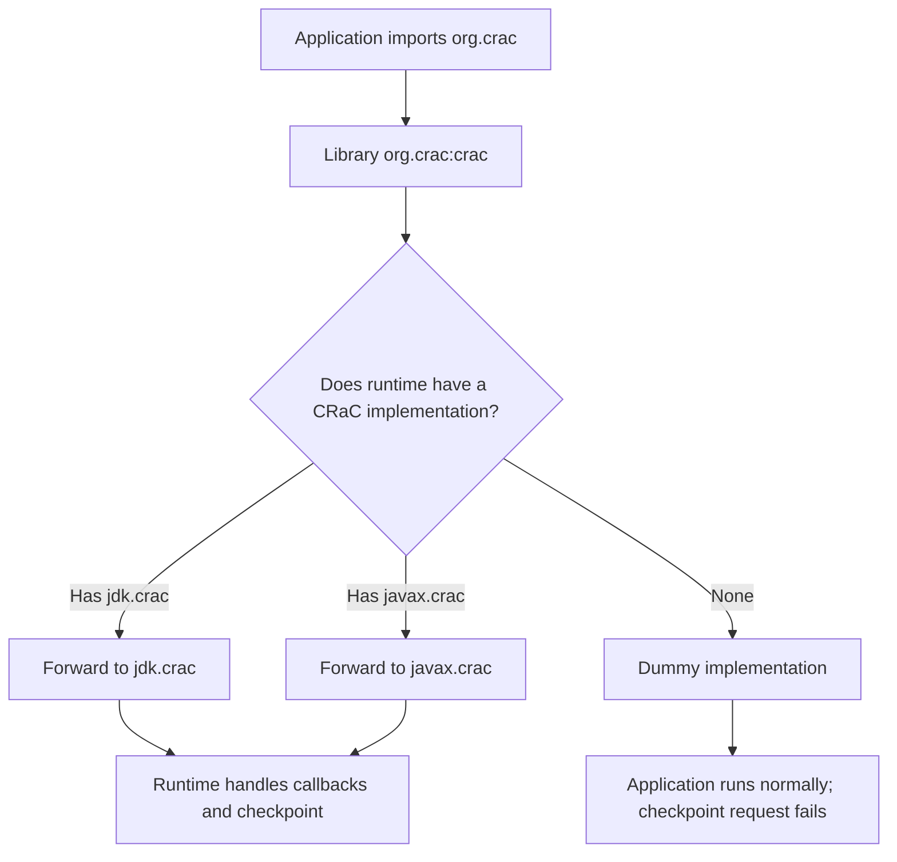

# Relationship Between the `org.crac` Compatibility API and the `jdk.crac` API

CRaC needs an API for applications to declare what must be done before checkpoint and after restore. In the CRaC ecosystem, there are two commonly encountered packages: `jdk.crac` and `org.crac`. They describe the same lifecycle coordination model, but are provided in two different ways.

`jdk.crac` is the API implemented directly in CRaC JDK builds. `org.crac` is an independent compatibility API designed so that applications can compile and run on a wider variety of Java runtimes. The `org.crac:crac` library mirrors the API of `jdk.crac` and `javax.crac` at compile time; at runtime, it uses reflection to find an existing CRaC implementation and forward calls. If the runtime has no implementation, the library uses a dummy implementation so the application can still run in normal mode.

The key point is that **`org.crac` makes source code compatible with multiple runtimes, while the ability to create a real checkpoint must still come from a Java runtime and deployment platform that support CRaC**. Simply adding the `org.crac:crac` dependency does not turn a regular JDK into a CRaC JDK.

## 1. Why Are There Two API Packages?

The CRaC API is not yet part of the Java SE Specification. Therefore, it cannot be assumed that every JDK provides the same CRaC package out of the box. Different runtimes and stages of development have used different API packages.

The commonly encountered packages have the following roles:

| Package | Where Provided | Main Purpose |
|---|---|---|
| `jdk.crac` | CRaC JDK | API implemented directly in the CRaC JDK runtime for applications to coordinate checkpoint/restore |
| `org.crac` | `org.crac:crac` compatibility library | Independent API so application code can compile on a regular JDK and connect to a CRaC implementation at runtime |
| `javax.crac` | Some compatible CRaC implementations/runtimes | API package recognized by the `org.crac` library to forward calls |

`javax.crac` here is the package name of a CRaC API in this ecosystem. It should not be inferred that it is a Java EE or Jakarta EE API.

CRaC separates the application coordination contract from the process snapshot and restore mechanism. The API contract describes callbacks and how to register resources; the runtime together with the checkpoint engine performs the actual process image creation. This separation allows multiple runtimes or vendors to provide CRaC capabilities through their own mechanisms, while applications can still use a common programming model.

## 2. `jdk.crac`: The API Built into the CRaC JDK

When using `jdk.crac` directly, the source code imports types from the runtime's package:

```java
import jdk.crac.Context;
import jdk.crac.Core;
import jdk.crac.Resource;

public final class CacheResource implements Resource {
    @Override
    public void beforeCheckpoint(Context<? extends Resource> context)
            throws Exception {
        // Stop updating the cache and release resources that cannot be kept across checkpoint.
    }

    @Override
    public void afterRestore(Context<? extends Resource> context)
            throws Exception {
        // Refresh the cache or connections that need to be recreated after restore.
    }
}

// Register the resource in the global context of the CRaC runtime.
Core.getGlobalContext().register(new CacheResource());
```

`Resource` receives notifications at two points:

- `beforeCheckpoint(...)`: the application prepares its state, stops appropriate work, and closes or releases resources that cannot safely exist in the process image.
- `afterRestore(...)`: the application restores the necessary resources, refreshes environment-dependent information, and brings the service back to a ready state.

`Context` manages the set of registered resources and how notifications are dispatched. `Core` provides the entry point to the global context and CRaC coordination functionality. These are the core components that both API packages target.

The advantage of `jdk.crac` is that the application works directly with the API provided by the CRaC JDK. This choice makes sense when a project intentionally locks into a specific CRaC JDK and both the build and deployment environments are controlled.

The limitation is that regular JDKs usually do not contain the `jdk.crac` package. If compiled on a JDK without this package, the compiler will not find the `Context`, `Core`, and `Resource` types. The source code also depends directly on the chosen runtime's API, so using the same artifact across different runtimes needs careful consideration.

## 3. `org.crac`: The Independent Compatibility API

The `org.crac:crac` library provides types with the same roles under the `org.crac` package. The equivalent example source code will import:

```java
import org.crac.Context;
import org.crac.Core;
import org.crac.Resource;

public final class CacheResource implements Resource {
    @Override
    public void beforeCheckpoint(Context<? extends Resource> context)
            throws Exception {
        // Stop updating the cache and release resources that cannot be kept across checkpoint.
    }

    @Override
    public void afterRestore(Context<? extends Resource> context)
            throws Exception {
        // Refresh the cache or connections that need to be recreated after restore.
    }
}

Core.getGlobalContext().register(new CacheResource());
```

The visible difference in the example is mainly the package imports. The programming-level contract is designed to correspond: `org.crac.Context`, `org.crac.Core`, and `org.crac.Resource` mirror the corresponding types of `jdk.crac` and `javax.crac`.

Because `org.crac` is an independent library, the project must declare the dependency at compile time and keep that library on the runtime classpath/module path when running. For example, with Gradle:

```groovy
dependencies {
    implementation("org.crac:crac:<crac-version>")
}
```

With Maven:

```xml
<dependency>
    <groupId>org.crac</groupId>
    <artifactId>crac</artifactId>
    <version>${crac.version}</version>
</dependency>
```

Choose a library version that matches the framework and runtime supported by the project. If the framework already manages the version or brings this dependency into the dependency graph, check the dependency tree before declaring another version.

### How the Library Forwards Calls

At compile time, the compiler only needs to see the `org.crac` types from the compatibility library. The application does not need a JDK with the `jdk.crac` package built in to compile classes that use `org.crac`.

At runtime, the `org.crac` library detects the CRaC implementation provided by the runtime using reflection. If a compatible implementation is found, the library forwards API calls to that implementation. The runtime may provide the API under the `jdk.crac` or `javax.crac` package.

If no CRaC implementation is found, the library uses a dummy implementation. In this mode:

- The application can still start on a regular JDK.
- Resources can still be registered so the application keeps the same lifecycle management structure.
- Requests to perform a checkpoint will fail with an exception because the runtime has no real checkpoint/restore service.

As a result, a single artifact compiled with `org.crac` can be shared between a regular development environment and a production environment with CRaC, provided that the application's other dependencies and runtime are also compatible.



The dummy implementation only helps the application run in an environment without CRaC. It does not simulate process snapshotting, does not create a fake checkpoint for production use, and cannot make the restore command work on a regular JDK.

## 4. Comparison of the Two Approaches

| Criterion | Using `jdk.crac` directly | Using `org.crac` |
|---|---|---|
| Package in source code | `jdk.crac.*` | `org.crac.*` |
| API source at compile time | CRaC JDK containing the `jdk.crac` package | `org.crac:crac` dependency |
| Compiling with a regular JDK | Usually fails due to missing `jdk.crac` | Works, if the dependency is on the compile classpath |
| Running on a CRaC JDK | Uses the runtime's built-in implementation | Library detects and forwards to a compatible implementation |
| Running on a JDK without CRaC | No corresponding API/runtime to use directly | Application can still run using the dummy implementation; checkpoint is unavailable |
| Ability to use the same artifact across multiple runtimes | Depends directly on the target runtime/API | Designed to support multiple runtimes with or without a CRaC implementation |
| Suitable when | The system is locked to a specific CRaC JDK | Libraries or applications need broader compatibility |

Neither option creates a checkpoint engine by itself. Regardless of which package is used, the deployment runtime must still support CRaC and the platform must meet that runtime's checkpoint/restore requirements.

## 5. Which API to Choose for a Project?

`org.crac` should be preferred in the following cases:

- The application needs to compile with a regular JDK in CI or on developer machines.
- The same artifact needs to run in a development environment without CRaC and a deployment environment with CRaC.
- A shared library wants to provide CRaC hooks without forcing all consumers to compile with a specific CRaC JDK.
- The project needs to support multiple runtimes/vendors that have compatible CRaC implementations.

`jdk.crac` can be chosen directly when:

- The project targets only one identified CRaC JDK.
- The JDK used in CI, build, and production is managed uniformly.
- Depending directly on the runtime's API is an intentional architectural decision.
- There is no need to compile the same source code on a regular JDK without `jdk.crac`.

For foundational libraries or enterprise applications that are built once and deployed across multiple environments, `org.crac` usually reduces constraints at the compile stage. For a specialized deployment image, using `jdk.crac` can be appropriate if the entire build and runtime chain follows a single CRaC JDK.

## 6. Migrating Source Code from `jdk.crac` to `org.crac`

If a project is directly importing `jdk.crac`, migrating to the compatibility API usually starts with replacing package imports and adding the dependency. Resource management logic does not need to change just because of switching packages, if the project only uses types and methods present in the common contract.

Example import change:

```diff
- import jdk.crac.Context;
- import jdk.crac.Core;
- import jdk.crac.Resource;
+ import org.crac.Context;
+ import org.crac.Core;
+ import org.crac.Resource;
```

The migration process should be carried out in the following steps:

1. **Inventory the APIs in use.** Find `jdk.crac.*` imports, types appearing in method signatures, exceptions, and related module declarations.
2. **Add the compatibility dependency.** Declare `org.crac:crac` in the appropriate dependency configuration. If application code needs to load the bridge at runtime, do not place the dependency in a compile-time-only scope.
3. **Update imports consistently.** Switch `Context`, `Core`, `Resource`, and related CRaC types to the corresponding `org.crac` package.
4. **Check module and library boundaries.** If a module's public API accepts or returns CRaC types, consumer modules must use the same type system. Check `module-info.java`, shading configurations, and dependency exclusions if the project uses them.
5. **Compile with a regular JDK.** This step confirms the source code no longer has unintended compile-time dependencies on `jdk.crac`.
6. **Run on a regular JDK.** Confirm the application starts and code paths that do not require checkpointing still work. If attempting to invoke a checkpoint, handle the case where the runtime does not support it.
7. **Run on the target CRaC JDK.** Verify that the library detects the implementation, callbacks are invoked, and checkpoint/restore actually succeeds on the deployment platform.

### Avoid Mixing Both Type Systems in the Same API Flow

Both packages have corresponding class names and contracts, but `org.crac.Resource` and `jdk.crac.Resource` are still two different Java types because their fully qualified names differ. Java does not automatically treat them as the same interface just because their methods have similar signatures.

For example, a class implementing `org.crac.Resource` cannot be passed directly into a method expecting `jdk.crac.Resource`. Similarly, an `org.crac.Context` cannot replace `jdk.crac.Context` in a method signature. The compatibility library performs the bridging at the runtime boundary; the compiler does not automatically convert these types.

Therefore, choose one package as a consistent contract for the application code. Avoid importing both `org.crac.*` and `jdk.crac.*` in the same class or letting the public APIs of modules mix the two type systems. If it is genuinely necessary to integrate both API systems in an adapter library, create an explicit conversion class and test the behavior on the actual runtime.

## 7. Runtime Testing Matrix

A project using `org.crac` should be tested on at least two types of environments:

| Environment | Expected Result |
|---|---|
| Regular JDK, without CRaC | Application compiles and starts; dummy implementation allows resource registration; checkpoint request reports unsupported |
| CRaC JDK with `jdk.crac` | Compatibility library detects the implementation; callbacks are coordinated and checkpoint/restore can work if the environment meets requirements |
| Runtime with a supported `javax.crac` implementation | Compatibility library forwards to that implementation; needs verification on the specific runtime version |
| Runtime with CRaC, but platform does not meet checkpoint conditions | API may be detected, but checkpoint/restore operations still fail due to engine limits, system permissions, or environment |

When verifying that a CRaC environment works, do not just check that the application starts successfully. Perform an actual checkpoint and restore cycle, observe callback logs, confirm resources are recreated, and check readiness before accepting traffic.

Some important testing principles:

- Confirm the `org.crac:crac` dependency is actually on the runtime classpath/module path.
- Check the CRaC JDK version, compatibility library version, and framework version being used.
- Confirm the running runtime is a CRaC-enabled build; the vendor name or Java version number alone is not enough to conclude this.
- Check the operating system, CPU architecture, checkpoint engine, system permissions, and container limits.
- Also test code paths on a regular JDK to ensure the dummy implementation does not break functionality unrelated to checkpointing.
- Check that checkpoint and restore errors are logged thoroughly; do not treat the application still starting up as proof that checkpointing succeeded.

## 8. Common Misconceptions

**Adding `org.crac:crac` enables CRaC.** Incorrect. The dependency only provides the compatibility API for application code. The ability to snapshot and restore a process is provided by the runtime and deployment platform.

**`org.crac` and `jdk.crac` are two package names that can be substituted directly everywhere.** Incorrect at the Java type level. They have corresponding contracts, but the classes/interfaces belong to two different packages. Use one type system consistently in application code.

**The dummy implementation can create checkpoints for testing.** Incorrect. The dummy implementation allows the application to run and register resources; checkpoint requests fail because there is no implementation performing the operation.

**Using `jdk.crac` is always better because it is in the JDK.** Only reasonable when the project intentionally depends on a specific CRaC JDK. If you need to build on a regular JDK or run the same artifact in multiple environments, `org.crac` is designed for that goal.

**Using `org.crac` means the application does not need runtime checks.** Incorrect. The application must still verify the CRaC implementation, checkpoint engine, and environment conditions before enabling the checkpointing workflow in production.

## 9. References

- [CRaC — What CRaC is](https://crac.org/about/about-crac/): explains the role of `jdk.crac`, the `org.crac` compatibility library, and the dummy implementation mechanism.
- [CRaC documentation repository](https://github.com/CRaC/docs): the main documentation of the CRaC project, including API guides and checkpoint/restore practices.
- [Package `jdk.crac` Javadoc](https://crac.org/openjdk-builds/javadoc/api/java.base/jdk/crac/package-summary.html): describes `Core`, `Context`, `Resource`, and the callback contract of the API in the CRaC JDK.
- [org.crac compatibility library](https://github.com/CRaC/org.crac): source code of the library providing the `org.crac` package.

## 10. Conclusion

`jdk.crac` is the API built into the CRaC JDK; `org.crac` is an independent compatibility API that helps applications use the same programming model across multiple runtimes. The `org.crac:crac` library mirrors the API types at compile time, then detects and forwards to the CRaC implementation at runtime. If no implementation is present, the application can still operate in normal mode, but cannot create checkpoints.

Choose `org.crac` when broad compilation and execution compatibility across multiple environments is needed; choose `jdk.crac` when the project is intentionally tied to a specific CRaC JDK. Whichever approach is chosen, keep the package consistent in the source code and verify checkpoint/restore on the actual deployment runtime and platform.
