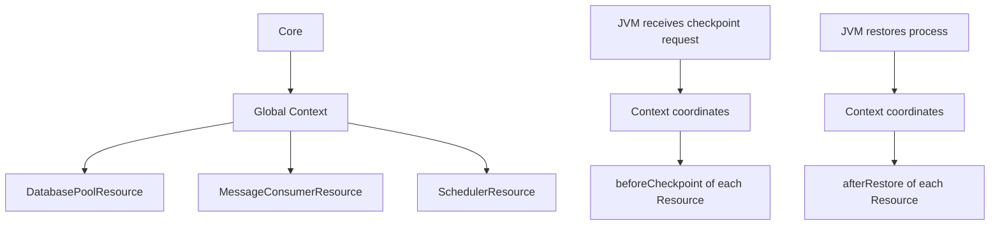
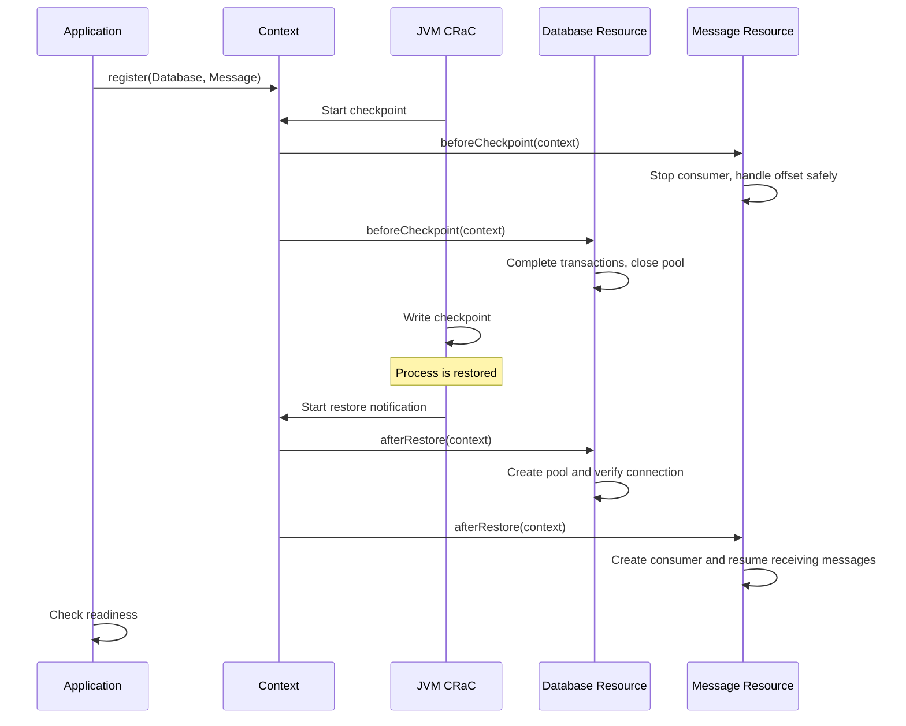

# Context: Managing Resource Groups and Distributing Notifications

In CRaC (Coordinated Restore at Checkpoint), `Resource` represents an application component that needs to perform work before checkpoint and after restore. `Context` manages the collection of registered resources, while the JVM coordinates sending lifecycle notifications to those resources.

A real-world application may have many resources that need coordination: connection pools, message broker clients, sockets, schedulers, file handles, or caches that depend on external systems. If each component handles its own lifecycle without being registered with CRaC, the JVM does not know which components to invoke during checkpoint or restore. `Context` provides a registration point so resources participate in the same process.

This content focuses on three things: understanding the role of `Context`, organizing `Resource` instances into a manageable group, and understanding how `beforeCheckpoint` / `afterRestore` notifications are distributed in the CRaC lifecycle.

## 1. Three Components in the CRaC API

The CRaC API has three common components when integrating resource lifecycles:

| Component | Role | Usage |
| --- | --- | --- |
| `Core` | Entry point to the JVM's global context | Obtain the root context via `Core.getGlobalContext()` |
| `Context` | Manages registered `Resource` instances within a scope | Register or unregister resources; provides the scope in which resources participate to receive notifications |
| `Resource` | Represents a component that needs checkpoint/restore lifecycle handling | Implement `beforeCheckpoint(...)` and `afterRestore(...)` |

The relationship can be visualized as follows:



`Core` provides the global context. The application registers the resources that need to participate in that context. When a checkpoint or restore request occurs, the JVM uses these registrations to coordinate the corresponding callbacks.

## 2. Context as a Resource Management Scope

`Context` can be understood as a lifecycle-managed registry. Each resource registered into a context becomes a member of that scope and is notified by CRaC at the corresponding lifecycle milestones.

The two basic operations are:

- `register(resource)`: adds a resource to the context so the resource participates in the checkpoint/restore process.
- `unregister(resource)`: removes the resource from the context when it is no longer under management or its lifecycle has ended.

Applications commonly use the global context:

```java
import org.crac.Core;

public final class DatabasePoolResource implements Resource {

    public DatabasePoolResource() {
        Core.getGlobalContext().register(this);
    }

    // Callbacks are presented in the next section.
}
```

When the constructor registers `this`, that instance is placed into the global context. The JVM can then invoke callbacks on that exact registered instance. Therefore, the resource needs to be initialized and registered with the proper lifecycle; you should not register a temporary object and then lose the reference to the object managing the resource.

### 2.1. Global Context

`Core.getGlobalContext()` is the common registration point for application resources. Independent resources such as a database pool, broker client, and scheduler can all register into this context.

```java
import org.crac.Core;

public final class CracResourceRegistration {

    public CracResourceRegistration(
            DatabasePoolResource database,
            MessageConsumerResource consumer,
            SchedulerResource scheduler) {

        Core.getGlobalContext().register(database);
        Core.getGlobalContext().register(consumer);
        Core.getGlobalContext().register(scheduler);
    }
}
```

The example above uses a centralized registration point to clearly show the group of resources the application wants to manage. The `DatabasePoolResource`, `MessageConsumerResource`, and `SchedulerResource` classes need to implement `Resource` and define their own callbacks.

It is not mandatory to create a separate registrar if the application or framework already has a suitable resource registration mechanism. What matters is that each resource is managed exactly once and belongs to the right context throughout its required lifecycle.

### 2.2. Context Is Not a Business Event Bus

`Context` serves CRaC lifecycle notifications. It is not a general-purpose event bus for sending business events such as `OrderCreated`, `PaymentCompleted`, or `UserRegistered`.

| Mechanism | Purpose |
| --- | --- |
| CRaC `Context` | Collects resources that need to receive notifications before checkpoint and after restore |
| Application event bus | Distributes business events between components |
| Dependency injection container | Creates, configures, and manages object dependencies |
| Scheduler | Schedules and executes work over time |

An application can use the mechanisms above simultaneously. For example, a Spring bean managing a message consumer can be created by the dependency injection container, receive events from the broker, and also register a resource with CRaC to close the consumer before checkpoint and recreate it after restore.

`Context` also does not close connections itself or know how to restore resources on its own. It manages members and participates in distributing notifications; each `Resource` is responsible for performing the appropriate work for its own resource.

## 3. Registering and Unregistering a Resource

A resource should be registered when the instance managing the resource has been created and is ready to participate in the CRaC lifecycle. Registration needs to be tied to the actual lifecycle of the component.

Example:

```java
import org.crac.Core;
import org.crac.Resource;

public final class MessageConsumerResource implements Resource {

    private MessageConsumer consumer;

    public MessageConsumerResource() {
        this.consumer = createConsumer();
        Core.getGlobalContext().register(this);
    }

    private MessageConsumer createConsumer() {
        // Create client/consumer according to the application configuration.
        return new MessageConsumer();
    }

    // beforeCheckpoint and afterRestore are implemented below.
}
```

Registering after the object has been created helps avoid cases where the JVM sends a callback to a resource that has not finished initializing. If resource creation fails, the application should handle the initialization error and not leave a resource registered in an unusable state.

### 3.1. When Is Unregister Needed?

When a resource permanently ends its lifecycle, the owner can unregister it from the context. For example, a component is completely replaced by a new instance, or a module is stopped and no longer participates in checkpoints.

```java
public void closePermanently() {
    if (consumer != null) {
        consumer.close();
        consumer = null;
    }

    Core.getGlobalContext().unregister(this);
}
```

This is only an illustration of the meaning of `unregister`; in a real application, you need to ensure proper resource closing order, synchronization with threads currently using it, and exception handling. If a resource is only temporarily closed to prepare for a checkpoint, it still needs to remain a member of the context to receive `afterRestore`. Do not unregister it just because the resource was closed before checkpoint.

### 3.2. Avoiding Duplicate Registration

A common design mistake is registering the same resource multiple times because a constructor, a framework lifecycle hook, and a registrar all perform registration. This makes callback behavior unpredictable and can lead to repeated resource closing or opening operations.

You should designate a single owner for registration. If a framework already manages a resource automatically, do not register the same instance again through another mechanism unless that integration explicitly requires it.

Example of a registrar that can guard against registering more than once:

```java
public final class CracResourceRegistration {

    private final DatabasePoolResource database;
    private final MessageConsumerResource consumer;
    private boolean registered;

    public CracResourceRegistration(
            DatabasePoolResource database,
            MessageConsumerResource consumer) {
        this.database = database;
        this.consumer = consumer;
    }

    public synchronized void register() {
        if (registered) {
            return;
        }

        Core.getGlobalContext().register(database);
        Core.getGlobalContext().register(consumer);
        registered = true;
    }
}
```

This is a simple way to organize it. In multi-threaded systems or systems capable of reinitializing modules, the registration state needs to be synchronized with the actual lifecycle of the resource. The `registered` flag does not replace handling the case where one registration operation succeeds and the next fails; a real-world registrar should have a clear rollback or reinitialization strategy.

## 4. How Does a Resource Receive Notifications from Context?

A class implementing `Resource` must implement two callbacks:

```java
void beforeCheckpoint(Context<? extends Resource> context)
        throws Exception;

void afterRestore(Context<? extends Resource> context)
        throws Exception;
```

The `context` parameter indicates the management scope in which the resource is participating. The resource can use this parameter when it needs to interact with the corresponding context via the API. In simple cases, the callback only needs to handle the resource owned by the instance.

The two callbacks have different meanings:

| Callback | Timing | Responsibility of Resource |
| --- | --- | --- |
| `beforeCheckpoint(...)` | Before the JVM writes the process state | Finish necessary work, flush data, stop activity, and close resources that should not be kept across the checkpoint |
| `afterRestore(...)` | After the process is restored | Recreate connections, verify external state, and resume operation when the resource is ready |

Example of managing a connection pool:

```java
import org.crac.Context;
import org.crac.Core;
import org.crac.Resource;

public final class DatabasePoolResource implements Resource {

    private HikariDataSource dataSource;

    public DatabasePoolResource() {
        this.dataSource = createDataSource();
        Core.getGlobalContext().register(this);
    }

    @Override
    public void beforeCheckpoint(Context<? extends Resource> context)
            throws Exception {
        if (dataSource != null && !dataSource.isClosed()) {
            dataSource.close();
        }
    }

    @Override
    public void afterRestore(Context<? extends Resource> context)
            throws Exception {
        dataSource = createDataSource();
        verifyConnection(dataSource);
    }

    private HikariDataSource createDataSource() {
        // Create pool from the current configuration.
        return new HikariDataSource();
    }

    private void verifyConnection(HikariDataSource pool) throws Exception {
        try (var connection = pool.getConnection()) {
            if (!connection.isValid(5)) {
                throw new IllegalStateException("Database is not ready");
            }
        }
    }
}
```

The `HikariDataSource` initialization is abbreviated to highlight the integration point. A real application needs to pass the JDBC URL, credentials, timeouts, and pool options from the current configuration. Credentials should not be embedded directly in source code or checkpoints if they can be safely reloaded after restore.

The example shows that `Context` does not directly call `dataSource.close()` or create a new pool. The JVM sends callbacks to the resource; the resource performs operations on the object it owns.

## 5. How Context Distributes Notifications

When the JVM receives a checkpoint request, it coordinates the registered resources so each component prepares its state. Upon restore, the JVM continues coordinating recovery callbacks. Applications do not need to manually iterate over the entire registry to invoke each resource in typical CRaC API usage.

Overview flow:



The diagram illustrates a common dependency order: the consumer stops before the database pool; the database pool is ready before the consumer resumes operating. The actual order must be based on the CRaC API contract and how resources are registered in the JDK being used.

### 5.1. Callback Order and Dependency Relationships

When multiple resources depend on each other, notification order matters. For example, a message consumer uses a repository, and the repository uses a database pool. When preparing for a checkpoint, the consumer should stop first, and then its dependencies are closed. When restoring, the database pool must be ready before the consumer starts processing messages.

The common CRaC ordering rule is:

- `beforeCheckpoint`: notified in reverse order of registration.
- `afterRestore`: notified in the order of registration.

Therefore, if the database pool needs to be ready before the message consumer, register the database resource before the consumer resource. At checkpoint, the consumer receives the notification first to stop; the database pool receives the notification later to close. At restore, the database pool receives the notification first to reconnect; the consumer receives the notification later to restart.

```java
// Register dependencies first, dependent components later.
Core.getGlobalContext().register(databasePoolResource);
Core.getGlobalContext().register(messageConsumerResource);
```

This ordering helps express simple dependency relationships. For complex resources with many cross-dependencies or requiring group synchronization, you should consolidate the coordination logic into a resource coordinator rather than relying on registration order scattered across multiple places. Always verify ordering details with the deployed API/JDK version, especially when frameworks register resources automatically.

### 5.2. Callbacks Are Not Arbitrary Parallel Notifications

Do not assume all callbacks are invoked concurrently on separate threads. Design callbacks according to the runtime's CRaC contract and treat each callback as a critical synchronization point in the process lifecycle.

If a callback performs long-running work, include clear timeouts and error handling. For example, stopping a consumer needs to wait for in-flight messages to finish within an allowed limit. If waiting does not complete, the application needs to report an error so the checkpoint does not proceed in an unsafe state.

Do not spawn a background thread inside a callback and return immediately while that thread is still closing connections or writing data. Once the callback finishes, the JVM may proceed with the checkpoint process; incomplete asynchronous operations will create a race condition.

## 6. Organizing Resource Groups

There are two common ways to organize multiple resources.

### 6.1. Registering Each Resource into the Same Context

This approach is suitable when each component has its own lifecycle and can prepare/restore itself.

```java
Core.getGlobalContext().register(databasePoolResource);
Core.getGlobalContext().register(messageConsumerResource);
Core.getGlobalContext().register(schedulerResource);
Core.getGlobalContext().register(fileResource);
```

Advantages:

- Each class is responsible for the resource it owns.
- A resource can be added or unregistered according to the component's lifecycle.
- Easy to inspect logs and identify which resource caused an error.
- Dependency relationships can be expressed via registration order when relationships are simple.

What needs to be controlled is preventing the same resource from being managed in multiple places. If a framework already provides a built-in resource for the database pool, do not create another resource that also closes that pool.

### 6.2. Registering a Coordinator Resource for the Entire Group

If a group of components needs to be prepared according to a unified procedure, you can create a resource coordinator. The coordinator is the only resource registered into the CRaC context and invokes the child components itself in an order defined by the application.

For illustration, the child components use a simple internal interface:

```java
public interface CheckpointParticipant {
    void beforeCheckpoint() throws Exception;
    void afterRestore() throws Exception;
}
```

Coordinator managing the group:

```java
import java.util.List;
import org.crac.Context;
import org.crac.Core;
import org.crac.Resource;

public final class InfrastructureGroup implements Resource {

    private final List<CheckpointParticipant> participants;

    public InfrastructureGroup(List<CheckpointParticipant> participants) {
        this.participants = List.copyOf(participants);
        Core.getGlobalContext().register(this);
    }

    @Override
    public void beforeCheckpoint(Context<? extends Resource> context)
            throws Exception {
        for (int i = participants.size() - 1; i >= 0; i--) {
            participants.get(i).beforeCheckpoint();
        }
    }

    @Override
    public void afterRestore(Context<? extends Resource> context)
            throws Exception {
        for (CheckpointParticipant participant : participants) {
            participant.afterRestore();
        }
    }
}
```

In the example, the participant list is ordered by initialization order: dependencies first, dependent components later. The coordinator calls them in reverse order to stop and in forward order to restore.

The participants here **do not implement `Resource` themselves and are not registered separately into the global context**. The coordinator is the sole CRaC contact point for the group, thereby avoiding a component receiving callbacks twice. If each participant is also registered independently, do not simultaneously have the coordinator invoke their callbacks again.

### 6.3. Choosing the Right Organization Approach

| Scenario | Organization Approach to Consider |
| --- | --- |
| Database pool and scheduler have independent lifecycles | Register each resource separately |
| Multiple components have a clear stop/start order | Register separately and order by dependency relationship |
| A cluster of clients must stop and start as a single unit | Use a coordinator and internal participants |
| Framework already integrates CRaC for a resource | Use the built-in mechanism, avoid duplicate registration |
| Resource is dynamically created/destroyed | Manage register/unregister alongside the actual lifecycle |

There is no benefit in creating a coordinator for every bean. Only group them when there are dependency relationships or a unified process that needs coordination. For independent resources, direct registration keeps responsibilities clearer.

## 7. Error Handling During Notification Distribution

Callbacks can declare `throws Exception` because preparing or restoring a resource can fail. For example, the database cannot close the pool due to unfinished transactions, or after restore it cannot connect to the database.

### 7.1. Errors Before Checkpoint

If a required resource cannot bring its resource into a safe state, the callback should report an error. The checkpoint process needs to stop or fail according to the runtime's contract. Do not catch the exception and ignore it:

```java
@Override
public void beforeCheckpoint(Context<? extends Resource> context)
        throws Exception {
    try {
        stopConsumerAndWait();
    } catch (Exception ex) {
        // Log with context, then propagate the error so the checkpoint fails.
        throw ex;
    }
}
```

The code snippet above illustrates the error propagation principle; in actual implementation, if you only log and rethrow, you can use `throw ex` directly. The important thing is that the error is not hidden.

### 7.2. Errors After Restore

If a resource cannot be restored, the application should not receive traffic yet. For example, the connection pool is created but the connection check fails, or the broker is not ready. Let the error propagate and use the application's readiness/lifecycle to keep the instance in an unready state.

Do not mark the application healthy as soon as the callback starts. All required resources must be verified as connected and able to serve work.

### 7.3. Do Not Ignore Errors in the Coordinator

With a coordinator managing multiple participants, you must clearly decide what happens when one participant fails. Before checkpoint, an error in one participant usually means the group cannot transition to a safe state. After restore, an error in a required participant means the group is not ready.

If the coordinator continues calling other participants after an error, it must aggregate errors and ensure the first error is not masked. The simplest and most predictable approach is to stop at the first error and propagate it; partial recovery is only suitable when the application clearly defines states and retry procedures.

## 8. Common Design Mistakes

| Mistake | Consequence | Solution |
| --- | --- | --- |
| Creating a `Resource` but forgetting to register it | The JVM does not invoke callbacks for that resource | Register into the context that owns the lifecycle |
| Registering the same instance in multiple places | Callbacks or resource operations may be duplicated | Choose a single registration owner |
| Unregistering immediately after `beforeCheckpoint` | The resource no longer receives `afterRestore` | Only unregister when permanently ending the lifecycle |
| Closing a resource in `beforeCheckpoint` without reopening it | The application restores but cannot serve | Recreate the resource in `afterRestore` |
| Relying on undocumented initialization order | Dependencies may not be ready when another resource restores | Order registrations or use a coordinator |
| Callback starts background work and returns | The JVM may checkpoint before the work finishes | Wait for the work to finish inside the callback |
| Swallowing callback exceptions | Checkpoint/restore may proceed with an invalid state | Propagate errors and keep the instance unready |
| Resource is managed by a framework, but the application registers it again | The same resource is closed/opened multiple times | Check the integration mechanism before manually registering |
| Keeping references to old connections after restore | Java objects exist, but external connections are dead | Recreate the client and verify the connection |

## 9. Testing Context and Resource in the Application

When integrating CRaC, you should test both registration and callback invocation. You can create a test resource that logs at both milestones:

```java
import org.crac.Context;
import org.crac.Core;
import org.crac.Resource;

public final class LoggingResource implements Resource {

    private final String name;

    public LoggingResource(String name) {
        this.name = name;
        Core.getGlobalContext().register(this);
    }

    @Override
    public void beforeCheckpoint(Context<? extends Resource> context)
            throws Exception {
        System.out.println(name + ": beforeCheckpoint");
    }

    @Override
    public void afterRestore(Context<? extends Resource> context)
            throws Exception {
        System.out.println(name + ": afterRestore");
    }
}
```

Instantiate a few instances with different names and create a checkpoint in a configured CRaC environment. Logs help observe which resources receive notifications and their actual order. Compare that order against the registration order and the contract of the JDK being used.

Points to verify:

1. All necessary resources are registered into the right context.
2. Each instance is registered under a single clear ownership mechanism.
3. `beforeCheckpoint` runs and completes before the checkpoint proceeds.
4. `afterRestore` runs after the process is restored.
5. Dependencies are stopped and started in the appropriate order.
6. Permanently destroyed resources are unregistered; temporarily closed resources remain registered.
7. Errors in callbacks are propagated and not turned into a false success state.
8. After restore, the application verifies connections and readiness before receiving traffic.

Observing logs is an integration behavior check. It does not replace business testing such as ensuring messages are not processed twice, transactions are not abandoned, or schedulers do not run duplicates across multiple instances.

## 10. Conclusion

`Context` is the scope that manages `Resource` instances participating in the CRaC lifecycle. `Core.getGlobalContext()` provides the commonly used global context; the application registers a resource when the component is created and unregisters it when the component's lifecycle ends. The JVM uses those registrations to distribute `beforeCheckpoint` before creating the image and `afterRestore` after restoring the process.

For independent resources, each resource can be registered into the same context. When a group needs unified coordination, a single registered coordinator can be used to manage internal participants. Whichever approach is chosen, keep ownership, dependency order, and error handling clear, and ensure all required resources are ready before the application receives traffic.
