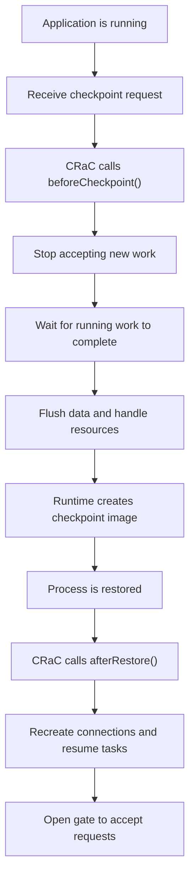
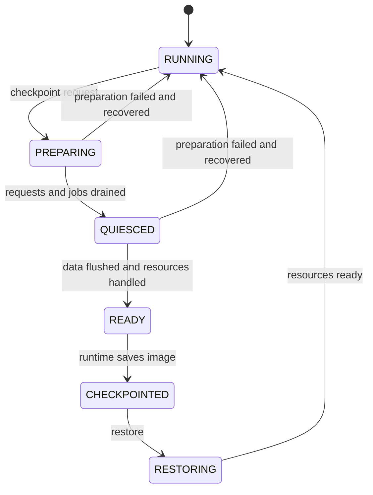

# beforeCheckpoint(): preparing state before creating an image

In CRaC (Coordinated Restore at Checkpoint), `beforeCheckpoint()` is the callback that the application uses to prepare before the runtime captures the process state. This is a key part of the `org.crac.Resource` API: before checkpointing, the application brings active components into a safe state; after restoring, the application restores the necessary resources to continue serving.

A checkpoint can save the heap, thread state, and much of the runtime information of the process. However, external services such as databases, message brokers, sockets, schedulers, or authentication systems continue operating independently. Connections open in the heap may have expired by the time the process is restored. Therefore, before creating the image, the application must coordinate stopping new work acceptance, completing in-flight operations, writing necessary data, and closing or re-preparing environment-dependent resources.

`beforeCheckpoint()` does not create the checkpoint itself. The runtime invokes this callback during the checkpoint procedure, before saving the process image. The callback's responsibility is to leave a state that can be safely restored and resumed.

## 1. The place of beforeCheckpoint in the CRaC lifecycle

A resource participates in the CRaC lifecycle by implementing the `org.crac.Resource` interface. This interface declares two callbacks:

- `beforeCheckpoint()`: runs before the process state is captured.
- `afterRestore()`: runs after the process is restored.

General flow:



Steps D, E, and F are the application's design responsibility. A simple application might only need to close a client; a large service might have to coordinate traffic, transactions, schedulers, connection pools, and many other components.

### 1.1. When the callback is invoked

When a checkpoint request is executed, CRaC invokes the callbacks of registered resources. `beforeCheckpoint()` runs right before the runtime saves the process state. After the callback completes, the checkpoint mechanism proceeds with the image creation process.

Because the callback sits right before the capture point, changes made by the callback can become part of the state saved in the image. For example, if the callback closes a client and sets the reference field to `null`, that `null` state is also in the checkpointed heap. After restore, `afterRestore()` needs to recreate the client and assign it to the corresponding field.

### 1.2. Callbacks do not replace startup logic

You should not move all application initialization logic into `beforeCheckpoint()` or `afterRestore()`. Most configuration, beans, data structures, and application state already prepared before checkpointing will be saved along with the process.

Callbacks only handle the transition between the two states:

| Timing | Goal | Example |
|---|---|---|
| Before checkpoint | Bring the application to a safe state for capture | Pause scheduler, drain requests, close sockets |
| After restore | Make resources usable in the current environment | Reopen pools, refresh tokens, start workers |

## 2. Resources and how to register callbacks

CRaC does not automatically know how every object in the application needs to be prepared. The application must register resources so the runtime can invoke lifecycle callbacks.

Commonly used API types are in the `org.crac` package:

- `Resource`: interface containing the pre-checkpoint and post-restore callbacks.
- `Context`: context managing resources.
- `Core`: entry point to the global context and CRaC operations.

Example of registering a resource:

```java
import org.crac.Context;
import org.crac.Core;
import org.crac.Resource;

public final class ClientResource implements Resource {

    private RemoteClient client;

    public ClientResource() throws Exception {
        this.client = RemoteClient.connect();

        // Register the resource so CRaC invokes its lifecycle callbacks.
        Core.getGlobalContext().register(this);
    }

    @Override
    public void beforeCheckpoint(
            Context<? extends Resource> context) throws Exception {
        if (client != null) {
            client.close();
            client = null;
        }
    }

    @Override
    public void afterRestore(
            Context<? extends Resource> context) throws Exception {
        client = RemoteClient.connect();
    }

    public RemoteClient getClient() {
        return client;
    }
}
```

`RemoteClient` is an illustrative application type, not a CRaC class. The example shows the basic idea: close the client before checkpoint, then recreate the client on restore.

Resource registration must happen before a checkpoint is requested. If an object is not registered with the appropriate context, the runtime has no callback to invoke for that object.

For applications with many interdependent resources, you should consolidate coordination into a lifecycle management component or use the CRaC integration mechanism provided by the framework. You should not let each class arbitrarily close part of the system without shared coordination rules.

## 3. Goals to achieve before creating an image

`beforeCheckpoint()` should prepare a consistent, restorable state. Specific tasks depend on the application, but usually revolve around the goals below.

### 3.1. Stop accepting new work

Before capturing the image, the application should stop accepting additional new requests or jobs. If it continues accepting work while resources are closing connections one by one, a request might start on a client that is about to be closed.

An admission gate can be used at the application layer:

1. Transition the instance state to `PREPARING_CHECKPOINT`.
2. Reject or redirect new requests according to system policy.
3. Stop polling new jobs from the queue.
4. Keep the traffic-receiving gate closed until preparation steps are complete.

Conceptual example:

```java
public void beforeCheckpoint(
        Context<? extends Resource> context) throws Exception {

    requestGate.stopAccepting();
    requestGate.awaitInFlightRequests(Duration.ofSeconds(30));

    // Continue preparing other resources...
}
```

`requestGate` is a component built by the application. It can be integrated with readiness health checks, load balancers, or the platform's traffic orchestration mechanism.

Readiness should transition to unready before the instance starts closing resources. That way, the orchestration system has time to stop sending new requests to the instance.

### 3.2. Wait for in-flight work to complete

Stopping new requests is not enough. Requests already accepted may still be:

- Executing transactions.
- Writing data.
- Sending messages.
- Reading or writing files.
- Calling external services.
- Holding locks or shared resources.

The application needs to define what constitutes completed work and wait for in-flight work to reach a safe state. It can track the number of active requests, open transactions, or executing jobs.

A timeout should be set for the wait step. If work cannot complete within the allowed time, the callback can report an error so the checkpoint is aborted according to the runtime's mechanism. Capturing an inconsistent state can cause data errors that are hard to recover from after restore.

You should not use `Thread.sleep()` with an arbitrary duration to assume requests have finished. You need to wait based on actual signals such as counters, latches, conditions, or the framework's drain mechanism.

### 3.3. Handle transactions and pending data

A checkpoint preserves memory state, but does not automatically guarantee that a database transaction or a message-sending operation has completed in a business sense.

Before checkpoint, the application needs to:

- Wait for running transactions to finish if possible.
- Commit or roll back according to business rules.
- Flush buffers that need durable persistence.
- Ensure events already sent to external systems are not sent twice upon restore.
- Save job processing state to durable storage if resuming from a specific point is needed.

Not all data in the heap needs to be written to the database. If an internal queue is designed to live in process state and be restored with the checkpoint, serializing or re-persisting it may create duplicate work. Clearly identify which data is restorable in-memory state and which data requires external durability.

For operations that could be sent repeatedly, use idempotency keys, unique constraints, or appropriate deduplication mechanisms. CRaC does not replace consistency guarantees of distributed systems.

### 3.4. Pause schedulers and workers

Schedulers can continue triggering work while the application is preparing for checkpoint. Workers can also pull more jobs from queues if there is no mechanism to stop admission.

A common procedure:

1. Stop the scheduler from creating new work.
2. Stop workers from pulling additional jobs.
3. Wait for running jobs to complete or save the job's business checkpoint as designed.
4. Put executors and schedulers into a state that can be restarted after restore.

You need to distinguish between pausing a scheduler and completely shutting down an executor. If you call `shutdown()` on an `ExecutorService` and keep that same object in the heap, after restore the executor may still be in the shutdown state and will not accept new tasks. In this case, the application must create a new executor or use a pause/resume mechanism designed for the checkpoint lifecycle.

You should not let a thread wait indefinitely inside `beforeCheckpoint()`. If a worker cannot stop safely, there must be a timeout and a policy for handling expiration.

### 3.5. Close or release environment-dependent resources

Some resources should not be reused after restore because they depend on state outside the process:

- Sockets and TCP connections.
- JDBC connections and connection pools.
- Clients to message brokers.
- HTTP clients with connection pools or open sockets.
- File descriptors and OS locks.
- Time-limited tokens or credentials.
- Handles to native services or devices.

These resources should be closed or brought into a library-supported state before checkpoint. After restore, they are recreated or verified before the application accepts traffic.

Not every object in the heap needs to be closed. Pure Java data structures, parsed configurations, loaded metadata, and caches can remain useful after restore if they do not depend on time or the environment. Only handle resources whose lifecycle requires coordination.

### 3.6. Ensure consistent application state

Before creating the image, relevant components must agree that the application is in the checkpoint-preparing state. For example, you cannot have the request gate report that it has stopped accepting work while a worker is still pulling new jobs from the queue.

The lifecycle state can be represented with a state machine:



A state machine helps avoid arbitrary state transitions. Each step should have clear completion conditions and be observable via logs or metrics.

## 4. Designing safely operable callbacks

A good callback needs clear ordering, timeouts, error handling, and observability. These characteristics matter because the callback runs at a sensitive time: the application is transitioning from an active state to a saved state.

### 4.1. Execute in dependency order

For example, if an HTTP handler uses a database pool, you need to stop requests and drain the handler before closing the pool. If a scheduler creates jobs that use an HTTP client, the scheduler needs to stop creating jobs before closing the client.

A reference order:

1. Mark the instance as preparing for checkpoint.
2. Stop accepting new traffic and jobs.
3. Wait for running requests, transactions, and jobs to reach a safe state.
4. Flush data that needs durable storage.
5. Stop schedulers or workers in a way that can be restarted.
6. Close connections and environment-dependent resources.
7. Log preparation-complete status for diagnostics.

The actual order must be based on the application's dependency graph. For example, if a worker needs the database to complete a job, you cannot close the database before the worker finishes draining.

You should not rely on the callback order of multiple independent resources if the application has not verified the ordering contract of the CRaC version in use. When operations are tightly coupled, group them into a coordinator to actively order them.

### 4.2. Set timeouts for operations that may wait

Each waiting step needs a time limit. For example:

- Drain HTTP requests for at most 30 seconds.
- Wait for workers to complete for at most 20 seconds.
- Flush buffers for at most 10 seconds.
- Close clients with library-supported timeouts.

The values above are only examples. Choose them based on SLAs, the platform's shutdown window, and the workload's maximum processing time.

When a timeout expires, the application needs a clear policy: abort the checkpoint, roll back the preparation state if possible, or mark the instance as unready for the system to handle. Avoid proceeding with the checkpoint while a critical operation is still half-running.

### 4.3. Keep callbacks safely repeatable

Design preparation operations so that calling them again does not cause serious errors. For example, closing an already-closed client can be handled as a no-op if the library allows it; stopping an admission gate twice should not corrupt state.

Repeatability is useful when preparation fails midway and the system needs to recover or retry. However, do not assume CRaC automatically retries callbacks on a specific schedule. This is a design principle so the application tolerates error paths.

### 4.4. Do not hide errors

If it cannot drain requests, flush data, or release an essential resource, the callback should report an error. Swallowing exceptions and letting the runtime continue checkpointing can produce an unsafe process image.

You can add information to the exception or log to identify which resource failed. You should not log secrets, tokens, or sensitive data.

### 4.5. Recover if preparation fails

A preparation attempt may fail after some components have already been stopped or closed. In that case, the application must know how to bring modified components back to an operational state, or keep the instance unready for further handling.

For example, if the connection pool has been closed but the subsequent flush operation fails, the application needs to recreate the pool before opening the request gate. If recovery does not succeed, do not open traffic while dependencies are still not ready.

Also note that `Resource` has two primary callbacks: `beforeCheckpoint()` and `afterRestore()`. There is no `afterCheckpoint()` callback in this basic contract to automatically reverse every operation after the image is created or when another resource fails. Therefore, design preparation boundaries and error coordination deliberately, and verify the specific behavior of the CRaC distribution you are using.

## 5. Example of coordinating multiple resources

The following example illustrates a resource coordinating service components: request gate, scheduler, outbox, and connection manager. The types `RequestGate`, `JobScheduler`, `Outbox`, and `ConnectionManager` are application-defined abstractions. They do not belong to the `org.crac` package.

```java
import java.time.Duration;

import org.crac.Context;
import org.crac.Core;
import org.crac.Resource;

public final class ServiceCheckpointResource implements Resource {

    private final RequestGate requestGate;
    private final JobScheduler scheduler;
    private final Outbox outbox;
    private final ConnectionManager connections;

    public ServiceCheckpointResource(
            RequestGate requestGate,
            JobScheduler scheduler,
            Outbox outbox,
            ConnectionManager connections) {

        this.requestGate = requestGate;
        this.scheduler = scheduler;
        this.outbox = outbox;
        this.connections = connections;

        Core.getGlobalContext().register(this);
    }

    @Override
    public void beforeCheckpoint(
            Context<? extends Resource> context) throws Exception {

        try {
            // 1. Stop accepting new requests or jobs.
            requestGate.stopAccepting();
            scheduler.stopSubmittingJobs();

            // 2. Wait for in-flight work to reach a safe state.
            requestGate.awaitInFlight(Duration.ofSeconds(30));
            scheduler.awaitRunningJobs(Duration.ofSeconds(30));

            // 3. Flush events that need to be persisted.
            outbox.flush();

            // 4. Close connections that depend on the external environment.
            connections.closeAll();

        } catch (Exception preparationFailure) {
            // If preparation fails, try to restore the service to an operational state.
            // Only open the request gate after dependencies and the scheduler are ready.
            try {
                connections.reconnectAll();
                scheduler.resume();
                requestGate.resume();
            } catch (Exception recoveryFailure) {
                preparationFailure.addSuppressed(recoveryFailure);
                // Keep the service in a state not accepting traffic if recovery fails.
            }

            throw preparationFailure;
        }
    }

    @Override
    public void afterRestore(
            Context<? extends Resource> context) throws Exception {

        // Recover dependencies first, then accept work.
        connections.reconnectAll();
        scheduler.resume();
        requestGate.resume();
    }
}
```

The example demonstrates several principles:

- Stop accepting new work before closing dependencies.
- Drain running requests and jobs before flushing.
- Only reopen the request gate after connections and the scheduler are ready.
- Exceptions during preparation are propagated after attempting recovery.
- If recovery fails, the service does not open the traffic gate.

In a real application, abstractions need timeouts and clear internal state. The `closeAll()` method should handle already-closed or partially closed connections. `reconnectAll()` needs to verify essential connections are working before returning successfully.

If a framework already provides CRaC integration for connection pools, schedulers, or lifecycle beans, prefer the supported mechanism. Avoid creating duplicate coordinating resources that might close the same resource twice.

## 6. Handling specific resource types

### 6.1. Database connections and connection pools

A JDBC connection can be closed by the database server or the network during the checkpoint interval. Upon restore, the Java object representing the connection may still reside in the heap, but the external connection session is no longer valid.

Before checkpoint:

- Stop accepting new transactions.
- Wait for open transactions to commit or roll back.
- Close connections or close the pool according to library guidelines.
- Do not leave threads holding connections running when the image is created.

After restore:

- Recreate or verify the connection pool.
- Confirm connectivity to the database.
- Only mark the application ready after essential dependencies are working.

With pools like HikariCP, consider the lifecycle of the pool object itself. Closing a pool often makes that object unusable; the application may have to create a new pool instance instead of calling a reopen method on the old object.

### 6.2. HTTP clients and sockets

An HTTP client may manage multiple sockets, connection pools, DNS caches, and TLS state. These components may depend on the network or runtime environment.

Before checkpoint, close the client or release connections according to the library's capabilities. After restore, create a new client if needed. For a client shared across the entire application, ensure all consumers have stopped using it before closing.

### 6.3. Message brokers and queue consumers

A consumer may be holding messages that were received but not yet acknowledged. If a checkpoint is created mid-processing, the system may redeliver the message or the restored process may continue with an inconsistent state.

Before checkpoint:

1. Stop polling new messages.
2. Complete and acknowledge processed messages.
3. For incomplete messages, apply an appropriate retry or nack policy.
4. Close the consumer and connection if required by the library.

After restore, create a new consumer, register subscriptions, and resume polling when the application is ready. Design handlers to be idempotent to tolerate message redelivery.

### 6.4. Files, locks, and native resources

File descriptors, file locks, and native handles can be tied to operating system resources. Holding a Java reference does not mean the operating system resource will always be in a valid state after restore.

Before checkpoint, close files or release locks if the resource is not supported for restoration. After restore, reopen files, verify paths, and reacquire locks according to the application's mechanism.

If a native library has its own resources, check the library's CRaC support. Do not assume every native handle is restored properly simply because the process was restored.

### 6.5. Threads, executors, and schedulers

Threads can be captured with their execution state, but the work a thread is performing may depend on resources that have changed outside the process. A thread waiting on a socket or holding a lock may not be in a suitable state to continue.

Before checkpoint, stop creating new work and bring workers to a safe state. For executors without pause/resume, consider shutting down the executor and creating a new executor after restore. Do not keep an already-shutdown executor and expect it to start working again on its own.

### 6.6. Caches and time-dependent data

In-heap caches can be saved with the checkpoint. However, TTLs, timestamps, tokens, or data fetched from external systems may be stale upon restore.

Before checkpoint, decide which caches can be kept as-is and which caches need to be cleared or marked for refresh. After restore, recompute time-dependent data and refresh critical values. It is not always necessary to clear the entire cache; base the decision on the validity of each data type.

## 7. Common design mistakes

| Mistake | Consequence | Remedy |
|---|---|---|
| Closing the database before draining requests | Running requests use a closed connection | Stop admission and drain first |
| Not stopping the scheduler | New jobs appear while resources are closing | Pause the scheduler before closing dependencies |
| Waiting indefinitely in the callback | Checkpoint hangs when a job does not finish | Use timeouts and an abort policy |
| Swallowing exceptions | Runtime may save an unsafe state | Log appropriately and propagate the error |
| Opening traffic immediately after calling reconnect | Requests arrive before dependencies are ready | Only open the gate after all recovery steps complete |
| Calling shutdown on an executor and reusing it | Executor remains in shutdown state after restore | Create a new executor or use a pause/resume mechanism |
| Closing the same resource in multiple places | Lifecycle errors or duplicate closes | Define a single owner for each resource |
| Keeping stale tokens and caches | Requests fail due to expired data | Check and refresh after restore |
| Writing data without idempotency | Jobs or events may be processed multiple times | Use idempotency keys and deduplication |
| Unclear callback order dependencies | Resources are closed in the wrong order | Use a coordinator with explicit ordering |

### 7.1. Closing resources too early

If the database pool is closed before running requests finish, requests can fail mid-flight. Always identify the dependencies of in-flight work and drain before closing the resources that work uses.

### 7.2. Clearing state that should be kept

You should not clear every data structure in `beforeCheckpoint()` just to make the checkpoint image smaller. The heap is part of the application state that needs to be restored. Only clear or refresh data with a clear reason, such as stale caches or references to resources that will be recreated.

### 7.3. Not checking readiness after restore

The fact that `afterRestore()` is called does not prove that all external services are ready. Connections may fail because the database is under maintenance or credentials have expired. The application needs to check essential dependencies and keep readiness false until they are ready.

### 7.4. Treating the callback as a place to run business logic

`beforeCheckpoint()` should not execute new long-running business operations or arbitrarily mutate business data. The callback should focus on bringing existing operations into a safe state. Business operations should be completed or persisted according to normal business workflows before a checkpoint is requested.

## 8. Observing and testing the preparation process

An application using CRaC should be able to explain why a checkpoint succeeded or failed. Log by stage while avoiding logging sensitive data.

Examples of observable events:

- `checkpoint.preparation.started`
- `checkpoint.traffic.drained`
- `checkpoint.workers.paused`
- `checkpoint.outbox.flushed`
- `checkpoint.connections.closed`
- `checkpoint.preparation.failed`

Useful metrics:

| Metric | Meaning |
|---|---|
| Number of in-flight requests | Confirm traffic has drained |
| Number of running jobs | Confirm workers have stopped safely |
| Drain duration | Detect long-running requests or jobs |
| Flush duration | Track data persistence overhead |
| Number of open connections | Verify resource release |
| Preparation failure count | Detect lifecycle errors |
| Readiness state | Prevent traffic from reaching an unready instance |

At a minimum, test the following scenarios:

1. Checkpoint when there are no running requests or jobs.
2. Checkpoint when there are long-running requests or open transactions.
3. Checkpoint when a worker is processing a message.
4. Database or broker cannot reconnect after restore.
5. A flush or resource-closing step fails.
6. A drain step exceeds the timeout.
7. Restore after a period long enough for tokens or caches to expire.
8. Restore in a deployment environment with real network configuration and secrets.

The goal of testing is to prove that the application does not accept traffic when its state is not ready, does not lose business data, and can recover when a preparation step fails.

## 9. beforeCheckpoint design checklist

### Work coordination

- [ ] Instance transitions to the checkpoint-preparing state.
- [ ] Readiness is updated to stop receiving new traffic.
- [ ] Schedulers and consumers stop accepting new jobs.
- [ ] In-flight requests and jobs are drained with a timeout.
- [ ] Transactions are committed or rolled back according to application policy.

### Data and resources

- [ ] Buffers requiring durable storage have been flushed.
- [ ] Events or messages that could be redelivered are handled idempotently.
- [ ] Environment-dependent connection pools, sockets, and clients are closed or prepared.
- [ ] File descriptors, locks, and native handles have been reviewed.
- [ ] Tokens, TTLs, and time-dependent caches have a refresh plan.

### Errors and recovery

- [ ] Exceptions in callbacks are not swallowed.
- [ ] Timeouts have a clear handling policy.
- [ ] Completed steps can be rolled back or recovered if preparation fails.
- [ ] Request gate only opens when dependencies are ready.
- [ ] Logs and metrics are sufficient to identify the failing step.

### Registration and integration

- [ ] Resources are registered with the CRaC context before checkpoint.
- [ ] Dependent components have a clear coordination order.
- [ ] Existing framework integrations have been checked to avoid duplicate handling.
- [ ] `afterRestore()` recreates closed resources and restarts necessary tasks.

## 10. Frequently asked questions

### Does beforeCheckpoint() create the checkpoint image itself?

No. This is a preparation callback invoked by CRaC before the runtime creates the image. Saving and restoring process state is performed by the checkpoint/restore mechanism.

### Do all Java objects have to be closed in the callback?

No. Pure Java objects and application data can be saved in the heap and continue to be used after restore. Only close or refresh resources whose lifecycle depends on the operating system, network, time, or external services.

### Should all threads be stopped before checkpoint?

It is not necessarily required to stop every thread. The application needs to coordinate threads that are performing work or depending on external resources. Some runtime threads may be handled by the JVM and CRaC through their own mechanisms. Follow the guidance of the JDK and libraries in use.

### What if a step in beforeCheckpoint() fails?

The callback should propagate the error so the checkpoint does not proceed with an unsafe state. The application needs to define how to recover components that were stopped or closed before the error occurred. If recovery is incomplete, keep the instance in a state not accepting traffic.

### Can I just close a connection in beforeCheckpoint() and skip afterRestore()?

Only if the application does not need that connection after restore or has another mechanism to recreate it before use. For typical clients and connection pools, a recreation or verification step in `afterRestore()` is needed.

### Should all in-memory data be flushed to the database?

No. Classify data by consistency requirements and restorability. The heap is saved with the checkpoint; only data that requires external durability or must be completed per business rules needs to be flushed. Persisting all state mechanically can create duplicates or increase preparation time.

## Conclusion

`beforeCheckpoint()` is the coordination point for bringing a Java application into a safe state before CRaC saves the process image. The callback needs to stop new work, drain running requests and jobs, handle transactions and data requiring durable storage, and close or re-prepare environment-dependent resources.

A good design requires clear dependency ordering, timeouts, exception handling, recoverability, and readiness signaling. After restore, `afterRestore()` recreates connections, starts tasks, and only opens traffic acceptance when essential dependencies are ready. When the two phases are coordinated properly, checkpoints can help applications start fast while maintaining consistency and operability.
