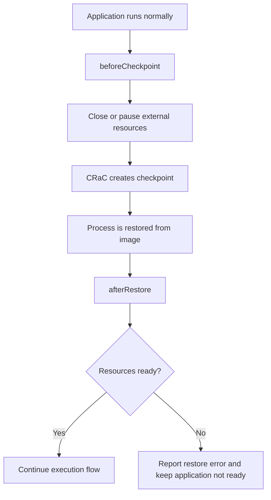

# afterRestore(): re-establishing resources before serving

CRaC restores the state of a JVM process from a checkpoint image. The heap, application objects, and execution state are restored according to the image, but external resources may have become invalid while the process was paused. A database connection may have been closed by the server, a socket may no longer be valid, a token may have expired, a message consumer may need to re-register, and a file lock may now belong to another process.

The `afterRestore()` callback allows the application to handle that work during the restore phase. The application uses the callback to recreate or verify resources, check dependencies, and only resume serving when the required state is ready.

The key point is to distinguish between two types of state:

- **In-process state**: Java objects, loaded configuration, caches, and data in the heap are restored from the image.
- **External state**: databases, brokers, HTTP services, filesystems, credentials, and independent systems may have changed while the process was stopped.

Restoring memory does not mean restoring the outside world. `afterRestore()` is the place to synchronize both sides before the application continues operating.

## 1. Position of afterRestore in the CRaC lifecycle

A CRaC resource implements the `org.crac.Resource` interface. The interface has two callbacks tied to two points in time:

- `beforeCheckpoint(...)`: prepares the resource before creating the image, typically by stopping related activity and closing resources that cannot be kept across a checkpoint.
- `afterRestore(...)`: re-establishes or verifies the resource after the process state has been restored.

General flow:



After restore, CRaC invokes the registered resources so the application has the opportunity to re-establish resources. The callbacks must complete according to the runtime's contract before the application resumes its post-checkpoint execution flow. Therefore, `afterRestore()` should not be treated as an optional background task that can run after the server has already accepted requests.

### afterRestore only runs on the restore path

`afterRestore()` is called when the process is restored from a checkpoint. It is not a normal startup callback and is not invoked simply because the application was freshly launched with `java -jar`.

The application needs both initialization paths:

1. **Fresh startup**: create connections and resources according to the application's normal lifecycle.
2. **Startup from checkpoint**: restore objects in memory, then use `afterRestore()` to refresh the necessary resources.

You should not put all initialization logic solely in `afterRestore()`, because a fresh run will not go through this callback. Conversely, you should not assume that constructors, `@PostConstruct`, Spring bean initialization, or startup runners will automatically run again when an object graph has already been restored from an image. Those objects already exist in the restored heap state.

## 2. Registering a Resource with CRaC

A resource is registered with a CRaC context so the runtime invokes the callbacks at the right phase. The common approach is to register with the global context:

```java
import org.crac.Context;
import org.crac.Core;
import org.crac.Resource;

public final class ExampleResource implements Resource {

    public ExampleResource() {
        Core.getGlobalContext().register(this);
    }

    @Override
    public void beforeCheckpoint(Context<? extends Resource> context)
            throws Exception {
        // Prepare or close resources before checkpoint.
    }

    @Override
    public void afterRestore(Context<? extends Resource> context)
            throws Exception {
        // Re-establish or verify resources after restore.
    }
}
```

Register the resource once during application startup. The resource object and its required state are kept in the image; upon restore, the callback is invoked on the restored state. Do not create another registration in `afterRestore()` without an explicit intention, as this can lead to duplicate registrations or callbacks running multiple times unexpectedly.

The `Context<? extends Resource>` parameter is the context associated with the resource callback. Most simple applications do not need to interact directly with this parameter, but they must still declare the exact interface signature. When using nested contexts or managing dynamic resources, follow the API and lifecycle rules of the CRaC version being used.

## 3. Resources that need to be re-established after restore

Not every object in the heap needs to be recreated. It is necessary to identify which resources are pure Java state that can continue to be used and which resources represent an external object with an independent lifecycle.

| Resource | Work to do in afterRestore |
|---|---|
| JDBC connection / connection pool | Create a new pool or connection, verify connectivity, and configure timeouts |
| HTTP client with open sockets | Recreate or refresh connections, verify endpoints and TLS |
| Message broker producer/consumer | Reconnect, verify subscriptions, consumer groups, and offsets |
| Redis/cache client | Reconnect, verify cluster topology and cache state |
| File handle | Reopen the file by path, check inode/metadata and read/write position |
| File lock | Reacquire the lock according to the application protocol and verify ownership |
| Stopped thread pool | Create a new executor and start the required workers |
| Scheduler | Re-register schedules without creating duplicate tasks |
| Short-lived credential/token | Refresh the token and verify access permissions |
| Cloud SDK client | Refresh credentials, endpoint discovery, and required connections |

### Database and connection pool

A `DataSource` object may still exist in the heap after restore, but the sockets held by the pool may have been closed by the database or the network. If the application continues using old connections, it may encounter errors when the first request is processed.

Common approaches:

- Close the pool before checkpoint using the corresponding callback.
- After restore, create a new pool from configuration stored in the application or re-read from the configuration source.
- Run a time-bounded health check to confirm the pool can actually obtain a connection.
- Only mark the database dependency as ready after the check succeeds.

Do not assume that connections opened before checkpoint can survive across the restore period. The database may restart, fail over, rotate credentials, or change DNS during that time.

### HTTP client and network connections

An HTTP client may manage connection pools, keep-alive sockets, TLS sessions, and DNS caches. After restore, old connections may no longer be valid even though the client object is still in the heap.

Depending on the library, you can close and recreate the client, clear the old connection pool, or invoke the recovery mechanism provided by the library. Use the official API of the client you are using. Do not just create a new wrapper object while other services still hold references to the old wrapper.

### Message broker and consumer

A consumer needs to reconnect and verify subscription state after restore. In particular, it must determine which messages were received but not yet processed or acknowledged at the time of the checkpoint.

Restoring in-memory state alone cannot guarantee that the broker preserved the lease or assignment. The consumer may be reassigned partitions, offsets may have changed, and messages may be redelivered. Design idempotent handlers, commit offsets at the right business boundary, and handle duplicates according to the broker protocol.

### Files, locks, and native resources

A file descriptor in a checkpointed process does not guarantee that the path or external file object remains the same. The file may have been replaced, the volume may have been remounted, or another process may hold the lock.

If you need to continue working with the file, reopen it by a verified path and check the necessary metadata. If using locks, re-execute the lock acquisition protocol. For native libraries, use the APIs that support checkpoint/restore or release and recreate the resources according to the library's instructions.

## 4. Designing a safe afterRestore callback

A good callback performs clear steps:

1. Create or re-obtain the resource from the factory/configuration.
2. Verify that the resource can actually perform work.
3. Publish the new resource to application components.
4. Only then mark the dependency or application as ready.
5. If it fails, close the partially created resource and report the error so the system handles the restore failure.

Do not mark ready immediately after calling the constructor. An HTTP client being successfully constructed does not prove the endpoint is reachable; a pool being successfully created does not prove the database can accept connections.

### Example: wrapper that recreates a client

The example below illustrates a wrapper that holds a closable and recreatable client. `Client` and `ClientFactory` are application-defined abstractions; they are not built-in JDK classes.

```java
import org.crac.Context;
import org.crac.Core;
import org.crac.Resource;

public final class RestorableClient implements Resource {

    public interface Client extends AutoCloseable {
        void healthCheck() throws Exception;

        @Override
        void close() throws Exception;
    }

    @FunctionalInterface
    public interface ClientFactory {
        Client connect() throws Exception;
    }

    private final ClientFactory factory;
    private volatile Client client;
    private volatile boolean ready;

    public RestorableClient(ClientFactory factory) {
        this.factory = factory;
        Core.getGlobalContext().register(this);
    }

    // Used in the fresh JVM startup lifecycle.
    public void startNormally() throws Exception {
        connectAndPublish();
    }

    @Override
    public synchronized void beforeCheckpoint(
            Context<? extends Resource> context) throws Exception {
        ready = false;

        Client oldClient = client;
        client = null;
        if (oldClient != null) {
            oldClient.close();
        }
    }

    @Override
    public synchronized void afterRestore(
            Context<? extends Resource> context) throws Exception {
        connectAndPublish();
    }

    private void connectAndPublish() throws Exception {
        Client candidate = factory.connect();
        try {
            candidate.healthCheck();
            client = candidate;
            ready = true;
        } catch (Exception failure) {
            try {
                candidate.close();
            } catch (Exception closeFailure) {
                failure.addSuppressed(closeFailure);
            }
            throw failure;
        }
    }

    public Client getClient() {
        if (!ready) {
            throw new IllegalStateException("Client is not ready");
        }
        return client;
    }
}
```

The example demonstrates several principles:

- The factory is retained to create a new client from current configuration and credentials.
- The old client is closed before checkpoint.
- The new client is published only after the health check succeeds.
- The `ready` flag is enabled after the resource has been verified.
- If creating or checking the client fails, the error is propagated outward rather than silently continuing.
- `startNormally()` serves a fresh JVM startup; `afterRestore()` serves the restore path.

In a real application, ensure all components access the client through this wrapper or provider. If another service holds a direct reference to the old client, replacing `client` inside the wrapper will not update those references. You can use a dependency provider, factory, or stable abstraction so consumers always obtain the current client.

Additionally, the `beforeCheckpoint` callback should run after the application has drained in-flight work using the client. Do not close the client while requests are still executing. If closing fails, let the checkpoint fail according to the runtime's policy rather than creating an image with the resource in an indeterminate state.

## 5. Coordinating afterRestore with readiness

A restored application should not receive traffic just because the process exists or the HTTP port is open. It must complete critical recovery steps before being placed back into the load balancer.

Readiness can be broken down into multiple dependencies:

- The database is connected and can execute a check query.
- The message broker is connected and subscriptions/assignments are stable.
- The cache or distributed lock service is ready.
- Credentials are valid.
- Schedulers and workers are in an appropriate state.

Only enable readiness when required dependencies are ready. Optional dependencies can be recovered asynchronously if the application can operate safely without them; this must be clearly reflected in the health status.

### Readiness vs. liveness

- **Liveness** answers whether the process is still alive and needs to be restarted.
- **Readiness** answers whether the instance can accept traffic yet.

During restore, a process may be alive but not ready because the database pool or broker has not been re-established yet. If liveness is used instead of readiness, the orchestrator may put the instance into service too early.

Do not use a health endpoint that always returns success just because the JVM has started. The health check must reflect the actual recovery state.

## 6. Error handling in afterRestore

`afterRestore()` allows declaring `throws Exception`. If a required resource cannot be re-established, the application needs to surface the failure clearly. Catching the exception, logging it, and returning normally can cause the JVM to keep running with an unusable dependency.

Classify errors:

| Error type | Appropriate handling |
|---|---|
| Transient, retryable error | Bounded retry, backoff, and overall timeout |
| Expired credential | Obtain a new credential from an authorized source and re-verify |
| Unreachable endpoint | Keep readiness as false and report the error |
| Invalid configuration | Stop restore or fail clearly; do not retry infinitely |
| Native resource does not support restore | Execute the library-supported recreation procedure or reject the image |
| Partially closed resource | Clean up incomplete state and recreate from scratch if possible |

### Bounded retry

If a dependency can recover after a brief interruption, the callback can retry within a bounded period. You need:

- An overall timeout so the callback does not hang indefinitely.
- Backoff to avoid putting heavy load on a struggling service.
- Logs containing the resource name, attempt number, and cause.
- Rules distinguishing transient errors from configuration or credential errors.

Do not retry infinitely inside the callback. If the database cannot recover, an unbounded loop will leave restore without a clear outcome and make orchestration difficult.

### Do not swallow exceptions

Avoid writing:

```java
@Override
public void afterRestore(Context<? extends Resource> context) {
    try {
        reconnect();
    } catch (Exception exception) {
        log.error("Reconnect failed", exception);
    }
}
```

The code above logs the error but does not inform CRaC that a required resource failed to recover. If the application continues, requests may fail later in a place that is hard to diagnose.

For required dependencies, let the exception propagate or translate it into an appropriate error according to the API contract, while keeping readiness at false. For optional dependencies, only continue when the application has explicitly designed how to operate when that dependency is absent.

## 7. Avoiding duplicate initialization and duplicate side effects

The restored heap contains the pre-checkpoint object graph. If `afterRestore()` re-runs the entire startup procedure like a fresh launch, the application may:

- Create an additional scheduler while the old scheduler was already restored.
- Register listeners or shutdown hooks multiple times.
- Initialize additional thread pools and increase the number of workers.
- Register duplicate consumers or create redundant subscriptions.
- Resend messages or execute business side effects a second time.
- Overwrite restored state with default data.

Separate logic into groups:

1. **One-time initialization for the object graph**: configuration, services, resource wrappers, and dependency injection.
2. **Initialization on fresh JVM launch**: creating initial resources according to the startup lifecycle.
3. **Re-establishment after restore**: refreshing only resources that have an external lifecycle or need re-verification.
4. **Intentional worker restart**: recreating executors, schedulers, or consumers only if they were stopped before checkpoint.

If a step may be called multiple times due to retries or orchestration, design that step to be idempotent. For example, check subscriptions before creating new ones, use stable consumer group names, and do not re-execute a business transaction just because the callback ran.

## 8. Integrating with Spring Boot

In a Spring Boot application, you can register a bean that implements `Resource`. The bean is created during fresh startup and registered with the global context. After restore, the bean is already in the restored heap and the `afterRestore()` callback is invoked on that bean.

Structural example:

```java
import org.crac.Context;
import org.crac.Core;
import org.crac.Resource;
import org.springframework.stereotype.Component;

@Component
public final class BrokerCracResource implements Resource {

    private final BrokerConnectionManager connectionManager;

    public BrokerCracResource(BrokerConnectionManager connectionManager) {
        this.connectionManager = connectionManager;
        Core.getGlobalContext().register(this);
    }

    @Override
    public void beforeCheckpoint(Context<? extends Resource> context)
            throws Exception {
        connectionManager.stopAndClose();
    }

    @Override
    public void afterRestore(Context<? extends Resource> context)
            throws Exception {
        connectionManager.connectAndVerify();
    }
}
```

`BrokerConnectionManager` is an application-defined component. It should provide operations with clear semantics, timeouts, and error reporting if the connection cannot recover. The example above assumes the manager is designed to replace the old connection without leaving other services holding stale references.

### Points to note in Spring

- Do not assume `@PostConstruct` will run again on every bean after restore.
- Do not recreate the entire ApplicationContext just to recover a socket.
- Do not register the same Resource multiple times when callbacks run.
- Use Spring Boot's readiness to keep the instance from receiving traffic during the recovery phase.
- Verify that beans with threads, executors, or native clients have appropriate lifecycles.
- Check dependency ordering between resources; if the broker depends on a credential provider, ensure credentials are refreshed before connecting to the broker.

If the order between multiple recovery steps matters, group them into a coordinating resource or design the resources using ordered contexts/lifecycles supported by the CRaC documentation. Do not rely on the accidental order of bean discovery or component scanning.

## 9. Observing and logging the recovery process

When restore fails, logs need to help identify which resource is not ready and why. Each callback should record:

- Resource name and start time.
- Execution duration.
- Outcome of recreation or verification.
- Retry count, if any.
- Error type and non-sensitive supporting details.
- Readiness state after completion.

Do not log passwords, access tokens, private keys, connection strings containing secrets, or sensitive data payloads. You may log hostnames/service names, error codes, timeouts, and correlation IDs if those values do not expose secrets.

Structured log example:

```text
INFO  crac-resource=database phase=afterRestore event=start
INFO  crac-resource=database phase=afterRestore event=connected duration_ms=184
INFO  crac-resource=broker phase=afterRestore event=start
WARN  crac-resource=broker phase=afterRestore event=retry attempt=2 reason=connection_timeout
INFO  crac-resource=broker phase=afterRestore event=ready duration_ms=920
INFO  application phase=restore event=readiness_ready
```

Useful metrics include total restore time, per-resource duration, retry count, failed resource count, and time from restore until readiness succeeds. Use them to identify which dependency slows down returning the instance to service.

## 10. Testing afterRestore

Testing the callback in a normally running JVM is not enough. You need to create a checkpoint image and perform a real restore in a compatible environment to verify the runtime invokes the callback as expected.

### Scenarios to test

| Scenario | Expected result |
|---|---|
| Fresh JVM startup | Startup creates initial resources; does not depend on afterRestore |
| Restore when database is healthy | Pool is recreated and health check succeeds |
| Database temporarily unreachable | Bounded retry; readiness remains false until it succeeds |
| Expired credential | Credential is refreshed or restore fails clearly |
| Broker rebalances partitions | Consumer verifies assignment/offset and handles duplicates safely |
| Callback fails to create resource | Does not publish an unready resource |
| Repeated restore from the same image in test environment | Does not create duplicate registrations, schedulers, or side effects |
| Application with multiple Resources | Dependency order is managed and errors are clearly identified |

### Recommended testing procedure

1. Start the application fresh and confirm normal startup.
2. Confirm the Resource is registered and external resources are working.
3. Bring the application to a checkpointable state.
4. Create a checkpoint using the method of the CRaC JDK in use.
5. Change a controllable external condition, such as closing old connections or rotating credentials in the test environment.
6. Restore the image.
7. Check the logs to verify `afterRestore()` ran.
8. Confirm the new client actually works via a health check or real request.
9. Confirm readiness only switches to true after required dependencies are ready.
10. Verify no schedulers, consumers, listeners, or side effects were duplicated.

Test both success and failure cases. A callback is only production-ready when it handles interrupted dependencies, changed credentials, and resource creation failures without letting the application serve in a half-initialized state.

## 11. Common misconceptions

| Misconception | Accurate understanding |
|---|---|
| Restore will re-run constructors of every bean. | The object graph is restored from the image; it is not a fresh JVM initialization. |
| afterRestore is a normal startup callback. | The callback only serves the restore-from-checkpoint path. |
| The client object is still in the heap so the socket is still usable. | The state of external services and connections may have changed. |
| Just creating a new client is enough. | Connectivity, permissions, subscriptions, and actual state must be verified. |
| You can catch all exceptions and continue. | Required dependency failures must be reported clearly and keep the application not ready. |
| The callback can create a new scheduler without checking. | This risks creating workers or tasks that duplicate the restored state. |
| The process is alive so it can accept requests. | Readiness must reflect that dependency recovery has completed. |
| Restore recovers transactions of external systems. | CRaC restores the process; distributed transactions and consistency remain the application's responsibility. |

## 12. Checklist before returning an instance to service

- [ ] Resource is registered exactly once with the CRaC context.
- [ ] Fresh JVM startup path has its own resource creation logic, independent of afterRestore.
- [ ] Old resources were closed or prepared according to contract before checkpoint.
- [ ] afterRestore creates or refreshes required connections.
- [ ] Health check verifies that the resource can actually operate.
- [ ] Credentials, DNS, endpoints, and external configuration have been re-verified.
- [ ] Consumers, schedulers, and workers are not initialized twice.
- [ ] Operations with side effects are protected by idempotency or deduplication mechanisms.
- [ ] Required errors are propagated or cause restore to fail clearly.
- [ ] Retries have timeouts and backoff, with no infinite loops.
- [ ] Readiness only switches to true when required dependencies are ready.
- [ ] Logs contain no secrets and have sufficient information for diagnosis.
- [ ] Real restore has been tested, both when dependencies are ready and when they fail.

`afterRestore()` is the boundary between restoring JVM state and returning the application to service. The callback must re-establish external resources that have become invalid, verify them before publishing them to the application, and handle errors according to a clear policy. When properly combined with readiness, idempotency, and real restore testing, the application can resume from a checkpoint without relying on stale connections or assumptions.
