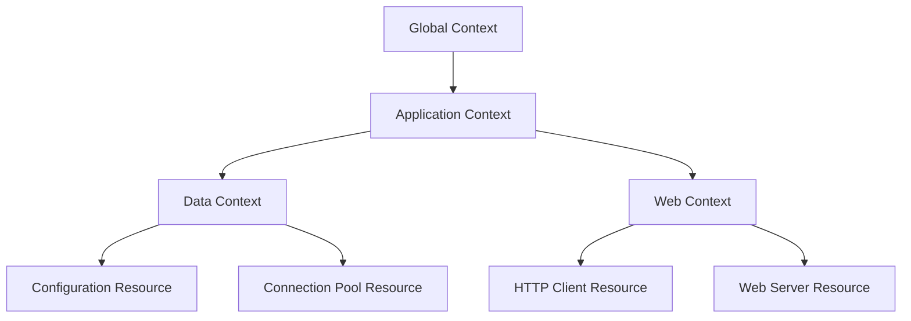

# Nested Contexts and Dependency Coordination

In Java CRaC, `Resource` represents a component that needs to receive notifications before checkpoint and after restore. `Context` manages a group of `Resource` instances and decides how to dispatch those two notifications. Because `Context` itself is also a `Resource`, a context can be registered inside another context. Nested contexts form a lifecycle management tree, helping divide an application into resource groups and coordinate processing order according to dependency relationships.

For example, an application might have an infrastructure group containing security configuration and a connection pool, and an HTTP group containing an HTTP client and a web server. The connection pool needs the security configuration ready before opening; the web server should only accept requests after dependent clients and services have been restored. A `Context` tree can represent these relationships to close resources in reverse order and restore them in dependency order.

## 1. Roles of `Resource` and `Context`

`Resource` is an interface that receives two callbacks:

- `beforeCheckpoint(Context<? extends Resource> context)`: prepares the resource before the JVM captures its state, for example stopping accepting requests, closing sockets, or putting a pool into a safe state.
- `afterRestore(Context<? extends Resource> context)`: refreshes the resource after the process is restored, for example reopening connections, updating environment information, or restarting services.

A `Resource` that wants to receive callbacks must be registered with a `Context` via `register(resource)`. The API provides the root context via `Core.getGlobalContext()`:

```java
import org.crac.Context;
import org.crac.Core;
import org.crac.Resource;

public final class DatabaseResource implements Resource {
    public DatabaseResource() {
        Core.getGlobalContext().register(this);
    }

    @Override
    public void beforeCheckpoint(Context<? extends Resource> context)
            throws Exception {
        // Close or pause the resource before checkpoint.
    }

    @Override
    public void afterRestore(Context<? extends Resource> context)
            throws Exception {
        // Recreate or check the resource after restore.
    }
}
```

The global context is a simple choice for small applications. When all resources are registered directly there, the resource list resides in a single shared group. Large applications may need to split by subsystem, such as database, messaging, HTTP server, scheduler, or cache. This is where nested contexts become useful.

## 2. `Context` Is Also a `Resource`

In the `org.crac` API, `Context<R extends Resource>` is an abstract class that implements `Resource`. In addition to the `register(R resource)` method, subclasses must define `beforeCheckpoint(...)` and `afterRestore(...)`. Because a context is also a resource, a child context can be registered with a parent context:

```java
Context<Resource> global = Core.getGlobalContext();
Context<Resource> subsystem = createSubsystemContext();

global.register(subsystem);
```

The snippet above illustrates the parent-child relationship; `createSubsystemContext()` is a factory implemented by the application itself. The API does not require a built-in method named `createContext()`. To create a child context with custom rules, the application defines a class that extends `Context`.

The hierarchical model can be visualized as follows:



Each parent context only needs to know its direct child contexts or resources. The child context is responsible for coordinating the inner group. This structure reduces direct dependencies between components and helps organize the lifecycle along subsystem boundaries.

## 3. Callback Order and Dependency Relationships

The global context has clear ordering rules:

| Timing | Notification order |
|---|---|
| `beforeCheckpoint` | Reverse registration order |
| `afterRestore` | Registration order |

This rule supports dependency relationships. A component that provides a dependency should be registered before the component that uses that dependency. At checkpoint, the consuming component is stopped first; at restore, the dependency is restored before the consumer starts.

For example, if the web server depends on the HTTP client, the HTTP client depends on the TLS configuration, and the connection pool depends on the security configuration, the registration order could be:

1. Configuration or secret provider.
2. TLS context and connection pool.
3. HTTP client.
4. Web server.

At checkpoint, callbacks run in reverse order: the web server stops accepting requests first, then the HTTP client closes, followed by the connection pool, and finally the foundational configuration is released if needed. At restore, the order is reversed so that configuration, pool, client, and then server become ready in turn.

Registration order is not an automatic dependency solver. The designer must identify actual dependencies and arrange the resources appropriately. If there is a circular dependency, separate responsibilities or create a shared coordinating resource instead of trying to handle it by changing the registration order.

## 4. Creating a Custom `Context`

When a group of resources needs its own callback order, you can extend `Context`. The following example creates `OrderedContext`, stores child resources, and applies the rule: invoke `beforeCheckpoint` in reverse order, and invoke `afterRestore` in registration order.

```java
import java.util.ArrayList;
import java.util.List;
import java.util.Objects;

import org.crac.CheckpointException;
import org.crac.Context;
import org.crac.Resource;
import org.crac.RestoreException;

public final class OrderedContext<R extends Resource> extends Context<R> {
    private final List<R> resources = new ArrayList<>();

    @Override
    public synchronized void register(R resource) {
        resources.add(Objects.requireNonNull(resource, "resource"));
    }

    private synchronized List<R> snapshot() {
        return new ArrayList<>(resources);
    }

    @Override
    public void beforeCheckpoint(Context<? extends Resource> parent)
            throws CheckpointException {
        List<R> current = snapshot();
        CheckpointException failure = null;

        for (int i = current.size() - 1; i >= 0; i--) {
            try {
                current.get(i).beforeCheckpoint(this);
            } catch (Exception e) {
                if (failure == null) {
                    failure = new CheckpointException(
                            "One or more resources failed before checkpoint");
                }
                failure.addSuppressed(e);
            }
        }

        if (failure != null) {
            throw failure;
        }
    }

    @Override
    public void afterRestore(Context<? extends Resource> parent)
            throws RestoreException {
        List<R> current = snapshot();
        RestoreException failure = null;

        for (R resource : current) {
            try {
                resource.afterRestore(this);
            } catch (Exception e) {
                if (failure == null) {
                    failure = new RestoreException(
                            "One or more resources failed after restore");
                }
                failure.addSuppressed(e);
            }
        }

        if (failure != null) {
            throw failure;
        }
    }
}
```

Some points in the implementation:

- `OrderedContext` extends `Context<R>`, so it can itself be registered as a `Resource` in a parent context.
- `register` keeps child resources in a list. `snapshot()` creates a copy so that callbacks do not hold the synchronization lock while calling resource code.
- `beforeCheckpoint` iterates the list from end to start; `afterRestore` iterates from start to end.
- The child resource's callback receives `this`, which is the context directly coordinating that resource. The `parent` parameter is the context that invoked the callback on the current context.
- Exceptions are collected using `addSuppressed` so that the remaining resources still receive callbacks and errors can be reported together.

This is an illustrative implementation pattern. In a real application, it is necessary to define registration, synchronization, and error policies suitable for the application's lifecycle. If resources can be added while checkpoint or restore is running, it must be clearly specified from which cycle the new resource will participate. The simplest and most predictable approach is to complete registration before the application allows creating a checkpoint.

## 5. Building a Context Tree for an Application

Suppose an application has two subsystems: data and web. Data needs configuration before the connection pool; web needs the HTTP client before the web server. We can create two child contexts and register them in the application context:

```java
import org.crac.Context;
import org.crac.Core;
import org.crac.Resource;

public final class ApplicationCracSetup {
    private final OrderedContext<Resource> application =
            new OrderedContext<>();
    private final OrderedContext<Resource> data =
            new OrderedContext<>();
    private final OrderedContext<Resource> web =
            new OrderedContext<>();

    public ApplicationCracSetup(
            Resource configuration,
            Resource connectionPool,
            Resource httpClient,
            Resource webServer) {

        // Dependency is registered before consumer.
        data.register(configuration);
        data.register(connectionPool);

        web.register(httpClient);
        web.register(webServer);

        // Data must restore before web.
        application.register(data);
        application.register(web);

        Context<Resource> global = Core.getGlobalContext();
        global.register(application);
    }
}
```

In the example, `configuration`, `connectionPool`, `httpClient`, and `webServer` are objects implementing `Resource`. The `application` context holds two child contexts; each child context holds the direct resources of its subsystem. When the global context calls `application`, this context continues dispatching callbacks down the tree.

The resulting order is as follows:

| Phase | Sequence |
|---|---|
| Checkpoint | `webServer` → `httpClient` → `connectionPool` → `configuration` |
| Restore | `configuration` → `connectionPool` → `httpClient` → `webServer` |

For the context tree to work reliably, keep a strong reference to `ApplicationCracSetup` or at least to `application` in a component that lives throughout the application's lifecycle. The global context may hold registered resources using weak references; if you only create the context in a local variable and drop the reference, the context may be reclaimed by the garbage collector and no longer receive callbacks. Child contexts and leaf resources must also be kept alive by their parent context or an appropriate owning component.

Do not register the same resource both directly with the global context and inside a child context. Doing so may cause the resource to receive callbacks multiple times in the same cycle. Each resource should have one clear owning context.

## 6. Coordinating Errors in the Context Tree

CRaC callbacks can fail. For example, a connection pool fails to close connections before checkpoint, or an HTTP client cannot recreate a TLS session after restore. A context needs to handle errors so that it does not hide the root cause and does not cause the application to falsely report readiness.

The global context aggregates errors from resources using `CheckpointException` or `RestoreException`, keeping individual errors in the suppressed exceptions list. When implementing a custom context, you should maintain similar behavior: continue notifying the remaining resources, collect errors, and then throw the aggregated exception to the parent context.

When a checkpoint callback fails, the checkpoint should not be considered successful. The runtime may execute the restore phase of the original process after a checkpoint notification fails; resources need consistent recovery logic for this situation. When a restore callback fails, the application must not transition to the ready state if a required dependency is not yet operational.

Example of inspecting the aggregated exception at the checkpoint call site:

```java
import org.crac.CheckpointException;
import org.crac.Core;
import org.crac.RestoreException;

public final class CheckpointCoordinator {
    public void checkpoint() {
        try {
            Core.checkpointRestore();
        } catch (CheckpointException e) {
            logCheckpointFailure(e);
            throw e;
        } catch (RestoreException e) {
            logRestoreFailure(e);
            throw e;
        }
    }

    private void logCheckpointFailure(CheckpointException e) {
        for (Throwable cause : e.getSuppressed()) {
            System.err.println("beforeCheckpoint failed: " + cause);
        }
    }

    private void logRestoreFailure(RestoreException e) {
        for (Throwable cause : e.getSuppressed()) {
            System.err.println("afterRestore failed: " + cause);
        }
    }
}
```

This is an illustrative example showing how to distinguish between the two error groups. Real applications should use a logging framework, record the full cause chain and suppressed exceptions, and clearly decide when the process must stop or not accept traffic.

## 7. Principles When Designing Nested Contexts

### Group by Subsystem Lifecycle

A child context should represent a group of resources sharing a management boundary, such as persistence, messaging, web, or scheduler. Avoid creating a context just to wrap a simple object if it does not help clarify ordering or ownership.

### Register in Dependency Direction

Within each context, register dependencies before consumers. This rule ensures checkpoint callbacks run in teardown order and restore callbacks run in startup order. Document dependency relationships in documentation or diagrams so maintainers understand why the registration order was chosen.

### One Resource Has Only One Managing Place

Duplicate registration across multiple contexts can cause callbacks to run multiple times. Choose one context that owns the resource and let the parent context manage the child context.

### Keep Contexts and Resources Alive

The global context holds weak references to registered resources. Keep strong references in an application singleton, lifecycle bean, or registry that lives for the duration of the process. Custom contexts must also retain the child resources they manage.

### Register Before Checkpoint Starts

Do not arbitrarily modify the context tree while callbacks are running. If the application has plugins or dynamic resources, a synchronization mechanism is needed to freeze the registration list before checkpoint and define how new registrations participate in the next cycle.

### Avoid Long Work and Mutual Dependencies in Callbacks

Callbacks are part of checkpoint/restore time. Only perform operations necessary to close, synchronize, or restore resources. If a resource requires multiple steps, encapsulate those steps within that resource or a dedicated context rather than having multiple resources operate on the same state.

### Test Multiple Cycles

A context tree may work properly on the first checkpoint but fail when restored multiple times. Test connection pools, executors, schedulers, clients, and servers across multiple cycles to detect duplicate registrations, duplicated threads, or resources not being closed properly.

## 8. Common Mistakes

| Issue | Possible Cause | Resolution |
|---|---|---|
| Resource does not receive callbacks | Not registered or context was reclaimed by the garbage collector | Check the owning context and keep a strong reference |
| Callback runs twice | Same resource registered in both parent and child context | Register only in one owning context |
| Consumer restored before dependency | Registration order does not reflect dependency relationships | Register provider before consumer |
| One error hides information about other errors | Custom context stops immediately at the first exception | Continue notifying remaining resources and collect suppressed errors |
| Application ready even though resource is not restored | Readiness does not wait for callbacks or ignores exceptions | Only open traffic after restoration succeeds |
| Child context does not dispatch callbacks downward | Subclass does not properly implement both callbacks or fails to call child resources | Check the custom `Context` implementation |
| Context tree is hard to maintain | Groups too small, circular dependencies, or scattered registrations | Group by subsystem and document dependency order |

Another mistake is relying solely on object creation order in a dependency injection container without checking the registration order with CRaC. These two orders can differ. Register resources explicitly and inspect callback logs during a test checkpoint/restore run.

## 9. Verifying Order with Logs

During development, you can log inside callbacks to see the actual order. For example:

```java
public final class NamedResource implements Resource {
    private final String name;

    public NamedResource(String name) {
        this.name = name;
    }

    @Override
    public void beforeCheckpoint(Context<? extends Resource> context) {
        System.out.println("beforeCheckpoint: " + name);
    }

    @Override
    public void afterRestore(Context<? extends Resource> context) {
        System.out.println("afterRestore: " + name);
    }
}
```

Register the resources in dependency order and then create a checkpoint on a CRaC-enabled runtime. The logs should show resources being stopped in reverse order and restored in registration order. With nested contexts, logs should record both the context name and the resource name to identify which branch is processing.

Do not leave `System.out.println` as the sole observation mechanism in production. Use a logger with the subsystem name, checkpoint identifier, and exception details so the order can be traced in a real environment.

## 10. Design Checklist

- [ ] Every resource requiring checkpoint/restore coordination implements `Resource`.
- [ ] Every resource is registered exactly once with its owning context.
- [ ] Child contexts extend `Context<R>` and dispatch callbacks to their child resources themselves.
- [ ] The context tree reflects subsystem boundaries and actual dependencies.
- [ ] Dependencies are registered before consumers.
- [ ] `beforeCheckpoint` runs in reverse registration order; `afterRestore` runs in registration order.
- [ ] Custom contexts collect errors and preserve suppressed exceptions.
- [ ] Contexts and resources are held by strong references throughout the required lifecycle.
- [ ] The registration tree is not arbitrarily modified while callbacks are executing.
- [ ] Readiness only succeeds after required resources have been restored.
- [ ] Callback order has been observed and multiple checkpoint/restore cycles have been tested.

## 11. References

- [CRaC API 1.5.0 — `Context`](https://javadoc.io/static/org.crac/crac/1.5.0/org/crac/Context.html): defines `Context` as a `Resource`, how to register child resources, and context callbacks.
- [CRaC API 1.5.0 — Package `org.crac`](https://javadoc.io/static/org.crac/crac/1.5.0/org/crac/package-summary.html): describes the context hierarchy and notification rules of the global context.
- [CRaC Best Practices](https://crac.org/reference/best-practices/): notes on resource lifecycle and retaining references to registered resources.

Nested contexts allow dividing resources into groups with separate lifecycles and connecting those groups into a coordination tree. Because `Context` is also a `Resource`, child contexts can be registered within parent contexts. When designing this tree, register dependencies before consumers, handle checkpoint in reverse order, restore in registration order, keep contexts alive, and aggregate errors so the application only resumes serving when all required resources are ready.
