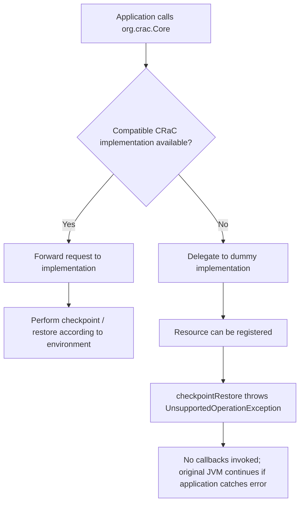

# Behavior of `org.crac` on a JVM Without Checkpoint Support

A Java application may need to use the CRaC API in its code while still having to run on a development machine, a test environment, or a standard JVM without checkpoint/restore capabilities. The `org.crac` package is designed to support this scenario through a compatibility library. The library provides the API to compile the application and searches for a CRaC implementation at runtime; if no compatible implementation is found, it falls back to a dummy implementation.

On a JVM without a CRaC implementation, the application can still instantiate and register a `Resource` via the dummy implementation. However, the operation requesting a checkpoint cannot be performed: `Core.checkpointRestore()` throws `UnsupportedOperationException`, no checkpoint/restore callbacks are fired, and execution continues in the original JVM if the application catches this exception. This is fallback behavior that allows the application to run in an environment that does not support CRaC, while clearly signaling that checkpoint functionality is unavailable.

To understand this behavior properly, three issues must be distinguished: whether the API is available for compilation, whether the runtime has a CRaC implementation, and whether a specific checkpoint attempt succeeds in the current environment.

## 1. `org.crac` Is a Compatibility API Layer

The CRaC API is not part of Java SE. A standard JDK is not required to provide CRaC packages. The CRaC project has different API packages depending on the implementation and stage of development, among which:

- `jdk.crac` is the API provided by a CRaC-enabled JDK.
- `org.crac` is provided by the `org.crac:crac` compatibility library, aimed at applications that want to compile and run on both CRaC-enabled runtimes and runtimes without a CRaC implementation.

The `org.crac` library mirrors the corresponding API and checks for an implementation at runtime. When a compatible CRaC implementation is detected, requests are forwarded to that implementation. When no implementation is present, the library uses the dummy implementation.

In Gradle, the dependency can be declared as follows, with the version managed centrally in the project:

```groovy
dependencies {
    implementation("org.crac:crac:${cracVersion}")
}
```

The artifact name `org.crac:crac` is very important: this is the library that provides the `org.crac` package to the application. Simply installing a standard Java SE JDK does not automatically make `import org.crac.Core` valid. Without the corresponding dependency during compilation, the compiler will not find the package; if the class is referenced but missing on the runtime classpath/module path, the JVM may report `ClassNotFoundException` or `NoClassDefFoundError` depending on how the class is loaded.

## 2. What Happens When No CRaC Implementation Is Found?

When an application includes the `org.crac` library but the current JVM does not provide a CRaC implementation recognized by the library, API calls are routed to the dummy implementation.

The dummy implementation has two important characteristics:

1. Allows the application to register a Resource so that initialization code and integration structure can run on a standard JVM.
2. Does not perform checkpoint/restore. When the application requests a checkpoint, the call fails with `UnsupportedOperationException`.

For `Core.checkpointRestore()`, the unsupported behavior is specifically described as: no notification callbacks are invoked and execution continues in the original Java instance. Therefore, if the application catches `UnsupportedOperationException`, the code after the `catch` block still runs in the same JVM that started up.



This does not mean the dummy implementation simulates a successful checkpoint. It only preserves the runnability of the API integration while rejecting the operation that the runtime cannot perform.

## 3. Distinguishing Runtime Cases

All "checkpoint does not run" situations should not be lumped into a single error category. The cases below have different causes and handling strategies.

| Situation | Typical Behavior | Meaning |
|---|---|---|
| Missing `org.crac` dependency | Compilation error when importing the package; or class loading error if the library is missing at runtime. | The application does not yet have the compatibility API on the classpath/module path. |
| Has `org.crac` library, no CRaC implementation | Dummy implementation is used; `checkpointRestore()` throws `UnsupportedOperationException`; no notification callbacks. | The JVM can run the application but cannot checkpoint using CRaC. |
| Has CRaC implementation and environment meets requirements | Runtime performs notifications, checkpoint, and restore according to the supported workflow. | Can continue after restore if the operation succeeds. |
| Has CRaC implementation but checkpoint or restore fails | May receive `CheckpointException`, `RestoreException`, or a specific error from the runtime/environment. | CRaC was detected, but the specific operation failed. |

For example, a CRaC-enabled JDK may be installed but lack OS permissions, engine configuration, or necessary conditions for checkpointing. This is not the same as a standard JVM using the dummy implementation. When a real implementation is present, the runtime may start the checkpoint process and then report an error because the process state or environment does not meet the requirements.

Therefore, `UnsupportedOperationException` is a signal that checkpoint functionality is not supported in the runtime currently used through the compatibility API. `CheckpointException` or `RestoreException` typically indicates that an implementation participated in the process, but a notification, checkpoint, or restore step failed. The cause and suppressed exception information must be read to identify the specific error.

## 4. How Does Resource Work on a JVM Without Checkpoint Support?

One easily misunderstood point is that the dummy implementation still allows registering a Resource. This enables the application to create resource-managing objects using the same code structure across multiple environments.

For example:

```java
import org.crac.Context;
import org.crac.Core;
import org.crac.Resource;

public final class CacheResource implements Resource {

    public CacheResource() {
        Core.getGlobalContext().register(this);
    }

    @Override
    public void beforeCheckpoint(Context<? extends Resource> context) {
        System.out.println("Prepare cache before checkpoint");
    }

    @Override
    public void afterRestore(Context<? extends Resource> context) {
        System.out.println("Refresh cache after restore");
    }
}
```

When running on a runtime with CRaC, callbacks are invoked during the corresponding phases of the checkpoint/restore lifecycle. When running via the dummy implementation on an unsupported JVM, the registration operation can still be performed, but there is no checkpoint event to trigger the callbacks. Therefore, the two log lines inside the callbacks do not appear just because the application calls `Core.checkpointRestore()` on a standard JVM.

This is useful for code compatibility: the application can always create and register a Resource without scattering runtime check conditions around every constructor. However, one must not rely on CRaC callbacks to perform essential initialization work during a normal run. If the application needs to open a cache, create a pool, or connect to a database during normal startup, use the application's normal initialization lifecycle. The `afterRestore(...)` callback is only for work that needs to be handled when a restore event occurs.

## 5. Catching `UnsupportedOperationException` When Requesting a Checkpoint

Because `UnsupportedOperationException` is an unchecked exception, Java method signatures are not required to declare it in `throws`. The application can specifically catch this exception to choose how to behave when the runtime does not support checkpointing.

```java
import org.crac.CheckpointException;
import org.crac.Core;
import org.crac.RestoreException;

public final class CheckpointCoordinator {

    public void requestCheckpoint() {
        try {
            Core.checkpointRestore();
            System.out.println("Checkpoint and restore completed");
        } catch (UnsupportedOperationException ex) {
            // Current runtime does not support CRaC.
            System.out.println("CRaC is not supported; continue without checkpoint");
        } catch (CheckpointException ex) {
            // Error during checkpoint notification / checkpoint phase.
            throw new IllegalStateException("Checkpoint failed", ex);
        } catch (RestoreException ex) {
            // Error during restore notification / restore phase.
            throw new IllegalStateException("Restore failed", ex);
        }
    }
}
```

The example demonstrates a "continue without checkpoint" policy when the API reports unsupported. In a real application, logs should clearly record that the runtime is unsupported so operators do not mistakenly believe the checkpoint succeeded. If the application is required to run from a checkpoint, the appropriate policy may be to abort startup or report a configuration error instead of continuing.

Do not catch all `RuntimeException`s and ignore them. Doing so can hide programming bugs or unexpected errors during integration. Handle the specific exception indicating unsupported and let unexpected errors remain observable.

## 6. Distinguishing Unsupported Errors From Actual Checkpoint Errors

The two groups of errors need to be handled differently:

### 6.1. Runtime Does Not Support CRaC

When using the dummy implementation, `Core.checkpointRestore()` throws `UnsupportedOperationException`. There are no notification callbacks and the original process continues. This is usually a known environmental condition, such as running unit tests on a standard JDK or running an application build that does not require checkpoint functionality.

The application can:

- Continue running in normal startup mode if checkpointing is optional.
- Report an incompatible configuration and stop if checkpointing is a mandatory requirement.
- Record metrics or logs to clearly distinguish CRaC mode from non-CRaC mode.

### 6.2. Runtime Supports CRaC But a Checkpoint Attempt Fails

When a real CRaC implementation is involved, errors can occur due to a Resource callback, unhandled file descriptors or sockets, OS permissions, engine, kernel, configuration, or the checkpoint image. In that case, `CheckpointException`, `RestoreException`, and their accompanying causes must be analyzed.

For example, if `beforeCheckpoint(...)` detects that a resource cannot be prepared and throws an error, the runtime may report `CheckpointException`. If the post-restore notification step encounters an error, the runtime may report `RestoreException`. Specific behavior should be cross-referenced with the Javadoc and documentation of the CRaC version in use.

Actual checkpoint errors should not be converted into "CRaC not supported". Doing so hides problems that the application or environment needs to fix.

## 7. Designing Applications That Run in Both Types of Environments

An application may need to run in two modes:

| Mode | Goal | Desired Behavior |
|---|---|---|
| JVM with CRaC | Create a checkpoint and restore to reduce startup time. | Resources coordinate before checkpoint and after restore; checkpoint requests are handled by the runtime. |
| JVM without CRaC | Run the application using the normal startup process. | Compatibility API allows instantiating and registering Resources; checkpoint requests are recognized as unsupported and the application applies a fallback policy. |

To support both, clearly design which tasks are mandatory in every run and which tasks are only for restore:

- Normal application initialization must happen independently of CRaC callbacks.
- Resource callbacks only manage the parts of resources that need to change around checkpoint/restore.
- If checkpointing is optional, only ignore the specific identified unsupported case.
- If checkpointing is mandatory, verify runtime capability early in the deployment process or let the checkpoint operation fail according to a clear policy.
- Do not assume callbacks have run on an unsupported JVM just because a Resource was registered.

A simple way to organize this is to place the policy decision in a coordinator instead of having every Resource check the runtime itself. Each Resource stays focused on resource lifecycle; the coordinator decides whether the application continues without a checkpoint or must stop when the capability is unavailable.

## 8. Testing Example on a Standard JVM

When running unit tests on a JDK without CRaC support but with the `org.crac:crac` dependency, the fallback can be tested without creating a checkpoint image.

Suppose the application has a coordinator like the previous example. A test can verify that the method requesting a checkpoint does not fail the test if the policy is to allow continuing. A Resource with counters can also be used to verify that callbacks are not invoked by a checkpoint request on the dummy implementation.

Example test idea:

```java
import org.crac.Context;
import org.crac.Core;
import org.crac.Resource;

final class CountingResource implements Resource {
    int beforeCount;
    int afterCount;

    @Override
    public void beforeCheckpoint(Context<? extends Resource> context) {
        beforeCount++;
    }

    @Override
    public void afterRestore(Context<? extends Resource> context) {
        afterCount++;
    }
}
```

In a test on a runtime confirmed to have no CRaC implementation:

1. Create and register `CountingResource`.
2. Call `Core.checkpointRestore()` and expect `UnsupportedOperationException`.
3. Verify that `beforeCount` and `afterCount` remain 0.
4. Verify that the application's fallback handling code continues according to the defined policy.

Do not run this test blindly on a CRaC-enabled JDK: when the runtime supports it, the call may actually checkpoint the process instead of throwing unsupported. Separate fallback tests from real CRaC integration tests and run them in clearly defined environments.

## 9. Test Matrix by Environment

| Test Environment | Goal | Evidence to Observe |
|---|---|---|
| Compile with `org.crac:crac` | Code can reference the compatibility API. | Build succeeds and the dependency is present in the configuration. |
| Standard JVM, with compatibility library | Test the dummy implementation. | Resource registration does not require checkpointing; `checkpointRestore()` throws `UnsupportedOperationException`; callbacks do not run. |
| CRaC-enabled JDK, properly configured environment | Test the path to the real implementation. | Callbacks, checkpoint image, and restore work according to the scenario. |
| CRaC-enabled JDK, environment missing permissions or configuration | Test operational errors. | Checkpoint/restore errors are recorded with specific causes; not mistaken for unsupported fallback. |
| Runtime without `org.crac` library | Test classpath/module path packaging errors. | Compile or class loading errors are properly identified. |

This matrix helps avoid wrong conclusions from a single run. An application running successfully on a standard JVM only proves that the compatibility library's fallback path works; it does not yet prove the real checkpoint/restore path.

## 10. Common Misconceptions

**"A standard JVM naturally includes the `org.crac` package."** Incorrect. `org.crac` is provided by the compatibility library. The dependency must be included in the build and runtime classpath/module path.

**"Being able to import `org.crac` means the JVM definitely supports checkpointing."** Incorrect. Having the API to compile does not mean the runtime has a CRaC implementation. The compatibility library may use the dummy implementation.

**"The dummy implementation performs an empty checkpoint."** Incorrect. It allows registering a Resource, but a checkpoint request fails with `UnsupportedOperationException`; there are no notification callbacks.

**"`beforeCheckpoint` and `afterRestore` callbacks always run when the application calls the API."** Incorrect on an unsupported runtime. There is no checkpoint/restore event, so callbacks are not executed.

**"Every error from `checkpointRestore()` means the JVM does not support it."** Incorrect. `UnsupportedOperationException` indicates the functionality is not supported in that API path; `CheckpointException` and `RestoreException` can indicate errors during a checkpoint/restore attempt on a runtime with an implementation.

**"Catching `UnsupportedOperationException` is enough to support all cases."** Incorrect. The application must also decide whether checkpointing is optional or mandatory, handle real checkpoint errors, and test Resources on a supported runtime.

## 11. Checklist When Running `org.crac` on a JVM Without Checkpoint Support

- [ ] Added the `org.crac:crac` compatibility library to the application's dependencies.
- [ ] Distinguished the `org.crac` package from the `jdk.crac` API provided by a CRaC-enabled JDK.
- [ ] Confirmed whether the runtime in use has a CRaC implementation or not.
- [ ] Understood that the dummy implementation allows registering a Resource but does not perform checkpointing.
- [ ] Handled `UnsupportedOperationException` according to an optional or mandatory checkpoint policy.
- [ ] Do not expect `beforeCheckpoint(...)` or `afterRestore(...)` to run on the dummy implementation.
- [ ] Do not confuse `UnsupportedOperationException` with `CheckpointException` or `RestoreException`.
- [ ] Verified that the dependency is present at both compile time and runtime.
- [ ] Have separate integration tests on a CRaC-enabled JDK if the application requires real checkpointing.

## 12. Key Terms to Remember

- **`org.crac`:** API package provided by the compatibility library so applications can integrate CRaC across multiple types of Java runtimes.
- **`jdk.crac`:** API package provided by a CRaC-enabled JDK.
- **Compatibility library:** library that enables code using the CRaC API to compile and run on runtimes with or without an implementation.
- **Dummy implementation:** fallback implementation that allows registering a Resource but does not perform checkpoint/restore.
- **`UnsupportedOperationException`:** exception indicating that the checkpoint/restore operation is not supported by the runtime; in the described dummy behavior, there are no notification callbacks and the original JVM continues.
- **`CheckpointException`:** exception related to an error during the checkpoint notification or checkpoint phase.
- **`RestoreException`:** exception related to an error during the restore notification or restore phase.
- **Runtime implementation:** the actual CRaC implementation to which the compatibility API forwards requests when detected.

When running `org.crac` on a JVM without checkpoint support, the application can still start up and register a Resource thanks to the dummy implementation. A call requesting a checkpoint will throw `UnsupportedOperationException`, invoke no callbacks, and continue in the original process if the application handles the exception. Keep this boundary clear in code and in testing: running the compatibility API on a standard JVM is a fallback capability, whereas real checkpoint/restore always requires a CRaC runtime and a supported environment.

## References

- [CRaC project documentation — API](https://github.com/CRaC/docs#crac): distinguishing `jdk.crac` and `org.crac`, implementation detection mechanism, and dummy implementation.
- [Azul — Integrating CRaC in your Application](https://docs.azul.com/crac/usage/integrating-crac): `org.crac:crac` dependency, behavior when no implementation is present, and how to register a Resource.
- [Javadoc — `org.crac.Core`](https://javadoc.io/doc/org.crac/crac/latest/org/crac/Core.html): signature and exceptions of `checkpointRestore()`.
