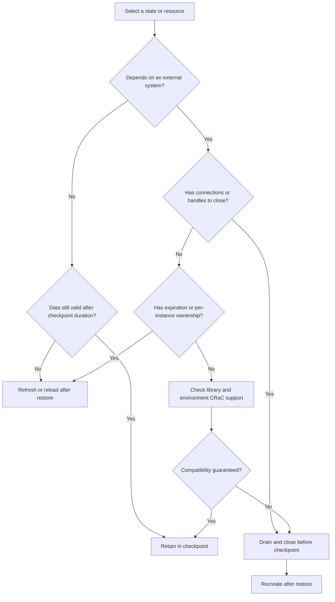

# Classifying State That Can Be Retained, Must Be Closed, and Must Be Recreated

When preparing a Java application for CRaC, it is necessary to clearly decide which state can be kept intact in the checkpoint, which state must be closed or paused before the checkpoint, and which state must be recreated after restore. This decision does not depend simply on whether a value is a Java object or an operating system resource. An object may still exist on the heap after restore while the external resource it represents has expired or become invalid. Conversely, many internal data structures can be kept intact and safely reused.

The key principle is that **a checkpoint saves process state at a point in time; it does not guarantee that external systems remain in the same state when the process is restored**. A database may have closed the connection, a token may have expired, DNS may have changed addresses, a lease may belong to another instance, and a message may have been delivered by the broker to another consumer. Therefore, classify each piece of state based on its data source, lifecycle, and validity after restore.

## 1. Three main state groups

In CRaC design, you can start with the following three groups:

| Group | Before checkpoint | After restore | Common examples |
|---|---|---|---|
| Can be retained | Bring the application to a stable state; keep objects in memory | Continue using after confirming the data is still appropriate | Immutable metadata, parser structures, internal beans, caches with controlled freshness |
| Must be closed or paused | Stop using, drain work, then close or pause according to library guidelines | Reopen, resume, or recreate the closed resource | TCP connection, JDBC connection, HTTP connection, consumer, file lock, native handle |
| Must be recreated or refreshed | Do not rely on old values as current identity or ownership | Re-read, re-authenticate, or re-register in the current environment | Token, lease, instance identity, service discovery, time-dependent schedules |

These three groups represent an application-policy classification. Some components may belong to multiple groups: retain the connection pool management object but close the physical connections; retain the cache structure but refresh data whose TTL has expired; retain the executor but stop and restart tasks. Both the wrapper object and the resources it owns must be classified.

In addition, one rule applies to all three groups: **in-flight work must be completed, safely paused, or recovered from a durable data source**. You should not checkpoint in the middle of a business transaction or an I/O operation whose external state cannot be resumed consistently.

## 2. State that can be retained

State that can be retained is typically internal data with a stable lifecycle that does not depend on an external connection session and does not need to be exclusively allocated for each restored process.

Common suitable examples include:

- Immutable objects, static lookup tables, and loaded metadata.
- Parser structures, serializers, converters, and internal data structures.
- Spring `ApplicationContext`, the bean graph, and completed initialization structures, if the beans do not hold external resources that require separate handling.
- Reusable warm-up results, such as optimized compiled code and prepared internal structures.
- Caches containing stable data or having an explicit freshness-checking policy.

Retaining an object does not mean every field inside the object remains valid. For example, a bean may hold immutable configuration while also holding an HTTP connection. The configuration can be retained; the connection needs to be handled according to the HTTP client's lifecycle. Therefore, classify at the component-resource level instead of assigning a single label to the entire bean.

### Caches and mutable data

A cache is an example that easily causes confusion. A heap cache is restored along with the checkpoint, but the data source may change between the time the checkpoint is created and the time of restore. A cache can be retained if:

1. The data does not change during the required usage period; or
2. The data has a TTL and the application re-checks expiration after restore; or
3. The cache has a version, timestamp, or invalidation mechanism to determine whether the data is still valid.

If these conditions are not met, the cache should be cleared or refreshed after restore. You should not assume a cache is still fresh simply because its object remains on the heap.

For example, a rarely changing country code table can be retained. A cache of product prices, access permissions, or inventory status needs to be re-verified against the current data source before being used for critical business logic.

### Internal structures and business state

Internal data structures can be retained, but you need to consider whether the snapshot is used to create one or multiple restored processes. If the checkpoint contains a local counter, a one-time generated identifier, or processed state, restored instances may start with that exact same value.

For example, an `AtomicLong` on the heap does not become a cluster-wide unique sequence generator just because it was checkpointed. Two processes restored from the same snapshot may both continue from the same counter value. For distributed IDs, sequence numbers, leader ownership, or state that must be unique, an external allocation mechanism must be used or identity must be regenerated after restore.

## 3. Resources that must be closed or paused before checkpoint

This group includes resources tied to the operating system, external connections, or an activity that may cause state changes while the process is stopped. Some resources may be directly supported for recovery by the runtime or library; however, the application should only keep them intact when the library version and deployment environment provide a clear compatibility guarantee.

Resources that typically need handling include:

- TCP connections, sockets, and sessions with external services.
- Physical connections in a JDBC connection pool or active database connections.
- HTTP connections, WebSockets, gRPC channels, or clients holding long-lived connections.
- Message consumers, subscriptions, and components actively receiving work from a broker.
- File locks, process locks, leases, or resources with external ownership.
- Native handles, native libraries, and operating system resources not guaranteed to be restored.
- Executors or schedulers running background tasks, if tasks need to be stopped and rescheduled.

Not every file or thread must be closed. File descriptors pointing to local files may be supported by certain checkpoint/restore configurations if the filesystem and environment are compatible. Idle thread pools may also be retained in some cases. Check the guidelines of the CRaC JDK, operating system, drivers, and libraries in use. If there is no compatibility guarantee, designing around closing/pausing and reopening is easier to control.

### Network and database connections

A TCP socket may still be represented by a Java object after restore, but the server side may have closed the connection or the session state may have changed. Similarly, a JDBC `Connection` may point to a database session that is no longer valid. If the application continues using the old connection, errors often only appear when the first request performs I/O.

A common workflow is:

1. Stop accepting new requests and wait for in-flight requests using connections to finish.
2. Stop background tasks accessing the database or HTTP services.
3. Close physical connections or put the pool/client into a library-supported state before checkpoint.
4. After restore, recreate connections or restart the pool/client.
5. Verify connectivity and only enable readiness once required dependencies are ready.

For connection pools, follow the CRaC integration of the pool and driver. Do not just close a borrowed connection and assume the entire pool is safe; the pool may hold multiple physical connections, housekeeper threads, and its own timers.

### Consumers, schedulers, and background threads

A consumer may be holding partition assignments, offset state, or a broker connection. Before checkpoint, stop receiving new messages and handle in-flight messages according to the system's ack/commit policy. After restore, the consumer typically must reconnect and rejoin the consumer group so the broker can distribute current assignments.

Schedulers also need to be classified. A task scheduled based on time before the checkpoint may already be overdue upon restore. A periodic task may run in duplicate if multiple restored processes start the scheduler simultaneously. Determine which tasks need to be rescheduled, which tasks need to acquire a lease, and which tasks must run under a single-instance mechanism.

For thread pools, distinguish between an idle pool and workers holding requests, transactions, locks, or I/O. If work is in progress, drain or stop it safely before checkpoint. Do not take a snapshot when a thread is in the middle of an operation that cannot be resumed consistently.

## 4. State that must be recreated or refreshed after restore

This group includes values that may have expired, changed with the environment, or need to be reallocated for each process. The wrapper object may be retained if appropriate, but the inner data needs to be reloaded.

| State | Why it needs refreshing | Action after restore |
|---|---|---|
| Access tokens, sessions, temporary credentials | May have expired or been revoked | Re-authenticate or acquire a new token |
| DNS and service discovery | Service addresses may have changed | Re-lookup or use the current discovery mechanism |
| Leases, leader locks, distributed locks | Ownership may have expired or belong to another instance | Re-register/re-acquire the lease via the coordination system |
| Instance ID and node registration info | Multiple restored instances may share the same old ID | Request a new ID or re-register with the platform |
| Caches with TTL, feature flags, and dynamic config | The data source may have been updated | Check version/TTL and reload when needed |
| Timers, deadlines, and schedules | Real time has elapsed during checkpoint | Recalculate deadlines and schedule relative to the current time |
| Consumer group state | Assignments may have changed | Reconnect and join the group |

Some state does not necessarily require recreating the entire object. For example, a client can retain its configuration and factory, but must obtain a new token and open a new channel. Separating stable configuration from session state makes recovery callbacks simpler.

### Time and deadlines

Do not assume a deadline calculated before the checkpoint still carries the same meaning as when it was created. If a task must run before a specific point in time, compare the deadline with the current time after restore and recalculate the wait duration. For periodic schedules, clearly decide whether to skip missed runs, catch up, or schedule for the next cycle.

Values based on monotonic time or temporary runtime time need to be evaluated according to how the library manages timers. Avoid saving a wait interval calculated before checkpoint and using it as-is without accounting for elapsed time.

### Secrets and credentials

A checkpoint may contain heap data, so tokens, credentials, keys, or sensitive information residing in memory can appear in the checkpoint artifact. Access permissions and the lifecycle of the checkpoint must be controlled as a sensitive artifact. For information that can expire or is issued per instance, retrieve it again from the secret manager or identity provider after restore instead of relying on an old copy.

## 5. In-flight work must be drained or recovered from a durable source

An in-flight request, uncommitted transaction, message being processed, or unfinished file write should not be treated as internal state that can be unconditionally retained. The heap may hold an object describing the work, but an external system may have committed, timed out, or assigned the work to another process.

Before checkpoint, determine how to handle each type of work:

- **Complete:** allow the request or transaction to finish before checkpointing.
- **Protocol-aware pause:** use a pause/resume mechanism supported by the library and ensure external state remains synchronized.
- **Rollback or release:** roll back the transaction, release locks, and return messages according to the broker's policy.
- **Recover from a durable source:** save progress to a database, queue, or workflow store; after restore, reload and continue from the application's own business checkpoint.

Do not confuse a process checkpoint with a business checkpoint. CRaC saves process state; it does not replace transaction logs, message offsets, workflow state, or idempotency mechanisms in a distributed application.

For example, if a consumer has received a message but has not committed the offset, after restore it must follow the broker's protocol to determine whether the message will be redelivered. If the handler has already written data but has not acked the message, the operation may be re-executed. Transactions and handlers should be idempotent or use appropriate deduplication keys.

## 6. Process for classifying a resource

For each bean, client, pool, cache, or background thread, answer the following questions in order:

1. **Where is the source of truth?** Does the value exist only on the heap, or is it also managed by a database, broker, operating system, or external service?
2. **Can it expire or change?** Tokens, leases, DNS, configuration, and caches with TTL need to be re-verified.
3. **Does it hold OS resources or connections?** Sockets, file handles, native handles, and connection pools must follow the library's CRaC guidelines.
4. **Is it currently performing work?** Requests, transactions, messages, and background tasks must be drained or recovered according to protocol.
5. **Can multiple restored instances be created from the same checkpoint?** If so, instance IDs, leases, counters, and side effects must be designed for multiple replicas.
6. **Which component owns the lifecycle?** The resource owner should be responsible for stopping, closing, recreating, and reporting readiness status.

The decision process can be represented by a diagram:



If it is not yet possible to determine whether a resource is safe to retain, do not infer solely from the fact that the object still exists on the heap. Consult the CRaC documentation for the specific JDK and library, then test checkpoint/restore in a compatible environment and observe the resource's behavior.

## 7. Applying classification with CRaC Resource callbacks

CRaC provides `org.crac.Resource` so a component can register work to be performed before checkpoint and after restore. The component managing the resource should own the corresponding callback, because it understands how to close and open the resource.

The example below illustrates a client connecting to an external service:

```java
import org.crac.Context;
import org.crac.Core;
import org.crac.Resource;

public final class RemoteClientResource implements Resource {

    private final RemoteClientFactory factory;
    private RemoteClient client;

    public RemoteClientResource(RemoteClientFactory factory) {
        this.factory = factory;
        this.client = factory.connect();
        Core.getGlobalContext().register(this);
    }

    @Override
    public void beforeCheckpoint(Context<? extends Resource> context)
            throws Exception {
        stopAcceptingCallsAndDrain();

        if (client != null) {
            client.close();
            client = null;
        }
    }

    @Override
    public void afterRestore(Context<? extends Resource> context)
            throws Exception {
        client = factory.connect();
        verifyConnection(client);
        resumeAcceptingCalls();
    }

    // Coordination methods are implemented according to the actual client.
    private void stopAcceptingCallsAndDrain() throws Exception { /* ... */ }
    private void verifyConnection(RemoteClient value) throws Exception { /* ... */ }
    private void resumeAcceptingCalls() { /* ... */ }
}
```

`RemoteClient` and `RemoteClientFactory` are illustrative types, not standard CRaC APIs. In a real application, replace them with the client in use and apply that library's checkpoint/restore guidelines. Resource registration should occur once during initialization. If the library already provides its own CRaC integration, use that integration to avoid registering duplicate callbacks or closing/opening the same resource twice.

The sequence in the example demonstrates the main responsibilities:

1. Stop accepting new calls to the client.
2. Wait for in-flight calls to finish within a bounded time.
3. Close the client before checkpoint and drop the reference to the old connection session.
4. After restore, create a new client using the factory.
5. Verify the connection and only allow new calls once the client is ready.

In real code, `stopAcceptingCallsAndDrain()` needs a timeout and must report an error if the client cannot be brought to a safe state. Do not wait indefinitely or close the connection while another thread is still using it. If `factory.connect()` fails after restore, the component must remain in a not-ready state and let the application's readiness mechanism handle the failure.

### Not every bean needs its own Resource

There is no need to register every Spring bean with CRaC just because that bean exists in the `ApplicationContext`. Register the components that own resources actually requiring state transitions. A bean containing only immutable data can be kept intact. A bean managing a pool, client, or scheduler needs to participate in the lifecycle if the library does not handle it automatically. If the library already has CRaC integration, avoid creating a second callback layer that duplicates responsibility.

## 8. Classification example in a Spring Boot application

Suppose a Spring Boot service has a `DataSource`, an HTTP client, a product cache, a message consumer, and a scheduler. You can start with the following classification table:

| Component | Initial classification | Required action |
|---|---|---|
| Spring bean holding no external resources | Retain | Continue using the initialized state |
| Immutable product metadata | Retain | Keep on heap if the version is still appropriate |
| Inventory cache | Refresh/check | Check TTL or reload from the source of truth |
| `DataSource` and pool | Depends on integration | Use pool/driver CRaC support; handle physical connections with proper lifecycle |
| HTTP client holding connections | Close and recreate or use CRaC integration | Drain requests, close channels/connections, reopen after restore |
| Message consumer | Pause/close and rejoin | Stop receiving messages, handle ack/commit, join group after restore |
| Scheduler | Pause and reschedule | Recalculate deadlines, avoid duplicate runs across replicas |
| Access token | Recreate/refresh | Re-authenticate if the token has expired or is no longer valid |
| Leader lease | Re-register | Acquire ownership through the coordination system after restore |

An application can organize these steps according to an overall lifecycle:

```text
Startup and warm-up
    |
    +-- Create beans, metadata, and stable caches
    +-- Register CRaC-aware resources
    |
Prepare for checkpoint
    |
    +-- Stop accepting traffic and drain requests
    +-- Pause consumers and schedulers
    +-- Close or prepare pools/clients per integration
    +-- Confirm resources are ready
    |
Checkpoint
    |
Restore
    |
    +-- Restore saved internal structures
    +-- Recreate connections and consumers
    +-- Refresh required tokens, leases, configs, and caches
    +-- Verify dependencies
    |
Readiness succeeds
    |
Serve traffic
```

Readiness must reflect actual serving capability. Completing the callbacks is not enough if the database is still unreachable or the consumer has not yet rejoined successfully. Keep the instance out of the load balancer until required dependencies are ready.

## 9. Common mistakes

### Retaining a connection object because it is still on the heap

The Java object may remain intact while the socket or server session has been closed. Check the connection lifecycle and use the library's CRaC integration or close/reopen in callbacks.

### Closing the entire application without distinguishing internal data

Closing everything before checkpoint loses warm-up benefits and may force the application to reinitialize many unnecessary components. Retain stable internal data and only handle resources that require state transitions.

### Closing only one connection while forgetting the pool and background threads

A pool may own multiple connections, timers, and its own workers. Use the pool's lifecycle API or supported integration instead of closing a single connection.

### Checkpointing while requests or transactions are still in progress

Heap state does not guarantee that external transactions will continue properly. Drain requests, complete or roll back transactions, and use durable data sources to recover work.

### Keeping tokens, leases, and instance IDs unchanged

These values may expire or be duplicated when restoring multiple instances. Refresh credentials, register leases, and generate an appropriate identity for each instance.

### Restarting schedulers without considering multiple replicas

Multiple restored instances may run the same task simultaneously. Use a distributed lock/lease or external coordination mechanism if the task is only allowed to run on one instance.

### Enabling readiness immediately when the JVM finishes restoring

Successful JVM recovery does not mean the database, broker, and HTTP clients are ready. Readiness must wait for the recovery of required dependencies to complete.

## 10. Verifying classification in the deployment environment

After classifying, verify each group with an actual checkpoint/restore run in an environment compatible with the deployment JDK and operating system. Observe the following points:

- Which resources are retained and can be used immediately after restore?
- Which resources are closed in `beforeCheckpoint` and reopened in `afterRestore`?
- Are any threads still processing work or holding locks when the checkpoint starts?
- Are tokens, leases, DNS, and caches verified against the current state?
- If a callback fails to close or open a resource, does checkpoint/readiness clearly report an error status?
- When creating two restored instances from the same checkpoint, are any IDs, leases, schedulers, or side effects duplicated?

Log per resource with the milestones `beforeCheckpoint-start`, `beforeCheckpoint-complete`, `afterRestore-start`, and `afterRestore-complete`. Attach the resource name and current instance identifier to identify which component caused a failure. Do not log tokens, passwords, or secret contents.

Useful measurements include drain duration, resource closing duration, restore duration, dependency recreation duration, and time from restore to readiness. If a resource takes a long time to reopen, evaluate whether its stable structural part can be retained while only recreating the connection session part.

## 11. Conclusion

State classification is the foundational step for a CRaC application to recover properly. Stable internal data can be retained to leverage initialization and warm-up results. Connections, handles, and activities tied to the operating system or external systems need to be drained, closed, or paused according to library guidelines. Tokens, leases, identifiers, dynamic configuration, and time-bounded data need to be verified or recreated according to the post-restore environment.

For each resource, identify the owner, source of truth, expiration conditions, pre-checkpoint action, and post-restore action. Then test the case where multiple processes are restored from the same snapshot. This classification approach helps retain valuable state, properly recover connections, and avoid using stale data or creating duplicate side effects when the application resumes operation.