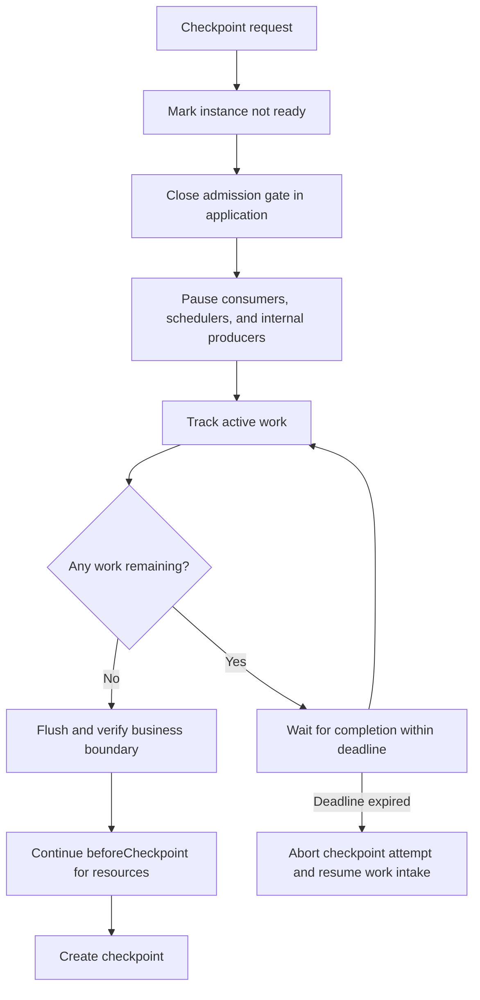

# Stop Accepting New Work and Wait for In-Flight Work to Complete

Before creating a CRaC checkpoint, the application needs to bring the process to a state that can be safely restored. An in-flight HTTP request, a partially processed message handler, or an unfinished transaction can leave an inconsistent state if the process is captured mid-way. Therefore, the application must **stop accepting new work**, and then **wait for all accepted work to complete** before proceeding to the resource preparation and checkpoint steps.

This process is commonly called *quiescing* and *draining*. Quiescing closes the gate for accepting new work; draining waits for accepted work to reach a safe completion point. These two actions must coordinate with the ingress/load balancer, HTTP server, message consumer, scheduler, executor, and background threads of the application.

This is an important part of the CRaC resource lifecycle. The `Resource.beforeCheckpoint(...)` callback is where the application orchestrates stopping work intake and waiting for drain. If a safe state cannot be reached within the configured deadline, the application should reject that checkpoint attempt and continue serving according to the designed recovery flow.

## 1. Why stop accepting work before checkpoint?

A checkpoint saves the state of the process at a point in time. If the application is still accepting and processing work while preparing for checkpoint, situations like the following can occur:

- A request has written part of the data but has not committed the transaction.
- A message has been fetched from the broker but has not finished processing or has not been acknowledged.
- An asynchronous task has been submitted to an executor but has not run yet.
- A scheduled job is updating a cache or shared state.
- A request has returned a response, but the background work it initiated is still running.
- A thread is holding a lock or modifying a data structure that another component needs to restore.

If a checkpoint is created in the middle of these activities, the heap state may no longer reflect a complete business boundary. After restore, the application risks continuing from a half-finished state, processing a task twice, missing a message, or holding a resource that is no longer valid.

The goal of draining is not to wait for all threads in the JVM to terminate. The JVM still has background threads serving the runtime. The goal is to wait for **the units of business work that the application has accepted** to reach a safe boundary: requests completed, transactions committed/rolled back, messages processed and acknowledged appropriately, or jobs having saved progress and stopped at a resumable point.

## 2. Two phases: closing the gate and draining work

### Closing the gate for new work

The application needs to block sources that generate new work before capturing state. Common sources include:

- HTTP/HTTPS traffic from a load balancer, ingress, or API gateway.
- New messages from Kafka, RabbitMQ, JMS, or other queuing systems.
- Scheduled runs from schedulers such as `@Scheduled`, Quartz, or internal cron.
- Pollers reading databases, directories, object storage, or external services.
- New tasks created from callbacks, listeners, timers, and executors.
- Long-lived connections such as WebSocket or streams that may continue sending messages.

Marking an instance as *not ready* helps the platform stop sending new traffic to that instance. However, readiness is only a signal to the orchestrator; it is not a synchronization lock inside the application. During the window while the load balancer updates its state, requests can still arrive. Keep-alive connections, requests already in network queues, or messages already received by a consumer may also continue to appear.

Therefore, an **admission gate** is needed right inside the application. This gate decides whether a new piece of work is accepted. When the gate is closed, new requests or tasks must receive an appropriate response, be routed to another instance, or be held at the source according to the retry policy. Work must not be accepted and silently dropped.

### Waiting for in-flight work to complete

After the gate closes, the application tracks the count of active work items and waits for that count to reach 0. Each work item is counted as active from the moment it is accepted until it actually finishes.

For example, with an HTTP request that invokes asynchronous processing, the work-tracking lease must be held until the `CompletableFuture` completes. If the counter is decremented as soon as the controller returns while the background task is still running, drain may report completion prematurely.

With a message consumer, stopping intake of new messages must be distinguished from finishing processing of already-received messages. The consumer can pause or stop polling; handlers that have already started must still complete, commit offsets, or acknowledge according to the broker's semantics. Do not acknowledge before the work is durably persisted.



## 3. Accurately tracking active work

A simple counter is only useful if every work intake path follows the same rule. The exact moments to increment and decrement the counter must be clearly defined:

1. Atomically increment the counter when the gate accepts a work item.
2. Return a lease/handle tied to that work item.
3. Hold the lease throughout processing, including when the work switches to another thread or runs asynchronously.
4. Decrement the counter only when the work actually finishes or has saved progress and stopped safely.
5. Close the lease exactly once, even when there are multiple completion branches or error handling paths.

Do not use two separate operations like `if (accepting) { count++; }` without a lock or coordinated atomic mechanism. One thread could close the gate between the check and the increment; drain could then observe the work count as 0 and start the checkpoint, while a new work item just slipped through.

### Example admission gate with counter and lease

The example below uses `ReentrantLock` and `Condition` so that checking the gate and incrementing the counter happen under the same lock. `Lease` can be closed from another thread and guarantees decrementing the counter only once.

```java
import java.time.Duration;
import java.util.concurrent.atomic.AtomicBoolean;
import java.util.concurrent.locks.Condition;
import java.util.concurrent.locks.ReentrantLock;

final class WorkGate {
    private final ReentrantLock lock = new ReentrantLock();
    private final Condition drained = lock.newCondition();

    private boolean accepting = true;
    private int inFlight;

    Lease tryAcquire() {
        lock.lock();
        try {
            if (!accepting) {
                return null;
            }
            inFlight++;
            return new Lease();
        } finally {
            lock.unlock();
        }
    }

    void stopAccepting() {
        lock.lock();
        try {
            accepting = false;
        } finally {
            lock.unlock();
        }
    }

    boolean awaitDrained(Duration timeout) throws InterruptedException {
        long remaining = timeout.toNanos();
        lock.lockInterruptibly();
        try {
            while (inFlight != 0) {
                if (remaining <= 0) {
                    return false;
                }
                remaining = drained.awaitNanos(remaining);
            }
            return true;
        } finally {
            lock.unlock();
        }
    }

    void resumeAccepting() {
        lock.lock();
        try {
            accepting = true;
        } finally {
            lock.unlock();
        }
    }

    final class Lease implements AutoCloseable {
        private final AtomicBoolean closed = new AtomicBoolean();

        @Override
        public void close() {
            if (!closed.compareAndSet(false, true)) {
                return;
            }

            lock.lock();
            try {
                inFlight--;
                if (inFlight == 0) {
                    drained.signalAll();
                }
            } finally {
                lock.unlock();
            }
        }
    }
}
```

An HTTP handler can use the gate as follows:

```java
void handleRequest(HttpExchange exchange) throws IOException {
    WorkGate.Lease lease = workGate.tryAcquire();
    if (lease == null) {
        exchange.sendResponseHeaders(503, -1);
        return;
    }

    try (lease) {
        processRequest(exchange);
    }
}
```

This is an illustrative example for synchronous work. In a real application, you must ensure the lease is held until the business processing finishes. If the handler only creates a `CompletableFuture` and returns, close the lease in the completion branch of the future:

```java
WorkGate.Lease lease = workGate.tryAcquire();
if (lease == null) {
    return CompletableFuture.failedFuture(
            new ServiceUnavailableException("Instance is draining")
    );
}

return processAsync()
        .whenComplete((result, error) -> lease.close());
```

In production code, handle executor task rejection, errors before the future is created, and cancellation so that the lease is always closed. If the work is forwarded to an internal queue, the lease must track both queue wait time and processing time according to the application's definition of a unit of work.

## 4. Coordinating the admission gate with CRaC

`Resource.beforeCheckpoint(...)` can call a coordinator to close the gate, stop work-producing sources, and wait for drain. The example below illustrates the coordination order; `ProducerController` is an application abstraction for pausing/resuming consumers, schedulers, and pollers.

```java
import java.time.Duration;
import java.util.concurrent.TimeoutException;

import org.crac.Context;
import org.crac.Resource;

final class DrainResource implements Resource {
    private final WorkGate gate;
    private final ProducerController producers;
    private final Duration drainTimeout;

    DrainResource(
            WorkGate gate,
            ProducerController producers,
            Duration drainTimeout) {
        this.gate = gate;
        this.producers = producers;
        this.drainTimeout = drainTimeout;
    }

    @Override
    public void beforeCheckpoint(Context<? extends Resource> context)
            throws Exception {
        gate.stopAccepting();

        try {
            producers.pause();

            if (!gate.awaitDrained(drainTimeout)) {
                throw new TimeoutException(
                        "Active work did not drain before checkpoint deadline"
                );
            }
        } catch (Exception failure) {
            try {
                producers.resume();
            } catch (Exception resumeFailure) {
                failure.addSuppressed(resumeFailure);
            }
            gate.resumeAccepting();
            throw failure;
        }
    }

    @Override
    public void afterRestore(Context<? extends Resource> context)
            throws Exception {
        // Recreate required dependencies and refresh dynamic configuration first.
        // Resume producers and open the gate only after the service is ready.
    }
}
```

`ProducerController` is an application-defined interface; it is not a built-in CRaC API. In a complete implementation, the `afterRestore` branch must call a restore coordinator to:

1. Restore database pools, broker clients, sockets, and required resources.
2. Refresh credentials, DNS, leases, and instance identity information.
3. Verify dependencies required for requests.
4. Reopen the admission gate and resume consumers/schedulers in the defined order.
5. Transition readiness back to accepting traffic after the above steps succeed.

If multiple independent `Resource` instances manage interdependent components, design a callback ordering or a shared coordinator. Do not open the gate as soon as any single callback runs if other resources have not finished restoring.

## 5. Handling each type of work source

| Work source | How to stop accepting new work | Drain condition |
|---|---|---|
| HTTP request | Mark not ready, close admission gate, reject new requests if they still arrive | Response completed; transaction committed/rolled back; lease closed |
| Message consumer | Pause partition/consumer or stop polling | Message finished processing and ack/commit according to broker semantics |
| Scheduler | Stop triggering new runs | Current job completes or saves its own progress checkpoint |
| Poller | Stop polling or fetching new batches | Batch finished processing; offset/cursor safely updated |
| Internal executor | Stop submitting new tasks | Queue and running tasks handled per policy; rejected tasks returned to source |
| WebSocket/stream | Stop accepting new sessions or new messages; send close signal if appropriate | In-flight messages complete; session closed or state saved for reconnect |
| Background callback | Cancel scheduling of new callbacks | Running callbacks complete and release resources |

### HTTP and readiness

With Spring Boot, the application can publish a readiness signal to inform the platform that the instance is no longer accepting new traffic:

```java
AvailabilityChangeEvent.publish(
        applicationContext,
        ReadinessState.REFUSING_TRAFFIC
);
```

After restoration is complete, the application can switch back:

```java
AvailabilityChangeEvent.publish(
        applicationContext,
        ReadinessState.ACCEPTING_TRAFFIC
);
```

This is a signal for readiness probes and the orchestration system. It does not track in-flight requests by itself and does not replace an admission gate. Combine readiness with an in-flight counter in a filter, interceptor, or request dispatch layer. For async MVC, reactive streams, or streaming responses, the counter must reflect when processing actually finishes, not merely when the initial method returns.

### Message broker

For consumers, clearly distinguish between *pause intake* and *finish in-flight*. A consumer may have already received messages before the pause takes effect. Drain needs to wait for running handlers to complete and confirm ack/offset commit at the right time.

If a message cannot complete within the drain deadline, you can let the broker redeliver after the consumer restarts, but only if the handler is designed to be idempotent and the ack has not been sent before the data is durable. Do not arbitrarily ack just to drive the counter to 0.

### Scheduler and long-running jobs

Schedulers must stop triggering new runs. For long-running jobs, decide upfront whether the job can finish within the drain window or must save progress and stop at a separate business checkpoint. A JVM checkpoint does not automatically replace the progress checkpoint of a distributed job.

A job processing millions of records may take many minutes or hours. Forcing a job to stop mid-batch without saving a safe cursor/offset increases the risk of duplicate processing or missed records. If it cannot stop safely, do not create a CRaC checkpoint at that time.

## 6. Drain deadlines and timeout handling

Draining must have a deadline. If waiting indefinitely, a hung request or a non-terminating job can prevent the checkpoint process from ever completing. If waiting too short, valid requests are rejected or checkpoints repeatedly fail.

The deadline should be based on:

- Maximum timeout of in-flight requests and jobs.
- Time needed to commit transactions, acknowledge messages, and flush data.
- Time for readiness state propagation to the load balancer/ingress.
- `terminationGracePeriodSeconds` or platform shutdown limits, if relevant.
- Time reserved for other resource callbacks and the checkpoint operation.

Example of an overall budget:

| Phase | Illustrative budget |
|---|---|
| Close gate and report not ready | 2 seconds |
| Wait for ingress to stop sending new traffic | 3 seconds |
| Drain in-flight requests/jobs/messages | 20 seconds |
| Flush and prepare resources | 5 seconds |
| Buffer for checkpoint engine | 10 seconds |
| Total | 40 seconds |

These are only illustrative numbers for budgeting. Real systems must measure actual latency and processing times, while ensuring callback deadlines are smaller than the limits allowed by the runtime and orchestrator.

When the deadline expires:

1. Do not proceed with checkpointing while work is still unfinished.
2. Log the count of remaining active work, work types, and elapsed wait time.
3. Restore serving state if the process continues running: resume producers, open the gate, and update readiness after confirming resources are still healthy.
4. Let the checkpoint operation fail explicitly and allow the system to retry at an appropriate time.
5. If some resources have already been closed and cannot be reopened, mark the instance not ready and execute a controlled recovery procedure.

Do not swallow `TimeoutException` and let CRaC continue capturing. Exceptions from callbacks must propagate so that the checkpoint operation is treated as failed per the runtime contract. Retry handling and process state behavior must be verified with the CRaC JDK and platform in use.

## 7. Avoiding common race conditions

### Closing the gate after checking the counter

A common bug is reading `inFlight == 0` and only then setting `accepting = false`. A new request can be accepted between those two operations. As a result, the application starts checkpointing while work is still running.

The solution is to close the gate and check the counter under the same lock or a clearly designed atomic state machine. The `WorkGate` example above places checking `accepting` and incrementing `inFlight` in the same critical section.

### Counting only synchronous requests

If a request spawns an async task, the completion of the HTTP handler does not necessarily mean business completion. Transfer the lease to the task and close it only when the task completes. For reactive pipelines, wrap the lease around the subscription/termination lifecycle rather than only around publisher creation.

### Pausing consumers but forgetting already-received messages

Pausing only prevents subsequent polls or deliveries depending on client semantics. Already-running handlers still need to be drained. Track the number of active handlers and ensure ack/commit only happens after successful processing.

### Gate closed but scheduler still submitting tasks

Every work-generating source must pass through the gate or be explicitly paused. If a scheduler keeps running and continuously creates tasks, the counter may never reach 0. If a task is rejected by the gate, the scheduler must handle the rejection according to a valid retry or skip-schedule policy.

### Resuming too early after restore

Opening the gate before database pools, broker clients, credentials, or dynamic configuration finish restoring can cause the first requests to fail. Readiness must only transition to accepting when all required dependencies are ready.

### No recovery path when checkpoint fails

If drain times out after pausing consumers and marking not ready, the application must know how to resume. Otherwise, a single failed checkpoint can leave the instance stuck in a state where it accepts no traffic. Callback design should include a rollback/compensation branch for reversible preparation steps.

## 8. Observability and operations

To know whether draining is working properly, emit metrics and logs per checkpoint attempt:

| Signal | Meaning |
|---|---|
| `crac.drain.active` | Number of active work items at observation time |
| `crac.drain.accepting` | Whether the gate is currently accepting new work |
| `crac.drain.duration` | Time from starting quiesce until drain completes |
| `crac.drain.timeout` | Number of times drain exceeded the deadline |
| `crac.drain.rejected` | Number of work items rejected while the gate is closed |
| `crac.drain.by_type` | Remaining work count by HTTP, message, scheduler, or job |

The metric names above are naming suggestions, not default CRaC metrics. You can add logs including checkpoint attempt ID, instance ID, gate close timestamp, consumer pause timestamp, initial/final work counts, timeout, and recovery outcome.

Do not log sensitive payloads, access tokens, or personal data in drain logs. Only log protected correlation IDs and metadata needed for investigation.

In operations, watch for these cases:

- Drain frequently finishes near timeout: you may need to reduce processing time, split jobs into smaller units, or increase the budget in a controlled manner.
- One type of work always remains: check for leaked leases, uncompleted futures, or hung consumer handlers.
- Counter drops to 0 too quickly: there may be an uninstrumented work path.
- Many requests rejected before ingress updates: review readiness propagation and how the gate returns responses.
- Restore succeeds but readiness is slow: check the recreation order of resources and external connections.

## 9. Drain design checklist for CRaC

- [ ] Listed all sources of new work: HTTP, messages, schedulers, pollers, executors, and long-lived connections.
- [ ] Every accepted work item has a lease or equivalent tracking mechanism.
- [ ] Checking the gate and incrementing the counter is an atomic operation.
- [ ] Leases are held until asynchronous work actually completes.
- [ ] The gate is closed before waiting for drain.
- [ ] Consumers, schedulers, and pollers have explicit pause/resume operations.
- [ ] New requests during drain are rejected or rerouted according to the retry policy.
- [ ] Transactions, message acks/offsets, and job progress are confirmed only at durable boundaries.
- [ ] Drain has a timeout and a recovery branch when timeout or callback failure occurs.
- [ ] The `beforeCheckpoint` callback completes only after business work has safely drained.
- [ ] After restore, dependencies are recreated before the gate opens and readiness switches to accepting.
- [ ] Metrics exist to detect leaked leases, hung work, and drain timeouts.
- [ ] Tested checkpointing while requests, messages, and jobs are running to verify the system waits properly or rejects checkpointing safely.

## 10. Conclusion

Stopping new work intake and waiting for in-flight work to complete is the step that brings the application to a consistent state before checkpointing. Readiness helps the platform stop sending traffic to the instance; the admission gate protects the application against requests that slip through; producer pause prevents schedulers and consumers from generating more work; and the lease counter confirms that accepted work has actually finished.

Close the gate atomically, track both synchronous and asynchronous work, set a drain deadline, and provide a recovery path if completion is not possible. Only when a safe boundary is reached should `beforeCheckpoint` allow the CRaC process to proceed. After restore, reopen the gate once required resources and dependencies are ready.
