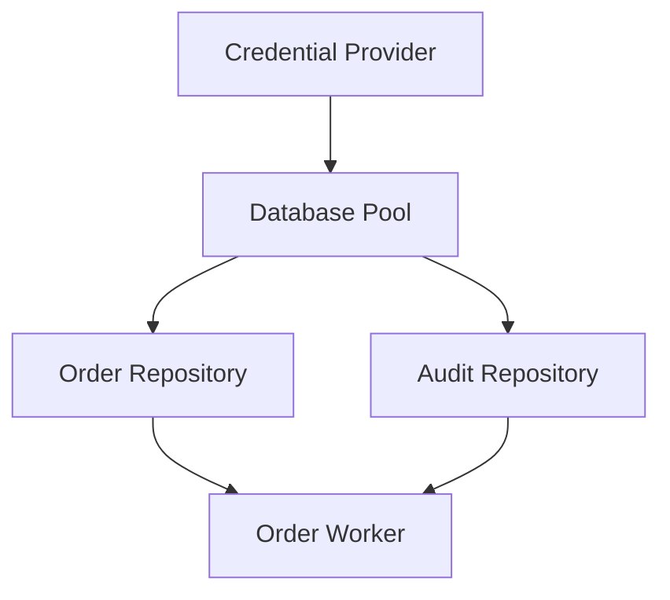

# Closing Resources in Dependency Order and Reopening in Reverse Order

Java applications often manage multiple resources with dependency relationships. A worker may use a repository; the repository uses a connection pool; the connection pool requires configuration and credentials to connect to the database. While the application is running, resources must be initialized in an appropriate order so that a dependency is ready before the component using it starts running.

When preparing for a CRaC checkpoint, the processing direction must be reversed: stop the upper-layer component first, then close the resources it depends on. After restore, open the dependency first and then restart the dependent component. This rule prevents the application from using a closed resource and helps the checkpoint–restore process take place in a controlled manner.

## 1. Understanding Dependency Relationships Between Resources

Suppose an application has a chain of resources:

```text
CredentialProvider
        ↓
DatabasePool
        ↓
OrderRepository
        ↓
OrderWorker
```

In this diagram, the arrows indicate the direction of dependency: the lower component needs the upper component to operate. `DatabasePool` needs credentials; `OrderRepository` needs the pool; `OrderWorker` calls the repository.

The initialization order is:

1. Create `CredentialProvider`.
2. Open `DatabasePool` with the credentials.
3. Initialize `OrderRepository` with the pool.
4. Start `OrderWorker`.

When closing, it must go in the reverse direction:

1. Stop `OrderWorker` so no new work uses the repository.
2. Close `OrderRepository` or the resources owned by the repository.
3. Close `DatabasePool` after no consumers are using it.
4. Release `CredentialProvider` after the pool has closed.

If the pool is closed before the worker, the worker might be executing a query while the connection has already been closed. If credentials are released before the pool, the pool might not be able to complete closing or refreshing connections. The lifecycle order must reflect the actual usage relationship.

## 2. The Rule of Closing and Opening in Reverse Order

For a dependency chain, the rule can be remembered as follows:

| Phase | Order | Example |
|---|---|---|
| Initial startup | Dependency first, dependent component after | Credential → Pool → Repository → Worker |
| Before checkpoint | Dependent component first, dependency after | Worker → Repository → Pool → Credential |
| After restore | Dependency first, dependent component after | Credential → Pool → Repository → Worker |

In other words, **close in the reverse order of opening**. This is also the familiar principle of a stack and `try-with-resources`: a resource created later is usually closed first, because it may be using a resource created earlier.

With multiple independent resources, there is no need to impose an arbitrary order between them. It is only necessary to ensure all dependency constraints are respected. For example, two independent database pools can be opened or closed in any order if no component uses them across each other.

## 3. Modeling with a Dependency Graph

In large applications, resource relationships are often not just a single chain. There may be multiple branches using the same dependency:



Here `OrderWorker` needs both `OrderRepository` and `AuditRepository`; both repositories need `DatabasePool`. `CredentialProvider` is the shared dependency of the pool.

A valid opening order must satisfy:

- `CredentialProvider` opens before `DatabasePool`.
- `DatabasePool` opens before both repositories.
- Both repositories are ready before `OrderWorker`.

One possible order is `CredentialProvider`, `DatabasePool`, `OrderRepository`, `AuditRepository`, `OrderWorker`. Another order can swap the two repositories because they are independent of each other. When closing, reverse the exact order chosen.

Algorithmically, each resource can be viewed as a node in a directed acyclic graph (DAG). An edge `A → B` means B depends on A. Topological sort produces a valid opening order; reversing that order produces a valid closing order.

### 3.1. Detecting Dependency Cycles

If A needs B to open, but B also needs A to open, the graph has a cycle. There is no linear order that satisfies both requirements. This is usually a sign of an unclear lifecycle design.

This can be handled by:

- Separating the shared configuration or interface out of the two resources.
- Using two-phase initialization: create the objects first, then link dependencies once both exist.
- Moving tightly coupled lifecycle resources into a shared owning coordinator.
- Using callbacks or lazy initialization to defer the actual dependency until the system is ready.

Do not hide a cycle by calling `open()` on each other or catching exceptions and continuing. That can cause a resource to be marked ready while its dependency is not yet operational.

## 4. Why Must Dependent Components Be Closed First?

An active component can hold a reference to a dependency and call it at any time. Therefore, before closing a dependency, components that might use that dependency must be stopped.

For example, with `OrderWorker`:

1. Stop receiving new messages or work.
2. Wait for in-flight messages to reach a safe state.
3. Complete or roll back transactions according to business policy.
4. Stop threads and schedulers belonging to the worker.
5. Close the repository or client that the worker uses.
6. Finally, close the connection pool and credential provider.

Merely calling `close()` on an object does not necessarily stop all activity. A scheduler may continue calling that object; a background thread may still be holding a connection; a consumer may continue receiving messages. Therefore, stopping incoming work and draining running operations usually must happen before releasing resources.

### 4.1. Stopping New Work and Waiting for In-Flight Work

Before a checkpoint, the application should have a quiescence boundary: no new work is accepted, and running work has completed or been brought to a state where it can safely resume.

For example, a worker might have the following steps:

- Pause the consumer so it does not receive more messages.
- Wait for running handlers to finish within a specified timeout.
- Confirm transactions have committed or rolled back.
- Flush necessary buffers or acknowledgements.
- Stop executors owned by the worker.
- Close the client or repository after no tasks are using them.

If the timeout expires and there is still running work, the checkpoint policy must clearly decide: cancel the checkpoint request, wait further within limits, or stop the instance via a safe procedure. Do not close a dependency that is currently being used by a thread.

## 5. Reopening Dependencies Before the Components That Use Them

After restore, the application needs to re-establish dependencies before starting workers or accepting traffic. With the example above:

1. Refresh `CredentialProvider` and validate the necessary credentials.
2. Recreate `DatabasePool` and verify connectivity.
3. Restore `OrderRepository` and `AuditRepository`.
4. Start `OrderWorker` and register the consumer.
5. Report readiness only when required dependencies are ready.

If the worker is started before the pool, it may receive messages and fail when accessing the database. If the repository was created with a pool that was closed before the checkpoint, the repository object may still exist on the heap, but it cannot execute queries.

Successful process restore should not be treated as proof that all dependencies are ready. The `afterRestore` callback and application-level readiness must reflect the actual recovery state.

## 6. Relation to CRaC Callbacks

CRaC provides `Resource` for applications to prepare before checkpoint and recover after restore:

- `beforeCheckpoint(...)`: stop or close resources before the snapshot is created.
- `afterRestore(...)`: recreate or refresh resources after the process is restored.

If registering each resource in the same `Context`, you must follow the callback ordering rules defined by the `org.crac` version in use. The CRaC API orders callbacks to support dependency lifecycles: `beforeCheckpoint` is invoked in the reverse order of registration, while `afterRestore` is invoked in registration order. Therefore, when using this mechanism directly, register dependencies first and dependent components afterward.

For example, the registration order is:

```java
Core.getGlobalContext().register(credentialProviderResource);
Core.getGlobalContext().register(databasePoolResource);
Core.getGlobalContext().register(orderRepositoryResource);
Core.getGlobalContext().register(orderWorkerResource);
```

With the same context, the order above allows callbacks to close the worker before the repository, pool, and credential provider; after restore, callbacks restore the credential provider before the pool, repository, and worker.

Check the Javadoc of the exact API version in use before relying on callback ordering, especially when the application uses multiple contexts or nested resources. Do not infer a global order between resources managed by independent contexts.

### 6.1. Using a Coordinator When Explicit Ordering Control Is Needed

When dependencies are complex, many resources are initialized by a framework, or registration order is difficult to control, you can create a `Resource` that coordinates the lifecycle. The coordinator keeps a list in opening order; at checkpoint, it traverses the list in reverse; after restore, it traverses in the original order.

Example:

```java
import org.crac.Context;
import org.crac.Core;
import org.crac.Resource;

import java.util.ArrayList;
import java.util.List;

interface ManagedResource {
    void open() throws Exception;
    void close() throws Exception;
}

public final class ResourceLifecycleCoordinator implements Resource {

    // Dependency first, dependent component after.
    private final List<ManagedResource> openOrder;

    public ResourceLifecycleCoordinator(
            List<ManagedResource> openOrder) {
        this.openOrder = List.copyOf(openOrder);
    }

    @Override
    public void beforeCheckpoint(Context<? extends Resource> context)
            throws Exception {
        // Close in reverse order: dependent first, dependency after.
        for (int i = openOrder.size() - 1; i >= 0; i--) {
            openOrder.get(i).close();
        }
    }

    @Override
    public void afterRestore(Context<? extends Resource> context)
            throws Exception {
        List<ManagedResource> opened = new ArrayList<>();

        try {
            // Open dependency first, then open dependent.
            for (ManagedResource resource : openOrder) {
                resource.open();
                opened.add(resource);
            }
        } catch (Exception failure) {
            // If partially opened, release the opened resources in reverse order.
            for (int i = opened.size() - 1; i >= 0; i--) {
                try {
                    opened.get(i).close();
                } catch (Exception cleanupFailure) {
                    failure.addSuppressed(cleanupFailure);
                }
            }
            throw failure;
        }
    }

    public static void register(ResourceLifecycleCoordinator coordinator) {
        Core.getGlobalContext().register(coordinator);
    }
}
```

The list passed to the coordinator must be ordered with dependencies first and dependents after. For example:

```java
List<ManagedResource> openOrder = List.of(
        credentialProvider,
        databasePool,
        orderRepository,
        orderWorker
);

ResourceLifecycleCoordinator coordinator =
        new ResourceLifecycleCoordinator(openOrder);

ResourceLifecycleCoordinator.register(coordinator);
```

This example is a lifecycle coordination skeleton. `ManagedResource` implementations need to manage their own open/close state, handle partially opened resources, and ensure `open()` or `close()` has defined failure behavior. Do not register both the coordinator and individual child resources in the same context if doing so causes a resource to be closed or opened twice.

## 7. Error Handling During Closing and Opening

Correct ordering does not only apply when all operations succeed. It is necessary to clearly define behavior if a resource fails to close or open.

### 7.1. A Resource Fails to Close Before Checkpoint

Suppose `OrderWorker` has stopped, but `OrderRepository` cannot close because an unfinished query remains. In that case, you should not proceed to close `DatabasePool`, because the repository may still need the pool to complete or release the query.

A safe policy is usually:

1. Stop the closing process at the failing resource.
2. Report an error so the checkpoint is rejected or not considered successful.
3. Keep lower-level dependencies active until the dependent's state is handled.
4. Perform a rollback/reopen of previously closed resources if the application can recover safely.
5. If rollback cannot be completed, mark the instance as not ready and use a recovery or fresh startup procedure.

Do not catch and ignore exceptions just to proceed with the checkpoint. An image created from a process with resources in an undefined state may fail to restore or behave incorrectly.

### 7.2. A Dependency Fails to Reopen After Restore

If `DatabasePool` fails to connect, you should not continue opening the repository and worker as if the system were ready. Stop the opening chain at the failing dependency. Previously opened resources need to be closed in reverse order to avoid leaks.

After a failure, readiness must remain in a failed or not-ready state. Depending on the platform, the instance may retry with limits, wait for the dependency to recover, or exit so the orchestrator creates a new instance. Do not let the worker accept traffic when a required dependency is not yet operational.

### 7.3. Designing Open/Close Operations to Be Safe When Called Repeatedly

In a real lifecycle, a resource may already be closed, not yet opened, partially opened, or recovering. Therefore:

- `close()` should be safe when called on an already closed state if that fits the resource's API.
- `open()` should detect an already opened resource to avoid creating duplicate threads, pools, or listeners.
- If `open()` fails partway through, the resource must release the partially created parts itself or clearly report an incomplete state.
- Do not set the `ready = true` flag before all required dependencies are operational.
- Do not use a single shared boolean variable to represent the state of multiple independent resources.

Operations must be synchronized with business threads. An idempotent `close()` is still unsafe if another thread continues using the resource during closing. Work must be drained, or appropriate locking and lifecycle state mechanisms must be used.

## 8. Types of Resources That Typically Need Ordering

| Resource | Before checkpoint | After restore |
|---|---|---|
| Scheduler/worker | Stop accepting work, wait for running tasks, stop the executor it owns | Recreate executor, register schedules, and start worker after dependencies |
| Message consumer | Pause/stop consumer, handle acknowledgements and in-flight messages | Create new consumer, register subscriptions, and start receiving messages |
| Repository/client | Stop new requests, wait for current operations, release internal state | Reinitialize after the underlying connection pool or client |
| Connection pool | Close pool after all consumers have stopped | Open pool after credentials/configuration are ready |
| Credential provider | Release cache or secret session if needed | Fetch or validate new credentials before opening the pool |
| HTTP client | Stop requests, close sockets/pool if needed | Create new client or connection pool before opening services that use it |
| File handle/stream | Flush and close writer/stream before the file or storage owner | Open storage/file before writers and consumers |
| Native library/context | Stop components calling native code before releasing the context | Create native context before initializing dependent wrappers |

Not every resource needs to be closed. Some libraries support CRaC and handle callbacks themselves; some resources can be restored by the platform; some resources must be created anew. Follow the library's guidance and avoid having both the application and the library own the same lifecycle, causing double closing.

## 9. Common Mistakes

**Closing a dependency before its dependent.** The worker or repository may still use the pool after the pool has closed. Stop upper-layer components first.

**Opening a dependent before its dependency.** The worker receives work when the pool or credentials are not ready yet. Open in dependency-first, dependent-after order.

**Calling close without draining activity.** Background threads or running requests may still be using the resource. Stop accepting new work and wait for running activity to reach a safe boundary.

**Assuming registration order does not matter.** CRaC callbacks in the same context have ordering rules. Register in dependency order and check the Javadoc of the exact API version.

**Registering both child resources and the coordinator.** A resource can receive callbacks twice if it is managed both directly and by a coordinator. Each resource needs one clear lifecycle owner.

**Ignoring callback errors.** If a dependent has not closed yet, continuing to close the dependency can corrupt state. If a dependency fails to open, do not start the dependent.

**Treating object initialization order as the complete dependency graph.** Constructor order does not always reflect all runtime relationships. List threads, schedulers, listeners, and callbacks that may use the resource as well.

**Not handling dependency cycles.** Two resources waiting on each other to open or close cannot be ordered in a linear list. Separate ownership or use multi-phase initialization.

## 10. Self-Check for Understanding

1. **If a repository depends on a connection pool, which component must close first?** The repository must stop operating and close before the pool, because the repository is still using the pool.
2. **After restore, open the pool or the repository first?** Open the pool first, then restore the repository.
3. **If a worker uses a repository and the repository uses a pool, what is the opening order?** Pool → Repository → Worker; the closing order is Worker → Repository → Pool.
4. **Why must requests be drained before closing a dependency?** So that no thread or request is still using the resource while that resource is being released.
5. **If a dependency fails to open after restore, should the worker accept traffic?** No. Readiness must remain not-ready, and upper-layer dependents must not be opened.
6. **What does a dependency graph with a cycle indicate?** The lifecycle cannot yet be linearly ordered; ownership needs to be separated, multi-phase initialization used, or dependencies redesigned.

## Conclusion

Resource lifecycle order must follow dependency relationships. During initialization or restore, open the dependency first and then open the component that uses it. When preparing for a checkpoint, stop and close the dependent component first and then release the dependency. Given a valid opening list, the closing order is simply the reversed list.

In CRaC applications, model dependencies explicitly, stop running work before closing, use `beforeCheckpoint` and `afterRestore` to coordinate, and handle callback errors and readiness intentionally. When there are many resources or complex dependencies, a coordinator with an explicit opening order makes the lifecycle easier to understand and control.
