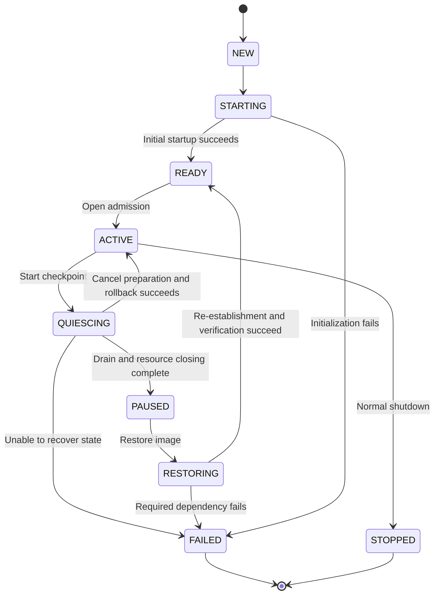

# Designing Active, Paused, and Ready-Again States

In a Java application using CRaC, a checkpoint is not just an operation that writes memory to an image. The application must transition from a serving state to a safe state for snapshotting, and then be able to restore and resume operations without duplicating work or reusing stale resources.

A controllable way to design this is to model the application lifecycle with explicit states:

- **ACTIVE**: the application is operating normally and can accept work.
- **QUIESCING**: the application stops accepting new work, waits for in-flight work to complete, and prepares resources.
- **PAUSED**: work has been safely stopped, and resources that need to be closed have been handled; this state is suitable for checkpointing.
- **RESTORING**: the process has just been restored and is re-establishing external dependencies.
- **READY**: required resources have been recovered and verified; the application can be brought back into service.
- **FAILED**: the pausing or recovery process encountered an error and cannot continue safely.
- **STOPPED**: the application has stopped completely according to the normal lifecycle.

These states help answer three operational questions: is the application accepting work, can it be checkpointed right now, and after restore is it eligible to receive requests yet.

## 1. Why Is a State Model Needed?

An application may contain many components operating simultaneously: an HTTP server, thread pools, schedulers, message consumers, database pools, cache clients, and background tasks. If checkpoint is simply called while the process is still operating normally, these components may be at different points in time:

- A request is updating data but has not committed yet.
- A consumer has received a message but has not acknowledged it yet.
- A scheduler is launching a periodic task.
- A thread is holding a lock or waiting on I/O.
- A connection pool is holding sockets that an external server will close while the application is paused.
- A cache contains temporary data that is only meaningful in the current run session.

Checkpointing such a state can cause the application after restore to continue from an inconsistent point. For example, a message has already been processed in an external system, but the ack state has not been recorded; when the consumer resumes, the message may be delivered a second time.

A state model forces the application to go through ordered steps. It also creates a centralized place to check conditions before allowing a checkpoint or reporting readiness after restore.

## 2. Defining the States

| State | Meaning | Accept new work? | Exit condition |
|---|---|---:|---|
| NEW | The object graph has just been created in a fresh run | No | Start initialization |
| STARTING | Creating and verifying initial resources | No | Required dependencies are ready |
| ACTIVE | The application is serving normally | Yes | Receive checkpoint or shutdown request |
| QUIESCING | Stopping admission and draining work | No | In-flight work has completed |
| PAUSED | Workers have stopped and resources are in a safe state | No | Restored from checkpoint |
| RESTORING | Recreating or verifying resources after restore | No | All required dependencies are ready |
| READY | Recovered; readiness can be enabled | Can open admission | Brought back into the serving flow |
| FAILED | Cannot guarantee a safe state or recovery | No | Error handling or instance replacement required |
| STOPPED | Permanently stopped | No | Does not continue from this lifecycle |

`PAUSED` and `STOPPED` have different meanings. PAUSED is a temporary state for saving an image and can continue after restore. STOPPED is the end of the instance lifecycle. Do not use the same `running=false` flag for both cases, because recovery code needs to know whether the application is waiting for restore or has been permanently stopped.

`READY` is also different from `ACTIVE`. READY indicates that required dependencies have been re-established and the instance can receive traffic. ACTIVE is the normal serving state after admission is opened. In a simple deployment, the two states may transition very quickly; they should still be distinguished in the model to coordinate with load balancers and readiness probes.

## 3. State Transition Diagram

Typical checkpoint and restore flow:



State transitions must have clear conditions. Do not allow transitioning directly from ACTIVE to PAUSED if requests or workers are still performing business operations. Do not transition from RESTORING to READY just because a client object was created; actual connectivity and access permissions must be verified.

### Invariants to Maintain

- When in QUIESCING or PAUSED, admission must be closed and must not accept new work.
- Only transition to PAUSED when in-flight work has drained and resources requiring preparation have completed.
- When in RESTORING, readiness must be false.
- Only transition to READY after all required dependencies have recovered.
- When in FAILED, do not automatically open admission to try serving again.
- STOPPED must not be treated as PAUSED and must not be automatically restored from the same lifecycle object.

## 4. Transitioning from ACTIVE to QUIESCING

When starting a checkpoint, the first step is to close the path for accepting new work. This needs to be coordinated with the HTTP server, load balancer, message broker, and scheduler.

An applicable sequence:

1. Change the state from ACTIVE to QUIESCING so components know that the instance is preparing for a checkpoint.
2. Close admission at the HTTP filter/server or remove the instance from the load balancer.
3. Stop receiving new messages from the broker.
4. Pause new scheduled runs and periodic jobs.
5. Wait for in-flight requests and tasks to complete within a bounded time period.
6. Handle remaining tasks according to policy: complete them, save a business checkpoint, or cancel them in a controlled manner.

Closing only the HTTP port is not enough. Consumers, schedulers, and internal workers can continue creating new work. Each work-producing source needs its own pause or drain mechanism.

### Tracking In-Flight Work

The application can maintain a counter of the number of admitted tasks currently in progress:

```java
import java.util.concurrent.atomic.AtomicInteger;

public final class InFlightCounter {

    private final AtomicInteger count = new AtomicInteger();

    public void started() {
        count.incrementAndGet();
    }

    public void finished() {
        int remaining = count.decrementAndGet();
        if (remaining < 0) {
            throw new IllegalStateException("In-flight counter became negative");
        }
    }

    public int current() {
        return count.get();
    }
}
```

When a request is accepted, increment the counter; in `finally`, decrement the counter. When quiescing, close admission first and then wait for the counter to reach 0. In an application with multiple types of workers, track them separately or aggregate all of them into a unified drain mechanism.

Example:

```java
inFlight.started();
try {
    handleRequest();
} finally {
    inFlight.finished();
}
```

The illustrative snippet needs to be placed inside an admission wrapper that ensures `started()` is only called after the request has been accepted. If the request is rejected because of QUIESCING, do not increment the counter.

### Drain with Timeout

Do not wait indefinitely for a hung request or background task. Set a deadline for draining and log remaining work if time runs out. Depending on business requirements, you can:

- Cancel tasks that can be safely canceled.
- Wait longer within operational limits.
- Persist state so the task can continue after restore.
- Reject the checkpoint if the task cannot be safely stopped.

Never arbitrarily mark drain as complete while the counter still has remaining work. That only hides an inconsistent state.

## 5. Transitioning from QUIESCING to PAUSED

After stopping new work acceptance and draining successfully, the application prepares external resources. CRaC provides `Resource.beforeCheckpoint(...)` to perform this step.

For example, a resource can:

- Stop workers and schedulers.
- Commit or roll back transactions according to business rules.
- Flush necessary files and logs.
- Ack processed messages and stop consumers.
- Close database connection pools or HTTP connections.
- Record the application state as PAUSED.

Only mark PAUSED after the required steps have completed. If closing a resource fails, the instance must not be considered ready for checkpointing.

### Example Resource for Lifecycle Management

The following snippet illustrates a single coordinator orchestrating admission, workers, and external dependencies. The `AdmissionGate`, `BackgroundWork`, and `ExternalDependencies` interfaces are application-defined abstractions; they must be implemented using the concrete APIs of the server, executor, and clients in use.

```java
import org.crac.Context;
import org.crac.Core;
import org.crac.Resource;

public final class ApplicationLifecycleResource implements Resource {

    public enum State {
        NEW,
        STARTING,
        ACTIVE,
        QUIESCING,
        PAUSED,
        RESTORING,
        READY,
        FAILED,
        STOPPED
    }

    public interface AdmissionGate {
        void close() throws Exception;
        void open() throws Exception;
    }

    public interface BackgroundWork {
        void stopAcceptingAndDrain() throws Exception;
        void stop() throws Exception;
        void start() throws Exception;
    }

    public interface ExternalDependencies {
        void connectAndVerify() throws Exception;
        void closeForCheckpoint() throws Exception;
    }

    private final AdmissionGate admission;
    private final BackgroundWork backgroundWork;
    private final ExternalDependencies dependencies;

    private volatile State state = State.NEW;

    public ApplicationLifecycleResource(
            AdmissionGate admission,
            BackgroundWork backgroundWork,
            ExternalDependencies dependencies) {
        this.admission = admission;
        this.backgroundWork = backgroundWork;
        this.dependencies = dependencies;
        Core.getGlobalContext().register(this);
    }

    public synchronized void startNormally() throws Exception {
        require(State.NEW);
        state = State.STARTING;
        try {
            dependencies.connectAndVerify();
            backgroundWork.start();
            state = State.READY;
            admission.open();
            state = State.ACTIVE;
        } catch (Exception failure) {
            failClosed(failure);
            throw failure;
        }
    }

    @Override
    public synchronized void beforeCheckpoint(
            Context<? extends Resource> context) throws Exception {
        require(State.ACTIVE);
        state = State.QUIESCING;
        try {
            admission.close();
            backgroundWork.stopAcceptingAndDrain();
            backgroundWork.stop();
            dependencies.closeForCheckpoint();
            state = State.PAUSED;
        } catch (Exception failure) {
            // Roll back only if every dependency can be restored safely.
            try {
                dependencies.connectAndVerify();
                backgroundWork.start();
                admission.open();
                state = State.ACTIVE;
            } catch (Exception recoveryFailure) {
                failure.addSuppressed(recoveryFailure);
                failClosed(failure);
            }
            throw failure;
        }
    }

    @Override
    public synchronized void afterRestore(
            Context<? extends Resource> context) throws Exception {
        require(State.PAUSED);
        state = State.RESTORING;
        try {
            dependencies.connectAndVerify();
            backgroundWork.start();
            state = State.READY;
            admission.open();
            state = State.ACTIVE;
        } catch (Exception failure) {
            failClosed(failure);
            throw failure;
        }
    }

    public State state() {
        return state;
    }

    public boolean isReady() {
        return state == State.ACTIVE;
    }

    private void require(State expected) {
        if (state != expected) {
            throw new IllegalStateException(
                    "Expected state " + expected + " but was " + state);
        }
    }

    private void failClosed(Exception failure) {
        state = State.FAILED;
        try {
            admission.close();
        } catch (Exception closeFailure) {
            failure.addSuppressed(closeFailure);
        }
    }
}
```

This is a design skeleton to illustrate state transitions, not a complete implementation for every server or executor. In a real application, collaborators must ensure drain with timeout, diagnosable close/open operations, and that `connectAndVerify()` can recreate closed resources.

The example also demonstrates these principles:

- `beforeCheckpoint` only accepts starting from ACTIVE.
- State changes to QUIESCING before closing admission.
- PAUSED is only set after draining, stopping, and closing dependencies succeed.
- `afterRestore` only accepts the PAUSED state restored from the image.
- READY only appears after dependencies and workers have been recovered.
- If rollback or restore fails, admission is closed and state transitions to FAILED.

If the application needs to manage multiple independent CRaC resources, the dependency order between them must be clearly defined. Do not rely on accidental registration order. Related operations can be grouped into a single coordinator or use nested Contexts according to the exact contract of the CRaC version.

## 6. Designing the PAUSED State

PAUSED does not just mean a boolean variable has been set to false. It must represent a verifiable set of conditions:

- Admission is closed.
- No business requests or tasks are still running.
- Schedulers are not launching additional jobs.
- Consumers are not receiving additional messages.
- Received messages have a clear processing/ack state.
- Transactions have completed or been handled according to policy.
- Resources requiring closure have closed successfully.
- Workers are no longer holding locks or buffers in an unsafe state.

An instance should only enter PAUSED when these required conditions are satisfied. If a component cannot be stopped, determine whether it is supported by CRaC/runtime and whether it can be safely kept across a checkpoint.

### Separating Application State from Individual Resource State

A large application may have many resources with their own states:

| Component | Before checkpoint | While PAUSED | After restore |
|---|---|---|---|
| HTTP admission | OPEN | CLOSED | Wait for readiness then OPEN |
| Request handler | RUNNING | DRAINED | RUNNING |
| Scheduler | RUNNING | STOPPED | STARTED |
| Message consumer | CONSUMING | PAUSED/CLOSED | REJOINED |
| Database pool | CONNECTED | CLOSED | RECREATED |
| HTTP client | CONNECTED | CLOSED/INVALIDATED | RECREATED |
| Cache | WARM | Keep or clear per policy | Verify or warm up again |

The coordinator aggregates the state of each resource. One should not assume that just because the overall state is PAUSED, every component has definitely stopped; results from the preparation steps are required.

## 7. Designing the READY State After Restore

When restoring an image, the heap contains the saved object graph again. However, network connections, credentials, locks, broker assignments, and external services may have changed.

The RESTORING state should keep admission closed while the application:

1. Reloads dynamic configuration or credentials that need refreshing.
2. Creates the database pool and verifies a query.
3. Creates HTTP clients or refreshes connection pools.
4. Reconnects to the broker and verifies subscriptions/assignments.
5. Reopens files, acquires locks, or creates native resources if needed.
6. Starts workers and schedulers according to policy.
7. Checks required dependencies.

Only when the required steps complete should it transition to READY. A successful client constructor does not prove the server can serve requests. Perform actual operational checks with a reasonable timeout.

### Readiness and Liveness

Readiness and liveness answer two different questions:

- **Readiness**: can the instance accept work right now?
- **Liveness**: is the process still alive and capable of continuing to operate?

During RESTORING, the process may be alive but not yet have a database connection. At that time, liveness may succeed, while readiness must fail. If readiness turns on too early, a load balancer or orchestrator may send requests to an instance that is not ready.

With Spring Boot, the state machine can be integrated into a readiness health indicator. The readiness indicator should return an unready status when the state is NEW, STARTING, QUIESCING, PAUSED, RESTORING, READY, or FAILED; only report ready when the state is ACTIVE, meaning admission has been successfully opened.

### READY Before ACTIVE

READY indicates that all dependencies have been verified and admission can be opened. ACTIVE indicates that the instance has been brought back into the serving flow. In one deployment, opening admission may happen immediately after READY; in another deployment, the orchestrator may need to update routes or register the instance first.

There is no need to prolong the READY state if the system has no separate orchestration step. However, keeping this concept helps separate resource recovery failures from failures in bringing the instance back into traffic.

## 8. Canceling Checkpoint and Recovering from Errors

Transitioning to PAUSED can fail midway. For example, admission has closed, workers have stopped, but the database pool failed to close. The application must have a clear policy:

- If the checkpoint has not been executed and all resources can be re-established, roll back to ACTIVE.
- If rollback succeeds, open admission and allow serving to continue.
- If rollback fails, transition to FAILED, keep admission closed, and let the orchestration system replace the instance or handle the incident.

Never set the state to ACTIVE just because an exception was caught. ACTIVE is only valid when all operating conditions have been restored.

CRaC provides `beforeCheckpoint` and `afterRestore` callbacks; do not design an `afterCheckpoint` callback assuming it will always be called for rollback. Verify the behavior of the JDK/runtime for errors occurring before, during, and after the dump operation. If the application needs to continue running when a checkpoint fails, rollback must be implemented according to the actual control flow and contract of the runtime.

### Error Classification

| Error | Reaction |
|---|---|
| Drain timeout | Do not mark PAUSED; cancel checkpoint or handle tasks per policy |
| Failed to close connection | Attempt rollback if safe; otherwise, FAILED |
| Invalid credentials on restore | Keep readiness false and report error clearly |
| Broker cannot rejoin | Retry with a bound; do not open consumer if unverified |
| Partial worker startup | Stop started workers and remain FAILED if unrecoverable |
| Readiness gate fails to open | Do not declare ACTIVE; report orchestration error |

Every error needs logging and execution timing. Avoid infinite retries inside callbacks because they can cause the restore process to hang without a clear operational outcome.

## 9. Work Consistency and Idempotency

A checkpoint saves the state of the process; it does not create a distributed transaction between the JVM and a database or message broker. Therefore, the application needs to ensure business operations are not executed twice upon restore.

Example with a message:

1. Consumer receives message M.
2. Application updates the database.
3. Before acking M, a checkpoint occurs.
4. After restore, the broker may redeliver M.
5. The handler needs to recognize that M has already been processed so it does not update the database a second time.

Solutions that can be used:

- Business-level idempotency keys.
- Deduplication tables or unique constraints.
- Transactional outbox/inbox.
- Ack/commit offset after the business operation is durable.
- Time-bounded leases and locks instead of assuming old leases still hold.

For schedulers, avoid running the same schedule twice if scheduler state is restored while another instance is also running that schedule. For worker pools, stop accepting new work, drain queues, or persist job state through a durable mechanism.

## 10. Observing and Testing the State Machine

Log each state transition in the format:

```text
INFO lifecycle from=ACTIVE to=QUIESCING reason=checkpoint
INFO lifecycle from=QUIESCING to=PAUSED in_flight=0
INFO lifecycle from=PAUSED to=RESTORING reason=crac_restore
INFO lifecycle from=RESTORING to=READY dependencies=all_healthy
INFO lifecycle from=READY to=ACTIVE admission=open
```

Do not log secrets, business payloads, or credentials. It is also advisable to log:

- Time spent in each state.
- Number of in-flight requests/tasks when drain starts.
- Which resources take the longest to close or recover.
- Retry counts and causes.
- Readiness results.
- Reason for transitioning to FAILED.

### Test Scenarios

| Scenario | Expected result |
|---|---|
| Fresh JVM startup | NEW → STARTING → READY → ACTIVE |
| Checkpoint with no requests | ACTIVE → QUIESCING → PAUSED |
| Checkpoint with in-flight request | Request completes before entering PAUSED |
| Drain timeout | Does not enter PAUSED; rollback or FAILED |
| Scheduler running | New jobs prevented, current job handled per policy |
| Broker has in-flight messages | Ack state not lost; duplicates handled safely |
| Restore with healthy dependencies | PAUSED → RESTORING → READY → ACTIVE |
| Restore when database fails | Do not open readiness; report error or bounded retry |
| Restore with expired credentials | Refresh credentials or clearly FAILED |
| One resource fails to recover | Admission remains closed |
| Normal shutdown | ACTIVE → STOPPED, not confused with PAUSED |

Testing needs to use real checkpoint/restore on the target runtime. Calling a simulated `afterRestore()` method directly only tests Java logic; it does not prove CRaC restored the object graph and invoked callbacks according to the proper lifecycle.

## 11. Common Design Mistakes

| Unsafe design | Consequence | Design approach |
|---|---|---|
| Using only a `running` boolean | Cannot distinguish draining, paused, and failed | Use an enum/state machine with valid transitions |
| Closing admission after stopping workers | New requests can still create additional work | Close admission first, then drain |
| Marking PAUSED before closing resources | Image may contain resources in a half-finished state | Only PAUSED when all required steps complete |
| Opening readiness at the start of afterRestore | Traffic arrives before dependencies are ready | Stay in RESTORING until health checks succeed |
| Catching exceptions and continuing | Instance serves with broken dependencies | Transition to FAILED and keep admission closed |
| Using STOPPED for checkpoint | Restore does not know if instance is waiting to resume or has ended | Distinguish PAUSED and STOPPED |
| Recreating all schedulers/consumers | Work or side effects are duplicated | Only restart resources that were intentionally stopped |
| No timeout for drain/reconnect | Checkpoint or restore hangs indefinitely | Use deadlines, timeouts, and error policies |
| Relying on accidental callback order | Dependent resources may recover in the wrong order | Use a coordinator or an order explicitly supported by the API |

## 12. Design Checklist

### Before Checkpoint

- [ ] Has an ACTIVE state and transitions to QUIESCING in a controlled manner.
- [ ] Admission closes before draining requests and tasks.
- [ ] All sources of new work such as schedulers and consumers are paused.
- [ ] Timeouts exist for in-flight requests/tasks.
- [ ] Transactions, messages, files, and native resources have clear policies.
- [ ] Only transitions to PAUSED after all required conditions are complete.

### After Restore

- [ ] Restored state starts from PAUSED and transitions to RESTORING.
- [ ] Dependencies are recreated or verified in dependency order.
- [ ] Credentials, endpoints, connections, and locks are refreshed when needed.
- [ ] Workers/schedulers are restarted only once.
- [ ] Health checks perform actual operations, with timeouts.
- [ ] Only transitions to READY when all required dependencies are healthy.
- [ ] Admission and readiness are opened after recovery is complete.

### Errors and Operations

- [ ] Has a FAILED state and does not automatically open admission on failure.
- [ ] Has rollback when checkpoint preparation fails and rollback is genuinely safe.
- [ ] Does not rely on non-existent callbacks such as afterCheckpoint.
- [ ] Side effects and message handlers have idempotency/deduplication.
- [ ] Logs state transitions and timing for each step.
- [ ] Tested with real checkpoint/restore, including dependency failure cases.

A clear state machine turns checkpoint–restore into an observable and controllable process. ACTIVE indicates the application is serving; QUIESCING and PAUSED ensure work is stopped at a safe point; RESTORING re-establishes external resources; READY confirms the instance is eligible to return to traffic. When each state has specific invariants and transition conditions, the application reduces the risk of accepting requests too early, duplicating work, or resuming with stale connections.
