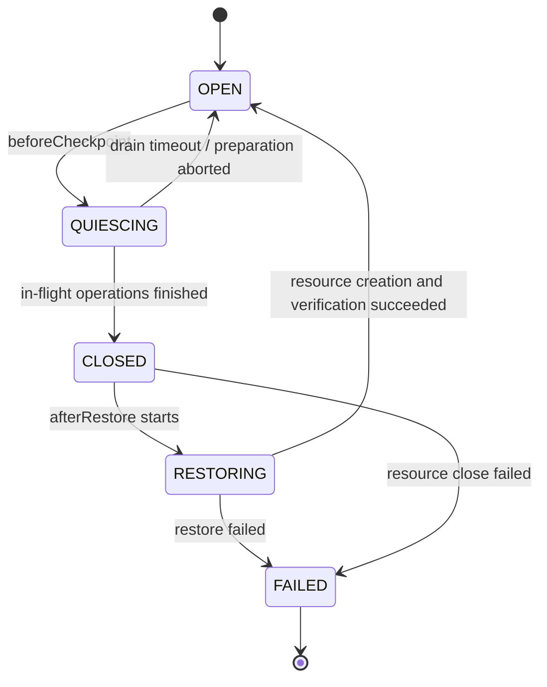

# Preventing Resource Access During the Checkpoint–Restore Transition

In CRaC (Coordinated Restore at Checkpoint), an application needs to control resource usage throughout the transition from the active state to checkpoint and from checkpoint back to the serving state. A process may contain many components sharing resources: HTTP requests, connection pools, message consumers, schedulers, sockets, file handles, or external service clients. If these components continue accessing a resource while the resource is being closed or reinitialized, the application may encounter connection errors, incomplete operations, or inconsistent state.

The solution is to create a **controlled access gating** mechanism. Before checkpoint, the application stops accepting new work, blocks new operations on the resource, and waits for in-flight operations to complete. After restore, the application keeps the gate closed while recreating and verifying the resource; it only opens access when the resource is ready.

This needs to be performed at two scopes:

- **Application scope:** stop accepting new requests or work, drain in-flight requests, and keep the instance in a not-ready state.
- **Resource scope:** protect each resource so that no new operation starts while the resource is transitioning state, while waiting for already-authorized operations to complete.

The two scopes work together. The gate at the resource level protects the resource itself; readiness and ingress control protect the processing flow of the entire application.

## 1. Why prevent access during the transition?

A checkpoint saves the state of a running process. Before writing the image, the application may need to close connection pools, stop consumers, or release sockets. After restore, these resources may need to be recreated because old connections are no longer valid or external services have changed while the checkpoint was stored.

If an application thread uses a resource at the exact moment a callback is closing the resource, several situations can occur:

- A request obtains a reference to the connection pool, but the pool is closed before the request acquires a connection.
- A consumer is processing a message while a callback begins closing the channel or client.
- A scheduler starts a new task after the application has already started draining.
- A thread reads a cache or client while `afterRestore` is replacing the old object with a new object.
- The application reports healthy too early and receives requests while the database pool or broker client has not yet reconnected.
- An asynchronous operation was launched before checkpoint, but its completion handler runs after the resource has closed.

Merely setting an `isCheckpointing` flag and checking it scattered across the source code is usually not enough. Every access path must use the same synchronization mechanism; if one caller bypasses the flag, a race condition still exists. The control mechanism must manage both new operations and operations that already started before the gate closed.

## 2. Distinguishing lifecycle states

A resource should have explicit states to decide whether operations are allowed. The following model can be used:

| State | Meaning | Business operations allowed? |
| --- | --- | --- |
| `OPEN` | The resource is ready and the application is active | Yes |
| `QUIESCING` | New operations are blocked; waiting for in-flight operations to complete | No |
| `CLOSED` | Operations have finished and the resource has been closed for checkpoint | No |
| `RESTORING` | Recreating or verifying the resource after restore | No |
| `FAILED` | Cannot guarantee the resource is safe or ready | No |

Typical state transition flow:



`QUIESCING` is a critical state. When transitioning to this state, the system does not grant permission for new operations but still allows previously authorized operations to complete. Only when the number of active operations reaches 0 does the callback close the resource.

If waiting for drain exceeds the timeout, the callback must report an error and abort the checkpoint preparation. At that point the resource has not been closed, so the gate can be reopened for the application to continue operating or retry after addressing the cause. If closing the resource has already started and failed, the gate should not be automatically opened as if the resource were still healthy; the error state should be kept and handled by operational procedures.

## 3. Two layers of protection: application ingress and Resource gate

### 3.1. Stopping new work at the application level

Before checkpoint, the deployment platform or lifecycle manager should take the instance out of the traffic-receiving flow. For HTTP applications, this is typically done via readiness, a load balancer, or an ingress controller. For workers, receiving new messages must be paused. For schedulers, new schedules must be prevented from triggering.

A general drain procedure:

1. Mark the instance as no longer ready to accept new work.
2. Stop accepting new requests, messages, or jobs.
3. Wait for in-flight requests and work to complete within a time limit.
4. Instruct each resource to close its access gate and drain direct operations on the resource.
5. Proceed with checkpoint only when all required components are in a safe state.

The `beforeCheckpoint` callback does not automatically update the load balancer's readiness or guarantee that ingress has stopped sending requests. Traffic coordination must be integrated with the application runtime platform. If relying only on the resource gate, new requests can still enter the application and then receive errors when attempting to use the locked resource.

### 3.2. Blocking direct operations at the Resource level

Even when ingress has drained, there may still be background tasks, internal callbacks, or access paths that do not go through HTTP. Therefore, each critical resource needs its own access gate or to participate in a shared gate mechanism.

Every operation using the resource must acquire an access permission (lease) before use. The lease is released in `finally` or `try-with-resources`. When `beforeCheckpoint` transitions the gate to `QUIESCING`, all new lease acquisitions are rejected; the callback waits for existing leases to be released before closing the resource.

This is the core point: **count and wait for operations currently using the resource**, rather than just checking a boolean.

## 4. Operation Gate pattern

A simple gate can use `ReentrantLock`, `Condition`, and a counter of active operations. `enter()` issues a lease when the state is `OPEN`; `Lease.close()` decrements the counter; `quiesceAndDrain()` transitions to `QUIESCING` and waits for the counter to reach 0.

```java
import java.time.Duration;
import java.util.concurrent.TimeoutException;
import java.util.concurrent.locks.Condition;
import java.util.concurrent.locks.ReentrantLock;
import java.util.concurrent.atomic.AtomicBoolean;

public final class ResourceGate {

    public enum State {
        OPEN,
        QUIESCING,
        CLOSED,
        RESTORING,
        FAILED
    }

    private final ReentrantLock lock = new ReentrantLock();
    private final Condition drained = lock.newCondition();
    private State state = State.OPEN;
    private int activeOperations;

    public Lease enter() {
        lock.lock();
        try {
            if (state != State.OPEN) {
                throw new IllegalStateException(
                        "Resource is unavailable: " + state);
            }

            activeOperations++;
            return new Lease(this);
        } finally {
            lock.unlock();
        }
    }

    private void leave() {
        lock.lock();
        try {
            if (activeOperations <= 0) {
                throw new IllegalStateException("Unbalanced resource lease");
            }

            activeOperations--;
            if (activeOperations == 0) {
                drained.signalAll();
            }
        } finally {
            lock.unlock();
        }
    }

    public void quiesceAndDrain(Duration timeout)
            throws InterruptedException, TimeoutException {
        long remaining = timeout.toNanos();

        lock.lock();
        try {
            if (state != State.OPEN) {
                throw new IllegalStateException(
                        "Cannot quiesce resource from state: " + state);
            }

            state = State.QUIESCING;
            while (activeOperations > 0) {
                if (remaining <= 0) {
                    state = State.OPEN;
                    drained.signalAll();
                    throw new TimeoutException(
                            "Timed out waiting for active resource operations");
                }

                remaining = drained.awaitNanos(remaining);
            }

            state = State.CLOSED;
        } catch (InterruptedException ex) {
            state = State.OPEN;
            drained.signalAll();
            Thread.currentThread().interrupt();
            throw ex;
        } finally {
            lock.unlock();
        }
    }

    public void beginRestore() {
        lock.lock();
        try {
            if (state != State.CLOSED) {
                throw new IllegalStateException(
                        "Cannot restore resource from state: " + state);
            }
            state = State.RESTORING;
        } finally {
            lock.unlock();
        }
    }

    public void open() {
        lock.lock();
        try {
            if (state != State.RESTORING) {
                throw new IllegalStateException(
                        "Cannot open resource from state: " + state);
            }
            state = State.OPEN;
            drained.signalAll();
        } finally {
            lock.unlock();
        }
    }

    public void fail() {
        lock.lock();
        try {
            state = State.FAILED;
            drained.signalAll();
        } finally {
            lock.unlock();
        }
    }

    public State state() {
        lock.lock();
        try {
            return state;
        } finally {
            lock.unlock();
        }
    }

    public static final class Lease implements AutoCloseable {
        private final ResourceGate owner;
        private final AtomicBoolean closed = new AtomicBoolean();

        private Lease(ResourceGate owner) {
            this.owner = owner;
        }

        @Override
        public void close() {
            if (closed.compareAndSet(false, true)) {
                owner.leave();
            }
        }
    }
}
```

The gate above illustrates the main synchronization principles:

- Checking the state and incrementing `activeOperations` happen within the same critical section. Therefore, a new operation cannot slip in while the callback transitions the state to `QUIESCING`.
- When the state is no longer `OPEN`, `enter()` rejects new operations.
- `quiesceAndDrain()` waits for issued leases to be closed; it does not close the resource while operations are still using it.
- A timeout or interrupt before closing the resource returns the gate to `OPEN`, allowing the application to resume and reporting that the checkpoint failed.
- `beginRestore()` keeps the gate closed while the resource is recreated; only `open()` after successful recovery grants access.
- `fail()` keeps the resource in an unusable state when safety cannot be guaranteed.

This is a foundational pattern to explain the mechanism. Applications need to add logging, metrics, retry policies, and appropriate state transition rules. It is also necessary to bound the timeout with a reasonable positive value and prevent callers from holding a lease longer than the actual time using the resource.

## 5. Integrating the Gate with a CRaC Resource

The following example combines `ResourceGate` with a connection pool. Every operation using the pool must go through `withConnection`; CRaC callbacks do not use this business access path because the gate is closed during state transitions.

```java
import java.sql.Connection;
import java.time.Duration;
import java.util.concurrent.TimeoutException;

import com.zaxxer.hikari.HikariDataSource;
import org.crac.Context;
import org.crac.Core;
import org.crac.Resource;

public final class ProtectedDatabaseResource implements Resource {

    @FunctionalInterface
    public interface SqlWork<T> {
        T apply(Connection connection) throws Exception;
    }

    private final ResourceGate gate = new ResourceGate();
    private HikariDataSource pool;

    public ProtectedDatabaseResource() throws Exception {
        pool = createPool();
        verifyConnection(pool);
        Core.getGlobalContext().register(this);
    }

    public <T> T withConnection(SqlWork<T> work) throws Exception {
        try (ResourceGate.Lease ignored = gate.enter();
             Connection connection = pool.getConnection()) {
            return work.apply(connection);
        }
    }

    @Override
    public void beforeCheckpoint(Context<? extends Resource> context)
            throws Exception {
        try {
            gate.quiesceAndDrain(Duration.ofSeconds(30));
        } catch (InterruptedException | TimeoutException ex) {
            // The resource has not been closed; the gate has been reopened for the application to continue.
            throw ex;
        }

        try {
            if (pool != null) {
                pool.close();
                pool = null;
            }
        } catch (RuntimeException ex) {
            gate.fail();
            throw ex;
        }
    }

    @Override
    public void afterRestore(Context<? extends Resource> context)
            throws Exception {
        gate.beginRestore();
        HikariDataSource restoredPool = null;

        try {
            restoredPool = createPool();
            verifyConnection(restoredPool);
            pool = restoredPool;
            gate.open();
        } catch (Exception ex) {
            if (restoredPool != null) {
                try {
                    restoredPool.close();
                } catch (RuntimeException closeFailure) {
                    ex.addSuppressed(closeFailure);
                }
            }
            gate.fail();
            throw ex;
        }
    }

    private HikariDataSource createPool() {
        // Create the pool from the application's current configuration.
        return new HikariDataSource();
    }

    private void verifyConnection(HikariDataSource dataSource)
            throws Exception {
        try (Connection connection = dataSource.getConnection()) {
            if (!connection.isValid(5)) {
                throw new IllegalStateException("Database is not ready");
            }
        }
    }
}
```

The `HikariDataSource` configuration is abbreviated. In a real application, `createPool()` must load the JDBC URL, credentials, timeouts, and configuration from the current source. Old credentials should not be retained in a checkpoint if the authentication information may expire or change.

### 5.1. Access paths must acquire a lease

Every caller that needs to use the resource must go through the protected method:

```java
databaseResource.withConnection(connection -> {
    try (var statement = connection.prepareStatement(
            "select current_timestamp")) {
        try (var result = statement.executeQuery()) {
            result.next();
            return result.getTimestamp(1);
        }
    }
});
```

A public `getPool()` method should not be provided so callers cannot obtain the pool and use it directly outside the gate. If another bean holds a reference to the pool and calls it directly, the lease-counting mechanism no longer covers all operations.

The gate is only effective if all access paths adhere to the contract. Encapsulate the resource, provide controlled operations, and avoid exposing internal objects that could be used after the gate has closed.

### 5.2. Why don't callbacks acquire a lease?

`beforeCheckpoint` calls `quiesceAndDrain()` to transition the gate out of `OPEN`. After that step, `enter()` will reject all new operations. If the callback called `withConnection()` to close or check the pool itself, the callback itself would be rejected by the gate.

Therefore, the callback directly manages the resource it owns after draining is complete. The business access path uses a lease; the lifecycle management path uses the internal control privileges of `Resource`. These two paths must be separated, and only the callback is allowed to use the management path during the state transition phase.

## 6. Blocking access at the application level

The resource gate protects direct operations on the resource, but HTTP requests can still enter the controller and execute part of their logic before reaching the resource. To avoid causing errors for users during checkpoint preparation, the application should have an admission gate at the request or worker level.

Example of an admission contract:

```java
public interface ApplicationAdmission {
    void stopAccepting();
    void awaitInFlightRequests(Duration timeout) throws Exception;
    void startAccepting();
}
```

A lifecycle manager can coordinate:

```java
public void prepareForCheckpoint() throws Exception {
    admission.stopAccepting();
    admission.awaitInFlightRequests(Duration.ofSeconds(30));
    // Only then request a checkpoint according to the configured CRaC mechanism.
}
```

This is an illustrative internal API, not a standard CRaC API. How admission connects to readiness, servlet filters, reactive web servers, load balancers, or message listeners depends on the framework and deployment platform.

At the application level, one of two policies can be chosen when the instance stops accepting new work:

- **Fail fast:** reject immediately with a retryable status (for example HTTP 503) or ask the producer to redeliver the message.
- **Wait bounded:** wait for a short period for the transition to complete, then return an error if the resource is not yet ready.

Requests should not be allowed to wait indefinitely. If the client times out before the server finishes, the client may retry and create duplicate processing. For message consumers, pause/resume, acknowledgment, and offsets must be coordinated so messages are not lost or acknowledged before business processing is complete.

## 7. Handling in-flight operations

An operation that acquired a lease before the gate transitioned to `QUIESCING` is allowed to complete. The callback waits for the lease counter to reach 0. This creates a clear boundary: after `quiesceAndDrain()` returns successfully, no protected operation is using the resource anymore.

### 7.1. Always release the lease

The lease must be closed even if the operation fails:

```java
try (ResourceGate.Lease ignored = gate.enter()) {
    performOperation();
}
```

`try-with-resources` guarantees `close()` is called when the block finishes normally or throws an exception. If the counter is incremented but forgotten to be decremented, the callback will wait forever or time out even though the actual work is done.

### 7.2. Bounding drain time

Do not wait indefinitely because a request may hang, a query may wait on a lock, or a client may not respond. Timeouts should be set for:

- request processing time;
- connection or query wait time;
- consumer stop time;
- transaction completion time;
- overall drain time before checkpoint.

Individual operation timeouts should be smaller than or coordinated with the overall drain timeout. If the drain timeout expires, the checkpoint must fail explicitly. Afterward, you can investigate which lease has not been released through metrics or logs by operation id.

### 7.3. Do not hold a lease across asynchronous tasks

A subtle bug is acquiring a lease, submitting work to an executor, and returning immediately:

```java
try (ResourceGate.Lease ignored = gate.enter()) {
    executor.submit(() -> useResource());
}
```

The lease in this example is closed immediately after the task is submitted, while the actual task may not have run yet or is still using the resource. The gate thinks no operations remain, but the worker thread is still accessing the resource.

There are two ways to handle this:

1. The background task acquires the lease itself inside its execution code, and only releases the lease when the resource operation is complete.
2. Use a task wrapper that transfers the lease to the worker and closes the lease in the worker's `finally` block; if the task is canceled before running, the wrapper must also release the lease.

Example of the first approach:

```java
executor.submit(() -> {
    try (ResourceGate.Lease ignored = gate.enter()) {
        useResource();
    }
});
```

When `QUIESCING` begins, a task that has not yet run will fail to acquire a lease and must handle the resource-unavailable situation. A task that has already acquired a lease will be counted in `activeOperations` and the callback waits for it to complete.

## 8. Order of closing and opening protection layers

In an application with multiple interdependent resources, the order of state transitions must be coordinated. For example, a consumer uses a repository, and the repository uses a database pool. When preparing for checkpoint, the consumer must stop receiving work and finish its messages before the pool closes. When restoring, the pool must be ready before the consumer resumes.

A typical order:

| Phase | Application admission | Consumer | Database pool |
| --- | --- | --- | --- |
| Active | Open | Open | Open |
| Start drain | Stop accepting new work | Pause receiving messages | Open so in-flight requests finish |
| Prepare checkpoint | Closed | Wait for in-flight messages and close gate | Wait for in-flight operations and close gate |
| Checkpointed | Closed | Closed | Closed |
| Restoring | Closed | Keep closed | Create pool and verify connection |
| Restore complete | Not opened until all resources are ready | Recreate consumer | Open after verification |
| Ready to serve | Open | Open | Open |

Do not open admission immediately when the database pool has just been created if the broker consumer, cache, or other required resources are still not ready. Admission should only open when the lifecycle manager has confirmed all required components and overall readiness are met.

## 9. Synchronization mistakes to avoid

### 9.1. Using only a boolean variable

The following code has a race condition:

```java
if (!checkpointing) {
    useResource();
}
```

A thread can read `checkpointing == false`, get paused, and then the callback sets the flag to `true` and closes the resource. When the thread resumes, it still calls `useResource()` on the closed resource. An atomic operation is needed that combines checking the state with registering the active operation, such as the gate's `enter()`.

### 9.2. Closing the resource before draining

If the callback closes the pool first and then waits for in-flight operations, those operations may fail while using a connection. The correct order is to block new operations, wait for old operations to finish, and only then close the resource.

### 9.3. Waiting while holding a lock that operations need

Do not hold a business lock for the entire drain wait if active operations need that same lock to complete. If the callback holds the lock and waits for the operation, while the operation waits for the lock held by the callback, the system deadlocks.

The sample gate only holds the lock while changing state and updating the counter; `Condition.awaitNanos()` releases the lock while waiting. Do not hold the gate lock while executing queries or calling external services.

### 9.4. Callback waiting on itself

Do not call `quiesceAndDrain()` from inside an operation that holds a lease on the same gate. In that case, the callback will wait for the calling thread's own unclosed lease. Call lifecycle callbacks from an independent coordination thread after the request/task has finished, or design the flow to separate the preparation part from the part that is using the resource.

### 9.5. Opening the gate before recovery finishes

Do not set the state to `OPEN` before the connection pool, client, or resource has been created and verified. If the gate is opened too early, requests may obtain a null reference or an unconnected client. If recovery fails, keep the gate in `FAILED`, keep readiness closed, and report the error.

### 9.6. Protecting only one access path

A resource can be accessed from a controller, scheduler, listener, callback, and a background task. If only the controller acquires a lease while the scheduler uses the internal object directly, the scheduler can still access it during checkpoint. All callers must be inventoried and all must be forced to go through the same access contract.

## 10. Error handling and recoverability

Errors before checkpoint and after restore have different implications.

| Timing | Example error | Appropriate action |
| --- | --- | --- |
| During drain | A request does not finish before timeout | Abort the checkpoint attempt, reopen the gate if the resource is not closed, record the still-running operation |
| During resource close | Connection pool or consumer fails to close | Keep the gate in `FAILED`, report checkpoint failure, and investigate resource state |
| During restore | Cannot create client or verify connection | Keep the gate closed, do not report readiness, allow recovery/restart procedures to handle |
| After gate opens | External service loses connection again | Use normal retry and circuit breaker mechanisms; readiness may transition back to not ready |

Do not catch errors and merely log them to continue as if successful. A checkpoint created when a resource is not yet in a safe state can cause the error to reappear on every restore. Similarly, a restored process whose resource has not yet reconnected is not yet an instance capable of serving.

If the `beforeCheckpoint` callback times out before closing the resource, the sample gate reopens so the application can continue. If `pool.close()` fails after draining, the gate transitions to `FAILED` because the pool can no longer be assumed usable. If `afterRestore` fails, the gate remains closed to prevent requests from touching an unready resource.

## 11. Multiple Resources and multiple restores

An application often has multiple gates. Each resource can be registered with `Core.getGlobalContext()` so CRaC invokes callbacks for each resource. In that case, the callback order must match dependency relationships: a dependent component should stop before its dependency and only resume after its dependency is ready. If multiple resources require a complex synchronization procedure, a coordinator can manage the group and only the coordinator is registered as a CRaC resource.

Do not let the same resource be managed by both an individual resource registration and have a coordinator invoke callbacks on it a second time. Closing or opening twice can cause unpredictable errors.

Additionally, a checkpoint can be used to create multiple instances. Each restored instance needs to create an active gate and resources appropriate for its instance. Having the gate in the `CLOSED` state inside the checkpoint is intentional: it prevents business operations from running before the restore callback reopens it. However, an in-memory gate does not replace distributed coordination mechanisms. If multiple instances restore together, they need distinct IDs, leases/locks in external systems, and idempotent processing to avoid multiple instances executing an exclusive task simultaneously.

## 12. Testing Resource Gate behavior

State transition scenarios should be tested with unit tests for the gate and CRaC smoke tests for the callbacks.

| Scenario | Expected result |
| --- | --- |
| Gate `OPEN`, caller acquires lease | Lease is granted and counter increments |
| Gate transitions to `QUIESCING`, new caller requests lease | New caller is rejected |
| Existing lease is closed | Counter decrements; callback is woken up when reaching 0 |
| Drain completes | Gate transitions to `CLOSED`; callback can close resource |
| Drain timeout | Gate returns to `OPEN`; checkpoint reports error; resource has not been closed |
| Thread waiting on drain is interrupted | Gate returns to `OPEN`, interrupt is preserved, and error is propagated |
| Restore starts | Gate transitions to `RESTORING`; callers are still rejected |
| Resource recreation and verification succeed | Gate transitions to `OPEN` |
| Resource recreation fails | Gate transitions to `FAILED`; callers continue to be rejected |
| Lease closed twice | Counter decrements only once thanks to idempotent lease |

An integration smoke test should observe logs at `beforeCheckpoint` and `afterRestore`, attempt requests while the gate is closed, and confirm that requests are only accepted again after the resource is ready. For message consumers, verify that in-flight messages are completed or redelivered according to the broker's semantics.

Useful metrics include:

- current state of each gate;
- number of active operations;
- drain duration;
- number of drain timeouts;
- resource close and recreation duration;
- number of failed restores;
- timestamps when admission is closed and opened;
- time from restore to readiness.

Do not include sensitive content or connection data in logs. An operation id or resource name can be attached to identify operations still holding a lease when draining times out.

## 13. Conclusion

Preventing resource access during the checkpoint–restore transition requires a lifecycle-managed synchronization mechanism. Before checkpoint, the application stops accepting new work, the gate blocks new operations, and waits for active leases to finish before closing the resource. After restore, the gate remains closed while the resource is recreated and verified; it opens only when the resource is ready.

Admission control protects the entire application, while an operation gate protects each individual resource. Both need timeouts, explicit error handling, and a unified access contract. When properly organized, the application avoids having requests, workers, or schedulers touch closing or unrecovered resources, and only accepts traffic once the entire system is ready.
