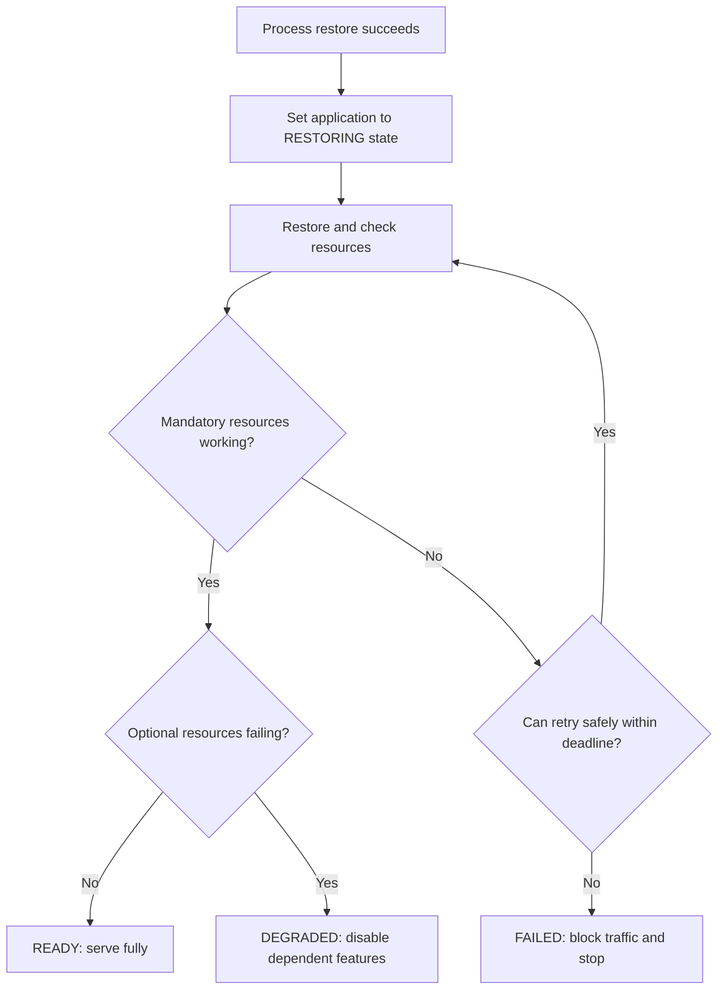
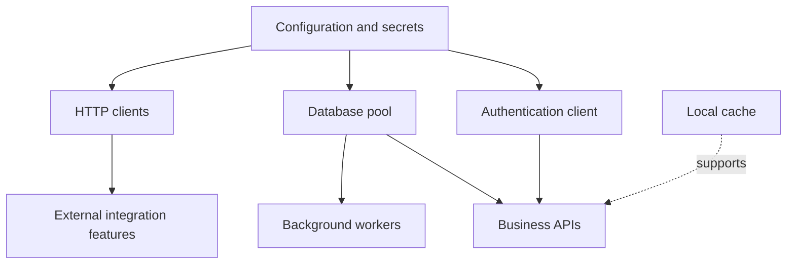

# Partial recovery and application stop policy when safe serving is not possible

After a Java process is restored from a checkpoint, not every resource the application needs is guaranteed to work normally. The heap and runtime state may have been restored, while database connections have already been closed by the server, the message broker is not yet reachable, caches need to be reloaded, or a dependent service is still starting up. Therefore, **a successful process restore does not mean the application is ready to serve**.

A CRaC application needs a recovery policy based on the criticality of each resource. If an optional component fails to recover, the application can switch to degraded mode and disable the related feature. If a mandatory component is not working, the application must remain not ready and stop according to a fail-stop policy when it cannot recover safely. The goal is to prevent the application from accepting requests in a state that could corrupt data, lose messages, or produce inconsistent business results.

## 1. Why might recovery only be partial?

A checkpoint captures the state of a process at a point in time. However, an application often depends on many resources outside the process or with their own lifecycles. During the time between checkpoint and restore, those resources can still change.

For example:

- The database server may close idle connections or restart.
- The message broker may expire sessions, close channels, or change consumer state.
- Short-lived tokens or credentials may expire.
- DNS, service addresses, TLS certificates, or network configurations may change.
- A local cache may still hold stale data while the source data has changed.
- A file, socket, or file descriptor held in the process state may no longer be valid for the post-restore environment.
- An external service may not be ready yet even though the Java process has resumed running.

Therefore, recovery needs to be understood across multiple layers:

1. **Process recovery:** the JVM and process state are brought back into operation by the runtime.
2. **Resource recovery:** the application checks, closes, recreates, or reconnects the required resources.
3. **Serving capability recovery:** once mandatory business conditions and dependencies are satisfied, the application can accept the corresponding traffic.



The diagram illustrates the application policy at a conceptual level. Specific states and how the runtime reports errors depend on the CRaC JDK, how restore is triggered, and the deployment design.

## 2. Classifying resources by criticality

Before writing callbacks, list the resources and determine the consequences if they fail to recover. Not every error requires stopping the entire application, but not every resource should be treated as optional either.

| Resource group | Examples | When recovery fails |
|---|---|---|
| Mandatory for the entire application | Database containing core business data, authentication key store, essential security configuration. | Do not accept traffic that needs these resources; if unable to recover within the allowed policy, stop the application. |
| Mandatory for a feature | Payment service, search store, broker for a specific business flow. | Disable or reject only the dependent feature; independent features may continue if safe. |
| Optional, rebuildable | Cache, recommendation data, temporary statistics data. | Can be reinitialized, temporarily bypassed, or served with reduced quality. |
| Observability and support | Metrics exporter, tracing exporter, secondary dashboards. | Can continue if losing observability does not violate operational or safety requirements. |

Classification must be based on the business contract. For example, a cache is usually rebuildable, but if the system uses the cache as the sole data source for a critical decision, it cannot be assumed optional by default.

### 2.1. Creating a dependency map

Resources can depend on each other. An HTTP client needs configuration and credentials; a worker needs a database pool and a broker consumer; an endpoint may need both a database and an authentication service.

Example of dependency relationships:



When designing recovery order, base it on actual dependency relationships. Do not assume callback order between `Resource` instances based solely on registration order if the API or implementation contract does not guarantee it. If multiple steps require a clear order, group them into a coordinator or build an explicit dependency orchestration mechanism.

## 3. Recovery states and readiness conditions

An application should have clear recovery states so other components know whether it can accept requests yet. A commonly used model includes:

| State | Meaning | Accepts traffic? |
|---|---|---|
| `RESTORING` | Checking or recreating resources after restore. | No. |
| `READY` | All mandatory resources for the serving scope are working. | Yes. |
| `DEGRADED` | Optional resources or a secondary feature are not ready; serving scope is restricted. | Only accepts requests that do not depend on disabled features. |
| `RECOVERING` | Retrying recovery of a resource that is not yet ready. | Only accepts the subset of features confirmed to be safe. |
| `FAILED` | Cannot guarantee safe serving. | No. |
| `STOPPING` | Rejecting new requests and terminating the process. | No. |

It is not necessary to use these exact state names in code. What matters is having a single consistent source of state and ensuring every traffic entry point obeys it.

### 3.1. Distinguishing liveness and readiness

Liveness answers the question of whether the process is alive and capable of continuing to run. Readiness answers the question of whether the application can accept the type of traffic routed to it.

During the `RESTORING` phase, the process may be alive but not ready. If a health check only verifies that the process exists or that an endpoint returns HTTP 200, the orchestration system may send traffic too early.

Readiness must reflect the mandatory resources for the serving scope. For an application with multiple features, there can be separate readiness for each capability group. For example, a lookup API may operate when the recommendation cache is not ready, but a payment API must be blocked if the database or authentication service is not working.

### 3.2. Blocking traffic inside the application

A readiness probe helps the load balancer or orchestrator stop routing to an unready instance. However, the application should still have an internal control layer to reject requests that depend on unrecovered resources. This protects the application while the health check has not updated yet or when requests go directly to the instance.

For example, a simple check can be called before handling a feature:

```java
public final class RecoveryGate {
    private volatile RecoveryState state = RecoveryState.RESTORING;
    private volatile boolean coreWorkReady;
    private volatile boolean recommendationsReady;

    public void requireCoreWork() {
        if (!coreWorkReady) {
            throw new ServiceUnavailableException(
                    "Core dependencies are not ready after restore");
        }
    }

    public void requireRecommendations() {
        if (!recommendationsReady) {
            throw new ServiceUnavailableException(
                    "Recommendations are temporarily unavailable");
        }
    }

    public void markCoreWorkReady() {
        coreWorkReady = true;
    }

    public void markRecommendationsReady() {
        recommendationsReady = true;
    }

    public void markDegraded() {
        state = RecoveryState.DEGRADED;
    }
}
```

This is an example illustrating the idea; in a real application, the gate must be updated atomically according to the recovery outcome and check specific capabilities. Do not allow all features to run just because the overall state is `DEGRADED`.

## 4. Partial recovery: continuing with features that are still safe

Partial recovery means the application has evaluated each resource by criticality and determined the scope of features it can still serve. It does not mean the application arbitrarily ignores errors in callbacks.

For example, an e-commerce application might have:

- Order database: mandatory for creating and updating orders.
- Payment service: mandatory for checkout, but not necessarily for public content pages.
- Product recommendation cache: optional because it can be rebuilt.
- Metrics exporter: supports observability, not directly involved in business decisions.

If the recommendation cache fails to recover, the application can disable recommendations and continue independent features. If the order database is not working, the application must reject order write operations. If the architecture cannot isolate dependent features, the safe choice may be to keep the entire application not ready.

### 4.1. Policy for optional resources

For rebuildable or non-essential resources, the callback can record the error, disable the related capability, and allow the recovery process to continue. Ensure that:

- Features depending on the resource are explicitly disabled.
- Endpoints or workers do not use the failing resource.
- Errors are logged and measured so they can be remediated.
- There is a mechanism to retry recovery if the resource may recover later.
- Retrying recovery does not create duplicate resources or race conditions.

Do not return stale data as if it were up to date if the cache may be outdated. If it is possible to serve from the primary data source, fall back to that source; otherwise, clearly indicate that the feature is temporarily unavailable.

### 4.2. Policy for mandatory resources

For mandatory resources, if recovery fails, the application must not report `READY`. Depending on the architecture, you can:

1. Retry a limited number of times within a bounded duration if the error is likely transient.
2. Stay in `RECOVERING` state and not accept traffic depending on the resource while waiting.
3. If the deadline expires or an unrecoverable error occurs, transition to `FAILED` and perform fail-stop.

Do not continue business processing when data integrity, authentication permissions, or the ability to record transactions has not been established.

## 5. Bounded and safe retries

An external service may be temporarily unavailable right after restore. Retrying is reasonable when errors are recoverable, but infinite retries can leave the process hanging in an unclear state and mask prolonged incidents.

### 5.1. Classifying errors before retrying

| Error type | Examples | Recommended policy |
|---|---|---|
| Transient | Connection refused while database is starting, short timeout, broker failing over. | Retry with backoff and time limit. |
| Configuration or authentication | Wrong credentials, missing secret, expired certificate, or wrong endpoint. | Do not retry infinitely; report error and stop, or wait for configuration changes per procedure. |
| Incompatible | Driver or runtime does not support the required operation. | Stop recovery; require version or configuration fix. |
| Unsafe state | Transaction outcome unknown, data may have been partially written. | Block related features and require reconciliation before continuing. |

### 5.2. Using backoff and deadlines

For transient errors, gradually increase the interval between attempts and set an overall deadline. Illustrative example:

```text
Attempt 1: try connecting immediately
Attempt 2: wait 250 ms
Attempt 3: wait 500 ms
Attempt 4: wait 1 second
Attempt 5: wait 2 seconds
Attempts exhausted or deadline reached: mark recovery as failed
```

These numbers are only examples; choose them based on SLA, service timeouts, and startup time limits. Add jitter so multiple instances do not retry simultaneously at the same moment.

Retries must be idempotent. If the first attempt partially created a resource before failing, the next attempt must check and reuse or release the old state instead of creating duplicate connection pools, threads, or consumers.

### 5.3. Do not block restore indefinitely

The `afterRestore(...)` callback is part of the restore flow. If the callback waits indefinitely for an external service, the restore process can also be prolonged or fail to complete. Set clear timeouts and retry counts.

For an optional dependency, the callback can record a degraded state and let the application continue in restricted mode, then recover asynchronously. For a mandatory dependency, the application must keep readiness false during background recovery; if the deadline expires, transition to fail-stop. Only use asynchronous recovery when all affected processing paths are protected by a recovery gate.

## 6. Fail-stop policy when safe serving is not possible

Fail-stop is a policy of proactively stopping service when the application cannot guarantee the correctness or safety of requests. Instead of trying to operate in an indeterminate state, the application rejects traffic, terminates the process in an observable way, and lets the deployment system restart or schedule another instance.

### 6.1. When is fail-stop needed?

Typical cases:

- A mandatory database cannot be reached and the application cannot perform business operations accurately.
- Required credentials, keys, or authentication mechanisms cannot be restored.
- A critical resource is in an indeterminate state after restore.
- In-flight transactions or messages risk being duplicated or losing data.
- A mandatory callback fails and there is no safe recovery option.
- The application cannot isolate the failing feature from the rest.

### 6.2. Safe stop sequence

A stop sequence can include:

1. Transition internal state to `FAILED`.
2. Set readiness to false and reject new requests.
3. Stop accepting work from schedulers, consumers, or workers.
4. Cancel or drain in-flight requests according to time limits and data consistency policies.
5. Close partially recovered resources if it can be done safely.
6. Log/emit metrics with the root cause and failing resource.
7. Terminate the process via a shutdown path supported by the application and deployment platform; ensure the error is represented as an observable failure state.

Do not simply call `System.exit(...)` right at the start of a callback if the application still needs to stop workers, close resources, or record state. Conversely, do not attempt a complex shutdown if the runtime state is no longer reliable. Choose a stop mechanism suitable for your framework and CRaC runtime, and test the actual behavior.

### 6.3. Do not swallow mandatory resource errors

If `afterRestore(...)` of a mandatory resource cannot complete, let the error propagate according to the API contract or turn it into an explicit recovery failure. With `org.crac`, the callback declaration can throw `Exception`; errors during the restore phase can be reflected via `RestoreException` at the caller requesting checkpoint/restore. When restore is triggered externally, how the error is reported to the launching process depends on the runtime and deployment tooling.

Crucially, do not catch an exception, log it as a warning, and still mark the application ready. If you want to continue, that resource must be classified as optional and the dependent feature must be disabled in a controlled manner.

## 7. Example of organizing callbacks with mandatory and optional resources

The following example illustrates a coordinator managing recovery. The database is a mandatory dependency; the recommendation cache is optional. The code illustrates the policy; connection methods and state management must be replaced by the application's implementation.

```java
import org.crac.Context;
import org.crac.Core;
import org.crac.Resource;

public final class ApplicationRecovery implements Resource {

    private final RecoveryGate gate;
    private final DatabasePool database;
    private final RecommendationCache recommendationCache;

    public ApplicationRecovery(
            RecoveryGate gate,
            DatabasePool database,
            RecommendationCache recommendationCache) {
        this.gate = gate;
        this.database = database;
        this.recommendationCache = recommendationCache;
        Core.getGlobalContext().register(this);
    }

    @Override
    public void beforeCheckpoint(Context<? extends Resource> context)
            throws Exception {
        gate.markRestoring();
        database.pauseAndPrepare();
        recommendationCache.pauseIfRunning();
    }

    @Override
    public void afterRestore(Context<? extends Resource> context)
            throws Exception {
        gate.markRestoring();

        // Database is mandatory: failure must cause recovery to fail.
        try {
            database.reconnectWithBoundedRetry();
        } catch (Exception mandatoryFailure) {
            gate.markFailed(mandatoryFailure);
            throw mandatoryFailure;
        }

        // Cache is rebuildable: failure degrades functionality, does not corrupt core data.
        try {
            recommendationCache.rebuild();
            gate.enableRecommendations();
        } catch (Exception optionalFailure) {
            gate.disableRecommendations(optionalFailure);
        }

        gate.markReadyOrDegraded();
    }
}
```

Key points to note:

- The gate is set to not ready before starting recovery.
- Database errors are propagated because it is a mandatory resource.
- Cache errors are recorded and the recommendation feature is disabled.
- The final state is only determined after resources have been evaluated.
- Every request going through the corresponding feature must check the gate/capability.

This is an application-level policy example, not built-in `DatabasePool`, `RecommendationCache`, or `RecoveryGate` classes in CRaC. In a real application, ensure that pausing and resuming workers, connection pools, and caches match the libraries in use.

## 8. Asynchronous recovery after the application has restored

Some resources may take a long time to rebuild but are not needed for the entire application. In that case, the application can transition to `DEGRADED` and recover the resource in the background.

For example, the recommendation cache can be reloaded after the primary database is ready. While the cache is rebuilding:

- Core business APIs continue operating if they do not depend on the cache.
- The recommendation API returns temporarily unavailable or uses a defined fallback.
- The cache-loading worker must have a time limit, a stop mechanism, and avoid overwriting newer data with an old snapshot.
- When the cache finishes, the application re-enables the capability and updates readiness accordingly.

Do not start background recovery and immediately report `READY` for all features. Represent which capabilities are ready and check that state at the right endpoint or task. In systems with only a single overall readiness probe, keep the probe not ready if any application-wide mandatory dependency is still missing.

## 9. Observing and operating recovery state

Partial recovery can only be operated well when the team knows which resources succeeded, which resources are retrying, and which features are disabled.

At a minimum, record:

- Restore start and end timestamps.
- Overall state: `RESTORING`, `READY`, `DEGRADED`, `RECOVERING`, or `FAILED`.
- Logical resource name, criticality level, and recovery outcome.
- Retry count, wait duration, and last error cause.
- List of currently disabled capabilities.
- Reason for readiness being false or reason for process termination.
- Startup/restore identifier to correlate logs across steps.

Do not log secrets, tokens, passwords, or sensitive data. Only log resource identifiers, error types, and enough information for investigation.

Useful metrics include restore duration, time to readiness, count of failed resource recoveries, retry counts, time spent in degraded state, and fail-stop counts. These metrics help distinguish restore failures from external dependency failures after the application is already running.

## 10. Testing partial recovery scenarios

Do not only test the case where every resource works. Simulate or inject failure conditions separately for each resource group.

| Scenario | Expected result |
|---|---|
| All mandatory and optional resources recover successfully | Application transitions to `READY`. |
| Mandatory database has a transient failure then reconnects successfully | Application keeps readiness false while retrying, then transitions to `READY`. |
| Mandatory database cannot recover before the deadline | Application does not accept traffic and performs fail-stop according to policy. |
| Optional cache fails to rebuild | Application transitions to `DEGRADED`, disables cache-dependent features, and continues independent features. |
| Payment service fails while content APIs are independent | Block payments; only continue content APIs if the architecture guarantees independence. |
| Mandatory resource callback throws an exception | Error is propagated and the application does not mark itself ready. |
| Retry is invoked again after partially creating a resource | No duplicate pools, threads, or consumers are created; old state is safely cleaned up or reused. |
| Request arrives while in `RESTORING` | Request is blocked or not routed to the instance. |
| Process stops due to recovery failure | Orchestrator observes the failure and can apply its restart policy. |

Check logs, readiness endpoints, capability gates, and the actual state of dependencies. Simply observing that a callback did not throw an exception is not enough to conclude that the application is serving safely.

## 11. Common design mistakes

**Marking ready as soon as process restore finishes.** This skips recovering connections, credentials, workers, and dependent data. Readiness must be tied to actual serving conditions.

**Treating every resource as mandatory.** A rebuildable cache does not necessarily have to stop the entire application. Misclassification causes unnecessary loss of availability.

**Treating every resource as optional.** Ignoring database or authentication errors can lead to data corruption or unsafe behavior. Mandatory resources must block dependent traffic.

**Infinite retries in callbacks.** Restore can be prolonged indefinitely, while causes like wrong credentials or wrong endpoints will not resolve on their own. Deadlines, backoff, and a termination policy are needed.

**Recovering resources in an implicit order.** Callbacks may depend on each other. Coordinate the order explicitly instead of relying on registration order if the API does not guarantee it.

**Swallowing exceptions from critical resources.** Logging an error and returning normally can cause the runtime and application to continue in an unsafe state. Mandatory errors must be propagated or converted into an explicit fail-stop state.

**Relying only on load balancer readiness.** Internal requests or direct requests may still reach the instance. In-application gates are needed for sensitive features.

**Not checking partial state before retrying.** Recreating a resource without cleaning up old state can leak connections, threads, or create duplicate consumers.

## 12. Checklist for building a recovery policy

- [ ] List all resources that must be checked after restore.
- [ ] Classify resources as application-wide mandatory, feature-mandatory, and optional.
- [ ] Document dependency relationships between resources.
- [ ] Define application states during restore and partial recovery.
- [ ] Block readiness and traffic until mandatory resources are working.
- [ ] Have in-application gates for resource-dependent features.
- [ ] Retry transient errors with backoff, retry limits, and deadlines.
- [ ] Ensure recovery operations can be safely retried without creating duplicate resources.
- [ ] Allow degraded mode only when the failing feature can be isolated.
- [ ] Propagate mandatory resource errors out of the callback or transition to an explicit fail-stop.
- [ ] Have a safe stop sequence and error information observable by the orchestrator.
- [ ] Test success, transient failure, permanent failure, and partial recovery scenarios.

## 13. Key terms to remember

- **Partial recovery:** the application recovers a subset of resources and only continues features confirmed to be safe.
- **Critical resource:** a resource mandatory for performing one or more business features.
- **Optional resource:** a resource that can be temporarily missing without compromising the correctness of the remaining features.
- **Readiness:** state indicating whether the application can accept traffic within its serving scope.
- **Liveness:** state indicating whether the process is alive and capable of continuing to run.
- **Degraded mode:** restricted operating mode when some secondary features are not ready.
- **Fail-stop:** policy of stopping service and terminating the process when safety cannot be guaranteed.
- **Backoff:** gradually increasing the wait time between retry attempts.
- **Idempotent recovery:** a recovery operation that can be re-run without creating side effects or duplicate resources.
- **Recovery gate:** a mechanism that blocks requests or capabilities when recovery conditions are not yet met.

When designing CRaC recovery, start from the question "which features can the application safely serve?" rather than only asking "has the process finished restoring?". Optional resources can lead to degraded mode if secondary features are clearly isolated. Mandatory resources must keep the application not ready; if bounded retries fail to recover them, fail-stop is the way to protect correctness and let the deployment platform handle the failed instance.
