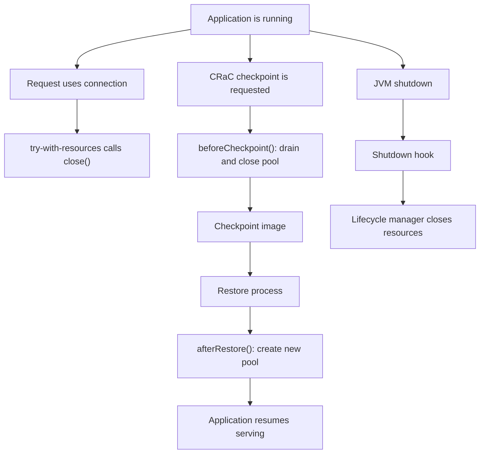

# Distinguishing CRaC Callbacks from Shutdown Hooks and AutoCloseable

In Java, several mechanisms can be used to release resources when a component reaches the end of its lifecycle. Three mechanisms that are often confused are CRaC callbacks, JVM shutdown hooks, and the `AutoCloseable` interface.

They can all lead to closing connections, flushing data, or stopping a client, but they are triggered at different times and serve different purposes:

- **CRaC Resource callback** coordinates application state before checkpoint and after restore.
- **Shutdown hook** runs when the JVM is performing an orderly shutdown.
- **AutoCloseable** represents a resource with an explicit close operation, typically invoked by try-with-resources or by lifecycle management code.

Understanding this boundary helps applications avoid missing checkpoint preparation steps, closing resources prematurely, or assuming that one cleanup mechanism will automatically replace another.

## 1. Three mechanisms address three different moments

Consider a Java service holding a database connection and a shared HTTP client. When the service terminates, the connections need to be closed. When the service creates a checkpoint and then restores, the connections may need to be closed before saving the image and recreated after restoration.

The three mechanisms play the following roles:

| Mechanism | When is it triggered? | Primary goal |
|---|---|---|
| CRaC `beforeCheckpoint()` | Before CRaC saves the process state | Prepare the application for a safe checkpoint |
| CRaC `afterRestore()` | After the process is restored | Restore resources so the application can continue running |
| JVM shutdown hook | When the JVM begins an orderly shutdown | Clean up when the process terminates |
| `AutoCloseable.close()` | When managing code calls `close()` | Release resources according to application-managed scope or lifecycle |

The key point is that checkpoint does not mean shutdown. During a checkpoint, the goal is to save state to continue execution later. During a shutdown, the goal is to terminate the process. When closing an `AutoCloseable`, the goal is to release a specific resource.

Therefore, a CRaC callback is not a shutdown hook by another name, and `AutoCloseable` does not automatically become a CRaC resource.

## 2. CRaC Callbacks: Coordinating Checkpoint and Restore

CRaC (Coordinated Restore at Checkpoint) provides an API in the `org.crac` package. An object participating in this lifecycle implements the `Resource` interface and registers with a CRaC context.

The two main callbacks are:

```java
void beforeCheckpoint(Context<? extends Resource> context)
        throws Exception;

void afterRestore(Context<? extends Resource> context)
        throws Exception;
```

### 2.1. beforeCheckpoint()

CRaC calls `beforeCheckpoint()` before saving the process image. The application uses this callback to bring the relevant components into a safe state.

Common tasks:

- Stop accepting new requests or jobs.
- Wait for in-flight requests, transactions, and jobs to complete or reach a safe stopping point.
- Flush data that needs to be persisted.
- Pause schedulers and consumers.
- Close sockets, database connections, or clients that depend on the external environment.
- Release operating system resources that cannot be reused after restore.

Not every Java object needs to be closed. Pure Java data structures can be saved in the heap and continue to be used after restore. Focus on resources whose lifecycle depends on the operating system, network, time, or external services.

### 2.2. afterRestore()

After the process is restored, CRaC calls `afterRestore()` for the registered resources. This callback restores resources that were closed or need to be refreshed.

Examples:

- Recreate database connections.
- Create new HTTP clients or sockets.
- Refresh expired tokens.
- Restart schedulers and workers.
- Verify network configuration, hostnames, and dependencies.

The application should only accept traffic after essential resources are ready. If recreating a database connection fails, the callback can report an error; the application's readiness should accurately reflect that state.

### 2.3. Registering a Resource

Minimal example:

```java
import org.crac.Context;
import org.crac.Core;
import org.crac.Resource;

public final class DatabaseResource implements Resource {

    private DatabaseClient client;

    public DatabaseResource() throws Exception {
        client = DatabaseClient.connect();
        Core.getGlobalContext().register(this);
    }

    @Override
    public void beforeCheckpoint(
            Context<? extends Resource> context) throws Exception {
        closeClient();
    }

    @Override
    public void afterRestore(
            Context<? extends Resource> context) throws Exception {
        client = DatabaseClient.connect();
    }

    private void closeClient() throws Exception {
        if (client != null) {
            client.close();
            client = null;
        }
    }
}
```

`DatabaseClient` here is an illustrative type defined by the application. `Core.getGlobalContext().register(this)` registers the resource so that CRaC can invoke its callbacks.

CRaC callbacks belong to the lifecycle of the checkpointed process. They do not replace normal shutdown logic, nor do they automatically manage every object that has a `close()` method.

## 3. JVM Shutdown Hook: Cleaning Up When the JVM Exits

A shutdown hook is a thread registered with the JVM via `Runtime.addShutdownHook()`. The JVM starts these hooks when initiating an orderly shutdown.

Example:

```java
public final class Application {

    public static void main(String[] args) {
        Runtime.getRuntime().addShutdownHook(
            new Thread(() -> {
                System.out.println("Application is shutting down");
                closeApplicationResources();
            }, "application-shutdown")
        );

        startApplication();
    }

    private static void closeApplicationResources() {
        // Close shared resources when the JVM exits.
    }

    private static void startApplication() {
        // Initialize and run the service.
    }
}
```

Shutdown hooks are suitable for process-level cleanup operations, such as closing connection pools, flushing logs, or asking workers to stop before the JVM exits.

### 3.1. When is a shutdown hook called?

A shutdown hook runs when the JVM begins shutting down along an orderly termination path, such as:

- The application calls `System.exit()`.
- The JVM receives a termination signal that the runtime handles with an orderly shutdown, depending on the operating system and how the process was launched.
- Certain shutdown events initiated by the runtime environment.

Hooks run in separate threads. The JVM may run multiple hooks concurrently; you should not rely on a fixed order between independent hooks.

Shutdown hooks are not guaranteed to run in all types of process termination. For example, `Runtime.halt()`, a forced process kill, a JVM crash, or a power outage can bypass hooks.

Therefore, critical data consistency guarantees should not be placed solely in a shutdown hook. Business operations that require durability must be performed in the normal processing flow with an appropriate persistence mechanism.

### 3.2. Shutdown hooks do not replace CRaC callbacks

A checkpoint aims to save the process to restore and continue running. A shutdown aims to terminate the JVM. The two events have different goals.

When the application prepares for a checkpoint, use `beforeCheckpoint()` to coordinate resources according to the CRaC contract. When the process is restored, use `afterRestore()` to recreate the necessary resources.

Do not rely on a shutdown hook to close connections before a checkpoint or to reopen connections after restore. Shutdown hooks do not provide a pair of callbacks corresponding to these two phases. Nor should you assume a checkpoint will be handled like a normal JVM shutdown.

### 3.3. Limitations when writing shutdown hooks

Shutdown hooks should complete quickly and avoid depending on unguaranteed ordering.

Some principles:

- Do not wait indefinitely on a worker or an external service.
- Set timeouts for stopping executors and closing clients.
- Do not call `System.exit()` from inside a shutdown hook to initiate a nested shutdown.
- Avoid spawning additional threads or complex work while the JVM is shutting down.
- Ensure the close operation can tolerate the case where the resource has already been closed.
- Do not log secrets or credentials.

Example of a shutdown hook that only asks a component to close resources:

```java
Runtime.getRuntime().addShutdownHook(
    new Thread(() -> {
        try {
            applicationLifecycle.close();
        } catch (Exception e) {
            logger.error("Failed to close application resources", e);
        }
    }, "application-shutdown")
);
```

`applicationLifecycle.close()` needs an appropriate timeout and error policy. Do not let a hook keep the JVM in a shutdown state indefinitely because an external service is unresponsive.

## 4. AutoCloseable: Closing Resources by Managed Scope

`AutoCloseable` is a standard Java interface declaring the method:

```java
public interface AutoCloseable {
    void close() throws Exception;
}
```

A class implementing `AutoCloseable` provides a way to release resources when the owner calls `close()`. This mechanism is commonly used with try-with-resources.

### 4.1. AutoCloseable and try-with-resources

Example:

```java
try (var connection = dataSource.getConnection()) {
    executeQuery(connection);
}
```

Upon exiting the `try` block, Java automatically calls `close()` on `connection`, even if the block body throws an exception. If there are multiple resources in the same try-with-resources statement, they are closed in the reverse order of their declaration.

This is a scope-based resource management mechanism. For example, a JDBC connection is opened for a query or a transaction and closed when the work is complete.

`AutoCloseable` does not automatically register an object with the JVM or CRaC. It does not know when a checkpoint occurs, nor does it have a callback to recreate resources after restore.

### 4.2. close() does not mean afterRestore()

`close()` releases the managed resource. After closing, the object may no longer be usable.

`afterRestore()` restores the necessary resources after the process is restored. It may create a new client or reopen a connection pool.

Do not expect calling `close()` to make an object automatically know how to reopen itself. Recreating resources requires separate logic, usually placed in a factory or a `reconnect()` method.

### 4.3. AutoCloseable helps write clearer CRaC code

The two mechanisms can be combined. A CRaC resource can use an internal close method, and that same method can also be called from `AutoCloseable.close()` when the application terminates normally.

Example:

```java
import org.crac.Context;
import org.crac.Core;
import org.crac.Resource;

public final class CracAwareClient
        implements Resource, AutoCloseable {

    private RemoteClient client;

    public CracAwareClient() throws Exception {
        openClient();
        Core.getGlobalContext().register(this);
    }

    @Override
    public synchronized void beforeCheckpoint(
            Context<? extends Resource> context) throws Exception {
        closeClient();
    }

    @Override
    public synchronized void afterRestore(
            Context<? extends Resource> context) throws Exception {
        openClient();
    }

    private void openClient() throws Exception {
        if (client == null) {
            client = RemoteClient.connect();
        }
    }

    private void closeClient() throws Exception {
        if (client != null) {
            RemoteClient oldClient = client;
            client = null;
            oldClient.close();
        }
    }

    @Override
    public synchronized void close() throws Exception {
        closeClient();
    }

    public synchronized RemoteClient getClient() {
        if (client == null) {
            throw new IllegalStateException(
                "Client is not available in the current lifecycle state");
        }
        return client;
    }
}
```

In the example:

- `beforeCheckpoint()` closes the client before checkpoint.
- `afterRestore()` creates a new client after restore.
- `close()` closes the client when the application terminates or when the lifecycle manager calls it.
- `closeClient()` sets the field to `null` before calling close on the old client, ensuring repeated close operations do not close the same reference multiple times.

`RemoteClient` is an illustrative application type. In real code, you must ensure that threads using the client have stopped before closing, and that consumers do not call `getClient()` while the client has not yet been restored.

It is also necessary to distinguish the `CracAwareClient` object from the connection inside it. The resource object may still exist in the heap after restore, while the old connection has been closed. The `afterRestore()` callback attaches a new connection to the restored object.

## 5. Detailed Comparison

### 5.1. By timing and scope

| Criterion | CRaC Resource | Shutdown hook | AutoCloseable |
|---|---|---|---|
| Triggering mechanism | CRaC context calls callbacks | JVM starts hook on shutdown | Managing code calls `close()` |
| Goal | Prepare for checkpoint and recover after restore | Clean up when JVM exits | Release a resource |
| Has post-restore recovery phase? | Yes, `afterRestore()` | No | Not inherently |
| Scope | Checkpoint/restore process lifecycle | JVM shutdown lifecycle | Managed object or resource |
| Commonly used for | Connections, schedulers, clients needing checkpoint coordination | Closing services when JVM exits | Files, streams, connections, locks |
| Can replace other mechanisms? | No | No | No |

### 5.2. By coordination capability

CRaC provides two clear points in time, making it suitable for resources that need to be closed before checkpoint and recreated after restore.

A shutdown hook only notifies that the JVM is shutting down. Hooks do not provide a continuation phase after restore. Multiple hooks can run concurrently, so you should not rely on ordering between hooks to close a dependency chain.

`AutoCloseable` has a small and clear scope: the owner of the resource decides when to close it. It is suitable for short-lived resources, but does not have the capability to coordinate the entire process on its own.

## 6. Combining All Three Mechanisms in the Same Application

An application can use all three mechanisms, provided each mechanism has a clear responsibility.

Example with a service managing a database pool:

1. Each request opens a short-lived connection using try-with-resources. `AutoCloseable` ensures the connection is closed after the request completes.
2. A CRaC resource manages the lifecycle of the shared connection pool. `beforeCheckpoint()` drains requests and then closes the pool; `afterRestore()` creates a new pool and verifies that connections work.
3. A shutdown hook asks the lifecycle manager to stop the service and close remaining resources when the JVM exits normally.

This flow can be illustrated as follows:



In real implementations, avoid registering multiple places to close the same resource without ownership rules. For example, if a CRaC resource has already closed the pool before checkpoint and a shutdown hook also calls `close()`, the close operation must be safe when the pool is already closed or has been replaced.

A good way to organize this is to assign resource ownership to a lifecycle manager. CRaC callbacks, shutdown hooks, and other management flows call into that manager; the manager is responsible for coordinating order and state.

### 6.1. Lifecycle manager example

```java
public final class ApplicationLifecycle implements AutoCloseable {

    private final DatabasePoolManager database;
    private final JobScheduler scheduler;
    private boolean acceptingRequests = true;

    public ApplicationLifecycle(
            DatabasePoolManager database,
            JobScheduler scheduler) {
        this.database = database;
        this.scheduler = scheduler;
    }

    public synchronized void prepareForCheckpoint() throws Exception {
        acceptingRequests = false;
        scheduler.pauseAndDrain();
        database.close();
    }

    public synchronized void resumeAfterRestore() throws Exception {
        database.reconnect();
        scheduler.resume();
        acceptingRequests = true;
    }

    @Override
    public synchronized void close() throws Exception {
        acceptingRequests = false;
        scheduler.stop();
        database.close();
    }
}
```

This is an illustrative abstraction. In a real application, you need to handle timeouts, access synchronization, and error recovery states. `prepareForCheckpoint()`, `resumeAfterRestore()`, and `close()` can be separated because they do not have the same meaning:

- `prepareForCheckpoint()` prepares a restorable state.
- `resumeAfterRestore()` re-establishes operations after restore.
- `close()` ends the application lifecycle.

Do not implement `close()` by calling `resumeAfterRestore()` or vice versa. Closing completely and preparing to continue are two different states.

## 7. Common Pitfalls to Avoid

### 7.1. Using a shutdown hook to close resources before checkpoint

A shutdown hook serves the JVM termination process. It is not a checkpoint preparation callback. If the application needs to close sockets or connection pools before taking a snapshot, register a CRaC resource and implement `beforeCheckpoint()`.

### 7.2. Assuming AutoCloseable is automatically called by CRaC

A class implementing `AutoCloseable` does not cause CRaC to automatically call `close()`. To participate in the checkpoint lifecycle, the object must be registered as a CRaC resource or managed by a registered resource.

### 7.3. Using try-with-resources for a resource that needs to live throughout the application

Try-with-resources closes the resource upon exiting the `try` scope. If a shared application client is placed in a short try block, the client will be closed as soon as the block ends. Distinguish short-lived per-request resources from shared application-lifecycle resources.

### 7.4. Reopening a closed object without recreating external state

Some objects cannot be reopened after `close()`. For example, a shut-down executor or a closed connection may not support reuse. After restore, create a new instance when required by the library.

### 7.5. Relying on shutdown hook ordering

The JVM may run shutdown hooks concurrently. If hook A needs the database to remain open to write data, while hook B closes the database, depending on the order between the two hooks can cause a race condition. Use a single lifecycle manager to coordinate shutdown order.

### 7.6. Assuming cleanup is always executed

A shutdown hook may not run if the JVM is forcefully stopped or crashes. `close()` only runs when managing code actually calls it. CRaC callbacks are only invoked during the corresponding CRaC workflow. No mechanism replaces durable data design and error handling in the business flow.

## 8. Which Mechanism to Choose for Each Scenario?

| Scenario | Appropriate mechanism | Reason |
|---|---|---|
| Closing a file after reading | AutoCloseable | Resource has a clear usage scope |
| Closing a JDBC connection after a request | AutoCloseable | Try-with-resources guarantees closing after processing |
| Closing a pool and recreating it after CRaC restore | CRaC Resource | Requires callbacks before checkpoint and after restore |
| Pausing a scheduler before checkpoint, resuming after restore | CRaC Resource | This is a transition in the checkpoint/restore lifecycle |
| Flushing logs and stopping services when JVM exits | Shutdown hook or lifecycle manager | Cleanup during shutdown |
| Releasing resources when a component is destroyed by a managed container | AutoCloseable or framework lifecycle API | Component lifecycle is managed by the framework |
| Ensuring business transactions are committed | Transaction manager and business logic | Should not depend on shutdown hooks |
| Recreating tokens after restore | CRaC Resource or post-restore initialization logic | Credentials may expire during checkpoint |

Not every application needs all three mechanisms. Choose based on the actual lifecycle of the resource.

## 9. Resource Lifecycle Design Checklist

### CRaC

- [ ] Resources needing coordination implement `org.crac.Resource`.
- [ ] Resources are registered before checkpoint.
- [ ] `beforeCheckpoint()` stops new work and brings resources to a safe state.
- [ ] `afterRestore()` recreates or verifies necessary resources.
- [ ] The application only accepts traffic after dependencies are ready.

### Shutdown hook

- [ ] The hook only handles cleanup work during JVM shutdown.
- [ ] The hook has a timeout and does not wait indefinitely.
- [ ] Does not depend on execution order between hooks.
- [ ] The close operation can tolerate an already-closed resource state.
- [ ] The application does not rely on shutdown hooks to guarantee business data.

### AutoCloseable

- [ ] The resource has a clear owner responsible for calling `close()`.
- [ ] Short-lived resources are managed with try-with-resources when appropriate.
- [ ] `close()` properly handles errors and releases resources.
- [ ] Does not assume an object can be reopened after closing.
- [ ] Shared resources have their own lifecycle and are not accidentally closed when leaving a short scope.

### Integration

- [ ] A lifecycle manager coordinates resources with dependency relationships.
- [ ] Multiple components do not close the same resource without clear ownership.
- [ ] Normal shutdown, checkpoint/restore, and reconnection failures have been tested.
- [ ] Logs clearly reflect checkpoint preparation, restore, and shutdown states.

## 10. Frequently Asked Questions

### Does CRaC invoke shutdown hooks when creating a checkpoint?

Checkpoint and JVM shutdown are two different events. Do not rely on shutdown hooks as a checkpoint preparation contract. Use `beforeCheckpoint()` for pre-checkpoint work and `afterRestore()` for recovery.

### Can a class implement both Resource and AutoCloseable?

Yes. This is a useful approach when the same client needs to be closed before checkpoint, recreated after restore, and also closed when the application terminates. Ensure the close method is safe when called multiple times and prevent consumers from using the client while it is not ready.

### Does AutoCloseable automatically call afterRestore()?

No. `AutoCloseable` only declares the close operation. Reopening logic must be written separately by the application, for example in the `afterRestore()` callback of a CRaC resource.

### Should a shutdown hook be registered for every AutoCloseable?

Usually not. Doing so can create many hooks running concurrently and make it difficult to control the closing order. There should be a lifecycle manager or an application-level hook to close components in dependency order.

### Are shutdown hooks guaranteed to run when the application is killed?

No. Certain types of forced termination, crashes, or power outages do not give the JVM a chance to run hooks. Therefore, critical data must be persisted during normal processing.

### If beforeCheckpoint() has already closed a resource, can a shutdown hook close it again?

Yes, if the close operation is designed to be idempotent. However, state must be managed clearly to avoid accidentally closing a newly created resource after restore or closing an object that no longer belongs to the current owner.

## Conclusion

CRaC Resource, shutdown hooks, and `AutoCloseable` all support resource management, but belong to different lifecycle boundaries. CRaC coordinates state before checkpoint and after restore; shutdown hooks clean up when the JVM exits; `AutoCloseable` releases a resource when the owner calls `close()`.

An application can combine them: use try-with-resources for short-lived connections, use CRaC resources for clients or pools that need to be recreated after restore, and use a lifecycle manager invoked from a shutdown hook to terminate the service in an orderly manner. When each mechanism is used for its intended purpose and resource ownership is clear, the application can checkpoint, restore, and shut down without confusing pausing to continue with terminating completely.
