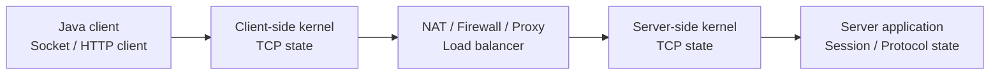
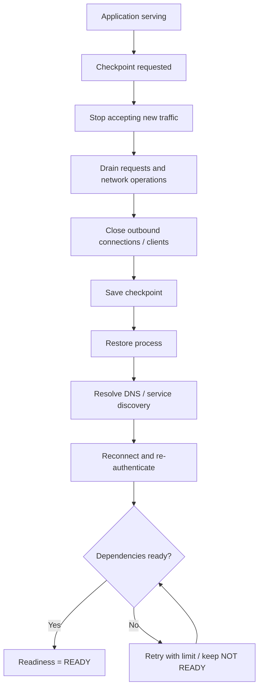

# Why an Open Connection Is Not Guaranteed to Be Valid After Restore

In Java, a connection object may still exist in the heap after a process is restored, but that does not prove the other side still keeps the session or the network path is still working. With CRaC (Coordinated Restore at Checkpoint), a process can be restored from a saved state after a period of time during which the database, server, load balancer, firewall, NAT, or authentication service continues operating independently.

Therefore, it is necessary to distinguish three states:

- **Java object still exists:** the reference variable to a Socket, HTTP client, or JDBC connection still holds a value in the heap.
- **Local state still exists:** the JVM and operating system may restore part of the socket or file descriptor state.
- **End-to-end connection is still active:** the remote peer, network path, and application protocol state still accept data exchange.

The first two states do not automatically guarantee the third state. An established connection can be restored in some environments, but it may also have been closed by the peer, dropped by a network device, or become incompatible with the current configuration. The application needs to verify and re-manage connections after restore.

## 1. Understanding “Open Connection” Correctly

A network connection is not just a Java object. It is a coordination among multiple components:

1. Java objects and buffers in the heap.
2. Sockets and file descriptors managed by the operating system.
3. TCP or other transport protocol state in the kernel.
4. Peer state, such as a server, database, or message broker.
5. Intermediate devices such as NAT, firewall, proxy, and load balancer.
6. Application-layer state such as TLS, session, authentication, transaction, or subscription.

The path of a TCP connection can be visualized as follows:



During checkpoint, CRaC coordinates with the JVM and the operating system's checkpoint/restore mechanism to save the process state. However, a server on another machine is not frozen along with the Java process. NAT can still expire mappings, load balancers can still clean up idle connections, servers can still restart, and tokens can still expire.

Therefore, the right question is not only “does the Socket object still exist?” but “are the entire transmission path and protocol state still accepted by the components on both ends?”.

## 2. What Can Happen During the Checkpoint Period?

Suppose an application creates a checkpoint at 10:00 and is restored at 10:20. During those 20 minutes, many events can occur:

- The server closes the connection due to idle timeout.
- The database fails over to another node.
- The load balancer removes the old backend.
- The NAT or firewall deletes the mapping because no traffic is seen.
- DNS is updated to a new address.
- TLS certificates or credentials are replaced.
- The message broker restarts or revokes the consumer session.
- The container network changes when the workload is moved to another host.

The Java process may restore the heap with the same reference to the old client, but external events have changed the connection conditions.

```mermaid
sequenceDiagram
    participant J as Java process
    participant N as Network path
    participant S as Remote server
    J->>S: TCP connection established
    Note over J: Create checkpoint
    Note over N,S: Time passes; peer or network state changes
    S-->>N: Close / expire idle connection
    Note over J: Restore process
    J->>S: Reuse old client and send data
    S-->>J: Connection reset / timeout / protocol error
```

This is a typical scenario, not the mandatory outcome of every restore. Some checkpoint/restore configurations can restore an established TCP socket under certain conditions. However, the ability to restore a socket on the client side does not force the peer and intermediate devices to preserve state while the process is absent.

## 3. Why Can a Connection Become Invalid?

### 3.1. The peer has closed the connection

The server may proactively close a connection due to:

- Idle timeout.
- Maintenance or restart.
- Deploying a new version.
- Failover.
- Connection count limits.
- Session management policies.

When the server closes the connection, the client does not necessarily receive an immediate notification. If there is no traffic, the client side may still hold the Socket object and believe the socket has not been closed.

A subsequent write operation may throw SocketException, Connection reset, Broken pipe, or a similar error. In some cases, the first write does not even report an error because the data is only placed into a local buffer; the error appears on a subsequent read or write.

### 3.2. NAT, firewall, and load balancer expire state

Intermediate devices often maintain a state table for connections. Mappings can be deleted when there is no traffic for a period of time.

For example:

- NAT no longer has a mapping between the internal address and the public address.
- A firewall drops an idle flow.
- A load balancer closes an inactive keep-alive connection.
- A proxy restarts and loses the state of managed connections.

After restore, the client may continue holding a local socket while the path through intermediate devices is no longer recognized.

Enabling TCP keepalive can help detect some dead connections while the application is running, but it is not an absolute solution. Keepalive has its own interval and timeout, which may be longer than the idle timeout of network devices. While the process is checkpointed, the application also cannot actively send heartbeats at the Java layer.

### 3.3. Server or database has failed over

A database cluster may switch primary, change endpoint addresses, or close existing sessions. Old connections may point to a node that has stopped serving.

Similarly, a message broker may restart or change leader. The old client holds consumer, channel, or session state that is no longer valid.

When reconnecting, the client needs to resolve the current endpoint, re-authenticate, and restore subscriptions or transactions according to the library's contract.

### 3.4. IP address, routes, and network environment change

When an application runs in a container or orchestration platform, the restore environment may differ from the checkpoint environment:

- The pod or container is run on a different host.
- The network namespace is recreated.
- The IP address or routes change.
- The network interface or gateway changes.
- The workload's network policy is updated.

A socket bound to specific local and remote addresses does not automatically adapt to every network change. Whether a socket can be restored depends on the operating system, the checkpoint/restore mechanism, and the deployment configuration.

### 3.5. DNS points to a new endpoint

DNS is typically looked up when creating a connection. An established TCP connection does not automatically switch to a new address just because a DNS record changes.

For example, before checkpoint, the hostname db.internal resolved to the IP of node A. During the checkpoint period, the system switches the database to node B and updates DNS. If the application continues using the old connection, it still relates to the old endpoint.

When creating a new connection, the hostname needs to be re-resolved according to the client's DNS and service discovery policy. Note also that DNS caching in the JVM or libraries may retain old results longer than desired.

### 3.6. TLS and security state

TLS sits on top of TCP. An open TCP socket does not mean all security state and authentication policies are still valid.

Possible scenarios include:

- The peer has closed the TLS session.
- The server certificate was replaced or expired.
- Client credentials or tokens expired.
- Trust store policies or TLS configuration changed.
- The TLS proxy restarted and no longer retains the old session.

When creating a new connection, the TLS handshake needs to be performed again according to the current configuration. The application must also refresh tokens or credentials if they have expired.

### 3.7. Application-layer state has expired

Even if TCP and TLS can still exchange data, state at the application layer may still become invalid:

- The database session was revoked by the server.
- The transaction timed out or rolled back.
- The broker consumer group rebalanced.
- A distributed lease or lock expired.
- An HTTP session or authentication token expired.
- A subscription to an external service was canceled.

Therefore, “socket connected” is not synonymous with “service ready to handle business logic”.

## 4. Distinguishing Local State from Actual Peer State

Java Socket properties only reflect part of the local state.

For example:

- Socket.isClosed() indicates whether the socket has been closed on the Java side.
- Socket.isConnected() indicates whether the socket has ever connected successfully.
- Socket.isBound() indicates whether the socket has ever been bound to a local address.

In particular, isConnected() is not a check of whether the peer is currently alive. A socket can return true for isConnected() while the server has disappeared or the network path has been disconnected.

Similarly, calling isClosed() and getting false only means the application has not closed the socket locally. It does not confirm that the NAT mapping, firewall state, or remote process still exists.

To verify actual exchange capability, the application needs to perform a meaningful communication operation, for example:

- Sending an application-layer health-check or heartbeat.
- Executing a lightweight query to the database.
- Calling a service's health endpoint.
- Reading/writing a message according to the broker's protocol.
- Making a request to verify that the working session is still valid.

Even a heartbeat only confirms the state at the time of the check. The connection can still fail immediately afterward, so every actual operation still needs network error handling.

## 5. Can TCP Be Restored?

It is necessary to distinguish the technical capability of checkpoint/restore from end-to-end reliability.

Some operating-system-level tools, such as CRIU in Linux environments, are capable of checkpointing and restoring certain established TCP connections under specific conditions and limitations. JDK CRaC coordinates with the OS mechanism and allows applications to prepare resources through callbacks.

However, the ability to restore a TCP socket does not mean every connection is safe to keep:

- The peer may have timed out while the process was checkpointed.
- Network devices may have deleted flow state.
- Addresses or routes may have changed.
- The server may have failed over.
- Application-layer sessions may have expired.

Therefore, applications need to follow the documentation of the JDK, CRaC implementation, CRIU, and deployment platform. If a library provides CRaC integration, check how the library handles connection pools and sockets. Do not assume all sockets are automatically closed or automatically recovered in the same way.

For outbound connections to databases, brokers, and HTTP services, a commonly controllable strategy is to close or put clients into a safe state before checkpoint, and then create new connections after restore.

## 6. Network Connection Management Workflow with CRaC

A safe workflow typically consists of two phases.

### 6.1. Before checkpoint

The application should:

1. Switch readiness to not ready to stop receiving new traffic.
2. Stop creating new requests or jobs.
3. Wait for in-flight requests and network operations to complete.
4. Handle in-progress transactions and messages according to business policy.
5. Close connections or connection pools according to the library's guidance.
6. Release consumers, sockets, and environment-dependent resources.
7. Let CRaC proceed with creating the checkpoint after callbacks complete.

Do not close a socket while another thread is still writing or reading. Drain work that is using the client first.

### 6.2. After restore

After the process is restored:

1. Re-read necessary network configuration if configuration may have changed.
2. Re-resolve hostnames or fetch new endpoints from service discovery.
3. Create new connections or reinitialize connection pools.
4. Perform TLS handshake and re-authenticate.
5. Restore subscriptions, consumers, or application-layer sessions.
6. Verify essential dependencies.
7. Only switch readiness to ready once connections have been verified.

Do not open traffic just because callbacks ran to the end. Connections may not have been established yet or the server may still not be ready.



## 7. Java Example: Closing a Socket Before Checkpoint and Reconnecting After Restore

The example below illustrates a TCP client registered with CRaC. The old socket is closed in beforeCheckpoint(); after restore, the client creates a new socket using the configured hostname and port.

```java
import java.io.IOException;
import java.net.InetSocketAddress;
import java.net.Socket;

import org.crac.Context;
import org.crac.Core;
import org.crac.Resource;

public final class TcpClientResource implements Resource, AutoCloseable {

    private final String host;
    private final int port;
    private final int connectTimeoutMillis;

    private Socket socket;

    public TcpClientResource(
            String host,
            int port,
            int connectTimeoutMillis) throws IOException {

        this.host = host;
        this.port = port;
        this.connectTimeoutMillis = connectTimeoutMillis;

        connect();
        Core.getGlobalContext().register(this);
    }

    private synchronized void connect() throws IOException {
        if (socket != null) {
            throw new IllegalStateException("Socket is already assigned");
        }

        Socket candidate = new Socket();

        try {
            candidate.setKeepAlive(true);
            candidate.connect(
                new InetSocketAddress(host, port),
                connectTimeoutMillis
            );
            socket = candidate;
        } catch (IOException e) {
            try {
                candidate.close();
            } catch (IOException closeFailure) {
                e.addSuppressed(closeFailure);
            }
            throw e;
        }
    }

    private synchronized void closeConnection() throws IOException {
        Socket oldSocket = socket;
        socket = null;

        if (oldSocket != null) {
            oldSocket.close();
        }
    }

    @Override
    public synchronized void beforeCheckpoint(
            Context<? extends Resource> context) throws Exception {
        closeConnection();
    }

    @Override
    public synchronized void afterRestore(
            Context<? extends Resource> context) throws Exception {
        connect();
    }

    @Override
    public synchronized void close() throws IOException {
        closeConnection();
    }

    public synchronized void send(byte[] payload) throws IOException {
        if (socket == null) {
            throw new IllegalStateException("Connection is not ready");
        }

        socket.getOutputStream().write(payload);
        socket.getOutputStream().flush();
    }
}
```

In the example:

- The constructor creates the initial connection and registers the resource with the global context.
- beforeCheckpoint() closes the old socket and clears the local reference.
- afterRestore() creates a new socket using the hostname and port.
- close() allows the lifecycle manager to close the client when the application shuts down.
- The methods synchronize access to the socket field to prevent concurrent closing and writing within the scope of the example.

This is a minimal lifecycle example. Production applications need to coordinate a request gate and drain all operations using the client before checkpoint. Timeout, retry, and readiness policies are also needed when connecting after restore fails.

An important point: setKeepAlive(true) only enables TCP keepalive according to the operating system's configuration. It does not prove the peer will keep the connection during checkpoint and does not replace recreating the connection.

## 8. How Should Reconnection Handle Errors?

Calling connect after restore may fail because the server has not finished starting, DNS has not updated, credentials are not ready, or the network is not yet fully configured.

A resilient client needs a reconnection policy.

### 8.1. Bounded retry and exponential backoff

Do not retry continuously without pause. That can increase load on a server experiencing an outage.

Exponential backoff increases the wait interval after each failure. Adding jitter prevents multiple instances from retrying at the exact same time.

Example retry schedule:

| Attempt | Illustrative wait interval |
|---|---:|
| 1 | 200 ms |
| 2 | 400 ms |
| 3 | 800 ms |
| 4 | 1.6 s |
| 5 | 3.2 s |

Values should have a maximum cap and be tuned to the SLA. After a certain number of attempts, the application can transition to a degraded state, continue background retries, or report an error to the orchestration platform.

### 8.2. Error classification

Not every error should be retried in the same way.

| Error type | Examples | Handling approach |
|---|---|---|
| Transient connection error | Connection refused, timeout | Retry with backoff |
| Peer closed connection | Connection reset, broken pipe | Create a new connection; determine the outcome of the previous operation |
| DNS or service discovery | Hostname not yet resolved | Retry resolution, refresh endpoint |
| Authentication | Token expired, credentials rejected | Refresh credentials then retry per policy |
| Configuration error | Wrong hostname, port, trust store | Report configuration error; avoid infinite retry |
| Protocol error | Invalid session or subscription | Reinitialize session at the application layer |

### 8.3. Do not blindly retry write operations

A difficult scenario is when the client sends a write command, the server commits the data, but the response is lost before the client receives it. After restore, the client only sees a timeout or reset. If the command is resent, the business operation may be executed twice.

For example:

1. Client sends a money transfer request.
2. Server executes and commits the transaction.
3. Connection breaks before the response reaches the client.
4. Client restores and retries the request.
5. Server receives the request a second time.

To handle this, use an idempotency key, request ID, unique constraint, or deduplication mechanism. The client must know whether the operation can be safely resent or needs to query the state first.

CRaC does not automatically guarantee exactly-once delivery for application protocols.

### 8.4. Connection pools must evict stale connections

For HTTP clients or database pools, do not keep an old connection in the pool just because the pool object still exists. Consider:

- Closing or evicting open connections before checkpoint.
- Recreating or refreshing the pool after restore according to the library's guidance.
- Configuring idle timeout and maximum lifetime appropriate to the infrastructure.
- Using a validation query or health check when supported by the library.
- Evicting a connection when an I/O error is detected.
- Not using a connection currently in use by another thread for health checks.

Libraries with CRaC integration may already implement part of these steps. Verify the version and resource registration method to avoid both using automatic integration and manually closing the same resource a second time.

## 9. Distinguishing Outbound Connections, Accepted Sockets, and Listening Sockets

Not all sockets have the same role.

| Socket type | Meaning | Handling to consider |
|---|---|---|
| Outbound connection | Client connecting to a server/database/broker | Usually closed before checkpoint and recreated after restore |
| Accepted socket | Connection from a client that has entered the server | Drain requests/sessions; handle potential client reconnect |
| Listening socket | Socket listening on a port | Check restore support and bind state; do not blindly re-bind |
| Datagram socket | Socket using UDP, without a TCP session | Check endpoint, routes, multicast membership, and protocol state |

A listening socket differs from an established outbound connection. If a listening socket is restored and still holds the port, the application calling bind again may encounter an address already in use error. Conversely, if the listener is not restored, the server needs to open a new listener before readiness switches to ready.

For accepted sockets, the client peer may have timed out while the server was checkpointed. The server should have timeouts and the ability to handle client reconnects. For stateless HTTP applications, it is often easier to manage by finishing in-flight requests before checkpoint and letting the client or load balancer resend requests according to an appropriate policy.

There is no single rule for closing or keeping sockets that applies to every type of application. Check the CRaC/JDK documentation, operating system mechanism, and framework in use.

## 10. Examples by Service Type

### 10.1. JDBC and database connection pools

A JDBC connection represents a session to the database. The session can be closed by the server when idle, during failover, or when the database restarts.

Before checkpoint:

- Stop accepting new transactions.
- Wait for current transactions to finish.
- Close connections or the pool according to the pool implementation's guidance.

After restore:

- Recreate or refresh the pool.
- Re-authenticate to the database.
- Verify the ability to execute a lightweight query.
- Only accept requests when the pool has valid connections.

A DataSource object may still exist in the heap, but that does not mean every connection inside the pool is still active.

### 10.2. HTTP clients and keep-alive

HTTP clients often reuse keep-alive connections to reduce TCP and TLS handshake overhead. A server or proxy may close idle connections without the client receiving immediate notification.

After restore, the pool may contain stale connections. Depending on the library, close the old client, evict connections, or create a new client. When retrying requests, distinguish safe-to-retry requests (e.g., idempotent GET) from write requests that may have already been processed by the server.

### 10.3. Message brokers

Broker clients typically maintain connections, heartbeats, consumer groups, subscriptions, and offsets. If the process is checkpointed for too long, the broker may consider the consumer disconnected and perform a rebalance.

After restore, the client may have to:

- Create a new connection.
- Re-authenticate.
- Re-register the consumer or subscription.
- Read the current offset.
- Handle messages that may be redelivered.
- Ensure handlers are idempotent.

Do not assume the consumer state in the heap is still the current state recognized by the broker.

### 10.4. WebSocket and long-lived bidirectional connections

WebSocket maintains a bidirectional session over TCP. A server, proxy, or load balancer may close the session during checkpoint. Upon restore, the WebSocket object remains in the heap while the peer has already removed the session.

Typically, the application needs to close the session before checkpoint and establish a new WebSocket after restore. A mechanism is needed to re-register subscriptions, restore communication state, and synchronize data missed during the interruption.

### 10.5. gRPC and HTTP/2

An HTTP/2 connection can contain multiple streams. If the connection is closed, active streams may fail simultaneously. A gRPC client may need to create a new channel, re-resolve endpoints, and establish a new TLS/HTTP/2 session.

Check how the gRPC library manages channels and connections in a CRaC environment. An existing channel object does not mean the underlying transport is ready.

## 11. Observability and Testing After Restore

To know whether connections are truly ready, the application should record state step by step:

- Checkpoint preparation started.
- In-flight request count reached 0.
- Outbound connections closed.
- Restore started.
- DNS/service discovery refreshed.
- TLS/authentication succeeded.
- Connection pool or client ready.
- Readiness transitioned to READY.

Useful metrics:

| Metric | Purpose |
|---|---|
| Reconnect time | Measure dependency recovery latency |
| Retry count | Detect endpoints not yet ready |
| Connection reset/timeout rate | Detect stale connections |
| Connections in pool | Detect empty pools or failed connections |
| DNS lookup time | Detect service discovery issues |
| Auth refresh count | Track expired credentials |
| Readiness duration | Measure time from restore to receiving traffic |

The following scenarios should be tested:

1. Restore immediately after checkpoint.
2. Restore after a period longer than the idle timeout of the server or load balancer.
3. Server restart while the process is checkpointed.
4. Database failover to another node.
5. DNS record change during the checkpoint period.
6. Token or certificate expiration before restore.
7. Network interface, route, or container change.
8. Write request committed by the server but response lost.
9. Broker consumer group rebalance during the checkpoint period.
10. Temporary reconnect failure followed by success after several retries.

The goal is to prove that the application detects faulty connections, recreates sessions when needed, does not accept traffic too early, and does not dangerously repeat business operations.

## 12. Network Connection Management Checklist

### Before checkpoint

- [ ] Stop accepting new requests and jobs.
- [ ] Drain operations currently using connections.
- [ ] Complete or handle transactions according to policy.
- [ ] Close or prepare outbound connections and connection pools.
- [ ] Stop consumers and handle subscriptions.
- [ ] Record connection state for diagnostics.

### After restore

- [ ] Re-resolve hostnames or endpoints when needed.
- [ ] Create new connections or verify connection pools.
- [ ] Perform TLS handshake and re-authenticate.
- [ ] Restore sessions, consumers, or subscriptions.
- [ ] Retry with limits and backoff.
- [ ] Readiness only transitions to READY when essential dependencies are confirmed working.

### Error handling

- [ ] Do not treat Socket.isConnected() as an end-to-end health check.
- [ ] Distinguish transient network errors from configuration and authentication errors.
- [ ] Do not retry write operations without an idempotency mechanism.
- [ ] Have timeouts for connect, read, write, and health checks.
- [ ] Have metrics for reconnect, reset, timeout, and readiness.
- [ ] Have tested peer timeout, failover, DNS change, and long-term restore.

## 13. Frequently Asked Questions

### Does a Socket object still existing after restore mean the connection is still active?

No. A Java object still existing only reflects state in the heap. The actual connection also depends on the kernel, peer, NAT, firewall, proxy, and application protocol state. It is necessary to verify or create a new connection.

### Does CRaC always close all sockets before checkpoint?

Do not assume so. Applications and libraries need to manage resources according to the guidance of JDK CRaC and the deployment environment. Some sockets may be supported for checkpoint/restore under specific conditions, but the peer and network path can still change during the checkpoint period.

### Does TCP keepalive solve the problem?

Not completely. Keepalive helps detect some unresponsive connections, but the check interval depends on operating system configuration and may be longer than the timeout of intermediate devices. It also does not refresh DNS, TLS credentials, or application-layer sessions.

### Does Socket.isConnected() check if the server is still alive?

No. This method indicates that the socket has previously connected successfully and has not been closed locally according to Java state. It does not send a probe packet to the peer and does not prove the server is currently active.

### Should outbound connections always be closed before checkpoint?

For many clients connecting to databases, brokers, and HTTP services, closing or evicting connections before checkpoint and recreating them after restore is an easily controllable strategy. However, check the documentation of the JDK, libraries, and socket type. Listening sockets and other socket types have their own requirements.

### What should the application do if reconnecting after restore fails?

Keep readiness in a not-ready state, apply bounded retries or backoff, log the error, and do not accept requests that depend on that connection. If the error is configuration or credentials, address the root cause instead of retrying indefinitely.

### Can a request be retried after a connection is reset?

Only when it is known that the request can be safely repeated or has an idempotency key. If the server already committed but the response was lost, blind retrying can cause duplicate side effects.

## Conclusion

An open connection in the heap does not guarantee validity after restore because a network connection is distributed state across the JVM, kernel, peer, intermediate devices, and application protocol. While the process is checkpointed, the server may close the session, NAT may expire the mapping, DNS may change the endpoint, tokens may expire, and the database or broker may fail over.

With CRaC, the application should coordinate draining work and closing environment-dependent connections in beforeCheckpoint(). After restore, re-resolve endpoints when needed, create new connections, authenticate, and restore application-layer sessions. Only open readiness after essential dependencies are ready. All network operations still need timeouts, error handling, and safe retries; in particular, write operations must have an idempotency mechanism to tolerate lost responses.
