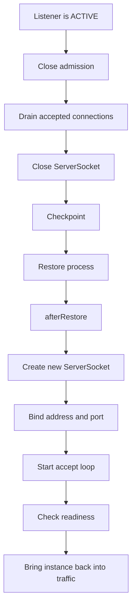

# Closing and Reopening Server Listening Sockets

In a Java application using CRaC, a TCP listening socket is a resource tied to the operating system. The `ServerSocket` object may reside in the heap at checkpoint time, but the port it bound to, the socket state, and the thread waiting on `accept()` still depend on the kernel and the network environment at restore time.

In many deployments, a controllable operational approach is to close the listener before checkpoint and bind a new listener after restore. This frees the port while the process is paused, avoids depending on the old socket, and allows the application to re-verify the bind address. However, this must be coordinated with already accepted connections, connection-accepting threads, load balancers, and server frameworks.

Basic flow:

1. Stop accepting new connections and remove the instance from traffic flow.
2. Drain or close accepted connections according to the application's policy.
3. Close the `ServerSocket`, causing the thread waiting on `accept()` to exit.
4. Take the checkpoint after the listener and related resources are in a safe state.
5. After restore, create a new `ServerSocket`, re-bind the address/port, and start a new accept loop.
6. Only enable readiness once the listener and required dependencies are ready.

## 1. ServerSocket and Listening Sockets

A TCP server typically has a socket listening on a local IP address and port. In Java, the basic API is `java.net.ServerSocket`.

```java
ServerSocket server = new ServerSocket(8080);
Socket client = server.accept();
```

The statement `new ServerSocket(8080)` creates a listener and binds port 8080 on the wildcard address. `accept()` waits for an incoming TCP connection. When a connection arrives, the method returns a separate `Socket` representing the accepted connection. The listener continues to exist to receive subsequent connections.

Distinguish between the two types of sockets:

- **Listening socket**: receives new connection requests on an address/port.
- **Accepted socket**: a separate connection that has been accepted and is used to exchange data with a client.

Closing `ServerSocket` only closes the listener. It does not automatically close all previously accepted `Socket` instances. Therefore, before checkpoint, there must be a separate policy for active connections: waiting for requests to complete, closing keep-alive connections, terminating TLS sessions, or having clients reconnect after restore.

### Why Close the Listener?

While the process is checkpointed, the port may be used by another process or a new instance. If the old listener still holds the port or the socket state is incompatible with the restore environment, restoration may fail when re-binding.

Closing the listener before checkpoint provides several benefits:

- Frees the port so another process or instance can use it according to the deployment plan.
- Causes the thread waiting on `accept()` to exit along a predictable control path.
- Creates a clear point to stop admission and drain connections.
- Allows restore to create a new socket from the current configuration, including the bind address and port.
- Avoids using a listener object whose state is closed or dependent on the pre-checkpoint environment.

Some platforms may support checkpointing/restoring certain types of sockets via CRIU. You should not rely on that capability without confirming it specifically with the JDK, CRIU, kernel, and deployment setup. The close-and-reopen listener model is usually easier to control for servers that need stable port binding after restore.

## 2. Listener Lifecycle in CRaC

CRaC provides `Resource` with two commonly used callbacks:

- `beforeCheckpoint(...)`: stop accepting connections, handle accepted sockets, and close the listener.
- `afterRestore(...)`: create a new listener, re-bind, and start the connection-accepting thread.



You should not bind a new listener before the old listener has been closed and the old accept thread has stopped. If two listeners attempt to bind the same address/port simultaneously, the operation may fail with `BindException` or exhibit behavior dependent on the operating system and socket options.

### Closing Order

A practical sequence:

1. Close admission at the HTTP server or coordination layer so no new requests arrive.
2. Remove the instance from the load balancer or service discovery.
3. Stop accepting new connections at the listener.
4. Wait for the accept loop to exit.
5. Drain accepted connections and in-flight requests.
6. Close remaining accepted sockets according to timeouts and application policy.
7. Mark the listener as PAUSED for checkpoint.

If you close the listener before draining requests, already accepted connections may still be performing work. The listener does not manage the lifecycle of accepted sockets on your behalf.

### Opening Order

After restore:

1. Verify bind configuration, credentials, and required network dependencies.
2. Create a new `ServerSocket`.
3. Configure socket options before binding.
4. Bind the address and port.
5. Start a new accept loop.
6. Verify that the listener is bound and the accept thread is running.
7. Enable readiness and bring the instance back into traffic.

If binding or starting the accept loop fails, keep the instance in a not-ready state and report an error. Do not return readiness success merely because the JVM has finished restoring.

## 3. Stable Address and Port Binding

The listener must bind to an address that clients or the load balancer can reach. You need to decide clearly:

- Bind to a specific IP address or wildcard.
- Use a fixed port or a dynamic port.
- IPv4, IPv6, or dual-stack protocol.
- Backlog for connections waiting to be accepted.
- Required socket options for the environment.

### Wildcard Address and Specific Address

`new ServerSocket(port)` typically binds to the wildcard address, meaning the listener can receive connections across matching interfaces on the machine. If you only want to receive connections on one interface, bind to a specific address.

```java
import java.net.InetAddress;
import java.net.InetSocketAddress;
import java.net.ServerSocket;

ServerSocket server = new ServerSocket();
server.bind(new InetSocketAddress(
        InetAddress.getByName("127.0.0.1"),
        8080
));
```

Binding to `127.0.0.1` only allows IPv4 loopback access; another container or machine cannot reach it via an external network address. In real deployments, choose an address appropriate for the topology. Wildcard is convenient for containers but may expose the listener on more interfaces than intended.

If the interface or IP address changes between checkpoint and restore, binding to the old address may fail. Consider binding wildcard or re-reading the address from the current configuration if the architecture permits. Do not arbitrarily switch to wildcard if doing so exposes the listener to an unintended network.

### Fixed Port and Dynamic Port

A **fixed port** is suitable when clients, load balancers, or service discovery already know the server's port:

```java
int port = 8080;
server.bind(new InetSocketAddress(port), 128);
```

After restore, the application must re-bind that exact port. If another process has already occupied the port, restore must report an error and keep the instance not ready.

A **dynamic port** is selected by binding port 0:

```java
server.bind(new InetSocketAddress(0), 128);
int actualPort = server.getLocalPort();
System.out.println("Listening on port " + actualPort);
```

The operating system chooses an available port. When restoring and binding port 0 again, the new port may differ from the old port. If clients need to know the port, the application must update service discovery or publish the new address after the listener is ready. Do not assume a dynamic port is preserved across checkpoint.

### Backlog

The backlog parameter in `bind(..., backlog)` hints at the number of connections waiting to be accepted. It is not the maximum number of clients the application can serve; the actual limit also depends on the kernel, operating system configuration, and processing capacity.

Choose the backlog based on accept rate, connection traffic, and how long the application might be overloaded. After restore, use a configuration consistent with a fresh run or the current deployment configuration.

### SO_REUSEADDR

`ServerSocket.setReuseAddress(true)` requests enabling the `SO_REUSEADDR` option before binding:

```java
ServerSocket server = new ServerSocket();
server.setReuseAddress(true);
server.bind(new InetSocketAddress(8080), 128);
```

This option is useful in certain scenarios for reusing an address after an old socket closes. The exact semantics depend on the operating system. It does not guarantee that two processes can simultaneously bind the same address/port, does not replace closing the old listener, and does not resolve all `BindException` cases.

Do not confuse `SO_REUSEADDR` with `SO_REUSEPORT`. `SO_REUSEPORT` has its own semantics, and its support and API are platform-dependent; Java's `ServerSocket` does not provide a portable equivalent API across all operating systems.

## 4. Managing the Accept Loop

Typically, a server has a thread or group of event loops waiting for new connections. When `ServerSocket.close()` is called, a thread blocked in `accept()` is woken up and usually receives a `SocketException`.

This is behavior that must be handled intentionally:

- If the listener is being closed for checkpoint, the socket-closed error is the expected outcome; the accept loop should exit normally.
- If the socket is closed or encounters an error while the server is still ACTIVE, that may be an operational error; it must be logged and the listener state transitioned to FAILED.
- After restore, a new thread must be created or a new event loop restarted. A Java `Thread` that has terminated cannot have `start()` called a second time.

Accept loop example:

```java
private void acceptLoop(ServerSocket listener) {
    while (accepting) {
        try {
            Socket client = listener.accept();

            if (!accepting) {
                client.close();
                break;
            }

            try {
                connectionManager.accept(client);
            } catch (RuntimeException failure) {
                try {
                    client.close();
                } catch (IOException closeFailure) {
                    failure.addSuppressed(closeFailure);
                }
                reportClientDispatchFailure(failure);
            }
        } catch (SocketException closed) {
            if (accepting) {
                reportUnexpectedListenerFailure(closed);
            }
            break;
        } catch (IOException failure) {
            if (accepting) {
                reportUnexpectedListenerFailure(failure);
            }
            break;
        }
    }
}
```

`connectionManager` is the application component that receives and manages accepted sockets. It should hand off the socket to a worker or event loop quickly; it should not process an entire long request directly on the accept thread, because then the server cannot accept the next connection.

### Closing the Listener and Waiting for the Accept Thread

A method to stop the listener typically does:

```java
private void stopListener() throws IOException, InterruptedException {
    accepting = false;

    ServerSocket oldServer = serverSocket;
    serverSocket = null;
    if (oldServer != null) {
        oldServer.close();
    }

    Thread oldThread = acceptThread;
    acceptThread = null;
    if (oldThread != null && oldThread != Thread.currentThread()) {
        oldThread.join(5_000);
        if (oldThread.isAlive()) {
            throw new IllegalStateException(
                    "Accept thread did not stop after listener close");
        }
    }
}
```

This is a simplified example. Production code needs to handle interruption by restoring the interrupt flag, preserve exceptions if both close and join fail, and not set the PAUSED state while the accept thread has not stopped. The timeout must be appropriate for how the server and operating system handle sockets.

## 5. Registering the Listener with CRaC Resource

The listener can be closed and opened within a resource. The example below illustrates the lifecycle structure. `ConnectionManager` is an application abstraction responsible for draining accepted sockets, recovering workers, and dispatching new sockets for processing.

```java
import org.crac.Context;
import org.crac.Core;
import org.crac.Resource;

import java.io.IOException;
import java.net.InetAddress;
import java.net.InetSocketAddress;
import java.net.ServerSocket;
import java.net.Socket;

public final class TcpListenerResource implements Resource {

    public interface ConnectionManager {
        void startNormally() throws Exception;
        void accept(Socket socket);
        void stopAndDrain() throws Exception;
        void resumeAfterAbortedCheckpoint() throws Exception;
        void prepareAfterRestore() throws Exception;
    }

    private enum State {
        NEW, ACTIVE, QUIESCING, PAUSED, RESTORING, FAILED
    }

    private final InetAddress bindAddress; // null means wildcard
    private final int port;
    private final int backlog;
    private final ConnectionManager connections;

    private volatile ServerSocket serverSocket;
    private volatile Thread acceptThread;
    private volatile boolean accepting;
    private volatile State state = State.NEW;

    public TcpListenerResource(
            InetAddress bindAddress,
            int port,
            int backlog,
            ConnectionManager connections) {
        this.bindAddress = bindAddress;
        this.port = port;
        this.backlog = backlog;
        this.connections = connections;
        Core.getGlobalContext().register(this);
    }

    public synchronized void startNormally() throws Exception {
        if (state != State.NEW) {
            throw new IllegalStateException("Unexpected state: " + state);
        }
        try {
            connections.startNormally();
            bindAndStartAcceptLoop();
            state = State.ACTIVE;
        } catch (Exception failure) {
            state = State.FAILED;
            closeListenerQuietly();
            throw failure;
        }
    }

    @Override
    public synchronized void beforeCheckpoint(
            Context<? extends Resource> context) throws Exception {
        if (state != State.ACTIVE) {
            throw new IllegalStateException("Cannot checkpoint from " + state);
        }

        state = State.QUIESCING;
        try {
            stopListener();
            connections.stopAndDrain();
            state = State.PAUSED;
        } catch (Exception failure) {
            try {
                connections.resumeAfterAbortedCheckpoint();
                bindAndStartAcceptLoop();
                state = State.ACTIVE;
            } catch (Exception resumeFailure) {
                failure.addSuppressed(resumeFailure);
                state = State.FAILED;
                closeListenerQuietly();
            }
            throw failure;
        }
    }

    @Override
    public synchronized void afterRestore(
            Context<? extends Resource> context) throws Exception {
        if (state != State.PAUSED) {
            throw new IllegalStateException("Unexpected restore state: " + state);
        }

        state = State.RESTORING;
        try {
            connections.prepareAfterRestore();
            bindAndStartAcceptLoop();
            state = State.ACTIVE;
        } catch (Exception failure) {
            state = State.FAILED;
            closeListenerQuietly();
            throw failure;
        }
    }

    private void bindAndStartAcceptLoop() throws IOException {
        ServerSocket candidate = new ServerSocket();
        try {
            candidate.setReuseAddress(true);
            InetSocketAddress endpoint = bindAddress == null
                    ? new InetSocketAddress(port)
                    : new InetSocketAddress(bindAddress, port);
            candidate.bind(endpoint, backlog);
        } catch (IOException failure) {
            try {
                candidate.close();
            } catch (IOException closeFailure) {
                failure.addSuppressed(closeFailure);
            }
            throw failure;
        }

        serverSocket = candidate;
        accepting = true;
        Thread thread = new Thread(
                () -> acceptLoop(candidate),
                "crac-tcp-acceptor"
        );
        acceptThread = thread;
        thread.start();
    }

    private void acceptLoop(ServerSocket listener) {
        // The listener identity prevents an old accept thread from resuming
        // if the application rolls back and opens a replacement listener.
        while (accepting && serverSocket == listener) {
            try {
                Socket client = listener.accept();
                if (!accepting || serverSocket != listener) {
                    client.close();
                    break;
                }
                try {
                    connections.accept(client);
                } catch (RuntimeException failure) {
                    try {
                        client.close();
                    } catch (IOException closeFailure) {
                        failure.addSuppressed(closeFailure);
                    }
                    reportClientDispatchFailure(failure);
                }
            } catch (IOException failure) {
                if (accepting && serverSocket == listener) {
                    state = State.FAILED;
                    reportUnexpectedListenerFailure(failure);
                }
                break;
            }
        }
    }

    private void stopListener() throws IOException, InterruptedException {
        accepting = false;
        ServerSocket oldServer = serverSocket;
        serverSocket = null;
        IOException closeFailure = null;
        if (oldServer != null) {
            try {
                oldServer.close();
            } catch (IOException failure) {
                closeFailure = failure;
            }
        }

        Thread oldThread = acceptThread;
        acceptThread = null;
        if (oldThread != null && oldThread != Thread.currentThread()) {
            try {
                oldThread.join(5_000);
            } catch (InterruptedException interrupted) {
                Thread.currentThread().interrupt();
                if (closeFailure != null) {
                    interrupted.addSuppressed(closeFailure);
                }
                throw interrupted;
            }
            if (oldThread.isAlive()) {
                IllegalStateException threadFailure = new IllegalStateException(
                        "Accept thread did not stop");
                if (closeFailure != null) {
                    threadFailure.addSuppressed(closeFailure);
                }
                throw threadFailure;
            }
        }
        if (closeFailure != null) {
            throw closeFailure;
        }
    }

    public int localPort() {
        ServerSocket current = serverSocket;
        return current == null ? -1 : current.getLocalPort();
    }

    private void closeListenerQuietly() {
        accepting = false;
        ServerSocket current = serverSocket;
        serverSocket = null;
        if (current != null) {
            try {
                current.close();
            } catch (IOException ignored) {
                // The original lifecycle failure is reported by the caller.
            }
        }
    }

    private void reportClientDispatchFailure(RuntimeException failure) {
        System.err.println("Cannot dispatch accepted socket: " + failure);
    }

    private void reportUnexpectedListenerFailure(IOException failure) {
        System.err.println("Listener failed unexpectedly: " + failure);
    }
}
```

This is an example illustrating the key coordination points, not a complete server framework. In production, you need to add logging, readiness state, accepted socket management, interruption handling, and accept thread monitoring. `ConnectionManager.stopAndDrain()` must stop admission for accepted connections, wait for in-flight requests, and close remaining connections according to a timeout. `prepareAfterRestore()` must recreate required workers or dependencies before the listener opens the port.

The example uses a fixed `port` if the value is greater than 0. If 0 is passed, the operating system assigns a dynamic port on each bind; `localPort()` returns the current port and may change after restore. In a real application, service discovery must be updated before the instance receives traffic.

An important point: `ServerSocket.isBound()` can continue to return true after the socket has been closed because it reflects that the socket was once bound. Use lifecycle state and `isClosed()`/the current listener reference to manage the lifecycle; do not use `isBound()` alone as a signal that the listener is still serving.

## 6. Accepted Sockets and Active Connections

Closing the listener does not close sockets that have already been accepted. For example:

```java
ServerSocket listener = new ServerSocket(8080);
Socket client = listener.accept();
listener.close();
// client is still a separate socket; its lifecycle needs to be managed.
```

A server may have many accepted sockets, including:

- Unclosed HTTP keep-alive connections.
- In-flight requests.
- Handshaken TLS connections.
- WebSockets or long-lived TCP connections.
- Connections currently transferring data or waiting for a response.

Before checkpoint, a decision must be made for each type:

| Connection Type | Common Policy |
|---|---|
| Short in-flight request | Stop accepting new requests and wait for the response to complete |
| Idle HTTP keep-alive | Send a close notification or close the socket |
| TLS connection | Terminate the session in a controlled manner if the protocol allows |
| WebSocket | Notify reconnect/retry according to the application protocol |
| Long-lived TCP session | Persist durable business state and ask the client to reconnect |
| Connection transferring data | Complete or abort in a controlled manner; do not assume bytes in transit will be replayed |

Connections in the backlog that have not yet been accepted are also not processed application data. When the listener closes, the kernel may reject or handle pending connections according to operating system behavior. Clients need appropriate retry/backoff. Do not treat the backlog as a durable queue.

## 7. Using ServerSocketChannel and Selector

Applications using Java NIO can manage the listener with `ServerSocketChannel` instead of `ServerSocket`. The channel can be registered with a `Selector` to receive `OP_ACCEPT` events.

Example of creating a channel:

```java
import java.net.InetSocketAddress;
import java.nio.channels.ServerSocketChannel;

ServerSocketChannel channel = ServerSocketChannel.open();
channel.configureBlocking(false);
channel.bind(new InetSocketAddress(8080), 128);
```

At checkpoint time, you need to:

1. Stop registering or handling new accept events.
2. Wake up the selector if the event loop is blocked in `select()`.
3. Cancel the key and close the `ServerSocketChannel`.
4. Stop the old event loop and handle existing accepted channels.

After restore, open a new channel, configure blocking mode, re-bind the address/port, and register the new channel with the selector/event loop. Do not keep an old `SelectionKey` and expect it to represent the new channel.

Closing a registered channel usually causes the key to be canceled and the selector to detect the change; however, the event loop should be designed to handle wakeup, invalid keys, and orderly selector closure. If the selector only serves this listener, creating a new selector after restore is usually easier to manage. If the selector manages multiple channels, the lifecycle of all channels must be coordinated within the same coordinator.

## 8. Integration with HTTP Servers and Spring Boot

When using an embedded server such as Tomcat, Jetty, or Netty, the framework usually owns the listening socket, accept thread, and connection pool. The application should not create a second `ServerSocket` to bind the same port inside a CRaC callback.

Instead:

- Use the lifecycle or CRaC integration supported by the framework/runtime version.
- Ensure the connector/server is stopped before checkpoint in the proper order.
- Drain requests and handle keep-alive/WebSocket connections according to policy.
- Restart the connector or re-establish the server listener after restore.
- Only report readiness after the server has bound and application dependencies are ready.

If the framework already provides a resource managing the listener, do not register another resource that also closes/opens the socket without clearly understanding the ordering. Two components owning the same listener may close it twice, open duplicates, or conflict on the port.

### HTTP Readiness and Load Balancers

Removing the instance from the load balancer before closing the listener helps reduce new requests during the quiesce phase. After restore, the reverse sequence applies:

1. Bind the listener successfully.
2. Complete recovery of databases, brokers, and required dependencies.
3. The health/readiness endpoint reports ready.
4. Service discovery/load balancer brings the instance back.

You should not register the instance in service discovery before the listener binds successfully. If port binding fails, the load balancer will send traffic to an address that cannot accept connections.

## 9. Bind Errors and How to Handle Them

| Error or Symptom | Possible Cause | Resolution |
|---|---|---|
| `BindException: Address already in use` | Another process holds the port or the old listener has not closed | Check the listening PID, confirm close, and wait for the accept loop to stop |
| `Cannot assign requested address` | The bind address is no longer attached to an interface | Check IP/interface after restore, consider wildcard configuration if appropriate |
| Accept thread does not exit | Socket was not closed properly or thread is stuck in other processing | Close the listener, inspect the thread stack, and do not mark PAUSED while the thread is alive |
| Listener binds successfully but clients cannot connect | Bound to wrong interface, firewall, route, or service discovery | Check address, port, network policy, and route |
| Port changes after restore | Application uses port 0 | Publish the new port or configure a fixed port |
| Old connections fail after restore | Old accepted sockets or connection pools are no longer valid | Drain/close before checkpoint and re-establish after restore |
| Listener opened twice | Multiple components manage the socket simultaneously | Designate a single owner for the listener and lifecycle |
| Readiness enabled too early | Health check only verifies process or object existence | Verify that the listener is bound and dependencies are actually working |

### Checking Ports on Linux

You can use operating system tools to see which process is listening:

```bash
ss -ltnp
```

Or filter by port:

```bash
ss -ltnp 'sport = :8080'
```

On Windows, you can use:

```powershell
Get-NetTCPConnection -LocalPort 8080 -State Listen
```

These commands assist in diagnosing occupied ports; permission to display PID/process may depend on the user and operating system. Do not automatically kill another process just because it holds the port. First identify the owner and why the port has not been released.

## 10. Security When Reopening the Listener

Restore is a point at which network configuration should be re-verified:

- Bind to the right interface, avoiding accidentally exposing the listener on all interfaces.
- Preserve firewall rules, network policies, and security groups.
- If the server uses TLS, verify that certificates, private keys, trust stores, and TLS configuration are still valid.
- Do not write secrets or sensitive handshake data to logs.
- Verify that authentication and authorization still work before accepting traffic.
- Limit backlog and connection counts according to serving capacity.
- Do not open the listener before required dependencies are ready.

If IP addresses, certificates, or credentials change during checkpoint, new configuration/secrets should be read through an authorized mechanism and verified before opening the listener.

## 11. Testing Checkpoint and Restore for Listeners

A test should verify both the socket and client behavior:

1. Start the server and verify the listener is listening on the right address/port.
2. Create several TCP/HTTP connections and verify the server serves normally.
3. Remove the instance from the load balancer or stop sending new clients.
4. Verify in-flight requests are drained and accepted sockets are handled according to policy.
5. Trigger checkpoint and verify the listener is closed and the old accept thread exits.
6. Restore the image and verify the new listener binds successfully.
7. Verify the new accept loop receives connections.
8. Verify readiness is only enabled after the listener and dependencies are ready.
9. Verify old clients receive predictable close/retry behavior.
10. Verify that two accept threads or two listeners are not running unintentionally.

Additional failure cases should be tested:

- The port is occupied by another process before restore.
- The bind IP address no longer exists.
- Port 0 is used and the new port is published.
- The accept thread does not stop within the timeout.
- An accepted connection cannot be drained.
- Checkpoint is aborted after the listener has closed and the application must roll back.
- An HTTP server framework already manages the listener itself.

Results to record include actual address/port before and after restore, listener close/open duration, number of accepted connections drained, number of bind errors, readiness time, and accept loop state.

## 12. Implementation Checklist

### Before Checkpoint

- [ ] Clearly identify the component that owns the listening socket.
- [ ] Close admission and stop routing new traffic to the instance.
- [ ] Drain requests, accepted sockets, and long-lived connections according to policy.
- [ ] Close the `ServerSocket` or `ServerSocketChannel`.
- [ ] Confirm the old accept thread/event loop has stopped.
- [ ] Do not mark PAUSED if there are still unhandled connections or workers.

### After Restore

- [ ] Verify bind address, port, and network configuration.
- [ ] Create a new listener and configure socket options before binding.
- [ ] Bind successfully before starting the accept loop.
- [ ] Create a new thread/event loop; do not restart a terminated Thread.
- [ ] Recover workers and dependencies before opening admission.
- [ ] Update service discovery if using a dynamic port.
- [ ] Only enable readiness when the listener is actually operational.

### Errors and Observability

- [ ] Handle `SocketException` from close as an expected exit path when pausing.
- [ ] Report an error if the accept loop stops unexpectedly in the ACTIVE state.
- [ ] Have timeouts for draining and stopping the accept thread.
- [ ] Have rollback if checkpoint is aborted and reopening the listener is safe.
- [ ] Do not use `SO_REUSEADDR` as a substitute for closing the old socket.
- [ ] Test restore on the exact target JDK, CRIU, kernel, and network environment.

Closing and reopening a listening socket is part of the checkpoint–restore lifecycle, not just calling `close()` and then `bind()`. The application needs to stop accepting new connections, handle accepted sockets, terminate the old accept loop, and only open a new listener after restore when dependencies are ready. When a single component owns the listener lifecycle and readiness state is explicitly controlled, the server can return to serving on the right address/port without relying on stale sockets or threads.
