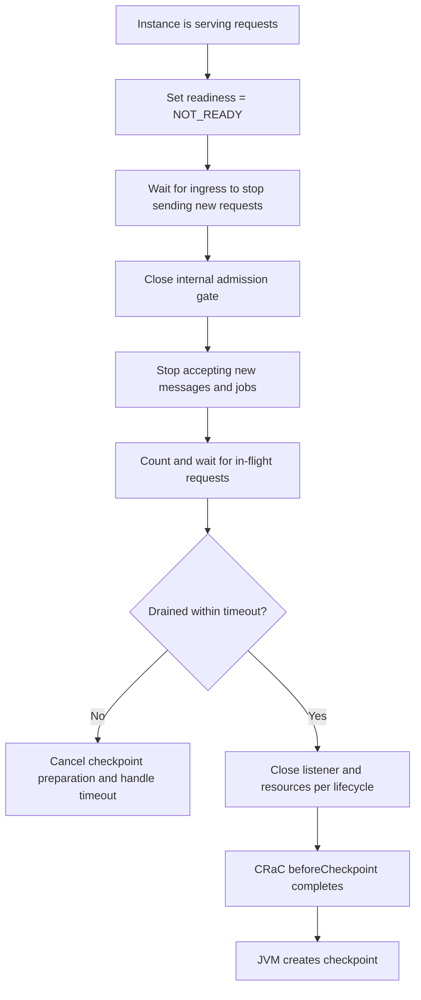

# Stopping New Requests and Handling In-Flight Requests

When preparing to create a checkpoint with CRaC (Coordinated Restore at Checkpoint), a server application needs to bring its network processing pipeline to a stable state. If it continues accepting new requests while the JVM or application is closing connections, stopping consumers, or preparing resources for a checkpoint, requests can arrive at an instance that is about to stop operating. Conversely, if the server or connection pool is closed immediately, already-accepted requests can be interrupted mid-flight.

Therefore, the application needs to perform two things in the right order: **stop accepting new work and allow already-accepted work to complete within a bounded period of time**. This process is commonly called *graceful drain* or *graceful shutdown*. In CRaC, draining is part of checkpoint preparation; after restore, the server must only accept requests once listeners, resources, and application state are ready.

Draining requires coordination across multiple layers:

- **Load balancer or ingress:** stop routing new requests to the instance about to be checkpointed.
- **HTTP server and application:** stop accepting or reject new requests, track in-flight requests, and wait for them to complete.
- **Business resources:** keep the database, broker, and necessary clients active until the last request completes; only then close them or transition them to a checkpoint-safe state.
- **JVM and CRaC:** proceed with checkpointing only when resources have completed their preparation callbacks.

No single CRaC callback automatically orchestrates the entire load balancer, HTTP server, and business logic. The application needs to combine CRaC APIs with the lifecycle mechanisms of the framework and deployment platform.

## 1. Why Drain Requests Before Checkpoint?

An in-flight request can use multiple resources throughout its processing lifetime:

- reading the body from a socket and writing the response back to the client;
- acquiring a connection from a database pool, opening a transaction, and committing or rolling back;
- calling an external HTTP service;
- sending a message or updating a consumer offset;
- reading from or writing to a cache;
- launching an asynchronous task to complete business logic.

If checkpointing starts before these operations finish, the application can save a state that is unsuitable to resume from. For example, a thread is restored while the client-side socket is already closed; an open transaction no longer has a valid connection; or a message has been received but not acknowledged according to the broker's semantics.

Stopping new requests bounds the amount of work that needs to finish. Waiting for running requests lets the application finish business operations at a controlled boundary. Only after draining succeeds can resources such as connection pools or network clients be safely closed.

### 1.1. Distinguishing Readiness, Liveness, and Admission

These three concepts serve different purposes:

| Mechanism | Question Answered | During Checkpoint Preparation |
| --- | --- | --- |
| Readiness | Should the instance receive new traffic? | Transition to not ready so the load balancer removes the instance from the serving pool |
| Liveness | Is the process still alive and should it keep running? | Usually remains healthy during drain; do not use liveness to signal that the instance is ready for traffic |
| Admission control | Does the application grant permission to start a new request? | Close the internal gate to block requests that slip through while readiness is propagating |

Readiness may take time to be updated by the load balancer or ingress controller. During that propagation delay, a request can still be sent to the instance. Admission control is the last line of defense: new requests arriving after the gate is closed are rejected with a retryable response, typically HTTP 503.

Liveness should not automatically turn unhealthy just because the instance is draining. If liveness fails, the platform might restart the process right while it is preparing for a checkpoint. Health endpoints also need to be handled separately so the orchestration system can still read readiness and liveness when admission for business requests is closed.

## 2. Overall Graceful Drain Process

A checkpoint preparation process typically consists of the following steps:

1. Mark the instance as no longer accepting new traffic via readiness or an equivalent orchestration mechanism.
2. Wait for the load balancer/ingress to stop sending new requests to the instance within a configured time limit.
3. Close the internal admission gate to block any new requests that still slip through.
4. Stop accepting new work from other sources such as message brokers, schedulers, and background workers.
5. Wait for in-flight requests, streams, and tasks to complete or terminate according to the timeout policy.
6. Confirm that no business operations are still using resources that need to be closed.
7. Close listeners or network resources using the mechanisms supported by the server and runtime; close connection pools, clients, or consumers in dependency order.
8. Let CRaC resources complete `beforeCheckpoint`; only then does the JVM proceed to create the process image.

Overall flow:



After restore, the process reverses at the resource level: the JVM invokes `afterRestore`, the application recreates necessary listeners and connections, verifies health, opens the admission gate, and only then transitions readiness back to ready. The admission gate must only be opened after required components are ready.

### 2.1. Readiness Orchestration Needs to Start Early Enough

If readiness is only set to not ready inside `beforeCheckpoint`, the platform may not have enough time to remove the instance from the load balancer before the JVM begins checkpointing. Therefore, for systems that require state propagation time, there should be a drain orchestration step before issuing the checkpoint command. This step can be performed by a deployment controller, lifecycle manager, or an internal administrative endpoint.

The CRaC callback still needs to close the admission gate and check the number of in-flight requests to protect the instance at the final moment. However, the callback should not assume that a readiness change takes effect immediately across all proxies.

## 3. Admission Gate for New Requests

An admission gate is an application-level synchronization component. When in the `ACCEPTING` state, new requests are allowed in and counted toward the number of in-flight requests. When transitioning to `DRAINING`, new requests are rejected; already-accepted requests continue running and remain counted until they complete.

Simple state model:

| State | New Requests | Already-Accepted Requests |
| --- | --- | --- |
| `ACCEPTING` | Accepted | Continue processing |
| `DRAINING` | Rejected or routed to another instance | Allowed to complete |
| `DRAINED` | Rejected | No active requests remaining |
| `RESTORING` | Rejected | No business requests allowed to run |
| `FAILED` | Rejected | Keep instance in not-ready state |

A gate needs to provide at least three operations:

- `tryEnter()`: grants a lease for a new request if the instance is accepting requests.
- `stopAccepting()`: transitions to `DRAINING`, preventing new leases.
- `awaitDrained(timeout)`: waits for existing leases to be released or signals a timeout.
- `cancelDrain()`: reopens admission if the drain is canceled before resources are closed.

Leases are closed in a `finally` block or `try-with-resources`. Checking the state and incrementing the counter must happen atomically within the same synchronization region so that no request slips in while the gate is closing.

## 4. Implementing RequestDrainGate in Java

The example below uses `ReentrantLock`, `Condition`, and an active request counter. `RequestLease` represents the right to process an accepted request.

```java
import java.time.Duration;
import java.util.concurrent.TimeoutException;
import java.util.concurrent.atomic.AtomicBoolean;
import java.util.concurrent.locks.Condition;
import java.util.concurrent.locks.ReentrantLock;

public final class RequestDrainGate {

    public enum State {
        ACCEPTING,
        DRAINING,
        DRAINED,
        RESTORING,
        FAILED
    }

    private final ReentrantLock lock = new ReentrantLock();
    private final Condition noRequests = lock.newCondition();

    private State state = State.ACCEPTING;
    private int inFlight;

    public RequestLease tryEnter() {
        lock.lock();
        try {
            if (state != State.ACCEPTING) {
                return null;
            }

            inFlight++;
            return new RequestLease(this);
        } finally {
            lock.unlock();
        }
    }

    private void leave() {
        lock.lock();
        try {
            if (inFlight <= 0) {
                throw new IllegalStateException("Unbalanced request lease");
            }

            inFlight--;
            if (inFlight == 0) {
                if (state == State.DRAINING) {
                    state = State.DRAINED;
                }
                noRequests.signalAll();
            }
        } finally {
            lock.unlock();
        }
    }

    public void stopAccepting() {
        lock.lock();
        try {
            if (state != State.ACCEPTING) {
                throw new IllegalStateException(
                        "Cannot drain from state " + state);
            }

            state = inFlight == 0 ? State.DRAINED : State.DRAINING;
            noRequests.signalAll();
        } finally {
            lock.unlock();
        }
    }

    public void cancelDrain() {
        lock.lock();
        try {
            if (state != State.DRAINING && state != State.DRAINED) {
                throw new IllegalStateException(
                        "Cannot cancel drain from state " + state);
            }

            state = State.ACCEPTING;
            noRequests.signalAll();
        } finally {
            lock.unlock();
        }
    }

    public void awaitDrained(Duration timeout)
            throws InterruptedException, TimeoutException {
        long remaining = timeout.toNanos();

        lock.lock();
        try {
            if (state != State.DRAINING && state != State.DRAINED) {
                throw new IllegalStateException(
                        "Cannot wait for drain from state " + state);
            }

            while (inFlight > 0) {
                if (remaining <= 0) {
                    throw new TimeoutException(
                            "Timed out waiting for in-flight requests");
                }
                remaining = noRequests.awaitNanos(remaining);
            }

            state = State.DRAINED;
        } catch (InterruptedException ex) {
            Thread.currentThread().interrupt();
            throw ex;
        } finally {
            lock.unlock();
        }
    }

    public void beginRestore() {
        lock.lock();
        try {
            if (state != State.DRAINED) {
                throw new IllegalStateException(
                        "Cannot restore from state " + state);
            }
            state = State.RESTORING;
        } finally {
            lock.unlock();
        }
    }

    public void resumeAccepting() {
        lock.lock();
        try {
            if (state != State.RESTORING) {
                throw new IllegalStateException(
                        "Cannot accept requests from state " + state);
            }
            state = State.ACCEPTING;
            noRequests.signalAll();
        } finally {
            lock.unlock();
        }
    }

    public void fail() {
        lock.lock();
        try {
            state = State.FAILED;
            noRequests.signalAll();
        } finally {
            lock.unlock();
        }
    }

    public int inFlightCount() {
        lock.lock();
        try {
            return inFlight;
        } finally {
            lock.unlock();
        }
    }

    public State state() {
        lock.lock();
        try {
            return state;
        } finally {
            lock.unlock();
        }
    }

    public static final class RequestLease implements AutoCloseable {
        private final RequestDrainGate owner;
        private final AtomicBoolean closed = new AtomicBoolean();

        private RequestLease(RequestDrainGate owner) {
            this.owner = owner;
        }

        @Override
        public void close() {
            if (closed.compareAndSet(false, true)) {
                owner.leave();
            }
        }
    }
}
```

The gate illustrates the following characteristics:

- `tryEnter()` checks the state and increments `inFlight` under the same lock.
- Once `stopAccepting()` runs, all new requests receive `null` and are not counted as in-flight requests.
- Requests that already hold a lease can still complete; `leave()` decrements the counter and wakes waiting threads when the count reaches 0.
- `awaitDrained()` uses a timeout so it does not wait indefinitely.
- After restore, the gate passes through `RESTORING`; only `resumeAccepting()` allows new requests.
- `RequestLease.close()` is idempotent to avoid decrementing the counter multiple times if multiple cleanup branches call it.

This is an illustrative synchronization class. In a real application, you must clearly define how to handle drain timeouts: if a callback fails before closing resources, the system can use a separate `cancelDrain()` operation to reopen the gate. Do not automatically reopen the gate after some resources have already been partially closed; in that case, put the instance into an error state or perform a controlled rollback.

## 5. Integrating the Admission Gate with an HTTP Server

A common integration approach is to place a filter or interceptor at the request boundary. Every business request must acquire a lease before entering the controller. If the gate is closed, the application returns a retryable rejection response.

Example with a Servlet Filter for synchronous requests:

```java
import java.io.IOException;

import jakarta.servlet.Filter;
import jakarta.servlet.FilterChain;
import jakarta.servlet.ServletException;
import jakarta.servlet.ServletRequest;
import jakarta.servlet.ServletResponse;
import jakarta.servlet.http.HttpServletResponse;

public final class RequestAdmissionFilter implements Filter {

    private final RequestDrainGate gate;

    public RequestAdmissionFilter(RequestDrainGate gate) {
        this.gate = gate;
    }

    @Override
    public void doFilter(
            ServletRequest request,
            ServletResponse response,
            FilterChain chain) throws IOException, ServletException {

        RequestDrainGate.RequestLease lease = gate.tryEnter();
        if (lease == null) {
            ((HttpServletResponse) response).sendError(
                    HttpServletResponse.SC_SERVICE_UNAVAILABLE,
                    "Instance is draining");
            return;
        }

        try (lease) {
            chain.doFilter(request, response);
        }
    }
}
```

This example is for synchronous requests. With Servlet asynchronous processing, `doFilter()` may finish before the response actually completes. In that case, do not close the lease immediately in `finally`; attach an `AsyncListener` and only release the lease when the async request completes, errors, or times out. With Spring WebFlux, the lease must remain alive until the publisher terminates, typically managed with `doFinally` or an equivalent wrapper.

### 5.1. Health Endpoints and Administrative Endpoints

Do not let the admission filter block the very endpoint that the load balancer uses to check readiness. If the readiness endpoint also returns 503 just because the gate is closed, the platform may not be able to distinguish an intentional drain state from an application failure.

Clearly separate endpoint groups:

- **Readiness:** accessible while the application is draining and must reflect the not-ready state.
- **Liveness:** reflects whether the process is still alive; usually unaffected by the business admission gate.
- **Drain administrative endpoint:** protected by appropriate authentication and authorization, used to request the start of draining.
- **Business requests:** must acquire a lease and be rejected when the gate is closed.

Administrative endpoints should not be exposed publicly. How filter mappings or security matchers are configured depends on the framework; ensure there is no bypass path that lets business requests skip the admission gate.

### 5.2. Do Not Rely Only on Filters to Stop Accepting TCP Connections

A filter sits inside the request processing pipeline. It can reject a request after the TCP connection has already been accepted. If the goal is to stop accepting new connections at the socket level, use the lifecycle API of the corresponding HTTP server or reverse proxy.

Stopping listeners and handling keep-alive depends on the server implementation. Some servers support pausing accept, graceful shutdown, or closing listeners while still allowing existing requests to finish. Determine the exact behavior of the server in use and integrate it with CRaC. Do not assume `server.stop()` across every framework preserves in-flight requests or can restart itself after restore.

## 6. Tracking In-Flight Requests

The in-flight counter must reflect the entire duration a request is still using resources or can still produce business side effects. For synchronous requests, a filter can increment the counter on entry and decrement it when the filter exits. For asynchronous requests, streaming, or WebSockets, the lifecycle is more complex.

### 6.1. Synchronous Servlet Requests

For synchronous requests, `try-with-resources` in a filter is a simple way to ensure the lease is released even when a controller throws an exception:

```java
RequestDrainGate.RequestLease lease = gate.tryEnter();
if (lease == null) {
    rejectWith503(response);
    return;
}

try (lease) {
    chain.doFilter(request, response);
}
```

A request is counted as in-flight from the moment it is admitted until the filter chain finishes. If the response has finished writing before the filter returns, this is an appropriate boundary.

### 6.2. Servlet Asynchronous Requests

With Servlet Async, the filter can return while the processing task is still running. If the lease is released in `doFilter`'s `finally` block, the drain may conclude that all requests are finished while the async task is still using the database or socket.

A practical implementation needs to:

1. Acquire the lease before invoking the filter chain.
2. After the chain returns, check whether the request started async processing.
3. If not async, close the lease immediately.
4. If async, register an `AsyncListener` and hold the lease until `onComplete`, `onError`, or `onTimeout` according to the application's policy.
5. When `onStartAsync` creates a new async cycle, re-register the listener for that cycle.
6. Use an idempotent lease so completion and timeout callbacks do not release the counter twice.

Pseudocode:

```java
RequestLease lease = gate.tryEnter();
if (lease == null) {
    rejectWith503(response);
    return;
}

boolean transferredToAsync = false;
try {
    chain.doFilter(request, response);
    if (request.isAsyncStarted()) {
        request.getAsyncContext().addListener(new DrainAsyncListener(lease));
        transferredToAsync = true;
    }
} finally {
    if (!transferredToAsync) {
        lease.close();
    }
}
```

`DrainAsyncListener` needs to close the lease when the async request ends, and re-register the listener in `onStartAsync`. The pseudocode only illustrates lease ownership transfer; production code must also handle exceptions during listener registration, repeated async dispatches, and races between timeout and completion.

### 6.3. Spring MVC and WebFlux

Spring MVC can use Servlet async, `Callable`, `DeferredResult`, or `WebAsyncTask`. The counter must track until the response actually finishes, not just until the controller returns the object representing asynchronous work.

Spring WebFlux uses a reactive pipeline. Request counting should be tied to the publisher's lifecycle, for example using `Mono.usingWhen` or the `doFinally` operator to release the lease when the publisher completes, errors, or is canceled. Client subscription cancellation must also be accounted for; otherwise, draining could wait on a canceled request or finish prematurely while background tasks are still running.

Do not use a generic synchronous filter and assume it accurately measures the lifecycle of both Servlet async and reactive streams. Integrate at the abstraction appropriate for the running server stack.

## 7. Long-Lived Requests and Streaming Protocols

Not all requests are short-lived. WebSocket connections, Server-Sent Events (SSE), long polling, HTTP streaming, and HTTP/2 streams can live longer than the expected drain duration.

The application needs to define a policy for each type:

| Connection Type | Applicable Drain Policy |
| --- | --- |
| Standard HTTP request/response | Wait for completion within the configured request timeout |
| Long polling | Stop creating new polls; let current polls finish or return a retryable close response |
| SSE | Stop sending new events, send a termination signal if the protocol allows, and close the stream in a controlled manner |
| WebSocket | Reject new connections, send a close frame with an appropriate reason, and wait for the client to close within a time limit |
| HTTP/2 | Stop accepting new streams per server capabilities, possibly using GOAWAY; let current streams finish within limits |
| Large upload/download | Allow completion if within the deadline; otherwise cancel per policy and ensure the client can resume or retry |

Do not wait indefinitely just because a WebSocket remains open. Conversely, closing sockets immediately can leave the client unaware of whether a business operation was committed. For retryable operations, an idempotency key or status query mechanism is needed so the client can determine the outcome.

## 8. Ending Requests at the Right Business Boundary

A request is considered complete when all of its business effects have reached a deterministic state, not merely when the controller returns.

For example, a payment request might:

1. receive the request and check the idempotency key;
2. open a transaction;
3. write payment data;
4. commit the transaction;
5. emit an event via a transactional outbox or acknowledge a message;
6. build the response and finish writing the response.

If draining ends after step 2 but before step 4, the checkpoint might save an incomplete request state. If the transaction is rolled back when the connection closes, the client may have already timed out and retried. If the transaction committed but the response did not reach the client, the client may also retry. Therefore, clear retry and idempotency semantics are required.

Key principles:

- Release the lease only after the transaction has committed or rolled back.
- Wait for data writes and response flushing to complete according to the framework's contract.
- Do not acknowledge a message before business logic has reached the required durable state.
- Use idempotency keys for requests that clients may retry.
- Set timeouts for each external step so the total drain time is predictable.
- For tasks handed off to an executor, the lease must be held until the work actually completes.

## 9. Integrating with CRaC Resource

You can create a `Resource` that coordinates the drain process. This resource does not necessarily own the database pool or broker client; it coordinates admission, the request tracker, and server lifecycle. Other specialized resources can still manage connection pools and clients separately.

Structural example:

```java
import java.time.Duration;
import java.util.concurrent.TimeoutException;
import org.crac.Context;
import org.crac.Core;
import org.crac.Resource;

public final class NetworkDrainResource implements Resource {

    private final RequestDrainGate requestGate;
    private final HttpServerLifecycle serverLifecycle;

    public NetworkDrainResource(
            RequestDrainGate requestGate,
            HttpServerLifecycle serverLifecycle) {
        this.requestGate = requestGate;
        this.serverLifecycle = serverLifecycle;
        Core.getGlobalContext().register(this);
    }

    @Override
    public void beforeCheckpoint(Context<? extends Resource> context)
            throws Exception {
        requestGate.stopAccepting();
        try {
            requestGate.awaitDrained(Duration.ofSeconds(30));
        } catch (InterruptedException | TimeoutException ex) {
            requestGate.cancelDrain();
            throw ex;
        }

        try {
            serverLifecycle.stopAcceptingConnections();
        } catch (Exception ex) {
            requestGate.fail();
            throw ex;
        }
    }

    @Override
    public void afterRestore(Context<? extends Resource> context)
            throws Exception {
        serverLifecycle.restoreListener();
        serverLifecycle.verifyReady();
        requestGate.beginRestore();
        requestGate.resumeAccepting();
    }
}
```

`HttpServerLifecycle` here is an illustrative application-defined interface, not a standard Java or CRaC API. The actual ordering of server listeners depends on the HTTP server and CRaC integration in use. If the server framework registers its own resource to close/open listeners, `NetworkDrainResource` should not close the same listener again.

In the example, `beginRestore()` is only valid when the gate is already in `DRAINED`. In a production environment, the gate needs to be placed into the appropriate state during restore, and the callback order between the network resource and dependent resources must be defined. If `awaitDrained()` times out, the callback must signal an error so the checkpoint fails. A higher-level lifecycle coordinator needs to decide how to restore admission if preparation is canceled before any resource is closed.

### 9.1. Ordering Between Drain and Other Resources

Suppose requests use a database pool and a broker client. A safe order is usually:

1. Stop ingress and close admission.
2. Wait for running requests to finish, including transactions and message publishing.
3. Stop schedulers and consumers so they do not generate new work.
4. Drain remaining database and broker operations.
5. Close pools and clients.
6. Complete the checkpoint.

After restore:

1. Recreate database pools and broker clients.
2. Verify connectivity and current configuration.
3. Start schedulers and consumers once dependencies are ready.
4. Start or open listeners.
5. Open the admission gate and transition readiness to ready.

If a framework determines resource callback order by registration order, organize registrations according to dependency relationships. For steps requiring coordination such as draining HTTP requests before closing pools, a coordinator can manage ordering more explicitly.

## 10. Timeouts and Policies When Draining Does Not Complete

Requests do not always finish within the expected time. A request might call a hung external service, wait on a lock, transfer a large file, or hold a long-lived stream. Therefore, draining requires an overall deadline and a policy for handling deadline expiration.

| Situation | Action |
| --- | --- |
| Request completes within deadline | Decrement counter; continue draining |
| Request still running near deadline | Log request id, route, and elapsed time; do not close resources the request is still using |
| Drain times out | Report checkpoint failure or cancel checkpoint request; do not pretend drain succeeded |
| Client cancels request | Cancel task if safe; release lease when all work actually ends |
| Request cannot be safely canceled | Wait until deadline and handle per business policy; do not arbitrarily cut off transactions |
| Server/resource partially closes then fails | Keep instance not ready and perform controlled recovery |

The drain duration must be shorter than the maximum time the platform allows the process to prepare for checkpointing. Leave room for closing resources, JVM/CRIU image writing, and other operational steps. Do not set the drain timeout longer than the overall deployment or checkpoint job deadline.

A timeout strategy may include:

- per-endpoint request timeouts;
- external service connect and read timeouts;
- transaction and database query timeouts;
- WebSocket/SSE/stream timeouts;
- overall drain timeout;
- platform checkpoint timeout.

Timeouts need to be ordered sensibly so requests have a chance to finish before the drain deadline. If a request cannot complete, a retry/idempotency policy is needed so the client or producer can continue once another instance is ready.

## 11. Common Implementation Pitfalls

| Pitfall | Consequence | Mitigation |
| --- | --- | --- |
| Changing readiness only without an admission gate | Requests can still reach the instance during propagation | Use readiness combined with an internal gate |
| Closing listeners before draining | Running requests can be interrupted | Stop accepting new requests, wait for in-flight, then stop listeners |
| Counting only synchronous requests | Async tasks keep running after the counter hits 0 | Track until async/streams actually terminate |
| Not handling WebSockets or SSE | Drain may never complete | Set policies for closing long-lived connections and deadlines |
| Health endpoints blocked by admission | Load balancer cannot read not-ready status | Separate readiness/liveness from business requests |
| Opening admission right after server binds port | Business resources may not be ready yet | Open only after all dependencies and readiness are met |
| Swallowing timeouts | Checkpoint may start while requests still use resources | Report error and cancel the checkpoint attempt |
| Closing pools while requests have open transactions | Transactions fail or business state becomes unclear | Wait for requests to finish before closing pools |
| Ignoring background tasks | Schedulers/consumers keep accessing resources | Pause new work generators and drain workers too |
| Holding leases too long or forgetting to close | Drain hangs | Use `try-with-resources`, timeouts, and in-flight metrics |
| Restarting listeners twice | Port bind errors or duplicate request handling | Maintain a single lifecycle owner for server listeners |

## 12. Observing and Testing the Drain Process

To verify that draining works, you need visibility into admission state, in-flight request counts, and wait times. Useful metrics include:

- current readiness status;
- admission gate state (`ACCEPTING`, `DRAINING`, `DRAINED`...);
- in-flight request count;
- count of new requests rejected during drain;
- overall drain duration and drain duration per route;
- count of requests exceeding the deadline;
- count of open long-lived connections;
- count of background jobs and messages in progress;
- listener close/open duration;
- time from restore to readiness.

Logs should include correlation id or request id, route, start time, and reason for non-completion. Do not log bodies, tokens, cookies, or sensitive data solely to track draining.

### 12.1. Scenarios to Test

| Scenario | Expected Result |
| --- | --- |
| Short request running when gate closes | Request completes; drain waits for lease release |
| New request arriving after gate closes | Rejected fast with appropriate retry response |
| Request arriving during readiness propagation | Admission gate still blocks new request |
| Request throws an exception | Lease is still released in cleanup |
| Async request completes late | Counter decrements only when async lifecycle ends |
| Client cancels streaming response | Task and lease are cleaned up per cancel policy |
| Drain timeout | Checkpoint is canceled or reports failure; resources are not arbitrarily closed |
| Restore succeeds | Server and dependencies are ready before admission opens |
| Restore fails | Readiness remains not ready and business requests are not accepted |

An integration smoke test should run multiple concurrent requests, trigger drain while requests are active, and verify that existing requests complete while new requests are rejected. Then perform checkpoint/restore in a compatible CRaC environment and confirm the instance only accepts requests after readiness returns to ready.

## 13. Conclusion

Stopping new requests and handling in-flight requests is a critical step to bring a networked application to a safe state before checkpointing. The process requires coordinating readiness and ingress control externally, an admission gate inside the application, an in-flight request counter, and the lifecycle of the HTTP server along with business resources.

The application should block new requests first, allow already-accepted requests to finish within a time limit, and only then close listeners and dependent resources. After restore, listeners and dependencies must be restored, verified, and reach readiness before opening admission. Synchronous requests, asynchronous requests, streams, and background work must all be tracked so no resource-using activity is missed.
