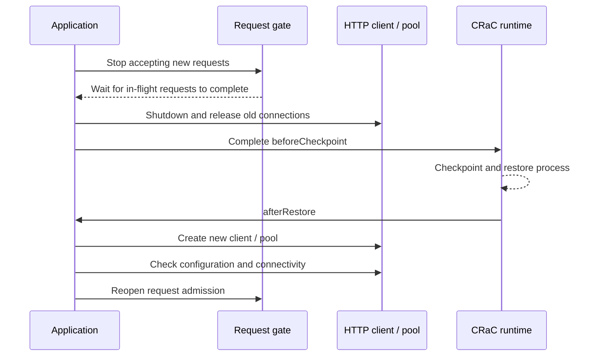

# Restoring HTTP Clients and Reusable Connection Pools

An HTTP client is typically created once and reused across multiple requests. Reusing the client enables reusing TCP connections, TLS sessions, and connection pools, reducing the cost of DNS lookups, TCP handshakes, and TLS handshakes. However, after an application is restored from a checkpoint, connections that were opened before the checkpoint may have been closed by the server, expired, or become incompatible with the current network.

Therefore, when integrating CRaC, the lifecycle of the HTTP client and connection pool must be managed as a resource group. Before checkpointing, the application stops accepting new requests, waits for in-flight requests to complete within the allowed deadline, and then closes or releases the client/pool according to the library's API. After restore, the application creates a new client/pool, reloads the necessary configuration and credentials, verifies connectivity, and only then re-enables request sending.

You should not assume that just because an HTTP client object still exists on the heap, its underlying sockets can continue to be used safely. The Java state of the client and the connection state at the operating system or remote server are two different things.

## 1. Why Does an HTTP Client Need Handling Around Checkpoint?

A reused HTTP client typically manages several components:

- A connection pool containing TCP connections already established to serve subsequent requests.
- HTTP/1.1 keep-alive connections or HTTP/2 connections capable of multiplexing multiple streams.
- TLS state, certificates, sessions, and authentication configuration.
- Internal executors or threads for executing asynchronous requests.
- Timers, schedulers, or idle connection cleanup tasks.
- Outgoing requests, incoming responses being read, and unclosed body streams.

When a process is checkpointed, threads and memory state can be saved. While the process is inactive, the server or proxy does not know that the client will return from a checkpoint. They may still close connections due to idle timeouts, restarts, failovers, or configuration changes. A connection existing in the process state after restore may therefore be a stale connection.

Common scenarios:

| Component | Changes that may occur while the process is checkpointed | Handling after restore |
|---|---|---|
| TCP connection | Server, proxy, or NAT closed the connection. | Discard old connections and establish new connections. |
| HTTP keep-alive | Idle timeout expired or peer no longer holds the socket. | Recreate the connection pool or let the client open new connections. |
| HTTP/2 | Multiplexed connection was closed by the peer; active streams were interrupted. | Create a new HTTP/2 connection and resend requests according to safety policies. |
| TLS | Session or certificate may have expired/changed. | Perform a new handshake and reload trust/key material if needed. |
| DNS | Service address may have changed. | Let the client re-resolve names according to the library's DNS caching policy. |
| Executor and scheduler | Internal threads are stopped, hung, or no longer fit the new lifecycle. | Shut down properly before checkpoint and recreate application-managed components. |
| HTTP response stream | Body may not be fully read or closed. | Complete or cancel requests before checkpoint; do not keep partial streams to continue blindly. |

## 2. Principles for Managing Clients and Connection Pools

A controllable workflow follows four principles.

**Stop accepting new requests before closing the client.** If new requests are still sent while the pool is shutting down, some requests may fail randomly or be rejected mid-flight. Use an admission gate at the application layer and ensure every request-sending path goes through that gate.

**Drain in-flight requests.** Wait for synchronous requests to complete, or track futures for asynchronous requests. For requests that cannot complete within the deadline, apply a clear timeout/cancel policy. Do not checkpoint while requests or response bodies are still in an indeterminate state.

**Close old resources using the library's proper API.** A client may own a connection pool, executor, and scheduler. Closing the client often closes the pool or stops the executor; if a pool is shared across multiple clients, it must be managed by its actual owner to avoid double-closing.

**Create a new client/pool after restore.** Reuse the managed configuration, but recreate objects whose lifecycles are tied to sockets, threads, or connections. Only re-enable request admission after the new client has been created and required dependencies are ready.



The order in the diagram is an application-designed workflow. If a library already has CRaC integration and manages the client/pool itself, follow that integration; avoid registering a second Resource that also closes or recreates a resource already managed by the library.

## 3. Handling In-Flight Requests Before Checkpoint

This is the part most often overlooked. Closing the pool while requests are still executing can corrupt requests, leave response bodies incomplete, or leave the application unsure whether the server received a write operation.

Before checkpointing, you should:

1. Prevent new requests from entering clients that are about to close.
2. Wait for running synchronous requests to finish.
3. For asynchronous requests, track `CompletableFuture` or equivalent handles until completion/cancellation.
4. Read completely or close response bodies and streams.
5. Cancel requests that exceed the deadline according to the chosen policy.
6. Only shut down the client/pool after the number of active requests has reached a safe state.

With `sendAsync(...)`, you cannot just check the number of running threads. You must manage the lifecycle of each future and callback. If a callback uses a client or executor owned by the application, you must ensure the callback has completed or been cancelled in a controllable manner.

### 3.1. GET Requests and Write Requests

GET requests can usually be resent after a connection interruption, though you still need to consider endpoint side effects and consistency of returned data.

For POST, PUT, or business operations that write data, do not automatically retry just because the client did not receive a response. The server may have already processed the request while the response was lost. If resent, the operation could be executed twice.

Common measures:

- Use an idempotency key for write operations that support it.
- Store business identifiers to query status before resending.
- Design endpoints to be idempotent when appropriate.
- Record requests with unknown outcomes and handle them via a reconciliation process.

Checkpoint/restore does not provide exactly-once guarantees for HTTP requests. Retry correctness must come from protocol and business design.

## 4. Closing Clients and Connection Pools Before Checkpoint

The closing method depends on the HTTP library in use. They can be categorized as follows:

| Client or stack | Components to manage | Handling approach |
|---|---|---|
| `java.net.http.HttpClient` on JDK 21+ | Client and internal executor managed by the client. | Use JDK 21 lifecycle APIs such as `shutdown()`, `awaitTermination(...)`, `shutdownNow()`; create a new `HttpClient` after restore. |
| Apache HttpClient 5 | `CloseableHttpClient` and connection manager/pool. | Drain requests, close client and pool according to ownership; create new client/manager after restore. |
| OkHttp | Dispatcher executor and `ConnectionPool`. | Stop accepting requests, handle in-flight requests, release idle connections, and create an appropriate client/dispatcher after restore. |
| Reactor Netty | `ConnectionProvider`, event loop resources, and clients configured on them. | Dispose application-owned resources and create new provider/client after restore. |

Do not apply a generic `close()` call to every library. Some clients are merely immutable configurations, while the connection pool or event loop is managed by a separate object. You must clearly identify who owns each resource and whether the shutdown method affects other clients sharing it.

### 4.1. Notes on `java.net.http.HttpClient` on JDK 21+

Starting in JDK 21, `java.net.http.HttpClient` provides lifecycle methods such as `shutdown()`, `shutdownNow()`, `awaitTermination(Duration)`, `isShutdown()`, `isTerminated()`, and `close()`. They allow applications to manage stopping the client in a controlled way.

`HttpClient` does not provide a public API to iterate over and close individual sockets in its internal connection pool. If you want to cleanly discard old connection state, the simplest approach is to shut down the old client before checkpoint and create a new `HttpClient` instance after restore.

Older JDKs do not have a corresponding lifecycle API for `java.net.http.HttpClient`. In that case, do not call a hypothetical method like `close()`; use a strategy suited to the JDK version, or choose an HTTP client with a clear lifecycle management API. Always check the Javadoc of the exact JDK being built and run.

## 5. Example Resource Managing JDK `HttpClient` on Java 21

The example below illustrates a reusable client for synchronous requests. `ReentrantReadWriteLock` ensures the checkpoint callback waits for requests currently passing through the wrapper to finish and prevents new requests from starting during shutdown.

```java
import org.crac.Context;
import org.crac.Core;
import org.crac.Resource;

import java.io.IOException;
import java.net.URI;
import java.net.http.HttpClient;
import java.net.http.HttpRequest;
import java.net.http.HttpResponse;
import java.time.Duration;
import java.util.concurrent.TimeUnit;
import java.util.concurrent.locks.Lock;
import java.util.concurrent.locks.ReentrantReadWriteLock;

public final class CracHttpClient implements Resource {

    private final ReentrantReadWriteLock admission =
            new ReentrantReadWriteLock();

    private volatile HttpClient client = newClient();
    private volatile boolean acceptingRequests = true;

    public CracHttpClient() {
        Core.getGlobalContext().register(this);
    }

    public HttpResponse<String> get(URI uri)
            throws IOException, InterruptedException {
        Lock readLock = admission.readLock();
        readLock.lockInterruptibly();
        try {
            if (!acceptingRequests) {
                throw new IllegalStateException(
                        "HTTP client is preparing for checkpoint");
            }

            HttpRequest request = HttpRequest.newBuilder(uri)
                    .timeout(Duration.ofSeconds(10))
                    .GET()
                    .build();

            return client.send(
                    request,
                    HttpResponse.BodyHandlers.ofString());
        } finally {
            readLock.unlock();
        }
    }

    // Called only by the coordinator after required dependencies have been checked.
    public void markReadyAfterDependencyChecks() {
        Lock writeLock = admission.writeLock();
        writeLock.lock();
        try {
            acceptingRequests = true;
        } finally {
            writeLock.unlock();
        }
    }

    @Override
    public void beforeCheckpoint(Context<? extends Resource> context)
            throws Exception {
        Lock writeLock = admission.writeLock();

        // Wait for current synchronous requests to finish; timeout avoids waiting indefinitely.
        if (!writeLock.tryLock(10, TimeUnit.SECONDS)) {
            throw new IllegalStateException(
                    "Timed out waiting for in-flight HTTP requests");
        }

        try {
            acceptingRequests = false;

            HttpClient oldClient = client;
            oldClient.shutdown();

            if (!oldClient.awaitTermination(Duration.ofSeconds(10))) {
                oldClient.shutdownNow();
                if (!oldClient.awaitTermination(Duration.ofSeconds(5))) {
                    throw new IllegalStateException(
                            "HTTP client did not terminate before checkpoint");
                }
            }
        } finally {
            writeLock.unlock();
        }
    }

    @Override
    public void afterRestore(Context<? extends Resource> context) {
        Lock writeLock = admission.writeLock();
        writeLock.lock();
        try {
            HttpClient restoredClient = newClient();
            client = restoredClient;
            // Keep the gate closed until the coordinator confirms dependencies are ready.
            acceptingRequests = false;
        } finally {
            writeLock.unlock();
        }
    }

    private static HttpClient newClient() {
        return HttpClient.newBuilder()
                .connectTimeout(Duration.ofSeconds(5))
                .version(HttpClient.Version.HTTP_2)
                .build();
    }
}
```

This is an illustrative example for Java 21+, not a complete production wrapper. In a real application, you need to integrate the gate with server/request admission so that all requests go through the wrapper. If there are asynchronous requests, futures and response bodies must be tracked separately; the read/write lock in the example only covers synchronous requests called via `get(...)`.

If the write lock cannot be acquired or the client does not stop within the deadline, the callback throws an error and the checkpoint should not proceed. At that point, the client may already be in the shutdown state while the gate remains closed; the application must keep readiness false and apply a fail-stop or controlled recovery policy. Do not continue serving as if the old client were still usable.

After restore, the example creates a new client from configuration while keeping the request gate closed. The application's coordinator needs to check required dependencies, and only then call `markReadyAfterDependencyChecks()` to open admission. In practice, configuration may need to be re-read from a config source or secret provider if endpoints, credentials, trust stores, or proxies can change during checkpoint time.

## 6. Managing Third-Party Library Connection Pools

For libraries with a separate connection manager, manage ownership properly between the client and the pool.

Example conceptual structure:

```text
HttpClientResource
    ├── request admission gate
    ├── CloseableHttpClient
    └── ConnectionManager / Pool
```

Before checkpoint:

1. Stop accepting new requests through the resource.
2. Wait for in-flight requests and response bodies to complete or be cancelled.
3. Stop application-owned eviction threads or schedulers.
4. Close the client and connection manager in the library's proper ownership order.
5. Verify that resources have been released before the callback finishes.

After restore:

1. Create a new connection manager/pool with configured limits and timeouts.
2. Create a new HTTP client attached to that pool.
3. Recreate executors or schedulers if managed by the application.
4. Check required credentials, proxy, TLS, and DNS policies.
5. Reopen request admission after required dependencies are ready.

If a pool is shared by multiple clients, only the owner is responsible for closing the pool. Dependent clients must be stopped before the pool is closed. Avoid registering each client and pool as independent Resources if their callbacks could close the same object twice or run in the wrong order.

## 7. Handling HTTP/2, WebSocket, SSE, and Streaming

Not every HTTP connection is a short request that can be drained simply.

### 7.1. HTTP/2 multiplexing

HTTP/2 allows multiple streams to run over a single TCP connection. If the connection is closed, multiple requests may be affected simultaneously. A new client can establish a new HTTP/2 connection, but that does not mean old streams automatically continue.

Identify which requests can be resent, which need business status checks, and which must report failure. Especially for write requests, an idempotency key or reconciliation mechanism is needed.

### 7.2. WebSocket

WebSocket is a bidirectional connection with session state. After restore, you should not assume the old session still works. The application needs to:

- Close or stop accepting new messages before checkpoint.
- Handle outgoing messages and unacknowledged messages.
- Establish a new WebSocket connection after restore.
- Re-authenticate and re-register subscriptions.
- Use sequence numbers, offsets, or resume tokens if supported by the protocol to avoid losing or duplicating messages.

### 7.3. Server-Sent Events and HTTP streaming

With SSE or streaming response bodies, keeping an active reading stream across a checkpoint can cause the client and server to go out of sync. You should finish or cancel the stream before checkpoint, and create a new request after restore. If the data source supports `Last-Event-ID`, offsets, or cursors, use them to resume from the confirmed position.

### 7.4. Long polling and long-lived requests

Long-lived requests need a clear deadline. Before checkpoint, you can wait within a limit or cancel and allow the external client to resend after restore. Do not hold a callback waiting indefinitely for a request that the server may have already timed out on its own.

## 8. Credentials, TLS, Proxy, and Connection Configuration

The new client needs to use configuration appropriate for the post-restore environment. Not all configuration should be preserved as-is in the checkpoint.

- **Credentials:** access tokens may expire; use a token provider to fetch a new token when needed instead of holding a short-lived token long-term in the client.
- **TLS:** certificates or trust stores may be updated; if policy permits changes, reload configuration before creating the new client.
- **Proxy:** proxy address or authentication details may change; recreate the client with current configuration.
- **DNS:** new connections may need to re-resolve service names. DNS caching behavior depends on the JDK and library, so check actual TTL and configuration.
- **Timeout:** apply appropriate connect timeout, request timeout, and read timeout; avoid hanging requests that block draining before checkpoint.
- **Secrets in checkpoint:** the heap may contain tokens or sensitive information. Protect the checkpoint image with appropriate access permissions and storage policies.

Do not log `Authorization` headers, cookies, tokens, or sensitive request content when diagnosing restore errors.

## 9. Retries and Request Correctness After Restore

When the new client sends its first requests, connection errors can occur because a service is not ready yet or DNS/proxy has just changed. Retries should be bounded and categorized by error type.

| Case | Recommended policy |
|---|---|
| Connect timeout before sending request | Can retry with backoff if the request is safe and deadline remains. |
| Server returns 429 or 503 | Respect `Retry-After` if present and limit the number of attempts. |
| GET fails due to stale connection | Create a new connection and retry within limits if endpoint semantics allow. |
| POST does not receive a response | Do not automatically resend without knowing whether the server processed it; use an idempotency key or reconciliation. |
| 401 due to expired token | Refresh credentials via the proper authentication mechanism, then retry within limits. |
| TLS handshake or certificate validation fails | Do not bypass TLS verification; fix the underlying certificate/configuration cause. |

Client-layer retries need to be coordinated with retries in the service mesh, load balancer, and calling application. Multiple active retry layers can rapidly multiply request counts. Set an overall deadline and limit retries at a single clearly responsible layer.

## 10. Observability and Testing After Restore

You should not just check that the `afterRestore(...)` callback ran. You must verify that the new client can actually send requests and handle responses properly.

### 10.1. Information to record

- Timestamps for starting drain, shutting down the old client, and creating the new client.
- Number of in-flight requests when checkpointing starts and drain duration.
- Number of requests timed out or cancelled before checkpoint.
- Time taken to create the pool/client after restore.
- Results of DNS, TCP connect, TLS handshake, and health requests if safely observable.
- Counts of new connections, connection reuse, stale connection errors, and retries.
- Readiness status of features using the HTTP client.

Log by the logical name of the client or dependency; do not log credentials or sensitive payloads.

### 10.2. Test scenario matrix

| Scenario | Expected result |
|---|---|
| No in-flight requests at checkpoint | Old client/pool is shut down; new client is created after restore. |
| Synchronous request in flight | Callback waits for request to complete within deadline. |
| Request does not complete before deadline | Checkpoint is blocked or fails; application does not assume the client is still ready. |
| Async request still pending | Future is drained/cancelled per policy; callbacks do not use a shut-down executor. |
| Server closes keep-alive connection during checkpoint | New client creates a new connection and test requests succeed. |
| DNS or endpoint changes | New client uses resolution/connection configuration per chosen policy. |
| Credentials expire | Token is refreshed or feature is kept unready per policy. |
| HTTP/2 peer closes connection | Requests are handled per semantics and retry policy, without assuming streams automatically continue. |
| WebSocket/SSE is open | Old session/stream is terminated; new connection resumes by cursor if supported. |
| POST was processed by server but response was lost | Do not resend blindly; use idempotency or reconciliation. |

Testing should be performed against a real HTTP server or a test server capable of actively closing connections, delaying responses, changing DNS/endpoints, and returning authentication errors. A unit test that only mocks `HttpClient` does not prove that the real connection pool and sockets work after restore.

## 11. Common Design Mistakes

**Keeping the old client because the object still exists after restore.** An object remaining on the heap does not prove that TCP connections or internal executors are still valid. Define the client's lifecycle and recreate it when needed.

**Closing the pool before stopping new requests.** Requests can start right while the pool is shutting down. Always block admission first and drain current requests.

**Not waiting for asynchronous requests.** Futures or callbacks may still use the client after the pool/executor has closed. All running work must be tracked.

**Creating a new client while keeping the old connection manager.** If the old pool holds stale sockets or a shut-down executor, the new client can still fail. Recreate the entire resource group according to ownership.

**Closing a shared pool from multiple Resources.** Double-close or wrong closing order can occur. One owner should coordinate the lifecycle of a shared pool.

**Retrying every request.** A POST or business operation may already have been processed by the server. Retrying without idempotency can create duplicate transactions.

**Ignoring TLS errors to reconnect quickly.** Do not disable certificate checks or hostname verification to bypass post-restore errors. Fix the trust store, certificate, or configuration.

**Using infinite waits in callbacks.** A hanging request can prevent the checkpoint from completing. Set clear timeouts and cancellation/stop policies.

## 12. Checklist for Restoring HTTP Clients and Connection Pools

- [ ] Identify the HTTP library, JDK version, and actual lifecycle APIs.
- [ ] Identify which clients, pools, executors, and schedulers are owned by the application.
- [ ] Register a Resource or CRaC integration with clear responsibility for the resource group.
- [ ] Block new requests before starting shutdown.
- [ ] Drain synchronous requests and track asynchronous requests.
- [ ] Close in-progress response bodies, streams, and requests per policy.
- [ ] Shut down clients/pools/executors in the proper ownership order.
- [ ] Use deadlines to prevent callbacks from waiting indefinitely.
- [ ] Create a new client/pool after restore instead of assuming old sockets still work.
- [ ] Reload credentials, TLS, proxy, and endpoint configuration if needed.
- [ ] Open request admission only after required dependencies are ready.
- [ ] Handle HTTP/2, WebSocket, SSE, and streaming as sessions or streams needing separate restoration.
- [ ] Do not retry write requests without ensuring idempotency or reconciliation.
- [ ] Test with a real server or a test server simulating connection closures and network errors.

## 13. Key Terms to Remember

- **HTTP client:** the component that sends HTTP requests and receives responses.
- **Connection pool:** a managed group of connections reused across multiple requests.
- **Keep-alive:** a mechanism that keeps an HTTP/TCP connection open for subsequent requests.
- **Stale connection:** a connection that the client believes is still usable, but the peer or network has closed or changed state.
- **Drain:** stopping acceptance of new work and waiting for in-flight work to complete.
- **Admission gate:** a mechanism that prevents new requests from entering the client while preparing for checkpoint or restore.
- **HTTP/2 multiplexing:** multiple HTTP streams sharing a single HTTP/2 connection.
- **Idempotency key:** an identifier that allows the server to recognize retries of the same business operation.
- **Connection manager:** a component that manages creating, allocating, and closing connections in some HTTP client libraries.
- **Resource:** an `org.crac.Resource` object that coordinates pre-checkpoint preparation and post-restore recovery.

Restoring an HTTP client in CRaC means managing the entire lifecycle of requests, connection pools, executors, and connection configuration. Stop accepting new requests, drain running work, release old clients/pools before checkpoint, and create new resources after restore. Only reopen traffic when required dependencies are working and retries are controlled according to the safety of each request.
