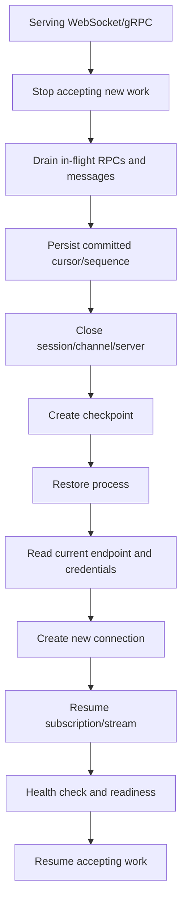

# WebSocket, gRPC, and Long-Lived Connections Across the Checkpoint Boundary

WebSocket and gRPC typically keep connections open for a long time to exchange data continuously. WebSocket maintains a bidirectional session over a TCP connection; gRPC typically uses HTTP/2, which can multiplex multiple RPCs and streams over the same channel. When a Java application goes through CRaC checkpoint/restore, these connections must be treated as resources with their own lifecycle.

A checkpoint saves process state according to the capabilities of the runtime and environment, but it does not guarantee that the peer, load balancer, proxy, or broker will still keep the network session alive while the process is paused. The other side may time out, close the socket, route the connection to another backend, or release session state. A `WebSocket`, `ManagedChannel`, or stream object still remaining in the heap does not prove that the external communication session is still valid.

For applications that need to operate reliably across CRaC, the common approach is to stop accepting new work, complete or save the progress of ongoing exchanges, close sessions that need to be closed before checkpoint, and then reconnect after restore. If the environment and library support keeping connections across a checkpoint, use that only after verifying the exact JDK version, operating system, runtime, proxy, and actual peer.

## 1. Why Do Long-Lived Connections Need Special Handling?

A short-lived connection is typically created, used for one operation, and closed. A long-lived connection can carry state across multiple layers:

- **Transport:** TCP socket, TLS session, HTTP/2 connection, and flow control state.
- **Protocol:** WebSocket handshake, HTTP/2 stream, gRPC metadata, and RPC state.
- **Application:** subscription registration, cursor, sequence number, session ID, heartbeat, and access permissions.
- **Runtime:** read/write threads, executors, timers, callbacks, and pending buffers.

A checkpoint can save part of the state inside the process, but the state of the peer and network devices resides outside the process. While the application is paused, the server may close the connection due to an idle timeout, the load balancer may remove the mapping, TLS credentials may expire, or the service may deploy a new version.

Even if the socket is restored successfully in a specific environment, the application session may no longer be valid. For example, the WebSocket server may have removed the subscription; the gRPC server may have ended the stream or released resources tied to the RPC. Therefore, both transport and business state must be verified.

### State Layers to Distinguish

| Component | Can It Be Kept in the Heap? | What to Verify After Restore |
|---|---|---|
| Client or channel object | Yes | Does the library support checkpointing and is the object still in a usable state? |
| TCP/TLS connection | Should not be assumed | Are the socket and TLS session still accepted by the peer? |
| WebSocket session | Should not be assumed | Do the handshake, server-side session, and subscription still exist? |
| gRPC stream | Should not be assumed | Is the RPC still open on both ends and is the flow-control state still synchronized? |
| Heartbeat/reconnect timer | May have state in the heap | Do deadlines and schedules need to be recalculated against the current time? |
| Resume cursor/sequence | Can be kept if persisted properly | Is the cursor acknowledged by the server and does it avoid missed/duplicate messages? |

## 2. Recommended Lifecycle Across Checkpoint

A commonly used workflow for long-lived connections consists of the following phases:

1. **Quiesce:** stop accepting new subscriptions, new RPCs, or new outbound work.
2. **Drain:** wait for in-flight messages to complete within a time limit; record the committed cursor or sequence.
3. **Close:** close the WebSocket/gRPC channel or server according to the protocol and library API.
4. **Checkpoint:** create the snapshot after resources are in a safe state.
5. **Restore:** restore the process and internal state.
6. **Reconnect:** resolve the endpoint, re-authenticate, and create a new transport/session.
7. **Resume:** send resume information to re-register subscriptions or continue the stream from the acknowledged cursor.
8. **Readiness:** accept traffic or new work only when the connection and application state are ready.



The diagram shows a typical application workflow. The exact order and APIs must follow the CRaC integration of the library in use. Some libraries manage resources automatically; do not close/open a second time manually if the integration already performs that work.

## 3. WebSocket: Closing the Old Session and Establishing a New One

WebSocket starts with an HTTP Upgrade handshake, then keeps a bidirectional connection open. Both sides can send frames at any time, so checkpointing must coordinate with listeners, send queues, and message-handling callbacks.

Before checkpoint, the application should:

- Stop accepting new session registration or message sending requests.
- Stop putting new messages into the WebSocket queue.
- Wait for in-flight messages and critical write operations to complete.
- Durably persist subscription state and the processed message position.
- Send a Close frame according to the protocol, waiting for the close process to complete within a timeout.
- Release dedicated listeners, timers, or executors if the component owns them.

After restore, the application must create a new WebSocket. Do not continue calling `sendText()` on the old session object just because that object is still in the heap. The new session must perform the handshake again, re-authenticate, and re-register the necessary subscriptions.

### Example Using Java `HttpClient` WebSocket

The following code snippet illustrates creating a new connection. `WebSocket.Listener` and queue management methods in a real application need to be implemented to handle messages, errors, close, and backpressure.

```java
import java.net.URI;
import java.net.http.HttpClient;
import java.net.http.WebSocket;
import java.util.concurrent.CompletableFuture;

public final class WebSocketConnector {

    private final URI endpoint;
    private final WebSocket.Listener listener;
    private HttpClient httpClient;
    private WebSocket webSocket;

    public WebSocketConnector(URI endpoint,
                              WebSocket.Listener listener) {
        this.endpoint = endpoint;
        this.listener = listener;
    }

    public void connect() throws Exception {
        httpClient = HttpClient.newHttpClient();
        webSocket = httpClient.newWebSocketBuilder()
                .buildAsync(endpoint, listener)
                .join();
    }

    public void closeForCheckpoint() throws Exception {
        WebSocket current = webSocket;
        webSocket = null;
        if (current != null) {
            current.sendClose(WebSocket.NORMAL_CLOSURE,
                    "checkpoint")
                    .orTimeout(5, java.util.concurrent.TimeUnit.SECONDS)
                    .join();
        }
    }
}
```

In the example, `NORMAL_CLOSURE` sends a Close frame with the normal closure code. A system may choose a code more suitable to its protocol policy, such as notifying that the server is going away. Do not send close before stopping producers and draining outbound messages; otherwise, the operation may fail or messages may not be delivered.

`sendClose()` initiates the WebSocket closing process and returns a `CompletableFuture`. The timeout in the example helps avoid waiting indefinitely; the application must handle the case where the peer does not complete the close handshake within the allowed time. Listeners and queues must be coordinated so that no other thread continues sending data on the closing session.

### Re-registering Subscriptions After Restore

A new WebSocket connection only completes the transport. The application must also restore state at the protocol layer:

1. Connect to the current endpoint.
2. Re-authenticate using a new token or credential if needed.
3. Send a subscribe request with the appropriate session/user/topic.
4. Send the last successfully processed cursor or sequence.
5. Process redelivered data and deduplicate using sequence or message ID.
6. Mark the subscription ready only after the server confirms.

Do not save only the last received message. Save the **last successfully processed and committed message**. If the cursor is saved after receiving but before processing completes, restore may skip unprocessed messages. If the cursor is saved before business commit, messages may be missed. Designs commonly use sequence numbers, acknowledgements, and idempotency keys to balance between at-least-once delivery and avoiding duplicate side effects.

### Server-Side WebSocket

If the Java application is a WebSocket server, each connected client has a server-side session. Before checkpoint, the server should stop accepting new handshakes, notify clients that the connection will close, drain in-flight messages, and close existing sessions. After restore, the server opens a new listener/socket and clients reconnect.

Do not assume clients will reconnect automatically or that the load balancer will route them back to the exact same old instance. Design a reconnect protocol with authentication, backoff, jitter, and a resume mechanism. Subscription state or business progress must be stored in an appropriate place if it needs to survive instance replacement.

## 4. gRPC: Channels, RPCs, and Streams Have Different Lifecycles

gRPC Java typically uses `ManagedChannel` as the abstraction for connecting to a server. A channel can manage HTTP/2 connections and multiplex multiple RPCs or streams. It is necessary to distinguish:

- **Channel:** client resource connecting to the endpoint; can manage DNS, TLS, load balancing, reconnect, and multiple HTTP/2 connections.
- **Unary RPC:** one request and one response; can usually be retried according to policy if supported by the method and server.
- **Server streaming:** the client sends one request, the server returns multiple messages.
- **Client streaming:** the client sends multiple messages, the server returns one response.
- **Bidirectional streaming:** both sides send/receive messages independently within the same RPC.
- **gRPC Server:** listener and in-flight RPCs on the server side.

Closing a channel typically causes active RPCs/streams to terminate or fail. Therefore, before checkpoint, stop creating new RPCs, drain RPCs that can complete, handle remaining streams according to policy, and close the channel. After restore, create a new channel and create new stubs from that channel.

### Recreating `ManagedChannel`

A simple example with gRPC Java:

```java
import io.grpc.ManagedChannel;
import io.grpc.ManagedChannelBuilder;

import java.util.concurrent.TimeUnit;

public final class GrpcConnection {

    private final String host;
    private final int port;
    private ManagedChannel channel;

    public GrpcConnection(String host, int port) {
        this.host = host;
        this.port = port;
    }

    public void connect() {
        channel = ManagedChannelBuilder
                .forAddress(host, port)
                .useTransportSecurity()
                .build();
    }

    public void closeForCheckpoint() throws InterruptedException {
        ManagedChannel current = channel;
        channel = null;
        if (current != null) {
            current.shutdown();
            if (!current.awaitTermination(5, TimeUnit.SECONDS)) {
                current.shutdownNow();
                current.awaitTermination(2, TimeUnit.SECONDS);
            }
        }
    }
}
```

`useTransportSecurity()` assumes the endpoint is configured with TLS and appropriate certificates. For other environments, transport configuration must comply with the service's security policy. In a real application, before `shutdown()`, stop creating new RPCs and wait for active RPCs according to the application's deadline. `shutdownNow()` is the escape hatch when graceful shutdown exceeds the timeout; canceled RPCs must have an appropriate retry or resume policy.

After restore, create a new `ManagedChannel` and recreate stubs from that channel. Do not reuse stubs attached to a shut-down channel. The new channel should be checked with a health-check RPC or an equivalent verification operation before readiness transitions to ready.

### gRPC Server

If the application is a gRPC server, before checkpoint it must stop accepting new RPCs and allow current RPCs to complete within a bounded time. gRPC Java `Server.shutdown()` initiates a graceful shutdown; if it does not finish within the timeout, `shutdownNow()` can be used according to policy. After restore, create and start a new `Server`, register the service implementations and health service, and only then enable readiness.

Do not store a shut-down `Server` in a field and expect to call `start()` again. A shut-down server is a terminated resource; create a new instance using the builder after restore. If the framework or library provides CRaC integration, prefer that mechanism.

## 5. Streaming RPC: Do Not Equate Restore With Continuing the Old Stream

Streaming RPCs are more complex than unary RPCs because both sides may have already exchanged partial data before the checkpoint. When the channel closes or the network is interrupted, the client cannot always know how far the server has processed. A message may have been received by the server without the response/ack reaching the client.

For client streaming or bidirectional streaming, it is necessary to determine:

- Which messages have been sent?
- Which messages has the server received?
- Which messages has the server processed and committed?
- Which messages has the client received and processed?
- What is the last sequence/cursor confirmed as durable?

Do not assume gRPC automatically replays all messages in a stream after a new channel is created. gRPC's retry mechanism has limitations and depends on RPC state, retry configuration, method semantics, and the timing of the failure. For long-lived business streams, an application-layer resume protocol is usually required.

### Sequence Number Resume Pattern

Suppose the client receives events with increasing sequences. After successfully processing an event, the client persists `lastCommittedSequence` to durable storage. Upon restore and creating a new stream, the client sends that cursor so the server continues from the next event.

```text
Client                              Server
  |                                   |
  |---- Subscribe(lastSequence=41) -->|
  |<----------- Event 42 -------------|
  |---- commit event 42 --------------|
  |---- persist cursor = 42 ----------|
  |<----------- Event 43 -------------|
  |                                   |
  |       checkpoint boundary        |
  |       close old stream            |
  |                                   |
  |---- Subscribe(lastSequence=42) -->|  after restore
  |<----------- Event 43 -------------|
```

If event 43 was processed but the cursor was not durably written before checkpoint, the server may resend event 43. The consumer must be idempotent or save processing state and the cursor in the same transaction if possible. If the cursor is saved before the business logic commits, the event may be skipped. Semantics must be clearly defined: at-least-once is usually easier to achieve than exactly-once; exactly-once requires transaction and identity coordination in the business system.

### Client-Side Pseudocode

```java
long lastCommittedSequence = cursorStore.load();

void onEvent(Event event) {
    if (event.sequence() <= lastCommittedSequence) {
        acknowledgeDuplicate(event);
        return;
    }

    processIdempotently(event);
    cursorStore.commit(event.sequence());
    lastCommittedSequence = event.sequence();
}

void reconnectAfterRestore() {
    createNewChannel();
    openNewStream(lastCommittedSequence);
}
```

This is pseudocode describing the protocol, not a complete implementation. In real code, updating the cursor and business outcome should be committed atomically or have a deduplication mechanism. If data comes from a broker or system with its own offset, use that system's offset/ack semantics instead of inventing a sequence not recognized by the server.

## 6. Integrating Long-Lived Connections With CRaC Resource

A resource managing a WebSocket or gRPC client can register with the global CRaC context. `beforeCheckpoint()` stops new work, drains, and closes resources. `afterRestore()` creates new connections, restores subscriptions or streams, and opens the gate for accepting work only when ready.

The example below uses helper methods to clarify the coordination order:

```java
import org.crac.Context;
import org.crac.Core;
import org.crac.Resource;

public final class LongLivedConnectionResource implements Resource {

    private final WebSocketConnector webSocket;
    private final GrpcConnection grpc;
    private volatile boolean acceptingWork;

    public LongLivedConnectionResource(WebSocketConnector webSocket,
                                       GrpcConnection grpc) {
        this.webSocket = webSocket;
        this.grpc = grpc;
        Core.getGlobalContext().register(this);
    }

    @Override
    public void beforeCheckpoint(Context<? extends Resource> context)
            throws Exception {
        acceptingWork = false;
        stopCreatingNewCalls();
        drainInFlightMessagesAndRpcs();
        persistCommittedCursors();
        webSocket.closeForCheckpoint();
        grpc.closeForCheckpoint();
    }

    @Override
    public void afterRestore(Context<? extends Resource> context)
            throws Exception {
        webSocket.connect();
        grpc.connect();
        resumeSubscriptionsAndStreams();
        verifyRemoteServices();
        acceptingWork = true;
    }

    private void stopCreatingNewCalls() { /* implemented by the application */ }
    private void drainInFlightMessagesAndRpcs() throws Exception { /* ... */ }
    private void persistCommittedCursors() throws Exception { /* ... */ }
    private void resumeSubscriptionsAndStreams() throws Exception { /* ... */ }
    private void verifyRemoteServices() throws Exception { /* ... */ }
}
```

`WebSocketConnector` and `GrpcConnection` are the management classes illustrated in previous sections. In a real application, the methods must handle concurrency, timeouts, per-service errors, and connection states thoroughly. The example also assumes draining and persisting cursors have completed before closing the transport.

If a connection cannot be reopened in `afterRestore()`, the callback must report an error instead of marking the component ready. Depending on application policy, the process can be left unready to allow orchestration retry mechanisms, or reinitialize the connection asynchronously while keeping `acceptingWork = false` until the health check succeeds.

Do not let a callback block indefinitely waiting for an external service. Use deadlines for connect, handshake, health check, and resume. If the system needs to retry, use backoff with jitter to prevent all restored instances from reconnecting in a single burst causing a load spike.

## 7. Handling In-Flight Outbound and Inbound Messages

One of the hardest bugs to debug occurs when checkpointing happens in the middle of a message. For example, the application calls `send()` without knowing whether the peer has received it yet. After restore, resending may create duplicates; not resending may lose the message.

To handle this, distinguish the milestones:

| Milestone | Meaning |
|---|---|
| Queued | The application has placed the message into an internal queue |
| Sent | The client API has accepted it or the transport has sent the data; not necessarily processed by the peer |
| Received | The peer has received the message; business logic has not necessarily committed |
| Processed | The peer has executed the business logic |
| Committed/Acknowledged | The result and progress have been confirmed according to the protocol |

Do not use the `Sent` state as proof that a message has been processed. For critical messages, use a stable message ID, acknowledgement from the peer, and idempotency on the receiving side. Before checkpoint, drain the send queue and wait for acknowledgements within a limit. Unacknowledged messages must be stored in an outbox or durable source for resending after restore.

For received messages, persist the cursor only after business logic has committed. If the application needs to process messages in order, maintain the sequence and check for gaps after resuming. If an already-committed message is received again, handle it idempotently instead of producing side effects a second time.

## 8. Heartbeat, Keepalive, and Timeouts

Long-lived connections often rely on heartbeats or keepalives to detect disconnected peers. A checkpoint creates a period during which the process does not process heartbeats. Upon restore, timers in the heap may contain stale deadlines and the peer may have already timed out the session.

Points to note:

- Do not assume heartbeats will continue on schedule while the process is checkpointed.
- Recalculate deadlines against the current time after restore.
- If the peer has closed the connection, create a new session instead of continuing to send heartbeats on the old session.
- Use reasonable timeouts for handshakes and health checks.
- Use backoff and jitter for reconnects to avoid connection storms.
- Do not let a reconnect loop create multiple channels, WebSockets, or threads without releasing old sessions.

gRPC keepalive operates at the HTTP/2 transport layer and has its own policy between client and server. It does not replace business health checks. WebSocket Ping/Pong also only indicates connection status at the protocol level; it does not prove that subscriptions or access permissions are still valid. After restore, re-verify application state.

## 9. Security and Routing After Reconnect

A reconnect may reach a different backend. This commonly happens when a load balancer distributes new connections or an old instance is replaced. Therefore:

- Re-authenticate and check access permissions against current policy.
- Do not rely on session affinity as the sole source of business state.
- Store subscription/cursor state in durable storage if it needs to be recovered across different instances.
- Verify TLS certificates, hostnames, and trust configuration when establishing a new connection.
- Do not write access tokens or secrets to logs; checkpoints must also be protected because they may contain sensitive heap data.
- Handle expired tokens by refreshing or fetching new credentials.

If the server requires a session token or resume token, ensure the token has an appropriate lifetime and scope. Do not use a checkpointed token shared across multiple restored instances if that token represents an exclusive session.

## 10. Multiple Restored Processes and Connection State

A single checkpoint can be used to launch multiple processes. If the snapshot contains a WebSocket session, gRPC channel, or stream object, the processes may start with the same object state in the heap. Cloning the heap cannot be treated as cloning a valid network session on the peer side.

Each restored instance must create its own transport/session and re-register its own identity. For subscriptions or streams with exclusive ownership, the server must grant a new assignment or confirm resume according to policy. If multiple processes resume the same cursor concurrently, the server may send duplicate data to multiple instances; design appropriate consumer groups, leases, or partition assignments.

Side effects such as sending messages, updating state, issuing commands, or running tasks must be protected by idempotency keys or coordination mechanisms. A boolean variable in the heap such as `alreadySent = true` is not enough to guarantee an operation occurs only once across the cluster when a snapshot is cloned.

## 11. Common Mistakes

### Reusing a WebSocket Object After Restore

An object remaining in the heap does not prove the peer still keeps the session. Close the session before checkpoint and create a new WebSocket after restore, unless the entire environment has been verified to support keeping sessions.

### Reusing a Shut-Down gRPC Channel

A shut-down `ManagedChannel` is not a channel to restart. Create a new channel and recreate stubs after restore.

### Reconnecting Only the Transport and Forgetting to Resume Subscriptions

A successful handshake does not restore application state. It is necessary to authenticate, subscribe, send the cursor, and wait for server confirmation.

### Assuming Streaming RPCs Are Replayed Automatically

gRPC retries do not guarantee replaying every message of a business stream. Use a resume protocol, sequences, acknowledgements, and idempotency.

### Closing Connections While Messages Are Still Being Processed

Messages may be lost or processed repeatedly. Drain, commit cursors, and save unacknowledged messages to durable storage before closing.

### Using Heartbeats Instead of Health Checks

Ping/Pong or HTTP/2 keepalive only checks part of the transport. After reconnect, verify dependencies and business permissions before readiness succeeds.

### Simultaneous Reconnects Without Backoff

Many replicas restoring at the same time can create a load spike on the auth service, load balancer, and backend. Use backoff with jitter and limit reconnection attempts.

## 12. Verification in a CRaC Environment

Test both client and server, both unary RPC and streaming, and both checkpoints requested from within the application and from external tools. The test environment should match the deployment environment in CRaC JDK, operating system, TLS, proxy, load balancer, and library versions.

Scenarios to observe:

1. Checkpoint while WebSocket is idle.
2. Checkpoint while WebSocket has outbound or in-flight messages.
3. Checkpoint while a gRPC unary RPC is active.
4. Checkpoint while gRPC streaming is exchanging messages.
5. Restore after the peer has closed the session or the load balancer has timed out.
6. Restore when the token has expired or DNS/backend has changed.
7. Multiple processes restored from the same checkpoint.
8. Reconnect failing temporarily and succeeding after retry.

Record milestones `quiesce-start`, `drain-complete`, `connection-close`, `afterRestore-start`, `reconnect-complete`, `resume-acknowledged`, and `readiness-ready`. Attach the instance identifier, transport type, and sanitized session/RPC ID. Do not log tokens, private payloads, or authentication data.

Useful metrics include drain duration, number of canceled RPCs, number of messages needing resend, number of deduplicated messages, reconnect duration, resume duration, and time to readiness. These measurements help identify whether checkpointing is disrupting the transport layer, protocol layer, or business layer.

## 13. Conclusion

WebSocket and gRPC are long-lived connections with state on the client, server, and business layers. Across the checkpoint boundary, an object remaining in the heap does not guarantee that the transport or stream is still accepted by the peer. The application must coordinate stopping new work, draining messages/RPCs, saving committed progress, and closing resources appropriately before checkpoint.

After restore, create new connections, re-authenticate, re-register subscriptions or streams, and resume from the acknowledged cursor. For critical data, use acknowledgements, sequence numbers, idempotency, and durable storage to handle cases where messages are resent or multiple restored processes operate concurrently. Enable readiness only when the transport, protocol, and business state are all ready.
