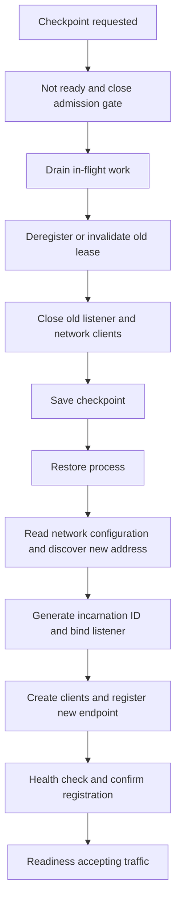

# Service Re-registration and Discovering the New Process Address

A Java application can be restored from a CRaC checkpoint in a different network environment from the one where the checkpoint was created. The restored process may have a different PID, hostname, IP address, dynamic port, or connection state. Even if the address does not change, sockets and sessions created before the checkpoint may have expired or no longer belong to an appropriate endpoint.

Therefore, after restore, the application needs to **re-determine the address at which the current instance can be reached**, recreate listeners and network clients when necessary, and then **re-register the endpoint with the service discovery system**. Before checkpoint, the instance should stop accepting traffic and remove or invalidate the old registration so that the system does not continue sending requests to an endpoint that has stopped serving.

This process belongs to the CRaC network resource lifecycle. The `Resource.beforeCheckpoint(...)` callback prepares and stops using old network resources; the `Resource.afterRestore(...)` callback refreshes network information, reopens listeners, registers the new instance, and only allows accepting traffic once all required components are ready.

## 1. Why can network addresses change after restore?

A checkpoint contains the process state at a point in time. However, network addresses and connectivity also depend on the operating system, network namespace, container runtime, orchestrator, DNS, DHCP, and services outside the JVM.

Some changes that can occur:

- The process is restored in a different container or network namespace and receives a different IP address.
- The PID or hostname of the new incarnation differs from the process that created the checkpoint.
- The Pod or container is recreated, resulting in a new Pod IP/container IP.
- A dynamically allocated port (`port 0`) changes when the listener is rebound.
- The DNS of a dependent service or the instance's hostname has changed.
- Old TCP sockets can no longer connect to the peer, or the peer has timed out.
- Credentials, TLS sessions, service registry leases, or connection pools expired while the checkpoint was stored.
- The machine has multiple network interfaces; the interface selected before checkpoint is no longer the interface to advertise after restore.

Not every restore causes addresses to change. Some platforms restore the process within the same host and namespace. However, the application should not treat PID, hostname, IP, dynamic ports, or old sockets as a stable identity if the deployment contract does not guarantee it.

## 2. Distinguishing between bind address and advertise address

A common mistake is using the same value for the listener address and the service registration address. These two addresses serve different purposes:

| Address type | Purpose | Example |
|---|---|---|
| Bind address | The local address on which the server socket listens | `0.0.0.0:8080`, `[::]:8080`, or a specific IP on an interface |
| Advertise address | The host/IP and port that clients or other services use to connect to the instance | `10.20.4.18:8080`, `orders-7.internal.example:8080` |
| Public endpoint | The address exposed via a load balancer, ingress, gateway, or DNS | `orders.example.com:443` |

`0.0.0.0` and `::` are wildcard addresses for binding on matching interfaces; they are not valid destination addresses to register for clients to connect to. When a listener binds a wildcard, the application must still determine a reachable hostname or IP to advertise.

In a container environment, a server typically binds `0.0.0.0` inside the container, while the advertise address may be the Pod IP, an internal service address, or a platform-provided hostname. If the service sits behind an ingress/load balancer, the public endpoint may be the stable hostname of the gateway rather than the process IP.

Clearly identify who owns each endpoint. If Kubernetes Service/EndpointSlice already manages instance addresses based on readiness, the application usually only needs to update readiness and the listener; it should not add a separate registration mechanism that could conflict with Kubernetes endpoints. With Consul, Eureka, or a custom registry, the application may need to register and renew leases directly.

## 3. Sources for determining the current address

There is no single Java API that can choose the right advertise address for every environment. The selection must be based on the system's topology and network policy.

### Platform-provided configuration

This is usually the clearest option when the platform already knows the instance address:

- Kubernetes can inject the Pod IP into an environment variable via the Downward API, for example `POD_IP`.
- The container runtime or deployment platform can provide the hostname and network metadata.
- A cloud environment can provide the instance's private IP or metadata endpoint.
- The deployment system can pass `SERVICE_ADVERTISE_HOST` and `SERVICE_PORT` per incarnation.

The advantage is that the application does not have to guess which interface is appropriate. However, the configuration must be refreshed per process/instance. If the value was recorded in the checkpoint from a previous run, after restore it may be an old address. Re-read from a dynamic configuration source after restore or use a provider that can query the platform when needed.

### Listing network interfaces with Java

Java provides `NetworkInterface` to inspect available interfaces and IP addresses. This is useful when the application runs on a VM or host with multiple interfaces, but you should not arbitrarily pick the first element.

```java
import java.net.InetAddress;
import java.net.NetworkInterface;
import java.net.SocketException;
import java.util.ArrayList;
import java.util.Enumeration;
import java.util.List;

final class NetworkAddressInspector {
    static List<InetAddress> candidateAddresses() throws SocketException {
        List<InetAddress> result = new ArrayList<>();
        Enumeration<NetworkInterface> interfaces =
                NetworkInterface.getNetworkInterfaces();

        while (interfaces != null && interfaces.hasMoreElements()) {
            NetworkInterface networkInterface = interfaces.nextElement();
            if (!networkInterface.isUp() || networkInterface.isLoopback()) {
                continue;
            }

            Enumeration<InetAddress> addresses =
                    networkInterface.getInetAddresses();
            while (addresses.hasMoreElements()) {
                InetAddress address = addresses.nextElement();
                if (address.isAnyLocalAddress()
                        || address.isLoopbackAddress()
                        || address.isLinkLocalAddress()
                        || address.isMulticastAddress()) {
                    continue;
                }

                result.add(address);
            }
        }

        return List.copyOf(result);
    }
}
```

The list above contains only candidate addresses. The application must still select based on configuration, subnet, interface name, IPv4/IPv6 address family, and routability from clients. A machine may simultaneously have a private network, public network, VPN, bridge, and management interface. Choosing the wrong address can cause the registry to advertise an endpoint that clients cannot reach.

Do not rely on `InetAddress.getLocalHost()` as a general-purpose discovery mechanism. The result can depend on hostname mapping, DNS, and hosts file configuration; it is not necessarily the address of the interface serving traffic.

### Using a stable hostname when appropriate

If the infrastructure provides a stable DNS name for the instance or load balancer, advertising the hostname may be more appropriate than an IP. In that case, confirm that DNS already points to the new endpoint before registering or transitioning readiness. You also need to manage TTL and DNS caching in clients.

A service's stable hostname is not necessarily the process's own hostname. For example, `orders.internal.example` may point to a load balancer, while each replica has a different Pod IP. Register the exact type of endpoint that the registry and clients expect.

## 4. Do not keep instance identity in the checkpoint

A checkpoint can be used to launch multiple replicas from the same image. If the instance ID is generated before checkpoint and stored on the heap, all replicas restored from that image could start with the same ID. The registry may overwrite registrations, lease renewals may conflict, or monitoring systems may see only one instance.

After restore, generate a new **incarnation ID** for each restored process. This ID can be a random UUID, or an ID assigned by the platform for the new instance. Do not use the PID as a unique key; the PID only has meaning within a process namespace and can be reused.

An instance record typically needs to contain:

- Service name and application version.
- Unique incarnation/instance ID.
- Advertise host or IP.
- Actual port after the listener binds successfully.
- Protocol and metadata such as zone, region, weight, or capabilities if required by the registry.
- Health/readiness status and lease information.

Do not put secrets, registration tokens, or personal data into public metadata. Credentials should be read or newly issued from a secret management source after restore.

## 5. Service registration lifecycle around checkpoint

For an application-managed service registry, a typical sequence is:

### Before checkpoint

1. Transition the instance to a refusing-traffic or not-ready state.
2. Close the admission gate so new requests are not accepted.
3. Wait for in-flight requests, messages, and jobs to complete.
4. Stop lease renewal or deregister the old instance according to the registry's contract.
5. Close the listener and network clients that need to be recreated.
6. Only allow the checkpoint to proceed once the preparation steps have succeeded.

### After restore

1. Re-read dynamic network configuration and determine the advertise address.
2. Generate a new incarnation ID.
3. Recreate outbound clients, DNS resolver/cache, and required connections.
4. Bind the listener and obtain the actual port.
5. Verify the listener and mandatory dependencies.
6. Register the new endpoint or create a new lease in the registry.
7. Wait for registration to be confirmed and required health checks to succeed.
8. Transition readiness to accepting traffic and open the admission gate.



If the registry supports TTL leases, set the TTL short enough for the old endpoint to expire on its own when deregistration fails, yet long enough to avoid flapping due to brief network glitches. TTL is only a safety net; whenever possible, explicitly deregister before checkpoint.

## 6. Orchestration example using `org.crac.Resource`

The following example illustrates how to wire an address provider, listener, and service registry into the CRaC lifecycle. Interfaces such as `AddressProvider`, `ListenerController`, and `ServiceRegistry` are application abstractions, not built-in CRaC APIs.

```java
import java.net.InetSocketAddress;
import java.util.UUID;

import org.crac.Context;
import org.crac.Resource;

final class NetworkRegistrationResource implements Resource {
    private final AddressProvider addressProvider;
    private final ListenerController listener;
    private final ServiceRegistry registry;
    private final NetworkClientManager clients;
    private final ReadinessController readiness;

    private String instanceId;
    private String registeredInstanceId;

    NetworkRegistrationResource(
            AddressProvider addressProvider,
            ListenerController listener,
            ServiceRegistry registry,
            NetworkClientManager clients,
            ReadinessController readiness) {
        this.addressProvider = addressProvider;
        this.listener = listener;
        this.registry = registry;
        this.clients = clients;
        this.readiness = readiness;
    }

    @Override
    public void beforeCheckpoint(Context<? extends Resource> context)
            throws Exception {
        readiness.refuseTraffic();
        listener.stopAccepting();

        // Drain request/message work before deregistering and closing resources.
        listener.awaitInFlightRequests();

        if (registeredInstanceId != null) {
            registry.deregister(registeredInstanceId);
            registeredInstanceId = null;
        }

        clients.closeConnections();
        listener.close();
    }

    @Override
    public void afterRestore(Context<? extends Resource> context)
            throws Exception {
        instanceId = UUID.randomUUID().toString();

        clients.recreateConnections();
        String advertiseHost = addressProvider.resolveAdvertiseHost();
        InetSocketAddress bindAddress = addressProvider.resolveBindAddress();

        listener.bind(bindAddress);
        int actualPort = listener.localPort();

        ServiceInstance instance = new ServiceInstance(
                instanceId,
                advertiseHost,
                actualPort
        );

        registry.register(instance);
        registeredInstanceId = instanceId;

        listener.verifyReady();
        listener.startAccepting();
        readiness.acceptTraffic();
    }
}
```

The snippet is an orchestration skeleton, not a complete production implementation. A real system needs to handle drain timeouts, rollback if deregister or close fails, listener cleanup if registration fails, and ensure readiness opens only after the endpoint can serve requests. The ordering of `acceptTraffic()` and `startAccepting()` must be designed according to the semantics of the server and readiness controller so there is no window where readiness reports ready while the listener is not yet accepting requests.

If the pre-checkpoint callback fails after already transitioning to not ready or closing part of the resources, there must be an appropriate recovery branch. If the checkpoint engine fails after the callback has completed, do not assume the runtime will automatically invoke an `afterRestore` callback on the old process to restore registration; the checkpoint management controller must handle the failed attempt state and either return the instance to service or replace it.

## 7. Discovering the actual address and port after binding

When a listener uses a dynamic port, do not register the initial configured port if the configuration is `0`. Read the actual port after binding:

```java
import java.net.InetSocketAddress;
import java.net.ServerSocket;

ServerSocket serverSocket = new ServerSocket();
serverSocket.bind(new InetSocketAddress("0.0.0.0", 0));

int actualPort = serverSocket.getLocalPort();
```

In the example, `0.0.0.0` is the bind address; it is not the host to put into the registry. The application needs to obtain `advertiseHost` from configuration or a separate address provider. If using a server framework, use the server's API to obtain the local port after startup instead of opening another socket yourself.

If using a fixed port, still confirm that binding succeeded before registering. The port might not have been released yet, network policy may have changed, or another process may have taken the port. Do not register an endpoint before the listener is actually listening.

With IPv6, pay attention to addresses with a scope ID for link-local and how host/port are represented. Clients and the registry must support the proper format. Do not strip or arbitrarily convert the scope if the application needs to connect within the same link-local network.

## 8. Refreshing outbound connections, DNS, and TLS

Registering a new endpoint only handles incoming traffic. Outgoing connections from the process may also need recovery:

- HTTP client connection pools may contain stale sockets.
- The DNS resolver cache may hold old addresses of dependencies.
- TCP keep-alive and TLS sessions may have timed out.
- Database, broker, and RPC clients may hold old channels or heartbeats.
- A proxy or service mesh sidecar may have updated endpoints and certificates.

Identify which network clients can safely continue and which must be closed/recreated. For clients with connection pools, prefer the library's official lifecycle API. After restore, re-resolve hostnames according to the resolver's TTL/policy, establish new connections, and check health before accepting traffic.

Do not cache DNS results indefinitely or store dependency IP addresses in the checkpoint as immutable values. If using DNS hostnames, ensure the resolver can refresh; if using a service registry, recreate subscriptions/watches and update the local cache.

## 9. Service registries, leases, and avoiding duplicate registrations

Different registries typically have different registration models:

| Mechanism | How the application handles it after restore |
|---|---|
| Consul service registration | Create a new registration with a new instance ID, current address/port, and appropriate health check; deregister the old registration if it still exists |
| Eureka client | Initialize/refresh the client according to current configuration, register the new instance, and wait for heartbeat/renewal to work |
| Registry using TTL leases | Create a new lease, store the lease token in the new runtime state, and renew according to TTL |
| Kubernetes Service/EndpointSlice | Transition the Pod to appropriate readiness; let the control plane manage endpoints by Pod IP and selector, avoiding redundant self-registration if unnecessary |
| Dynamic DNS record | Update the record with the current hostname/IP, manage TTL, and confirm the record has been published |

The system names in the table are examples of integration models. APIs, registration order, and convergence times depend on the specific product, version, and configuration.

To avoid duplicate or stale registrations:

- Generate a new instance ID for each incarnation after restore, especially when one checkpoint is cloned into multiple replicas.
- Use idempotent register/deregister operations if supported by the registry.
- Do not use a shared ID stored in the checkpoint for all replicas.
- Stop old lease renewals before checkpoint and create a new lease after restore.
- Set a reasonable TTL so old registrations expire automatically if the old process cannot deregister.
- Verify that the registry has accepted the new endpoint before opening readiness.
- Have a mechanism to clean up orphaned registrations based on health checks/TTL rather than arbitrarily deleting another instance's registration.

If the system restores multiple replicas in parallel, each replica must register its own endpoint or register through a load balancer/service abstraction with a stable identity. Do not let replicas overwrite the same registry key.

## 10. Error handling and readiness ordering

Network recovery can fail because an interface has not appeared yet, the metadata service is not ready, DNS has not updated, the registry is temporarily unreachable, or port binding fails.

Apply bounded retries with backoff for retryable steps, for example:

1. Wait for the network interface or metadata endpoint to become ready within a deadline.
2. Re-resolve the advertise address and verify that the address complies with policy.
3. Bind the listener and obtain the actual port.
4. Connect to the registry and register the endpoint.
5. Run health checks against mandatory dependencies.
6. Open readiness once all minimum conditions are met.

If the deadline expires, let recovery fail clearly and keep the instance in the not-ready state. Do not advertise an endpoint that is not listening or not routable. The orchestrator can create a new instance or retry restore according to deployment policy.

Do not use an infinite retry loop inside `afterRestore`, because a hung callback can prevent the process from ever transitioning to an operational state. Set an overall deadline, log the reason, and let the external orchestrator decide whether to retry or replace the instance.

## 11. Observability and testing

Record network information per restore:

| Metric/log | Purpose |
|---|---|
| Incarnation ID and process ID | Distinguish the new run from the pre-checkpoint process |
| Bind address and actual port | Confirm the listener opened on the expected address and port |
| Advertise host/IP | Confirm the registry received the correct endpoint |
| Selected network interface | Investigate cases where the wrong interface or subnet was chosen |
| Registration/lease status | Detect failed, duplicate, or expired registrations |
| DNS resolve duration and result | Detect stale caches or unconverged DNS |
| Listener readiness | Confirm the instance only accepts traffic after recovery completes |

Do not log registry tokens, credentials, private keys, or sensitive data. Internal IP addresses may be sensitive infrastructure information; only emit them where access permissions are appropriate.

Test scenarios should include:

1. Creating a checkpoint in an environment with one network interface and a stable endpoint.
2. Restoring in an environment with a different IP or hostname if the platform supports this scenario.
3. Testing the case where the listener uses a dynamic port and the post-restore port differs from the old port.
4. Verifying that the registry removes or expires the old registration and accepts the new registration.
5. Restoring multiple replicas from the same checkpoint and verifying each replica has a unique instance ID.
6. Changing a DNS address and verifying outbound clients re-resolve it.
7. Making the registry temporarily unreachable and verifying the instance does not transition to ready.
8. Simulating a port bind failure or unready interface and verifying the callback reports an error and does not advertise a wrong endpoint.
9. Verifying health checks and real traffic reach the right instance after registration completes.

## 12. Implementation checklist

- [ ] Identified the source providing the bind address and advertise address for each environment.
- [ ] Not using `0.0.0.0` or `::` as the advertise address.
- [ ] Not relying on `InetAddress.getLocalHost()` or the first interface as the default choice.
- [ ] Dynamic network configuration is re-read after restore, without using stale values from the checkpoint.
- [ ] Instance ID is newly generated for each incarnation, especially when cloning a checkpoint into multiple replicas.
- [ ] Listener is rebound and the actual port is read after binding.
- [ ] Outbound sockets, DNS cache, TLS sessions, and client pools are refreshed according to the library's lifecycle.
- [ ] Old registrations/leases are deregistered or have a TTL/health check to expire.
- [ ] New endpoint is registered only after the listener can accept connections.
- [ ] Readiness transitions to accepting only after registration and health checks succeed.
- [ ] Discovery, DNS, bind, or registration failures have a deadline and recovery path.
- [ ] Tested restore when addresses change and when multiple replicas restore together.

## 13. Conclusion

After a CRaC restore, an application must treat network information and service registration as state that can change. Separate the bind address from the advertise address, obtain the endpoint from a reliable configuration or metadata source, generate a new incarnation ID, bind the listener to obtain the actual port, and register the new endpoint with the service registry.

Before checkpoint, the instance needs to stop accepting traffic, drain work, stop old leases, and close network resources that must be recreated. After restore, open readiness only when the listener, outbound clients, DNS, and service registration are ready. If the platform already manages endpoints such as Kubernetes Service, use readiness and the built-in discovery mechanism to avoid two competing sources of registration.
