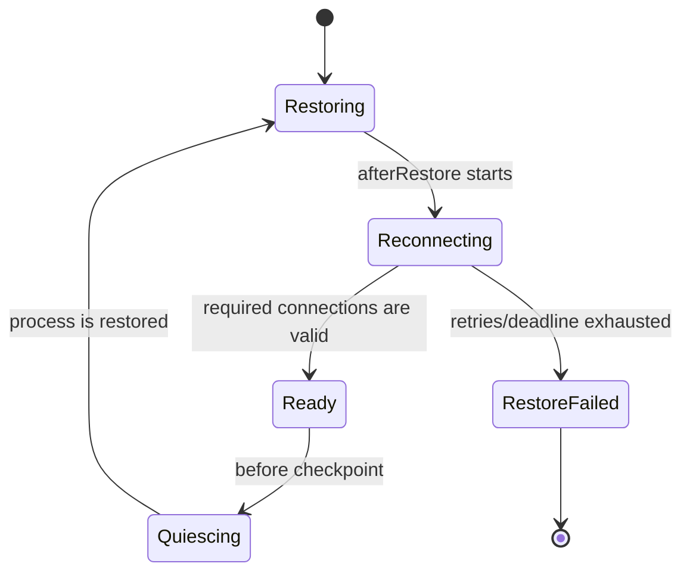

# Reconnecting with Appropriate Timeouts, Retry Counts, and Jittered Delays

After a Java process is restored from a CRaC checkpoint, network connections that existed before the checkpoint may no longer be usable. Sockets, TLS sessions, connection pools, or DNS state may have changed while the process was paused. The application needs to proactively verify and re-establish required connections before resuming request processing.

The network may not be ready immediately when the `afterRestore` callback runs. A dependent service may still be starting up, DNS may not have updated yet, a load balancer may not have registered the backend yet, or a database may be recovering. If the application only tries to connect once, it may fail due to a transient error. If it retries continuously without limits, multiple instances restored at the same time can create a burst of connection attempts and overload the dependent service.

An appropriate reconnect strategy needs to combine **timeouts**, **attempt limits**, **an overall time budget**, and **jittered delays**. Each attempt must have its own limit; the entire process must have a deadline; only recoverable errors should be retried; and the application should only accept traffic once required connections are ready.

## 1. Why Is Reconnecting Needed After Restore?

A checkpoint preserves process state at a point in time. The Java state of a client may still be in the heap, but that does not prove the underlying network connection still works. While the process was not running, the server side may have closed the socket, a firewall may have expired the NAT mapping, a certificate may have been rotated, or the service address may have been updated.

Resources that commonly need to be checked or recreated include:

- TCP sockets and connections to external services.
- TLS sessions, certificate state, or time-limited tokens.
- HTTP client connection pools and keep-alive connections.
- Connections to databases, message brokers, caches, or service discovery.
- Clients holding DNS results or IP addresses resolved before the checkpoint.
- Data-receiving streams, consumers, or subscriptions tied to a network connection.

Not every client object has to be recreated from scratch. Some libraries have CRaC support or dedicated callbacks to close and refresh connections. Use the integration recommended by the library if available. For self-managed clients, clearly identify which state can be retained and which state must be refreshed in the CRaC lifecycle.

## 2. Placing Reconnect Logic in the CRaC Lifecycle

A `Resource` can close connections before checkpoint and reconnect after restore:

- `beforeCheckpoint`: stop accepting new work, wait for in-flight requests using the connection to finish, close the client/pool or put it into a safe state.
- `afterRestore`: create new connections or verify clients restored by the library, apply a bounded retry policy, and only mark as ready when the connection meets requirements.

Structural example:

```java
import org.crac.Context;
import org.crac.Core;
import org.crac.Resource;

public final class NetworkResource implements Resource {
    private final ConnectionFactory factory;
    private Connection connection;

    public NetworkResource(ConnectionFactory factory) {
        this.factory = factory;
        Core.getGlobalContext().register(this);
    }

    @Override
    public synchronized void beforeCheckpoint(
            Context<? extends Resource> context) throws Exception {
        if (connection != null) {
            connection.close();
            connection = null;
        }
    }

    @Override
    public synchronized void afterRestore(
            Context<? extends Resource> context) throws Exception {
        connection = factory.connect();
    }
}
```

The snippet only illustrates where the two callbacks go. `factory.connect()` in the example does not yet have timeouts or retries; the following sections will add the necessary limits. In a real application, `beforeCheckpoint` also needs to coordinate with workers currently using the connection to avoid closing the socket while a request is still running.

Reconnect logic should not be placed solely in `main()`. Restore resumes from the checkpointed state and does not re-run the entire startup path like a fresh launch. Resource recovery logic must reside in the `afterRestore` callback or in the CRaC lifecycle supported by the library being used.

## 3. Distinguishing Types of Timeouts

A connection attempt can consist of multiple stages. Configuring only a single generic timeout without knowing which stage it bounds can cause the application to wait longer than expected.

| Timeout | What It Bounds | Example Problem If Unbounded |
|---|---|---|
| DNS timeout | Time to resolve the service name | Lookup is slow or resolver is unresponsive |
| Connect timeout | Time to establish the TCP connection | SYN receives no response or endpoint is unreachable |
| TLS handshake timeout | Time to negotiate TLS | Server is slow or handshake hangs |
| Read/response timeout | Time waiting for response data | Connection exists but server does not return data |
| Request deadline | Total time for a single request | Multiple individual stages add up to exceed SLA |
| Reconnect deadline | Total time spent across all reconnect attempts | Retries drag on indefinitely and keep the application in an unready state |

The timeout of `Socket.connect()` in Java only bounds the TCP connection phase. It does not automatically bound DNS, TLS handshake, or data reading time. HTTP clients, JDBC drivers, and message broker clients have their own configurations; check the library's API to set timeouts at the right layer.

### 3.1. Per-Attempt Timeout

Each connection attempt needs a finite timeout. For example, if the connect timeout is 2 seconds, a single attempt should not wait indefinitely just because the service has not responded yet.

A per-attempt timeout helps release resources when an endpoint is unresponsive. However, it does not bound the total reconnect time if the application performs multiple attempts.

### 3.2. Overall Deadline

The overall deadline defines the latest point in time by which the reconnect process is allowed to finish. For example, a callback has at most 8 attempts, each connect attempt takes at most 2 seconds, but the total budget is only 20 seconds. When the deadline expires, the application must stop retrying and report an error.

Deadlines should be measured using a monotonic clock such as `System.nanoTime()`, not `System.currentTimeMillis()` for calculating durations. The system clock can be adjusted; `nanoTime()` is suitable for measuring elapsed time.

When less time remains than a single attempt's timeout, pass the remaining time to the client. Do not start a new attempt if the deadline has already expired.

## 4. Limiting the Number of Attempts

The number of attempts needs to be clearly defined. `maxAttempts` should include the initial attempt:

| `maxAttempts` | Meaning |
|---:|---|
| 1 | Try only once, no retries |
| 3 | One initial attempt and up to two retries |
| 8 | One initial attempt and up to seven retries |

Do not use an infinite loop in `afterRestore`. The callback could keep the process in the recovery state for too long, preventing the service from passing readiness or causing the orchestration system to repeatedly judge the instance as unready.

The attempt limit needs to go hand in hand with the overall deadline. A configuration with 10 attempts but a total deadline of 5 seconds will not be able to use all 10 attempts if each connect takes nearly a second. Conversely, a 5-minute deadline with only 2 attempts may underutilize the recovery budget. Choose both values based on the SLA, client timeouts, and the time the dependent service typically needs to become ready.

## 5. Exponential Backoff and Jitter

If a connection fails, do not retry immediately in a tight loop. Each retry needs to wait for a period of time. A common strategy is exponential backoff: gradually increasing the wait time after each failure while setting a maximum cap.

With base delay (b), max delay (m), and failed attempt (n), the wait cap can be calculated as follows:

\[
c_n = \min(m, b \cdot 2^{n-1})
\]

If all instances use the exact same fixed schedule, they may retry at the same time. This phenomenon creates a *thundering herd*: many clients simultaneously flood a newly recovered service with requests.

Jitter adds a random component to the wait time to spread out retries. With *full jitter*, the delay is chosen randomly between 0 and the current backoff cap:

\[
d_n \sim U(0, c_n)
\]

Example with a base delay of 200 ms and max delay of 5 seconds:

| Retry Attempt | Backoff Cap | Possible Full Jitter Range |
|---:|---:|---:|
| 1 | 200 ms | 0–200 ms |
| 2 | 400 ms | 0–400 ms |
| 3 | 800 ms | 0–800 ms |
| 4 | 1,600 ms | 0–1,600 ms |
| 5 | 3,200 ms | 0–3,200 ms |
| 6 onwards | 5,000 ms | 0–5,000 ms |

Full jitter reduces the likelihood of instances synchronizing retries. Another option is equal jitter, which keeps half of the wait time fixed and randomizes the other half. Regardless of the algorithm chosen, cap the maximum delay and do not sleep longer than the remaining time in the deadline.

### 5.1. Avoiding Overflow When Increasing Backoff

Do not compute `baseDelay * (1L << attempt)` carelessly because bit shifting or multiplication can overflow when the attempt count is large. You can double in a controlled way and stop at the max delay:

```java
static long cappedBackoffNanos(
        long baseNanos, long maxNanos, int failedAttempt) {
    long cap = baseNanos;
    for (int i = 1; i < failedAttempt && cap < maxNanos; i++) {
        cap = cap > maxNanos / 2
                ? maxNanos
                : Math.min(maxNanos, cap * 2);
    }
    return cap;
}
```

Assume `baseNanos` and `maxNanos` are valid positive numbers, and `baseNanos` is not greater than `maxNanos`. This calculation avoids multiplying beyond the chosen limit.

## 6. Retry Only Recoverable Errors

Not every connection error should be retried. Retrying configuration errors or authentication errors will not help the connection succeed and only prolongs recovery time.

| Error Category | Examples | Handling Approach |
|---|---|---|
| Transient errors | Connection refused while service is starting, reset, timeout, DNS temporarily unresolvable | Can retry within the deadline |
| Recoverable overload | HTTP 503, some HTTP 429, broker reporting temporarily unavailable | Retry with backoff; honor `Retry-After` if provided by the library |
| Configuration errors | Wrong host, wrong port, missing route, or wrong TLS configuration | Do not retry indefinitely; report configuration error |
| Authentication/authorization errors | Wrong credentials, revoked token, invalid certificate | Refresh credentials if a mechanism exists; otherwise stop and report error |
| Programming errors | Null state, invariant violation, or invalid data type | Do not retry as a network error |

Exceptions should be classified according to the client's API. Do not catch `Exception` or `Throwable` and retry everything. For example, `SocketTimeoutException` can be a transient error; `SSLHandshakeException` usually requires checking the specific cause rather than retrying by default; `UnknownHostException` can be transient in some environments but can also be caused by an incorrect hostname.

For HTTP, retrying status codes needs to follow application policy and request semantics. A GET request is generally easier to retry than a POST request that creates a transaction. If the server already processed the request but the response was lost, resending the POST may create a duplicate transaction. Use an idempotency key or a protocol that guarantees idempotency before retrying write operations.

## 7. Java Example: Reconnect with Deadline, Retry, and Full Jitter

The following example uses the `ConnectionFactory` abstraction to focus on the retry policy. The factory must ensure `connectAndValidate(timeout)` bounds both the connection operation and the health check within the passed timeout, and closes any partial resources itself if the connection attempt fails.

```java
import java.io.IOException;
import java.time.Duration;
import java.util.concurrent.ThreadLocalRandom;
import java.util.concurrent.TimeUnit;

import org.crac.Context;
import org.crac.Core;
import org.crac.Resource;

public final class ReconnectingResource implements Resource {
    private final ConnectionFactory factory;
    private final int maxAttempts;
    private final Duration perAttemptTimeout;
    private final Duration totalTimeout;
    private final Duration baseDelay;
    private final Duration maxDelay;

    private volatile Connection connection;

    public ReconnectingResource(
            ConnectionFactory factory,
            int maxAttempts,
            Duration perAttemptTimeout,
            Duration totalTimeout,
            Duration baseDelay,
            Duration maxDelay) {

        if (maxAttempts < 1) {
            throw new IllegalArgumentException("maxAttempts must be >= 1");
        }
        if (perAttemptTimeout.isZero() || perAttemptTimeout.isNegative()
                || totalTimeout.isZero() || totalTimeout.isNegative()
                || baseDelay.isNegative() || maxDelay.isNegative()
                || baseDelay.compareTo(maxDelay) > 0) {
            throw new IllegalArgumentException("Invalid retry durations");
        }

        this.factory = factory;
        this.maxAttempts = maxAttempts;
        this.perAttemptTimeout = perAttemptTimeout;
        this.totalTimeout = totalTimeout;
        this.baseDelay = baseDelay;
        this.maxDelay = maxDelay;

        Core.getGlobalContext().register(this);
    }

    @Override
    public synchronized void beforeCheckpoint(
            Context<? extends Resource> context) throws Exception {
        Connection current = connection;
        connection = null;
        if (current != null) {
            current.close();
        }
    }

    @Override
    public synchronized void afterRestore(
            Context<? extends Resource> context) throws Exception {
        reconnectWithRetry();
    }

    private void reconnectWithRetry() throws Exception {
        long totalNanos = totalTimeout.toNanos();
        long deadline = System.nanoTime() + totalNanos;
        IOException lastFailure = null;

        for (int attempt = 1; attempt <= maxAttempts; attempt++) {
            long remaining = deadline - System.nanoTime();
            if (remaining <= 0) {
                break;
            }

            long attemptNanos = Math.min(
                    perAttemptTimeout.toNanos(), remaining);
            Connection candidate = null;
            try {
                candidate = factory.connectAndValidate(
                        Duration.ofNanos(attemptNanos));

                if (deadline - System.nanoTime() <= 0) {
                    Connection expired = candidate;
                    candidate = null;
                    expired.close();
                    lastFailure = new IOException(
                            "Reconnect deadline expired during connection setup");
                    break;
                }

                connection = candidate;
                return;
            } catch (IOException e) {
                lastFailure = e;
                if (candidate != null) {
                    try {
                        candidate.close();
                    } catch (IOException closeFailure) {
                        e.addSuppressed(closeFailure);
                    }
                }
                if (!isRetryable(e)) {
                    throw e;
                }
            }

            if (attempt == maxAttempts) {
                break;
            }

            remaining = deadline - System.nanoTime();
            if (remaining <= 0) {
                break;
            }

            long cap = cappedBackoffNanos(
                    baseDelay.toNanos(), maxDelay.toNanos(), attempt);
            long delay = cap == 0
                    ? 0
                    : ThreadLocalRandom.current().nextLong(cap + 1);
            long sleepNanos = Math.min(delay, remaining);

            try {
                TimeUnit.NANOSECONDS.sleep(sleepNanos);
            } catch (InterruptedException e) {
                Thread.currentThread().interrupt();
                throw e;
            }
        }

        throw new IOException(
                "Could not reconnect within the configured retry budget",
                lastFailure);
    }

    private static long cappedBackoffNanos(
            long baseNanos, long maxNanos, int failedAttempt) {
        long cap = baseNanos;
        for (int i = 1; i < failedAttempt && cap < maxNanos; i++) {
            cap = cap > maxNanos / 2
                    ? maxNanos
                    : Math.min(maxNanos, cap * 2);
        }
        return cap;
    }

    private static boolean isRetryable(IOException failure) {
        return failure instanceof java.net.ConnectException
                || failure instanceof java.net.SocketTimeoutException
                || failure instanceof java.net.NoRouteToHostException;
    }

    public Connection requireConnection() {
        Connection current = connection;
        if (current == null) {
            throw new IllegalStateException("Connection is not ready");
        }
        return current;
    }

    public interface ConnectionFactory {
        Connection connectAndValidate(Duration timeout) throws IOException;
    }

    public interface Connection extends AutoCloseable {
        @Override
        void close() throws IOException;
    }
}
```

The example illustrates important points:

1. `maxAttempts` includes the initial attempt.
2. Each call to the factory receives a timeout no greater than the configured timeout or the remaining time.
3. The overall deadline is calculated using `System.nanoTime()`.
4. Only transient network errors recognized by `isRetryable` are retried; configuration errors or errors not in the list are thrown immediately. Real applications need to adjust the classifier based on the client and DNS/TLS environment.
5. Backoff grows exponentially and is capped by `maxDelay`.
6. Full jitter spreads out retry times across instances.
7. If the thread is interrupted, the callback preserves the interrupt status and stops retrying.
8. If attempts or the deadline are exhausted, the callback throws an error so recovery does not silently succeed.

To use the example, provide a `ConnectionFactory` implementation for your HTTP client, database, or custom protocol. The factory must enforce the actual timeout at the library layer, not just accept a `Duration` parameter and ignore it. If `connectAndValidate` fails after opening a socket or creating a session, the factory is responsible for closing those partial resources before throwing the exception.

In the configuration above, `baseDelay` can be 100–250 ms, `maxDelay` can be a few seconds, `maxAttempts` can be 5–8, and `totalTimeout` can be 15–30 seconds. These are only starting points for experimentation; measure actual recovery times and tune them according to the SLA and the load capacity of the dependent service.

## 8. Combining Retries with Connection Pools and HTTP Clients

Applications usually do not manage individual sockets themselves, but instead use an HTTP client, JDBC pool, or message broker client. Identify the library's official lifecycle:

- Close or suspend the pool in `beforeCheckpoint` according to the library's CRaC integration guide.
- In `afterRestore`, recreate the pool or call the resume/refresh API supported by the library.
- Configure connect timeout, TLS timeout, validation timeout, and request timeout on the right client.
- Verify an actual connection with a lightweight health check before marking the pool as ready.
- Do not create an additional new pool if the library already recovers the pool itself in its own callback.

For JDBC, `DataSource.getConnection()` does not have a standard timeout parameter that applies uniformly to all drivers. Connection wait time is typically configured via pool or driver properties. Check the configuration of HikariCP, Agroal, DBCP, or the driver in use rather than assuming a generic Java timeout will bound every step.

For HTTP clients, distinguish between connection setup timeout and overall request timeout. A successful TCP connection does not mean the server is able to handle requests yet. It may be necessary to call a health endpoint or perform a safe check operation before letting the client accept traffic.

## 9. Request Retries and Idempotency

Reconnecting only restores the communication channel. Retrying a business request is a separate decision. If the connection drops after the server has executed the operation but before the client receives the response, the client does not know whether the operation succeeded.

For example, a client sends a request to create an order. The server writes the order successfully, but the response is lost. If the client resends the request without an idempotency key, the server may create a second order.

Before retrying a request, answer the following:

- Is the request safe to resend?
- Does the server support an idempotency key or request identifier?
- Can the result of the previous call be checked using a transaction ID?
- Did the error occur before sending data, while sending, or after the server might have already processed it?
- Is there a business deadline covering all retry attempts?

Read operations are generally easier to retry than write operations, though cost and system load still need to be considered. For write operations, use a stable idempotency key across all attempts and do not generate a new key for each retry.

## 10. Circuit Breakers, Rate Limits, and Multiple Instances Restoring Simultaneously

Backoff and jitter reduce retry frequency, but they do not completely replace circuit breakers or rate limiting. If a dependent service is experiencing a prolonged outage, a circuit breaker can temporarily stop calls to avoid wasting resources. When the service recovers, a few controlled probes are used to determine when to close the circuit.

When multiple instances restore at the same time:

- Use full jitter to spread out initial attempts and retries.
- Limit the number of concurrent connections using a pool or semaphore.
- Use a circuit breaker to avoid continuing to call an endpoint that has been failing for an extended period.
- Respect quotas, rate limits, and `Retry-After` if the service returns a wait instruction.
- Avoid having all instances use the same fixed retry schedule after a deployment.
- Startup staggering can be added at the orchestration layer if the number of instances is large.

Jitter should be generated independently for each instance and each retry attempt. Do not use a single fixed delay value configured identically across the entire cluster if the goal is to avoid synchronization.

## 11. Readiness After Restore

After the `afterRestore` callback completes, the application still needs to confirm that serving components are ready. States can be separated into:



Readiness should reflect the actual ability to process work, not just the fact that the JVM is running. If a dependency is optional, the application may allow operating in a degraded mode and retry in the background later. If a dependency is required, do not accept traffic until the connection is restored.

Do not keep the `afterRestore` callback running retries indefinitely to wait for a service. Use a finite deadline, report errors clearly, and let orchestration decide whether to restart, apply instance-level backoff, or transition to an unready state. If the application supports background reconnection after restore, clearly separate the readiness of independent features so an optional dependency does not block the entire system.

## 12. Logging, Metrics, and Observability

Each reconnect attempt should have sufficient logs or metrics to answer why recovery was slow:

- Dependency name and logical endpoint (do not log secrets or tokens).
- Current attempt number and maximum total attempts.
- Exception type or classified error code.
- Attempt timeout and elapsed time within the overall deadline.
- Backoff cap and actual jittered delay.
- Final outcome: connection succeeded, attempts exhausted, deadline expired, or interrupted.
- Time from the start of `afterRestore` until the dependency is ready.

Useful metrics include `reconnect_attempts_total`, `reconnect_failures_total`, `reconnect_duration_seconds`, `reconnect_delay_seconds`, and the number of instances waiting on a dependency. Use low-cardinality tags such as service name and outcome; avoid attaching full URLs, user IDs, or request IDs as metric labels.

When multiple instances restore simultaneously, compare the timeline of retry timestamps and the number of connections to the dependency. If retries still cluster in bursts, check whether jitter is actually being applied and whether any orchestration layer is synchronizing restart schedules.

## 13. Testing the Reconnect Strategy

Do not only test the case where the server is always up. Simulate common post-restore scenarios:

1. **Service ready immediately:** the first attempt succeeds; no unnecessary delay is incurred.
2. **Service starts slowly:** the first few attempts fail transiently and then succeed; verify retries stop immediately once connected.
3. **Service never becomes ready:** verify total time does not significantly exceed the deadline and the callback reports an error after the limit.
4. **Connect hangs:** verify the per-attempt timeout is enforced on the real client.
5. **Unrecoverable error:** wrong credentials or misconfiguration are not retried indefinitely.
6. **Thread interrupted:** retries stop and the interrupt status is preserved.
7. **Multiple instances restore concurrently:** verify jitter spreads out retries and the dependency is not overwhelmed.
8. **Write request loses response:** verify the idempotency key prevents the business operation from being executed twice.
9. **Multiple checkpoint/restore cycles:** verify old connections are closed, new connections are created, and sockets or threads do not accumulate.

Use a mock clock or an injectable sleeper/random source in unit tests to verify the backoff algorithm without actually waiting. Then run integration tests with the target client and CRaC-enabled runtime to confirm timeouts are enforced at the real network layer.

## 14. Configuration Checklist

- [ ] Old network connections are closed or refreshed properly according to the library's lifecycle before checkpoint.
- [ ] `afterRestore` recreates or validates required connections.
- [ ] Separate timeouts for connect, TLS, read, and request are configured appropriately.
- [ ] Each attempt has a finite timeout and respects the remaining time.
- [ ] There is an overall deadline for the entire reconnect process.
- [ ] `maxAttempts` is finite and includes the initial attempt.
- [ ] Only transient errors are retried; configuration and authentication errors are handled separately.
- [ ] Backoff increases gradually, has a maximum cap, and uses jitter.
- [ ] Retries do not exceed the deadline and stop when the thread is interrupted.
- [ ] Write requests are only retried when appropriate idempotency is in place.
- [ ] Connection pools and clients use the library's proper CRaC integration.
- [ ] Readiness is only enabled when required dependencies are ready.
- [ ] Logs and metrics exist for attempts, delays, errors, and reconnect duration.
- [ ] Tested against slow-recovering dependencies, prolonged outages, and multiple instances restoring simultaneously.

## 15. References

- [CRaC API — `Resource`](https://javadoc.io/doc/org.crac/crac/latest/org/crac/Resource.html): `beforeCheckpoint` and `afterRestore` callbacks for resources requiring lifecycle management.
- [Java `Socket`](https://docs.oracle.com/en/java/javase/21/docs/api/java.base/java/net/Socket.html): timeouts for TCP connections and socket operations.
- [Java `System.nanoTime()`](https://docs.oracle.com/en/java/javase/21/docs/api/java.base/java/lang/System.html#nanoTime()): monotonic clock for measuring elapsed time.
- [AWS Builders' Library — Timeouts, retries, and backoff with jitter](https://aws.amazon.com/builders-library/timeouts-retries-and-backoff-with-jitter/): how to choose timeouts, bound retries, and use jitter to avoid synchronized load.

Reconnecting after restore should be treated as part of the network resource lifecycle. Set per-attempt timeouts, bound the total time and number of attempts, retry only transient errors, and use exponential backoff with jitter to distribute load. When required connections are not yet ready, the application must remain unready and report errors clearly rather than continuing to process requests with a stale or invalid connection.
