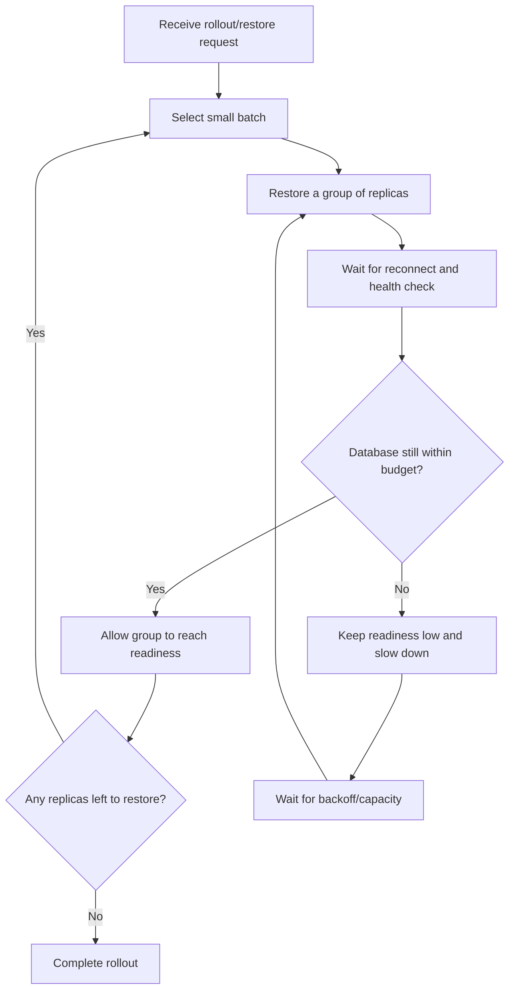

# Restoring Multiple Replicas Without Causing a Connection Explosion

CRaC allows creating a checkpoint from an initialized Java process, then restoring that state to shorten the time it takes to bring the application into operation. In a deployment environment with multiple replicas, a single checkpoint can be used to launch many replicas almost simultaneously. If each replica immediately creates a full connection pool and connects to the database, the total number of new connections can spike sharply.

This phenomenon is often called a *connection storm* or *thundering herd*. It can cause the database to hit its connection limit, increase CPU and memory usage, slow down authentication, cause pools to continuously retry, and prolong readiness time. Replicas can fail together and retry simultaneously, making the situation worse.

To avoid this issue, it is necessary to calculate a system-wide connection budget, limit the connection creation rate upon restore, create pools on demand, restore in batches, and only bring replicas into service when dependencies are truly ready. A pool created on the heap before checkpoint does not represent a separate connection budget guaranteed for each restore instance.

## 1. Why Can Multiple Restores Cause a Connection Storm?

Suppose a service has a warmed-up checkpoint. Upon deployment, the platform creates 30 replicas from that checkpoint. Each replica contains a connection pool configuration with `maximumPoolSize = 20`. If each pool attempts to create 20 connections immediately upon startup, the database could receive up to 600 connection requests within a short period of time.

Even if the pool does not open all connections immediately, the first wave of concurrent requests can cause pools to grow in size at the same time. Several factors make the burst larger:

- Many replicas are restored in the same rollout or scale-out batch.
- Pools are configured with a high `minimumIdle` or eager initialization.
- Each replica's warm-up runs parallel queries and borrows many connections at once.
- Startup checks, health checks, schedulers, and consumers all access the database right after restore.
- Retries lack backoff, or all replicas use the same retry interval.
- A rollout has a surge, causing old and new replicas to coexist during the transition period.
- A failed restore causes the orchestration to restart multiple replicas at the same time.

The problem has two distinct dimensions:

1. **Total number of connections:** the number of concurrent connections exceeds the capacity of the database or proxy.
2. **Connection creation rate:** many TCP/TLS handshakes, authentications, and session initializations occur simultaneously, overloading the backend even though the final total number of connections might remain below the limit.

Therefore, simply reducing `maximumPoolSize` may not solve the burst. Both the maximum number of connections and the rate of opening new connections must be controlled.

## 2. Calculating the Connection Budget at the System-Wide Level

You should not choose the pool size independently for each replica. Start from the actual limit of the database, subtracting the portion reserved for administration, migrations, monitoring, background tasks, and a safety margin.

A simple calculation:

```text
app_connection_budget =
    database_connection_limit
    - reserved_admin_connections
    - other_application_connections
    - safety_headroom

peak_replica_count =
    steady_state_replicas
    + rollout_surge_replicas
    + scale_out_or_restore_overlap

per_replica_pool_max <=
    floor(app_connection_budget / peak_replica_count)
```

This is the starting limit for the total pools of a single replica. If a replica has multiple pools or has consumers/jobs that use separate connections, they must be added to the budget. Connections from old application versions still running during the rollout must also be counted.

### Calculation Example

Suppose the database allows a maximum of 300 connections. We reserve 40 connections for administration and internal operations, 30 for other applications, and keep 30 connections as headroom to handle abnormal load. The remaining budget for the service being designed is:

```text
300 - 40 - 30 - 30 = 200 connections
```

If a rollout or restore can create a maximum of 24 coexisting replicas, the average limit per replica is:

```text
floor(200 / 24) = 8 connections per replica
```

A maximum pool size of 8 connections is the starting point for load testing. If each replica also has a separate pool for jobs or a second datasource, the budget must be divided further. Do not set every pool to 8 and forget that a single replica may own multiple pools.

| Component | Expected Connection Count |
|---|---:|
| Database connection limit | 300 |
| Administration and internal operations | 40 |
| Other applications | 30 |
| Safety headroom | 30 |
| Budget for the service | 200 |
| Peak replicas | 24 |
| Starting pool max per replica | 8 |
| Total pool max for the service | 192 |

Calculate based on the peak replica count, not just the steady-state replica count. If a rollout allows creating 8 new replicas before 8 old replicas are terminated, the surge portion must be included in the calculation. With autoscaling or multiple worker groups, you must count the total number of instances that can open connections simultaneously.

### Do Not Exhaust the Database Limit

The database's connection limit is not a target to fill. The database needs resources for running queries, locks, memory, replication, internal tasks, and administrative clients. Many idle connections still consume resources and can increase context-switching overhead. A small pool with a controlled queue sometimes performs more stably than many large pools.

## 3. Distinguishing Maximum Pool Size, Minimum Pool Size, and Connection Creation Rate

Connection pools typically have several parameters with different meanings:

- **Maximum pool size:** the maximum number of connections the pool can manage.
- **Minimum idle:** the number of idle connections the pool tries to maintain.
- **Initial/eager connections:** the number of connections created when the pool initializes, depending on the implementation.
- **Connection timeout:** the maximum time a caller waits to obtain a connection.
- **Idle timeout/max lifetime:** the policy for evicting idle connections or connections that have lived too long.
- **Validation/keepalive:** how the pool checks or maintains connections.

If `minimumIdle` is close to `maximumPoolSize`, many pools may try to maintain a large number of connections right after restore. For workloads that can ramp up gradually, configuring a low or zero minimum idle can help the pool open connections on demand instead of immediately filling the pool. You need to check the default behavior and documentation of the pool in use; libraries may differ.

Illustrative configuration example for HikariCP in Spring Boot:

```yaml
spring:
  datasource:
    hikari:
      maximum-pool-size: 8
      minimum-idle: 0
      connection-timeout: 30000
      pool-name: orders-db-pool
```

The values above are only an example for the budget calculation in the previous section, not a universal optimal configuration. They must be adjusted according to peak replica count, query duration, concurrent thread count, number of datasources, and actual database limits.

A low minimum pool size helps reduce idle connections but does not by itself limit the rate at which the pool grows under sudden load. If many concurrent requests arrive together, the pool can still create many connections rapidly up to `maximumPoolSize`. Therefore, additional concurrency limits or connection creation rate limits are needed at the deployment level.

## 4. Restoring in Batches Instead of All at Once

If the platform can control the rollout, limit the number of replicas restored or brought into readiness at the same time. For example, instead of starting 24 replicas simultaneously, you can start groups of 3 or 4 replicas, wait for that group to connect stably, and then move on to the next group.



Deployment approaches can include:

- Limiting `maxSurge` or the concurrency of rolling updates.
- Splitting restores into batches and waiting for the previous batch to stabilize.
- Using a deployment controller or restore coordinator to grant reconnect permissions.
- Adding a randomized wait time between replicas.
- Not scaling up en masse just because the database is temporarily slow; avoiding autoscaling loops that amplify load.

Readiness should be used to prevent traffic from reaching replicas that do not yet have valid database connections. However, readiness does not by itself limit the number of connections a replica creates. Batch coordination and reconnect permission granting must be handled separately.

## 5. Using Jitter and Backoff to Spread Out Reconnects

If all replicas restore at the same time and all wait exactly 5 seconds before connecting, they will still create a burst after 5 seconds. A fixed delay is not enough to break synchronization. Add jitter so that reconnect times differ across replicas.

A common full jitter formula:

```text
cap(attempt) = min(max_delay, base_delay * 2^attempt)
delay = random(0, cap(attempt))
```

For example, with `base_delay = 500 ms` and `max_delay = 30 s`, each retry randomly picks a delay from 0 up to the exponentially increasing cap. You should limit the number of retries or total retry duration, while avoiding multiple nested retry layers.

Pseudocode:

```java
Duration retryDelay(int attempt,
                    Duration baseDelay,
                    Duration maxDelay) {
    long exponential = Math.min(
            maxDelay.toMillis(),
            baseDelay.toMillis() * (1L << Math.min(attempt, 20)));

    long jitter = ThreadLocalRandom.current()
            .nextLong(exponential + 1);

    return Duration.ofMillis(jitter);
}
```

This illustrative snippet needs to be supplemented with overflow handling, a total deadline, and an application-specific retry policy. Do not retry infinitely when the database rejects connections due to misconfiguration, invalid credentials, or exhausted database capacity. Classifying transient errors versus configuration errors helps avoid futile loops.

When the database returns overload or connection limit signals, increase the wait time, reduce concurrency, and keep the replica in a not-ready state. If there are multiple replicas, jitter must be generated from a separate random source for each run, rather than using the same fixed schedule baked into the checkpoint.

## 6. Limiting New Connections with Admission Control

Jitter spreads out timing but does not guarantee that the number of concurrent connection attempts stays within limits. For large systems, an admission control mechanism is needed to allow only a certain number of replicas or pools to reconnect at the same time.

Common options:

- **Restore coordinator:** issues permits to each replica; each permit allows creating or warming up a pool.
- **Distributed semaphore:** limits the number of concurrent reconnect tasks across the entire cluster.
- **Token bucket:** limits the rate of creating new connections per second.
- **Connection proxy/pooler:** centralizes management and multiplexes client connections if the database model and proxy support it.
- **Deployment concurrency limit:** controls the number of replicas restored simultaneously from the deployment platform.

An in-JVM `Semaphore` only limits the number of threads inside a single replica. If there are 50 replicas, each with a semaphore of 2, there can still be 100 reconnect tasks in total. To limit at the cluster level, permits must be managed by a shared service, proxy, coordinator, or rollout policy that is aware of the total number of replicas.

### Pseudocode for a Restore Coordinator

```java
public void reconnectAfterRestore() throws Exception {
    try (ReconnectPermit permit = restoreCoordinator.acquirePermit(
            Duration.ofMinutes(2))) {

        HikariDataSource newPool = poolFactory.create();
        try {
            verifyDatabase(newPool);
            currentPool.set(newPool);
            readiness.markDatabaseReady();
        } catch (Exception failure) {
            newPool.close();
            throw failure;
        }
    }
}
```

`ReconnectPermit`, `restoreCoordinator`, `poolFactory`, and `readiness` are illustrative abstractions. The permit needs a lease/timeout to self-release if a replica dies partway through. Granting the permit should cover both pool creation and connection verification time, avoiding releasing the permit immediately after starting the operation.

If there is no shared coordinator, you can limit batches at the deployment layer. This is often the simpler approach if the deployment platform already controls the number of replicas restored simultaneously.

## 7. Properly Recreating Pools After Restore

A checkpoint can retain pool management objects on the heap, but physical connections and database sessions should not be assumed valid just because the pool object still exists. Use the official CRaC integration of the connection pool or driver if available. If the application manages the lifecycle itself, it must close the pool before checkpoint and create a new pool after restore.

An important point: many pools become permanently closed objects after calling `close()`. You should not assume you can call `start()` or reopen the same object. Create a new pool instance from a factory, unless the specific library has a supported reinitialization API.

Example factory for creating a new Hikari pool:

```java
public final class DataSourceFactory {

    private final DatabaseSettings settings;

    public DataSourceFactory(DatabaseSettings settings) {
        this.settings = settings;
    }

    public HikariDataSource create(String poolName) {
        HikariConfig config = new HikariConfig();
        config.setJdbcUrl(settings.jdbcUrl());
        config.setUsername(settings.username());
        config.setPassword(settings.password());
        config.setMaximumPoolSize(settings.maximumPoolSize());
        config.setMinimumIdle(0);
        config.setConnectionTimeout(settings.connectionTimeoutMillis());
        config.setPoolName(poolName);
        return new HikariDataSource(config);
    }
}
```

This is a configuration example; credentials should be retrieved from a secret manager or appropriate secure configuration, not hard-coded in code. The pool name can include a new instance identifier to distinguish restored instances in metrics. Pool values must adhere to the calculated total budget.

### Lifecycle Management with a CRaC Resource

A datasource management component can coordinate quiescing, draining, and creating a new pool. The following code is illustrative pseudocode because drain/readiness abstractions and Spring wiring depend on the application:

```java
public final class DatabasePoolResource implements Resource {

    private final DataSourceFactory factory;
    private final RestoreCoordinator coordinator;
    private final DatabaseWorkGate workGate;
    private final AtomicReference<HikariDataSource> pool =
            new AtomicReference<>();

    @Override
    public void beforeCheckpoint(Context<? extends Resource> context)
            throws Exception {
        workGate.stopNewDatabaseWork();
        workGate.drainTransactionsAndQueries();

        HikariDataSource oldPool = pool.getAndSet(null);
        if (oldPool != null) {
            oldPool.close();
        }
    }

    @Override
    public void afterRestore(Context<? extends Resource> context)
            throws Exception {
        try (ReconnectPermit ignored = coordinator.acquirePermit()) {
            HikariDataSource newPool = factory.create(newPoolName());
            try {
                verifyDatabase(newPool);
                pool.set(newPool);
                workGate.markDatabaseReady();
            } catch (Exception failure) {
                newPool.close();
                throw failure;
            }
        }
    }
}
```

In a real implementation, you need to initialize the initial `pool` before serving traffic and register the resource exactly once. You must also ensure no request acquires the pool while `beforeCheckpoint()` is draining or before `afterRestore()` attaches the new pool. `verifyDatabase()` should use a lightweight query with a timeout and no business side effects.

If the connection pool or Spring integration already registers a CRaC resource itself, do not create a second callback that closes the same pool. There should be only one lifecycle owner per pool. For a Spring `DataSource` bean, ensure the bean or facade layer accessing the pool points to the new instance after restore; closing a `HikariDataSource` while keeping the same reference in the bean will cause subsequent requests to use the closed pool.

## 8. Bounded Database Warm-Up

Pre-checkpoint warm-up helps detect configuration errors and prepare execution paths, but you should not create the entire pool or run heavy queries on every replica simultaneously after restore.

Distinguish between:

- **Pre-checkpoint warm-up:** preparing classes, client-side query plans, internal structures, and cache data that can be retained.
- **Post-restore reconnect:** creating the necessary connections within budget and admission control.
- **Readiness check:** verifying that a connection can actually execute a required query.
- **Traffic ramp-up:** gradually increasing traffic so the pool expands on demand.

There is no need to keep `minimumIdle` equal to `maximumPoolSize` just so every replica has a full set of connections ready before receiving traffic. You can start with a minimum number of connections and let the pool expand with load within limits. If the workload requires many connections immediately, ramp up in batches and account for it in the database budget.

Warm-up queries should read data safely, be bounded in quantity, and avoid side effects. Do not run migrations, create business data, or lock tables just to warm up the connection pool. Migrations should be a separately coordinated deployment step, not run concurrently from every restored replica.

## 9. Connection Proxies and Poolers Between the Application and Database

A proxy or pooler can help centralize connection management and reduce the number of backend sessions the database must maintain, depending on the pooling model and database protocol. For example, a proxy can reuse backend connections across many short-lived client sessions or enforce a total connection limit across multiple replicas.

However, a proxy does not eliminate the connection budget. Distinguish between:

- The number of connections from the application to the proxy.
- The number of backend connections from the proxy to the database.
- The number of concurrent transactions/sessions the database actually processes.
- Pool limits per user, database, tenant, or workload.

If a proxy holds one backend connection per client session, it may simply shift the bottleneck from the database to the proxy. If using transaction pooling, the application must be compatible with the fact that the backend session can change between transactions; you should not rely on long-lived session state such as temporary tables, session variables, or advisory locks if the pooling model does not support them.

The proxy/pooler must be tested with the JDBC driver, transaction semantics, prepared statements, session state, and the application's reconnect mechanism. It is an additional control layer, not a replacement for limiting pools per replica and calculating the total budget.

## 10. Safe Retries When the Database Is Overloaded

When the database rejects connections or responds slowly, retrying too quickly can generate additional load and prolong the incident. Use conditional retries:

- Retry transient network errors, overload errors, or service unavailable errors according to policy.
- Do not retry infinitely on authentication errors, wrong URLs, missing permissions, or invalid configurations.
- Use exponential backoff with jitter and a total deadline.
- Limit the number of concurrent reconnects.
- Avoid retrying at multiple layers simultaneously, for example, the JDBC driver, pool, service wrapper, and application all retrying independently.
- Use a circuit breaker or degraded state if the database cannot serve requests yet.
- Keep requests in a bounded queue or return retryable errors; do not accumulate indefinitely on the heap.

When the pool fails to acquire a connection within the timeout, observe the number of waiting threads. Increasing `connectionTimeout` too much may only cause more requests to hang longer. Set the timeout appropriately for the request deadline and queue limits.

## 11. Readiness, Liveness, and Traffic Coordination

After restore, a replica may have started the JVM but not yet connected to the database. Readiness must reflect that state so the load balancer does not send traffic to a replica that is not ready.

Distinguish between:

- **Liveness:** the process is still alive and not deadlocked or unrecoverably corrupted.
- **Readiness:** the replica has enough required dependencies to handle current traffic.
- **Startup state:** post-restore recovery is still running and not yet complete.

If the database is temporarily overloaded, readiness can remain false while liveness remains true. If liveness also fails and orchestration continuously restarts replicas, the system can create a new restore/reconnect loop that worsens the connection storm. Use appropriate timeouts and probe thresholds, avoiding treating a single slow DB query as proof that the process is dead.

Only enable readiness after:

1. The new pool has been created within the allowed budget.
2. A connection has been successfully acquired and the validation query has completed.
3. Current configuration and credentials have been loaded.
4. Other required dependencies are ready.
5. The work gate allows accepting new work.

If the service has some features that can still operate when the database is temporarily unavailable, you can design readiness by capability or separate endpoints. However, do not mark the entire application ready when core functionality requires the database and the database is not yet usable.

## 12. Avoiding Other Simultaneous Startup Activities

A connection storm is sometimes mistaken for a pool-only issue, while many other startup activities simultaneously generate load on the database:

- Every replica runs migrations or heavy schema checks.
- Every replica loads the entire cache using identical queries.
- Every replica starts schedulers and executes jobs immediately.
- Consumer groups reconnect together and rebalance assignments.
- Health checks run queries too frequently.
- Every replica refreshes tokens or fetches configuration from a shared service at the same time.

Separate these tasks from pool creation and coordinate them according to policy. Migrations should generally run in a single coordinated job. Caches can be loaded lazily on demand or split into batches. Schedulers need a lease if only one instance is allowed to run. Consumers need to pause/resume according to the broker's protocol.

## 13. Observing and Alerting on Connection Storms

Do not monitor only the current connection count. Measure both the connection creation rate and the wait time to acquire a connection.

| Metric | What to Observe |
|---|---|
| Active connections | Number of connections currently in use by the application |
| Idle connections | Number of connections sitting in the pool but not borrowed |
| Pending borrowers | Number of requests/threads waiting for a connection |
| Pool total/max | Current pool size compared to the limit |
| Connection creation rate | Number of new connections opened per second |
| Connection acquisition latency | Time a caller waits to obtain a connection |
| Connection timeout count | Number of times a connection could not be acquired within the timeout |
| Database session count | Number of database sessions by application/user |
| Authentication/connect errors | Handshake, TLS, authentication, or connection refusal errors |
| Restore-to-readiness time | Time from restore until the replica is ready |

Attach the pool name and instance ID to metrics to distinguish replicas. Do not put user IDs, tokens, or sensitive data into high-cardinality labels. Log the milestones `afterRestore-start`, `reconnect-permit-acquired`, `pool-created`, `database-validated`, and `readiness-ready` to see where time is being spent.

A typical sign of a connection storm is many replicas having the same `afterRestore` timestamp, a spike in connection creation rate, rising pending borrowers, database sessions hitting the limit, and increasing acquisition latency. If you only look at total connections after the burst has passed, you may miss the root cause.

## 14. Testing Multi-Replica Restore Scenarios

Test with the expected peak replica count, including rollout surges and autoscaling. Do not just restore a single process and conclude that the pool works well.

Scenarios should include:

1. Restoring a single replica when the database is normal.
2. Restoring an entire batch when the database is near its connection limit.
3. Restoring concurrently with a rollout where old replicas are still serving traffic.
4. The database rejecting a portion of connections and then recovering after a few seconds.
5. Credentials expiring or database failover occurring during reconnect.
6. A replica dying after acquiring a reconnect permit but before finishing pool creation.
7. Multiple replicas retrying together after a timeout.
8. Warm-up and readiness checks running concurrently across multiple replicas.

Verify that total connections do not exceed the budget, the connection creation rate is bounded, retries are spread out, permits are released on error, and readiness succeeds only after the pool is operational. Also verify that multiple processes restoring from the same checkpoint do not reuse a closed pool object or the same identity.

## 15. Reference Deployment Workflow

```text
Before checkpoint
  1. Stop accepting new requests/jobs.
  2. Drain running transactions and queries.
  3. Stop database-dependent schedulers/consumers.
  4. Close the pool via CRaC integration or create a pool replacement plan.

After restore
  1. Generate identity and load current credentials.
  2. Wait for a reconnect permit or batch turn.
  3. Create a new pool with maximum/minimum idle calculated according to the budget.
  4. Verify the connection with a lightweight query.
  5. Restart consumers/schedulers according to the coordination mechanism.
  6. Enable readiness and accept traffic.
```

The specific workflow depends on the connection pool, JDBC driver, framework, and deployment environment. If the library already has a CRaC-aware resource, use the supported mechanism instead of registering duplicate callbacks yourself. If managing it yourself, ensure only one component owns closing the old pool and creating the new pool.

## 16. Conclusion

Restoring multiple replicas from the same checkpoint can cause numerous connection pools to simultaneously open connections to the database. To avoid a connection storm, you must calculate the budget based on the peak replica count, reserve headroom for other operations, limit the pool per replica, and control the reconnect rate. Pools should open connections on demand within limits, while restores should be batched or gated by permits so replicas do not create sudden load spikes together.

At the CRaC boundary, drain database work before checkpoint and use supported integrations to handle pools. If a pool needs to be closed, create a new pool instance after restore instead of reusing the closed object. Combine backoff with jitter, cluster-level admission control, bounded retries, readiness gating, and metrics on connection creation/acquisition. When these limits are designed together, multiple replicas can recover in a controlled manner without pushing the database into an overloaded state.
