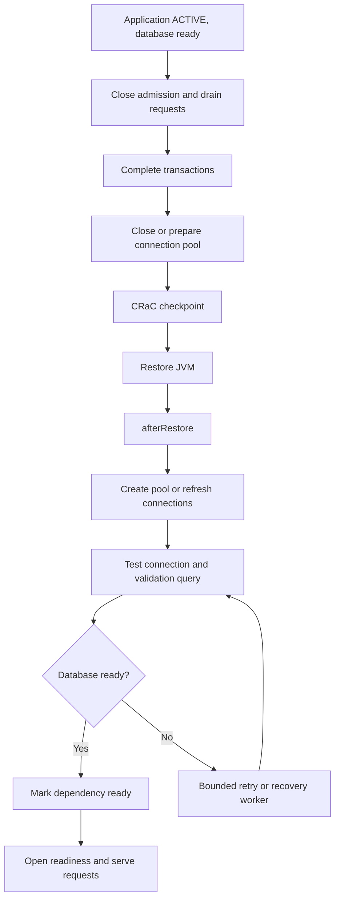

# Handling the Case Where the Database Is Not Ready on Restore

CRaC restores the state of a JVM process from a checkpoint image. Restoring the heap and Java objects does not mean the database has also been restored or is ready to accept connections. While the application is paused, the database may restart, fail over, change endpoints, rotate credentials, close old sockets, or be running migrations.

Therefore, after restore, the application must treat the database as a dependency that needs to be re-verified. An old connection pool may still exist in the heap, but the connections inside it have expired. The application needs to re-establish or verify the pool, test a meaningful database operation, and only accept database-dependent requests when the connection is ready.

There are two commonly used recovery policies:

- **Bounded wait in the restore callback**: retry connecting within a defined period. If the database is still not ready, report a restore error so the orchestration system can handle the instance.
- **Asynchronous recovery**: the callback starts a controlled retry process and returns; readiness remains false until the database is actually ready. This approach is suitable when the application can stay alive without serving database-dependent business logic yet.

Choose the policy based on the role of the database and how the deployment platform manages instances. Do not open traffic just because the JVM has restored successfully.

## 1. Why might the database not be ready?

A checkpoint saves process state, not a synchronized snapshot for the database. The database has an independent lifecycle, resources, and recovery mechanism. When the JVM is restored, the database may be in a different state from the time of checkpoint.

Common causes:

| Cause | Symptom after restore |
|---|---|
| Database starts slower than the application | Connection refused, timeout, or host not listening yet |
| Database is restarting/failing over | Old connections reset, endpoint temporarily unreachable |
| DNS or service discovery changed | Application continues using old address or cannot resolve new address yet |
| Network policy/firewall not ready | TCP connect timeout or refused |
| Credentials rotated | Authentication failed even though host and port are reachable |
| TLS certificate/trust store changed | Handshake failed |
| Connection pool contains old sockets | Obtaining connection from pool succeeds, but query fails |
| Connection limit reached | Database rejects new connections when multiple instances restore simultaneously |
| Schema migration running | Database accepts connections, but some tables or columns are not in the expected state |
| Database overloaded after reopening | Slow connections, query timeouts, or throttling |

Therefore, checking an open TCP port is not enough to conclude that the database is ready. The application needs to check using the exact driver and authentication credentials it will use when serving requests.

### Restoring the JVM does not restore the database

Suppose before checkpoint the application has:

- A `DataSource` and connection pool.
- Services holding references to `DataSource`.
- A cache containing data read from the database.
- Some completed transactions.

After restore, these objects may reappear in the heap. However, the database may have switched to a new primary, old connections may be closed, the user password may have been rotated, or data may have been updated by another instance. The checkpoint image does not guarantee the database retains the same state.

In particular, do not keep open JDBC transactions across a checkpoint. Before checkpoint, complete, commit, or roll back transactions according to business rules. An unfinished transaction may be rolled back by the database or its connection closed; restored Java state cannot make an external transaction continue safely on its own.

## 2. Determine whether the database is a required or optional dependency

The recovery policy depends on whether the application can operate safely when the database is not ready.

**Required database** when main requests need to read/write the database, or application state cannot be guaranteed correct without the database. In this case:

- Keep readiness false.
- Do not accept business requests that require the database.
- Retry connecting according to timeout and backoff.
- If the recovery deadline expires, report a clear error so the platform replaces the instance or orchestrates a re-restore.

**Optional database** when part of the application can operate independently, such as health endpoints, static pages, or read-only features using valid cached data. In that case, partial service may be allowed, but readiness must be distinguished by capability or route. Do not return a global healthy status if core features are still unusable.

Do not use stale cache to pretend the database is ready. The cache may contain outdated or inconsistent data. If degraded mode is allowed, clearly define which data is permitted, the stale expiration, how to notify, and when to resynchronize.

## 3. Database lifecycle around checkpoint and restore

A CRaC resource can manage the connection pool across two callbacks:

- `beforeCheckpoint(...)`: stop accepting work, complete transactions, close the pool, or clean up connections according to the pool's guidelines.
- `afterRestore(...)`: create a new pool, validate connections, and report recovery status to the application.



If the database is not ready, the retry branch must be bounded, observable, and keep readiness false. Do not let the connection pool or request threads retry infinitely on their own without centralized recovery state.

### Closing the pool before checkpoint

Pools often contain sockets and connection management state. After the process is restored, those sockets may no longer be usable. If the pool library has supported CRaC integration, follow the instructions for that library and runtime.

If managing the lifecycle manually:

1. Stop issuing new connections to requests.
2. Wait for in-flight transactions and database operations to complete.
3. Close the pool using the library's API.
4. Keep a stable provider so services can obtain the new pool after restore.

Do not assume a pool that has been `close()`d can be `start()`ed again. For example, some pools implement the closed state as the end of the object's lifecycle; in that case, a new pool instance must be created and the delegate inside the stable provider/proxy must be replaced.

### Creating a new pool after restore

After restore, the new pool needs to fetch the current configuration and credentials. Avoid reusing old connection objects or keeping expired passwords in the image. If a secret manager is available, fetch new credentials via the authorized mechanism and do not log secrets.

The pool should be published to the application after it has been created and successfully validated. If the pool is published first and validated afterward, requests may obtain connections from an unready pool.

## 4. Testing the database with a real connection

A useful check should use the same:

- JDBC driver that the application will use.
- Actual host, port, database name, and TLS config.
- Current credentials.
- Connection pool or factory that requests will use.

You can check using `Connection.isValid(timeoutSeconds)` if the JDBC driver supports it properly. Another option is to execute a lightweight query such as `SELECT 1` with a query timeout. For some database management systems, the validation query syntax may differ; choose a statement appropriate for the target database.

Direct JDBC check example:

```java
import javax.sql.DataSource;
import java.sql.Connection;
import java.sql.SQLException;

public final class DatabaseProbe {

    private DatabaseProbe() {
    }

    public static void verify(DataSource dataSource) throws SQLException {
        try (Connection connection = dataSource.getConnection()) {
            if (!connection.isValid(3)) {
                throw new SQLException("Database connection is not valid");
            }
        }
    }
}
```

This snippet checks the ability to obtain a connection and verify the connection within the driver's timeout. It does not check all business logic or permissions on every table. If the application needs to confirm schema access permissions, it can execute a small read-only query against an appropriate table or metadata.

Do not use a heavy check query, scan large tables, or invoke migrations inside a health check. Health checks need to be fast, bounded, and not create significant load on the database.

## 5. Retry with exponential backoff and jitter

The database may only need a few extra seconds to start, but many instances restoring simultaneously can create a burst of connections. Retrying immediately in a loop can make the situation worse.

A retry policy should have:

- **Total deadline**: limits the total time waiting for the database.
- **Connection timeout**: limits the time to obtain a connection.
- **Validation/query timeout**: limits the time for the check.
- **Exponential backoff**: progressively increases the time between attempts.
- **Jitter**: adds randomness so instances do not retry at the exact same moment.
- **Maximum attempts or duration**: ensures the callback does not hang indefinitely.
- **Error classification**: distinguishes transient errors from misconfiguration or invalid credentials.

Example of a backoff schedule:

| Attempt | Base wait interval |
|---:|---:|
| 1 | 250 ms |
| 2 | 500 ms |
| 3 | 1 s |
| 4 | 2 s |
| 5 onwards | Max 5 s |

Jitter can randomly offset each wait time around the base value. For example, at the 2-second level, each instance might wait around 1 to 3 seconds. The goal is to spread the load, not to make the total wait time unbounded.

### JDBC retry helper example

The following snippet attempts to create a new candidate pool, obtain a connection, and validate it. A failed candidate pool is closed before retrying. `PoolHandle` and `PoolFactory` are application abstractions; they allow creating a new pool instead of trying to reuse a closed one.

```java
import javax.sql.DataSource;
import java.sql.Connection;
import java.sql.SQLException;
import java.time.Duration;
import java.util.concurrent.ThreadLocalRandom;
import java.util.concurrent.TimeUnit;

public final class DatabaseRecovery {

    public interface PoolHandle extends AutoCloseable {
        DataSource dataSource();

        @Override
        void close() throws Exception;
    }

    @FunctionalInterface
    public interface PoolFactory {
        PoolHandle create() throws Exception;
    }

    private DatabaseRecovery() {
    }

    public static PoolHandle openUntilReady(
            PoolFactory factory,
            Duration totalTimeout) throws Exception {

        if (totalTimeout.isZero() || totalTimeout.isNegative()) {
            throw new IllegalArgumentException("totalTimeout must be positive");
        }

        long deadline = System.nanoTime() + totalTimeout.toNanos();
        long baseDelayMillis = 250;
        Exception lastFailure = null;

        while (true) {
            PoolHandle candidate = null;
            try {
                candidate = factory.create();
                verify(candidate.dataSource());
                return candidate;
            } catch (InterruptedException interrupted) {
                if (candidate != null) {
                    try {
                        candidate.close();
                    } catch (Exception closeFailure) {
                        interrupted.addSuppressed(closeFailure);
                    }
                }
                Thread.currentThread().interrupt();
                throw interrupted;
            } catch (Exception failure) {
                lastFailure = failure;
                if (candidate != null) {
                    try {
                        candidate.close();
                    } catch (Exception closeFailure) {
                        failure.addSuppressed(closeFailure);
                    }
                }
            }

            long remainingNanos = deadline - System.nanoTime();
            if (remainingNanos <= 0) {
                throw new SQLException(
                        "Database did not become ready before the deadline",
                        lastFailure
                );
            }

            double jitterFactor = ThreadLocalRandom.current()
                    .nextDouble(0.5, 1.5);
            long delayMillis = Math.max(
                    1L,
                    (long) (baseDelayMillis * jitterFactor)
            );
            long remainingMillis = Math.max(
                    1L,
                    TimeUnit.NANOSECONDS.toMillis(remainingNanos)
            );
            try {
                Thread.sleep(Math.min(delayMillis, remainingMillis));
            } catch (InterruptedException interrupted) {
                Thread.currentThread().interrupt();
                throw interrupted;
            }
            baseDelayMillis = Math.min(baseDelayMillis * 2, 5_000);
        }
    }

    private static void verify(DataSource dataSource) throws SQLException {
        try (Connection connection = dataSource.getConnection()) {
            if (!connection.isValid(3)) {
                throw new SQLException("Database connection is not valid");
            }
        }
    }
}
```

This example is an illustrative pattern. When implementing, the pool's connection acquisition timeout and the JDBC driver's validation timeout must align with the total deadline. If `factory.create()` or `getConnection()` can block longer than the deadline, checking the deadline only between attempts is not enough; timeouts must be set on those operations themselves.

For obvious configuration errors such as an incorrect URL, missing driver, or invalid credentials, continuous retrying usually does not help. Exceptions can be classified by driver/database to fail fast on non-recoverable errors. Do not classify based solely on message strings if the driver provides a stable SQLState or error code.

### Do not use infinite retries

Infinite retries can cause:

- The restore callback to never finish.
- The instance to consume resources without serving traffic.
- The platform not to receive a clear success/failure result.
- Logs and metrics to grow uncontrollably.
- The database to be overloaded by repeated connection attempts.

If waiting longer than the callback limit is necessary, use an asynchronous recovery coordinator and keep readiness false, rather than blocking the callback indefinitely.

## 6. Integrating retry into a CRaC Resource

A resource can manage a provider containing the current pool. Services in the application use the stable provider instead of directly holding a pool instance that may be closed.

Skeleton example:

```java
import org.crac.Context;
import org.crac.Core;
import org.crac.Resource;

public final class DatabaseCracResource implements Resource {

    public interface PoolProvider {
        DatabaseRecovery.PoolHandle detach();
        void install(DatabaseRecovery.PoolHandle pool);
    }

    private final PoolProvider provider;
    private final DatabaseRecovery.PoolFactory poolFactory;
    private final java.time.Duration recoveryTimeout;

    public DatabaseCracResource(
            PoolProvider provider,
            DatabaseRecovery.PoolFactory poolFactory,
            java.time.Duration recoveryTimeout) {
        this.provider = provider;
        this.poolFactory = poolFactory;
        this.recoveryTimeout = recoveryTimeout;
        Core.getGlobalContext().register(this);
    }

    @Override
    public void beforeCheckpoint(Context<? extends Resource> context)
            throws Exception {
        // Admission and transactions must be drained before this resource.
        DatabaseRecovery.PoolHandle oldPool = provider.detach();
        if (oldPool != null) {
            oldPool.close();
        }
    }

    @Override
    public void afterRestore(Context<? extends Resource> context)
            throws Exception {
        DatabaseRecovery.PoolHandle newPool =
                DatabaseRecovery.openUntilReady(poolFactory, recoveryTimeout);
        provider.install(newPool);
    }
}
```

This is a skeleton showing the resource's responsibilities; `PoolProvider` needs to be implemented in a thread-safe manner. Detaching must prevent requests from obtaining the pool during QUIESCING/RESTORING. The provider only installs the new pool after it has been successfully validated.

In a Spring application, a stable `DataSource` proxy can be provided so that every connection acquisition forwards to the current pool. This prevents services that injected the proxy from holding references to the old pool. If a `DataSource` field is replaced directly inside the resource while repositories or other services are holding the old pool, those consumers can still use the closed object.

If the connection pool library or framework already has CRaC integration, prefer the supported mechanism instead of manually closing/opening the same pool a second time. Avoid having two resources own the same pool.

## 7. Choosing a synchronous or asynchronous recovery policy

Not every application needs to wait for the database inside the callback. There are two main strategies.

### Strategy A — Bounded wait in afterRestore

The callback calls the retry helper and only returns when the database is ready. If the deadline expires, the callback reports an error.

Suitable when:

- The database is a required dependency for all served functionality.
- The instance has no safe degraded mode.
- The platform can handle a failed restore and create a new instance or retry according to policy.
- The expected recovery time has a clear bound.

The advantage is that the instance only proceeds once the critical dependency is ready. The drawback is that the callback duration may be extended and if the database is down for a long time, the restore will fail. The exact behavior when a callback throws an exception depends on the CRaC JDK and how the platform launches it; it must be tested with the target runtime.

### Strategy B — Recovery worker and readiness false

The callback can transition the state to RESTORING, start a new recovery worker, and return. The worker retries the database in the background; the application keeps readiness false until the pool is created and successfully validated.

Suitable when:

- The process can stay alive without serving database-dependent business logic yet.
- Readiness and liveness are configured separately.
- The orchestrator does not kill the instance just because readiness is false.
- The application can keep admission closed or restrict to routes that do not depend on the database.

Do not use an executor or thread that was stopped before checkpoint without verifying its lifecycle. A new recovery executor can be created after restore. The worker must have a deadline or long-term retry policy, metrics, and a shutdown mechanism.

Illustrative example:

```text
afterRestore
    state = RESTORING
    start new recovery worker
    return

recovery worker
    retry database connection
    validate pool
    install pool
    state = READY
    open admission
```

If the database is required, business endpoints must still be rejected throughout RESTORING. Only readiness endpoints and features determined to be safe may operate. Do not let requests enter and hang waiting for the connection pool.

### Comparison

| Criterion | Retry in callback | Recovery worker |
|---|---|---|
| When callback finishes | After DB is ready or deadline expires | After worker is started |
| Instance state | Does not proceed if callback is not finished | Can stay alive but not ready yet |
| Suitable for | Required DB, short recovery time | Prolonged recovery, degraded mode available |
| Handling when DB is down for long | Callback reports error | Keeps readiness false and retries according to policy |
| Main requirements | Clear timeout and restore failure orchestration | Readiness gate, worker lifecycle, and retry limits |

There is no single best strategy for every system. Choose based on the ability to serve without the database and the platform's recovery mechanism.

## 8. Readiness, liveness, and admission control

A living process does not mean the database is ready. During RESTORING:

- **Liveness** may succeed if the JVM and process are still running.
- **Readiness** must be false if the database is a required dependency and cannot be connected to yet.
- **Admission** must be closed so business requests do not enter a service lacking the database.

When the database is ready:

1. Create and validate the pool.
2. Install the new pool into the provider.
3. Start workers that depend on the database.
4. Transition state to READY.
5. Open admission.
6. Transition to ACTIVE and report readiness success.

If the application has routes that do not need the database, readiness can be defined by capability group. For example, a health endpoint can always respond while business APIs do not accept traffic yet. Avoid an overall health indicator reporting UP when core functionality is unusable.

### Simple state example

```java
public enum DatabaseState {
    ACTIVE,
    QUIESCING,
    PAUSED,
    RESTORING,
    READY,
    FAILED
}
```

Readiness is only enabled when the database pool has been installed and verified:

```java
public boolean isDatabaseReady() {
    return state == DatabaseState.READY
            || state == DatabaseState.ACTIVE;
}
```

In a full state machine, ensure state only transitions to READY after the provider has successfully installed the pool and admission is controlled in the proper order. Do not rely solely on a boolean flipped at the beginning of the callback.

## 9. Connection pool and timeout configuration

Pools have many different timeouts. They need to be configured according to an overall recovery budget.

| Configuration | Meaning | Note after restore |
|---|---|---|
| Connection timeout | Maximum time waiting to obtain a connection from the pool | Do not let requests wait indefinitely when DB is not ready |
| Validation timeout | Maximum time to validate a connection | Should be shorter than connection timeout |
| Max lifetime | Maximum lifetime of a connection | Should match database/proxy timeouts |
| Idle timeout | Time to keep an idle connection | Does not replace refreshing connections after restore |
| Initialization behavior | Whether the pool fails fast when unable to create initial connections | Must match the chosen retry strategy |
| Maximum pool size | Maximum number of connections | Calculate total across all simultaneously restoring instances |

For example, with HikariCP, properties such as `connectionTimeout`, `validationTimeout`, `maxLifetime`, and `initializationFailTimeout` have different meanings. Read the documentation for the exact HikariCP version in use. Do not set all timeouts to very large values to avoid errors; that only makes requests and restores hang longer.

### Avoiding a connection storm

Suppose 30 instances restore simultaneously and each instance opens a pool of up to 20 connections. The database may have to handle up to 600 new connections in a short time, not counting normal workload.

Load-reduction measures:

- Add jitter to retries.
- Do not open the maximum pool size immediately if not yet needed.
- Consider limiting the number of simultaneously restoring instances.
- Calculate the total connection budget across the entire deployment.
- Use a pool size appropriate for the number of workers and database capacity.
- Avoid having each health check create multiple connections or run heavy queries.

Retries should help the application wait for the database, not turn a database outage into a connection flood.

## 10. Handling credentials, DNS, and migrations

### Changed credentials

The checkpoint image may hold configurations or objects containing old credentials. If passwords, tokens, or certificates are rotated while the application is paused, new connections must fetch the current credentials.

Do not log credentials and do not put secrets in source code. Use a secret manager or the environment's secure configuration mechanism. After restore, refresh credentials before creating the pool; if authentication fails, classify it as a configuration/credential error and do not retry aggressively as if the database were just starting up.

### DNS and endpoints

After failover, a hostname may resolve to a new address. Some connection pools or HTTP/JDBC drivers retain open connections and DNS cache for a long time. Creating a new pool after restore helps the driver make new connections, but JVM and library DNS caching still needs to be checked.

Prefer a stable hostname/service discovery instead of hard-coding the IP of a database node. If the architecture uses primary/replica, connect to the right endpoint for read/write operations and verify the node role if required by the driver or database management system.

### Schema migrations

The database may accept connections, but the schema is not yet compatible with the application version. This is different from a network connection error.

Do not run DDL migrations arbitrarily from every `afterRestore()`, because multiple instances may run simultaneously and contend for schema locks. Use a migration process with an owner/leader, version control, and a clear release order. After restore, check the schema version or a necessary read-only operation before marking the dependency ready.

## 11. Transactions, retries, and idempotency

Do not leave database transactions open across a checkpoint. Before checkpoint:

- Stop accepting new work.
- Wait for in-flight transactions to complete.
- Commit or roll back according to business outcomes.
- Close connections and pools according to policy.

After restore, do not automatically replay a SQL statement just because the old connection failed. If the client does not know whether the previous transaction committed or not, blind retries can create duplicate data.

Safety measures:

- Use a unique key or idempotency key for data creation operations.
- Use transactions to write business state and outbox in the same database.
- Design retryable operations to be able to recognize an already-committed result.
- Do not assume a client-side rollback proves the database did not commit if the connection was lost during commit.
- Verify business state by querying by transaction/business id when the commit outcome is unknown.

CRaC restores JVM state; transactional consistency remains the responsibility of the application and database.

## 12. Observing the recovery process

Each recovery should log by resource and phase:

```text
INFO  crac-resource=database phase=afterRestore event=start
WARN  crac-resource=database event=connect_retry attempt=1 reason=connection_refused
WARN  crac-resource=database event=connect_retry attempt=2 reason=connection_timeout
INFO  crac-resource=database event=pool_validated duration_ms=1240
INFO  application event=readiness_ready
```

Do not log URLs containing passwords, tokens, certificate private material, or sensitive data. Logs should include error codes, SQLState, attempt count, wait time, and dependency name.

Useful metrics:

- Time from restore to database ready.
- Retry count and retry success rate.
- Connection error count by SQLState or error code.
- Pool creation and validation duration.
- Number of active/idle connections.
- Number of instances in RESTORING state.
- Duration readiness is false after restore.
- Number of failed callbacks or incomplete restores.

Monitor these metrics to distinguish slow database startup, credential errors, DNS errors, and connection storms. If all instances retry at the same time, metrics can show the database becoming overloaded right after restore.

## 13. Common errors

| Symptom | Possible cause | Resolution |
|---|---|---|
| Connection refused | Database not listening yet or wrong endpoint | Wait up to deadline, check host/port and DB status |
| Connection timeout | Network, firewall, overload, or routing | Check network and configure timeout/backoff |
| Authentication failed | Expired or incorrect credentials | Refresh secret, do not retry aggressively |
| TLS handshake failed | Certificate/trust store or hostname mismatch | Check certificate chain and TLS configuration |
| Connection reset | Pool holding old sockets or DB just failed over | Discard old connections, create new pool |
| Too many connections | Multiple instances opening pools simultaneously | Reduce pool size, limit concurrency, and add jitter |
| Query timeout | DB overloaded or unsuitable validation query | Use lightweight probe, bound timeout |
| Table/column not found | Migration not finished or incompatible schema | Coordinate migration and check schema version |
| Restore succeeds but requests fail | Readiness enabled before pool was verified | Keep admission closed until DB is ready |
| Infinite retries | No deadline or per-operation timeout | Add total deadline and pool/driver timeouts |

## 14. Testing procedure

Testing must cover both scenarios where the database is ready and where it is not ready.

1. Start a fresh application, confirm the connection pool and database requests work.
2. Bring the application to a checkpointable state; drain transactions and close the pool as designed.
3. Create a checkpoint with the target CRaC JDK.
4. In the test environment, stop the database or block connections before restore.
5. Restore the image and confirm the application transitions to RESTORING, with readiness remaining false.
6. Verify retries have backoff, deadline, and proper logging.
7. Restart the database or restore the network.
8. Confirm the application creates a new pool and runs the probe successfully.
9. Confirm readiness only turns on after the pool is installed and verified.
10. Send business requests and check transactions, messages, and idempotency.

Test additional scenarios:

- Credentials rotated before restore.
- Database endpoint changed after failover.
- Database returns authentication error instead of connection refused.
- Multiple instances restore simultaneously.
- Database never becomes ready within the retry deadline.
- Candidate pool is created, but validation fails.
- Application runs in degraded mode while the database is not ready.
- Restore callback throws an exception and how the platform handles the instance.

For each run, record restore time, retry count, time database became ready, time readiness turned on, and subsequent request results. Test on the exact CRaC JDK, JDBC driver, pool, and database versions being deployed.

## 15. Implementation checklist

### Before checkpoint

- [ ] Close admission and drain requests/jobs using the database.
- [ ] Do not leave open transactions across checkpoint.
- [ ] Commit or roll back according to business rules.
- [ ] Close or prepare the pool according to the library's CRaC integration.
- [ ] Have a stable provider/proxy to replace the pool after restore.

### After restore

- [ ] Determine whether the database is a required or optional dependency.
- [ ] Refresh credentials and endpoint configuration when needed.
- [ ] Create a new pool or refresh connections using supported APIs.
- [ ] Check using a real JDBC connection and lightweight probe.
- [ ] Retry with deadline, backoff, jitter, and per-operation timeouts.
- [ ] Do not retry infinitely on obvious configuration or credential errors.
- [ ] Only install and publish the pool after validation succeeds.
- [ ] Keep readiness false and admission closed when the database is not ready.

### Operations

- [ ] Separate readiness from liveness.
- [ ] Calculate connection budget when multiple instances restore simultaneously.
- [ ] Do not run migrations concurrently from every restore callback.
- [ ] Handle transactions and retry operations according to idempotency principles.
- [ ] Logs/metrics contain sufficient information without containing secrets.
- [ ] Tested slow database startup, failover, invalid credentials, and timeouts.

When the database is not ready after restore, the application needs to remain in an unready state, re-establish the pool with current configuration, verify a real connection, and retry within a bounded time budget. Only when required dependencies are ready should readiness and admission be opened. This helps CRaC restore the JVM without mistaking restored memory state for the external database state.