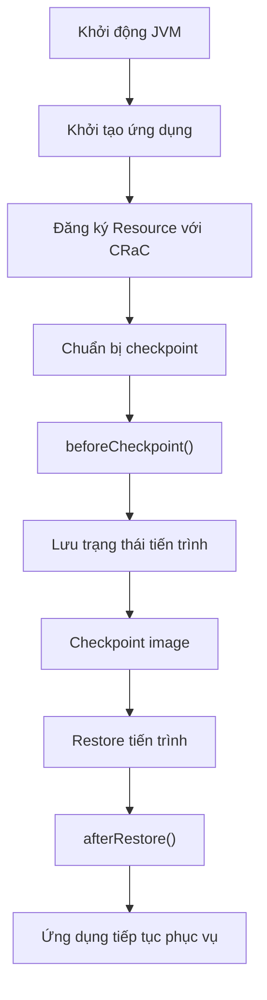

# CRaC là gì: Coordinated Restore at Checkpoint

CRaC là viết tắt của **Coordinated Restore at Checkpoint**. Đây là kỹ thuật giúp một ứng dụng Java khởi động nhanh bằng cách lưu trạng thái của tiến trình sau khi ứng dụng đã khởi tạo, rồi khôi phục tiến trình từ trạng thái đã lưu ở những lần chạy sau.

Thay vì mỗi lần khởi động đều phải tạo JVM mới, nạp class, khởi tạo framework, đọc cấu hình và chuẩn bị các thành phần dùng chung, ứng dụng có thể được khôi phục từ một **checkpoint** đã tạo trước đó. JVM tiếp tục chạy với phần lớn trạng thái đã được chuẩn bị sẵn.

Từ khóa quan trọng trong tên CRaC là *Coordinated* — có phối hợp. Trước khi chụp trạng thái, ứng dụng cần chuẩn bị những tài nguyên bên ngoài như kết nối cơ sở dữ liệu, socket, luồng nền và bộ lập lịch. Sau khi khôi phục, ứng dụng cần kiểm tra hoặc tạo lại các tài nguyên đó để chúng phù hợp với môi trường hiện tại.

## 1. Vì sao Java cần CRaC?

Một ứng dụng Java thường phải thực hiện nhiều công việc trước khi có thể nhận yêu cầu đầu tiên:

1. Khởi tạo JVM và các thành phần runtime.
2. Nạp, liên kết và khởi tạo các class cần thiết.
3. Đọc cấu hình, biến môi trường và tệp tài nguyên.
4. Khởi tạo framework, dependency injection container và các thành phần ứng dụng.
5. Tạo connection pool, HTTP client, cache và các dịch vụ dùng chung.
6. Chạy đủ lâu để một số đường thực thi thường gặp được tối ưu hóa bởi JIT compiler.

Với ứng dụng nhỏ, thời gian này có thể không đáng kể. Với ứng dụng Spring Boot hoặc dịch vụ có nhiều dependency, quá trình khởi động có thể kéo dài hơn đáng kể. Điều đó ảnh hưởng đến việc mở rộng số lượng instance, triển khai phiên bản mới, khôi phục sau sự cố và chạy workload có thời gian sống ngắn.

CRaC hướng đến việc giảm phần công việc lặp lại đó. Ứng dụng được khởi động và chuẩn bị một lần trong môi trường tạo checkpoint. Trạng thái tiến trình tại thời điểm phù hợp được lưu lại. Những lần chạy sau có thể khôi phục từ checkpoint thay vì thực hiện lại toàn bộ quá trình khởi động.

Ví dụ, một dịch vụ có thể mất vài giây để nạp framework và tạo cấu trúc ứng dụng. Nếu checkpoint được tạo sau khi các bước này hoàn tất, mỗi instance mới có thể bắt đầu từ trạng thái đã khởi tạo. Thời gian khôi phục thực tế vẫn phụ thuộc vào kích thước checkpoint, môi trường hệ điều hành, tài nguyên cần kết nối lại và cấu hình triển khai.

## 2. Checkpoint và restore hoạt động như thế nào?

**Checkpoint** là ảnh chụp trạng thái của tiến trình tại một thời điểm. Trong môi trường CRaC, trạng thái này có thể bao gồm heap của Java, trạng thái các luồng, stack, vùng nhớ và những thông tin tiến trình cần thiết để tiếp tục thực thi.

**Restore** là quá trình dựng lại tiến trình từ checkpoint để ứng dụng tiếp tục hoạt động. Khi restore thành công, chương trình tiếp tục từ trạng thái đã được lưu, sau khi các callback phục hồi tài nguyên đã đăng ký được thực hiện.

Có thể hình dung vòng đời tổng quát như sau:



Các bước trên mô tả ý tưởng chung. Lệnh tạo checkpoint, vị trí lưu ảnh và cách tiến trình ban đầu kết thúc hoặc tạm dừng phụ thuộc vào JDK CRaC và công cụ triển khai đang sử dụng.

### 2.1. Giai đoạn khởi tạo

Ứng dụng được chạy bằng một môi trường Java có hỗ trợ CRaC. JVM và ứng dụng khởi động như bình thường. Các class, framework, cấu hình và cấu trúc dữ liệu cần thiết được khởi tạo.

Trong giai đoạn này, ứng dụng cũng đăng ký những đối tượng cần tham gia vào vòng đời checkpoint/restore. Các đối tượng đó thường đại diện cho tài nguyên có thể cần đóng, làm mới hoặc tạo lại.

### 2.2. Giai đoạn trước checkpoint

Ngay trước khi hệ thống chụp trạng thái, CRaC gọi callback `beforeCheckpoint()` của các resource đã đăng ký.

Ứng dụng dùng giai đoạn này để đưa trạng thái của mình về một thời điểm an toàn, chẳng hạn:

- Hoàn tất hoặc rollback giao dịch đang mở theo chính sách của ứng dụng.
- Ghi dữ liệu đang chờ xuống nơi lưu trữ bền vững.
- Tạm dừng scheduler và các tác vụ nền.
- Đóng kết nối mạng hoặc giải phóng tài nguyên không thể dùng lại sau restore.
- Đưa connection pool và client về trạng thái có thể khởi tạo lại.

Mục tiêu là tránh lưu một tiến trình đang giữ tài nguyên đã hết hạn hoặc đang thực hiện một thao tác dở dang.

### 2.3. Lưu checkpoint

Sau khi ứng dụng hoàn tất việc chuẩn bị, cơ chế checkpoint lưu trạng thái tiến trình thành một ảnh có thể dùng cho restore.

Trong nhiều môi trường Linux, CRaC dựa vào CRIU (*Checkpoint/Restore In Userspace*) cùng sự tích hợp của JDK để lưu và khôi phục tiến trình. CRIU xử lý trạng thái tiến trình ở cấp hệ điều hành; JDK CRaC phối hợp với JVM và ứng dụng để quá trình đó có thể thực hiện an toàn hơn.

Checkpoint không phải một tệp Java object được tạo bằng cơ chế serialization thông thường. Nó là ảnh trạng thái của tiến trình, phụ thuộc vào JVM, hệ điều hành và môi trường chạy tương thích.

### 2.4. Giai đoạn restore

Khi tiến trình được khôi phục, CRaC gọi callback `afterRestore()` của các resource đã đăng ký. Ứng dụng dùng callback này để thiết lập lại những tài nguyên đã đóng hoặc cần làm mới trước checkpoint.

Ví dụ:

- Tạo lại kết nối đến cơ sở dữ liệu.
- Khởi tạo lại HTTP client hoặc socket.
- Làm mới thông tin xác thực và token đã hết hạn.
- Khởi động lại scheduler hoặc worker thread.
- Kiểm tra các tài nguyên phụ thuộc vào địa chỉ IP, hostname hoặc thời điểm hiện tại.

Sau khi các bước phục hồi cần thiết hoàn tất, ứng dụng tiếp tục từ trạng thái đã checkpoint và có thể bắt đầu nhận yêu cầu.

## 3. CRaC API trong Java

CRaC cung cấp API để ứng dụng thông báo những tài nguyên cần được xử lý ở hai thời điểm: trước checkpoint và sau restore. API thường được sử dụng thông qua package `org.crac`.

Hai thành phần cốt lõi là:

- `Resource`: interface mà một đối tượng triển khai để nhận callback vòng đời.
- `Core`: điểm truy cập đến context toàn cục và các thao tác CRaC do runtime cung cấp.

Một resource triển khai hai phương thức:

```java
void beforeCheckpoint(Context<? extends Resource> context)
        throws Exception;

void afterRestore(Context<? extends Resource> context)
        throws Exception;
```

`beforeCheckpoint()` chạy trước khi trạng thái tiến trình được lưu. `afterRestore()` chạy khi tiến trình đã được khôi phục. Tham số `context` cung cấp ngữ cảnh quản lý resource trong vòng đời CRaC.

### 3.1. Đăng ký một Resource

Ví dụ sau minh họa một client kết nối đến dịch vụ bên ngoài. Client cũ được đóng trước checkpoint và tạo lại sau restore.

```java
import org.crac.Context;
import org.crac.Core;
import org.crac.Resource;

public final class RemoteClientResource implements Resource {

    private RemoteClient client;

    public RemoteClientResource() throws Exception {
        this.client = connect();

        // Đăng ký đối tượng này để CRaC gọi các callback.
        Core.getGlobalContext().register(this);
    }

    private RemoteClient connect() throws Exception {
        // Thay bằng logic tạo client thực tế của ứng dụng.
        return RemoteClient.create();
    }

    @Override
    public void beforeCheckpoint(
            Context<? extends Resource> context) throws Exception {

        if (client != null) {
            client.close();
            client = null;
        }
    }

    @Override
    public void afterRestore(
            Context<? extends Resource> context) throws Exception {

        client = connect();
    }

    public RemoteClient getClient() {
        return client;
    }
}
```

`RemoteClient` trong ví dụ là kiểu minh họa cho client của ứng dụng; đây không phải class thuộc CRaC API. Trong dự án thực tế, hãy thay nó bằng HTTP client, database client hoặc thành phần kết nối mà ứng dụng đang sử dụng.

Đối tượng resource cần được tạo và đăng ký trong quá trình khởi tạo ứng dụng, trước thời điểm checkpoint. Nếu đối tượng không được đăng ký với context phù hợp, CRaC sẽ không biết cần gọi callback của nó.

### 3.2. Vì sao phải có cả hai callback?

Hai callback giải quyết hai thời điểm có yêu cầu khác nhau:

| Callback | Thời điểm | Công việc điển hình |
|---|---|---|
| `beforeCheckpoint()` | Trước khi lưu trạng thái | Đóng, tạm dừng, flush hoặc đưa tài nguyên về trạng thái an toàn |
| `afterRestore()` | Sau khi khôi phục trạng thái | Tạo lại kết nối, làm mới token, khởi động lại tác vụ và kiểm tra tài nguyên |

Không nên xem hai callback là nơi chạy mọi logic khởi động của ứng dụng. Chúng chỉ nên xử lý những công việc cần thiết để chuyển tiếp an toàn giữa trạng thái trước checkpoint và sau restore.

### 3.3. Kích hoạt checkpoint từ ứng dụng

Một số môi trường CRaC cho phép ứng dụng yêu cầu checkpoint bằng API `Core.checkpointRestore()`. Ví dụ minh họa:

```java
import org.crac.Core;

public class Application {

    public static void main(String[] args) throws Exception {
        initializeApplication();

        // Runtime thực hiện checkpoint và tiếp tục tại đây
        // khi tiến trình được restore.
        Core.checkpointRestore();

        startServingRequests();
    }

    private static void initializeApplication() {
        // Đọc cấu hình, tạo bean, nạp dữ liệu cần thiết...
    }

    private static void startServingRequests() {
        // Bắt đầu nhận yêu cầu.
    }
}
```

Trong luồng ví dụ, ứng dụng được khởi tạo trước lời gọi checkpoint. Khi tiến trình được restore, lời gọi tiếp tục trả về và ứng dụng thực hiện phần công việc phía sau. Cách kích hoạt checkpoint cũng có thể được cung cấp bởi công cụ dòng lệnh hoặc nền tảng triển khai. Hãy dùng cách được tài liệu của JDK CRaC đang chọn hỗ trợ.

## 4. Những tài nguyên cần xử lý cẩn thận

CRaC lưu trạng thái tiến trình, nhưng điều đó không đảm bảo mọi tài nguyên bên ngoài vẫn hợp lệ khi tiến trình được khôi phục. Một tham chiếu Java có thể vẫn tồn tại trong heap trong khi tài nguyên mà nó trỏ đến đã hết hạn hoặc không còn đúng với môi trường hiện tại.

### 4.1. Kết nối cơ sở dữ liệu

Một kết nối JDBC đang mở có thể bị máy chủ cơ sở dữ liệu ngắt trong thời gian checkpoint. Nếu ứng dụng restore rồi sử dụng lại kết nối cũ, thao tác truy vấn có thể thất bại.

Cách xử lý thường gặp:

1. Trước checkpoint, dừng nhận công việc mới và hoàn tất hoặc xử lý các giao dịch đang chạy theo chính sách ứng dụng.
2. Đóng kết nối hoặc đưa connection pool về trạng thái an toàn.
3. Sau restore, kiểm tra pool và tạo lại các kết nối cần thiết.
4. Chỉ cho phép ứng dụng nhận yêu cầu khi kết nối đã sẵn sàng.

Không nên chỉ giữ nguyên một đối tượng connection trong heap và giả định rằng máy chủ vẫn duy trì phiên làm việc đó.

### 4.2. Socket và kết nối mạng

Socket có thể gắn với địa chỉ IP, cổng, trạng thái TCP và tài nguyên hệ điều hành. Những thông tin này có thể không còn phù hợp sau khi restore, nhất là khi tiến trình được chạy trong container hoặc môi trường mạng khác.

Với HTTP client, message broker client hoặc kết nối đến dịch vụ khác, ứng dụng nên có cách đóng và tạo lại kết nối. Cần xác định rõ thành phần nào sở hữu socket và nơi nào chịu trách nhiệm mở lại nó.

### 4.3. Token và thông tin xác thực

Token có thời hạn. Một checkpoint có thể được tạo tại thời điểm token còn hợp lệ nhưng được restore sau khi token đã hết hạn.

Sau restore, ứng dụng nên kiểm tra thời hạn và làm mới thông tin xác thực khi cần. Cũng cần chú ý rằng checkpoint có thể chứa token, mật khẩu hoặc dữ liệu nhạy cảm trong heap. Vì vậy, checkpoint phải được bảo vệ như một artifact chứa dữ liệu nhạy cảm.

### 4.4. Thread và tác vụ nền

Một thread có thể đang thực hiện công việc tại thời điểm checkpoint. Nếu công việc đó phụ thuộc vào tài nguyên bên ngoài hoặc đang ở giữa một thao tác, việc khôi phục có thể tạo ra trạng thái khó dự đoán.

Ứng dụng nên phối hợp với executor, scheduler và worker thread để:

- Ngừng nhận thêm công việc trong khoảng chuẩn bị checkpoint.
- Đợi các thao tác cần thiết hoàn tất hoặc đưa chúng về trạng thái có thể tiếp tục.
- Tránh checkpoint khi một giao dịch hoặc thao tác ghi dữ liệu đang ở trạng thái không nhất quán.
- Khởi động lại các tác vụ nền cần thiết sau restore.

Cách xử lý cụ thể phụ thuộc vào thư viện và mô hình xử lý đồng thời của ứng dụng.

### 4.5. Thời gian và lịch chạy

Checkpoint có thể được tạo trước một khoảng thời gian dài rồi mới restore. Trong thời gian đó, đồng hồ, thời hạn token, cache TTL, lịch chạy và trạng thái của hệ thống bên ngoài vẫn tiếp tục thay đổi.

Không nên giả định rằng mọi giá trị thời gian được lưu trong heap vẫn phản ánh thời điểm hiện tại. Sau restore, ứng dụng cần cập nhật những dữ liệu phụ thuộc vào thời gian thực, kiểm tra timeout và tính lại lịch cho các tác vụ phù hợp.

### 4.6. Tệp và tài nguyên hệ điều hành

File descriptor, tệp đang mở, khóa, đường dẫn mount và các tài nguyên hệ điều hành có thể phụ thuộc vào môi trường tạo checkpoint. Khả năng khôi phục chúng phụ thuộc vào nền tảng và cấu hình.

Nếu ứng dụng cần một tệp, thiết bị hoặc mount cụ thể, hãy kiểm tra tài nguyên đó sau restore. Không nên mặc định rằng đường dẫn hoặc quyền truy cập sẽ giống hệt ở mọi môi trường triển khai.

## 5. Quy trình sử dụng CRaC trong triển khai

Một quy trình triển khai điển hình có thể được tổ chức thành các bước sau:

1. **Chọn JDK hỗ trợ CRaC.** Kiểm tra tài liệu của nhà cung cấp JDK về phiên bản, hệ điều hành, kiến trúc và các yêu cầu runtime.
2. **Chuẩn bị ứng dụng.** Xác định các resource cần đóng, tạm dừng hoặc khởi tạo lại. Đăng ký chúng với CRaC.
3. **Khởi động ứng dụng trong môi trường tạo checkpoint.** Dùng cấu hình tương ứng với môi trường sẽ restore.
4. **Đưa ứng dụng đến trạng thái sẵn sàng.** Nạp class, khởi tạo framework và chuẩn bị dữ liệu cần thiết.
5. **Tạo checkpoint.** Dùng API hoặc công cụ được JDK CRaC hỗ trợ để lưu trạng thái tiến trình.
6. **Lưu trữ checkpoint an toàn.** Quản lý phiên bản, quyền truy cập và vòng đời của artifact.
7. **Restore trong môi trường mục tiêu.** Đảm bảo JDK, hệ điều hành, kiến trúc và các điều kiện tương thích.
8. **Kiểm tra trạng thái sau restore.** Xác nhận callback đã hoàn tất, kết nối đã sẵn sàng và ứng dụng có thể xử lý yêu cầu.
9. **Theo dõi khi vận hành.** Đo thời gian restore, lỗi kết nối, bộ nhớ và hành vi của các tác vụ nền.

Lệnh cụ thể để tạo và restore checkpoint thay đổi theo bản phân phối CRaC, cách đóng gói ứng dụng và môi trường chạy. Không nên sao chép một lệnh từ môi trường khác nếu chưa xác nhận nó phù hợp với JDK và hệ điều hành đang dùng.

## 6. Điều kiện tương thích và giới hạn

CRaC cần sự hỗ trợ ở nhiều lớp: JVM, hệ điều hành, cơ chế checkpoint/restore và môi trường triển khai. Vì vậy, không phải ứng dụng Java nào cũng có thể tạo checkpoint ở một máy rồi restore tùy ý ở bất kỳ máy nào.

Các yếu tố cần kiểm tra gồm:

- **JDK:** phải là bản phân phối và phiên bản có hỗ trợ CRaC.
- **Hệ điều hành và kernel:** cần đáp ứng yêu cầu của cơ chế checkpoint/restore mà bản CRaC sử dụng.
- **Kiến trúc CPU và thư viện native:** tiến trình có thể phụ thuộc vào kiến trúc, thư viện và môi trường đã tạo checkpoint.
- **Container và quyền hệ thống:** namespace, quyền, cấu hình bảo mật, mount và giới hạn container có thể ảnh hưởng đến checkpoint/restore.
- **Tài nguyên bên ngoài:** database, message broker, cache và dịch vụ mạng phải có khả năng kết nối lại.
- **Cấu hình ứng dụng:** biến môi trường, secret, đường dẫn và cấu hình theo instance cần được đánh giá khi restore ở môi trường khác.

Checkpoint nên được xem là artifact gắn với một môi trường tương thích cụ thể. Nếu thay đổi JDK, hệ điều hành, thư viện native hoặc cấu hình runtime, hãy tạo và kiểm thử checkpoint mới theo quy trình triển khai.

CRaC cũng có chi phí. Việc tạo checkpoint tiêu tốn thời gian và tài nguyên; ảnh checkpoint có thể chiếm dung lượng đáng kể; ứng dụng cần thêm logic quản lý vòng đời tài nguyên. Với một chương trình vốn đã khởi động rất nhanh, lợi ích có thể không đủ bù cho độ phức tạp này.

## 7. CRaC khác gì serialization và các kỹ thuật tăng tốc khởi động?

### 7.1. CRaC và Java serialization

Java serialization chuyển một đồ thị đối tượng được chọn thành dữ liệu có thể ghi hoặc truyền, rồi tái tạo đối tượng từ dữ liệu đó. Ứng dụng cần quyết định đối tượng nào được serialize và cách khôi phục chúng.

CRaC lưu trạng thái của tiến trình ở cấp runtime và hệ điều hành. Nó có thể giữ lại nhiều trạng thái đang tồn tại trong tiến trình, gồm heap và trạng thái thực thi, thay vì yêu cầu ứng dụng serialize từng đối tượng.

| Tiêu chí | Java serialization | CRaC |
|---|---|---|
| Phạm vi | Đồ thị đối tượng được chọn | Trạng thái tiến trình |
| Cách khôi phục | Đọc dữ liệu và tái tạo đối tượng | Restore tiến trình từ checkpoint |
| Tích hợp ứng dụng | Chọn và quản lý đối tượng cần serialize | Phối hợp tài nguyên qua callback |
| Phụ thuộc môi trường | Phụ thuộc định dạng và class | Phụ thuộc JDK, hệ điều hành và môi trường tương thích |
| Mục đích điển hình | Lưu hoặc truyền dữ liệu đối tượng | Giảm công việc khởi động ứng dụng |

Hai kỹ thuật giải quyết những bài toán khác nhau và không thay thế trực tiếp cho nhau.

### 7.2. CRaC và Class Data Sharing (CDS)

CDS giúp JVM chia sẻ dữ liệu class đã được chuẩn bị để giảm một phần chi phí nạp class và khởi động. CDS tập trung vào dữ liệu class.

CRaC hướng đến việc khôi phục trạng thái tiến trình đã chạy, có thể bao gồm cả trạng thái ứng dụng và runtime tại thời điểm checkpoint. Vì vậy, phạm vi tác động của hai kỹ thuật khác nhau. Tùy JDK và cách triển khai, chúng có thể được cân nhắc kết hợp hoặc đánh giá riêng.

### 7.3. CRaC và tối ưu hóa ứng dụng thông thường

Tối ưu cấu hình, giảm số dependency, giảm công việc khởi tạo đồng bộ và cải thiện lazy loading vẫn có giá trị. CRaC không tự động sửa một ứng dụng có quá trình khởi động kém hiệu quả hoặc có logic khởi tạo sai.

Trước khi áp dụng, nên đo thời gian khởi động hiện tại và xác định phần chi phí có thể được giảm bằng checkpoint. Sau đó so sánh thời gian khởi động thông thường với thời gian restore trong cùng điều kiện triển khai.

## 8. Khi nào nên cân nhắc CRaC?

CRaC phù hợp để đánh giá khi:

- Ứng dụng có thời gian khởi động dài do khởi tạo JVM, framework hoặc nhiều thành phần dùng chung.
- Hệ thống cần tạo instance mới nhanh khi tải tăng.
- Nền tảng thường xuyên triển khai phiên bản mới hoặc khởi tạo lại workload.
- Môi trường chạy có thể được kiểm soát để tạo và restore checkpoint tương thích.
- Nhóm phát triển có thể quản lý vòng đời của kết nối, thread, token và các tài nguyên bên ngoài.

CRaC có thể không phù hợp khi:

- Ứng dụng khởi động vốn đã nhanh và không có yêu cầu giảm thời gian khởi động.
- Môi trường chạy thay đổi thường xuyên hoặc không đáp ứng điều kiện tương thích.
- Ứng dụng phụ thuộc nhiều vào tài nguyên mạng hoặc hệ điều hành không thể khởi tạo lại an toàn.
- Việc bảo vệ, lưu trữ và phân phối checkpoint tạo ra chi phí vận hành quá lớn.
- Ứng dụng không có cách đưa các tác vụ đang chạy về trạng thái an toàn trước checkpoint.

Quyết định nên dựa trên phép đo của workload thực tế, không chỉ dựa vào thời gian restore trong một ví dụ đơn lẻ.

## 9. Danh sách kiểm tra trước khi đưa CRaC vào production

### Ứng dụng

- [ ] Đã xác định các kết nối mạng, database client, file và tài nguyên hệ điều hành cần xử lý.
- [ ] Các resource cần thiết đã đăng ký với CRaC context.
- [ ] `beforeCheckpoint()` xử lý được công việc đang chạy và không để dữ liệu ở trạng thái không nhất quán.
- [ ] `afterRestore()` tạo lại hoặc kiểm tra tài nguyên phụ thuộc môi trường.
- [ ] Scheduler, executor và worker thread có quy trình dừng và khởi động lại rõ ràng.
- [ ] Token, cache TTL và dữ liệu phụ thuộc thời gian được làm mới khi cần.

### Môi trường

- [ ] JDK và hệ điều hành hỗ trợ CRaC theo đúng cấu hình triển khai.
- [ ] Môi trường tạo checkpoint và restore đáp ứng yêu cầu tương thích.
- [ ] Quyền hệ thống, container, mount và thư viện native đã được kiểm tra.
- [ ] Các secret và dữ liệu trong checkpoint được bảo vệ phù hợp.
- [ ] Có quy trình tạo lại checkpoint khi thay đổi JDK hoặc môi trường runtime.

### Vận hành

- [ ] Đã đo và so sánh thời gian khởi động thông thường với thời gian restore.
- [ ] Đã thử restore sau một khoảng thời gian đủ dài để phát hiện token hoặc kết nối hết hạn.
- [ ] Có health check để chỉ nhận traffic sau khi ứng dụng và tài nguyên thiết yếu sẵn sàng.
- [ ] Có cách xử lý khi checkpoint hoặc restore thất bại.
- [ ] Có chính sách lưu trữ, phân quyền và xóa checkpoint cũ.

## 10. Câu hỏi thường gặp

### CRaC có phải là serialization toàn bộ ứng dụng không?

Không. Serialization làm việc với đồ thị đối tượng được chọn. CRaC lưu trạng thái tiến trình ở cấp JVM và hệ điều hành để có thể khôi phục tiến trình trong môi trường tương thích.

### Có cần sửa mã nguồn ứng dụng để dùng CRaC không?

Mức độ thay đổi tùy ứng dụng. Những ứng dụng có tài nguyên bên ngoài cần đóng hoặc làm mới thường phải triển khai và đăng ký các resource callback. Ứng dụng càng phụ thuộc vào kết nối mạng, database, scheduler và trạng thái môi trường thì việc phối hợp càng quan trọng.

### Sau restore, kết nối database có tự hoạt động không?

Không nên giả định như vậy. Kết nối có thể đã hết hạn hoặc bị đóng trong thời gian checkpoint. Ứng dụng cần đóng hoặc chuẩn bị connection pool trước checkpoint và kiểm tra hoặc tạo lại kết nối sau restore.

### Có thể restore checkpoint trên bất kỳ máy nào không?

Không. Khả năng restore phụ thuộc vào JDK, hệ điều hành, kernel, kiến trúc và các điều kiện runtime. Hãy tuân theo yêu cầu tương thích của bản phân phối CRaC đang sử dụng.

### CRaC có làm ứng dụng xử lý request nhanh hơn không?

Mục tiêu chính của CRaC là giảm thời gian đưa một instance vào trạng thái sẵn sàng. Tốc độ xử lý từng request sau khi ứng dụng đã chạy phụ thuộc vào logic, tài nguyên và cấu hình ứng dụng; checkpoint không tự động tối ưu các yếu tố đó.

## Kết luận

CRaC giúp Java giảm thời gian khởi động bằng cách lưu trạng thái tiến trình sau khi ứng dụng đã được chuẩn bị và khôi phục trạng thái đó khi cần chạy instance mới. Điểm cốt lõi là phối hợp vòng đời tài nguyên: đóng hoặc tạm dừng những gì cần xử lý trước checkpoint, rồi kiểm tra và tạo lại những gì cần thiết sau restore.

Để sử dụng CRaC an toàn, cần chọn đúng JDK và môi trường tương thích, triển khai callback cho các tài nguyên quan trọng, bảo vệ checkpoint như dữ liệu nhạy cảm và kiểm thử restore trong điều kiện gần với production.
