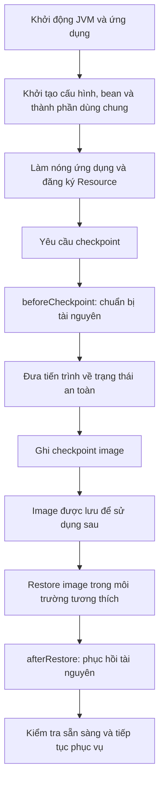

# Checkpoint, ảnh trạng thái và restore: các khái niệm cốt lõi

Một ứng dụng Java thường cần thực hiện nhiều công việc trước khi có thể phục vụ yêu cầu đầu tiên: khởi tạo Spring context, đọc cấu hình, quét classpath, tạo bean, nạp thư viện native, thiết lập kết nối đến cơ sở dữ liệu, tải dữ liệu dùng chung và làm nóng một số đường chạy quan trọng. Với ứng dụng lớn, giai đoạn khởi động này có thể chiếm phần đáng kể trong tổng thời gian đưa dịch vụ vào trạng thái sẵn sàng.

CRaC (Coordinated Restore at Checkpoint) cho phép lưu lại trạng thái của một tiến trình Java sau khi nó đã hoàn thành phần khởi tạo cần thiết, rồi khôi phục tiến trình từ trạng thái đó ở lần chạy sau. Nhờ vậy, ứng dụng có thể tiếp tục từ một trạng thái đã được chuẩn bị thay vì phải thực hiện lại toàn bộ quá trình khởi động.

Để hiểu CRaC, cần phân biệt ba khái niệm liên quan chặt chẽ: **checkpoint** là thao tác chụp trạng thái tiến trình tại một thời điểm; **checkpoint image** là tập dữ liệu lưu trạng thái đã chụp; **restore** là quá trình khôi phục tiến trình từ tập dữ liệu đó để tiếp tục thực thi. Đây là cơ chế phối hợp giữa JVM, ứng dụng và hệ điều hành, không đơn thuần là lưu một vài đối tượng Java xuống đĩa.

## 1. CRaC giải quyết vấn đề gì?

Trong cách khởi động thông thường, mỗi tiến trình mới phải đi qua một chuỗi công việc gần giống nhau:

1. Hệ điều hành tạo tiến trình và khởi chạy JVM.
2. JVM khởi tạo runtime, nạp các lớp cần thiết và chuẩn bị bộ nhớ.
3. Mã ứng dụng chạy, đọc cấu hình và tạo các thành phần nội bộ.
4. Ứng dụng kết nối đến dịch vụ bên ngoài như database, cache hoặc message broker.
5. Ứng dụng thực hiện các bước làm nóng cần thiết rồi mới báo sẵn sàng nhận tải.

Một phần đáng kể của công việc trên có thể lặp lại mỗi lần tạo tiến trình, dù kết quả khởi tạo về cơ bản giống nhau. CRaC hướng đến việc tái sử dụng kết quả đó.

Ứng dụng được khởi chạy bằng một bản JDK có hỗ trợ CRaC. Khi ứng dụng đã đạt trạng thái phù hợp, một yêu cầu checkpoint được gửi đến JVM. JVM phối hợp với ứng dụng để chuẩn bị các tài nguyên, sau đó cơ chế checkpoint của hệ điều hành lưu trạng thái tiến trình thành một image. Khi cần chạy ứng dụng, tiến trình được restore từ image và tiếp tục từ trạng thái đã lưu.

CRaC đặc biệt hữu ích khi chi phí khởi động lớn và có thể chuẩn bị trước một trạng thái dùng chung, chẳng hạn dịch vụ cần khởi tạo nhiều bean, nạp nhiều thư viện hoặc làm nóng các đường xử lý thường dùng. Nó không tự làm cho mọi ứng dụng khởi động nhanh hơn trong mọi hoàn cảnh. Chi phí tạo image, giới hạn môi trường restore và việc quản lý tài nguyên vẫn cần được tính đến.

## 2. Ba khái niệm cốt lõi

### 2.1. Checkpoint — chụp trạng thái tiến trình

Checkpoint là một thời điểm và một thao tác có kiểm soát, tại đó tiến trình được đưa về trạng thái có thể lưu lại. Trước khi trạng thái được ghi ra, ứng dụng cần xử lý những tài nguyên có thể không còn hợp lệ khi tiến trình được khôi phục ở một thời điểm hoặc môi trường khác.

Có thể hình dung checkpoint như việc tạm dừng một chương trình tại một ranh giới thực thi đã được chuẩn bị, lưu trạng thái cần thiết để chương trình có thể tiếp tục về sau. Tuy nhiên, việc dừng và lưu này phải được phối hợp với JVM và hệ điều hành. Một lệnh tạm dừng tiến trình thông thường không thay thế được quy trình checkpoint của CRaC.

Một checkpoint tốt thường được tạo sau khi:

- Cấu hình đã được đọc và kiểm tra.
- Các thành phần ứng dụng cần thiết đã được khởi tạo.
- Những lớp và đường xử lý quan trọng đã được nạp hoặc làm nóng nếu điều đó có lợi.
- Các tác vụ nền đã đi đến ranh giới an toàn hoặc có cơ chế tạm dừng.
- Những giao dịch đang xử lý đã hoàn tất hoặc được xử lý theo chính sách rõ ràng.
- Các tài nguyên bên ngoài đã được chuẩn bị để đóng, giữ hoặc tạo lại phù hợp với môi trường restore.

Checkpoint không nên được tạo tùy tiện giữa một thao tác nghiệp vụ đang dở dang. Nếu tiến trình bị chụp khi dữ liệu nội bộ đang ở trạng thái trung gian, ứng dụng có thể tiếp tục từ một trạng thái không nhất quán hoặc gây ra tác dụng phụ lặp lại sau restore.

### 2.2. Checkpoint image — ảnh trạng thái

Checkpoint image là tập dữ liệu mà cơ chế checkpoint tạo ra để mô tả trạng thái tiến trình tại thời điểm chụp. Tùy vào JDK, hệ điều hành và công cụ được sử dụng, image có thể gồm nhiều tệp và metadata; không nên mặc định rằng nó luôn là một tệp duy nhất.

Ở mức khái niệm, image có thể chứa những phần trạng thái thuộc tiến trình như:

- Các trang bộ nhớ của tiến trình, trong đó có heap và các đối tượng Java đang tồn tại.
- Trạng thái thực thi của các luồng, chẳng hạn stack và vị trí thực thi cần thiết để tiếp tục.
- Trạng thái runtime của JVM và một phần bộ nhớ native liên quan.
- Thông tin tiến trình và những tài nguyên hệ điều hành mà cơ chế checkpoint hỗ trợ lưu, khôi phục.

Phạm vi chính xác phụ thuộc vào cách triển khai. Không nên xem danh sách trên là cam kết rằng mọi loại tài nguyên của mọi ứng dụng đều được lưu và khôi phục nguyên trạng.

Image cũng không phải là bản sao của toàn bộ hệ thống bên ngoài tiến trình. Dữ liệu trong database, trạng thái của message broker, nội dung cache từ xa, tài nguyên cloud hay thay đổi do một dịch vụ khác tạo ra không tự động được đóng gói vào image. Những hệ thống đó tiếp tục tồn tại và có thể thay đổi trong lúc tiến trình đang được lưu.

Vì image có thể chứa heap, dữ liệu nghiệp vụ đang nằm trong bộ nhớ, token hoặc thông tin xác thực, nó cần được bảo vệ như một artifact nhạy cảm. Quyền đọc image, nơi lưu trữ, thời hạn sử dụng và cách xóa image cũ đều là một phần của vận hành CRaC.

### 2.3. Restore — khôi phục và tiếp tục thực thi

Restore dùng checkpoint image để tái tạo tiến trình đã được lưu. Thay vì bắt đầu một tiến trình mới rồi chạy lại toàn bộ mã khởi động từ đầu, cơ chế restore khôi phục trạng thái đã chụp để tiến trình có thể tiếp tục thực thi.

Điều đó có nghĩa là những đối tượng đã tồn tại trong bộ nhớ tại thời điểm checkpoint có thể tiếp tục tồn tại sau restore. Trạng thái của luồng và vị trí thực thi cũng được khôi phục theo khả năng của cơ chế được dùng. Mã khởi động thông thường, chẳng hạn `main`, không được chạy lại như trong một lần khởi động mới chỉ vì tiến trình vừa được restore.

Sau restore, ứng dụng vẫn cần thực hiện công việc hậu khôi phục. Một số kết nối có thể đã bị đóng trước checkpoint; một số thông tin xác thực, địa chỉ mạng, lease hoặc dữ liệu cache có thể đã hết hạn; một số tài nguyên cần được tạo lại. CRaC cung cấp các callback để ứng dụng thực hiện phần chuẩn bị trước checkpoint và phần phục hồi sau restore.

Restore cũng có điều kiện tương thích. Một image không phải gói ứng dụng có thể mang đi chạy tùy ý trên mọi máy. JDK, kiến trúc CPU, hệ điều hành, cấu hình kernel, đường dẫn file, thư viện native, quyền tiến trình và những điều kiện khác có thể ảnh hưởng đến khả năng restore. Môi trường tạo image và môi trường khôi phục phải tuân theo yêu cầu của bản CRaC đang sử dụng.

## 3. Vòng đời từ khởi động đến restore

Một vòng đời CRaC điển hình có thể được mô tả như sau:



Có thể chia quy trình thành bốn giai đoạn:

**Giai đoạn khởi tạo.** Ứng dụng chạy như một ứng dụng Java bình thường. Nó đọc cấu hình, tạo các thành phần cần thiết, nạp dữ liệu dùng chung và chuẩn bị các đường xử lý muốn tái sử dụng. Đây là thời điểm thích hợp để làm những công việc tốn thời gian nhưng ít phụ thuộc vào một instance cụ thể.

**Giai đoạn chuẩn bị checkpoint.** Khi nhận yêu cầu checkpoint, JVM gọi các resource callback đã đăng ký. Ứng dụng có thể dừng nhận công việc mới, chờ tác vụ đang chạy hoàn tất, flush dữ liệu, đóng kết nối hoặc tạm dừng scheduler. Mục tiêu là để trạng thái được lưu không chứa những tài nguyên sẽ hỏng hoặc không còn phù hợp sau restore.

**Giai đoạn tạo image.** Sau khi phần chuẩn bị hoàn tất, cơ chế checkpoint lưu trạng thái tiến trình. Tiến trình được đưa vào trạng thái đã checkpoint và image có thể được dùng cho một lần restore về sau. Việc tạo image và lưu trữ image là hai công việc vận hành cần được quản lý rõ ràng.

**Giai đoạn restore.** Cơ chế restore tái tạo tiến trình. Các callback sau restore được gọi để ứng dụng tạo lại hoặc làm mới tài nguyên. Chỉ sau khi các thành phần cần thiết đã sẵn sàng, instance mới nên được đưa vào nhận lưu lượng hoặc công việc nền.

## 4. Phối hợp với ứng dụng bằng CRaC API

JVM và hệ điều hành có thể lưu trạng thái tiến trình, nhưng chỉ ứng dụng mới hiểu ý nghĩa của những tài nguyên nghiệp vụ mà nó đang sử dụng. Ví dụ, ứng dụng biết connection nào cần đóng, scheduler nào cần tạm dừng và client nào phải tạo lại. Vì vậy, CRaC có API để ứng dụng đăng ký các đối tượng thực hiện công việc trước checkpoint và sau restore.

API Java thường được dùng thông qua package `org.crac`. Một resource triển khai `org.crac.Resource` và cung cấp hai callback:

- `beforeCheckpoint(...)`: được gọi trước khi checkpoint được thực hiện để resource chuẩn bị trạng thái.
- `afterRestore(...)`: được gọi sau khi tiến trình được restore để resource phục hồi trạng thái cần thiết.

Ví dụ dưới đây minh họa một resource quản lý một kết nối JDBC đơn lẻ:

```java
import org.crac.Context;
import org.crac.Core;
import org.crac.Resource;

import javax.sql.DataSource;
import java.sql.Connection;
import java.sql.SQLException;

public final class DatabaseConnectionResource implements Resource {

    private final DataSource dataSource;
    private Connection connection;

    public DatabaseConnectionResource(DataSource dataSource)
            throws SQLException {
        this.dataSource = dataSource;
        this.connection = dataSource.getConnection();
    }

    @Override
    public void beforeCheckpoint(Context<? extends Resource> context)
            throws Exception {
        if (connection != null) {
            connection.close();
            connection = null;
        }
    }

    @Override
    public void afterRestore(Context<? extends Resource> context)
            throws Exception {
        connection = dataSource.getConnection();
    }

    public Connection getConnection() {
        return connection;
    }
}
```

Resource cần được đăng ký với context của CRaC để JVM biết phải gọi các callback:

```java
DatabaseConnectionResource resource =
        new DatabaseConnectionResource(dataSource);

Core.getGlobalContext().register(resource);
```

Đây là ví dụ tối giản cho một kết nối đơn. Ứng dụng thực tế thường dùng connection pool. Khi đó cần quản lý vòng đời của cả pool theo API của thư viện đang sử dụng: đóng hoặc đưa pool về trạng thái an toàn trước checkpoint, rồi khởi tạo pool mới sau restore. Chỉ đóng một connection lấy ra từ pool chưa chắc đã giải phóng những socket và thread nội bộ của pool.

Hai callback có trách nhiệm khác nhau. `beforeCheckpoint` chuẩn bị tài nguyên để trạng thái có thể được lưu; `afterRestore` làm cho tài nguyên hoạt động trở lại trong môi trường mới. Không nên đặt toàn bộ logic nghiệp vụ hoặc công việc khởi động ứng dụng vào hai callback này. Chúng nên tập trung vào vòng đời của những tài nguyên mà resource sở hữu.

Nếu việc chuẩn bị trước checkpoint thất bại, ứng dụng không nên tiếp tục coi trạng thái đó là một checkpoint hợp lệ. Tương tự, nếu callback sau restore không thể tạo lại một tài nguyên bắt buộc, instance chưa nên được đánh dấu sẵn sàng. Cách báo lỗi và xử lý tiếp theo cần được thiết kế phù hợp với phiên bản CRaC và cơ chế triển khai.

## 5. Vì sao phải quản lý tài nguyên trước và sau checkpoint?

Một đối tượng Java đang nằm trong heap không đồng nghĩa với việc mọi tài nguyên mà đối tượng đó tham chiếu vẫn dùng được sau restore. Một đối tượng `Connection` có thể vẫn tồn tại trong bộ nhớ nhưng socket tương ứng đã bị đóng hoặc trạng thái phiên làm việc ở database đã hết hiệu lực. Tương tự, một client HTTP có thể giữ connection pool, selector, timer hoặc thread gắn với trạng thái mạng tại thời điểm checkpoint.

Vì vậy, ứng dụng cần phân loại tài nguyên theo cách xử lý vòng đời:

| Nhóm tài nguyên | Việc cần cân nhắc trước checkpoint | Việc cần làm sau restore |
|---|---|---|
| Database connection | Hoàn tất giao dịch, đóng connection hoặc pool theo hướng dẫn của thư viện | Tạo lại connection hoặc pool và kiểm tra kết nối |
| HTTP client và socket | Dừng request mới, xử lý request đang chạy, đóng connection không thể tái sử dụng | Tạo lại connection và làm mới trạng thái mạng cần thiết |
| Message broker | Hoàn tất hoặc dừng nhận message theo chính sách; tránh giữ trạng thái xử lý dở dang | Tạo lại consumer/producer, đăng ký subscription và xác nhận trạng thái |
| Scheduler và tác vụ nền | Tạm dừng lịch chạy hoặc chờ tác vụ đạt ranh giới an toàn | Khởi động lại lịch chạy phù hợp với thời gian hiện tại |
| File và buffer | Flush dữ liệu cần ghi, xác định descriptor nào có thể tiếp tục sử dụng | Mở lại file hoặc kiểm tra descriptor theo yêu cầu của nền tảng |
| Cache và dữ liệu có thời hạn | Ghi nhận dữ liệu nào có thể đã cũ | Làm mới hoặc xác thực lại dữ liệu hết hạn |
| Token, session và lease | Tránh chụp trạng thái có thời hạn sống ngắn nếu không có kế hoạch làm mới | Kiểm tra hạn dùng, gia hạn hoặc lấy thông tin xác thực mới |

Không phải tài nguyên nào cũng cần đóng. Một số tài nguyên có thể được cơ chế checkpoint hỗ trợ giữ lại; một số thư viện có tích hợp CRaC riêng; một số tài nguyên cần được tạo lại hoàn toàn. Quyết định phải dựa trên tài liệu của JDK, thư viện và hệ điều hành đang dùng.

Một số tình huống cần chú ý:

- **Request đang xử lý:** nếu checkpoint diễn ra khi request mới chỉ ghi một phần dữ liệu ra hệ thống bên ngoài, restore có thể tiếp tục từ trạng thái trong bộ nhớ trong khi hệ thống bên ngoài đã ghi nhận tác dụng phụ. Cần drain request hoặc thiết kế thao tác có tính idempotent.
- **Giao dịch database:** không nên để transaction ở trạng thái không rõ ràng tại ranh giới checkpoint. Hãy hoàn tất, rollback hoặc xử lý theo cơ chế giao dịch của ứng dụng trước khi lưu.
- **Scheduler:** một lịch chạy được khôi phục từ trạng thái cũ có thể chạy trễ, chạy lặp hoặc bỏ lỡ khoảng thời gian dự kiến. Sau restore, lịch cần được đối chiếu với thời gian hiện tại và chính sách nghiệp vụ.
- **Thông tin xác thực:** token hoặc chứng thư có thể hết hạn trong lúc image được lưu. Không nên giả định thông tin xác thực trong heap vẫn hợp lệ sau một khoảng thời gian dài.
- **Thread và tác vụ nền:** cần xác định thread nào có thể tiếp tục an toàn, thread nào cần tạm dừng hoặc khởi động lại. Không nên để một tác vụ nắm lock hoặc giữ tài nguyên bên ngoài ở trạng thái trung gian khi checkpoint.

## 6. Trạng thái nào được lưu và trạng thái nào nằm ngoài image?

Ranh giới quan trọng nhất là ranh giới giữa **trạng thái bên trong tiến trình** và **trạng thái của hệ thống bên ngoài**.

| Trạng thái | Quan hệ với checkpoint image |
|---|---|
| Đối tượng Java đang nằm trong heap | Thuộc trạng thái tiến trình và có thể được lưu trong image |
| Stack và trạng thái thực thi của thread | Được cơ chế checkpoint lưu theo khả năng triển khai |
| Trạng thái runtime và bộ nhớ native | Có thể được lưu như một phần trạng thái tiến trình; phụ thuộc JDK và nền tảng |
| File descriptor, socket và tài nguyên hệ điều hành | Chỉ được khôi phục trong phạm vi cơ chế và loại tài nguyên được hỗ trợ; cần phối hợp với ứng dụng |
| Bản ghi trong database | Không nằm trong image; database tiếp tục quản lý dữ liệu của nó |
| Message đang nằm trong broker | Không nằm trong image; broker tiếp tục quản lý message và trạng thái giao nhận |
| Dữ liệu cache ở dịch vụ từ xa | Không nằm trong image; có thể thay đổi trong lúc tiến trình được lưu |
| Cấu hình hoặc trạng thái ở cloud control plane | Không được image tiến trình tự động lưu lại |

Ví dụ, một ứng dụng có đối tượng `OrderService` đang giữ một `Order` trong heap. Đối tượng đó có thể được khôi phục cùng tiến trình. Nhưng nếu `OrderService` đã gửi một yêu cầu tạo đơn hàng đến database hoặc dịch vụ thanh toán, kết quả của thao tác bên ngoài không được rollback chỉ vì tiến trình được restore. Khi tiếp tục, ứng dụng phải biết thao tác đó đã hoàn tất hay chưa để tránh tạo đơn hàng hoặc thanh toán lần thứ hai.

Điều này cho thấy checkpoint image không phải một transaction snapshot bao trùm toàn bộ hệ thống. Nếu nghiệp vụ cần nhất quán giữa bộ nhớ và dịch vụ bên ngoài, ứng dụng vẫn phải dùng transaction, outbox, idempotency key, xác nhận message hoặc các cơ chế nhất quán phù hợp.

## 7. Phân biệt CRaC với những cơ chế dễ nhầm lẫn

| Cơ chế | Thứ được lưu | Cách tiếp tục |
|---|---|---|
| Java serialization | Đối tượng được chọn và hỗ trợ serialize | Ứng dụng tự đọc dữ liệu và dựng lại đối tượng |
| Heap dump | Thông tin heap phục vụ phân tích | Dùng công cụ phân tích; không khôi phục trực tiếp một tiến trình đang chạy |
| Container image | Filesystem, ứng dụng và cấu hình image | Tạo container rồi khởi động tiến trình mới |
| Restart thông thường | Không lưu trạng thái thực thi trước đó | JVM chạy lại và ứng dụng khởi tạo từ đầu |
| CRaC checkpoint image | Trạng thái tiến trình được cơ chế CRaC hỗ trợ lưu | Restore tiến trình để tiếp tục từ trạng thái đã checkpoint |

**CRaC không phải Java serialization.** Serialization chỉ lưu những đối tượng được chọn và tuân theo quy tắc serialize. CRaC hướng đến trạng thái của cả tiến trình, bao gồm nhiều phần runtime và hệ điều hành mà serialization không thể biểu diễn.

**CRaC không phải heap dump.** Heap dump chủ yếu phục vụ điều tra bộ nhớ. Nó không chứa đầy đủ trạng thái luồng và tiến trình để tiếp tục thực thi.

**CRaC không thay thế container image.** Container image mô tả môi trường filesystem và các thành phần cần để tạo container. Checkpoint image mô tả trạng thái của một tiến trình đã chạy. Hai loại artifact có thể được sử dụng cùng nhau nhưng có mục đích khác nhau.

**CRaC không phải restart nhanh bằng cách bỏ qua mọi bước khởi động.** Restore tiếp tục từ một trạng thái đã lưu. Vì vậy, logic khởi động thông thường không tự chạy lại; ứng dụng phải dùng callback và cơ chế readiness để xử lý những gì cần làm sau restore.

## 8. Điều kiện tương thích và giới hạn vận hành

Khả năng checkpoint/restore phụ thuộc vào bản JDK có hỗ trợ CRaC và cơ chế của hệ điều hành. Các triển khai CRaC trên Linux thường phối hợp với CRIU (Checkpoint/Restore In Userspace), nhưng yêu cầu cụ thể về kernel, quyền, namespace, cgroup và cấu hình hệ thống phụ thuộc phiên bản nền tảng.

Khi tạo image và restore, cần kiểm tra ít nhất các nhóm điều kiện sau:

1. **JDK:** dùng bản phân phối và phiên bản JDK có hỗ trợ CRaC; không mặc định một JDK bất kỳ đều có khả năng restore image đó.
2. **Kiến trúc và hệ điều hành:** image cần được tạo và khôi phục trên môi trường đáp ứng yêu cầu tương thích của cơ chế đang dùng.
3. **Thư viện native:** thư viện native, agent, JNI và các thành phần phụ thuộc hệ thống có thể tạo ra ràng buộc riêng.
4. **Filesystem:** đường dẫn, mount point, quyền truy cập và file mà tiến trình đang sử dụng phải phù hợp ở môi trường restore.
5. **Mạng:** địa chỉ IP, port, socket, DNS và kết nối đến dịch vụ ngoài có thể thay đổi hoặc hết hiệu lực.
6. **Quyền hệ thống:** checkpoint/restore có thể yêu cầu quyền hoặc cấu hình kernel mà môi trường chạy thông thường không cấp sẵn.
7. **Phiên bản ứng dụng:** image cần được quản lý cùng phiên bản mã, cấu hình và dependency tương ứng để tránh restore một trạng thái không còn phù hợp.

Vì thế, không nên tạo image trên một máy rồi mặc định có thể restore image đó ở mọi máy hoặc mọi container. Hãy xác định rõ môi trường tạo image, môi trường đích, các ràng buộc tương thích và cách kiểm thử restore trong pipeline triển khai.

Một image cũng có vòng đời. Khi mã ứng dụng, cấu hình, JDK hoặc dependency thay đổi, image cũ có thể không còn phù hợp. Quy trình build và phát hành nên tạo, kiểm tra, gắn phiên bản và thay thế image theo cùng nhịp phát hành ứng dụng.

## 9. Thiết kế ứng dụng để có thể restore an toàn

CRaC hoạt động tốt hơn khi ứng dụng phân biệt rõ dữ liệu dùng chung có thể tái sử dụng và trạng thái gắn với một instance hoặc một thời điểm cụ thể.

**Nên chuẩn bị trước checkpoint:** cấu hình đã xác thực, metadata ít thay đổi, dữ liệu dùng chung có thể tái sử dụng, các lớp đã nạp và những bước làm nóng có lợi. Những công việc này giúp image chứa một trạng thái gần với trạng thái sẵn sàng.

**Nên tạo sau restore:** thông tin định danh riêng của instance, kết nối mạng, connection pool, token ngắn hạn, subscription, lease và các tài nguyên phụ thuộc môi trường đang chạy. Những giá trị này thường cần được tạo mới hoặc xác thực lại.

Khi nhiều instance được tạo từ cùng một image, cần đặc biệt chú ý đến dữ liệu định danh. Nếu image chứa sẵn một UUID, tên node, port hoặc thông tin đăng ký dịch vụ mang tính duy nhất, các instance được restore có thể vô tình dùng chung giá trị đó. Hãy tạo hoặc làm mới những giá trị cần duy nhất sau restore.

Ứng dụng cũng cần có ranh giới readiness rõ ràng. Việc tiến trình đã restore thành công ở mức hệ điều hành chưa có nghĩa mọi dependency của ứng dụng đã sẵn sàng. Health check hoặc readiness check chỉ nên thành công sau khi callback bắt buộc hoàn tất, kết nối cần thiết đã được thiết lập và những trạng thái quan trọng đã được xác thực.

Một cách tiếp cận thực tế là:

1. Liệt kê các bước khởi động tốn thời gian và xác định bước nào có thể tái sử dụng.
2. Liệt kê tài nguyên bên ngoài mà ứng dụng đang giữ, cùng cách đóng hoặc phục hồi từng loại.
3. Đăng ký `Resource` ở nơi quản lý vòng đời phù hợp, tránh đăng ký lặp khi ứng dụng khởi tạo lại một thành phần.
4. Chọn thời điểm checkpoint khi ứng dụng đã khởi tạo xong và không có nghiệp vụ ở trạng thái trung gian.
5. Thử restore trên môi trường gần với môi trường triển khai thật.
6. Đo cả thời gian tạo image, thời gian restore và thời gian từ restore đến readiness.
7. Kiểm thử tình huống image cũ, dependency mất kết nối, token hết hạn và callback phục hồi thất bại.

## 10. Các lỗi thiết kế thường gặp

**Giữ nguyên kết nối mạng chỉ vì đối tượng Java vẫn còn.** Một object có thể vẫn nằm trong heap trong khi socket hoặc phiên làm việc bên ngoài không còn hợp lệ. Hãy quản lý tài nguyên theo vòng đời và tạo lại khi cần.

**Checkpoint khi request hoặc transaction đang dở.** Tiến trình có thể được khôi phục với dữ liệu nội bộ chưa hoàn tất trong khi hệ thống ngoài đã ghi nhận một phần tác dụng phụ. Hãy drain request, hoàn tất transaction hoặc dùng cơ chế idempotency phù hợp.

**Coi image là bản sao dữ liệu bền vững.** Image không thay thế database backup hay cơ chế phục hồi dữ liệu nghiệp vụ. Nó là trạng thái tiến trình tại một thời điểm và có thể trở nên cũ.

**Không làm mới thông tin phụ thuộc thời gian.** Token, certificate, lease, cache và lịch chạy có thể hết hạn khi image đang được lưu. Hãy xác thực lại sau restore.

**Đưa dữ liệu riêng của một instance vào image dùng chung.** Các instance restore từ cùng image có thể trùng định danh hoặc cùng sử dụng một trạng thái không còn phù hợp. Hãy tạo giá trị riêng sau restore.

**Đánh dấu sẵn sàng ngay khi tiến trình được restore.** Restore ở cấp tiến trình và readiness ở cấp ứng dụng là hai điều kiện khác nhau. Chỉ nhận traffic sau khi các resource bắt buộc đã phục hồi thành công.

**Không kiểm thử đúng môi trường triển khai.** Một image hoạt động trên máy tạo image chưa chắc restore được trong container hoặc node khác. Kiểm thử cần bao gồm đúng JDK, kernel, quyền, filesystem và cấu hình runtime dự kiến.

## 11. Tự kiểm tra mức độ hiểu

1. **Checkpoint khác restore ở điểm nào?** Checkpoint lưu trạng thái tiến trình tại một thời điểm; restore dùng trạng thái đã lưu để tái tạo và tiếp tục tiến trình.
2. **Checkpoint image có lưu database từ xa không?** Không. Image lưu trạng thái tiến trình trong phạm vi được hỗ trợ; database vẫn quản lý dữ liệu của chính nó.
3. **Vì sao cần `beforeCheckpoint` và `afterRestore`?** Ứng dụng cần chuẩn bị tài nguyên trước khi lưu và phục hồi những tài nguyên không thể tiếp tục sử dụng sau khi tiến trình được khôi phục.
4. **Restore có chạy lại `main` như một lần khởi động mới không?** Không. Mục tiêu của restore là tiếp tục từ trạng thái đã checkpoint; phần khởi động thông thường không được chạy lại như một tiến trình mới.
5. **Có thể restore một image trên bất kỳ máy nào không?** Không. Khả năng restore phụ thuộc vào JDK, hệ điều hành, kiến trúc, thư viện, quyền và các điều kiện tương thích khác.
6. **Nếu một instance được restore từ image dùng chung, giá trị định danh duy nhất nên được tạo khi nào?** Thường nên tạo hoặc làm mới sau restore để mỗi instance có định danh riêng.

## Kết luận

Checkpoint là thao tác lưu trạng thái tiến trình; checkpoint image là dữ liệu mô tả trạng thái đã lưu; restore là quá trình khôi phục tiến trình để tiếp tục thực thi. CRaC kết hợp khả năng checkpoint/restore của nền tảng với callback của ứng dụng, nhờ đó ứng dụng có thể tái sử dụng phần khởi tạo tốn thời gian và chủ động xử lý tài nguyên bên ngoài.

Khi thiết kế CRaC, hãy luôn xác định rõ trạng thái nào thuộc tiến trình, trạng thái nào thuộc hệ thống bên ngoài, tài nguyên nào cần đóng hoặc tạo lại, và điều kiện nào phải thỏa mãn trước khi instance nhận công việc. Nắm vững ba khái niệm checkpoint, image và restore là nền tảng để triển khai CRaC an toàn và có thể vận hành lâu dài.
