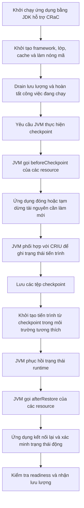

# Vai trò của ứng dụng, JVM và cơ chế tạo ảnh

CRaC (Coordinated Restore at Checkpoint) giúp một ứng dụng Java khởi động nhanh bằng cách lưu trạng thái của một tiến trình đang chạy, sau đó khôi phục trạng thái đó để tạo ra một tiến trình đã được khởi tạo sẵn. Thay vì mỗi lần triển khai đều phải khởi động JVM, nạp lớp, khởi tạo framework, tạo cache và chờ mã nóng được biên dịch JIT, hệ thống có thể chuẩn bị các công việc này một lần rồi tạo checkpoint.

Để CRaC hoạt động đúng, ba lớp phải phối hợp với nhau:

- **Ứng dụng** hiểu trạng thái nghiệp vụ và tài nguyên mà nó đang sử dụng. Ứng dụng quyết định việc gì cần hoàn tất trước checkpoint, tài nguyên nào cần đóng và cách kết nối lại sau restore.
- **JVM** hiểu cấu trúc bên trong tiến trình Java. JVM điều phối trạng thái runtime, gọi các callback CRaC và phối hợp với cơ chế checkpoint của hệ điều hành.
- **Hệ điều hành và công cụ checkpoint/restore** lưu rồi phục hồi trạng thái tiến trình ở cấp hệ điều hành. Trên Linux, CRIU (Checkpoint/Restore In Userspace) là công cụ thường được dùng trong kiến trúc này.

Không thành phần nào có thể tự đảm nhiệm toàn bộ công việc. Ứng dụng không nên tự sao chép heap của JVM; JVM không thể tự suy luận một giao dịch nghiệp vụ đã an toàn hay chưa; còn CRIU không hiểu ý nghĩa của một kết nối cơ sở dữ liệu hoặc một tác vụ nền trong ứng dụng Java.

## 1. Nhìn CRaC theo ba lớp trách nhiệm

| Thành phần | Hiểu điều gì? | Trách nhiệm chính |
| --- | --- | --- |
| Ứng dụng Java | Luồng nghiệp vụ, dữ liệu, giao dịch và vòng đời tài nguyên | Đưa ứng dụng về trạng thái nhất quán; đóng hoặc tạm dừng tài nguyên không thể giữ qua checkpoint; khôi phục tài nguyên và làm mới dữ liệu động sau restore |
| JVM có hỗ trợ CRaC | Heap, thread, class metadata, JIT code, garbage collector và trạng thái runtime | Điều phối checkpoint tại thời điểm an toàn; thực thi callback; chuẩn bị và khôi phục trạng thái máy ảo |
| Hệ điều hành và CRIU | Tiến trình, bộ nhớ, thread, memory mapping và file descriptor | Ghi trạng thái tiến trình thành các tệp checkpoint và dựng lại tiến trình từ các tệp đó |
| Nền tảng triển khai | Vòng đời instance, môi trường chạy và lưu lượng | Tạo checkpoint trong môi trường tương thích, phân phối checkpoint, restore instance và chỉ nhận lưu lượng khi instance sẵn sàng |

Điểm quan trọng là **checkpoint lưu trạng thái của một tiến trình đang chạy**, chứ không chỉ lưu mã nguồn hoặc cấu hình ứng dụng. Một checkpoint có thể chứa rất nhiều trạng thái đã được tạo ra trong lúc khởi động: đối tượng Java trong heap, lớp đã nạp, cấu trúc runtime, thread và mã máy do JIT biên dịch. Vì vậy, một instance được restore có thể tiếp tục từ trạng thái đã khởi tạo thay vì thực hiện lại toàn bộ quá trình khởi động.

## 2. Vai trò của ứng dụng Java

Ứng dụng chịu trách nhiệm về tính đúng đắn của trạng thái nghiệp vụ. JVM và công cụ checkpoint có thể lưu trạng thái bộ nhớ, nhưng chúng không biết trạng thái đó có phù hợp để tiếp tục xử lý yêu cầu hay không.

Ví dụ, tại thời điểm tạo checkpoint, ứng dụng có thể đang:

- xử lý một yêu cầu HTTP nhưng chưa ghi kết quả giao dịch vào cơ sở dữ liệu;
- giữ một kết nối JDBC trong connection pool;
- nhận thông điệp từ message broker nhưng chưa xác nhận thông điệp;
- chạy một tác vụ định kỳ hoặc một tác vụ nền;
- giữ token, thông tin xác thực hoặc dữ liệu cấu hình có thời hạn;
- lưu kết quả truy vấn hoặc dữ liệu cache có thể thay đổi trong thời gian checkpoint được lưu trữ.

Nếu chỉ chụp bộ nhớ ngay tại thời điểm đó, tiến trình được khôi phục có thể tiếp tục với trạng thái không còn hợp lệ. Do đó, ứng dụng cần phối hợp để tạo ra một điểm khôi phục có ý nghĩa.

### 2.1. Đưa ứng dụng về trạng thái nhất quán

Trước checkpoint, ứng dụng hoặc nền tảng triển khai cần kiểm soát lưu lượng và công việc đang chạy. Mục tiêu là không để checkpoint bắt đầu trong lúc ứng dụng đang thực hiện một thao tác mà việc tiếp tục sau restore có thể gây sai lệch.

Một quy trình chuẩn bị thường gồm các việc sau:

1. Đánh dấu instance không nhận yêu cầu mới hoặc yêu cầu bộ cân bằng tải ngừng chuyển lưu lượng đến instance.
2. Chờ các yêu cầu đang xử lý hoàn tất trong giới hạn thời gian được cấu hình.
3. Hoàn tất hoặc đưa các giao dịch về trạng thái an toàn; flush dữ liệu đệm cần được ghi bền vững.
4. Tạm dừng consumer, scheduler hoặc công việc nền có thể tạo tác động bên ngoài trong lúc checkpoint.
5. Đóng các kết nối và tài nguyên cần được tạo lại sau restore.
6. Chỉ yêu cầu JVM checkpoint khi ứng dụng đã sẵn sàng.

Không phải ứng dụng nào cũng cần thực hiện toàn bộ các bước trên. Cách chuẩn bị phụ thuộc vào loại ứng dụng, framework, nguồn dữ liệu và cách triển khai. Tuy nhiên, tính nhất quán nghiệp vụ luôn thuộc trách nhiệm của ứng dụng và quy trình vận hành của nó.

Việc drain lưu lượng nên được phối hợp ở tầng triển khai hoặc qua cơ chế readiness của ứng dụng. Không nên giả định rằng callback `beforeCheckpoint` tự động bảo đảm bộ cân bằng tải đã ngừng gửi yêu cầu mới. Callback là điểm tích hợp với vòng đời checkpoint; nó không thay thế toàn bộ quy trình điều phối lưu lượng.

### 2.2. Quản lý tài nguyên qua callback CRaC

CRaC cung cấp API để ứng dụng đăng ký những tài nguyên cần tham gia vào vòng đời checkpoint và restore. Một resource thường triển khai hai callback:

- `beforeCheckpoint(...)`: được gọi trước khi trạng thái tiến trình được ghi lại. Ứng dụng có thể flush dữ liệu, dừng hoạt động liên quan và đóng tài nguyên không nên được giữ trong checkpoint.
- `afterRestore(...)`: được gọi sau khi tiến trình được khôi phục. Ứng dụng có thể tạo lại kết nối, khởi động lại consumer hoặc nạp lại dữ liệu động.

Ví dụ dưới đây minh họa một resource quản lý connection pool. Phần tạo pool được rút gọn để tập trung vào hai mốc vòng đời:

```java
import org.crac.Context;
import org.crac.Core;
import org.crac.Resource;

public final class DatabasePoolResource implements Resource {

    private HikariDataSource dataSource;

    public DatabasePoolResource() {
        Core.getGlobalContext().register(this);
        this.dataSource = createDataSource();
    }

    @Override
    public void beforeCheckpoint(Context<? extends Resource> context)
            throws Exception {
        if (dataSource != null && !dataSource.isClosed()) {
            dataSource.close();
        }
    }

    @Override
    public void afterRestore(Context<? extends Resource> context)
            throws Exception {
        dataSource = createDataSource();
    }

    private HikariDataSource createDataSource() {
        // Tạo connection pool từ cấu hình hiện hành của ứng dụng.
        return new HikariDataSource();
    }
}
```

Đây là ví dụ về cấu trúc tích hợp, không phải cấu hình connection pool hoàn chỉnh. Trong ứng dụng thực tế, cần truyền cấu hình kết nối, xử lý lỗi khởi tạo, quản lý việc đăng ký resource đúng một lần và bảo đảm không có giao dịch đang mở khi pool bị đóng.

Hai callback thể hiện hai trách nhiệm khác nhau:

| Mốc | Câu hỏi ứng dụng phải trả lời | Ví dụ với connection pool |
| --- | --- | --- |
| Trước checkpoint | Tài nguyên hiện tại có an toàn để được giữ nguyên trong ảnh tiến trình không? | Đợi giao dịch hoàn tất, đóng pool và giải phóng kết nối |
| Sau restore | Tài nguyên cần được tạo lại hoặc làm mới như thế nào? | Tạo pool mới và thiết lập kết nối tới cơ sở dữ liệu hiện hành |

Một resource có thể quản lý socket, client của message broker, bộ lập lịch, file handle hoặc tài nguyên bên ngoài khác. Cần xác định rõ ai sở hữu vòng đời của từng tài nguyên. Nếu framework hoặc thư viện đã tích hợp CRaC và tự quản lý một resource, ứng dụng nên dùng cơ chế tích hợp đó thay vì đăng ký thêm một resource khác cùng đóng và mở lại tài nguyên. Quản lý trùng lặp có thể dẫn đến đóng tài nguyên sai thứ tự hoặc tạo nhiều kết nối ngoài dự kiến.

Callback nên có hành vi rõ ràng, có thể kiểm soát lỗi và an toàn khi được gọi theo vòng đời mà runtime quy định. Không nên đặt logic nghiệp vụ dài hoặc một tác vụ không có giới hạn thời gian vào callback. Nếu một bước chuẩn bị bắt buộc thất bại, ứng dụng cần để lỗi được báo ra để quy trình checkpoint có thể dừng thay vì tạo ra một ảnh không đáng tin cậy.

### 2.3. Phân biệt trạng thái trong bộ nhớ và trạng thái bên ngoài

Checkpoint có thể giữ một đối tượng Java trong heap, nhưng điều đó không có nghĩa mọi dữ liệu mà đối tượng đại diện cũng được đóng băng.

Ví dụ, một đối tượng cache có thể còn nguyên trong heap sau restore, trong khi bản ghi tương ứng trong cơ sở dữ liệu đã được một hệ thống khác cập nhật. Tương tự, một đối tượng giữ access token vẫn còn trong bộ nhớ dù token đã hết hạn. Một client Java có thể còn tham chiếu tới socket, nhưng kết nối TCP phía bên kia có thể đã bị đóng trong thời gian checkpoint được lưu trữ.

Vì vậy, ứng dụng cần phân loại trạng thái:

- **Trạng thái có thể giữ lại:** cấu trúc đã khởi tạo, dữ liệu bất biến hoặc cache có thể dùng lại nếu vẫn còn hợp lệ.
- **Trạng thái cần xác minh:** dữ liệu có thể thay đổi ở hệ thống bên ngoài, thông tin có thời hạn, trạng thái phân quyền hoặc metadata phụ thuộc môi trường.
- **Trạng thái cần tạo lại:** kết nối mạng, connection pool, consumer, lease, lock hoặc tài nguyên phụ thuộc một phiên làm việc cụ thể.
- **Trạng thái phải hoàn tất trước checkpoint:** giao dịch đang mở, thao tác ghi chưa hoàn tất hoặc thông điệp đã nhận nhưng chưa có chiến lược xác nhận an toàn.

Không nên dùng việc một đối tượng vẫn tồn tại trong heap làm bằng chứng rằng trạng thái bên ngoài của nó còn hiệu lực.

### 2.4. Xử lý thời gian, định danh và tác vụ nền

Checkpoint có thể được restore sau một khoảng thời gian đáng kể. Một instance mới vì thế cần xem xét các giá trị phụ thuộc thời điểm và danh tính của instance.

- **Thời hạn:** kiểm tra lại token, chứng thư, cache có TTL, lease và các deadline sau restore.
- **Định danh instance:** nếu mỗi instance cần một ID duy nhất, hãy tạo hoặc xác nhận ID mới sau restore. Không nên giả định một giá trị đã nằm trong checkpoint có thể dùng chung cho nhiều bản restore.
- **Sinh số ngẫu nhiên:** cân nhắc việc làm mới nguồn ngẫu nhiên phù hợp với yêu cầu bảo mật và tránh để nhiều bản restore sử dụng cùng một chuỗi trạng thái ngẫu nhiên.
- **Scheduler và timer:** xác định tác vụ nào cần tiếp tục, tác vụ nào cần tính lại lịch và tác vụ nào phải bảo đảm chỉ chạy một lần.
- **Leader, lock và lease:** xác minh quyền sở hữu lại với hệ thống điều phối hoặc kho dữ liệu sau restore; không dựa vào một lock cũ trong bộ nhớ để kết luận instance vẫn là leader.

Nếu cùng một checkpoint được dùng để tạo nhiều instance, mọi trạng thái đã được sao chép từ checkpoint có thể xuất hiện ở nhiều bản restore. Những tác vụ tạo tác động bên ngoài cần có cơ chế chống xử lý trùng, định danh instance phù hợp hoặc cơ chế điều phối tập trung.

## 3. Vai trò của JVM

JVM là thành phần hiểu trạng thái nội bộ của một chương trình Java. Một tiến trình Java không chỉ gồm các đối tượng nghiệp vụ. Nó còn có heap, stack của thread, class metadata, mã máy do JIT tạo ra, cấu trúc garbage collector, trạng thái đồng bộ và nhiều vùng bộ nhớ runtime khác.

Nếu chỉ sao chép một phần heap bằng cơ chế thông thường, chương trình không thể tiếp tục chạy như một tiến trình Java hoàn chỉnh. JVM phải phối hợp để trạng thái runtime có thể được ghi lại và khôi phục cùng với trạng thái tiến trình ở cấp hệ điều hành.

### 3.1. Điều phối trạng thái máy ảo

Khi nhận yêu cầu checkpoint, JVM CRaC phối hợp các thành phần runtime để chuẩn bị tiến trình. Ở mức khái niệm, công việc gồm:

1. Điều phối các resource đã đăng ký và gọi callback `beforeCheckpoint`.
2. Đưa runtime tới trạng thái có thể được checkpoint an toàn, phối hợp hoạt động của các thread và các thành phần nội bộ của VM.
3. Phối hợp với cơ chế checkpoint ở cấp hệ điều hành để ghi lại trạng thái tiến trình.
4. Khi restore, tiếp tục khôi phục runtime và gọi callback `afterRestore` để ứng dụng sửa lại các tài nguyên phụ thuộc môi trường.

JVM biết cách diễn giải trạng thái Java của chính nó. Đây là lý do CRaC cần một bản phân phối JDK có hỗ trợ CRaC; một JVM thông thường không mặc nhiên có khả năng checkpoint và restore tiến trình theo cách này.

### 3.2. Giữ lại phần khởi tạo đã tốn thời gian

Một trong những lợi ích của CRaC là có thể lưu trạng thái đã được chuẩn bị trước khi tạo checkpoint. Chẳng hạn, trước checkpoint ứng dụng có thể đã:

- nạp các lớp cần thiết;
- khởi tạo Spring context và các bean;
- phân tích cấu hình và tạo cấu trúc dữ liệu dùng chung;
- thực hiện một số đường chạy để JIT biên dịch các phương thức nóng;
- tạo cache ban đầu và chuẩn bị các thành phần dùng thường xuyên.

Những trạng thái này có thể nằm trong bộ nhớ tiến trình và được giữ trong checkpoint. Khi restore thành công, ứng dụng có cơ hội bắt đầu từ trạng thái đã khởi tạo đó. Đây là khác biệt quan trọng so với việc chỉ tối ưu thứ tự nạp lớp hoặc giảm số lượng dependency trong lúc khởi động.

Tuy nhiên, không nên hiểu rằng mọi lần restore đều có thời gian khởi động bằng không. Restore vẫn cần thời gian dựng lại tiến trình, thực hiện callback, kết nối tài nguyên bên ngoài, kiểm tra sức khỏe và đáp ứng các yêu cầu của môi trường chạy. Hiệu quả thực tế phụ thuộc vào kích thước ảnh, hệ điều hành, phần cứng, cách chuẩn bị ứng dụng và lượng công việc phải thực hiện sau restore.

### 3.3. JVM không thay ứng dụng quyết định tính hợp lệ của dữ liệu

JVM có thể bảo toàn một đối tượng Java và những tham chiếu của nó trong bộ nhớ. JVM không thể tự biết:

- giao dịch trong cơ sở dữ liệu đã commit hay chưa;
- thông điệp đã được broker xác nhận hay chưa;
- access token có còn hiệu lực hay không;
- một cache có cần đồng bộ lại với hệ thống nguồn hay không;
- một tác vụ nền có được phép chạy đồng thời ở nhiều bản restore hay không.

Đó là lý do API resource của CRaC tồn tại. JVM cung cấp các mốc vòng đời; ứng dụng sử dụng các mốc đó để thực hiện những hành động có ý nghĩa với hệ thống của mình.

## 4. Vai trò của hệ điều hành và CRIU

CRaC cần một cơ chế có thể ghi và dựng lại tiến trình ở cấp hệ điều hành. Trong các môi trường Linux hỗ trợ CRaC, CRIU thường đảm nhiệm phần checkpoint/restore này.

CRIU làm việc với các khái niệm của hệ điều hành như không gian địa chỉ tiến trình, vùng nhớ được ánh xạ, thread, trạng thái CPU và file descriptor. Nó không phân tích ý nghĩa của các đối tượng Java. JVM và ứng dụng phải chuẩn bị trạng thái phù hợp trước khi CRIU thực hiện phần việc ở cấp tiến trình.

Có thể hình dung sự phân công như sau:

- JVM biết vùng nhớ nào thuộc runtime Java và điều phối thời điểm checkpoint.
- CRIU ghi lại và phục hồi trạng thái tiến trình mà hệ điều hành quản lý, trong phạm vi các loại tài nguyên và điều kiện môi trường được hỗ trợ.
- Ứng dụng xử lý các tài nguyên bên ngoài hoặc phụ thuộc phiên làm việc mà việc khôi phục ở cấp tiến trình không thể bảo đảm tính hợp lệ.

Khả năng khôi phục file descriptor, socket, thiết bị và các tài nguyên hệ điều hành phụ thuộc loại tài nguyên, phiên bản công cụ, kernel và môi trường triển khai. Vì thế, thiết kế ứng dụng nên chủ động đóng và mở lại các kết nối bên ngoài quan trọng khi cần, thay vì giả định mọi kết nối đều có thể tiếp tục sử dụng sau restore.

## 5. Quy trình tạo checkpoint và restore

Một vòng đời CRaC thường có hai giai đoạn lớn: **chuẩn bị và tạo checkpoint**, sau đó **restore và đưa instance trở lại phục vụ**.



### 5.1. Khởi chạy và chuẩn bị ứng dụng

Ứng dụng được chạy bằng một JDK có hỗ trợ CRaC trong môi trường phù hợp với môi trường sẽ dùng để restore. Sau khi khởi chạy, hệ thống có thể thực hiện các công việc làm nóng:

- nạp những lớp sẽ được dùng thường xuyên;
- khởi tạo framework và dependency injection container;
- phân tích cấu hình, tạo các cấu trúc dữ liệu dùng chung;
- chạy các đường xử lý đại diện để JIT có cơ hội biên dịch mã nóng;
- tạo trước những cache an toàn và có thể tái sử dụng.

Không nên làm nóng bằng các thao tác tạo tác động nghiệp vụ thật nếu chúng có thể gây ghi dữ liệu, gửi thông điệp hoặc tạo giao dịch ngoài ý muốn. Dữ liệu chuẩn bị trước checkpoint cần được chọn sao cho an toàn khi nhiều instance cùng được restore từ một ảnh.

### 5.2. Yêu cầu checkpoint

Khi ứng dụng đã sẵn sàng, quy trình vận hành gửi yêu cầu checkpoint tới JVM. Cách gửi yêu cầu và vị trí lưu ảnh phụ thuộc bản phân phối JDK CRaC cũng như cấu hình triển khai.

Ví dụ dưới đây minh họa một cách cấu hình thường gặp ở các bản JDK CRaC hỗ trợ các tùy chọn tương ứng:

```bash
# Khởi chạy ứng dụng và chỉ định nơi lưu checkpoint
java -XX:CRaCCheckpointTo=/var/lib/my-app/checkpoint -jar app.jar

# Yêu cầu JVM tạo checkpoint cho tiến trình đang chạy
jcmd <pid> JDK.checkpoint

# Khởi chạy/restore ứng dụng từ checkpoint đã lưu
java -XX:CRaCRestoreFrom=/var/lib/my-app/checkpoint
```

Các tùy chọn và lệnh điều khiển có thể khác theo bản phân phối JDK, phiên bản CRaC và cách đóng gói môi trường. Cần đối chiếu tài liệu của đúng JDK đang triển khai trước khi đưa lệnh vào script vận hành. Những lệnh trên minh họa luồng thao tác, không phải một cấu hình dùng chung cho mọi hệ thống.

### 5.3. JVM gọi callback trước checkpoint

JVM gọi `beforeCheckpoint` cho các resource đã đăng ký. Tại thời điểm này, ứng dụng thực hiện phần chuẩn bị thuộc trách nhiệm của nó, chẳng hạn đóng connection pool, giải phóng socket, flush dữ liệu đệm hoặc dừng consumer.

Nếu một resource bắt buộc không thể hoàn tất bước chuẩn bị, quy trình cần nhận được lỗi để dừng checkpoint. Tạo ảnh khi tài nguyên chưa ở trạng thái an toàn có thể khiến mọi lần restore tiếp theo lặp lại cùng một lỗi hoặc tiếp tục từ trạng thái không nhất quán.

### 5.4. JVM và CRIU ghi trạng thái tiến trình

Sau khi giai đoạn chuẩn bị hoàn tất, JVM phối hợp với cơ chế checkpoint của hệ điều hành. CRIU ghi trạng thái tiến trình vào một tập hợp tệp. Tập hợp này là checkpoint của tiến trình Java.

Ảnh có thể bao gồm trạng thái bộ nhớ và các thành phần tiến trình cần thiết để dựng lại nó. Đây không phải bản dump các đối tượng theo định dạng JSON, Java serialization hay một file JAR mới. Nó cũng không phải native image được biên dịch từ mã Java.

Checkpoint phải được lưu trữ như một artifact có vòng đời và quyền truy cập được kiểm soát. Việc tạo checkpoint thành công cũng không đồng nghĩa ảnh đó có thể restore trên mọi máy hoặc mọi phiên bản JDK.

### 5.5. Restore và hoàn tất khởi tạo

Khi cần tạo instance mới, môi trường triển khai dùng cơ chế restore tương ứng để dựng lại tiến trình từ checkpoint. JVM tiếp tục trạng thái runtime đã được ghi và gọi `afterRestore` để ứng dụng xử lý tài nguyên cần kết nối lại.

Sau callback, ứng dụng có thể cần:

- tạo connection pool mới và xác minh kết nối cơ sở dữ liệu;
- tạo lại client hoặc consumer cho message broker;
- nạp lại secret, token hoặc cấu hình có thể đã thay đổi;
- xác minh cache, lease, lock và trạng thái phân quyền;
- tính lại lịch chạy cho scheduler;
- tạo định danh instance phù hợp với bản restore hiện tại.

Chỉ sau khi các bước bắt buộc hoàn tất và kiểm tra readiness thành công, instance mới nên nhận lưu lượng. Một tiến trình restore được về mặt kỹ thuật nhưng chưa kết nối được cơ sở dữ liệu vẫn chưa phải một instance sẵn sàng phục vụ.

## 6. Checkpoint image chứa gì và không bảo đảm điều gì?

Checkpoint là ảnh của tiến trình trong một môi trường cụ thể. Nó có thể giữ lại nhiều trạng thái đã được tạo trong lúc ứng dụng chạy, nhưng không phải bản sao đồng bộ của toàn bộ hệ thống phân tán.

| Nhóm trạng thái | Cách hiểu khi dùng CRaC |
| --- | --- |
| Đối tượng Java trong heap | Có thể được giữ lại cùng trạng thái tham chiếu của tiến trình |
| Class metadata và trạng thái runtime | Thuộc trạng thái JVM cần được phục hồi cùng tiến trình |
| Mã đã được JIT biên dịch | Có thể được giữ trong trạng thái tiến trình, giúp giảm phần công việc làm nóng lại |
| Stack và trạng thái thread | Thuộc trạng thái tiến trình; việc khôi phục phải tuân theo hỗ trợ của JVM, CRIU và môi trường |
| File descriptor và socket | Phụ thuộc loại tài nguyên và khả năng restore của môi trường; ứng dụng thường cần đóng và tạo lại kết nối bên ngoài |
| Cơ sở dữ liệu, message broker và dịch vụ bên ngoài | Không được đóng băng cùng checkpoint; trạng thái của chúng vẫn có thể thay đổi độc lập |
| Secret, token và dữ liệu có thời hạn trong heap | Có thể vẫn xuất hiện trong ảnh, nhưng có thể đã hết hạn hoặc cần làm mới khi restore |
| Tác động nghiệp vụ đã gửi ra ngoài | Không thể hoàn tác hoặc đồng bộ chỉ bằng cách restore bộ nhớ tiến trình |

Điểm cần ghi nhớ: **checkpoint ghi lại trạng thái tiến trình, không tạo snapshot nhất quán cho tất cả hệ thống mà ứng dụng đang kết nối**. Nếu ứng dụng đang dùng database, cache, broker, object storage và dịch vụ HTTP, mỗi hệ thống đó vẫn có vòng đời riêng.

### 6.1. Checkpoint không phải container image

Container image thường chứa filesystem, ứng dụng, thư viện và cấu hình cần thiết để tạo một container mới. Checkpoint lại chứa trạng thái của một tiến trình đã chạy.

Hai loại artifact có thể được dùng cùng nhau: container image cung cấp môi trường và các thành phần cần thiết, còn checkpoint cung cấp trạng thái tiến trình để restore. Cách kết hợp cụ thể tùy nền tảng triển khai.

### 6.2. Checkpoint không phải GraalVM Native Image

Native Image tạo một executable native từ ứng dụng Java thông qua quá trình biên dịch ahead-of-time. CRaC lưu trạng thái của một tiến trình Java đang chạy bằng cơ chế checkpoint/restore.

| Tiêu chí | CRaC checkpoint | Native Image |
| --- | --- | --- |
| Đầu vào chính | Tiến trình Java đang chạy trên JDK hỗ trợ CRaC | Mã ứng dụng và dependency được biên dịch thành executable native |
| Thời điểm chuẩn bị | Khởi chạy, khởi tạo và làm nóng trước khi checkpoint | Phân tích và biên dịch trước khi chạy |
| Trạng thái được tái sử dụng | Trạng thái runtime của tiến trình đã checkpoint | Chương trình native đã được biên dịch và dữ liệu khởi tạo theo mô hình native image |
| Điều kiện vận hành | JDK, JVM, OS và công cụ restore tương thích | Runtime native và các giới hạn của quá trình build native image |

Hai cách tiếp cận giải quyết bài toán khởi động theo những hướng khác nhau. Việc lựa chọn phụ thuộc vào yêu cầu tương thích, quy trình build, đặc điểm ứng dụng và môi trường vận hành.

## 7. Những điều kiện cần kiểm soát khi triển khai

### 7.1. Tính tương thích của môi trường

Checkpoint không phải định dạng portable có thể tùy ý chuyển giữa mọi máy. Khả năng restore phụ thuộc vào bản phân phối và phiên bản JDK, kiến trúc CPU, kernel, thư viện hệ thống, cấu hình tiến trình và hỗ trợ của CRIU. Cần tạo và restore checkpoint trong một môi trường tương thích đã được kiểm chứng.

Nếu thay đổi JDK, thư viện native, cấu hình hệ điều hành hoặc nền tảng container, cần đánh giá lại khả năng restore. Không nên giả định một checkpoint cũ luôn tương thích với một runtime mới chỉ vì ứng dụng JAR không thay đổi.

### 7.2. Tài nguyên mạng và dịch vụ bên ngoài

Kết nối TCP, TLS session, connection pool và client của dịch vụ ngoài có thể không còn hợp lệ khi restore. Nên thiết kế resource để đóng trước checkpoint và tạo lại sau restore nếu tài nguyên phụ thuộc một phiên kết nối cụ thể.

Sau khi kết nối lại, ứng dụng cần xử lý timeout, xác thực, DNS, thay đổi endpoint và lỗi dịch vụ như trong một lần kết nối mới. Không nên chỉ kiểm tra một tham chiếu Java khác `null` rồi kết luận kết nối đang hoạt động.

### 7.3. Tính lặp lại và nhiều bản restore

Một checkpoint có thể được dùng để tạo nhiều instance. Các instance có thể bắt đầu từ cùng một trạng thái trong bộ nhớ, trong khi hệ thống bên ngoài đã tiếp tục thay đổi. Điều này ảnh hưởng đến ID, scheduler, consumer, lock, lease, bộ đếm và các thao tác ghi.

Ứng dụng cần có chiến lược phù hợp như tạo ID instance mới, xác nhận quyền sở hữu với hệ thống điều phối, dùng xử lý idempotent và kiểm soát consumer. Nếu một tác vụ chỉ được phép chạy một lần trên toàn hệ thống, không nên chỉ dựa vào trạng thái thread hoặc scheduler được giữ trong checkpoint để bảo đảm điều đó.

### 7.4. Bảo mật của checkpoint

Vì checkpoint có thể chứa heap và trạng thái tiến trình, nó có thể chứa secret, token, thông tin xác thực, dữ liệu người dùng và dữ liệu nghiệp vụ nhạy cảm. Artifact checkpoint cần được bảo vệ như một bản sao của bộ nhớ ứng dụng:

- giới hạn quyền đọc và quyền ghi;
- bảo vệ đường truyền và nơi lưu trữ;
- áp dụng mã hóa theo yêu cầu bảo mật của hệ thống;
- xác định thời hạn lưu và quy trình xóa;
- tránh đưa checkpoint vào kho artifact công khai hoặc log build;
- đánh giá việc làm mới hoặc loại bỏ credential trước khi tạo ảnh.

### 7.5. Đo lường đúng hiệu quả

CRaC hướng đến giảm thời gian từ lúc cần instance đến lúc instance có thể phục vụ. Khi đánh giá, nên đo riêng các khoảng thời gian:

- khởi chạy và làm nóng để tạo checkpoint;
- thời gian tạo và lưu checkpoint;
- thời gian restore tiến trình;
- thời gian chạy callback `afterRestore`;
- thời gian kết nối lại dịch vụ và đạt readiness;
- thời gian từ lúc nhận yêu cầu đầu tiên đến khi xử lý ổn định.

Nếu chỉ đo thời gian JVM restore mà bỏ qua kết nối cơ sở dữ liệu, kiểm tra readiness và thời gian khởi động consumer, kết quả có thể không phản ánh thời gian thực tế để đưa instance vào phục vụ.

## 8. Cách phân tích một ứng dụng trước khi áp dụng CRaC

Khi đánh giá một ứng dụng Java, có thể lần lượt trả lời các câu hỏi sau:

1. **Phần khởi động nào tốn thời gian?** Xác định thời gian nạp lớp, khởi tạo framework, tạo cache, biên dịch JIT và kết nối dịch vụ.
2. **Trạng thái nào có thể giữ lại?** Tách cấu trúc bất biến và phần khởi tạo an toàn khỏi dữ liệu động hoặc phụ thuộc môi trường.
3. **Tài nguyên nào phải đóng trước checkpoint?** Liệt kê socket, connection pool, consumer, file handle và các tài nguyên có vòng đời bên ngoài tiến trình.
4. **Công việc nào phải hoàn tất trước checkpoint?** Xác định giao dịch, request, message và tác vụ nền cần drain hoặc đồng bộ.
5. **Cần làm gì sau restore?** Xác định việc kết nối lại, refresh credential, xác minh cache, lấy ID mới và khôi phục scheduler.
6. **Một checkpoint có thể tạo bao nhiêu instance?** Đánh giá tác động của trạng thái được nhân bản và các thao tác có thể bị thực hiện nhiều lần.
7. **Môi trường restore có tương thích không?** Kiểm tra JDK CRaC, CRIU, kernel, kiến trúc CPU và thư viện native.
8. **Đã bảo vệ checkpoint chưa?** Xác định quyền truy cập, mã hóa, thời hạn lưu và quy trình xóa artifact.

Các câu trả lời này giúp xác định phần việc của ứng dụng, phần việc của JVM và phần việc của nền tảng triển khai. Chúng cũng chỉ ra những điểm cần kiểm thử trước khi dùng checkpoint trong môi trường thật.

## 9. Kết luận

CRaC hoạt động nhờ sự phối hợp giữa ứng dụng, JVM và cơ chế checkpoint/restore của hệ điều hành. Ứng dụng chịu trách nhiệm về tính nhất quán nghiệp vụ và vòng đời tài nguyên; JVM điều phối trạng thái runtime Java và các callback; CRIU cùng hệ điều hành ghi và phục hồi trạng thái tiến trình.

Checkpoint giúp tái sử dụng phần khởi tạo đã thực hiện trước đó, nhưng không làm cho các dịch vụ bên ngoài ngừng thay đổi và cũng không tự bảo đảm mọi kết nối còn hợp lệ. Chất lượng của một triển khai CRaC phụ thuộc vào việc phân loại trạng thái đúng, chuẩn bị ứng dụng trước checkpoint, khôi phục tài nguyên sau restore và xác minh instance sẵn sàng trước khi nhận lưu lượng.
