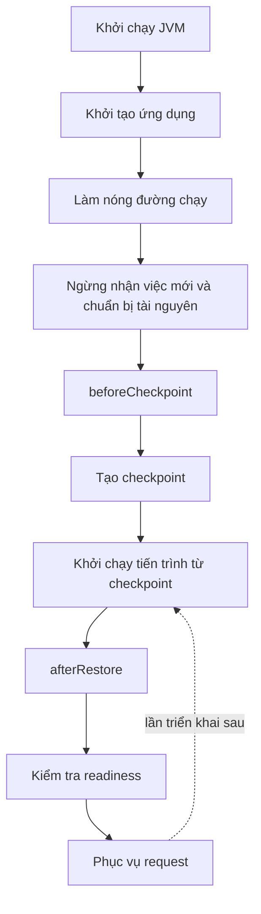

# Vòng đời tổng thể: khởi động, làm nóng, checkpoint và restore

CRaC là viết tắt của **Coordinated Restore at Checkpoint**. Đây là cơ chế cho phép lưu trạng thái của một tiến trình Java đã được khởi tạo vào một checkpoint, sau đó khôi phục tiến trình từ trạng thái đó. Mục tiêu thường gặp là giảm thời gian khởi động và độ trễ ở những lần triển khai tiếp theo: ứng dụng có thể thực hiện trước các công việc tốn thời gian như nạp lớp, tạo Spring Application Context, khởi tạo thư viện và làm nóng các đường chạy quan trọng; các bản chạy sau tiếp tục từ trạng thái đã chuẩn bị.

Để hiểu CRaC, cần nhìn toàn bộ vòng đời thay vì chỉ nhìn thao tác tạo hoặc nạp checkpoint. Một vòng đời điển hình gồm các giai đoạn sau:

1. **Khởi động:** JVM chạy và ứng dụng thực hiện quá trình khởi tạo thông thường.
2. **Làm nóng:** ứng dụng thực thi các đường chạy đại diện để chuẩn bị mã đã biên dịch, cache và các cấu trúc cần thiết.
3. **Chuẩn bị checkpoint:** ứng dụng đưa tài nguyên và công việc đang chạy về trạng thái an toàn để chụp.
4. **Checkpoint:** runtime ghi lại trạng thái tiến trình tại một thời điểm.
5. **Restore:** runtime khôi phục tiến trình từ checkpoint.
6. **Hoàn tất sau restore:** ứng dụng nối lại các tài nguyên bên ngoài, làm mới dữ liệu động và chỉ sau đó mới sẵn sàng nhận lưu lượng.



Sơ đồ mô tả luồng khái niệm. Công cụ triển khai có thể quyết định thời điểm chụp checkpoint, lưu checkpoint ở đâu và tạo bao nhiêu bản restore. Phần quan trọng của ứng dụng là chuẩn bị đúng trạng thái trước khi chụp và phục hồi đúng tài nguyên sau khi nạp.

## 1. CRaC thay đổi điểm bắt đầu của một lần chạy như thế nào?

Trong cách khởi động Java truyền thống, mỗi tiến trình mới thường phải đi qua một chuỗi công việc tương tự: tạo JVM, nạp lớp, chạy static initializer, tạo object, dựng dependency injection container, đọc cấu hình, tạo client và khởi tạo các cache. Nếu ứng dụng dùng Spring Boot, phần này còn bao gồm quá trình dựng `ApplicationContext`, tạo bean và thực hiện các callback khởi động.

Với CRaC, ta có thể thực hiện phần lớn công việc đó trong một tiến trình chuẩn bị. Sau khi ứng dụng đã ở trạng thái phù hợp, runtime tạo checkpoint. Những lần chạy tiếp theo có thể khôi phục trạng thái đã lưu thay vì thực hiện lại toàn bộ quá trình khởi động từ đầu.

Điều này không có nghĩa CRaC biến ứng dụng thành một tập object được Java Serialization ghi ra file. Checkpoint là ảnh chụp trạng thái của tiến trình do runtime và cơ chế checkpoint/restore của môi trường hỗ trợ. Nó có thể chứa trạng thái bộ nhớ, các lớp đã nạp, trạng thái thực thi của thread và những phần trạng thái tiến trình mà cơ chế đó hỗ trợ. Khả năng khôi phục còn phụ thuộc vào JDK CRaC, hệ điều hành, kernel, kiến trúc máy và cách triển khai.

Một điểm cần phân biệt là **khởi tạo ứng dụng** và **khôi phục ứng dụng** là hai chặng khác nhau. Khi restore thành công, tiến trình tiếp tục từ trạng thái đã checkpoint; ứng dụng không mặc nhiên chạy lại toàn bộ `main()` như một lần khởi động lạnh. Nếu chương trình gọi API checkpoint trực tiếp, luồng thực thi tiếp tục sau điểm gọi khi tiến trình được restore. Nếu công cụ bên ngoài yêu cầu checkpoint, runtime điều phối việc dừng và khôi phục theo cơ chế của bản phân phối đang dùng.

Vì vậy, một ứng dụng CRaC thường có hai nhóm công việc:

- Công việc nên làm trước checkpoint vì kết quả của nó có thể được tái sử dụng, chẳng hạn nạp lớp, tạo cấu trúc ứng dụng và làm nóng các đường chạy ổn định.
- Công việc phải thực hiện lại sau restore vì phụ thuộc vào môi trường hiện tại, chẳng hạn mở kết nối mạng, xác thực lại với dịch vụ bên ngoài, làm mới token hoặc khởi động scheduler.

Thiết kế tốt là xác định rõ công việc nào thuộc nhóm nào, thay vì giả định mọi trạng thái trong bộ nhớ đều còn hợp lệ sau khi restore.

## 2. Giai đoạn khởi động: tạo trạng thái nền của ứng dụng

Giai đoạn đầu tiên vẫn là khởi động Java bình thường trên một runtime có hỗ trợ CRaC. JVM được tạo, classpath được thiết lập và mã khởi tạo của ứng dụng chạy. Với một ứng dụng Spring Boot, các hoạt động thường diễn ra gồm:

- Đọc cấu hình và xác định profile môi trường.
- Nạp class, tạo object và chạy các static initializer.
- Tạo Spring `ApplicationContext`, đăng ký bean và inject dependency.
- Khởi tạo các cấu trúc dữ liệu dùng chung, bộ chuyển đổi, serializer và cache nội bộ.
- Đăng ký các tài nguyên cần được thông báo trước checkpoint và sau restore.
- Chuẩn bị các thành phần phục vụ request, tác vụ nền và quan sát hệ thống.

Mục tiêu của giai đoạn này là đưa ứng dụng đến trạng thái có thể làm nóng một cách có kiểm soát. Không nên đồng nhất trạng thái “tiến trình đã chạy” với trạng thái “ứng dụng đã sẵn sàng nhận request”. Một ứng dụng có thể đã tạo xong bean nhưng vẫn chưa nạp cache, chưa kiểm tra kết nối hoặc chưa hoàn thành các bước chuẩn bị cần thiết.

Khi thiết kế phần khởi động, hãy phân loại dữ liệu theo vòng đời của nó:

| Loại trạng thái | Ví dụ | Cách xử lý thường phù hợp |
|---|---|---|
| Ổn định và có thể tái sử dụng | Metadata bất biến, cấu trúc parser, bảng tra cứu tĩnh | Có thể tạo trước checkpoint và giữ lại sau restore |
| Có thể thay đổi theo môi trường | Endpoint, feature flag, cấu hình triển khai | Xác định có cần đọc lại sau restore hay không |
| Phụ thuộc phiên làm việc bên ngoài | TCP connection, database connection, message consumer | Chuẩn bị đóng hoặc tạm dừng trước checkpoint; tạo lại sau restore |
| Có thời hạn | Access token, lease, dữ liệu cache có TTL | Kiểm tra hạn và làm mới sau restore |
| Gắn với một instance cụ thể | Instance ID, leader lease, lịch chạy độc quyền | Xác lập lại theo instance sau restore |

Ví dụ, việc tạo một `DataSource` có thể phù hợp ở giai đoạn khởi động, nhưng các kết nối vật lý bên trong connection pool cần được xử lý theo hướng dẫn CRaC của driver và pool đang sử dụng. Một object Java còn nằm trong heap không đảm bảo socket hoặc phiên làm việc ở hệ điều hành vẫn có thể dùng được sau restore.

## 3. Giai đoạn làm nóng: chuẩn bị đường chạy trước khi chụp

Làm nóng (warm-up) là giai đoạn ứng dụng chủ động thực hiện một số công việc đại diện trước checkpoint. Mục tiêu là giảm phần công việc còn lại khi phục vụ request thật.

Trong JVM, một số phương thức chỉ được biên dịch tối ưu sau khi đã được thực thi đủ số lần. Các thư viện cũng có thể khởi tạo cấu trúc nội bộ theo nhu cầu sử dụng đầu tiên. Ứng dụng còn có thể cần nạp dữ liệu vào cache hoặc tạo trước các cấu trúc tốn thời gian. Nếu checkpoint được tạo sau giai đoạn này, trạng thái phù hợp có thể được giữ lại và tái sử dụng khi restore.

Một kế hoạch warm-up thường bao gồm:

1. Chọn các luồng nghiệp vụ đại diện, chẳng hạn đọc dữ liệu, chuyển đổi dữ liệu, xử lý một request phổ biến hoặc render một mẫu phản hồi.
2. Thực thi các luồng đó với dữ liệu an toàn, có kích thước hợp lý và không gây tác động ngoài ý muốn.
3. Chờ các công việc khởi tạo bất đồng bộ cần thiết hoàn tất.
4. Kiểm tra cache và các thành phần nội bộ đã đạt trạng thái mong muốn.
5. Chuyển sang giai đoạn chuẩn bị checkpoint.

Warm-up cần được thiết kế có chủ đích. Nếu gọi endpoint tạo đơn hàng, gửi email, trừ tiền hoặc phát message thật chỉ để làm nóng, lần chuẩn bị checkpoint có thể gây ra side effect như một lần xử lý nghiệp vụ bình thường. Nên dùng dữ liệu thử nghiệm, stub phù hợp hoặc đường chạy warm-up không tạo side effect. Nếu không thể tránh side effect, phải có cơ chế cô lập và xác định rõ cách hoàn tác.

Không phải tài nguyên nào được tạo trong warm-up cũng nên giữ nguyên. Ví dụ:

- Cache nội bộ chứa dữ liệu bất biến có thể giữ lại.
- Cache đọc từ dịch vụ bên ngoài cần được đánh giá theo TTL và độ mới.
- Kết nối đến database hoặc HTTP server cần tuân thủ khả năng checkpoint của driver, client và môi trường. Cách an toàn phổ biến là đóng hoặc đưa chúng về trạng thái có thể khôi phục trước checkpoint, rồi kết nối lại sau restore.
- Scheduler và consumer có thể phải tạm dừng để không xử lý cùng một công việc trong lúc chuẩn bị snapshot hoặc tạo nhiều tác động khi nhiều bản restore cùng chạy.

Warm-up càng đầy đủ thì trạng thái checkpoint càng gần trạng thái phục vụ thực tế, nhưng warm-up cũng tiêu tốn CPU, bộ nhớ và thời gian chuẩn bị. Hãy chọn những đường chạy có ảnh hưởng rõ rệt đến thời gian sẵn sàng hoặc độ trễ request; không cần thực thi mọi nhánh hiếm gặp.

## 4. Chuẩn bị checkpoint: đưa ứng dụng về trạng thái an toàn

Đây là bước phối hợp quan trọng nhất trong vòng đời CRaC. Trước khi runtime chụp trạng thái tiến trình, ứng dụng cần xử lý những tài nguyên không thể giữ nguyên qua checkpoint hoặc những hoạt động có thể làm snapshot thiếu nhất quán.

Một trình tự chuẩn bị thường có các công việc sau:

1. Ngừng nhận công việc mới hoặc chuyển instance ra khỏi load balancer.
2. Chờ request đang xử lý hoàn tất trong một khoảng thời gian có giới hạn.
3. Tạm dừng scheduler, consumer và các thread nền có thể tạo side effect.
4. Flush dữ liệu còn nằm trong buffer nếu dữ liệu đó cần được giữ lại.
5. Đóng hoặc chuẩn bị lại socket, kết nối database, file handle và tài nguyên gắn với hệ điều hành theo yêu cầu của thư viện tương ứng.
6. Nhả lock hoặc lease cần được cấp lại sau restore.
7. Ghi nhận trạng thái nội bộ cần thiết để sau restore có thể tiếp tục an toàn.
8. Cho phép checkpoint khi tất cả thành phần đã xác nhận trạng thái sẵn sàng.

CRaC cung cấp API để ứng dụng đăng ký những đối tượng cần nhận callback ở hai thời điểm: trước checkpoint và sau restore. Một tài nguyên triển khai `org.crac.Resource` có thể định nghĩa `beforeCheckpoint` và `afterRestore`.

```java
import org.crac.Context;
import org.crac.Core;
import org.crac.Resource;

public final class RemoteClientResource implements Resource {

    private RemoteClient client;

    public RemoteClientResource() {
        this.client = RemoteClient.connect();
    }

    @Override
    public void beforeCheckpoint(Context<? extends Resource> context)
            throws Exception {
        // Ngừng sử dụng client trước khi đóng kết nối.
        if (client != null) {
            client.close();
            client = null;
        }
    }

    @Override
    public void afterRestore(Context<? extends Resource> context)
            throws Exception {
        // Tạo kết nối mới trong môi trường sau restore.
        client = RemoteClient.connect();
    }

    public static void register() {
        Core.getGlobalContext().register(new RemoteClientResource());
    }
}
```

`RemoteClient` trong ví dụ là lớp minh họa cho một client bên ngoài; ứng dụng thực tế cần thay bằng thư viện đang sử dụng và áp dụng đúng hướng dẫn CRaC của thư viện đó. Đăng ký resource một lần trong giai đoạn khởi tạo. Trong ứng dụng thật, việc đóng client cần được phối hợp với các thread đang dùng nó để tránh một request đang chạy bị lỗi giữa chừng.

Hai callback có trách nhiệm khác nhau:

| Callback | Thời điểm | Trách nhiệm thường gặp |
|---|---|---|
| `beforeCheckpoint` | Trước khi runtime chụp trạng thái | Ngừng hoạt động liên quan, flush dữ liệu, đóng hoặc chuẩn bị tài nguyên bên ngoài |
| `afterRestore` | Sau khi tiến trình được khôi phục | Tạo lại kết nối, làm mới thông tin hết hạn, khởi động lại thành phần đã tạm dừng |

Không nên đặt nghiệp vụ chính như tạo đơn hàng, phát message hoặc ghi dữ liệu kinh doanh vào hai callback này. Callback phục vụ việc chuyển trạng thái vòng đời của tài nguyên. Chúng cần có hành vi rõ ràng, có thể quan sát và an toàn khi một bước thất bại.

### Quản lý hoạt động đang diễn ra

Chỉ đóng kết nối là chưa đủ nếu vẫn còn thread sử dụng kết nối đó. Trước checkpoint, ứng dụng cần có một cơ chế điều phối để ngừng nhận việc mới, chờ hoặc hủy công việc đang chạy theo chính sách, rồi mới đóng tài nguyên.

Ví dụ, một HTTP server có thể cần được đưa ra khỏi load balancer trước, sau đó chờ request đang xử lý kết thúc. Một message consumer có thể cần dừng nhận message mới và xác nhận các message đã xử lý. Một scheduler có thể cần tạm dừng để tránh cùng một tác vụ chạy đồng thời ở tiến trình gốc và các tiến trình được restore.

Các bước chuẩn bị nên có timeout. Nếu một tài nguyên không thể chuyển sang trạng thái an toàn, việc checkpoint cần thất bại rõ ràng thay vì tạo một snapshot mà ứng dụng không thể phục hồi đáng tin cậy. Hãy ghi log đủ thông tin để biết resource nào chưa hoàn tất, nhưng tránh ghi secret hoặc dữ liệu nhạy cảm vào log.

## 5. Checkpoint: ghi lại trạng thái tiến trình

Khi ứng dụng đã chuẩn bị xong, một tác nhân có thể yêu cầu runtime tạo checkpoint. Tác nhân đó có thể là công cụ triển khai, script vận hành hoặc chính ứng dụng thông qua API mà runtime hỗ trợ.

Với một số bản phân phối CRaC, quy trình thao tác có dạng minh họa sau:

```bash
# Khởi chạy bằng JDK có hỗ trợ CRaC và chỉ định nơi lưu checkpoint.
java -XX:CRaCCheckpointTo=/checkpoints/my-app -jar app.jar

# Sau khi ứng dụng khởi tạo và warm-up xong, yêu cầu checkpoint.
jcmd <pid> JDK.checkpoint

# Khởi chạy một tiến trình mới từ checkpoint đã lưu.
java -XX:CRaCRestoreFrom=/checkpoints/my-app
```

Tên option, lệnh quản trị, quyền hệ điều hành và cách bố trí thư mục có thể khác theo bản JDK/runtime. Đây là ví dụ về trình tự, không phải lệnh có thể áp dụng nguyên trạng cho mọi môi trường. Cần dùng đúng tài liệu của bản CRaC JDK đang triển khai.

Ở mức khái niệm, runtime điều phối các callback chuẩn bị đã đăng ký, chụp trạng thái tiến trình khi các điều kiện cho phép và lưu checkpoint theo cấu hình. Nếu một bước chuẩn bị quan trọng thất bại, hệ thống phải báo checkpoint thất bại để người vận hành xử lý. Không nên coi việc tạo ra một thư mục hoặc file checkpoint là bằng chứng duy nhất rằng snapshot có thể restore thành công.

Checkpoint cần được quản lý như một artifact triển khai. Nó gắn với môi trường tương thích về JDK, hệ điều hành, kiến trúc và các điều kiện runtime liên quan. Không nên mặc định có thể tạo checkpoint trên một máy rồi khôi phục ở bất kỳ máy nào khác. Snapshot cũng có thể chứa dữ liệu đang nằm trong bộ nhớ, bao gồm cấu hình hoặc thông tin nhạy cảm; cần kiểm soát quyền truy cập, lưu trữ và vòng đời của nó như với một artifact có dữ liệu quan trọng.

## 6. Restore: tiếp tục từ trạng thái đã lưu

Khi restore, runtime tạo tiến trình từ checkpoint và khôi phục trạng thái đã chụp. Các lớp và object đã được chuẩn bị có thể đã sẵn sàng trong bộ nhớ; ứng dụng không phải thực hiện lại toàn bộ các bước khởi động lạnh. Tuy nhiên, trạng thái bộ nhớ được khôi phục không đồng nghĩa mọi tài nguyên bên ngoài vẫn hợp lệ.

Trong khoảng thời gian giữa checkpoint và restore, môi trường có thể đã thay đổi:

- Kết nối TCP hoặc database có thể đã bị đóng ở phía server hoặc không còn hợp lệ ở tiến trình được khôi phục.
- Token, certificate, DNS record, lease hoặc session có thể đã hết hạn hoặc thay đổi.
- Một file, mount, secret hoặc endpoint có thể đã được thay thế trong lần triển khai mới.
- Đồng hồ hệ thống đã tiến về phía trước; dữ liệu cache có TTL hoặc lịch chạy cần được đánh giá lại.
- Nhiều bản restore có thể cùng khởi chạy, vì vậy các công việc vốn chỉ được phép có một instance thực hiện cần cơ chế phân quyền lại.

Do đó, `afterRestore` thường dùng để kết nối lại dịch vụ bên ngoài, xác thực lại, đọc cấu hình động, khởi động thread nền và khôi phục các thành phần đã tạm dừng. Chỉ nên tái sử dụng trạng thái đã checkpoint khi ứng dụng có thể chứng minh trạng thái đó còn hợp lệ.

### Thứ tự sẵn sàng sau restore

Một tiến trình đã restore không nên lập tức nhận traffic chỉ vì JVM đã chạy. Trình tự an toàn hơn là:

1. Runtime khôi phục trạng thái tiến trình.
2. Các resource thực hiện callback `afterRestore`.
3. Ứng dụng làm mới thông tin phụ thuộc môi trường và khởi động lại công việc nền.
4. Ứng dụng kiểm tra các dependency bắt buộc, chẳng hạn database hoặc dịch vụ cần thiết để xử lý request.
5. Readiness chuyển sang trạng thái sẵn sàng.
6. Load balancer hoặc nền tảng triển khai bắt đầu gửi traffic.

Nếu một kết nối bắt buộc không thể khôi phục, ứng dụng nên giữ readiness ở trạng thái chưa sẵn sàng và báo lỗi có thể chẩn đoán. Phục vụ request khi dependency vẫn hỏng sẽ biến một lỗi restore có thể nhận biết thành lỗi nghiệp vụ khó truy tìm.

Với hệ thống có nhiều replica, mỗi bản restore phải tự xác lập danh tính và quyền sở hữu tài nguyên của mình. Không nên giả định snapshot chứa một instance ID, leader lease hoặc trạng thái scheduler vẫn còn độc quyền. Cần đăng ký lại lease, tham gia lại nhóm consumer hoặc thực hiện cơ chế bầu chọn theo thiết kế của hệ thống.

## 7. Nhìn toàn bộ vòng đời qua một ứng dụng Spring Boot

Giả sử một dịch vụ Spring Boot cần kết nối database và một dịch vụ HTTP bên ngoài. Một cách tổ chức vòng đời có thể như sau:

| Giai đoạn | Hoạt động của ứng dụng | Trạng thái mong muốn |
|---|---|---|
| Khởi động | Dựng `ApplicationContext`, tạo bean, đọc cấu hình, đăng ký CRaC resource | Các thành phần nội bộ đã được tạo |
| Làm nóng | Gọi các luồng xử lý đại diện, nạp cache ổn định, chuẩn bị mã chạy nóng | Đường chạy quan trọng đã được chuẩn bị |
| Chuẩn bị checkpoint | Ngừng nhận request, drain request đang chạy, dừng consumer/scheduler, xử lý connection pool và HTTP client | Không còn hoạt động có thể làm snapshot thiếu nhất quán |
| Checkpoint | Runtime chụp trạng thái tiến trình | Có checkpoint tương thích để triển khai |
| Restore | Runtime khôi phục tiến trình đã chụp | Trạng thái bộ nhớ được phục hồi |
| Sau restore | Mở lại pool/client, làm mới token, đăng ký lease và khởi động tác vụ nền | Dependency và tài nguyên bên ngoài hợp lệ |
| Readiness | Chạy kiểm tra cần thiết và báo sẵn sàng | Có thể nhận traffic |

Điểm thiết kế quan trọng là tách rõ các thành phần theo vòng đời. Bean quản lý cache nội bộ có thể giữ trạng thái qua checkpoint. Bean quản lý kết nối cần biết cách đóng và tạo lại kết nối. Bean quản lý scheduler cần biết cách tạm dừng và khởi động lại. Nếu mọi logic này nằm rải rác trong các nơi khởi tạo không liên quan, việc bảo đảm ứng dụng restore đúng sẽ khó hơn nhiều.

Trong Spring, có thể tổ chức các resource CRaC thành bean và đăng ký chúng trong giai đoạn khởi tạo ứng dụng. Tuy nhiên, việc một bean đã được Spring tạo ra không tự động bảo đảm tài nguyên mà bean sở hữu tương thích với checkpoint. Chủ sở hữu tài nguyên cần xác định rõ callback và phối hợp với vòng đời của thư viện bên dưới. Cần kiểm tra hướng dẫn CRaC của phiên bản Spring, connection pool, JDBC driver, HTTP client, messaging client và các thư viện nền đang dùng.

## 8. Những lỗi thường gặp khi hiểu sai vòng đời

### Giữ nguyên mọi kết nối vì object vẫn còn trong heap

Một object Java có thể vẫn tồn tại sau restore trong khi socket hoặc phiên làm việc ở phía dịch vụ bên ngoài đã hết hiệu lực. Ứng dụng tiếp tục dùng object cũ và gặp lỗi ở request đầu tiên. Hãy xử lý tài nguyên theo khả năng hỗ trợ của từng thư viện, thường là đóng hoặc chuẩn bị trước checkpoint rồi tạo lại sau restore.

### Warm-up bằng nghiệp vụ thật

Warm-up có thể chạy nhiều lần trong môi trường tạo checkpoint, môi trường kiểm thử hoặc khi cần tạo lại checkpoint. Nếu nó gửi email, ghi dữ liệu hoặc phát message thật, side effect có thể bị lặp. Hãy dùng dữ liệu an toàn và thiết kế đường warm-up không tạo tác động nghiệp vụ ngoài ý muốn.

### Đưa instance vào phục vụ trước khi `afterRestore` hoàn tất

JVM đã restore không có nghĩa các kết nối và dependency đã sẵn sàng. Nếu readiness được bật quá sớm, request có thể đến khi client chưa được tạo lại. Readiness phải phản ánh trạng thái thực tế của các dependency bắt buộc.

### Để scheduler hoặc consumer chạy không kiểm soát

Snapshot có thể giữ trạng thái thread và bộ lập lịch. Khi nhiều bản restore cùng hoạt động, một công việc có thể được thực hiện nhiều lần hoặc nhiều instance cùng nghĩ rằng mình sở hữu một nhiệm vụ độc quyền. Hãy dừng và đăng ký lại công việc theo cơ chế phân quyền phù hợp.

### Coi checkpoint là artifact có thể dùng ở mọi nơi

Checkpoint phụ thuộc vào runtime và môi trường hỗ trợ. Khác biệt về JDK, hệ điều hành, kernel, kiến trúc hoặc tài nguyên hệ thống có thể làm restore thất bại. Cần tạo và kiểm thử checkpoint trong môi trường triển khai tương thích, đồng thời quản lý phiên bản của checkpoint cùng phiên bản ứng dụng.

### Chỉ kiểm tra thời gian khởi động mà bỏ qua lần request đầu tiên

Restore có thể nhanh nhưng request đầu tiên vẫn chậm nếu đường chạy chưa được warm-up, cache chưa sẵn sàng hoặc client chưa kết nối lại. Hãy đo cả thời gian restore, thời gian đạt readiness và độ trễ của request đầu tiên sau readiness.

## 9. Nguyên tắc thiết kế một vòng đời CRaC ổn định

- **Phân loại trạng thái:** xác định dữ liệu nào có thể giữ lại và dữ liệu nào phải làm mới sau restore.
- **Đăng ký đúng chủ sở hữu:** thành phần tạo và quản lý tài nguyên nên chịu trách nhiệm cho callback của tài nguyên đó.
- **Dừng công việc có phối hợp:** ngừng nhận việc mới, xử lý công việc đang chạy và chỉ đóng tài nguyên sau khi không còn thread sử dụng.
- **Giữ callback tập trung:** callback nên thực hiện công việc vòng đời có thể giải thích được, không chứa nghiệp vụ kinh doanh.
- **Làm cho thao tác có thể quan sát:** ghi nhận resource bắt đầu, hoàn tất hoặc thất bại; dùng timeout để tránh chuẩn bị checkpoint vô hạn.
- **Phục hồi dữ liệu động:** kiểm tra token, lease, TTL, cấu hình và endpoint khi restore.
- **Kiểm soát readiness:** chỉ nhận traffic sau khi callback và các kiểm tra bắt buộc hoàn tất.
- **Kiểm thử cả hai đường:** kiểm thử khởi động lạnh và restore, bao gồm trường hợp kết nối bị ngắt, token hết hạn, callback thất bại và nhiều replica cùng khởi chạy.
- **Bảo vệ checkpoint:** giới hạn quyền đọc/ghi và không lưu checkpoint ở nơi không được kiểm soát.

Để đánh giá hiệu quả, nên đo ít nhất thời gian khởi động lạnh, thời gian warm-up, thời gian tạo checkpoint, thời gian restore, thời gian từ restore đến readiness và độ trễ của các request đầu tiên. Những số đo này giúp xác định CRaC đang rút ngắn giai đoạn nào và liệu chi phí warm-up/checkpoint có phù hợp với lợi ích triển khai hay không.

## 10. Kết luận

Vòng đời CRaC là một chuỗi chuyển trạng thái có phối hợp: ứng dụng khởi động, làm nóng, chuẩn bị tài nguyên, tạo checkpoint, restore và hoàn tất phục hồi trước khi phục vụ traffic. Giá trị của CRaC đến từ việc tái sử dụng phần trạng thái khởi tạo tốn thời gian, trong khi vẫn xử lý đúng những tài nguyên và dữ liệu phụ thuộc môi trường hiện tại.

Khi thiết kế một ứng dụng CRaC, hãy bắt đầu bằng việc lập danh sách tài nguyên mà ứng dụng sở hữu. Với từng tài nguyên, xác định nó có thể tồn tại qua checkpoint hay không, cần làm gì trong `beforeCheckpoint`, cần khởi tạo lại điều gì trong `afterRestore`, và điều kiện nào cho phép bật readiness. Khi các trách nhiệm này rõ ràng, checkpoint trở thành một bước triển khai có thể kiểm soát thay vì một thao tác chụp trạng thái đầy rủi ro.
