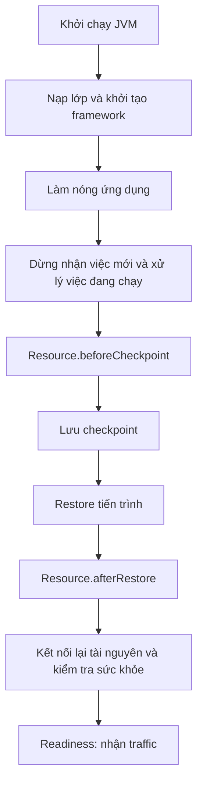

# Tình huống áp dụng: mở rộng nhanh, khởi động lại và dịch vụ ít truy cập

CRaC (Coordinated Restore at Checkpoint) giúp một ứng dụng Java tiếp tục chạy từ trạng thái JVM đã được chuẩn bị trước. Thay vì mỗi tiến trình mới phải tải lớp, khởi tạo framework, tạo cache và làm nóng các đường chạy thường dùng từ đầu, ta có thể tạo một **checkpoint** sau giai đoạn khởi động, lưu trạng thái tiến trình rồi **restore** trạng thái đó khi cần một tiến trình mới.

Khả năng này đặc biệt hữu ích trong ba tình huống: cần tạo thêm instance nhanh khi tải tăng, cần khởi động lại dịch vụ với thời gian chờ ngắn, và có dịch vụ ít truy cập muốn giảm thời gian cold start. CRaC rút ngắn phần khởi tạo ứng dụng; nó không tự làm tăng throughput của từng request, không thay thế cơ chế lưu dữ liệu bền vững và cũng không loại bỏ việc quản lý tài nguyên bên ngoài JVM.

## 1. CRaC thay đổi quá trình khởi động như thế nào?

Một lần khởi động Java thông thường thường đi qua các bước:

1. JVM khởi tạo và nạp các lớp cần thiết.
2. Framework tạo application context, bean và cấu hình.
3. Ứng dụng kết nối cơ sở dữ liệu, message broker, dịch vụ ngoài và các tài nguyên khác.
4. Cache được nạp; các đường chạy quan trọng có thể cần thêm thời gian để JIT biên dịch và tối ưu.
5. Ứng dụng chuyển sang trạng thái sẵn sàng nhận traffic.

Với CRaC, ta chuẩn bị ứng dụng đến một trạng thái phù hợp, yêu cầu JVM phối hợp với các resource đã đăng ký để chuẩn bị checkpoint, rồi lưu ảnh trạng thái tiến trình. Khi restore, runtime khôi phục tiến trình từ ảnh đó và gọi các callback phục hồi tài nguyên. Phần công việc khởi tạo đã nằm trong checkpoint có thể được bỏ qua hoặc rút ngắn đáng kể.



Checkpoint là ảnh trạng thái của tiến trình, không phải bản sao dữ liệu nghiệp vụ trong database. Nó cũng không giống việc tuần tự hóa một vài object Java: trạng thái runtime và tài nguyên native của tiến trình có thể liên quan đến quá trình khôi phục. Cơ chế thực tế dựa trên bản phân phối JVM và nền tảng hỗ trợ checkpoint/restore, thường kết hợp với khả năng của hệ điều hành như CRIU trên Linux. Vì vậy, cần kiểm tra phiên bản JDK, hệ điều hành, kiến trúc CPU, container runtime và các giới hạn của môi trường triển khai.

## 2. Mở rộng nhanh khi tải tăng

### Vấn đề khi scale-out theo cách thông thường

Giả sử một dịch vụ Spring Boot đang chạy ổn định với hai instance. Khi lưu lượng tăng đột ngột, bộ điều phối cần tạo thêm nhiều instance. Nếu mỗi instance phải khởi động hoàn toàn từ đầu, thời gian nạp lớp, tạo application context, khởi tạo client và làm nóng JIT có thể khiến năng lực phục vụ tăng chậm hơn tốc độ tăng của traffic.

Điều này dễ tạo thành vòng lặp bất lợi:

- Traffic tăng làm hàng đợi và thời gian phản hồi tăng.
- Bộ điều phối yêu cầu thêm instance.
- Instance mới mất thời gian khởi động nên chưa thể nhận request.
- Các instance hiện có tiếp tục chịu tải cao trong lúc chờ instance mới sẵn sàng.

### Dùng checkpoint làm trạng thái khởi động mẫu

Ta có thể chuẩn bị một checkpoint từ đúng phiên bản ứng dụng sẽ triển khai:

1. Khởi chạy ứng dụng trong môi trường tương thích với môi trường restore.
2. Hoàn tất khởi tạo framework, cấu hình và các thành phần dùng chung.
3. Làm nóng những đường chạy quan trọng bằng dữ liệu thử an toàn, không chứa trạng thái riêng của một người dùng hay một instance.
4. Dừng nhận request mới, chờ request đang xử lý hoàn tất và chuẩn bị các resource cho checkpoint.
5. Tạo checkpoint và lưu ảnh theo phiên bản ứng dụng, JDK và môi trường tương ứng.
6. Khi cần scale-out, khởi tạo nhiều instance từ checkpoint đó.
7. Mỗi instance thực hiện `afterRestore`, tạo lại các kết nối riêng và chỉ chuyển sang readiness sau khi kiểm tra thành công.

```text
                 ┌──────────────────────────────┐
                 │  Ứng dụng đã khởi tạo, warm  │
                 └──────────────┬───────────────┘
                                │ checkpoint
                                ▼
                       ┌─────────────────┐
                       │  Checkpoint v42 │
                       └───┬─────┬─────┬─┘
                           │     │     │ restore
                           ▼     ▼     ▼
                         App A App B App C
                           │     │     │
                           └─────┴─────┘
                         nhận traffic độc lập
```

Lợi ích chính là các instance mới có thể bắt đầu từ trạng thái đã nạp lớp và đã warm-up. Đây là cách giảm độ trễ scale-out khi chi phí khởi tạo ứng dụng lớn. Tốc độ thực tế vẫn phụ thuộc kích thước checkpoint, tốc độ đọc ảnh, tài nguyên máy, thời gian restore và các bước kết nối lại.

### Trạng thái nào không nên dùng chung giữa các replica?

Mỗi replica phải có danh tính và tài nguyên riêng. Một checkpoint được nhân bản có thể khiến nhiều tiến trình bắt đầu với cùng dữ liệu trong bộ nhớ. Cần chủ động làm mới hoặc cấp lại những thông tin sau restore:

- **Instance identity:** hostname logic, instance ID, thông tin đăng ký service discovery và metadata dùng để phân biệt replica.
- **Kết nối:** connection pool, socket, session của client, channel tới broker và file descriptor phụ thuộc tiến trình hoặc máy cũ.
- **Lease và khóa phân tán:** không để nhiều replica cùng khôi phục một trạng thái leader, lease hoặc quyền sở hữu công việc.
- **Thông tin xác thực ngắn hạn:** token, credential tạm thời và chữ ký có thời hạn cần được kiểm tra hoặc cấp mới.
- **Trạng thái ngẫu nhiên:** không sao chép trạng thái bộ sinh số ngẫu nhiên theo cách khiến các replica tạo ra chuỗi giống nhau; dùng cơ chế entropy phù hợp với runtime và nền tảng.
- **Cache phụ thuộc thời gian hoặc instance:** kiểm tra TTL, dữ liệu đã lỗi thời và cache chứa dữ liệu riêng tư.

Không nên đưa dữ liệu của request thật, session người dùng hoặc giao dịch đang diễn ra vào checkpoint dùng chung cho nhiều replica. Hãy dùng dữ liệu warm-up tổng quát, có thể tái tạo và an toàn để nhân bản.

## 3. Khởi động lại dịch vụ nhanh hơn

### Khởi động lại sau triển khai hoặc bảo trì

Trong một lần restart thông thường, tiến trình mới phải lặp lại toàn bộ quá trình khởi tạo. Với CRaC, một checkpoint đã được chuẩn bị từ cùng phiên bản ứng dụng có thể giúp tiến trình mới khôi phục nhanh hơn.

Một quy trình triển khai có thể gồm:

1. Build ứng dụng và chuẩn bị môi trường runtime tương thích.
2. Chạy ứng dụng mới, hoàn tất khởi tạo và warm-up.
3. Tạo checkpoint cho phiên bản mới, kiểm tra khả năng restore trước khi đưa vào sử dụng rộng rãi.
4. Chuyển traffic sang tiến trình mới sau khi readiness thành công.
5. Cho tiến trình cũ drain request, rồi dừng theo quy trình triển khai.

Khi cần restart một instance cùng phiên bản, hệ thống có thể restore từ checkpoint đã kiểm chứng thay vì thực hiện cold start. Khi nâng JDK, thay đổi native library, đổi cấu hình hệ điều hành hoặc thay đổi thành phần không tương thích, nên tạo checkpoint mới trong môi trường đích. Không giả định checkpoint cũ có thể restore trên mọi máy hoặc mọi phiên bản runtime.

### CRaC không thay thế crash recovery

Checkpoint chỉ đại diện cho trạng thái tại thời điểm nó được tạo. Nếu ứng dụng gặp sự cố sau đó, restore từ checkpoint sẽ quay lại trạng thái trong ảnh, có thể cũ hơn trạng thái hiện tại của hệ thống bên ngoài.

Ví dụ: checkpoint được tạo lúc 10:00. Sau đó ứng dụng xử lý thêm nhiều đơn hàng và ghi chúng vào database. Nếu tiến trình bị lỗi lúc 10:30 rồi restore checkpoint 10:00, bộ nhớ ứng dụng có thể trở về trạng thái cũ trong khi database vẫn giữ các thay đổi đã commit sau 10:00. Vì thế:

- Dữ liệu nghiệp vụ quan trọng phải nằm trong hệ thống lưu trữ bền vững.
- Consumer của message queue cần dùng cơ chế ack, retry và idempotency phù hợp.
- Không checkpoint khi request hoặc transaction đang ở trạng thái dở dang.
- Trước checkpoint, dừng nhận việc mới, drain công việc đang xử lý và flush dữ liệu cần thiết.
- Sau restore, đồng bộ lại trạng thái từ nguồn dữ liệu chuẩn và kiểm tra các tác vụ theo lịch.

CRaC giúp rút ngắn thời gian dựng lại tiến trình. Tính đúng đắn của dữ liệu sau lỗi vẫn phụ thuộc vào transaction, database, queue và thiết kế phục hồi của ứng dụng.

### Xử lý các tác vụ phụ thuộc thời gian

Một tiến trình được restore có thể tiếp tục với object và thread đã tồn tại ở thời điểm checkpoint. Vì vậy, hãy xem lại mọi logic phụ thuộc vào thời gian thực:

- Timer hoặc scheduler có thể đã bỏ lỡ thời điểm chạy.
- Cache TTL và token có thể đã hết hạn trong lúc tiến trình không chạy.
- Heartbeat, lease hoặc health signal có thể cần đăng ký lại.
- Job định kỳ cần tính lại thời điểm chạy tiếp theo thay vì tin rằng bộ đếm trong bộ nhớ vẫn đúng.
- DNS hoặc địa chỉ của dịch vụ ngoài có thể đã thay đổi.

Sau restore, hãy tính lại deadline từ thời gian hiện tại và dữ liệu bền vững khi nghiệp vụ yêu cầu. Không dùng một timer trong bộ nhớ làm nguồn sự thật cho lịch hoặc deadline quan trọng.

## 4. Dịch vụ ít truy cập và giảm cold start

Một số dịch vụ có lượng request thấp hoặc không đều: trang quản trị nội bộ, endpoint báo cáo, webhook hiếm gặp, công cụ vận hành hoặc worker chỉ chạy theo đợt. Giữ một JVM luôn hoạt động có thể tốn tài nguyên trong khi phần lớn thời gian không có việc. Tuy nhiên, nếu scale về zero rồi khởi động JVM từ đầu khi có request, người dùng đầu tiên có thể phải chờ lâu.

CRaC mở ra một phương án: chuẩn bị checkpoint sau khi ứng dụng đã warm-up, cho phép tiến trình đang chạy được dừng, rồi restore từ checkpoint khi dịch vụ cần hoạt động trở lại.

Một luồng xử lý điển hình:

1. Trong lúc triển khai, tạo và kiểm tra checkpoint của dịch vụ.
2. Khi không có traffic, nền tảng có thể scale tiến trình về zero nhưng giữ checkpoint ở nơi có thể truy cập.
3. Khi có request hoặc sự kiện kích hoạt, nền tảng khởi tạo tiến trình từ checkpoint.
4. Ứng dụng phục hồi kết nối, làm mới cấu hình động và kiểm tra readiness.
5. Sau khi xử lý xong hoặc hết thời gian giữ ấm, nền tảng có thể scale xuống theo chính sách vận hành.

Lợi ích là giảm thời gian khởi tạo so với cold start hoàn toàn. Tuy nhiên, request đầu tiên vẫn có thể chờ thời gian tải checkpoint, restore, kết nối database và qua readiness probe. Nếu yêu cầu latency rất nghiêm ngặt, có thể cần giữ tối thiểu một instance hoạt động hoặc pre-warm instance trước thời điểm có traffic.

CRaC cũng không tự làm giảm RAM của một tiến trình đang chạy. Việc tiết kiệm tài nguyên chỉ xuất hiện khi nền tảng thực sự dừng tiến trình hoặc scale về zero; checkpoint khi đó vẫn cần dung lượng lưu trữ và quy trình quản lý phiên bản.

## 5. Quản lý tài nguyên với API `org.crac`

Ứng dụng cần thông báo cho CRaC biết những tài nguyên nào phải chuẩn bị trước checkpoint và khôi phục sau restore. API `org.crac` cung cấp interface `Resource` với hai callback:

| Callback | Thời điểm | Công việc thường làm |
|---|---|---|
| `beforeCheckpoint(...)` | Trước khi chụp trạng thái | Dừng nhận việc, đóng hoặc giải phóng tài nguyên không thể giữ qua restore, flush dữ liệu cần thiết |
| `afterRestore(...)` | Sau khi tiến trình được khôi phục | Tạo lại pool, mở lại client/socket, đăng ký heartbeat, làm mới credential và cấu hình động |

Ví dụ sau minh họa cách đóng connection pool trước checkpoint và tạo pool mới sau restore. `AutoCloseable` giúp ví dụ không phụ thuộc vào một thư viện pool cụ thể; trong ứng dụng thực tế, factory sẽ tạo pool phù hợp với cấu hình của dịch vụ.

```java
import java.util.function.Supplier;

import org.crac.Context;
import org.crac.Core;
import org.crac.Resource;

final class PoolResource implements Resource {
    private final Supplier<? extends AutoCloseable> poolFactory;
    private AutoCloseable pool;

    PoolResource(Supplier<? extends AutoCloseable> poolFactory) {
        this.poolFactory = poolFactory;
        this.pool = poolFactory.get();
    }

    @Override
    public void beforeCheckpoint(Context<? extends Resource> context)
            throws Exception {
        if (pool != null) {
            pool.close();
            pool = null;
        }
    }

    @Override
    public void afterRestore(Context<? extends Resource> context)
            throws Exception {
        pool = poolFactory.get();
    }
}

// Đăng ký resource trong giai đoạn khởi tạo ứng dụng.
Core.getGlobalContext().register(
        new PoolResource(this::createConnectionPool)
);
```

Trong ví dụ, `createConnectionPool()` là phương thức của ứng dụng, trả về một đối tượng triển khai `AutoCloseable`. Cần thay pool minh họa bằng cách quản lý pool thật của ứng dụng và bảo đảm các thành phần đang sử dụng pool đã dừng trước khi đóng nó.

Một số nguyên tắc khi triển khai callback:

- Đăng ký resource trong giai đoạn khởi tạo, trước khi yêu cầu checkpoint.
- `beforeCheckpoint` phải kết thúc công việc chuẩn bị trước khi tiến trình được chụp. Nếu không thể giải phóng tài nguyên an toàn, hãy để checkpoint thất bại và xử lý lỗi rõ ràng.
- `afterRestore` phải tạo lại tài nguyên gắn với tiến trình hiện tại. Không tiếp tục sử dụng socket hoặc connection chỉ vì object Java vẫn còn trong heap.
- Không nuốt exception khi khôi phục pool, client hoặc tài nguyên thiết yếu. Ứng dụng chưa sẵn sàng thì không được nhận traffic.
- Các tài nguyên tùy chọn có thể phục hồi bất đồng bộ, nhưng readiness cần phản ánh đúng những thành phần tối thiểu để phục vụ request.
- Kiểm tra thư viện native, thread tự tạo và agent đang dùng có tương thích với cơ chế checkpoint/restore của JDK và nền tảng hay không.

Với ứng dụng Spring Boot, có thể đặt việc đăng ký resource ở thành phần quản lý vòng đời ứng dụng. Điểm quan trọng là callback phải điều phối được các bean liên quan: dừng nhận request, drain executor, đóng pool và tạo lại client theo đúng thứ tự. Không nên để nhiều bean tự đóng cùng một tài nguyên mà không có một chủ sở hữu rõ ràng.

## 6. Chọn tình huống phù hợp

| Tình huống | CRaC có thể giúp gì? | Điều cần kiểm tra |
|---|---|---|
| Scale-out khi traffic tăng đột ngột | Tạo thêm replica từ trạng thái đã khởi tạo và warm-up | Thời gian restore, kích thước ảnh, danh tính replica, kết nối riêng và khả năng nhân bản trạng thái |
| Restart sau deploy hoặc bảo trì | Khôi phục tiến trình cùng phiên bản nhanh hơn cold start | Tính tương thích của JDK/OS/native library, drain request và kiểm tra checkpoint mới |
| Dịch vụ ít truy cập | Scale tiến trình xuống thấp hoặc zero, rồi restore khi có nhu cầu | Nơi lưu checkpoint, latency request đầu tiên, readiness và chính sách giữ ấm |
| Ứng dụng phụ thuộc nhiều vào native resource | Có thể cần nhiều bước tích hợp để phục hồi an toàn | Tính tương thích của driver, socket, file descriptor, thread và thư viện native |

CRaC thường đáng thử khi thời gian khởi động hoặc warm-up chiếm tỷ trọng đáng kể trong thời gian đưa instance vào phục vụ. Nếu ứng dụng khởi động vốn đã nhanh, checkpoint lớn, môi trường không hỗ trợ restore hoặc tài nguyên không thể tái tạo an toàn, chi phí vận hành có thể lớn hơn lợi ích.

## 7. Checklist vận hành

Trước khi đưa checkpoint vào quy trình triển khai, hãy xác nhận các điểm sau:

- [ ] Checkpoint được tạo từ đúng phiên bản ứng dụng, JDK, thư viện native và môi trường tương thích.
- [ ] Ứng dụng đã hoàn tất khởi tạo và warm-up các đường chạy cần thiết.
- [ ] Không còn request, transaction hoặc job đang xử lý dở khi checkpoint.
- [ ] Mọi resource quan trọng đã đăng ký callback hoặc có quy trình phục hồi tương đương.
- [ ] Database pool, broker client, socket và file handle được kiểm tra sau restore.
- [ ] Instance ID, lease, credential, random state và cache phụ thuộc thời gian được làm mới phù hợp.
- [ ] Dữ liệu nghiệp vụ có nguồn lưu trữ bền vững; restore không làm ứng dụng ghi lặp hoặc dùng trạng thái cũ như dữ liệu mới nhất.
- [ ] Readiness chỉ thành công sau khi các thành phần bắt buộc đã phục hồi.
- [ ] Checkpoint được bảo vệ như một artifact nhạy cảm vì ảnh tiến trình có thể chứa dữ liệu và bí mật trong bộ nhớ.
- [ ] Có quy trình tạo checkpoint mới, kiểm tra restore, rollback và loại bỏ ảnh cũ.
- [ ] Đã đo cold start, thời gian restore, thời gian readiness, kích thước ảnh và latency của request đầu tiên trên môi trường gần production.

Tên tùy chọn JVM, lệnh tạo checkpoint và cách tích hợp với bộ điều phối phụ thuộc vào bản phân phối CRaC/JDK và nền tảng triển khai. Hãy dùng tài liệu của đúng runtime đang vận hành để cấu hình lệnh và quyền hệ thống; không sao chép một lệnh của bản phân phối khác rồi giả định rằng nó hoạt động giống nhau.

## 8. Kết luận

CRaC phù hợp khi ứng dụng Java tốn nhiều thời gian để khởi tạo hoặc warm-up và hệ thống cần đưa instance vào phục vụ nhanh. Với scale-out, checkpoint giúp nhân bản trạng thái đã chuẩn bị; với restart, nó giúp khôi phục tiến trình cùng phiên bản; với dịch vụ ít truy cập, nó có thể giảm cold start khi tiến trình được scale về zero.

Giá trị của CRaC phụ thuộc vào việc chuẩn bị checkpoint ở thời điểm an toàn và phục hồi đúng mọi tài nguyên sau restore. Hãy coi checkpoint là trạng thái khởi động của tiến trình, còn database, queue và các hệ thống lưu trữ bền vững vẫn là nguồn sự thật cho dữ liệu nghiệp vụ.
