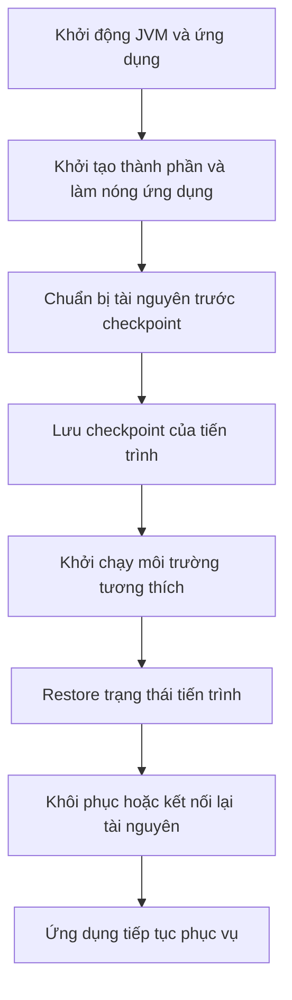

# Kiến thức đầu vào và trình tự học CRaC

CRaC (Coordinated Restore at Checkpoint) là cơ chế giúp một ứng dụng Java lưu lại trạng thái của tiến trình tại một thời điểm đã chuẩn bị, sau đó khôi phục tiến trình từ trạng thái đó. Nhờ vậy, ứng dụng có thể tiếp tục hoạt động mà không phải thực hiện lại toàn bộ quá trình khởi động và khởi tạo tốn thời gian.

Để học CRaC hiệu quả, cần hiểu đồng thời ba phần: JVM và vòng đời ứng dụng Java, tiến trình và tài nguyên của hệ điều hành, cùng cách ứng dụng phối hợp trước khi checkpoint và sau khi restore. Bài này xác định những kiến thức cần có và một lộ trình tăng dần từ ví dụ đơn giản đến ứng dụng thực tế.

## 1. CRaC giải quyết vấn đề gì?

Một ứng dụng Java thường phải thực hiện nhiều công việc trước khi sẵn sàng phục vụ yêu cầu:

- Khởi tạo JVM, nạp class và chạy static initializer.
- Tạo Spring Application Context hoặc cấu trúc ứng dụng tương đương.
- Tạo bean, cấu hình dependency, đọc cấu hình và nạp dữ liệu ban đầu.
- Khởi tạo connection pool, HTTP client, cache, bộ lập lịch và các thành phần dùng chung.
- JIT biên dịch những đoạn mã được thực thi thường xuyên để cải thiện hiệu năng.

Những bước này có thể khiến thời gian khởi động dài, đặc biệt với ứng dụng có nhiều thành phần hoặc cần khởi tạo nhiều tài nguyên. CRaC cho phép ứng dụng hoàn tất một phần hoặc toàn bộ quá trình chuẩn bị, tạo checkpoint, rồi khởi động những phiên bản sau bằng cách restore checkpoint đó.

Có thể hình dung luồng tổng quát như sau:

Checkpoint chứa trạng thái tiến trình ở cấp độ JVM và hệ điều hành. Vì vậy, CRaC không đơn thuần là tuần tự hóa (serialize) các đối tượng Java rồi đọc chúng lại. Một tiến trình còn có thread, vùng nhớ, file descriptor, socket, trạng thái runtime và những liên hệ với tài nguyên bên ngoài. Các thành phần này cần được xem xét khi lưu và khôi phục.

CRaC cũng không đồng nghĩa với việc đóng gói ứng dụng thành container hay biên dịch thành native image. Container cung cấp môi trường triển khai; native image thay đổi cách ứng dụng được biên dịch và chạy; CRaC lưu và khôi phục trạng thái của một tiến trình tương thích. Những công nghệ này có thể xuất hiện cùng nhau trong một kiến trúc, nhưng giải quyết các vấn đề khác nhau.

## 2. Kiến thức đầu vào cần chuẩn bị

Không cần trở thành chuyên gia JVM hoặc Linux trước khi bắt đầu. Tuy nhiên, cần nắm được các khái niệm dưới đây ở mức đủ để giải thích điều gì đang tồn tại trong tiến trình và điều gì có thể thay đổi sau khi restore.

### 2.1. Nền tảng Java và vòng đời ứng dụng

Đây là nhóm kiến thức bắt buộc. Cần hiểu:

- Cấu trúc một ứng dụng Java: class, object, static field, classpath hoặc module path, thư viện và cấu hình runtime.
- Vòng đời khởi động: từ lúc JVM được tạo, class được nạp, mã khởi tạo được chạy đến lúc ứng dụng bắt đầu nhận yêu cầu.
- Thread và concurrency: thread được tạo ở đâu, executor hoạt động thế nào, tác vụ nền được lập lịch ra sao và trạng thái dùng chung được bảo vệ như thế nào.
- Tài nguyên Java: stream, file, socket, connection pool, executor, timer và các đối tượng có vòng đời cần đóng hoặc khởi tạo lại.
- Xử lý lỗi và shutdown: ứng dụng dừng tài nguyên thế nào, lỗi khởi tạo được xử lý ra sao và thành phần nào chịu trách nhiệm giải phóng tài nguyên.

Đặc biệt, cần phân biệt trạng thái nằm trong bộ nhớ Java với tài nguyên nằm ngoài JVM. Một object có thể vẫn tồn tại trong heap của checkpoint, nhưng socket mà object đó tham chiếu đến có thể không còn sử dụng được sau khi restore.

### 2.2. Kiến thức cơ bản về JVM

Nên hiểu các vùng và hoạt động chính của JVM:

| Khái niệm | Vì sao liên quan đến CRaC |
|---|---|
| Heap | Chứa object và trạng thái ứng dụng có thể được giữ lại trong checkpoint. |
| Java stack | Gắn với các thread và trạng thái thực thi tại thời điểm checkpoint. |
| Metaspace | Lưu metadata của class đã được nạp. |
| Class loading | Giúp xác định thành phần nào đã được nạp trước checkpoint. |
| Garbage Collection | Ảnh hưởng đến trạng thái và áp lực bộ nhớ trong quá trình chạy. |
| JIT compilation | Việc làm nóng ứng dụng trước checkpoint có thể giúp giữ lại lợi ích của quá trình tối ưu hóa đã thực hiện. |
| Thread và monitor | Có thể liên quan đến tác vụ đang chạy, khóa và trạng thái đồng bộ tại thời điểm checkpoint. |

Không cần học sâu thuật toán GC hay cấu trúc mã máy của JIT ngay từ đầu. Mục tiêu là hiểu rằng checkpoint lưu trạng thái của một tiến trình JVM đang chạy, nên thời điểm tạo checkpoint và trạng thái của các thread có ý nghĩa.

### 2.3. Kiến thức hệ điều hành và tiến trình

CRaC làm việc ở cấp độ tiến trình, vì vậy cần biết những khái niệm Linux cơ bản:

- Process và PID: một chương trình đang chạy được hệ điều hành quản lý như thế nào.
- Không gian địa chỉ và vùng nhớ của tiến trình: heap, stack, memory mapping và thư viện được ánh xạ vào bộ nhớ.
- File descriptor: cách tiến trình tham chiếu đến file, pipe, socket và các tài nguyên I/O.
- Socket và kết nối mạng: trạng thái kết nối TCP, cổng lắng nghe và kết nối tới dịch vụ bên ngoài.
- Signal và quyền truy cập: tiến trình nhận tín hiệu, chạy dưới user nào và bị giới hạn bởi quyền gì.
- Namespace, cgroup và container ở mức khái niệm: môi trường chạy có thể giới hạn hoặc cô lập tiến trình ra sao.

Các bản phân phối JDK hỗ trợ CRaC thường kết hợp JVM với cơ chế checkpoint/restore của hệ điều hành; trên Linux, CRIU (Checkpoint/Restore In Userspace) là một thành phần thường gặp. Khả năng sử dụng thực tế phụ thuộc vào JDK, phiên bản hệ điều hành, kernel, quyền và cấu hình môi trường. Vì vậy, không nên giả định mọi máy chạy Java đều có thể checkpoint/restore giống nhau.

### 2.4. Tài nguyên bên ngoài và mạng

Đây là nhóm kiến thức rất quan trọng khi chuyển từ ví dụ nhỏ sang ứng dụng thật. Hãy phân biệt:

- **Tài nguyên nội bộ tiến trình:** object, cấu trúc dữ liệu, cache trong bộ nhớ và trạng thái Java có thể được giữ trong checkpoint.
- **Tài nguyên do hệ điều hành quản lý:** file descriptor, file đang mở, socket, thread và các đối tượng runtime liên quan.
- **Tài nguyên ở dịch vụ bên ngoài:** kết nối database, message broker, Redis, HTTP service, dịch vụ xác thực hoặc hệ thống khác.

Một kết nối đang mở trước checkpoint không mặc nhiên còn hợp lệ sau restore. Đầu bên kia có thể đã đóng kết nối, timeout hoặc thay đổi trạng thái. Tương tự, cổng lắng nghe, socket, file và khóa có thể phụ thuộc môi trường chạy. Cần biết cách tạo, kiểm tra, đóng và mở lại các tài nguyên này.

### 2.5. Framework và môi trường triển khai

Nếu ứng dụng sử dụng Spring Boot, nên biết:

- Spring Application Context được tạo và refresh như thế nào.
- Bean eager/lazy được khởi tạo ở giai đoạn nào.
- Lifecycle callback, listener và event của Spring hoạt động ra sao.
- Connection pool, HTTP server, scheduler và tác vụ nền được tạo ở đâu.
- Cấu hình theo profile, biến môi trường, secret, volume và health check được cung cấp khi triển khai như thế nào.

Đây là kiến thức cần thiết khi áp dụng CRaC vào ứng dụng Spring Boot; người học CRaC với một Java application nhỏ không cần học toàn bộ Spring trước.

## 3. Những khái niệm CRaC cần phân biệt

Trước khi đi vào API, hãy nắm rõ các thuật ngữ sau:

| Thuật ngữ | Ý nghĩa |
|---|---|
| Checkpoint | Thời điểm và thao tác ghi lại trạng thái tiến trình để có thể khôi phục sau này. |
| Checkpoint image | Dữ liệu được tạo ra để phục vụ việc restore; định dạng và cách lưu phụ thuộc công cụ triển khai. |
| Restore | Khôi phục tiến trình từ checkpoint để ứng dụng tiếp tục hoạt động. |
| Resource | Tài nguyên mà ứng dụng cần phối hợp xử lý trước checkpoint hoặc sau restore. |
| `beforeCheckpoint` | Callback để ứng dụng chuẩn bị tài nguyên trước khi trạng thái tiến trình được lưu. |
| `afterRestore` | Callback để ứng dụng kiểm tra, mở lại hoặc hoàn tất việc khôi phục tài nguyên sau khi tiến trình được restore. |
| CRIU | Công cụ checkpoint/restore tiến trình ở userspace trên Linux, thường được dùng trong các triển khai CRaC. |

API CRaC cung cấp cách đăng ký các đối tượng triển khai `org.crac.Resource` vào context. Resource có thể thực hiện công việc cần thiết trong `beforeCheckpoint(...)` và `afterRestore(...)`. Ví dụ, ứng dụng có thể tạm dừng tác vụ nền hoặc đóng một kết nối không thể giữ qua restore, sau đó tạo lại kết nối khi được khôi phục.

Hai callback này không tự động làm cho mọi thư viện bên thứ ba tương thích với CRaC. Nhà phát triển cần xác định tài nguyên nào cần xử lý, dùng API tích hợp sẵn của thư viện nếu có, hoặc tự quản lý vòng đời tài nguyên. Cách triển khai cụ thể phải theo JDK CRaC và phiên bản thư viện đang sử dụng.

## 4. Trình tự học CRaC đề xuất

Nên học theo thứ tự từ mô hình tiến trình đến việc xử lý tài nguyên thực tế. Mỗi giai đoạn nên có một kết quả quan sát được để xác nhận đã hiểu.

### Bước 1: Đo và hiểu quá trình khởi động ứng dụng Java

Chọn một ứng dụng Java nhỏ có thể chạy độc lập. Quan sát thời gian từ lúc khởi chạy đến lúc ứng dụng sẵn sàng nhận yêu cầu. Ghi lại các công việc diễn ra trong startup: nạp class, tạo object, nạp cấu hình, tạo kết nối và làm nóng ứng dụng.

**Kết quả cần đạt:** giải thích được ứng dụng đang tốn thời gian ở giai đoạn nào và trạng thái nào có thể có ích nếu được giữ lại.

### Bước 2: Ôn JVM và mô hình tiến trình

Ôn heap, stack, class loading, thread, file descriptor, socket và vòng đời process. Dùng công cụ quan sát tiến trình để phân biệt trạng thái trong bộ nhớ với tài nguyên bên ngoài.

**Kết quả cần đạt:** mô tả được một ứng dụng Java đang chạy gồm những loại trạng thái nào và vì sao lưu object Java đơn thuần không tương đương checkpoint tiến trình.

### Bước 3: Tìm hiểu môi trường CRaC được hỗ trợ

Xác định JDK distribution có hỗ trợ CRaC, phiên bản Java, hệ điều hành Linux, kernel và yêu cầu của công cụ checkpoint/restore. Kiểm tra hướng dẫn cài đặt và chạy của đúng bản phân phối JDK đang dùng. Nếu chạy trong container, tìm hiểu quyền, cấu hình và giới hạn cần thiết của container.

**Kết quả cần đạt:** có một môi trường mẫu đáp ứng yêu cầu của bản CRaC đã chọn và biết cách kiểm tra lỗi môi trường cơ bản.

### Bước 4: Thực hiện checkpoint và restore với ứng dụng tối giản

Bắt đầu bằng ứng dụng ít phụ thuộc, chẳng hạn một HTTP server đơn giản hoặc chương trình giữ một bộ đếm trong bộ nhớ. Chạy ứng dụng, đưa nó đến trạng thái mong muốn, tạo checkpoint rồi restore theo hướng dẫn của JDK và công cụ tương ứng.

Quan sát log, thời gian khởi động, trạng thái trong bộ nhớ và khả năng nhận yêu cầu sau restore. Thực hiện lại nhiều lần để hiểu rõ quy trình và các điều kiện môi trường.

**Kết quả cần đạt:** phân biệt được khởi động mới với restore, đồng thời xác nhận ứng dụng thực sự tiếp tục từ checkpoint.

### Bước 5: Học Resource API và vòng đời callback

Tìm hiểu `org.crac.Resource`, context đăng ký resource và hai callback `beforeCheckpoint(...)`, `afterRestore(...)`. Thử đăng ký một resource đơn giản, ghi log ở hai callback và quan sát thời điểm chúng được gọi.

Sau đó, thêm logic chuẩn bị trước checkpoint và khôi phục sau restore. Giữ callback rõ ràng, có thể lặp lại an toàn và có xử lý lỗi phù hợp. Không đặt công việc nặng hoặc phụ thuộc dịch vụ bên ngoài vào callback nếu chưa hiểu ảnh hưởng của nó đến thời gian và độ tin cậy của restore.

**Kết quả cần đạt:** giải thích được ứng dụng cần làm gì trước checkpoint và sau restore, cũng như nơi đăng ký các resource.

### Bước 6: Xử lý tài nguyên thực tế

Mở rộng ví dụ theo từng loại tài nguyên, không thêm tất cả cùng lúc:

1. File và stream: xác định file descriptor nào được giữ, đóng hoặc mở lại.
2. Database: kiểm tra connection pool, connection đang mượn và khả năng tạo kết nối mới.
3. HTTP client và socket: kiểm tra kết nối đang mở, timeout và khả năng kết nối lại.
4. Thread pool và scheduler: dừng hoặc tạm hoãn tác vụ phù hợp, tránh tác vụ chạy trùng sau restore.
5. Cache và dữ liệu ngoài tiến trình: xác định dữ liệu nào được giữ trong bộ nhớ và dữ liệu nào cần đồng bộ lại.

Với mỗi loại, hãy kiểm thử cả trường hợp thành công và trường hợp tài nguyên bên ngoài đã thay đổi trong lúc tiến trình không hoạt động.

**Kết quả cần đạt:** có danh sách tài nguyên của ứng dụng, cách xử lý trước checkpoint, cách khôi phục sau restore và bằng chứng kiểm thử.

### Bước 7: Tích hợp framework và container

Khi ví dụ Java thuần đã hoạt động, chuyển sang ứng dụng thực tế như Spring Boot. Xác định các bean, listener, server, pool và tác vụ nền có vòng đời liên quan đến checkpoint. Kiểm tra khả năng tương thích của JDK, framework và thư viện; ưu tiên tài liệu tích hợp chính thức của phiên bản đang sử dụng.

Tiếp theo, đưa ứng dụng vào môi trường triển khai gần với production. Kiểm tra cấu hình container, quyền cần thiết, volume chứa checkpoint, biến môi trường, secret, health check và cách khởi chạy tiến trình sau restore.

**Kết quả cần đạt:** ứng dụng có thể restore trong môi trường triển khai mục tiêu và các tài nguyên quan trọng hoạt động bình thường.

### Bước 8: Đánh giá hiệu năng và vận hành

So sánh cold start với thời gian restore bằng cùng điều kiện thử nghiệm. Ngoài thời gian sẵn sàng, cần kiểm tra:

- Ứng dụng có nhận và xử lý yêu cầu chính xác sau restore không.
- Kết nối database, broker và HTTP có được khôi phục ổn định không.
- Tác vụ nền có bị chạy lặp, bỏ sót hoặc chạy với trạng thái cũ không.
- Log, metric, tracing và health check có phản ánh đúng trạng thái sau restore không.
- Checkpoint có tương thích với đúng JDK, thư viện, hệ điều hành và cấu hình triển khai không.
- Có phương án quay về cold start khi checkpoint không dùng được hay không.

Checkpoint có thể chứa dữ liệu nhạy cảm đang nằm trong bộ nhớ tiến trình. Cần kiểm soát quyền đọc, nơi lưu trữ, thời hạn giữ và cách chia sẻ checkpoint giống như quản lý một artifact nhạy cảm.

**Kết quả cần đạt:** có số liệu so sánh, bộ kiểm thử sau restore và quy trình vận hành khi restore thành công hoặc thất bại.

## 5. Bài thực hành tăng dần

Một chuỗi thực hành nhỏ giúp nối các kiến thức thành quy trình hoàn chỉnh:

| Lần thực hành | Nội dung | Bằng chứng hoàn thành |
|---|---|---|
| 1 | Chạy ứng dụng Java tối giản và đo cold start. | Log thời điểm bắt đầu và thời điểm sẵn sàng. |
| 2 | Tạo một trạng thái trong bộ nhớ, checkpoint rồi restore. | Giá trị trạng thái còn đúng sau restore. |
| 3 | Đăng ký Resource và ghi log trong hai callback. | Log thể hiện thứ tự chuẩn bị và khôi phục. |
| 4 | Thêm database hoặc HTTP client. | Ứng dụng kết nối và xử lý yêu cầu được sau restore. |
| 5 | Thêm thread pool hoặc tác vụ định kỳ. | Không có tác vụ chạy trùng hoặc sử dụng trạng thái lỗi thời. |
| 6 | Chạy trong container gần với môi trường mục tiêu. | Có thể tạo và restore checkpoint bằng quy trình triển khai đã ghi lại. |

Mỗi lần chỉ nên bổ sung một nhóm tài nguyên. Khi có lỗi, cách làm này giúp xác định lỗi đến từ môi trường checkpoint, callback hay chính tài nguyên vừa thêm.

## 6. Những hiểu lầm thường gặp khi mới học

**“CRaC chỉ lưu heap của Java.”** Không chính xác. Checkpoint liên quan đến trạng thái của tiến trình và hệ điều hành; heap chỉ là một phần của trạng thái đó.

**“Restore xong thì mọi kết nối cũ chắc chắn dùng được.”** Không thể mặc định như vậy. Dịch vụ bên ngoài có thể đã đóng kết nối hoặc thay đổi trạng thái. Ứng dụng phải kiểm tra và khôi phục tài nguyên phù hợp.

**“Chỉ cần tạo checkpoint một lần là dùng được ở mọi máy.”** Checkpoint phụ thuộc vào môi trường tương thích. JDK, hệ điều hành, kiến trúc, thư viện và cấu hình triển khai đều có thể ảnh hưởng đến khả năng restore.

**“Dùng Spring Boot thì framework tự xử lý mọi resource.”** Không nên giả định điều này. Mức độ hỗ trợ phụ thuộc phiên bản framework, JDK và từng thư viện. Cần kiểm tra tài liệu tích hợp và kiểm thử ứng dụng thực tế.

**“Restore nhanh đồng nghĩa ứng dụng đã sẵn sàng.”** Tiến trình có thể đã restore nhưng vẫn cần hoàn tất callback, kết nối lại dịch vụ, cập nhật trạng thái và vượt qua health check trước khi nhận traffic.

## 7. Checklist trước khi chuyển sang nội dung CRaC chuyên sâu

- [ ] Giải thích được vòng đời khởi động cơ bản của một ứng dụng Java.
- [ ] Phân biệt được heap, stack, thread và tài nguyên do hệ điều hành quản lý.
- [ ] Giải thích được process, file descriptor, socket và kết nối tới dịch vụ bên ngoài.
- [ ] Phân biệt checkpoint với serialize object và với container image.
- [ ] Xác định được JDK và môi trường chạy có hỗ trợ CRaC.
- [ ] Thực hiện được checkpoint và restore cho một ứng dụng tối giản.
- [ ] Giải thích được vai trò của `beforeCheckpoint(...)` và `afterRestore(...)`.
- [ ] Xác định được tài nguyên cần đóng, tạm dừng, kiểm tra hoặc tạo lại.
- [ ] Kiểm thử được ứng dụng sau restore, bao gồm kết nối và tác vụ nền.

Nếu chưa hoàn thành toàn bộ checklist, hãy quay lại đúng phần kiến thức còn thiếu. Không cần trì hoãn việc chạy ví dụ CRaC đầu tiên cho đến khi hiểu sâu mọi chi tiết của JVM hoặc Linux; có thể học các phần nâng cao ngay khi bài thực hành cho thấy chúng cần thiết.

## 8. Thuật ngữ cần nhớ

- **CRaC:** Coordinated Restore at Checkpoint, cơ chế phối hợp giữa ứng dụng Java và runtime để checkpoint/restore tiến trình.
- **Checkpoint:** trạng thái tiến trình được lưu để có thể khôi phục.
- **Restore:** thao tác khôi phục tiến trình từ checkpoint.
- **CRIU:** Checkpoint/Restore In Userspace, công cụ checkpoint/restore tiến trình trên Linux.
- **Resource:** thành phần ứng dụng cần phối hợp xử lý vòng đời khi checkpoint và restore.
- **Cold start:** khởi động ứng dụng từ đầu, không dùng checkpoint có sẵn.
- **Warm-up:** giai đoạn ứng dụng được thực thi để nạp và chuẩn bị các thành phần, có thể bao gồm JIT compilation.

Lộ trình phù hợp là bắt đầu từ một ứng dụng Java nhỏ, hiểu rõ trạng thái của tiến trình, thực hiện checkpoint/restore cơ bản, rồi lần lượt bổ sung Resource API, kết nối ngoài, framework và môi trường triển khai. Cách học này giúp mỗi khái niệm CRaC gắn với một hành vi có thể quan sát và kiểm chứng.
