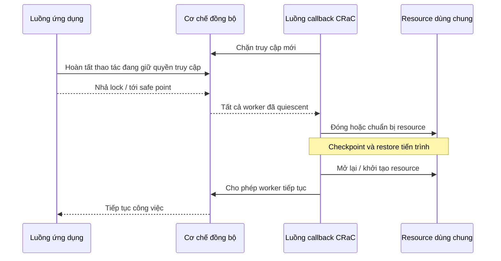

# Phối hợp luồng ứng dụng với luồng thực hiện callback

Một ứng dụng Java thường có nhiều luồng cùng sử dụng connection pool, file, cache, scheduler hoặc các thành phần dùng chung. Khi CRaC chuẩn bị checkpoint, callback `beforeCheckpoint(...)` phải đưa những tài nguyên đó về trạng thái có thể lưu. Sau restore, callback `afterRestore(...)` khôi phục tài nguyên để ứng dụng tiếp tục hoạt động.

Callback không tự động làm cho mọi luồng ứng dụng dừng ở một điểm an toàn. Trong lúc resource đang chuyển sang trạng thái tạm dừng, một worker khác vẫn có thể cố truy cập resource, xử lý request mới hoặc chạy một tác vụ định kỳ. Vì vậy, ứng dụng phải phối hợp giữa luồng thực hiện callback và các luồng đang sử dụng resource: chặn truy cập mới, đợi thao tác đang chạy kết thúc, đưa worker tới safe point, rồi chỉ cho phép chúng tiếp tục sau khi resource đã sẵn sàng.

CRaC không áp đặt một mô hình concurrency duy nhất. Cách phối hợp phụ thuộc số lượng worker, cách chúng nhận công việc, event loop, executor và cách checkpoint được kích hoạt. Bài này trình bày các mẫu đồng bộ thường dùng, những deadlock dễ gặp và cách thiết kế luồng phục hồi có thể kiểm soát.

## 1. Callback và luồng ứng dụng có vai trò khác nhau

Hai callback của `org.crac.Resource` có nhiệm vụ phối hợp vòng đời tài nguyên:

- `beforeCheckpoint(Context<? extends Resource> context)`: chuẩn bị resource trước khi JVM và tiến trình được checkpoint.
- `afterRestore(Context<? extends Resource> context)`: khôi phục hoặc mở lại resource sau khi tiến trình được restore.

Callback được CRaC runtime gọi thông qua `Context`. Chúng không phải một lệnh broadcast tự động yêu cầu tất cả worker kết thúc công việc. Ứng dụng phải thiết kế cơ chế để những luồng đang truy cập resource biết khi nào cần dừng, chờ hoặc tiếp tục.

Luồng thực hiện callback cũng không nhất thiết là một worker đang sử dụng resource. Ví dụ, tài liệu CRaC mô tả trường hợp checkpoint được kích hoạt bằng `jcmd <pid> JDK.checkpoint`: callback được gọi từ một luồng khác với luồng định kỳ đang ghi file. Khi checkpoint được gọi bằng `Core.checkpointRestore()`, lời gọi nằm trong luồng code đã yêu cầu checkpoint. Vì nguồn kích hoạt có thể khác nhau, không nên giả định callback luôn chạy trên main thread, worker thread hoặc event-loop thread.

Một nguyên tắc quan trọng là callback đóng vai trò điều phối. Nó cần phối hợp với worker thông qua lock, barrier, signal hoặc một tác vụ được đưa vào event loop. Không nên dựa vào việc “JVM sẽ tự dừng tất cả worker đúng lúc” để bảo vệ một cấu trúc dữ liệu hoặc tài nguyên ứng dụng.

## 2. Vòng đời của một resource trong môi trường nhiều luồng

Trước khi CRaC, nhiều component thường có vòng đời đơn giản:

```text
CREATED → ACTIVE → CLOSED
```

Với CRaC, một số component cần thêm trạng thái tạm dừng và tiếp tục:

```text
CREATED → ACTIVE → SUSPENDING → SUSPENDED
                                  ↓
                               RESTORING
                                  ↓
                                ACTIVE
```

Trong `SUSPENDING`, ứng dụng ngừng cấp quyền truy cập mới và đợi các thao tác đang sử dụng resource hoàn tất. Trong `SUSPENDED`, resource đã được đóng hoặc đưa về trạng thái phù hợp cho checkpoint. Sau restore, callback khôi phục resource; worker chỉ được tiếp tục khi resource đã sẵn sàng.



Trạng thái `SUSPENDED` không có nghĩa mọi thread của ứng dụng đã biến mất. Worker có thể đang chờ tại barrier hoặc đang bị chặn bởi lock. Chúng không được phép truy cập resource trong khoảng thời gian resource chưa sẵn sàng.

## 3. Xác định điểm an toàn cho từng loại worker

Một safe point là vị trí trong luồng xử lý mà worker có thể tạm dừng mà không làm hỏng công việc đang thực hiện. Safe point thường nằm giữa hai đơn vị công việc, sau khi worker đã hoàn tất hoặc ghi nhận trạng thái của thao tác hiện tại.

Ví dụ:

| Loại worker | Safe point phù hợp | Việc cần hoàn tất trước khi chờ |
|---|---|---|
| Worker đọc queue | Sau khi xử lý xong một message, trước khi lấy message tiếp theo. | Commit/rollback, acknowledge hoặc lưu offset theo semantics của broker. |
| Worker ghi file | Sau khi ghi xong một chunk và flush dữ liệu cần thiết. | Hoàn tất buffer, đóng handle nếu cần. |
| HTTP request worker | Sau khi response đã được đọc/đóng hoặc request được hủy có kiểm soát. | Giải phóng connection và cập nhật trạng thái request. |
| Scheduled task | Giữa hai lần chạy. | Hủy lịch cũ hoặc ngăn lần chạy mới bắt đầu. |
| Event loop | Sau khi xử lý xong event hiện tại, trước khi lấy event kế tiếp. | Hoàn tất callback hiện tại và đưa loop vào trạng thái chờ. |

Không nên yêu cầu worker dừng giữa một thao tác ghi dữ liệu, transaction hoặc cập nhật trạng thái có nhiều bước nếu không có cơ chế rollback hoặc resume rõ ràng.

Một worker đang block vô thời hạn trong `take()`, `read()` hoặc I/O mạng có thể không bao giờ tới safe point. Dùng timeout polling, cancellation, interrupt hoặc API shutdown phù hợp để đánh thức worker. Không giả định gọi `interrupt()` sẽ hủy được mọi loại I/O hoặc mọi thư viện.

## 4. Mẫu tổng quát: dùng `ReadWriteLock` khi số luồng truy cập không cố định

Khi không biết trước luồng nào sẽ truy cập resource và thời điểm nào, `ReadWriteLock` là một cách phối hợp trực tiếp:

- Mỗi thao tác sử dụng resource lấy read lock.
- `beforeCheckpoint(...)` lấy write lock. Write lock chỉ được cấp khi các reader hiện tại đã nhả lock, đồng thời chặn reader mới.
- Callback chuẩn bị hoặc đóng resource trong khi đang giữ write lock.
- `afterRestore(...)` mở lại resource rồi nhả write lock để worker tiếp tục.

Ví dụ rút gọn:

```java
import org.crac.Context;
import org.crac.Core;
import org.crac.Resource;

import java.util.concurrent.locks.Lock;
import java.util.concurrent.locks.ReadWriteLock;
import java.util.concurrent.locks.ReentrantReadWriteLock;
import java.util.concurrent.TimeUnit;
import java.util.function.Function;

public final class SharedConnectionPool implements Resource {

    private final ReadWriteLock lifecycle = new ReentrantReadWriteLock();
    private final Lock useLock = lifecycle.readLock();
    private final Lock checkpointLock = lifecycle.writeLock();

    private volatile ConnectionPool pool;
    private volatile boolean failed;
    private volatile boolean checkpointLockHeld;
    private volatile boolean poolPreparedForCheckpoint;

    public SharedConnectionPool() {
        pool = createPool();
        Core.getGlobalContext().register(this);
    }

    public <T> T withConnection(Function<Connection, T> operation) {
        useLock.lock();
        try {
            if (failed || pool == null) {
                throw new IllegalStateException("Pool is unavailable");
            }
            // Giữ read lock trong toàn bộ thời gian thao tác sử dụng connection.
            return pool.withConnection(operation);
        } finally {
            useLock.unlock();
        }
    }

    @Override
    public void beforeCheckpoint(Context<? extends Resource> context)
            throws Exception {
        // Chờ mọi thao tác đang dùng pool kết thúc và chặn reader mới.
        if (!checkpointLock.tryLock(10, TimeUnit.SECONDS)) {
            throw new IllegalStateException(
                    "Timed out waiting for active pool users");
        }
        checkpointLockHeld = true;

        // Giữ write lock qua checkpoint để worker tiếp tục bị chặn.
        poolPreparedForCheckpoint = true;
        closePool();
        pool = null;
    }

    @Override
    public void afterRestore(Context<? extends Resource> context)
            throws Exception {
        try {
            if (poolPreparedForCheckpoint) {
                // Nếu lần đóng trước checkpoint thất bại, thử đóng phần resource còn lại.
                if (pool != null) {
                    pool.close();
                    pool = null;
                }
                pool = createPool();
                failed = false;
                poolPreparedForCheckpoint = false;
            }
        } catch (Exception e) {
            failed = true;
            throw e;
        } finally {
            // Worker được đánh thức nhưng sẽ thấy failed nếu pool không mở lại được.
            if (checkpointLockHeld) {
                checkpointLockHeld = false;
                checkpointLock.unlock();
            }
        }
    }

    private void closePool() throws Exception {
        if (pool != null) {
            pool.close();
        }
    }

    private ConnectionPool createPool() {
        return new ConnectionPool();
    }
}
```

`ConnectionPool` và `Connection` trong ví dụ là kiểu minh họa, không phải lớp của CRaC. `withConnection(...)` giữ read lock trong toàn bộ thao tác sử dụng connection; nếu chỉ khóa lúc lấy connection rồi trả connection cho caller sử dụng sau khi nhả lock, callback vẫn có thể đóng pool trong khi caller đang dùng connection. Code thực tế cần dùng API lease/return của thư viện pool đang sử dụng và giữ cơ chế đồng bộ cho toàn bộ vòng đời lease.

### 4.1. Vì sao write lock có thể giữ worker ở trạng thái an toàn?

Khi callback lấy write lock, nó phải đợi tất cả thao tác đang giữ read lock hoàn tất. Sau khi write lock được cấp:

- Không còn thao tác nào đang chạy trong vùng được bảo vệ.
- Các worker mới muốn truy cập phải chờ.
- Callback có thể đóng pool hoặc thay đổi trạng thái resource mà không bị thao tác đồng thời chen vào.
- Sau restore, callback tạo lại pool rồi nhả lock; worker mới được tiếp tục.

Tài liệu best practices của CRaC sử dụng chính mẫu này cho connection pool. Tài liệu cũng lưu ý read lock có chi phí trên đường chạy thường xuyên vì việc khóa có thể cần atomic operation. Với code rất nóng, hãy đo overhead và cân nhắc mẫu đồng bộ phù hợp hơn.

### 4.2. Lưu ý về lock ownership và lỗi callback

`ReentrantReadWriteLock` là lock có ownership theo thread. Không được lấy write lock ở một worker rồi kỳ vọng callback khác có thể nhả lock thay worker đó. Mẫu CRaC nói trên lấy write lock trong callback `beforeCheckpoint(...)` và nhả trong `afterRestore(...)`; hãy dùng theo execution contract của runtime CRaC đang triển khai và kiểm thử đường checkpoint/restore thật.

Nếu `beforeCheckpoint(...)` ném exception sau khi lấy write lock, một số implementation CRaC sẽ đi vào đường phục hồi resource và gọi `afterRestore(...)` để hoàn tác trạng thái đã chuẩn bị. Tài liệu best practices của CRaC mô tả cách này trong ví dụ. Không tự ý nhả lock trong `catch` rồi tiếp tục checkpoint nếu trạng thái resource chưa được phục hồi. Hãy thiết kế đường rollback và kiểm thử với JDK/runtime cụ thể.

Trong `afterRestore(...)`, nếu mở pool thất bại, worker không được phép sử dụng pool. Ví dụ đặt `failed = true` trước khi nhả lock; mọi thao tác sau đó kiểm tra trạng thái và từ chối truy cập. Ứng dụng cần kết hợp việc này với readiness/fail-stop policy của mình.

## 5. Mẫu cho số lượng worker đã biết: dùng `Phaser`

Nếu ứng dụng có một số lượng worker cố định hoặc đã biết trước, và các worker thường xuyên đi qua một điểm kiểm tra, `Phaser` có thể giúp đồng bộ với callback mà không phải lấy read lock trên mỗi lần truy cập.

Ý tưởng có hai barrier:

1. Trước checkpoint, callback tạo `Phaser` có `N + 1` party: N worker và callback. Callback chờ cho đến khi tất cả worker tới safe point.
2. Sau restore, callback mở lại resource, rồi tham gia barrier thứ hai để giải phóng các worker đang chờ.

Ví dụ minh họa với hai worker:

```java
import org.crac.Context;
import org.crac.Core;
import org.crac.Resource;

import java.util.concurrent.Phaser;
import java.util.concurrent.TimeUnit;

public final class FileWriterResource implements Resource {

    private static final int WORKER_COUNT = 2;
    private volatile Phaser checkpointPhaser;
    private volatile boolean fileClosed;

    public FileWriterResource() {
        Core.getGlobalContext().register(this);
    }

    public void workerLoop() throws Exception {
        while (!Thread.currentThread().isInterrupted()) {
            awaitCheckpointIfNeeded();
            writeNextChunk();
        }
    }

    private void awaitCheckpointIfNeeded() throws Exception {
        Phaser current = checkpointPhaser;
        if (current == null) {
            return;
        }

        // Barrier 1: worker báo đã tới safe point.
        if (current.arriveAndAwaitAdvance() < 0) {
            throw new IllegalStateException("Checkpoint barrier terminated");
        }

        // Barrier 2: worker chờ callback mở resource sau restore.
        if (current.arriveAndAwaitAdvance() < 0) {
            throw new IllegalStateException("Restore barrier terminated");
        }
    }

    @Override
    public void beforeCheckpoint(Context<? extends Resource> context)
            throws Exception {
        Phaser phaser = new Phaser(WORKER_COUNT + 1);
        checkpointPhaser = phaser;

        // Callback là party thứ N+1 và chờ tất cả worker.
        int phase = phaser.arrive();
        if (phase < 0) {
            throw new IllegalStateException("Workers did not reach safe point");
        }
        try {
            phaser.awaitAdvanceInterruptibly(phase, 10, TimeUnit.SECONDS);
            closeFile();
            fileClosed = true;
        } catch (Exception e) {
            checkpointPhaser = null;
            phaser.forceTermination();
            throw e;
        }
    }

    @Override
    public void afterRestore(Context<? extends Resource> context)
            throws Exception {
        Phaser phaser = checkpointPhaser;
        try {
            if (fileClosed) {
                reopenFile();
                fileClosed = false;
            }
            checkpointPhaser = null;
        } catch (Exception e) {
            if (phaser != null) {
                phaser.forceTermination();
            }
            throw e;
        }

        if (phaser != null && phaser.arriveAndAwaitAdvance() < 0) {
            throw new IllegalStateException("Workers could not resume");
        }
    }

    private void writeNextChunk() throws Exception {
        // Xử lý một đơn vị công việc rồi quay lại safe point.
    }

    private void closeFile() throws Exception {
        // Flush và đóng file trước checkpoint.
    }

    private void reopenFile() throws Exception {
        // Mở file mới hoặc xác minh file sau restore.
    }
}
```

Ví dụ chỉ phù hợp khi đúng `WORKER_COUNT` worker tham gia barrier. Trong ứng dụng thật, cần xử lý worker bị dừng, worker được thêm/bớt, lỗi trong lúc ghi và trường hợp worker không bao giờ tới safe point. Nếu số worker thay đổi động, cần quản lý đăng ký/deregister party hoặc chọn `ReadWriteLock`/coordinator phù hợp.

### 5.1. Tránh chờ vô hạn tại barrier

Nếu worker đang chờ queue vô hạn, bị kẹt trong I/O hoặc chạy một tác vụ quá dài, callback sẽ chờ mãi. Có thể:

- Dùng `poll(timeout)` thay cho `take()` vô hạn.
- Đặt timeout cho I/O và request.
- Gửi signal hoặc interrupt để đánh thức worker nếu thao tác hỗ trợ.
- Chia công việc dài thành các đoạn có thể tạm dừng.
- Đặt deadline cho quá trình quiesce; nếu hết hạn, báo lỗi checkpoint thay vì tiếp tục với trạng thái chưa an toàn.

Khi một worker rời khỏi hệ thống, phải cập nhật số party tương ứng. Một `Phaser` chờ một party đã biến mất sẽ không tự biết rằng worker đó không còn tham gia.

## 6. Mẫu Event Loop: đưa lệnh tạm dừng vào đúng luồng xử lý

Một số ứng dụng dùng event loop đơn luồng. Tất cả thao tác trên resource được thực hiện bởi cùng một thread, ví dụ một scheduler đơn luồng hoặc một event loop quản lý heartbeat và I/O.

Trong trường hợp này, callback không nên trực tiếp thay đổi resource khi event loop vẫn đang xử lý event. Cách phù hợp là:

1. `beforeCheckpoint(...)` gửi một lệnh pause vào event loop.
2. Event loop hoàn tất event hiện tại, chuyển sang trạng thái suspended và thông báo cho callback.
3. Callback đợi xác nhận, sau đó đóng hoặc chuẩn bị resource.
4. Sau restore, callback mở lại resource và phát tín hiệu resume.
5. Event loop thức dậy và tiếp tục lấy event mới.

Mẫu khái niệm:

```java
import org.crac.Context;
import org.crac.Core;
import org.crac.Resource;

import java.util.concurrent.CountDownLatch;
import java.util.concurrent.ExecutorService;
import java.util.concurrent.TimeUnit;

public final class EventLoopResource implements Resource {

    private final ExecutorService eventLoop;
    private final Object monitor = new Object();
    private boolean suspended;

    public EventLoopResource(ExecutorService eventLoop) {
        this.eventLoop = eventLoop;
        Core.getGlobalContext().register(this);
    }

    @Override
    public void beforeCheckpoint(Context<? extends Resource> context)
            throws Exception {
        CountDownLatch paused = new CountDownLatch(1);

        eventLoop.execute(() -> {
            synchronized (monitor) {
                suspended = true;
                paused.countDown();
                while (suspended) {
                    try {
                        monitor.wait();
                    } catch (InterruptedException e) {
                        Thread.currentThread().interrupt();
                        return;
                    }
                }
            }
        });

        if (!paused.await(10, TimeUnit.SECONDS)) {
            throw new IllegalStateException("Event loop did not pause");
        }

        closeEventLoopResource();
    }

    @Override
    public void afterRestore(Context<? extends Resource> context)
            throws Exception {
        reopenEventLoopResource();
        synchronized (monitor) {
            suspended = false;
            monitor.notifyAll();
        }
    }

    private void closeEventLoopResource() throws Exception { /* ... */ }
    private void reopenEventLoopResource() throws Exception { /* ... */ }
}
```

Đây là skeleton minh họa; các hàm xử lý resource cần được thay bằng implementation của ứng dụng và lifecycle của executor cần có owner rõ ràng. Event-loop task được gửi từ callback sẽ chạy sau khi event hiện tại kết thúc. Task đó tự chờ trên monitor cho tới khi callback `afterRestore(...)` đánh thức nó.

Trong code thực tế, nếu `paused.await(...)` hết thời hạn, cần hủy yêu cầu pause đang chờ hoặc gửi tín hiệu rollback có thể xử lý cả trường hợp task chưa bắt đầu. Nếu không, task pause có thể chạy muộn sau khi callback đã báo lỗi và làm event loop bị treo ở trạng thái suspended. Tương tự, `closeFile()` nên có hành vi rollback rõ ràng nếu chỉ đóng được một phần trước khi ném lỗi.

Không gọi checkpoint trực tiếp từ chính thread duy nhất của event loop nếu `beforeCheckpoint(...)` cần gửi một task khác lên cùng loop rồi chờ task đó. Trong tình huống đó, thread loop đang bị chiếm bởi lời gọi checkpoint nên task pause không thể chạy. Hãy yêu cầu một coordinator bên ngoài event loop kích hoạt checkpoint, hoặc dùng một giao thức pause được thiết kế riêng cho loop.

### 6.1. Deadlock khi dùng chung một event loop

Nếu có nhiều Resource cùng dùng một single-thread executor, không nên để mỗi callback gửi một task pause rồi chờ task đó hoàn tất theo cách độc lập. Resource đầu tiên có thể làm event loop bị chặn, khiến task pause của Resource tiếp theo không bao giờ được thực thi.

Với executor dùng chung, hãy tạo một coordinator chịu trách nhiệm tạm dừng và tiếp tục toàn bộ executor, hoặc gom các thao tác liên quan vào một Resource đại diện cho executor. Tài liệu CRaC cảnh báo rõ mẫu event-loop đơn giản không áp dụng nguyên trạng khi một single-thread executor được chia sẻ giữa nhiều component.

## 7. Phối hợp với `ExecutorService` và tác vụ định kỳ

Thread pool thường có nhiều worker, queue công việc và các task đang chạy. Trước checkpoint, cần quyết định rõ:

- Có ngừng nhận task mới không?
- Task đang chạy được phép hoàn tất hay phải hủy?
- Task nằm trong queue được giữ lại, loại bỏ hay lưu bền vững?
- Executor được giữ lại qua checkpoint hay shutdown và tạo lại sau restore?
- Ai chịu trách nhiệm mở lại admission và reschedule task?

Không phải lúc nào cũng cần shutdown toàn bộ executor. Nếu thread pool chỉ xử lý công việc thuần Java và trạng thái của nó có thể tiếp tục an toàn, có thể phối hợp worker tới barrier. Nếu executor sở hữu native resource, socket hoặc thư viện không hỗ trợ restore, cần shutdown và khởi tạo lại theo API của thư viện.

### 7.1. Tác vụ `scheduleAtFixedRate`

Một lỗi dễ gặp là để `ScheduledExecutorService.scheduleAtFixedRate(...)` tiếp tục giữ lịch cũ. Nếu tiến trình checkpoint trong thời gian dài, sau restore scheduler có thể cố thực hiện các lần chạy bị bỏ lỡ để bắt kịp lịch. Điều này có thể tạo ra một loạt tác vụ dồn dập, gửi heartbeat quá nhiều hoặc chạy lại công việc theo thời gian đã trôi qua.

Với tác vụ không nên chạy bù, hãy:

1. Hủy scheduled future trong `beforeCheckpoint(...)`.
2. Ghi lại cấu hình lịch, không giữ giả định rằng các lần chạy bị bỏ lỡ phải được thực hiện.
3. Tạo lịch mới trong `afterRestore(...)` với mốc thời gian phù hợp.
4. Bảo đảm chỉ có một lịch đang hoạt động, tránh reschedule trùng.

Nếu nghiệp vụ cần chạy bù, hãy tính toán rõ số lần cần bù và giới hạn tốc độ, thay vì để scheduler tự phát một loạt lần chạy ngoài kiểm soát.

### 7.2. Phân biệt shutdown với pause

`ExecutorService.shutdown()` thường chuyển executor sang trạng thái không nhận task mới và cho phép task đã gửi hoàn tất. Đây là trạng thái kết thúc, không phải pause để dùng lại. Nếu đã shutdown một executor trước checkpoint, sau restore thường cần tạo executor mới thay vì kỳ vọng có thể mở lại executor cũ.

Nếu muốn giữ worker sống nhưng tạm dừng, hãy xây dựng cơ chế pause/resume riêng bằng lock, condition, semaphore hoặc barrier. Chọn cơ chế dựa trên threading model và đảm bảo worker không tiếp tục sử dụng resource đã đóng.

## 8. Thứ tự callback và quan hệ phụ thuộc giữa Resource

Một ứng dụng có thể đăng ký nhiều Resource: database pool, HTTP client, scheduler, file manager và server. Nếu chúng phụ thuộc nhau, thứ tự chuẩn bị và khôi phục cần được thiết kế có chủ đích.

Theo tài liệu tích hợp CRaC của Azul, Resource được gọi `beforeCheckpoint(...)` theo thứ tự đăng ký; `afterRestore(...)` được gọi theo thứ tự ngược lại. Điều này cho phép đăng ký thành phần phụ thuộc trước/sau để khôi phục theo chiều ngược với quá trình chuẩn bị.

Ví dụ:

| Thứ tự đăng ký | Resource | Chuẩn bị trước checkpoint | Khôi phục sau restore |
|---:|---|---|---|
| 1 | Database pool | Dừng cấp connection và đóng pool. | Mở pool trước. |
| 2 | Repository | Dừng truy cập repository. | Tiếp tục sau khi pool đã sẵn sàng. |
| 3 | Background worker | Dừng nhận task và chờ safe point. | Tiếp tục sau khi repository sẵn sàng. |

Trong ví dụ này, thứ tự đăng ký cần được chọn theo dependency thật. Nếu thứ tự callback không đủ để biểu diễn quan hệ phức tạp, hãy dùng một Resource coordinator để gọi các bước theo thứ tự tường minh. Không để hai Resource cùng sở hữu và đóng một executor hoặc pool vì có thể gây double-close hoặc race condition.

## 9. Deadlock và race condition thường gặp

### 9.1. Callback chờ worker nhưng worker đang chờ callback

Ví dụ: callback lấy một lock rồi đợi worker kết thúc. Worker lại cần lock đó để hoàn tất công việc. Cả hai cùng chờ nhau.

**Cách phòng tránh:** xác định lock order trước, không đợi worker trong khi giữ lock mà worker cần để thoát, và giữ critical section ngắn. Nếu cần lock write qua checkpoint, hãy bảo đảm worker không giữ read lock khi đợi một sự kiện chỉ callback mới phát ra.

### 9.2. Gọi checkpoint khi đang giữ read lock

Nếu một worker gọi `Core.checkpointRestore()` ngay trong vùng đã lấy read lock, callback `beforeCheckpoint(...)` có thể cần write lock để đợi tất cả reader thoát. Nhưng caller đang giữ read lock và không thể thoát khỏi lời gọi checkpoint cho tới khi callback hoàn tất. Đây là tình huống tự deadlock.

**Cách phòng tránh:** yêu cầu checkpoint từ coordinator nằm ngoài vùng bảo vệ resource. Nếu checkpoint được kích hoạt bằng `jcmd`, vẫn cần bảo đảm mọi worker có thể nhả lock và tới safe point.

### 9.3. Callback chờ task trên executor mà callback đang chiếm

Nếu callback chạy trên một single-thread executor rồi gửi một task khác tới cùng executor và chờ `Future.get()`, task mới không thể chạy vì thread duy nhất đang bị callback chiếm.

**Cách phòng tránh:** không block executor cần chạy task xác nhận. Dùng coordinator thread riêng hoặc thiết kế callback gửi lệnh và chờ bằng cơ chế không chiếm event loop.

### 9.4. Worker bị block trong I/O vô hạn

Callback lấy write lock hoặc đợi barrier nhưng worker đang mắc kẹt trong I/O. Callback không thể tiếp tục.

**Cách phòng tránh:** đặt timeout cho I/O, dùng API cancellation, polling có timeout và deadline tổng cho bước quiesce. Nếu không thể đưa worker về trạng thái an toàn, hãy làm checkpoint thất bại.

### 9.5. Mở resource trước khi worker được giải phóng

Nếu callback đánh thức worker trước khi pool, file hoặc client được mở lại hoàn tất, worker có thể sử dụng resource chưa sẵn sàng.

**Cách phòng tránh:** thứ tự phải là tạo/mở resource, xác nhận trạng thái hợp lệ, cập nhật readiness rồi mới release barrier hoặc nhả lock.

### 9.6. Resource bị đăng ký trùng

Một component có thể được khởi tạo nhiều lần hoặc nhiều module cùng đăng ký callback quản lý một executor. Điều này khiến callback chạy nhiều lần và shutdown/resume lặp.

**Cách phòng tránh:** xác định một owner cho mỗi resource dùng chung, giữ strong reference tới handler khi cần và đăng ký đúng một lần theo vòng đời component.

## 10. Xử lý lỗi trong quá trình đồng bộ

Phối hợp thread cần có đường xử lý lỗi cho cả hai giai đoạn.

### 10.1. `beforeCheckpoint(...)` không thể đưa worker tới safe point

Nếu worker không nhả lock hoặc không tới barrier trong deadline, không nên tiếp tục checkpoint với resource đang được truy cập. Callback có thể ném exception để báo quá trình chuẩn bị thất bại. Ứng dụng cần ghi rõ worker nào chưa quiescent và nguyên nhân có thể quan sát.

Không nên bỏ qua timeout rồi đóng resource trong lúc worker vẫn sử dụng. Điều đó tạo race condition và có thể làm checkpoint chứa trạng thái không nhất quán.

### 10.2. `afterRestore(...)` không thể khôi phục resource

Nếu file không mở lại được, pool không tạo được hoặc event loop không thể resume, worker không được chạy tiếp với resource lỗi. Có thể đánh dấu trạng thái failed, chặn capability liên quan và ném exception theo hợp đồng callback. Chính sách cuối cùng là retry có giới hạn, degraded mode hoặc fail-stop tùy mức độ quan trọng của resource.

Nếu dùng `Phaser`, khi khôi phục thất bại có thể gọi `forceTermination()` để các worker đang đợi nhận biết barrier đã hỏng thay vì tiếp tục chờ vô hạn. Với lock, sau khi nhả lock cần có trạng thái lỗi để worker không truy cập resource chưa khởi tạo.

### 10.3. Không dùng sleep làm cơ chế đồng bộ

`Thread.sleep(...)` chỉ trì hoãn một thread trong một khoảng thời gian; nó không chứng minh các worker khác đã hoàn tất công việc. Không dùng kiểu “sleep 2 giây rồi đóng pool” để thay thế barrier, lock hoặc acknowledgement. Dùng một tín hiệu xác nhận rõ ràng rằng worker đã tới safe point.

## 11. Quy trình thiết kế và kiểm thử phối hợp thread

Với mỗi resource, hãy thực hiện theo trình tự:

1. Liệt kê mọi thread có thể đọc, ghi hoặc đóng resource.
2. Xác định safe point cho từng loại thread.
3. Chọn cơ chế đồng bộ phù hợp: read/write lock, phaser, event loop hoặc coordinator.
4. Định nghĩa trạng thái khi đang suspend và khi restore chưa hoàn tất.
5. Đặt timeout cho mọi thao tác chờ worker, I/O và executor.
6. Xác định thứ tự đóng và mở lại resource theo dependency.
7. Xử lý trường hợp worker biến mất, task lỗi hoặc callback thất bại.
8. Kiểm thử bằng cách kích hoạt checkpoint khi worker đang idle, đang xử lý, đang chờ queue và đang thực hiện I/O.

Ma trận kiểm thử gợi ý:

| Trạng thái khi checkpoint bắt đầu | Điều cần xác nhận |
|---|---|
| Không có worker đang sử dụng resource | Callback hoàn tất và resource được khôi phục đúng. |
| Một worker đang ở critical section | Callback đợi worker nhả lock trước khi đóng resource. |
| Nhiều worker đồng thời truy cập | Tất cả reader/party cần thiết đều tới safe point. |
| Worker bị block trong I/O | Timeout hoặc cancellation đưa worker về trạng thái xử lý được. |
| Worker kết thúc bất thường | Barrier/party count được xử lý, không chờ vô hạn. |
| Callback chuẩn bị thất bại | Không tạo checkpoint từ trạng thái resource chưa an toàn. |
| Restore resource thất bại | Worker không sử dụng resource lỗi; ứng dụng giữ readiness false hoặc dừng. |
| Scheduler bỏ lỡ nhiều chu kỳ | Không chạy bù ngoài ý muốn sau restore. |
| Nhiều Resource dùng chung executor | Không xảy ra deadlock do nhiều callback cùng chờ một event loop. |

Hãy quan sát cả event log, thread dump, thời gian chờ và trạng thái resource. Một lần checkpoint thành công chưa đủ nếu worker vẫn tiếp tục xử lý trên một connection hoặc file đã đóng.

## 12. Chọn mẫu đồng bộ nào?

| Threading model | Mẫu phù hợp | Điểm cần chú ý |
|---|---|---|
| Số luồng truy cập không xác định, truy cập ngẫu nhiên | `ReadWriteLock` | Bảo vệ mọi đường truy cập; đo chi phí read lock trên hot path. |
| Số worker cố định, thường xuyên đi qua safe point | `Phaser` hoặc barrier | Party count phải chính xác; xử lý worker rời nhóm và timeout. |
| Một event loop đơn luồng | Gửi lệnh pause vào event loop rồi đợi acknowledgement | Không chặn event loop trước khi task pause chạy; tránh nhiều callback chờ cùng executor. |
| Scheduled task | Cancel/reschedule hoặc pause/resume có trạng thái | Tránh task chạy bù hoặc lịch bị tạo trùng. |
| Nhiều executor và dependency | Coordinator quản lý lifecycle | Có thứ tự phụ thuộc rõ ràng và một owner cho resource dùng chung. |

Không có một mẫu tốt nhất cho mọi ứng dụng. Hãy bắt đầu từ cách worker thực sự sử dụng resource, sau đó chọn cơ chế đồng bộ nhỏ nhất có thể bảo đảm safe point và có thể kiểm thử.

## 13. Checklist phối hợp luồng ứng dụng với callback

- [ ] Liệt kê mọi thread và executor có thể truy cập resource.
- [ ] Xác định callback được kích hoạt bằng `Core.checkpointRestore()` hay công cụ bên ngoài.
- [ ] Không giả định callback luôn chạy trên main thread hoặc worker thread.
- [ ] Xác định safe point cho mỗi loại worker.
- [ ] Chặn truy cập mới trước khi đóng resource.
- [ ] Đợi thao tác đang chạy kết thúc bằng lock/barrier/acknowledgement.
- [ ] Không gọi checkpoint trong khi đang giữ lock mà callback cần lấy.
- [ ] Không chờ một task trên executor mà callback đang chiếm.
- [ ] Đặt timeout cho I/O và mọi bước chờ worker.
- [ ] Mở lại resource trước khi release worker sau restore.
- [ ] Có trạng thái lỗi để worker không dùng resource nếu restore thất bại.
- [ ] Quản lý đúng số party của `Phaser` hoặc barrier.
- [ ] Tạm dừng và reschedule tác vụ định kỳ theo chính sách.
- [ ] Xác định thứ tự đăng ký Resource theo quan hệ phụ thuộc.
- [ ] Kiểm thử deadlock, worker mất, callback lỗi và restore lỗi trên runtime CRaC thực tế.

## 14. Thuật ngữ cần nhớ

- **Callback thread:** luồng thực hiện `beforeCheckpoint(...)` hoặc `afterRestore(...)` theo cơ chế gọi của CRaC runtime.
- **Worker thread:** luồng ứng dụng xử lý request, message hoặc công việc nền.
- **Safe point:** vị trí worker có thể tạm dừng mà không làm hỏng đơn vị công việc đang xử lý.
- **Quiescence:** trạng thái không còn thao tác đang sử dụng resource cần checkpoint.
- **Read/write lock:** cơ chế cho phép nhiều reader đồng thời nhưng writer cần quyền độc quyền.
- **Barrier:** điểm đồng bộ nơi nhiều thread phải cùng tới trước khi tiếp tục.
- **`Phaser`:** công cụ đồng bộ nhiều party qua các phase, phù hợp với nhóm worker đã biết.
- **Event loop:** mô hình một thread tuần tự xử lý các event hoặc task.
- **Drain:** ngừng nhận công việc mới và chờ công việc đang chạy hoàn tất.
- **Deadlock:** tình trạng các thread chờ tài nguyên hoặc sự kiện mà chính chúng đang ngăn cản nhau tạo ra.
- **Lock ordering:** quy tắc thứ tự lấy nhiều lock để tránh deadlock.

Phối hợp thread với CRaC callback là một phần của thiết kế vòng đời resource. Callback chỉ báo rằng checkpoint hoặc restore đang diễn ra; ứng dụng phải tự đồng bộ các worker tới safe point, giữ chúng tránh xa resource đang tạm dừng và chỉ cho phép tiếp tục sau khi khôi phục hoàn tất. Hãy chọn `ReadWriteLock`, `Phaser`, event-loop coordination hoặc coordinator theo threading model thực tế, luôn có timeout và đường xử lý lỗi để checkpoint không bị treo hoặc tiếp tục với trạng thái không an toàn.

## Tài liệu tham khảo

- [CRaC — Best practices](https://crac.org/reference/best-practices/): các mẫu `ReadWriteLock`, `Phaser`, event loop và lưu ý về scheduled task.
- [Azul — Application Lifecycle with CRaC](https://docs.azul.com/crac/usage/application-lifecycle): vòng đời component, đồng bộ worker với callback và ví dụ event loop.
- [Azul — Integrating CRaC in your Application](https://docs.azul.com/crac/usage/integrating-crac): đăng ký Resource và thứ tự callback trước checkpoint/sau restore.
