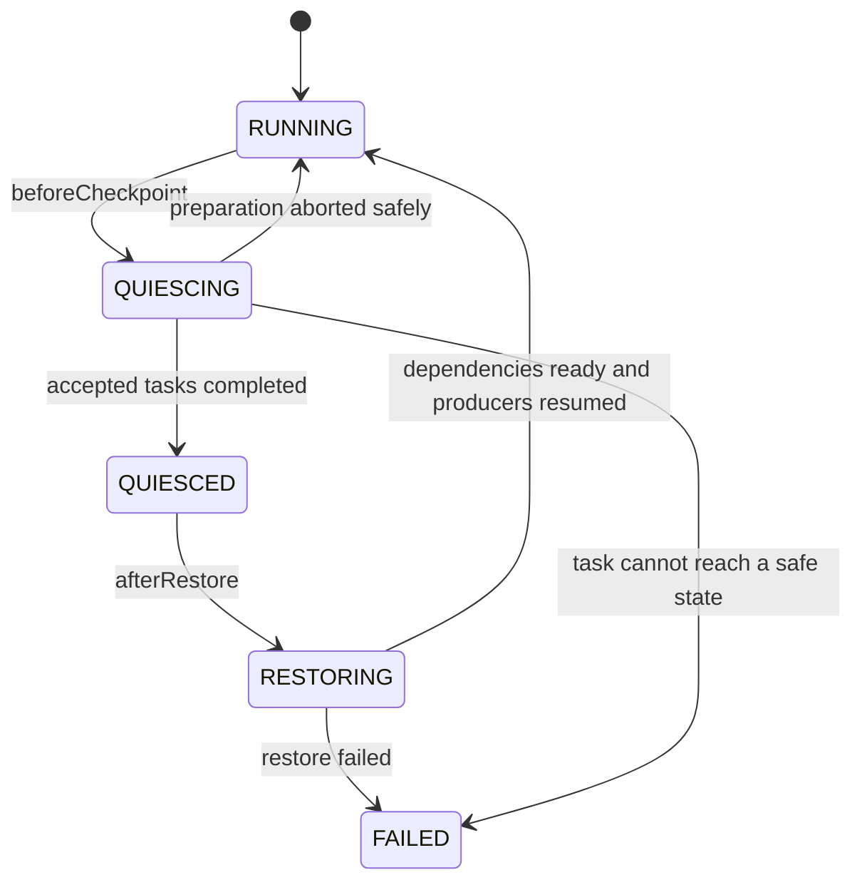
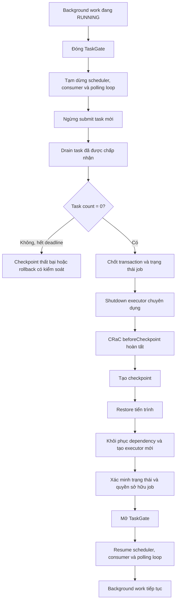

# Tác vụ đang chạy và cách đưa hệ thống về trạng thái yên ổn

Trong CRaC (Coordinated Restore at Checkpoint), ứng dụng cần đưa tiến trình về một trạng thái có thể lưu lại và tiếp tục an toàn sau restore. Với ứng dụng có luồng và tác vụ nền, công việc này phức tạp hơn việc chỉ chờ request HTTP kết thúc. Một ứng dụng có thể đồng thời chạy scheduled job, executor task, message consumer, vòng lặp polling, tác vụ bất đồng bộ hoặc một quy trình xử lý kéo dài.

Nếu checkpoint bắt đầu khi những tác vụ này còn đang thực hiện side effect, ứng dụng có thể được khôi phục ở giữa một quy trình nghiệp vụ. Ví dụ, tác vụ đã ghi dữ liệu vào database nhưng chưa xác nhận message; scheduler đã bắt đầu lần chạy tiếp theo; hoặc một task đang giữ kết nối tới dịch vụ ngoài đã bị đóng trong thời gian checkpoint được lưu trữ.

Mục tiêu là đưa hệ thống về trạng thái **quiescent** (yên ổn): không có nguồn nào tiếp tục tạo công việc mới, không còn tác vụ đang thực hiện thao tác cần bảo vệ, và các công việc đang chờ đã có chính sách xử lý rõ ràng. Sau restore, ứng dụng tạo lại executor, scheduler và consumer cần thiết, xác minh dependency rồi mới tiếp tục nhận công việc.

## 1. Thế nào là trạng thái yên ổn?

Một hệ thống có tác vụ nền được xem là quiescent khi các điều kiện sau đã được đáp ứng:

1. Các nguồn phát sinh công việc mới đã được tạm dừng hoặc đóng admission.
2. Không có task nào mới được đưa vào vùng xử lý trong lúc hệ thống đang drain.
3. Các task đã được chấp nhận đã hoàn tất, hoặc được dừng theo một chính sách an toàn và có thể tiếp tục.
4. Queue trong bộ nhớ đã được xử lý theo chính sách đã chọn; không còn task mơ hồ về trạng thái thực thi.
5. Transaction, message acknowledgment và side effect bên ngoài đã đạt một ranh giới nghiệp vụ xác định.
6. Các tài nguyên mà task sử dụng đã được đóng hoặc chuẩn bị theo callback CRaC.

Quiescent không có nghĩa JVM không còn thread. Một tiến trình Java vẫn có thể có thread quản trị, thread của runtime hoặc thread đang chờ. Điều quan trọng là không còn công việc ứng dụng đang sử dụng tài nguyên hoặc có thể tạo tác động nghiệp vụ trong khi checkpoint diễn ra.

JVM CRaC điều phối trạng thái runtime và thread ở cấp máy ảo. Tuy nhiên, JVM không hiểu một job đã commit dữ liệu hay chưa, message đã được xác nhận hay chưa, hoặc một lịch chạy có cần được thực hiện lại hay không. Ứng dụng phải đưa các hoạt động nghiệp vụ về trạng thái rõ ràng trước khi checkpoint.

### 1.1. Phân biệt các loại công việc nền

| Loại công việc | Nguồn tạo công việc | Vấn đề khi checkpoint |
| --- | --- | --- |
| Scheduled task | `ScheduledExecutorService`, cron, scheduler framework | Lịch có thể kích hoạt thêm task; lần chạy tiếp theo có thể bị trễ hoặc lặp sau restore |
| Executor task | `ExecutorService`, thread pool | Task đang chạy, task đã xếp hàng hoặc task bị từ chối cần được xử lý rõ ràng |
| Message consumer | Kafka, RabbitMQ hoặc broker khác | Message đã nhận nhưng chưa hoàn tất hoặc chưa ack có thể được giao lại |
| Polling loop | Vòng lặp đọc file, database hoặc endpoint | Thread có thể đang chờ, giữ socket hoặc xử lý một batch dở dang |
| Async task | `CompletableFuture`, callback, reactive pipeline | Task có thể tiếp tục sau khi method tạo task đã trả về |
| Background workflow | Job dài gồm nhiều bước | Cần biết bước nào đã hoàn tất và bước nào có thể retry |

Không phải mọi loại công việc đều có cùng chính sách. Scheduled trigger có thể được hủy rồi tạo lại sau restore; task đã được nhận vào executor có thể cần hoàn tất; message chưa xử lý có thể được trả lại broker; workflow dài cần lưu tiến độ bền vững để tiếp tục từ bước cuối cùng đã commit.

## 2. Mô hình vòng đời của tác vụ nền

Một task coordinator có thể sử dụng các trạng thái sau:

| Trạng thái | Ý nghĩa | Có nhận task mới? |
| --- | --- | --- |
| `RUNNING` | Hệ thống đang nhận và thực hiện task | Có |
| `QUIESCING` | Đã ngừng nhận task mới; đang chờ task đã nhận hoàn tất | Không |
| `QUIESCED` | Không còn task được theo dõi đang chạy hoặc chờ thực thi | Không |
| `RESTORING` | Đang tạo lại executor, scheduler và dependency | Không |
| `FAILED` | Không thể bảo đảm trạng thái task hoặc dependency an toàn | Không |

Luồng chuyển trạng thái cơ bản:



Điểm quan trọng là đóng admission trước khi chờ. Nếu chỉ kiểm tra số task đang chạy mà vẫn cho scheduler hoặc consumer submit task mới, số lượng có thể không bao giờ về 0. Sau khi chuyển sang `QUIESCING`, task mới phải bị từ chối hoặc được giữ lại ở một hàng đợi bền vững để xử lý sau.

## 3. Xác định nguồn phát sinh công việc mới

Trước khi drain, cần liệt kê tất cả nguồn có thể tạo task. Chỉ dừng thread pool là chưa đủ nếu scheduler, consumer hoặc một callback vẫn tiếp tục submit công việc.

### 3.1. Scheduler và timer

Với `ScheduledExecutorService`, cần dừng việc kích hoạt các lần chạy định kỳ. `ScheduledFuture.cancel(false)` ngăn lần thực thi tương lai theo hợp đồng của future và không yêu cầu interrupt task đang chạy. Task hiện tại vẫn phải được theo dõi và chờ hoàn tất.

Nếu scheduler sở hữu nhiều lịch, cần lưu danh sách future hoặc một registry lịch để hủy có kiểm soát. Với `ScheduledThreadPoolExecutor`, có thể cấu hình chính sách shutdown để các delayed task và periodic task không tự tiếp tục ngoài ý muốn:

```java
ScheduledThreadPoolExecutor scheduler =
        new ScheduledThreadPoolExecutor(2);

scheduler.setRemoveOnCancelPolicy(true);
scheduler.setExecuteExistingDelayedTasksAfterShutdownPolicy(false);
scheduler.setContinueExistingPeriodicTasksAfterShutdownPolicy(false);
```

Các one-shot task đang chờ cần có chính sách riêng. Nếu task có ý nghĩa nghiệp vụ, hãy lưu trạng thái hoặc lịch chạy ở nơi bền vững để có thể lên lịch lại. Không nên hủy một task quan trọng chỉ vì nó đang nằm trong queue của scheduler.

### 3.2. Message consumer

Consumer cần ngừng nhận message mới trước khi đóng channel hoặc client. Sau đó chờ message đang xử lý đạt trạng thái nghiệp vụ an toàn.

Ví dụ với một consumer xử lý message:

1. Tạm dừng fetch/poll hoặc pause partition/queue.
2. Không bắt đầu xử lý message mới.
3. Chờ message đang xử lý hoàn tất.
4. Commit offset hoặc acknowledge theo đúng semantics của broker và nghiệp vụ.
5. Đóng consumer hoặc để resource tương ứng thực hiện việc đó.

Nếu một message chưa hoàn tất, thường nên để broker giao lại sau khi consumer được tạo lại. Không xác nhận message chỉ để làm cho bộ đếm task về 0. Ngược lại, nếu nghiệp vụ đã commit nhưng ack chưa được gửi, message có thể được giao lại; handler cần idempotent để không tạo side effect trùng.

### 3.3. Polling loop và worker tự quản lý

Với vòng lặp như `while (running)`, cần một tín hiệu dừng có thể quan sát được. Vòng lặp phải kiểm tra tín hiệu tại ranh giới an toàn, hoàn tất hoặc trả lại công việc đang xử lý, rồi thoát.

```java
while (running) {
    WorkItem item = source.poll(pollTimeout);
    if (item == null) {
        continue;
    }

    processAtSafeBoundary(item);
}
```

Trong triển khai thực tế, `running` nên là trạng thái thread-safe, việc `poll` cần timeout hoặc khả năng wake-up, và phần `processAtSafeBoundary` phải có chính sách commit/retry. Không dùng một cờ boolean đơn lẻ nếu có race giữa kiểm tra cờ và bắt đầu side effect.

## 4. Theo dõi task đã được chấp nhận

Để biết khi nào hệ thống đã yên ổn, cần đếm các task đã được nhận vào hệ thống. Bộ đếm nên bao gồm cả task đang chạy và task đã được chấp nhận nhưng còn nằm trong executor queue.

Một cách làm là cấp một lease cho mỗi task ngay tại thời điểm submit. Lease được đóng khi task hoàn tất, thất bại hoặc bị hủy và đã được xử lý theo chính sách. Nhờ vậy, khi admission đóng, task coordinator có thể chờ toàn bộ lease đã cấp được giải phóng.

### 4.1. TaskGate

Ví dụ dưới đây minh họa gate đếm số task được chấp nhận:

```java
import java.time.Duration;
import java.util.concurrent.TimeoutException;
import java.util.concurrent.atomic.AtomicBoolean;
import java.util.concurrent.locks.Condition;
import java.util.concurrent.locks.ReentrantLock;

public final class TaskGate {

    public enum State {
        RUNNING,
        QUIESCING,
        QUIESCED,
        RESTORING,
        FAILED
    }

    private final ReentrantLock lock = new ReentrantLock();
    private final Condition idle = lock.newCondition();
    private State state = State.RUNNING;
    private int acceptedTasks;

    public TaskLease tryAccept() {
        lock.lock();
        try {
            if (state != State.RUNNING) {
                return null;
            }

            acceptedTasks++;
            return new TaskLease(this);
        } finally {
            lock.unlock();
        }
    }

    private void completeOne() {
        lock.lock();
        try {
            if (acceptedTasks <= 0) {
                throw new IllegalStateException("Unbalanced task lease");
            }

            acceptedTasks--;
            if (acceptedTasks == 0) {
                if (state == State.QUIESCING) {
                    state = State.QUIESCED;
                }
                idle.signalAll();
            }
        } finally {
            lock.unlock();
        }
    }

    public void stopAccepting() {
        lock.lock();
        try {
            if (state != State.RUNNING) {
                throw new IllegalStateException(
                        "Cannot quiesce from state " + state);
            }

            state = acceptedTasks == 0 ? State.QUIESCED : State.QUIESCING;
            idle.signalAll();
        } finally {
            lock.unlock();
        }
    }

    public void awaitQuiesced(Duration timeout)
            throws InterruptedException, TimeoutException {
        long remaining = timeout.toNanos();

        lock.lock();
        try {
            if (state != State.QUIESCING && state != State.QUIESCED) {
                throw new IllegalStateException(
                        "Cannot wait for quiescence from state " + state);
            }

            while (acceptedTasks > 0) {
                if (remaining <= 0) {
                    throw new TimeoutException(
                            "Timed out waiting for accepted background tasks");
                }
                remaining = idle.awaitNanos(remaining);
            }

            state = State.QUIESCED;
        } catch (InterruptedException ex) {
            Thread.currentThread().interrupt();
            throw ex;
        } finally {
            lock.unlock();
        }
    }

    public void cancelQuiesce() {
        lock.lock();
        try {
            if (state != State.QUIESCING && state != State.QUIESCED) {
                throw new IllegalStateException(
                        "Cannot cancel quiesce from state " + state);
            }
            state = State.RUNNING;
            idle.signalAll();
        } finally {
            lock.unlock();
        }
    }

    public void beginRestore() {
        lock.lock();
        try {
            if (state != State.QUIESCED) {
                throw new IllegalStateException(
                        "Cannot restore from state " + state);
            }
            state = State.RESTORING;
        } finally {
            lock.unlock();
        }
    }

    public void resume() {
        lock.lock();
        try {
            if (state != State.RESTORING) {
                throw new IllegalStateException(
                        "Cannot resume from state " + state);
            }
            state = State.RUNNING;
            idle.signalAll();
        } finally {
            lock.unlock();
        }
    }

    public void fail() {
        lock.lock();
        try {
            state = State.FAILED;
            idle.signalAll();
        } finally {
            lock.unlock();
        }
    }

    public int acceptedTaskCount() {
        lock.lock();
        try {
            return acceptedTasks;
        } finally {
            lock.unlock();
        }
    }

    public static final class TaskLease implements AutoCloseable {
        private final TaskGate owner;
        private final AtomicBoolean closed = new AtomicBoolean();

        private TaskLease(TaskGate owner) {
            this.owner = owner;
        }

        @Override
        public void close() {
            if (closed.compareAndSet(false, true)) {
                owner.completeOne();
            }
        }
    }
}
```

`tryAccept()` thực hiện kiểm tra trạng thái và tăng bộ đếm trong cùng một critical section. Vì vậy, một task không thể được nhận sau khi `stopAccepting()` đã đóng gate. `TaskLease` idempotent để tránh giảm bộ đếm hai lần nếu nhiều nhánh cleanup cùng gọi `close()`.

### 4.2. Cấp lease ngay khi submit

Nếu chỉ tăng bộ đếm khi worker thread bắt đầu chạy, task đang nằm trong queue sẽ chưa được tính. Callback có thể kết luận sai rằng không còn công việc trong khi queue vẫn chứa task đã được chấp nhận.

Hãy cấp lease trước khi submit và giữ lease cho tới khi task thực sự kết thúc:

```java
import java.util.concurrent.ExecutorService;
import java.util.concurrent.RejectedExecutionException;

public final class TrackedTaskSubmitter {

    private final TaskGate gate;
    private final ExecutorService executor;

    public TrackedTaskSubmitter(TaskGate gate, ExecutorService executor) {
        this.gate = gate;
        this.executor = executor;
    }

    public void submit(Runnable task) {
        TaskGate.TaskLease lease = gate.tryAccept();
        if (lease == null) {
            throw new RejectedExecutionException(
                    "Background task admission is closed");
        }

        try {
            executor.execute(() -> {
                try (lease) {
                    task.run();
                }
            });
        } catch (RuntimeException ex) {
            lease.close();
            throw ex;
        }
    }
}
```

Task được tính từ lúc được admission chấp nhận, kể cả khi còn chờ trong queue. Nếu executor từ chối submit, lease được giải phóng ngay. Nếu task chạy và ném exception, `try-with-resources` vẫn đóng lease. Ví dụ không trả `Future` để caller tùy ý hủy wrapper khi task còn nằm trong queue; nếu ứng dụng cần hủy task đã nhận, cơ chế hủy phải đồng thời giải phóng lease và ghi nhận/requeue công việc đúng một lần.

Caller cần xử lý `RejectedExecutionException` theo semantics của công việc. Với một job có thể retry, hãy trả lại job cho durable queue hoặc ghi trạng thái retry. Không được âm thầm bỏ task chỉ vì gate đã đóng.

## 5. Drain executor và scheduler

Executor và scheduler cần được quản lý theo quyền sở hữu. Một resource chỉ nên gọi `shutdown()` trên executor mà nó thực sự sở hữu. Nếu executor được chia sẻ bởi nhiều subsystem, một thành phần không được tự ý shutdown toàn bộ pool; thay vào đó, cần đóng admission của task thuộc phạm vi mình và chờ các task đó hoàn tất.

### 5.1. Executor chuyên dụng

Với executor chuyên dụng cho một nhóm background task, quy trình thường là:

1. Đóng `TaskGate` để không nhận task mới.
2. Tạm dừng các producer: scheduler, consumer và polling loop.
3. Gọi `shutdown()` để executor không nhận submission mới và xử lý các task đã được queue theo chính sách của executor.
4. Chờ `awaitTermination(timeout)`.
5. Xác nhận bộ đếm task đã về 0.
6. Chỉ sau đó mới cho CRaC tiếp tục checkpoint.

Ví dụ:

```java
executor.shutdown();

if (!executor.awaitTermination(30, TimeUnit.SECONDS)) {
    throw new TimeoutException("Background executor did not terminate");
}

gate.awaitQuiesced(Duration.ofSeconds(5));
```

`shutdown()` không ngắt các task đang chạy; nó cho phép các task đã được submit tiếp tục theo hành vi của executor. `awaitTermination()` chờ executor kết thúc. Nếu hết thời gian, callback phải báo lỗi và checkpoint không được xem là đã chuẩn bị thành công.

Không dùng `shutdownNow()` như thao tác mặc định. Phương thức này yêu cầu interrupt task đang chạy và trả lại các task còn nằm trong queue. Chỉ sử dụng khi task được thiết kế để hủy an toàn và mọi task được trả lại đều được lưu hoặc giao lại đúng cách.

Sau restore, một executor đã shutdown không thể tái sử dụng. Resource sở hữu nó cần tạo executor mới từ cấu hình hiện hành.

### 5.2. Executor dùng chung

Nếu executor dùng chung cho nhiều thành phần, không gọi `shutdown()` chỉ để checkpoint một nhóm task. Thay vào đó:

- đóng gate cho task thuộc nhóm;
- dừng producer của nhóm;
- theo dõi lease của task đã nhận;
- chờ các task thuộc nhóm hoàn tất;
- để owner cấp cao hơn quản lý vòng đời thread pool.

Việc giữ executor sống hay tạo lại sau restore phụ thuộc cách quản lý thread và tích hợp CRaC của runtime. Dù chọn cách nào, không để task của nhóm tiếp tục được submit trong thời gian drain.

### 5.3. ScheduledExecutorService

Với periodic task, cần hủy future để ngăn lần kích hoạt tiếp theo. `cancel(false)` không interrupt lần chạy đang diễn ra; task hiện tại phải được tính trong `TaskGate` và chờ hoàn tất.

```java
for (ScheduledFuture<?> future : periodicJobs) {
    future.cancel(false);
}

scheduler.shutdown();
if (!scheduler.awaitTermination(30, TimeUnit.SECONDS)) {
    throw new TimeoutException("Scheduler did not stop in time");
}
```

Đối với delayed one-shot task, cần quyết định chúng sẽ được chạy trước checkpoint, hủy và lên lịch lại, hay lưu trạng thái vào durable store. Không nên dựa vào việc một đối tượng `ScheduledFuture` còn nằm trong heap để suy ra lịch sẽ tiếp tục đúng sau restore.

## 6. Xử lý task đang chạy và task đang chờ

Không phải task nào cũng có thể kết thúc ngay. Cần xác định task đang ở giai đoạn nào và chọn chính sách phù hợp.

| Trạng thái task | Cách xử lý thường dùng |
| --- | --- |
| Chưa được nhận | Không submit mới khi gate đã đóng |
| Đã được nhận nhưng còn trong queue | Cho chạy tới khi hoàn tất, hoặc hủy và ghi lại để retry theo chính sách |
| Đang thực thi, chưa có side effect | Có thể dừng tại safe point và đưa về trạng thái retry |
| Đang thực thi transaction | Hoàn tất commit/rollback; không cắt ngang tùy tiện |
| Đã commit nhưng chưa ack message | Có thể bị giao lại; handler cần idempotent hoặc đối chiếu trạng thái đã commit |
| Đang gọi dịch vụ bên ngoài | Chờ kết quả trong deadline hoặc lưu trạng thái retry có idempotency key |
| Task dài nhiều bước | Lưu checkpoint nghiệp vụ riêng tại ranh giới bước bền vững |

### 6.1. Safe point trong task

Với một tác vụ dài, có thể chia công việc thành các bước nhỏ và chỉ kiểm tra tín hiệu quiesce ở ranh giới an toàn. Ví dụ, một job xử lý danh sách 10.000 bản ghi có thể hoàn tất một batch, ghi tiến độ bền vững, rồi mới dừng.

```java
for (Batch batch : batches) {
    if (stopRequested.get()) {
        persistProgress(batch.previousCheckpoint());
        return;
    }

    processBatch(batch);
    persistProgress(batch.id());
}
```

Ví dụ này giả định `persistProgress` chỉ ghi một batch đã hoàn tất. Trong thực tế, cần bảo đảm dữ liệu nghiệp vụ và tiến độ được commit nhất quán. Nếu tiến độ được ghi trước khi batch hoàn tất, lần chạy lại có thể bỏ sót dữ liệu; nếu ghi sau nhưng không idempotent, batch có thể được xử lý hai lần.

### 6.2. Không dùng interrupt thay cho quy trình quiesce

Interrupt chỉ là một tín hiệu yêu cầu thread dừng hoặc hủy thao tác chờ. Nó không tự hoàn tác side effect đã xảy ra và không bảo đảm task kết thúc an toàn.

Không nên gửi interrupt cho toàn bộ worker chỉ để làm cho `awaitTermination()` trả về nhanh. Task cần có hợp đồng hủy rõ ràng: nó có thể dừng ở đâu, transaction được rollback thế nào, message được ack hay requeue ra sao, và tiến độ được ghi ở đâu.

Nếu task không thể dừng an toàn trước deadline, checkpoint nên thất bại hoặc task phải được chuyển sang trạng thái durable có thể tiếp tục. Không tạo ảnh như thể hệ thống đã yên ổn trong khi task vẫn đang tạo side effect.

## 7. Queue trong bộ nhớ và hàng đợi bền vững

Một queue trong bộ nhớ là một phần trạng thái của tiến trình. Việc checkpoint có thể giữ các đối tượng trong queue, nhưng không tự tạo semantics giao nhận exactly-once. Sau restore, một task có thể được thực thi lại trong khi side effect từ lần trước đã xảy ra ở hệ thống bên ngoài.

Với task nghiệp vụ quan trọng, nên dùng durable queue hoặc lưu trạng thái job trong database. Mỗi job có thể có trạng thái như:

```text
PENDING -> CLAIMED -> RUNNING -> COMPLETED
                 \-> RETRY
                 \-> FAILED
```

Khi chuẩn bị checkpoint:

- ngừng claim job mới;
- hoàn tất job đang chạy hoặc trả lease/claim về trạng thái có thể retry;
- ghi tiến độ tại ranh giới nghiệp vụ bền vững;
- để các job chưa bắt đầu ở trạng thái `PENDING` hoặc `RETRY` trong durable store.

Sau restore:

- kết nối lại durable queue;
- lấy claim/lease mới từ hệ thống điều phối;
- tiếp tục job từ trạng thái đã commit;
- dùng idempotency key hoặc unique constraint để chống side effect trùng.

Không nên serialize một executor queue tùy ý rồi coi đó là cơ chế phục hồi công việc. Đối tượng task có thể giữ tham chiếu tới socket, transaction, thread-local hoặc dữ liệu không còn hợp lệ sau restore.

## 8. Tích hợp với Resource CRaC

Một resource có thể điều phối nhóm background task. Nó đăng ký với global context và thực hiện việc dừng nguồn phát sinh task, drain task đã nhận, rồi tạo lại executor/scheduler sau restore.

Ví dụ cấu trúc:

```java
import java.time.Duration;
import java.util.concurrent.ExecutorService;
import java.util.concurrent.TimeUnit;
import java.util.concurrent.TimeoutException;

import org.crac.Context;
import org.crac.Core;
import org.crac.Resource;

public final class BackgroundWorkResource implements Resource {

    private final TaskGate gate;
    private final TaskProducers producers;
    private ExecutorService executor;

    public BackgroundWorkResource(
            TaskGate gate,
            TaskProducers producers) {
        this.gate = gate;
        this.producers = producers;
        this.executor = createExecutor();
        Core.getGlobalContext().register(this);
    }

    @Override
    public void beforeCheckpoint(Context<? extends Resource> context)
            throws Exception {
        gate.stopAccepting();
        producers.pauseAndCancelTriggers();

        executor.shutdown();
        if (!executor.awaitTermination(30, TimeUnit.SECONDS)) {
            throw new TimeoutException(
                    "Background tasks did not finish before checkpoint");
        }

        gate.awaitQuiesced(Duration.ofSeconds(5));
        producers.verifyNoActiveWork();
    }

    @Override
    public void afterRestore(Context<? extends Resource> context)
            throws Exception {
        gate.beginRestore();
        executor = createExecutor();
        producers.restoreDependencies();
        producers.verifyReady();
        gate.resume();
        producers.resumeTriggers();
    }

    private ExecutorService createExecutor() {
        return java.util.concurrent.Executors.newFixedThreadPool(4);
    }
}
```

`TaskProducers` là interface nội bộ minh họa, đại diện cho scheduler, consumer và polling loop mà resource này sở hữu. `pauseAndCancelTriggers()` phải ngừng tạo task mới; `verifyNoActiveWork()` xác nhận những nguồn bên ngoài executor cũng đã drain; `restoreDependencies()` tạo lại client và kết nối cần thiết.

Ví dụ giả định resource sở hữu executor chuyên dụng và các producer. Nếu executor được chia sẻ, không shutdown executor đó ở đây. Nếu scheduler hoặc consumer được một CRaC resource khác quản lý, không dừng hoặc khởi động chúng lần nữa trong `TaskProducers`; cần xác định một owner duy nhất cho mỗi vòng đời.

### 8.1. Thứ tự restore

Sau restore, executor có thể được tạo lại trước khi các dependency nghiệp vụ đã sẵn sàng. Vì vậy, không mở task admission hoặc resume producer quá sớm.

Một thứ tự phù hợp thường là:

1. Khôi phục database pool, broker client và các dependency cần thiết.
2. Tạo executor và scheduler mới.
3. Xác minh kết nối, cấu hình, credential và trạng thái điều phối.
4. Đưa task gate sang `RUNNING`.
5. Khởi động lại scheduler, consumer và polling loop.
6. Chuyển readiness ứng dụng thành ready.

Nếu callback của nhiều resource được điều phối riêng, cần bảo đảm thứ tự dependency theo hợp đồng CRaC và framework đang dùng. Một coordinator chung có thể đơn giản hóa thứ tự nếu các bước cần phối hợp chặt chẽ.

### 8.2. Nếu chuẩn bị checkpoint thất bại

Nếu `beforeCheckpoint` thất bại, không được giả định `afterRestore` sẽ được gọi. `afterRestore` dành cho tiến trình được khôi phục từ checkpoint. Khi checkpoint bị hủy và tiến trình hiện tại tiếp tục chạy, lifecycle manager cần có đường rollback riêng để:

- tạo lại executor nếu executor đã shutdown;
- mở lại gate nếu chưa có tài nguyên nào bị đóng;
- khởi động lại scheduler hoặc consumer theo trạng thái hiện hành;
- xác minh dependency trước khi đưa instance trở lại ready.

Nếu một phần tài nguyên đã đóng và không thể rollback an toàn, giữ instance ở trạng thái chưa sẵn sàng và dùng quy trình phục hồi hoặc restart. Không mở gate chỉ vì muốn tiếp tục phục vụ khi chưa xác nhận các tài nguyên hoạt động được.

## 9. Tác vụ định kỳ và thời gian sau restore

Checkpoint có thể được lưu trong một khoảng thời gian rồi mới được restore. Lịch chạy cần được đánh giá lại theo thời điểm thực tế, vì một scheduled task có thể đã bỏ lỡ nhiều chu kỳ trong thời gian đó.

Ví dụ một báo cáo chạy mỗi phút. Nếu checkpoint được tạo lúc 10:00 và restore lúc 10:20, ứng dụng cần quyết định:

- chỉ chạy một lần ngay sau restore;
- bỏ qua các chu kỳ đã lỡ và đợi lịch kế tiếp;
- chạy bù từng chu kỳ bị bỏ lỡ;
- tính lại lịch từ thời điểm restore.

Không có một chính sách phù hợp cho mọi task. Job tạo snapshot có thể chỉ cần chạy một lần; job đồng bộ dữ liệu có thể cần catch-up; job gửi thông báo có thể không được phép chạy bù hàng loạt.

Nên lưu trạng thái lịch hoặc watermark nghiệp vụ ở nơi bền vững nếu việc bỏ lỡ chu kỳ ảnh hưởng đến tính đúng đắn. Khi restore, tạo lịch mới từ trạng thái đã lưu thay vì tin rằng timer trong heap phản ánh đúng thời gian thực bên ngoài.

## 10. Side effect, transaction và xử lý trùng

Task nền thường tương tác với hệ thống bên ngoài. Checkpoint không thể hoàn tác một email đã gửi, một message đã publish hoặc một bản ghi đã commit. Vì vậy, task cần có ranh giới hoàn tất rõ ràng.

Ví dụ với consumer:

1. Nhận message và kiểm tra message id.
2. Bắt đầu transaction.
3. Ghi kết quả nghiệp vụ.
4. Commit transaction.
5. Acknowledge message hoặc commit offset.

Nếu checkpoint xảy ra sau bước 4 nhưng trước bước 5, broker có thể giao lại message. Handler cần kiểm tra message id hoặc idempotency key để nhận ra nghiệp vụ đã hoàn tất. Nếu ack trước bước 4, message có thể bị mất khi tiến trình dừng.

Các nguyên tắc cần áp dụng:

- Commit hoặc rollback transaction trước khi task được tính là hoàn tất.
- Chỉ ack/commit offset sau khi side effect cần thiết đã bền vững.
- Dùng idempotency key, unique constraint hoặc inbox/outbox pattern để xử lý giao lại.
- Lưu tiến độ job dài tại ranh giới bước đã commit.
- Không giữ transaction hoặc connection qua khoảng thời gian checkpoint.
- Không coi việc thread đã kết thúc là bằng chứng side effect đã được ghi bền vững.

CRaC giúp tái sử dụng trạng thái tiến trình. Nó không tự cung cấp exactly-once processing cho message hoặc background job.

## 11. Timeout và cách xử lý task không kết thúc

Drain phải có deadline. Một task có thể bị treo ở lời gọi HTTP, truy vấn database, lock hoặc thao tác I/O. Nếu chờ vô hạn, quá trình checkpoint sẽ không hoàn tất.

| Tình huống | Hành động phù hợp |
| --- | --- |
| Tất cả task kết thúc trong deadline | Đánh dấu quiesced và tiếp tục checkpoint |
| Task còn chạy nhưng có thể dừng ở safe point | Yêu cầu dừng, chờ task ghi tiến độ và kết thúc |
| Task chờ dịch vụ ngoài | Dùng timeout của client; sau deadline lưu trạng thái retry nếu có thể |
| Task không thể kết thúc an toàn | Báo checkpoint thất bại; không tạo ảnh như thể hệ thống đã yên ổn |
| Task đã submit nhưng executor từ chối | Giải phóng lease và đưa task về durable queue hoặc báo lỗi cho producer |
| Task bị hủy khi còn trong queue | Ghi nhận rõ task đã được requeue hoặc hủy theo chính sách |
| Executor không terminate đúng hạn | Giữ instance chưa sẵn sàng; rollback hoặc restart theo lifecycle manager |

Thời gian chờ task cần nhỏ hơn deadline tổng thể dành cho checkpoint. Hãy dành thêm thời gian cho callback đóng resource, JVM/CRIU ghi ảnh và các thao tác của nền tảng triển khai.

Không gọi `shutdownNow()` rồi bỏ qua danh sách task trả về. Các task đó đã được nhận nhưng chưa chạy; nếu không được lưu hoặc requeue, hệ thống có thể mất công việc. Với task đang chạy, interrupt chỉ an toàn khi task được thiết kế để xử lý interruption và rollback side effect đúng cách.

## 12. Nhiều instance restore từ cùng checkpoint

Một checkpoint có thể được dùng để tạo nhiều instance. Nếu mỗi instance cùng khởi động một scheduler hoặc cùng claim một job, hệ thống có thể thực hiện công việc trùng lặp.

Các biện pháp thường dùng:

- Tạo instance identity mới sau restore nếu hệ thống cần định danh riêng.
- Dùng distributed lock hoặc lease bên ngoài để xác định instance sở hữu một job độc quyền.
- Dùng consumer group hoặc cơ chế phân vùng của broker để phân phối message.
- Dùng idempotency key và unique constraint cho side effect có thể được gửi lại.
- Chỉ cho phép một scheduler leader tạo lịch toàn cục nếu nghiệp vụ yêu cầu.
- Xác minh lease/lock đã hết hạn hoặc được cấp lại; không dựa vào object lock trong heap để kết luận instance vẫn sở hữu tài nguyên.

TaskGate chỉ kiểm soát task trong một tiến trình. Nó không thay thế điều phối phân tán giữa nhiều bản restore.

## 13. Quan sát trạng thái task và quá trình quiesce

Để xác định vì sao hệ thống chưa yên ổn, cần ghi nhận được trạng thái task và nguồn tạo task.

Metric hữu ích:

- số task đã được chấp nhận;
- số task đang chạy;
- số task đang chờ trong executor queue;
- số task bị từ chối khi gate đóng;
- số task bị hủy hoặc requeue;
- thời gian chạy của task dài nhất;
- thời gian drain tổng thể;
- số lần drain timeout;
- thời gian shutdown và khởi tạo lại executor;
- thời điểm scheduler/consumer pause và resume;
- thời gian từ restore đến khi task processing hoạt động lại.

Log nên chứa job id, task type, trạng thái trước/sau và correlation id. Không ghi token, payload nhạy cảm hoặc thông tin kết nối chỉ để chẩn đoán drain.

### 13.1. Các tình huống cần thử

| Kịch bản | Kết quả mong đợi |
| --- | --- |
| Task đang chạy khi gate đóng | Task được phép hoàn tất; callback chờ lease được giải phóng |
| Producer submit task mới sau khi gate đóng | Task bị từ chối hoặc được giữ lại ở durable queue |
| Task đã queue trước khi gate đóng | Được drain hoặc requeue theo chính sách đã chọn |
| Scheduled task định kỳ | Future bị hủy; lần chạy hiện tại hoàn tất |
| Message đang xử lý | Được hoàn tất/ack đúng thứ tự hoặc được giao lại an toàn |
| Task ném exception | Lease được giải phóng và trạng thái lỗi được ghi nhận |
| Task không kết thúc trước timeout | Checkpoint thất bại; không giả định task đã hoàn tất |
| Restore thành công | Executor/scheduler mới được tạo; dependency sẵn sàng trước khi resume |
| Nhiều instance restore | Không tạo side effect trùng nhờ lease, idempotency hoặc phân phối job |

Smoke test nên tạo một task chạy đủ lâu, kích hoạt quiesce trong lúc task đang hoạt động, thử submit thêm task, rồi xác nhận task mới bị từ chối và task cũ được drain. Sau đó tạo checkpoint và restore trong môi trường CRaC tương thích, xác nhận executor mới hoạt động và scheduler không chạy trùng.

## 14. Quy trình tham khảo từ lúc chuẩn bị đến sau restore



Sơ đồ là một trình tự khái quát. Trong ứng dụng thực tế, executor có thể dùng chung, scheduler có thể do framework sở hữu và consumer có thể là một CRaC resource riêng. Khi đó cần điều phối theo quyền sở hữu thật và tránh dừng/khởi động cùng một thành phần nhiều lần.

## 15. Kết luận

Đưa hệ thống có tác vụ nền về trạng thái yên ổn đòi hỏi ngừng mọi nguồn tạo công việc mới, theo dõi task đã được chấp nhận, xử lý queue theo chính sách rõ ràng và chờ các side effect đạt ranh giới nghiệp vụ an toàn. Scheduled task, executor task, message consumer và workflow dài cần cách drain khác nhau; không thể chỉ dừng thread pool rồi xem hệ thống đã sẵn sàng checkpoint.

Trong CRaC, `beforeCheckpoint` là nơi resource phối hợp dừng producer và drain task; `afterRestore` là nơi tạo lại executor, scheduler và kết nối cần thiết. Chỉ resume task khi dependency đã sẵn sàng. Với công việc quan trọng, durable state, idempotency và lease phân tán bảo đảm hệ thống tiếp tục đúng ngay cả khi task bị giao lại hoặc checkpoint được dùng để tạo nhiều instance.
