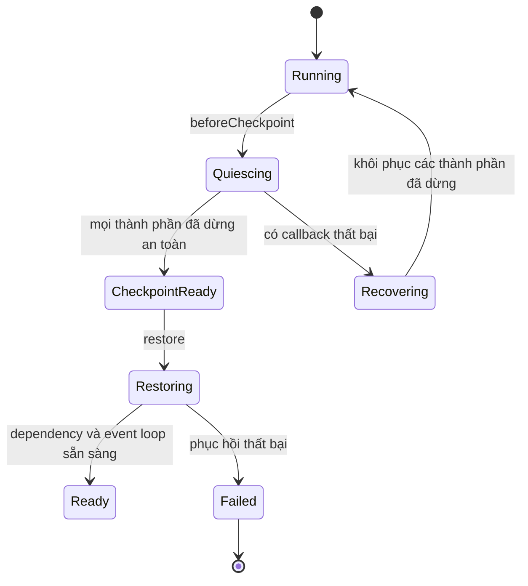

# Event loop và thứ tự tạm dừng các thành phần dùng chung

Ứng dụng Java thường có một hoặc nhiều event loop để nhận sự kiện, đưa công việc vào hàng đợi và điều phối callback trên các luồng xử lý. Event loop có thể dùng chung connection pool, cache, scheduler, registry, message client hoặc trạng thái nghiệp vụ. Khi tạo checkpoint CRaC, các thành phần này phải được tạm dừng theo một thứ tự có kiểm soát để không còn công việc mới đi vào trong khi dependency đã bị đóng.

Thứ tự phục hồi cũng quan trọng như thứ tự tạm dừng. Thành phần nền tảng phải sẵn sàng trước event loop; event loop phải sẵn sàng trước khi ingress, consumer hoặc scheduler tiếp tục phát sinh công việc. Nếu khởi động producer quá sớm, nó có thể gửi task vào một event loop chưa chạy hoặc truy cập một connection pool chưa được tạo lại.

Một quy trình an toàn thường đi theo chiều: **ngừng nhận công việc mới → chặn admission → xử lý hết công việc đang chạy → tạm dừng event loop → đóng hoặc flush thành phần dùng chung → checkpoint**. Sau restore, thực hiện chiều ngược lại: **phục hồi thành phần dùng chung → khởi động event loop → mở admission → khởi động lại producer và nhận traffic**.

## 1. Event loop và các thành phần dùng chung

Event loop là vòng lặp điều phối công việc. Nó thường chờ sự kiện từ socket, timer, queue hoặc một nguồn sự kiện khác, sau đó gọi handler tương ứng. Trong một ứng dụng, có thể có nhiều event loop theo từng subsystem hoặc một event loop dùng chung cho nhiều loại công việc.

Một số thành phần thường được event loop và handler sử dụng:

| Thành phần | Vai trò | Rủi ro nếu bị dừng sai thứ tự |
|---|---|---|
| Ingress hoặc producer | Nhận request, message, timer hoặc event bên ngoài | Tiếp tục gửi công việc khi hệ thống đang quiesce |
| Event loop | Nhận và phân phối task tới handler | Task mới vào khi dependency đang đóng hoặc loop chưa sẵn sàng |
| Executor/worker pool | Chạy công việc được event loop dispatch | Task đang chạy bị gián đoạn hoặc worker truy cập tài nguyên đã đóng |
| Connection pool | Cung cấp kết nối database hoặc dịch vụ | Handler đang chạy dùng connection không còn hợp lệ |
| Cache/registry | Giữ trạng thái dùng chung trong bộ nhớ | Dữ liệu chưa được flush hoặc chưa được làm mới khi restore |
| Scheduler | Phát sinh tác vụ theo lịch | Timer kích hoạt trong lúc ứng dụng chưa phục hồi |
| Queue | Lưu task chờ xử lý | Task bị mất, xử lý hai lần hoặc không rõ trạng thái sau checkpoint |

Không phải mọi thành phần đều phải đóng. Một cache thuần Java có thể được giữ trong checkpoint nếu dữ liệu của nó còn hợp lệ. Một connection pool thường cần đóng hoặc refresh theo hướng dẫn CRaC của thư viện. Một queue có thể cần flush, drain hoặc giữ nguyên tùy semantics. Điều quan trọng là xác định quan hệ phụ thuộc và trạng thái cần bảo toàn của từng thành phần.

## 2. Vì sao phải tạm dừng theo thứ tự?

Giả sử một HTTP listener nhận request, gửi task vào event loop, handler đọc cache và truy cập database qua connection pool. Nếu đóng connection pool trước khi listener ngừng nhận request và event loop drain task, handler đang chạy có thể thất bại vì pool đã đóng.

Ngược lại, sau restore, nếu mở listener trước khi pool và event loop sẵn sàng, request mới có thể tới một hệ thống chưa thể xử lý. Kết quả có thể là lỗi kết nối, task bị từ chối hoặc trạng thái nghiệp vụ dở dang.

Sắp xếp theo quan hệ phụ thuộc giải quyết hai chiều:

- Trước checkpoint, consumer dừng trước provider. Thành phần tạo công việc dừng trước event loop; event loop drain trước khi các dependency nó dùng bị đóng.
- Sau restore, provider sẵn sàng trước consumer. Cache, pool và registry được phục hồi trước event loop; ingress và producer chỉ chạy sau khi event loop đã nhận task được.

Ví dụ thứ tự:

```mermaid
flowchart TD
    subgraph CP[Trước checkpoint]
      A[Ngừng ingress và producer] --> B[Đóng admission của event loop]
      B --> C[Drain task và in-flight handler]
      C --> D[Tạm dừng event loop và worker]
      D --> E[Flush hoặc đóng shared resources]
      E --> F[Tạo checkpoint]
    end
    subgraph RS[Sau restore]
      G[Phục hồi shared resources] --> H[Khởi động event loop và worker]
      H --> I[Mở admission]
      I --> J[Khởi động producer và ingress]
      J --> K[Phục vụ công việc]
    end
```



Đây là thứ tự logic. Cách thực hiện cụ thể phụ thuộc framework, số event loop, queue và cách các resource được đăng ký với CRaC.

## 3. Xác định các giai đoạn quiesce

Quiesce là quá trình đưa ứng dụng về trạng thái không còn công việc mới và không còn thao tác đang sử dụng tài nguyên sắp bị đóng. Chỉ đặt một cờ `paused = true` thường chưa đủ, vì producer có thể đang gửi task đúng lúc cờ thay đổi hoặc queue vẫn còn task đang chờ.

Một quy trình quiesce cần các giai đoạn sau.

### 3.1. Ngừng nguồn phát sinh công việc

Trước tiên, dừng hoặc tạm ngừng các nguồn tạo task:

- Ngừng nhận request mới ở HTTP listener hoặc gateway.
- Tạm dừng message consumer hoặc giảm số message được poll.
- Dừng scheduler phát sinh timer task.
- Ngừng đọc sự kiện mới từ socket, file watcher hoặc broker.
- Tạm dừng job nội bộ và các callback định kỳ.

Việc ngừng producer cần có xác nhận. Chẳng hạn, message consumer chỉ nên được coi là dừng khi poll loop không còn dispatch message mới. HTTP listener có thể cần ngừng accept hoặc trả trạng thái unavailable trong lúc quiesce.

### 3.2. Đóng cổng admission

Sau khi các producer đã dừng, event loop cần từ chối task mới từ các đường gọi còn lại. Một admission gate giúp đồng bộ giữa thao tác gửi task và thời điểm bắt đầu quiesce.

Khi gate đóng, mọi submit mới phải nhận kết quả rõ ràng: bị từ chối, được giữ ở một hàng đợi bền vững bên ngoài, hoặc được chuyển sang cơ chế retry của caller. Không nên âm thầm bỏ task.

### 3.3. Drain công việc đã được chấp nhận

Các task được chấp nhận trước khi gate đóng có thể vẫn nằm trong queue hoặc đang chạy. Hãy đợi chúng hoàn tất trong một deadline hữu hạn. Drain cần bao gồm:

- Task đang chờ trong event loop queue.
- Handler đang chạy trên event loop thread.
- Công việc đã dispatch sang worker pool.
- Callback hoặc continuation sẽ quay lại event loop.
- Transaction hoặc thao tác ghi đang cần commit/rollback.

Nếu công việc không thể hoàn tất trong thời gian cho phép, hãy có chính sách rõ ràng: hủy an toàn, lưu trạng thái vào durable queue hoặc làm checkpoint thất bại. Không được đóng shared resource khi vẫn còn handler có thể sử dụng nó.

### 3.4. Flush và tạm dừng thành phần dùng chung

Khi event loop và worker đã drain, từng shared resource có thể flush dữ liệu, đóng kết nối hoặc ghi trạng thái cần bảo toàn. Ví dụ, cache ghi dữ liệu bẩn xuống storage, producer commit offset, transaction hoàn tất và connection pool đóng các connection.

Không phải thao tác flush nào cũng cần thiết. Một cache có thể được dựng lại từ nguồn dữ liệu chính; một queue bền vững có thể tự giữ message chưa xử lý. Hãy dựa vào semantics của thành phần thay vì flush mọi thứ một cách máy móc.

## 4. Đóng admission an toàn trước khi drain

Một race condition phổ biến xảy ra khi một thread kiểm tra gate đang mở, trong khi thread khác đóng gate và bắt đầu drain. Thread đầu tiên có thể submit task sau khi quá trình drain đã kiểm tra queue rỗng.

Để tránh race, thao tác kiểm tra gate và ghi nhận task được chấp nhận phải có một điểm đồng bộ nguyên tử. Ví dụ dưới đây dùng `ReentrantLock` và `Condition` để quản lý số task đang được chấp nhận hoặc đang thực thi.

```java
import java.time.Duration;
import java.util.concurrent.TimeUnit;
import java.util.concurrent.locks.Condition;
import java.util.concurrent.locks.ReentrantLock;

public final class AdmissionGate {
    private final ReentrantLock lock = new ReentrantLock();
    private final Condition idle = lock.newCondition();
    private boolean accepting = true;
    private int inFlight;

    public boolean tryEnter() {
        lock.lock();
        try {
            if (!accepting) {
                return false;
            }
            inFlight++;
            return true;
        } finally {
            lock.unlock();
        }
    }

    public void leave() {
        lock.lock();
        try {
            if (inFlight <= 0) {
                throw new IllegalStateException("Unbalanced leave()");
            }
            inFlight--;
            if (inFlight == 0) {
                idle.signalAll();
            }
        } finally {
            lock.unlock();
        }
    }

    public void closeAdmission() {
        lock.lock();
        try {
            accepting = false;
        } finally {
            lock.unlock();
        }
    }

    public boolean awaitIdle(Duration timeout) throws InterruptedException {
        long remaining = timeout.toNanos();
        lock.lockInterruptibly();
        try {
            while (inFlight != 0) {
                if (remaining <= 0) {
                    return false;
                }
                remaining = idle.awaitNanos(remaining);
            }
            return true;
        } finally {
            lock.unlock();
        }
    }

    public void openAdmission() {
        lock.lock();
        try {
            if (inFlight != 0) {
                throw new IllegalStateException(
                        "Cannot open admission while old work is in flight");
            }
            accepting = true;
        } finally {
            lock.unlock();
        }
    }
}
```

Mỗi task cần gọi `tryEnter()` trước khi được nhận và gọi `leave()` đúng một lần khi hoàn tất hoặc bị hủy. Nên dùng `try/finally` quanh phần thực thi để không làm rò rỉ bộ đếm:

```java
if (!gate.tryEnter()) {
    rejectOrDefer(task);
    return;
}

eventLoop.execute(() -> {
    try {
        handle(task);
    } finally {
        gate.leave();
    }
});
```

Đoạn ví dụ giả định `execute()` không từ chối task sau khi gate đã chấp nhận. Trong triển khai thật, nếu `execute()` ném `RejectedExecutionException` hoặc việc enqueue thất bại, caller phải gọi `leave()` để hoàn tác bộ đếm. Cũng cần bảo đảm `leave()` được gọi khi task bị hủy trước khi bắt đầu chạy.

`inFlight` trong ví dụ đại diện cho toàn bộ công việc đã được nhận, không chỉ handler đang chạy. Nếu handler dispatch sang worker khác hoặc tạo continuation bất đồng bộ, phạm vi admission phải kéo dài cho tới khi toàn bộ chuỗi công việc kết thúc. Nếu chỉ giảm bộ đếm ngay khi handler enqueue sang worker, drain có thể báo idle trong khi worker vẫn dùng shared resource.

## 5. Phân biệt queue rỗng và hệ thống idle

Queue rỗng không có nghĩa hệ thống đã idle. Có thể có task đang chạy, task đã dispatch sang worker pool, callback đang chờ hoàn tất I/O hoặc timer đã được kích hoạt nhưng chưa enqueue.

Một điều kiện quiesce đáng tin cậy cần kết hợp:

1. Producer không còn phát sinh task mới.
2. Admission gate đã đóng.
3. Queue nội bộ không còn task chờ xử lý.
4. Số task đã được chấp nhận nhưng chưa hoàn tất bằng 0.
5. Worker và event loop không còn thực thi handler có thể truy cập shared resource.
6. Các transaction hoặc thao tác ghi đã commit, rollback hoặc được lưu lại an toàn.

Với event loop có nhiều queue, cần drain từng queue. Với hệ thống reactive, một callback có thể tạo thêm callback khác; hãy tính cả continuation và subscription. Với actor model, cần xác định mailbox nào phải drain và message nào có thể giữ lại trong durable mailbox.

## 6. Đăng ký Resource theo đúng thứ tự dependency

CRaC phân phối callback theo thứ tự đăng ký của context. Với global context, `beforeCheckpoint` được gọi theo thứ tự ngược với đăng ký; `afterRestore` được gọi theo thứ tự đăng ký. Quy tắc này cho phép tạo thứ tự tạm dừng và phục hồi bằng cách đăng ký provider trước consumer.

Giả sử ứng dụng có:

- `SharedServicesResource`: quản lý cache, connection pool và registry.
- `EventLoopResource`: quản lý event loop và admission gate.
- `IngressResource`: quản lý listener, message consumer và scheduler.

Hãy đăng ký theo thứ tự:

```java
var global = Core.getGlobalContext();

global.register(sharedServicesResource); // Provider
global.register(eventLoopResource);      // Consumer của shared services
global.register(ingressResource);        // Producer gửi task vào event loop
```

Kết quả:

| Pha | Thứ tự callback | Lý do |
|---|---|---|
| `beforeCheckpoint` | Ingress → Event loop → Shared services | Ngừng producer, drain consumer, sau đó mới đóng provider |
| `afterRestore` | Shared services → Event loop → Ingress | Phục hồi provider, khởi động consumer, cuối cùng mới nhận công việc |

Nếu một subsystem có nhiều resource phụ thuộc, có thể dùng các `Context` con để gom theo ranh giới subsystem. Hãy bảo đảm thứ tự đăng ký trong từng context con cũng phản ánh chiều dependency. Không đăng ký cùng một resource ở cả context cha và context con vì nó có thể nhận callback nhiều lần.

## 7. Triển khai EventLoopResource

Phần quản lý event loop phụ thuộc framework. Một event loop có thể được pause/resume, hoặc có thể cần đóng và tạo lại worker thread hay selector. Hãy dùng API lifecycle được framework hỗ trợ; không tự ý dừng thread bằng `Thread.stop()` hoặc bỏ mặc thread đang xử lý callback.

Một adapter giúp tách chính sách CRaC khỏi framework cụ thể:

```java
import java.time.Duration;

public interface EventLoopController {
    void closeAdmission();

    boolean drain(Duration timeout) throws InterruptedException;

    void pauseOrStop() throws Exception;

    void startOrResume(Duration timeout) throws Exception;

    void openAdmission();
}
```

Resource điều phối adapter:

```java
import java.time.Duration;

import org.crac.Context;
import org.crac.Resource;

public final class EventLoopResource implements Resource {
    private final EventLoopController controller;
    private final Duration drainTimeout;
    private final Duration startTimeout;

    public EventLoopResource(
            EventLoopController controller,
            Duration drainTimeout,
            Duration startTimeout) {
        this.controller = controller;
        this.drainTimeout = drainTimeout;
        this.startTimeout = startTimeout;
    }

    @Override
    public void beforeCheckpoint(Context<? extends Resource> context)
            throws Exception {
        controller.closeAdmission();

        if (!controller.drain(drainTimeout)) {
            throw new IllegalStateException(
                    "Event loop did not become idle before checkpoint");
        }

        controller.pauseOrStop();
    }

    @Override
    public void afterRestore(Context<? extends Resource> context)
            throws Exception {
        controller.startOrResume(startTimeout);
        controller.openAdmission();
    }
}
```

Resource này giả định ingress đã ngừng trước khi callback chạy và shared services đã được phục hồi trước `afterRestore`. Điều đó được bảo đảm bằng thứ tự đăng ký trong context. Nếu `drain()` hết timeout, callback báo lỗi và checkpoint không nên tiếp tục với event loop vẫn đang dùng tài nguyên. Nếu `startOrResume()` thất bại, ứng dụng không được mở admission.

Adapter thực tế cần bảo đảm `drain()` đếm cả task trên event loop lẫn công việc được dispatch sang worker. Nếu framework đã có API quiesce/drain chuyên dụng, ưu tiên dùng API đó thay vì xây dựng một bộ đếm song song không đồng bộ với queue thật.

## 8. Quản lý shared resources

Shared resource nên có lifecycle riêng. Ví dụ, một resource quản lý connection pool và cache có thể thực hiện:

```java
import org.crac.Context;
import org.crac.Resource;

public final class SharedServicesResource implements Resource {
    private final SharedServices services;

    public SharedServicesResource(SharedServices services) {
        this.services = services;
    }

    @Override
    public void beforeCheckpoint(Context<? extends Resource> context)
            throws Exception {
        services.flushRequiredState();
        services.closeExternalConnections();
    }

    @Override
    public void afterRestore(Context<? extends Resource> context)
            throws Exception {
        services.reopenExternalConnections();
        services.refreshEnvironmentDependentState();
    }
}
```

`SharedServices` là abstraction của ứng dụng. Thứ tự bên trong callback cũng cần theo dependency: flush cache trước khi đóng storage mà cache cần ghi; làm mới cấu hình trước khi tạo connection pool; xác thực registry trước khi event loop nhận task.

Không nên đóng mọi shared object theo một danh sách tùy ý. Chia thành các resource nhỏ theo vòng đời và quan hệ phụ thuộc sẽ giúp xác định lỗi dễ hơn. Tuy nhiên, tránh chia quá nhỏ tới mức nhiều resource cùng quản lý một pool hoặc một cache.

## 9. Quản lý ingress, consumer và scheduler

IngressResource là lớp ngoài cùng trong chuỗi dependency vì nó phát sinh task cho event loop. Trước checkpoint, nó phải ngừng nguồn phát sinh trước khi event loop drain. Sau restore, nó chỉ được khởi động lại khi event loop và shared services đã sẵn sàng.

```java
import java.time.Duration;

import org.crac.Context;
import org.crac.Resource;

public final class IngressResource implements Resource {
    private final IngressController ingress;
    private final Duration stopTimeout;
    private final Duration startTimeout;

    public IngressResource(
            IngressController ingress,
            Duration stopTimeout,
            Duration startTimeout) {
        this.ingress = ingress;
        this.stopTimeout = stopTimeout;
        this.startTimeout = startTimeout;
    }

    @Override
    public void beforeCheckpoint(Context<? extends Resource> context)
            throws Exception {
        ingress.stopAcceptingNewWork(stopTimeout);
    }

    @Override
    public void afterRestore(Context<? extends Resource> context)
            throws Exception {
        ingress.startAcceptingNewWork(startTimeout);
    }
}
```

`stopAcceptingNewWork()` cần dừng cả các nguồn chủ động như scheduler và message consumer. Chỉ đóng cổng HTTP không đủ nếu một scheduled task vẫn enqueue công việc. Với message broker, cần xác định semantics của acknowledgment và offset: message đã nhận nhưng chưa hoàn tất phải được xử lý, lưu lại hoặc để broker redeliver theo cách không gây mất hay nhân đôi nghiệp vụ.

Scheduler cần được pause và quản lý timer đang chờ. Sau restore, tránh chạy dồn tất cả tác vụ định kỳ đã bị lỡ nếu điều đó tạo ra một đợt tải lớn. Chọn chính sách bỏ qua, gộp hoặc chạy bù theo semantics của từng job.

## 10. Hàng đợi: drain, giữ lại hay lưu bền vững?

Không phải queue nào cũng nên drain tới rỗng. Cách xử lý phụ thuộc loại queue:

| Loại queue | Cách xử lý thường phù hợp |
|---|---|
| Queue nội bộ chỉ chứa task ngắn | Ngừng producer và drain tới rỗng trong deadline |
| Queue có task dài | Cho task hoàn tất nếu đủ thời gian; nếu không, checkpoint thất bại hoặc lưu trạng thái tiếp tục |
| Durable queue bên ngoài | Dừng consumer và commit offset/ack theo semantics; message chưa ack có thể được redeliver |
| In-memory queue không durable | Drain hoặc serialize trạng thái một cách có kiểm soát; không giả định task còn an toàn nếu chưa xác định được trạng thái |
| Timer queue | Pause scheduler và xác định chính sách cho timer bị lỡ |

Nếu queue còn task khi hết deadline, không nên xóa queue để làm cho hệ thống trông như đã idle. Hãy chọn một trong các chính sách rõ ràng: fail checkpoint, ghi task vào durable storage, hoặc chuyển task về nguồn phát sinh để xử lý lại sau restore.

Với task có tác dụng phụ, cần idempotency. Nếu checkpoint xảy ra sau khi task đã ghi database nhưng trước khi acknowledgment được commit, task có thể được phát lại sau restore. Dùng transaction, idempotency key hoặc outbox/inbox pattern để tránh thực hiện nghiệp vụ hai lần.

## 11. Tránh deadlock và race condition khi quiesce

### Không chờ event loop từ chính event loop thread

Nếu callback `beforeCheckpoint` được gọi trên event loop thread rồi chờ chính loop drain, loop không thể tiếp tục chạy để hoàn tất task. Việc chờ có thể deadlock. Hãy thực hiện coordination từ thread quản lý bên ngoài event loop hoặc dùng API quiesce được framework hỗ trợ.

### Không giữ lock ứng dụng trong lúc chờ worker

Nếu thread checkpoint giữ một monitor hoặc lock mà handler cần để hoàn tất, `drain()` có thể chờ handler mãi mãi. Chỉ giữ lock trong thao tác thay đổi trạng thái ngắn; không giữ lock điều phối trong lúc chờ I/O hoặc join worker.

### Chặn cả đường enqueue gián tiếp

Một handler có thể tạo callback hoặc submit task mới vào cùng event loop. Admission gate cần áp dụng cho mọi đường submit, không chỉ ingress bên ngoài. Khi đang drain, quyết định rõ continuation nội bộ nào được phép hoàn tất và không cho công việc mới vô hạn tự sinh.

### Xử lý task bị từ chối

Khi admission đóng, caller cần biết task bị từ chối. Có thể trả lỗi tạm thời, giữ lại ở durable queue hoặc retry sau khi service ready. Không nên silently drop task hoặc để caller chờ vô hạn.

### Dùng deadline cho toàn bộ quiesce

Thời gian dừng ingress, drain queue, dừng worker và flush shared services cần nằm trong một ngân sách tổng thể. Nếu mỗi giai đoạn có timeout độc lập quá lớn, tổng thời gian checkpoint có thể vượt giới hạn orchestration.

## 12. Xử lý lỗi và khôi phục trạng thái khi checkpoint thất bại

Một callback có thể thất bại sau khi một phần hệ thống đã tạm dừng. Ví dụ, ingress đã dừng, event loop đã drain, nhưng cache flush thất bại. Ứng dụng cần có đường rollback để trở lại trạng thái phục vụ ban đầu nếu runtime không hoàn tất checkpoint.

Một state machine có thể gồm:



Các resource nên thực hiện thao tác có thể lặp lại an toàn khi phù hợp. Ví dụ, `close()` có thể được thiết kế idempotent; `start()` cần kiểm tra loop chưa chạy; `resume()` không nên tạo hai worker cho cùng một queue. Khi callback lỗi, ghi nhận resource nào đã hoàn tất và resource nào chưa hoàn tất để rollback theo thứ tự phù hợp.

CRaC runtime quản lý quy trình checkpoint/restore ở cấp tiến trình, nhưng ứng dụng vẫn chịu trách nhiệm cho trạng thái và side effect của các resource. Không giả định mọi callback trước checkpoint đã thành công chỉ vì callback đầu tiên đã chạy. Nếu một resource không thể phục hồi trạng thái nhất quán, hãy báo lỗi thay vì mở traffic.

## 13. Quan sát trạng thái event loop

Nên có log và metric để biết vì sao quiesce hoặc restore chậm:

- Số task đang chờ trong từng queue.
- Số task đã được chấp nhận nhưng chưa hoàn tất.
- Số handler đang chạy và thời gian chạy lâu nhất.
- Thời gian ngừng ingress.
- Thời gian drain event loop và worker pool.
- Thời gian flush/đóng shared resource.
- Thời gian khởi động event loop sau restore.
- Số lần task bị từ chối trong giai đoạn admission đóng.
- Trạng thái cuối cùng của từng resource: ready, paused, failed hoặc timed out.

Log nên ghi tên subsystem và phase (`beforeCheckpoint` hoặc `afterRestore`) cùng thời điểm bắt đầu/kết thúc. Tránh ghi payload nhạy cảm hoặc toàn bộ nội dung message. Metric cần dùng nhãn có cardinality thấp; không dùng task ID hoặc request ID làm label.

Nếu quiesce thường xuyên vượt deadline, hãy tìm handler chạy lâu, queue không có giới hạn, producer chưa dừng hoặc callback phụ thuộc vòng. Nếu restore chậm, đo riêng thời gian phục hồi shared services, event loop start và ingress resume.

## 14. Quy trình triển khai mẫu

Một trình tự có thể áp dụng cho ứng dụng có listener, event loop, cache và database pool:

1. Tạo các CRaC `Resource` riêng cho database/cache, event loop và ingress.
2. Đăng ký theo thứ tự dependency: shared services trước, event loop tiếp theo, ingress cuối cùng.
3. Trước checkpoint, ingress ngừng nhận request và dừng message consumer/scheduler.
4. Event loop đóng admission, drain queue và chờ mọi handler/worker kết thúc.
5. Shared services flush dữ liệu cần bảo toàn, đóng connection pool và làm sạch tài nguyên ngoài tiến trình.
6. Khi mọi callback thành công, runtime tạo checkpoint.
7. Sau restore, shared services đọc cấu hình hiện tại, tạo lại pool và refresh cache cần thiết.
8. Event loop khởi động hoặc resume, xác nhận worker sẵn sàng rồi mở admission.
9. Ingress và producer khởi động lại, readiness được bật và traffic được nhận.
10. Theo dõi queue, task bị từ chối, lỗi kết nối và thời gian phục hồi trong những chu kỳ đầu.

Đối với framework như Netty, Vert.x, Akka hoặc một reactive runtime khác, hãy kiểm tra hướng dẫn CRaC và lifecycle của framework. Các framework có thể có selector, event loop thread, timer wheel hoặc internal queue cần được xử lý theo API riêng. Adapter minh họa trong bài chỉ thể hiện thứ tự phối hợp, không thay thế integration của framework.

## 15. Kiểm thử event loop qua checkpoint–restore

Nên kiểm thử cả trạng thái bình thường và các tình huống race:

1. Gửi tải liên tục rồi bắt đầu quiesce; xác nhận ingress dừng trước và không có task mới được chấp nhận sau khi admission đóng.
2. Đưa task dài vào worker pool; xác nhận drain chờ worker hoàn tất hoặc báo timeout theo chính sách.
3. Cho handler enqueue continuation; xác nhận admission và bộ đếm bao phủ toàn bộ chuỗi xử lý.
4. Làm cho một shared resource flush thất bại; xác nhận ứng dụng rollback các thành phần đã tạm dừng hoặc báo trạng thái lỗi rõ ràng.
5. Tạo checkpoint thành công; restore và xác nhận shared services sẵn sàng trước event loop.
6. Xác nhận ingress không nhận request cho tới khi event loop mở admission.
7. Kiểm thử queue còn task, message chưa ack và timer bị lỡ để xác nhận không mất hoặc nhân đôi nghiệp vụ.
8. Thực hiện nhiều chu kỳ checkpoint/restore để phát hiện event loop thread bị nhân đôi, worker bị rò rỉ hoặc listener không được khởi động lại.
9. Kiểm thử khi thread bị interrupt hoặc callback vượt deadline.

Hãy dùng barrier, latch hoặc test hook để tạo race có thể tái lập thay vì chỉ dựa vào stress test ngẫu nhiên. Với từng chu kỳ, ghi lại thứ tự callback để xác nhận quan hệ dependency đúng.

## 16. Checklist thiết kế

- [ ] Đã liệt kê toàn bộ producer, event loop, worker pool, queue và shared resource.
- [ ] Đã xác định dependency giữa các thành phần.
- [ ] Producer và ingress dừng nhận công việc mới trước khi event loop drain.
- [ ] Admission gate đóng nguyên tử và áp dụng cho mọi đường submit.
- [ ] Drain tính cả task chờ, task đang chạy, worker và continuation.
- [ ] Shared resource chỉ flush/đóng sau khi consumer đã idle.
- [ ] Mọi giai đoạn có timeout và ngân sách tổng thể.
- [ ] Resource được đăng ký theo thứ tự provider trước consumer.
- [ ] `beforeCheckpoint` dừng ingress, event loop rồi shared resources.
- [ ] `afterRestore` phục hồi shared resources, event loop rồi ingress.
- [ ] Callback lỗi có chính sách rollback hoặc fail rõ ràng.
- [ ] Queue và message có semantics bảo đảm không mất hoặc xử lý trùng.
- [ ] Readiness chỉ bật khi event loop và dependency bắt buộc đã sẵn sàng.
- [ ] Đã kiểm thử race, task dài, callback lỗi và nhiều chu kỳ restore.

## 17. Tài liệu tham khảo

- [CRaC API — `Resource`](https://javadoc.io/doc/org.crac/crac/latest/org/crac/Resource.html): callback quản lý tài nguyên trước checkpoint và sau restore.
- [CRaC API — `Context`](https://javadoc.io/doc/org.crac/crac/latest/org/crac/Context.html): đăng ký và điều phối các resource trong context.
- [Java `ExecutorService`](https://docs.oracle.com/en/java/javase/21/docs/api/java.base/java/util/concurrent/ExecutorService.html): quản lý vòng đời executor, shutdown và chờ task hoàn tất.
- [Java `Condition`](https://docs.oracle.com/en/java/javase/21/docs/api/java.base/java/util/concurrent/locks/Condition.html): phối hợp thread chờ điều kiện và thông báo khi trạng thái thay đổi.

Event loop và shared resources cần được phối hợp như một nhóm có thứ tự vòng đời. Hãy dừng producer trước, đóng admission, drain mọi công việc đã nhận, rồi mới tạm dừng event loop và đóng dependency dùng chung. Sau restore, phục hồi dependency trước, khởi động event loop và chỉ mở ingress khi hệ thống đã sẵn sàng. Thứ tự đăng ký `Resource` theo chiều provider trước consumer giúp CRaC thực hiện callback checkpoint theo chiều ngược và callback restore theo chiều phục hồi dependency.
