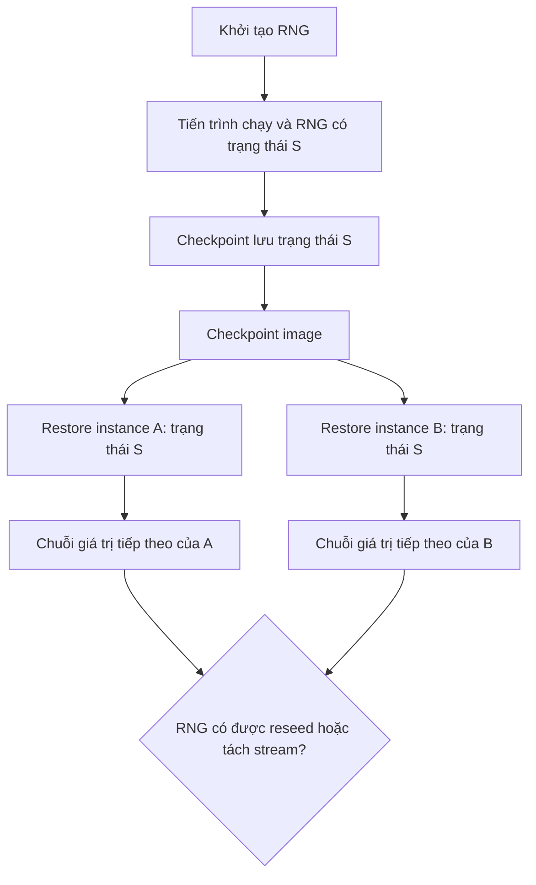

# Random, SecureRandom và việc đánh giá tính duy nhất theo runtime

Ứng dụng Java thường tạo số ngẫu nhiên để sinh mã định danh, token, khóa tạm, giá trị mô phỏng hoặc phân phối công việc. Khi chạy bình thường, các bộ sinh số ngẫu nhiên (random number generator, RNG) duy trì trạng thái nội bộ để tạo ra chuỗi giá trị tiếp theo. Với CRaC, trạng thái đó có thể nằm trong bộ nhớ của tiến trình và được lưu cùng checkpoint image.

Điều này tạo ra một tình huống cần chú ý: nếu cùng một image được restore thành nhiều tiến trình, các tiến trình có thể bắt đầu từ cùng trạng thái RNG. Nếu bộ sinh không được reseed hoặc phân vùng trạng thái theo cách phù hợp, chúng có thể tạo ra cùng chuỗi giá trị. Điều này đặc biệt nguy hiểm khi chuỗi đó được dùng làm ID, nonce, token hoặc dữ liệu cần tính duy nhất.

Khi thiết kế CRaC, cần phân biệt ba mục tiêu khác nhau: **tính ngẫu nhiên** của chuỗi, **tính khó dự đoán** đối với đối thủ và **tính duy nhất** của giá trị trong một phạm vi hệ thống. `Random`, `SecureRandom` và các API định danh giải quyết những mục tiêu khác nhau; không có bộ sinh số ngẫu nhiên nào tự nó thay thế được cơ chế bảo đảm uniqueness ở tầng hệ thống.

## 1. Trạng thái RNG có thể được lưu trong checkpoint image

Một bộ sinh giả ngẫu nhiên (pseudo-random number generator, PRNG) thường dùng một trạng thái nội bộ và thuật toán xác định để tạo chuỗi giá trị. Khi khởi tạo với cùng seed, cùng thuật toán và cùng số lần gọi, nó tạo ra cùng chuỗi kết quả.

Ví dụ với `java.util.Random`:

```java
Random first = new Random(12345L);
Random second = new Random(12345L);

System.out.println(first.nextInt());
System.out.println(second.nextInt()); // Cùng kết quả với lần gọi đầu của first
```

Checkpoint có thể chụp object RNG cùng trạng thái nội bộ của nó. Giả sử ứng dụng đã tạo `Random`, gọi `nextInt()` vài lần rồi checkpoint. Nếu image đó được restore thành hai tiến trình, cả hai bản sao có thể tiếp tục từ cùng trạng thái đã chụp và tạo ra cùng các giá trị tiếp theo.



Nếu cả hai tiến trình tiếp tục từ cùng trạng thái xác định, chuỗi đầu ra có thể trùng nhau. Đây không phải lỗi của cơ chế random; đó là hệ quả của việc sao chép trạng thái tiến trình.

Với `SecureRandom`, kết quả phụ thuộc thuật toán, provider, nguồn entropy và cách runtime CRaC tích hợp. Một số triển khai có thể có cơ chế reseed hoặc xử lý đặc biệt sau restore; không nên mặc định tất cả JDK/provider đều tự động làm như vậy. Phải xác định đúng runtime và kiểm chứng hành vi thực tế.

## 2. Phân biệt randomness, unpredictability và uniqueness

Ba thuộc tính thường bị nhầm lẫn:

| Thuộc tính | Câu hỏi cần trả lời | Ví dụ |
|---|---|---|
| Randomness | Các giá trị có phân bố phù hợp với mục tiêu không? | Dữ liệu mô phỏng cần phân bố đều |
| Unpredictability | Người quan sát có thể dự đoán giá trị tiếp theo không? | Session token, reset token, nonce bảo mật |
| Uniqueness | Có thể bảo đảm không trùng trong phạm vi cần thiết không? | ID đơn hàng, khóa bản ghi, ID instance |

Một chuỗi có vẻ ngẫu nhiên vẫn có thể trùng. Một bộ sinh mật mã có thể làm giá trị khó dự đoán nhưng không cung cấp bảo đảm tuyệt đối rằng hai lần sinh sẽ khác nhau. Ngược lại, một sequence từ database có thể duy nhất trong phạm vi database dù không ngẫu nhiên và có thể đoán được.

Vì vậy, hãy chọn cơ chế theo yêu cầu:

- Mô phỏng hoặc thuật toán cần tái lập kết quả: PRNG có seed được kiểm soát.
- Token bảo mật hoặc nonce: CSPRNG phù hợp, chẳng hạn `SecureRandom`.
- ID cần duy nhất trên nhiều instance: sequence/database constraint, ID service hoặc thuật toán ID phân tán có quy tắc cấp phát node/sequence rõ ràng.
- ID cần cả tính khó đoán và xác suất va chạm cực thấp: dùng CSPRNG với không gian giá trị đủ lớn, đồng thời vẫn xử lý collision ở nơi lưu trữ.

## 3. `java.util.Random`

`Random` là PRNG tổng quát, thích hợp với mô phỏng, thuật toán và tác vụ không yêu cầu tính khó dự đoán mật mã. Nó có trạng thái xác định; seed quyết định chuỗi kết quả.

```java
import java.util.Random;

Random random = new Random();
int value = random.nextInt(100);
double ratio = random.nextDouble();
```

Nếu không truyền seed, constructor lấy seed theo cơ chế của implementation. Tuy nhiên, điều đó không biến `Random` thành bộ sinh bảo mật. Sau khi object đã được tạo và sử dụng, trạng thái PRNG nằm trong tiến trình và có thể được checkpoint cùng các object khác.

### 3.1. Vì sao `Random` dễ tạo chuỗi trùng sau restore?

`Random` dùng trạng thái nội bộ được cập nhật mỗi khi tạo giá trị. Nếu hai tiến trình bắt đầu từ cùng trạng thái, cùng thuật toán sẽ tạo cùng chuỗi kết quả. Đây là đặc tính có ích cho kiểm thử tái lập, nhưng có thể gây va chạm khi mỗi instance dùng chuỗi đó để sinh ID.

Ví dụ minh họa vấn đề:

```java
public final class IdGenerator {
    private final Random random = new Random();

    public synchronized long nextId() {
        return random.nextLong();
    }
}
```

Nếu image được tạo sau khi `random` đã được khởi tạo, nhiều instance restore từ cùng image có thể có cùng trạng thái của `random`. Gọi `nextId()` ở các instance có thể cho kết quả trùng nhau. `synchronized` chỉ tuần tự hóa các thread trong một tiến trình; nó không phối hợp các tiến trình restore độc lập.

Không nên sửa bằng cách gọi `new Random(System.currentTimeMillis())` ngay sau restore. Đồng hồ có độ phân giải hữu hạn, nhiều instance có thể khởi tạo trong cùng một đơn vị thời gian và timestamp không phải nguồn entropy đáng tin cậy. Nếu cần một PRNG cho mô phỏng, hãy cấp seed hoặc stream ID duy nhất từ một coordinator bên ngoài.

## 4. `SecureRandom`

`SecureRandom` là API Java dành cho bộ sinh số ngẫu nhiên có tính chất bảo mật. Nó được cung cấp bởi một security provider, có thể sử dụng thuật toán DRBG hoặc một cơ chế khác phù hợp với provider. API này thường được dùng để sinh token, nonce, salt và các giá trị nhạy cảm.

Ví dụ cơ bản:

```java
import java.security.SecureRandom;
import java.util.HexFormat;

SecureRandom secureRandom = new SecureRandom();
byte[] tokenBytes = new byte[32];
secureRandom.nextBytes(tokenBytes);

String token = HexFormat.of().formatHex(tokenBytes);
```

`SecureRandom` là lựa chọn phù hợp hơn `Random` cho dữ liệu cần khó dự đoán. Tuy nhiên, chất lượng và hành vi cụ thể phụ thuộc provider, thuật toán, cấu hình hệ điều hành và runtime. `SecureRandom` không đồng nghĩa với một cam kết rằng mọi restore từ mọi checkpoint image đều tự động có trạng thái RNG độc lập.

### 4.1. Seed và reseed

Seed là dữ liệu khởi tạo hoặc bổ sung trạng thái RNG. Reseed là quá trình đưa thêm entropy vào bộ sinh để cập nhật trạng thái nội bộ. Một `SecureRandom` có thể được seed tự động khi khởi tạo hoặc ở lần sử dụng đầu tiên, tùy provider.

Trên Java 17 trở lên, API `SecureRandom` có phương thức `reseed()` để yêu cầu bộ sinh reseed. Khả năng và cách thực hiện vẫn phụ thuộc provider; nếu provider không hỗ trợ, thao tác có thể ném `UnsupportedOperationException`. Vì vậy, không được gọi `reseed()` rồi mặc định mọi runtime đều đã cập nhật entropy thành công.

```java
SecureRandom secureRandom = new SecureRandom();

try {
    secureRandom.reseed();
} catch (UnsupportedOperationException unsupported) {
    // Cần chiến lược khác phù hợp với provider/runtime.
}
```

Không dùng timestamp, PID, hostname hoặc một giá trị dễ đoán làm seed duy nhất cho `SecureRandom`. Những giá trị đó có thể hỗ trợ phân biệt instance ở tầng ứng dụng, nhưng không thay thế entropy mật mã.

### 4.2. `setSeed()` không phải cách reset trạng thái về một seed mới

`setSeed()` bổ sung dữ liệu seed vào bộ sinh theo hợp đồng provider. Không nên xem nó như thao tác đặt lại generator về một trạng thái mới đã được bảo đảm độc lập. Đặc biệt, không gọi:

```java
secureRandom.setSeed(System.currentTimeMillis());
```

để “làm mới” tính bảo mật sau restore. Timestamp có thể đoán được và không cung cấp entropy đủ mạnh. Hãy dùng `reseed()` nếu provider hỗ trợ hoặc tạo instance mới từ nguồn entropy của provider theo hướng dẫn của runtime.

### 4.3. `getInstanceStrong()` và vấn đề chờ entropy

`SecureRandom.getInstanceStrong()` yêu cầu thuật toán/provider được cấu hình là strong theo security properties của runtime. Tùy hệ điều hành và provider, việc lấy entropy có thể chặn trong một số điều kiện. Đối với ứng dụng server cần thời gian readiness dự đoán được, hãy hiểu rõ provider và nguồn entropy thay vì tự động thay mọi `new SecureRandom()` bằng `getInstanceStrong()`.

Không được giảm chất lượng bảo mật bằng cách chuyển sang `Random` chỉ để tránh độ trễ. Hãy chọn provider/algorithm phù hợp, khởi tạo theo chính sách triển khai và đo thời gian khởi tạo trong môi trường đích.

## 5. `ThreadLocalRandom` và `SplittableRandom`

### 5.1. `ThreadLocalRandom`

`ThreadLocalRandom` cung cấp generator gắn với từng thread, phù hợp với các tác vụ song song cần số ngẫu nhiên không mang yêu cầu mật mã. Nó giúp giảm tranh chấp khi nhiều thread cùng sinh giá trị.

```java
int bucket = ThreadLocalRandom.current().nextInt(16);
```

Không thể gọi `setSeed()` để tự đặt seed cho `ThreadLocalRandom`; API không cho phép điều khiển seed theo cách đó. Trạng thái generator gắn với thread vẫn cần được xem xét trong bối cảnh checkpoint. Nếu một runtime snapshot trạng thái thread và generator rồi restore nhiều bản sao, không nên tự suy ra các stream đã được tách độc lập nếu tài liệu runtime không xác nhận.

`ThreadLocalRandom` không phải CSPRNG và không dùng cho token, password reset code hoặc dữ liệu bảo mật.

### 5.2. `SplittableRandom`

`SplittableRandom` được thiết kế cho tính toán song song và cho phép tạo generator con qua `split()`. Nó hữu ích khi cần các stream ngẫu nhiên tách biệt trong một thuật toán, đặc biệt với seed được kiểm soát.

```java
SplittableRandom root = new SplittableRandom(2026L);
SplittableRandom workerA = root.split();
SplittableRandom workerB = root.split();

long sampleA = workerA.nextLong();
long sampleB = workerB.nextLong();
```

Tuy nhiên, nếu checkpoint xảy ra sau khi `root` và các generator con đã được tạo, trạng thái của chúng có thể được sao chép cùng image. Restore nhiều instance từ cùng image có thể sao chép cả trạng thái stream. `split()` chỉ tách stream trong trạng thái đang chạy; nó không tự tạo một định danh instance duy nhất xuyên qua nhiều restore.

## 6. `UUID.randomUUID()` và tính duy nhất xác suất

`UUID.randomUUID()` tạo UUID phiên bản 4 bằng bộ sinh giả ngẫu nhiên mạnh về mật mã của runtime. UUID v4 có 122 bit ngẫu nhiên vì một số bit được dành cho version và variant.

```java
import java.util.UUID;

UUID requestId = UUID.randomUUID();
```

Không gian giá trị lớn làm xác suất va chạm rất thấp trong quy mô sử dụng thông thường, nhưng không biến UUID thành cơ chế bảo đảm duy nhất tuyệt đối. Nếu generator state bị sao chép qua checkpoint và provider/runtime không reseed hoặc tách trạng thái sau restore, các tiến trình có thể có nguy cơ tạo cùng UUID.

Với `n` UUID v4 được sinh độc lập, xác suất va chạm gần đúng theo birthday bound là:

\[
P(\text{collision}) \approx \frac{n(n-1)}{2^{123}}
\]

Đây là xấp xỉ khi xác suất còn nhỏ và các giá trị thực sự độc lập, phân bố phù hợp. Nếu các generator có trạng thái trùng do restore, giả định độc lập không còn đúng; công thức trên không thể dùng để đánh giá tình huống đó.

Nếu ID được lưu trong database, hãy đặt unique constraint hoặc primary key. Khi xảy ra collision, tầng lưu trữ phải từ chối giá trị trùng và ứng dụng có thể tạo lại ID theo chính sách an toàn. Constraint là lớp bảo vệ cuối cùng trước lỗi do xác suất, bug generator hoặc việc restore nhiều instance.

## 7. Đánh giá tính duy nhất theo runtime CRaC

Không có một câu trả lời chung cho mọi JDK. Hành vi RNG sau restore phụ thuộc vào nhiều lớp:

1. **JDK distribution:** nhà cung cấp có thể tích hợp cơ chế CRaC riêng cho một số API hoặc trạng thái runtime.
2. **JDK version/build:** cơ chế reseed hoặc xử lý trạng thái RNG có thể thay đổi giữa các bản build.
3. **Security provider:** `SecureRandom` được cung cấp bởi provider nào, thuật toán gì và hỗ trợ reseed ra sao.
4. **Entropy source:** provider lấy entropy từ hệ điều hành, DRBG nội bộ hay cơ chế khác.
5. **Thời điểm khởi tạo:** RNG đã được khởi tạo và sử dụng trước checkpoint hay chỉ được tạo sau restore.
6. **Cách restore:** một image được restore một lần hay được dùng làm nguồn cho nhiều instance độc lập.
7. **Cách ứng dụng sử dụng RNG:** generator có dùng chung giữa các thread, có được tạo mới sau restore hay trạng thái được giữ trong singleton/static field.

Vì vậy, cần ghi rõ bộ môi trường đã kiểm tra: vendor JDK, phiên bản đầy đủ, build, OS/kernel, provider, thuật toán SecureRandom và cách tạo/restore image. Chỉ ghi “Java 21” là chưa đủ để kết luận uniqueness được xử lý như thế nào.

### 7.1. Kiểm tra provider và thuật toán thực tế

Có thể ghi nhận provider và thuật toán được chọn:

```java
SecureRandom secureRandom = new SecureRandom();

System.out.println("Algorithm: " + secureRandom.getAlgorithm());
System.out.println("Provider: " + secureRandom.getProvider().getName());
System.out.println("Provider version: " +
        secureRandom.getProvider().getVersionStr());
```

Các API có sẵn phụ thuộc phiên bản Java. Với JDK cũ hơn, thông tin version provider có thể cần lấy bằng API khác. Không log seed, token hoặc dữ liệu ngẫu nhiên nhạy cảm để chẩn đoán.

### 7.2. Kiểm tra hành vi reseed

Với Java 17+, có thể thử `reseed()` trên provider đang dùng và ghi nhận nó có hỗ trợ hay không. Tuy nhiên, một lời gọi không ném exception chỉ cho biết provider chấp nhận yêu cầu; không phải bằng chứng đầy đủ rằng mọi instance restore đều có entropy độc lập hoặc đạt chuẩn bảo mật.

Hãy kết hợp:

- Tài liệu release note của JDK CRaC và provider.
- Cấu hình security provider thực tế.
- Kiểm tra `reseed()` hoặc cơ chế tạo mới generator theo hỗ trợ.
- Thử nghiệm restore nhiều lần từ cùng image.
- Xác minh unique constraint ở tầng lưu trữ.

## 8. Reseed hoặc tạo lại SecureRandom sau restore

Nếu runtime không tự xử lý trạng thái SecureRandom theo cách đã được xác nhận, ứng dụng có thể đăng ký CRaC Resource để chủ động yêu cầu reseed hoặc tạo lại generator sau restore. Cách cụ thể phụ thuộc Java version và provider.

Ví dụ sau minh họa holder cho phép thay instance SecureRandom:

```java
import org.crac.Context;
import org.crac.Resource;

import java.security.SecureRandom;
import java.util.concurrent.atomic.AtomicReference;

public final class SecureRandomHolder implements Resource {
    private final AtomicReference<SecureRandom> current =
            new AtomicReference<>(new SecureRandom());

    public byte[] nextBytes(int length) {
        if (length <= 0) {
            throw new IllegalArgumentException("length must be positive");
        }

        byte[] bytes = new byte[length];
        current.get().nextBytes(bytes);
        return bytes;
    }

    @Override
    public void beforeCheckpoint(Context<? extends Resource> context) {
        // Không cần ghi seed ra file hoặc log.
    }

    @Override
    public void afterRestore(Context<? extends Resource> context) {
        SecureRandom replacement = new SecureRandom();

        // Buộc provider khởi tạo/đưa generator vào sử dụng.
        byte[] warmup = new byte[32];
        replacement.nextBytes(warmup);
        java.util.Arrays.fill(warmup, (byte) 0);

        current.set(replacement);
    }
}
```

Holder này tạo generator mới sau restore và dùng provider mặc định của runtime. Việc này chỉ có ý nghĩa khi provider khởi tạo trạng thái từ nguồn entropy phù hợp. Nó không thể bảo đảm độc lập nếu provider hoặc môi trường bị cấu hình sai, entropy source không đáng tin cậy hoặc runtime có một vấn đề riêng. Cần kiểm tra provider, tài liệu JDK và kết quả kiểm thử.

Nếu provider hỗ trợ `reseed()` và tài liệu runtime khuyến nghị giữ cùng instance, có thể gọi `reseed()` trong `afterRestore` thay vì thay object. Phải xử lý `UnsupportedOperationException` và không dùng timestamp làm seed dự phòng. Ví dụ minh họa ở trên cũng cần được đăng ký một lần với CRaC context:

```java
SecureRandomHolder randomHolder = new SecureRandomHolder();
Core.getGlobalContext().register(randomHolder);
```

`SecureRandomHolder` nên là nguồn cấp phát duy nhất mà các thành phần dùng chung truy cập. Tránh để một số bean dùng holder trong khi bean khác giữ reference đến một `SecureRandom` cũ được tạo trước checkpoint.

## 9. Tạo ID duy nhất cho nhiều instance

Nếu yêu cầu là không trùng ID giữa nhiều instance, chỉ reseed RNG có thể chưa đủ. Cần xác định phạm vi uniqueness và chọn cơ chế có nguồn cấp phát phù hợp.

### 9.1. Database sequence hoặc identity

Database sequence/identity là lựa chọn đơn giản khi database đã là nơi lưu trữ bản ghi. Database quản lý việc cấp số và có thể bảo đảm giá trị sequence không lặp trong phạm vi cấu hình của sequence.

Ưu điểm:

- Nhiều instance cùng xin ID từ một nguồn cấp phát chung.
- Constraint ở database bảo vệ tính duy nhất.
- Không phụ thuộc trạng thái PRNG trong checkpoint image.

Hạn chế:

- Cần truy cập database khi xin ID.
- Sequence có thể có khoảng trống do rollback, cache hoặc instance dừng.
- Tính duy nhất chỉ nằm trong phạm vi sequence/database được thiết kế.

### 9.2. ID service hoặc coordinator

Một dịch vụ cấp ID tập trung có thể cấp dải số hoặc ID cho từng instance. Khi restore, instance phải đăng ký và nhận một lease/worker identity mới trước khi phát ID. Không lưu worker identity duy nhất trong image dùng chung nếu nhiều instance sẽ restore từ image đó.

### 9.3. Snowflake-style ID

Các thuật toán kiểu Snowflake kết hợp timestamp, worker/node ID và sequence trong cùng một khoảng thời gian. Chúng có thể tạo ID phân tán mà không cần truy vấn database cho từng ID, nhưng chỉ an toàn khi:

- Node/worker ID được cấp duy nhất cho từng instance đang hoạt động.
- Hai instance không dùng cùng node ID đồng thời.
- Clock rollback hoặc clock drift được xử lý.
- Sequence overflow trong cùng đơn vị thời gian có chính sách chờ hoặc lỗi.
- Sau restore, instance lấy node ID/lease mới hoặc xác nhận quyền sở hữu độc quyền trước khi tiếp tục.

Nếu checkpoint image chứa worker ID và sequence đang dùng, nhiều instance restore có thể sao chép cả hai. Cần cấp lại worker ID và khởi tạo sequence theo quy tắc thuật toán trước khi instance phát ID.

### 9.4. UUID hoặc random token

UUID v4 hoặc token ngẫu nhiên có không gian đủ lớn có xác suất collision thấp nếu generator hoạt động độc lập và đúng. Chúng phù hợp với nhiều hệ thống phân tán, nhưng vẫn cần unique constraint khi lưu trữ. Với token bảo mật, cần CSPRNG; không dùng sequence dễ đoán chỉ vì nó duy nhất.

## 10. Thời gian không phải nguồn bảo đảm uniqueness

Một số cách tạo ID ghép timestamp với random hoặc counter. Cần hiểu giới hạn của từng loại thời gian:

- `System.currentTimeMillis()` là thời gian wall-clock theo millisecond; nhiều yêu cầu có thể xảy ra trong cùng millisecond và đồng hồ hệ thống có thể được điều chỉnh.
- `System.nanoTime()` dùng đo khoảng thời gian tương đối; giá trị có origin tùy JVM và không phải timestamp toàn cục.
- `Instant.now()` cung cấp thời gian wall-clock có độ phân giải phụ thuộc clock/provider; hai lần gọi vẫn có thể trả cùng giá trị.
- Đồng hồ trên nhiều máy không nhất thiết đồng bộ tuyệt đối.

Do đó, timestamp đơn lẻ không tạo ID duy nhất. Nếu dùng timestamp + counter, counter phải được bảo vệ đồng thời trong từng node và node identity phải duy nhất giữa các instance. Nếu dùng timestamp + random, vẫn còn xác suất collision và rủi ro RNG state bị sao chép qua restore.

## 11. Quy trình kiểm thử RNG với CRaC

Không nên chỉ thử gọi `nextBytes()` một lần sau restore. Cần kiểm tra kịch bản gần với triển khai thật, đặc biệt khi một image được dùng để tạo nhiều instance.

Một bài thử có thể gồm:

1. Ghi nhận vendor, version/build JDK, OS/kernel và security provider.
2. Tạo `Random` với seed đã biết, gọi một số lần rồi checkpoint.
3. Restore cùng image thành hai tiến trình độc lập.
4. Mỗi tiến trình sinh một chuỗi giá trị từ `Random`; xác nhận chuỗi giống nhau khi trạng thái deterministic được sao chép.
5. Khởi tạo `SecureRandom` trước checkpoint, sinh dữ liệu, rồi checkpoint và restore thành nhiều instance.
6. Mỗi instance sinh một batch dữ liệu kiểm thử; chỉ so sánh trong môi trường thử nghiệm và không log nội dung token thật.
7. Thử `reseed()` nếu provider hỗ trợ và lặp lại bài kiểm tra.
8. Thử tạo SecureRandom mới trong `afterRestore` và kiểm tra provider/runtime đã chọn.
9. Sinh ID đồng thời từ nhiều instance và ghi vào bảng có unique constraint.
10. Kiểm tra collision, lỗi unique constraint, thời gian khởi tạo, thời gian reseed và hành vi khi entropy source không sẵn sàng.
11. Lặp lại sau khi nâng JDK, provider, base image hoặc cấu hình hệ điều hành.

### 11.1. Phân biệt kiểm thử với chứng minh bảo mật

Một thử nghiệm không tìm thấy collision không chứng minh xác suất collision bằng zero. Nó chỉ cho biết trong số lượng lần chạy và điều kiện đã thử, chưa quan sát thấy va chạm. Đánh giá bảo mật cần dựa trên thuật toán, provider, entropy source, cấu hình runtime và tài liệu triển khai.

Với CSPRNG, không nên công bố output thật hoặc seed trong log để tiện so sánh. Có thể dùng môi trường kiểm thử cô lập, tạo dữ liệu giả và so sánh kết quả nội bộ. Không dùng token sản xuất cho bài kiểm thử.

### 11.2. Ma trận kiểm thử theo cách sử dụng image

| Kịch bản | Điều cần xác minh |
|---|---|
| Một image, một lần restore | Generator tiếp tục hoặc được làm mới theo chính sách runtime |
| Một image, nhiều restore song song | Các instance không phát cùng stream nguy hiểm cho mục đích sử dụng |
| Nhiều image từ các build khác nhau | Provider và hành vi RNG vẫn phù hợp với từng runtime |
| Restore sau thời gian dài | Entropy source, provider và cấu hình vẫn sẵn sàng |
| Nâng cấp JDK/provider | Reseed, SecureRandom algorithm và tích hợp CRaC không đổi ngoài dự kiến |
| Database/ID service tạm thời unavailable | Instance chưa phát ID cần uniqueness nếu chưa có lease/sequence hợp lệ |

## 12. Những lỗi thường gặp

**Dùng `Random` để sinh token bảo mật.** `Random` là PRNG tổng quát và không được thiết kế để chống dự đoán. Dùng `SecureRandom` với provider phù hợp.

**Cho rằng `SecureRandom` luôn tự reseed sau restore.** Hành vi phụ thuộc JDK distribution, version và provider. Kiểm tra tài liệu và thử nghiệm đúng runtime.

**Cho rằng SecureRandom đảm bảo ID duy nhất tuyệt đối.** Nó tạo giá trị khó dự đoán với xác suất va chạm thấp, nhưng vẫn có xác suất trùng. Dùng unique constraint hoặc cơ chế cấp ID chung nếu cần bảo đảm.

**Seed bằng timestamp hoặc PID.** Các giá trị này có thể trùng hoặc đoán được và không phải entropy mật mã. Dùng entropy source của provider hoặc coordinator cấp định danh riêng.

**Gọi `setSeed()` với thời gian để reset generator.** `setSeed()` không phải cam kết tạo một trạng thái mật mã mới độc lập. Dùng `reseed()` nếu provider hỗ trợ hoặc tạo generator mới theo hướng dẫn runtime.

**Dùng `synchronized` để chống trùng giữa tiến trình.** Khóa Java chỉ đồng bộ thread trong cùng process. Nhiều instance restore độc lập không chia sẻ monitor.

**Giữ node ID trong checkpoint image dùng chung.** Nhiều instance có thể nhận cùng worker ID và tạo ID trùng. Cấp lại node identity sau restore.

**Dùng timestamp đơn lẻ làm ID.** Clock có độ phân giải hữu hạn và không đồng bộ tuyệt đối giữa máy. Kết hợp cơ chế sequence/identity có quản lý hoặc nguồn cấp phát khác.

**Chỉ thử một instance restore.** Lỗi clone RNG state thường lộ rõ khi cùng image được restore nhiều lần. Phải thử nhiều bản sao song song.

## 13. Tự kiểm tra mức độ hiểu

1. **Vì sao hai tiến trình restore từ cùng image có thể tạo cùng chuỗi `Random`?** Vì trạng thái nội bộ của PRNG có thể được sao chép từ cùng snapshot; cùng trạng thái và thuật toán tạo cùng chuỗi tiếp theo.
2. **`SecureRandom` khác `Random` ở điểm nào?** `SecureRandom` được thiết kế cho mục đích bảo mật và dựa vào provider/entropy phù hợp; `Random` là PRNG tổng quát, không chống dự đoán mật mã.
3. **`SecureRandom` có bảo đảm uniqueness tuyệt đối không?** Không. Nó làm xác suất va chạm thấp và giá trị khó đoán, nhưng vẫn cần constraint hoặc coordinator nếu cần bảo đảm ở tầng hệ thống.
4. **Vì sao `setSeed(System.currentTimeMillis())` không phải cách reseed an toàn?** Timestamp có thể đoán được, có độ phân giải hữu hạn và không cung cấp entropy mật mã.
5. **Có thể dùng `synchronized` để ngăn ID trùng giữa hai instance restore không?** Không. Monitor chỉ phối hợp thread trong cùng tiến trình.
6. **Vì sao cần kiểm thử nhiều restore từ cùng image?** Để phát hiện generator state hoặc worker identity bị sao chép giữa các tiến trình.
7. **Snowflake-style ID cần điều kiện gì sau restore?** Node ID/lease duy nhất, sequence được khởi tạo đúng và xử lý clock rollback/overflow.
8. **Unique constraint có vai trò gì khi dùng UUID ngẫu nhiên?** Nó là lớp bảo vệ cuối cùng để từ chối ID collision ở tầng lưu trữ.

## Kết luận

`Random`, `SecureRandom`, `ThreadLocalRandom` và `SplittableRandom` phục vụ các nhu cầu khác nhau. Trạng thái PRNG có thể nằm trong checkpoint image; khi cùng image được restore nhiều lần, các generator có thể bắt đầu từ cùng trạng thái. Với `SecureRandom`, hành vi sau restore phụ thuộc JDK distribution, phiên bản, provider và entropy source, vì vậy không được giả định mọi runtime đều tự reseed.

Hãy chọn generator theo mục đích, xác minh provider và hành vi reseed trên đúng runtime CRaC, đồng thời kiểm thử nhiều instance restore từ cùng image. Khi cần ID duy nhất trên toàn hệ thống, dùng database sequence/unique constraint, ID service hoặc thuật toán phân tán có cấp phát node ID rõ ràng. Randomness hỗ trợ giảm xác suất va chạm; uniqueness vẫn cần được thiết kế và bảo vệ ở tầng hệ thống.
