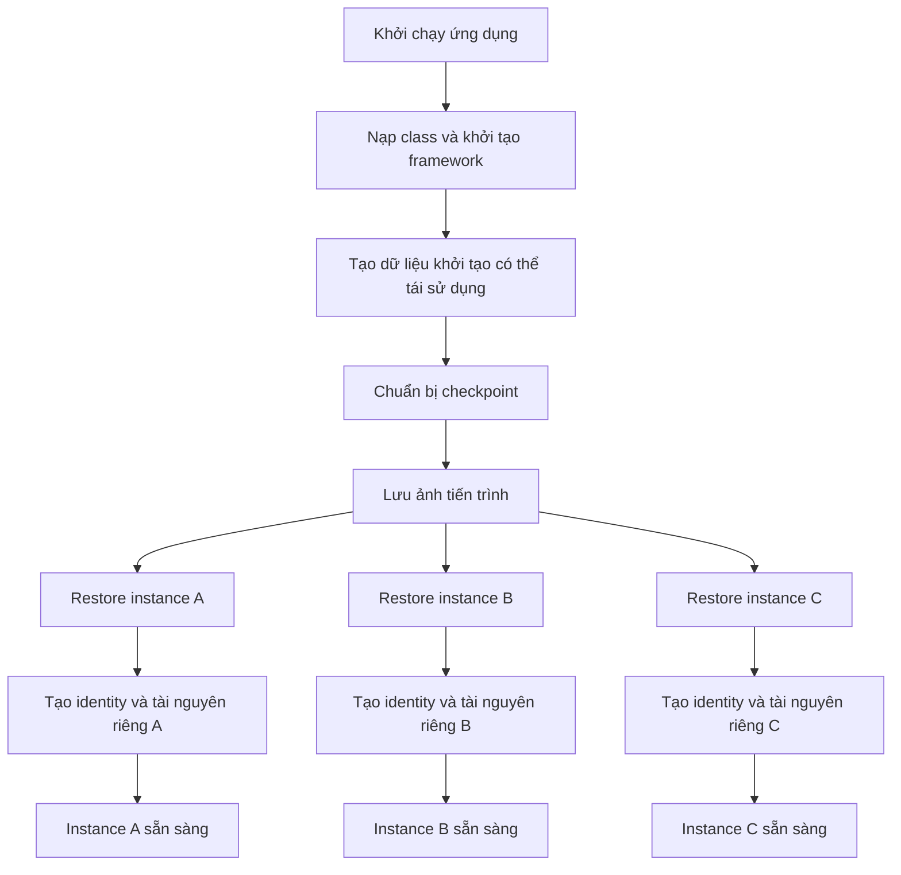
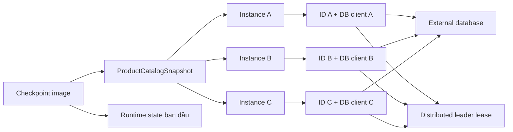

# Phân biệt trạng thái khởi tạo dùng chung với trạng thái riêng từng bản sao

CRaC (Coordinated Restore at Checkpoint) cho phép lưu trạng thái của một tiến trình Java đã được khởi tạo rồi restore trạng thái đó để tạo tiến trình phục vụ nhanh hơn. Một checkpoint có thể được dùng làm mẫu để khởi chạy nhiều bản sao của cùng ứng dụng. Vì vậy, khi thiết kế ứng dụng CRaC, cần phân biệt dữ liệu và cấu trúc có thể tái sử dụng giữa các bản sao với trạng thái phải được tạo riêng cho từng instance.

Ví dụ, việc nạp class, phân tích template, tạo bảng tra cứu bất biến và khởi tạo framework có thể tốn thời gian nhưng có thể thực hiện trước checkpoint. Những dữ liệu đó phù hợp để giữ trong ảnh và tái sử dụng khi restore. Ngược lại, instance ID, port đang bind, socket, lease leader, trạng thái scheduler, bộ đếm cục bộ và client kết nối tới dịch vụ bên ngoài thường phải được tạo mới hoặc xác minh sau restore.

Điểm cần hiểu rõ là **checkpoint giữ trạng thái bộ nhớ của một tiến trình; khi dùng ảnh đó để restore nhiều instance, mỗi instance nhận một bản sao trạng thái bộ nhớ ban đầu**. Các object mutable trong heap không tự trở thành một vùng nhớ dùng chung giữa các tiến trình. Nếu nhiều instance cần cùng nhìn thấy một trạng thái mutable mới nhất, ứng dụng phải dùng một hệ thống lưu trữ hoặc cơ chế điều phối bên ngoài.

## 1. Hai nhóm trạng thái trong ứng dụng CRaC

Có thể chia trạng thái của ứng dụng thành hai nhóm lớn:

- **Trạng thái khởi tạo có thể tái sử dụng:** dữ liệu hoặc cấu trúc được chuẩn bị trước checkpoint, có thể dùng làm điểm xuất phát cho mọi instance restore.
- **Trạng thái riêng từng bản sao:** dữ liệu định danh, tài nguyên runtime, quyền sở hữu và thông tin thay đổi theo từng instance. Nhóm này cần được tạo mới, làm mới hoặc xác minh sau restore.

| Nhóm | Ví dụ | Cách xử lý |
| --- | --- | --- |
| Khởi tạo có thể tái sử dụng | Class đã nạp, cấu trúc template, bảng tra cứu bất biến, parser đã cấu hình | Chuẩn bị trước checkpoint và giữ trong ảnh nếu hợp lệ |
| Cache khởi tạo | Dữ liệu tham chiếu ít thay đổi, metadata, danh mục phiên bản | Có thể giữ nếu có version/TTL và chính sách refresh sau restore |
| Cấu hình tĩnh | Quy tắc mặc định, mapping, schema đã phân tích | Có thể giữ nếu cấu hình vẫn đúng với môi trường restore |
| Định danh instance | Instance ID, node ID, pod identity, tên worker | Tạo hoặc xác minh riêng sau restore |
| Tài nguyên kết nối | Socket, connection pool, broker client, HTTP client có session | Đóng trước checkpoint và tạo lại hoặc xác minh sau restore |
| Trạng thái điều phối | Leader lease, distributed lock, ownership token | Lấy lại từ hệ thống điều phối bên ngoài |
| Trạng thái mutable cục bộ | Counter, hàng đợi nội bộ, scheduler state, request đang xử lý | Drain, khởi tạo lại hoặc lưu bền vững theo semantics nghiệp vụ |
| Secret và credential động | Token, session, certificate, credential có thời hạn | Nạp lại hoặc refresh theo nguồn hiện hành |

Không nên phân loại chỉ dựa vào kiểu Java. Một `Map` có thể là bảng tra cứu bất biến dùng chung về mặt logic, hoặc có thể là cache mutable cần đồng bộ. Một singleton có thể chứa dữ liệu khởi tạo an toàn, nhưng cũng có thể giữ instance ID hoặc socket không thể sao chép. Ý nghĩa và vòng đời của dữ liệu mới quyết định cách xử lý.

## 2. Checkpoint như một mẫu khởi tạo

Một quy trình thường gồm ba giai đoạn:

1. **Khởi tạo và làm nóng:** ứng dụng nạp class, tạo framework context, phân tích cấu hình, tạo dữ liệu khởi tạo và làm nóng các đường chạy quan trọng.
2. **Checkpoint:** JVM và cơ chế checkpoint lưu trạng thái tiến trình, bao gồm object graph và trạng thái runtime phù hợp.
3. **Restore từng instance:** mỗi tiến trình được dựng lại từ ảnh; ứng dụng giữ lại trạng thái khởi tạo có thể tái sử dụng và tạo lại phần trạng thái phụ thuộc instance hoặc môi trường.



Các instance bắt đầu từ cùng một trạng thái khởi tạo được lưu trong checkpoint. Sau restore, mỗi tiến trình có không gian bộ nhớ riêng và có thể phát triển theo dữ liệu request, lịch chạy và công việc mà nó nhận được.

### 2.1. Trạng thái ban đầu giống nhau không có nghĩa trạng thái tiếp tục dùng chung

Giả sử checkpoint chứa một `Map` có 1.000 mục cấu hình. Khi restore thành ba instance, mỗi tiến trình có thể nhận một `Map` với nội dung ban đầu giống nhau. Nếu instance A cập nhật mục thứ nhất, thay đổi đó chỉ diễn ra trong heap của A. Instance B và C không tự nhận được cập nhật.

Điều này có thể minh họa như sau:

```text
Checkpoint image
    sharedBootstrapMap = {A: 1, B: 2, C: 3}
            |
            +---- restore ----> Instance A: {A: 10, B: 2, C: 3}
            |
            +---- restore ----> Instance B: {A: 1, B: 20, C: 3}
            |
            +---- restore ----> Instance C: {A: 1, B: 2, C: 30}
```

Mỗi bản sao có thể thay đổi dữ liệu cục bộ mà không làm thay đổi các bản sao khác. Nếu dữ liệu phải được đồng bộ giữa instance, cần đặt nó trong database, Redis, distributed cache, message broker hoặc một dịch vụ chia sẻ phù hợp.

### 2.2. Singleton và static field vẫn thuộc từng tiến trình

Một class có `static` field hoặc singleton thường có một giá trị trong mỗi JVM. Khi restore checkpoint thành nhiều tiến trình, các giá trị ban đầu đó được phục hồi trong từng tiến trình tương ứng.

Ví dụ:

```java
public final class ApplicationCache {

    private static final Map<String, String> LOOKUP =
            loadImmutableLookupTable();

    private ApplicationCache() {
    }

    public static String find(String key) {
        return LOOKUP.get(key);
    }
}
```

Nếu `LOOKUP` chỉ được đọc sau khi khởi tạo và dữ liệu vẫn hợp lệ, đây có thể là một phần tốt để chuẩn bị trước checkpoint. Nhưng nếu `LOOKUP` bị sửa theo request, mỗi instance sẽ có bản mutable riêng sau restore. Tên `static` không biến field đó thành bộ nhớ chia sẻ giữa các tiến trình.

Tương tự, singleton chỉ bảo đảm một instance trong một JVM. Nếu restore thành năm JVM, mỗi JVM có singleton riêng. Không dùng singleton để bảo đảm chỉ có một scheduler leader hoặc một job toàn hệ thống.

## 3. Nhận diện trạng thái khởi tạo có thể tái sử dụng

Trạng thái khởi tạo phù hợp để đưa vào checkpoint thường có các đặc điểm:

- Được tạo trước khi ứng dụng nhận traffic.
- Có chi phí tạo lớn, ví dụ parse schema, build index, nạp metadata hoặc tạo cấu trúc dữ liệu.
- Có thể dùng lại mà không phụ thuộc vào ID hoặc tài nguyên của một instance cụ thể.
- Là bất biến, hoặc có chính sách refresh rõ ràng nếu dữ liệu thay đổi.
- Không giữ tài nguyên bên ngoài có vòng đời riêng như socket, file lock hoặc database transaction.

Ví dụ về dữ liệu có thể tái sử dụng:

```java
public final class SharedBootstrapData {

    private final Map<String, RouteDefinition> routes;
    private final List<Template> templates;
    private final SchemaRegistrySnapshot schema;

    public SharedBootstrapData(
            Map<String, RouteDefinition> routes,
            List<Template> templates,
            SchemaRegistrySnapshot schema) {
        this.routes = Map.copyOf(routes);
        this.templates = List.copyOf(templates);
        this.schema = schema;
    }

    public RouteDefinition route(String name) {
        return routes.get(name);
    }

    public List<Template> templates() {
        return templates;
    }

    public SchemaRegistrySnapshot schema() {
        return schema;
    }
}
```

Các bản sao có thể dùng cùng nội dung ban đầu của `SharedBootstrapData`. `Map.copyOf` và `List.copyOf` tạo collection không thể sửa thông qua các API đó, nhưng điều này chỉ tạo tính bất biến nông: nếu `RouteDefinition` hoặc `Template` bên trong vẫn mutable, caller vẫn có thể làm thay đổi trạng thái lồng nhau. Muốn dữ liệu thực sự bất biến, các phần tử và object được tham chiếu cũng phải có hợp đồng bất biến.

### 3.1. Cache có thể giữ lại nhưng cần kiểm tra freshness

Cache khởi tạo là trường hợp dễ nhầm. Cache có thể được làm nóng trước checkpoint để giảm thời gian khởi động, nhưng dữ liệu trong cache có thể lỗi thời khi ảnh được restore sau vài phút hoặc vài giờ.

Trước khi giữ cache trong checkpoint, hãy xác định:

- Dữ liệu có thay đổi trong hệ thống nguồn không?
- Cache có TTL hoặc version không?
- Có thể dùng snapshot cũ trong một khoảng thời gian cho phép không?
- Có cần invalidate hoặc refresh sau restore không?
- Nhiều instance có được phép bắt đầu với cùng dữ liệu cache rồi cập nhật độc lập không?

Với cache tham chiếu tương đối ổn định, có thể giữ snapshot ban đầu rồi kiểm tra version sau restore. Với dữ liệu giá, quyền truy cập, trạng thái tài khoản hoặc dữ liệu cần tính mới cao, nên refresh trước khi phục vụ request. Với cache mutable cần chia sẻ giữa nhiều instance, dùng cache ngoài tiến trình thay vì dựa vào bản copy trong heap.

## 4. Nhận diện trạng thái riêng từng bản sao

Trạng thái riêng từng instance là dữ liệu mà mỗi tiến trình cần có giá trị duy nhất hoặc cần phản ánh môi trường và quyền sở hữu hiện tại.

Ví dụ:

- ID của instance, worker hoặc node.
- Port, địa chỉ bind, socket và connection pool.
- Client đang giữ phiên xác thực hoặc kết nối TLS.
- Thread pool, scheduler và trạng thái của các tác vụ đang chạy.
- Leader election, lock hoặc lease đang sở hữu.
- Bộ đếm cục bộ, thống kê riêng của instance và trạng thái rate limit local.
- Thông tin endpoint, credential hoặc secret có thể thay đổi giữa các lần triển khai.
- Temporary directory, file handle hoặc tài nguyên gắn với container hiện tại.

Nếu một giá trị phải duy nhất cho mỗi bản sao, không tạo giá trị đó trước checkpoint rồi kỳ vọng mỗi lần restore sẽ tự có giá trị mới. Giá trị được tạo trước checkpoint có thể được sao chép vào mọi instance.

### 4.1. Instance ID và node identity

Giả sử ứng dụng tạo ID trong quá trình khởi động:

```java
public final class InstanceIdentity {
    private final String id = UUID.randomUUID().toString();
}
```

Nếu instance identity đã được tạo trước checkpoint, nhiều bản restore có thể bắt đầu với cùng một giá trị ID. Điều này gây nhầm lẫn trong log, metric, tracing, service registration hoặc distributed lock.

Hãy tạo identity riêng trong giai đoạn restore hoặc trong lifecycle hook chạy sau khi process được khởi tạo từ ảnh:

```java
public final class PerInstanceState {

    private String instanceId;

    public void initializeAfterRestore() {
        instanceId = UUID.randomUUID().toString();
    }

    public String instanceId() {
        return instanceId;
    }
}
```

Nếu nền tảng triển khai cung cấp pod UID, task ID hoặc instance metadata, có thể đọc giá trị hiện hành sau restore. Cách đó giúp identity khớp với tài nguyên được nền tảng quản lý. UUID tạo cục bộ phù hợp khi chỉ cần định danh duy nhất trong phạm vi ứng dụng, nhưng không thay thế identity do hạ tầng cấp nếu các hệ thống khác cần tra cứu instance.

### 4.2. Random generator và token

Trạng thái của bộ sinh số ngẫu nhiên có thể nằm trong heap. Không nên giả định mọi bản restore sẽ tự tạo ra chuỗi ngẫu nhiên độc lập chỉ vì tiến trình có PID khác nhau. Với dữ liệu không nhạy cảm, hãy tạo lại generator theo cách được provider hỗ trợ. Với dữ liệu bảo mật, dùng API bảo mật như `SecureRandom` và tuân thủ tài liệu provider để bảo đảm nguồn entropy và cơ chế reseed phù hợp.

Không tự tạo token xác thực hoặc secret trước checkpoint rồi dùng chung giá trị đó cho tất cả bản restore nếu token được thiết kế cho một instance hoặc một phiên. Token có thể hết hạn trong thời gian ảnh được lưu, bị thu hồi hoặc bị ràng buộc với môi trường ban đầu. Hãy refresh credential từ nguồn có thẩm quyền sau restore.

### 4.3. Lease, lock và quyền leader

Một instance có thể giữ object biểu diễn distributed lock hoặc lease trong heap tại thời điểm checkpoint. Điều đó không có nghĩa quyền sở hữu bên ngoài vẫn còn hiệu lực sau restore. Lease có thể hết hạn, lock có thể được cấp cho instance khác, hoặc nhiều bản restore cùng tin rằng mình là leader.

Sau restore, cần:

1. Đọc trạng thái hiện tại từ hệ thống điều phối hoặc kho dữ liệu.
2. Xác minh lease/lock cũ còn hợp lệ hay không.
3. Nếu cần quyền sở hữu, yêu cầu cấp lease mới bằng định danh instance hiện tại.
4. Chỉ chạy công việc độc quyền khi hệ thống bên ngoài xác nhận quyền sở hữu.
5. Gia hạn lease và xử lý mất lease theo cơ chế runtime thông thường.

Không dùng `synchronized`, `ReentrantLock` hoặc singleton trong heap để bảo đảm độc quyền giữa nhiều JVM. Những cơ chế đó chỉ đồng bộ thread trong cùng tiến trình.

## 5. Phân biệt trạng thái mutable cục bộ với trạng thái dùng chung thật sự

Một biến có thể được gọi là shared trong mã nguồn vì nhiều service trong cùng ứng dụng truy cập nó. Nhưng điều đó không có nghĩa nó được chia sẻ giữa nhiều instance restore.

| Kiểu trạng thái | Phạm vi chia sẻ thực tế | Khi có nhiều bản restore |
| --- | --- | --- |
| `static` field | Một JVM | Mỗi JVM có bản riêng |
| Singleton bean | Một application context/JVM | Mỗi JVM có singleton riêng |
| `ConcurrentHashMap` trong heap | Các thread trong một JVM | Mỗi JVM có map riêng |
| Cache trong process | Một tiến trình | Nội dung ban đầu có thể giống nhau rồi phân kỳ |
| Database | Nhiều tiến trình theo quyền truy cập | Các instance cùng đọc/ghi hệ thống dữ liệu bên ngoài |
| Redis/distributed cache | Nhiều tiến trình theo cấu hình mạng và namespace | Có thể là trạng thái dùng chung thật sự |
| Message broker | Nhiều consumer/producer | Broker quản lý queue, partition và acknowledgment bên ngoài tiến trình |
| Distributed lock/lease | Nhiều tiến trình theo giao thức điều phối | Phải lấy và gia hạn quyền sở hữu từ hệ thống ngoài |

Ví dụ, một bộ đếm `AtomicLong` trong heap được snapshot có thể bắt đầu cùng giá trị ở nhiều instance. Sau đó, mỗi instance tăng bộ đếm riêng. Nếu mục đích là đo tổng số request toàn hệ thống, bộ đếm local không đủ; cần metric aggregation hoặc một hệ thống lưu trữ tập trung.

### 5.1. Dùng external store cho trạng thái cần đồng bộ

Nếu nhiều instance phải nhìn thấy cùng một trạng thái mutable, đặt trạng thái đó trong hệ thống bên ngoài có semantics phù hợp:

- Database cho dữ liệu nghiệp vụ và transaction.
- Redis hoặc distributed cache cho dữ liệu truy cập nhanh và cơ chế atomic phù hợp.
- Message broker cho công việc cần phân phối và acknowledgment.
- Distributed coordination service cho leader election, lock hoặc lease.
- Object storage cho artifact hoặc dữ liệu bất biến lớn.

Chọn hệ thống dựa trên consistency, durability, latency và cách xử lý lỗi. Không nên chuyển mọi dữ liệu vào một external store nếu dữ liệu chỉ là cấu trúc bất biến có thể tái tạo trong từng instance.

## 6. Vòng đời trước checkpoint và sau restore

Một cách tổ chức rõ ràng là tách `SharedBootstrapData` khỏi `PerInstanceRuntimeState`.

```java
public final class ApplicationState {

    private final SharedBootstrapData bootstrapData;
    private PerInstanceRuntimeState runtimeState;

    public ApplicationState(SharedBootstrapData bootstrapData) {
        this.bootstrapData = bootstrapData;
        this.runtimeState = PerInstanceRuntimeState.createFresh();
    }

    public SharedBootstrapData bootstrapData() {
        return bootstrapData;
    }

    public PerInstanceRuntimeState runtimeState() {
        return runtimeState;
    }

    public void refreshForRestoredInstance() {
        runtimeState = PerInstanceRuntimeState.createFresh();
    }
}
```

`SharedBootstrapData` chứa dữ liệu đã chuẩn bị và có thể giữ lại. `PerInstanceRuntimeState` chứa các giá trị cần được tạo mới, chẳng hạn instance ID, bộ đếm local và trạng thái kết nối.

### 6.1. Resource quản lý trạng thái riêng từng instance

Ví dụ dưới đây dùng CRaC `Resource` để làm mới trạng thái riêng sau restore:

```java
import java.util.UUID;
import org.crac.Context;
import org.crac.Core;
import org.crac.Resource;

public final class InstanceRuntimeResource implements Resource {

    private final SharedBootstrapData bootstrapData;
    private String instanceId;
    private RuntimeClient client;

    public InstanceRuntimeResource(SharedBootstrapData bootstrapData)
            throws Exception {
        this.bootstrapData = bootstrapData;
        initializeInstanceState();
        Core.getGlobalContext().register(this);
    }

    @Override
    public void beforeCheckpoint(Context<? extends Resource> context)
            throws Exception {
        if (client != null) {
            client.close();
            client = null;
        }
    }

    @Override
    public void afterRestore(Context<? extends Resource> context)
            throws Exception {
        initializeInstanceState();
    }

    private void initializeInstanceState() throws Exception {
        instanceId = UUID.randomUUID().toString();
        client = RuntimeClient.connect(instanceId, bootstrapData);
        client.verifyConnection();
    }

    public String instanceId() {
        return instanceId;
    }
}
```

`RuntimeClient` là lớp minh họa cho client phụ thuộc môi trường. Trong ứng dụng thực tế, cần nạp endpoint, credential và cấu hình hiện hành khi kết nối; không giữ client cũ chỉ vì object reference vẫn tồn tại sau restore.

Ví dụ này cho thấy hai vòng đời tách biệt:

- `bootstrapData` được tạo trước checkpoint và giữ lại nếu dữ liệu vẫn hợp lệ.
- `instanceId` và `client` được khởi tạo lại cho mỗi bản restore.

Nếu cùng checkpoint tạo ba tiến trình, mỗi tiến trình sẽ gọi `initializeInstanceState()` riêng và có ID riêng. Các instance vẫn có thể sử dụng cùng dữ liệu khởi tạo ban đầu.

### 6.2. Không dựa vào Java `transient` để loại dữ liệu khỏi checkpoint

Từ khóa `transient` trong Java chủ yếu ảnh hưởng tới cơ chế Java serialization. CRaC checkpoint lưu trạng thái tiến trình ở cấp JVM và hệ điều hành; nó không phải thao tác `ObjectOutputStream.writeObject()`.

Do đó, khai báo:

```java
private transient String instanceId;
```

không phải cách bảo đảm `instanceId` bị loại khỏi checkpoint. Nếu cần giá trị riêng cho từng bản restore, hãy chủ động ghi đè hoặc tạo lại giá trị trong lifecycle sau restore. Nếu cần đóng tài nguyên, hãy dùng callback phù hợp.

## 7. Cấu hình môi trường và dữ liệu có thể thay đổi

Một số cấu hình được nạp lúc khởi động có vẻ giống trạng thái khởi tạo dùng chung, nhưng có thể khác giữa môi trường checkpoint và môi trường restore.

Ví dụ:

- URL database hoặc broker có thể khác giữa staging và production.
- Secret có thể được rotate trong lúc checkpoint được lưu.
- Feature flag có thể thay đổi.
- DNS hoặc service discovery có thể trả endpoint mới.
- Certificate hoặc token có thể hết hạn.
- Pod/VM có thể nhận CPU, memory limit hoặc network interface khác.

Không nên đóng băng toàn bộ cấu hình môi trường vào checkpoint rồi giả định nó luôn đúng. Có thể phân loại cấu hình thành:

| Loại cấu hình | Cách xử lý |
| --- | --- |
| Quy tắc bất biến của ứng dụng | Có thể phân tích và giữ trong checkpoint |
| Mapping/schema có version | Giữ snapshot và kiểm tra version sau restore |
| Endpoint dịch vụ | Nạp lại hoặc xác minh qua service discovery |
| Secret/token | Refresh từ secret manager hoặc identity provider |
| Feature flag | Refresh nếu yêu cầu cập nhật tức thời |
| Cấu hình tài nguyên theo instance | Đọc từ metadata hiện hành sau restore |

Một ứng dụng có thể giữ bản cấu hình khởi tạo để giảm chi phí parse, sau đó chỉ refresh các trường động. Cách này vừa tái sử dụng được phần chuẩn bị tốn thời gian, vừa tránh sử dụng cấu hình đã lỗi thời.

## 8. Cache và dữ liệu khởi tạo có version

Với cache được chuẩn bị trước checkpoint, có thể lưu kèm metadata về phiên bản hoặc thời điểm tạo:

```java
public record CacheSnapshot<T>(
        String sourceVersion,
        Instant createdAt,
        T value) {
}
```

Sau restore, ứng dụng kiểm tra snapshot:

1. Snapshot có thuộc đúng phiên bản schema và cấu hình hiện hành không?
2. Snapshot có còn trong thời hạn sử dụng không?
3. Dữ liệu nguồn có version mới hơn không?
4. Có thể dùng snapshot trong lúc refresh hay phải chờ refresh hoàn tất?
5. Cache có được phép mutable riêng theo instance không?

Nếu snapshot không hợp lệ, hãy tạo lại hoặc refresh trước khi mở readiness. Nếu snapshot hợp lệ nhưng mỗi instance sẽ cập nhật riêng, hãy chấp nhận rõ ràng rằng cache có thể phân kỳ. Nếu cần invalidation đồng bộ, dùng một kênh invalidation hoặc cache tập trung.

Không dùng checkpoint như cơ chế đồng bộ cache. Nó chỉ tái sử dụng trạng thái tại thời điểm tạo ảnh.

## 9. Thread, scheduler và trạng thái riêng từng bản sao

Thread và executor có thể là một phần của trạng thái tiến trình, nhưng không nên coi mọi task hoặc lịch chạy trong checkpoint đều phù hợp để nhiều instance cùng tiếp tục.

Một scheduler được khởi tạo trước checkpoint có thể chứa future hoặc trạng thái lần chạy tiếp theo. Khi nhiều instance restore, mỗi bản sao có thể có cùng lịch và cùng trạng thái timer ban đầu. Nếu scheduler thực hiện tác động toàn hệ thống, nhiều instance có thể chạy cùng một job.

Các lựa chọn thường dùng:

- Tạm dừng scheduler trước checkpoint và tạo lịch mới sau restore.
- Chỉ cho một instance trở thành leader bằng distributed lease.
- Lưu trạng thái job và watermark ở database hoặc scheduler service.
- Thiết kế job idempotent để việc chạy lại không tạo tác động trùng.
- Dùng scheduler tập trung nếu chỉ cần một lịch toàn hệ thống.

Với executor thread pool, cần drain task đang chạy và quyết định task đang queue. Sau restore, có thể tạo executor mới cho từng instance. Không nên mặc định một queue trong heap là durable queue hoặc đảm bảo task chỉ chạy một lần.

## 10. Tài nguyên mạng và tài nguyên hệ điều hành

Tài nguyên mạng thường gắn với instance hoặc phiên làm việc cụ thể:

- Listening socket có thể gắn với địa chỉ và port của môi trường ban đầu.
- Outbound TCP connection có thể bị peer đóng khi checkpoint được lưu.
- TLS session, authentication session hoặc token có thể hết hạn.
- DNS record và service endpoint có thể thay đổi.
- File descriptor có thể tham chiếu file hoặc mount không còn giống nhau.
- Temporary path có thể không tồn tại trong container restore.

Với các tài nguyên này, ứng dụng nên đóng trước checkpoint khi cần và tạo lại sau restore. Sau khi tạo, cần xác minh tài nguyên thực sự hoạt động thay vì chỉ kiểm tra object reference khác `null`.

Nếu server listener được framework hoặc thư viện CRaC tích hợp quản lý, hãy dùng đúng lifecycle của framework. Tránh vừa để framework tự khôi phục listener vừa tự bind thêm một socket mới trong callback của ứng dụng.

## 11. Nhiều instance và các vấn đề đồng thời

Khi một checkpoint được dùng để tạo nhiều instance, cần đánh giá những trạng thái có thể bị nhân bản:

| Trạng thái bị nhân bản | Rủi ro | Biện pháp |
| --- | --- | --- |
| Instance ID cũ | Log, metric và service registration trùng định danh | Tạo ID mới sau restore |
| Scheduler state | Nhiều instance chạy cùng job | Distributed lease hoặc scheduler tập trung |
| Leader flag trong heap | Nhiều instance cùng tin mình là leader | Bầu chọn leader ở hệ thống ngoài |
| Local counter | Số liệu bị tách thành nhiều bản và không phản ánh tổng | Dùng metric aggregation hoặc atomic counter ngoài tiến trình |
| Mutable cache | Các instance có nội dung phân kỳ | Dùng cache chia sẻ hoặc invalidation |
| Random generator state | Các bản sao có thể bắt đầu từ trạng thái generator giống nhau | Tái khởi tạo theo provider và yêu cầu bảo mật |
| Consumer state | Nhiều bản sao có thể tiếp tục xử lý cùng công việc | Dùng consumer group, partition assignment và idempotency |
| Credential/token | Nhiều instance dùng token cũ hoặc cùng token không phù hợp | Refresh credential theo identity hiện hành |

### 11.1. Local lock không phải distributed lock

`synchronized` và `ReentrantLock` điều phối thread trong cùng JVM. Khi checkpoint được restore thành nhiều tiến trình, mỗi tiến trình có lock riêng. Một lock đang ở trạng thái unlocked trong ảnh không tạo ra quyền sở hữu độc quyền toàn hệ thống; một lock đang locked cũng không thể đại diện cho một distributed lease còn hiệu lực.

Nếu cần bảo đảm chỉ một instance thực hiện tác vụ, hãy dùng một cơ chế điều phối bên ngoài có lease, thời hạn, fencing token hoặc semantics tương đương. Mỗi thao tác ghi quan trọng nên kiểm tra fencing token hoặc ownership version nếu hệ thống hỗ trợ, để instance đã mất lease không tiếp tục ghi dữ liệu.

### 11.2. Không giả định chỉ có một lần restore

Checkpoint có thể được lưu và dùng lại nhiều lần. Vì vậy, logic sau restore phải an toàn khi được chạy ở mỗi bản restore. Không viết callback theo giả định nó chỉ chạy đúng một lần trong toàn bộ vòng đời của artifact.

Các thao tác như đăng ký instance vào service discovery, lấy lease, tạo scheduler hoặc khởi động consumer cần có cơ chế cleanup và identity phù hợp. Nếu cùng một checkpoint được restore lại sau khi một instance trước đó đã bị hủy, hệ thống bên ngoài phải có khả năng hết hạn hoặc thu hồi đăng ký cũ.

## 12. Bảo mật và dữ liệu nhạy cảm trong trạng thái khởi tạo

Checkpoint có thể chứa object graph trong heap, bao gồm cấu hình, token, credential, dữ liệu người dùng và cache. Trạng thái khởi tạo dùng chung không mặc nhiên an toàn để chia sẻ hoặc lưu trữ lâu dài.

Các nguyên tắc cần áp dụng:

- Không đưa secret không cần thiết vào cache hoặc object graph trước checkpoint.
- Refresh credential có thời hạn sau restore.
- Giới hạn quyền đọc checkpoint vì ảnh có thể chứa dữ liệu nhạy cảm.
- Bảo vệ artifact khi truyền và lưu trữ theo chính sách bảo mật.
- Xác định thời hạn lưu và quy trình xóa checkpoint cũ.
- Không ghi token hoặc dữ liệu nhạy cảm vào log khi tạo/restore instance.
- Nếu mỗi instance có identity riêng, cấp quyền theo identity đó thay vì sao chép một quyền sở hữu cũ.

Nếu checkpoint được phân phối cho nhiều node, cần xem nó như một bản sao bộ nhớ ứng dụng có thể chứa thông tin nhạy cảm. Quyền truy cập artifact cần được kiểm soát tương ứng.

## 13. Quy trình phân loại trạng thái trước khi tạo checkpoint

Khi chuẩn bị một ứng dụng Java cho CRaC, có thể lập danh mục object và tài nguyên theo các câu hỏi sau:

1. Dữ liệu này có được tạo trước khi nhận traffic không?
2. Dữ liệu có bất biến sau khởi tạo hay sẽ thay đổi theo request?
3. Dữ liệu có thể dùng cùng giá trị ban đầu cho mọi instance restore không?
4. Dữ liệu có phụ thuộc instance ID, pod, port, hostname hoặc địa chỉ mạng không?
5. Dữ liệu có đại diện cho tài nguyên bên ngoài hoặc quyền sở hữu có thời hạn không?
6. Dữ liệu có cần đồng bộ giữa các instance sau restore không?
7. Nếu checkpoint được restore nhiều lần, việc sao chép dữ liệu này có tạo tác động trùng không?
8. Có thể tái tạo hoặc refresh dữ liệu sau restore với chi phí chấp nhận được không?

Sau đó phân loại:

| Kết quả phân loại | Hành động trước checkpoint | Hành động sau restore |
| --- | --- | --- |
| Bất biến và dùng lại an toàn | Giữ trong checkpoint | Dùng lại |
| Cache có thể stale | Giữ nếu có lợi ích | Kiểm tra version/TTL, refresh nếu cần |
| Mutable riêng từng instance | Drain hoặc lưu tiến độ nghiệp vụ | Khởi tạo trạng thái riêng mới |
| Cần đồng bộ toàn hệ thống | Lưu trong hệ thống bên ngoài | Đọc/ghi qua external store |
| Tài nguyên kết nối | Đóng hoặc đưa về trạng thái an toàn | Tạo lại và xác minh |
| Lease/lock/leader | Giải phóng hoặc đánh dấu không còn sở hữu | Yêu cầu cấp lại từ hệ thống điều phối |
| Secret động | Tránh snapshot nếu không cần | Refresh từ nguồn có thẩm quyền |

## 14. Ví dụ thiết kế ứng dụng có nhiều bản restore

Giả sử một dịch vụ xử lý đơn hàng có ba thành phần:

- `ProductCatalogSnapshot`: danh mục sản phẩm được tải và parse trước checkpoint, chủ yếu dùng đọc.
- `InstanceRuntime`: instance ID, counter local và client kết nối tới database.
- `OrderScheduler`: tạo job xử lý đơn hàng theo lịch, cần chỉ có một leader toàn hệ thống.

Thiết kế có thể như sau:



Quy trình:

1. Trước checkpoint, ứng dụng tải danh mục sản phẩm, parse dữ liệu và tạo snapshot bất biến.
2. Scheduler dừng tạo job mới; công việc đang chạy được drain hoặc ghi tiến độ bền vững.
3. Database client và các kết nối cần thiết được đóng qua resource callback.
4. JVM tạo checkpoint.
5. Mỗi instance restore giữ lại danh mục ban đầu, tạo instance ID mới và kết nối database bằng cấu hình hiện hành.
6. Mỗi instance yêu cầu leader lease từ hệ thống điều phối. Chỉ instance nhận lease mới được chạy scheduler độc quyền.
7. Các instance khác vẫn có thể phục vụ request đọc/ghi theo quyền của chúng nhưng không tự chạy công việc dành riêng cho leader.

Nếu danh mục sản phẩm thay đổi trong thời gian checkpoint được lưu, mỗi instance kiểm tra version và refresh khi cần. Nếu danh mục chỉ được giữ trong heap mà không có invalidation, các bản sao có thể tiếp tục dùng dữ liệu cũ.

## 15. Các lỗi thiết kế thường gặp

| Lỗi | Hậu quả | Cách xử lý |
| --- | --- | --- |
| Tạo instance ID trước checkpoint rồi giữ nguyên | Các bản restore có thể trùng identity | Tạo ID mới sau restore |
| Nghĩ `static` nghĩa là chia sẻ giữa các JVM | Mỗi instance có bản static riêng | Dùng external store nếu cần trạng thái chia sẻ thật |
| Giữ cache mutable và giả định mọi bản sao tự đồng bộ | Cache phân kỳ giữa các instance | Bất biến hóa, versioning hoặc dùng cache ngoài tiến trình |
| Giữ socket/client cũ trong heap | Kết nối có thể đã hết hiệu lực | Đóng và tạo lại sau restore |
| Dùng local lock làm leader lock | Nhiều instance cùng thực hiện job | Dùng distributed lease hoặc leader election |
| Giữ token cũ trong checkpoint | Token hết hạn hoặc bị thu hồi | Refresh credential sau restore |
| Tin rằng `transient` loại field khỏi checkpoint | Dữ liệu vẫn có thể nằm trong ảnh tiến trình | Tạo lại field qua lifecycle callback |
| Resume scheduler ở mọi instance | Job toàn cục chạy nhiều lần | Chỉ leader được phép chạy hoặc dùng scheduler tập trung |
| Không kiểm tra cache version | Instance phục vụ dữ liệu stale | Kiểm tra freshness trước readiness |
| Giữ trạng thái task trong queue heap như durable | Task có thể mất hoặc lặp side effect | Dùng durable queue và idempotency |

## 16. Kiểm tra sau restore

Khi xác nhận một bản restore sẵn sàng, cần kiểm tra cả phần khởi tạo được giữ lại và phần trạng thái riêng được tạo mới.

| Nội dung | Điều cần xác nhận |
| --- | --- |
| Shared bootstrap data | Object có sẵn, đúng version và có thể đọc an toàn |
| Cache snapshot | TTL/version còn hợp lệ hoặc đã refresh |
| Instance identity | Mỗi instance có ID riêng và được đăng ký đúng với nền tảng |
| Database/broker client | Kết nối mới hoạt động và dùng credential hiện hành |
| Scheduler/consumer | Chỉ được resume khi dependency và quyền sở hữu đã sẵn sàng |
| Leader lease | Được cấp lại từ hệ thống điều phối; không dựa vào flag cũ trong heap |
| Mutable counters | Được khởi tạo theo phạm vi local hoặc lấy từ external store đúng semantics |
| Readiness | Chỉ chuyển ready sau khi mọi resource bắt buộc đã hoàn tất restore |

Một phép thử quan trọng là restore cùng một checkpoint thành nhiều tiến trình trong môi trường tương thích. Ghi lại identity của từng tiến trình, xác nhận các giá trị riêng không trùng, thử thay đổi cache local ở một instance và xác nhận instance khác không tự thay đổi, sau đó kiểm tra trạng thái cần chia sẻ thông qua external store.

## 17. Kết luận

Trạng thái khởi tạo dùng chung là phần dữ liệu và cấu trúc có thể tái sử dụng từ checkpoint, thường gồm class đã nạp, cấu hình bất biến, template và cache có chính sách freshness rõ ràng. Trạng thái riêng từng bản sao gồm identity, kết nối, lease, scheduler, counter local và những dữ liệu phụ thuộc môi trường hoặc quyền sở hữu hiện tại.

Khi một checkpoint được restore nhiều lần, mỗi tiến trình nhận trạng thái bộ nhớ ban đầu tương tự nhưng phát triển độc lập. `static`, singleton và collection trong heap không tạo ra bộ nhớ mutable dùng chung giữa các JVM. Hãy giữ phần khởi tạo an toàn trong ảnh, tạo lại trạng thái riêng trong lifecycle sau restore, và dùng hệ thống bên ngoài cho dữ liệu cần đồng bộ giữa các instance. Cách phân chia này giúp tận dụng thời gian khởi tạo đã được chuẩn bị mà vẫn bảo đảm mỗi bản sao có identity, tài nguyên và quyền sở hữu phù hợp với môi trường hiện tại.
