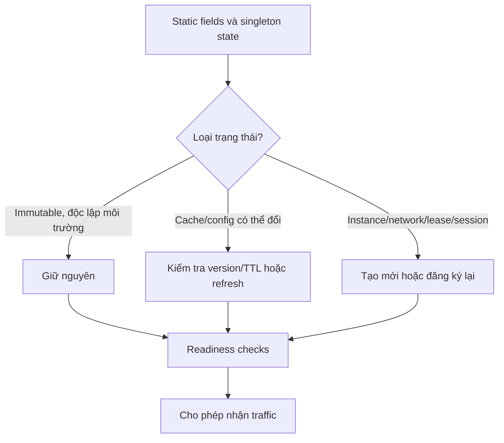

# Biến static, singleton và dữ liệu đã khởi tạo trước checkpoint

Trong Java, biến `static`, singleton và các object đã được khởi tạo trước checkpoint đều nằm trong trạng thái của tiến trình. Khi CRaC restore tiến trình từ checkpoint, những object đó được phục hồi cùng heap và các tham chiếu của chúng. JVM không khởi động một ứng dụng Java mới từ đầu, vì vậy static initializer, constructor singleton và các bước khởi tạo đã chạy trước checkpoint không tự động chạy lại chỉ vì có restore.

Điều này giúp ứng dụng tránh lặp lại nhiều công việc khởi tạo tốn thời gian, nhưng cũng tạo ra một trách nhiệm quan trọng: **phải phân biệt dữ liệu có thể giữ nguyên với dữ liệu phụ thuộc vào thời gian, instance, môi trường hoặc dịch vụ bên ngoài**. Cache có thể đã cũ, credential có thể hết hạn, địa chỉ mạng có thể thay đổi, instance ID có thể bị nhân bản khi restore cùng checkpoint thành nhiều replica, và một singleton có thể giữ kết nối hoặc trạng thái leader không còn hợp lệ.

Trong vòng đời CRaC, hãy dùng `Resource.beforeCheckpoint(...)` để đưa trạng thái mutable về ranh giới an toàn và chuẩn bị các thành phần cần đóng; dùng `Resource.afterRestore(...)` để làm mới dữ liệu runtime, tái tạo tài nguyên và cập nhật các singleton/static holder trước khi ứng dụng nhận công việc mới.

## 1. Điều gì được giữ lại khi restore?

Checkpoint lưu trạng thái tiến trình tại thời điểm chụp. Với ứng dụng Java, trạng thái đó bao gồm heap, object graph, giá trị các field, tham chiếu giữa các object và trạng thái runtime mà checkpoint engine hỗ trợ.

Vì vậy, nếu checkpoint được tạo sau khi ứng dụng đã khởi tạo:

- Các object được tham chiếu từ static field vẫn nằm trong trạng thái được phục hồi.
- Singleton đã tạo vẫn là object singleton trong heap được restore.
- Giá trị field của object được giữ tại thời điểm checkpoint.
- Cache, map, counter và cấu hình đã nạp trong bộ nhớ vẫn mang giá trị đã lưu.
- Một số thread, timer hoặc tài nguyên khác có thể có trạng thái riêng tùy runtime và nền tảng; cần quản lý theo lifecycle của chúng.

Ví dụ:

```java
import java.util.Map;
import java.util.UUID;
import java.util.concurrent.ConcurrentHashMap;

public final class ApplicationState {
    public static final Map<String, String> CACHE = new ConcurrentHashMap<>();
    public static String instanceId = UUID.randomUUID().toString();

    private ApplicationState() {
    }
}
```

Nếu `CACHE` đã có dữ liệu và `instanceId` đã được tạo trước checkpoint, các giá trị đó có thể xuất hiện nguyên trạng sau restore. Không có bước nào tự động gọi lại `UUID.randomUUID()` chỉ vì tiến trình được phục hồi.

### Static initializer không chạy lại

Static initializer chạy khi class được khởi tạo trong một classloader. Restore không tương đương với việc nạp lại class vào một JVM mới. Do đó, không dùng static initializer như callback phục hồi:

```java
final class RegistryClientHolder {
    static final RegistryClient CLIENT = createAndConnect();

    private RegistryClientHolder() {
    }
}
```

`createAndConnect()` có thể đã mở socket, đọc DNS, lấy credential hoặc đăng ký endpoint trước checkpoint. Sau restore, field `CLIENT` vẫn trỏ tới object được lưu trong ảnh tiến trình; static initializer không tự chạy lần thứ hai để tạo client mới.

Hãy tách việc tạo cấu trúc Java thuần khỏi việc mở kết nối và đăng ký dịch vụ. Những thao tác phụ thuộc môi trường nên được gọi từ lifecycle manager có thể chạy lại sau restore.

## 2. Singleton cũng được phục hồi như object bình thường

Singleton là một quy ước thiết kế để một class cung cấp một instance dùng chung trong một phạm vi nhất định, thường là một JVM hoặc classloader. Singleton không phải một thực thể phân tán và cũng không được JVM tự tạo lại sau restore.

Ví dụ singleton eager initialization:

```java
import java.util.Map;

public final class ConfigurationManager {
    private static final ConfigurationManager INSTANCE =
            new ConfigurationManager();

    private volatile Map<String, String> properties = Map.of();

    private ConfigurationManager() {
        reload();
    }

    public static ConfigurationManager getInstance() {
        return INSTANCE;
    }

    public void reload() {
        properties = loadCurrentProperties();
    }
}
```

Sau restore, `INSTANCE` và object `ConfigurationManager` đã tồn tại trong heap. Constructor không chạy lại, nên `reload()` trong constructor cũng không chạy lại. Nếu cấu hình có thể thay đổi trong lúc tiến trình checkpoint, singleton sẽ giữ snapshot cũ cho tới khi ứng dụng chủ động reload.

Với dependency injection container, singleton-scoped bean cũng là object nằm trong heap. Không nên giả định constructor, `@PostConstruct` hoặc callback khởi tạo thông thường sẽ tự chạy lại khi CRaC restore. Hãy đăng ký một `Resource` hoặc lifecycle coordinator rõ ràng để gọi các thao tác refresh cần thiết.

### Singleton trong một JVM không phải singleton toàn cụm

Nếu một checkpoint được dùng để restore ba replica, mỗi tiến trình có một bản sao heap riêng. Mỗi bản sao sẽ chứa object singleton giống nhau về trạng thái ban đầu. Vì vậy, một singleton giữ:

- Cờ `isLeader = true`.
- Counter cấp số thứ tự.
- Bộ nhớ cache được xem là nguồn sự thật.
- Khóa hoặc lease được cho là chỉ thuộc về instance hiện tại.
- Một instance ID được tạo trước checkpoint.

có thể tạo ra nhiều bản sao có cùng trạng thái sau khi restore. Không dùng singleton trong heap để thực hiện leader election, distributed lock hoặc cấp ID duy nhất toàn hệ thống. Những trách nhiệm đó cần một dịch vụ hoặc kho lưu trữ có tính phối hợp phân tán.

## 3. Phân loại dữ liệu static và singleton

Không phải mọi dữ liệu đã khởi tạo trước checkpoint đều phải xóa. Hãy phân loại theo nguồn gốc và thời hạn hợp lệ của nó.

| Nhóm dữ liệu | Ví dụ | Cách xử lý sau restore |
|---|---|---|
| Hằng số bất biến | Mã enum, bảng tra cứu thuần, regex đã compile | Thường giữ nguyên nếu không phụ thuộc môi trường |
| Cấu hình triển khai ổn định | Tên service, feature flag cố định theo artifact | Giữ nếu nguồn cấu hình đảm bảo không đổi; nếu cấu hình động thì reload |
| Cấu hình runtime có thể thay đổi | Endpoint, timeout, tenant routing, feature flag từ remote config | Đọc lại hoặc xác minh version sau restore |
| Cache có thể tái tạo | Cache reference data, metadata, kết quả lookup | Invalidate hoặc refresh theo TTL/version |
| Danh tính instance | Instance ID, hostname, IP, port, pod metadata | Tạo hoặc phát hiện lại cho incarnation hiện tại |
| Credential và token | Access token, certificate tạm, session key | Kiểm tra hạn, refresh hoặc cấp mới từ secret provider |
| Kết nối và client | HTTP pool, DB client, broker session, registry client | Đóng/tạo lại hoặc xác minh theo tài liệu thư viện |
| Trạng thái thời gian | `lastRunAt`, deadline, lease expiry, timer state | So sánh với thời gian hiện tại và dữ liệu bền vững |
| Trạng thái phối hợp | Leader flag, distributed lock, lease ownership | Xác minh hoặc giành quyền mới từ hệ thống phân tán |
| Dữ liệu nghiệp vụ tạm trong heap | Counter chưa flush, batch đang xử lý, transaction state | Drain và lưu bền vững trước checkpoint |

Một câu hỏi hữu ích cho mỗi field static hoặc singleton là: **nếu tiến trình được restore sau một giờ, hoặc được nhân bản thành nhiều replica, giá trị này còn đúng và còn thuộc về instance này không?** Nếu câu trả lời là không hoặc chưa chắc, field đó cần refresh hoặc xác minh.

## 4. `static final` không đồng nghĩa object bất biến

`final` trên một field tham chiếu chỉ ngăn gán lại tham chiếu. Nó không làm object mà tham chiếu trỏ tới trở nên immutable.

```java
static final Map<String, String> SETTINGS = new HashMap<>();
```

Không thể gán `SETTINGS = anotherMap`, nhưng vẫn có thể gọi `SETTINGS.put(...)`. Nội dung map sẽ được giữ trong checkpoint và có thể đã cũ sau restore.

Tương tự, `Collections.unmodifiableMap(map)` chỉ tạo view không cho sửa qua view đó; nếu code khác vẫn giữ `map` gốc, nội dung vẫn có thể thay đổi. Java record cũng chỉ cung cấp tính bất biến nông: một record chứa `List` mutable vẫn có thể quan sát list thay đổi.

Đối với dữ liệu thật sự có thể giữ qua restore, ưu tiên cấu trúc immutable và dữ liệu đầu vào có version rõ ràng:

```java
import java.util.Map;
import java.util.concurrent.atomic.AtomicReference;

record RoutingSnapshot(
        long version,
        Map<String, String> routes) {

    RoutingSnapshot {
        routes = Map.copyOf(routes);
    }
}

final class RoutingTable {
    static final AtomicReference<RoutingSnapshot> CURRENT =
            new AtomicReference<>(new RoutingSnapshot(1, Map.of()));

    private RoutingTable() {
    }
}
```

`Map.copyOf` tạo bản sao không thể sửa qua tham chiếu trả về. Khi cần refresh, tạo snapshot mới rồi thay tham chiếu atomically. Cách này giúp reader không nhìn thấy map đang được cập nhật dở.

## 5. Dữ liệu nào thường trở nên stale?

### Cache và dữ liệu đọc từ hệ thống ngoài

Cache có thể giữ giá trị đúng lúc checkpoint nhưng sai sau đó vì database, registry hoặc remote service đã thay đổi. Sau restore:

- Kiểm tra TTL và version của dữ liệu.
- Invalidate cache phụ thuộc thời gian hoặc instance.
- Refresh cache quan trọng trước khi mở readiness.
- Dùng stale-while-revalidate chỉ khi nghiệp vụ cho phép trả dữ liệu cũ trong một khoảng thời gian.
- Không xem cache trong heap là nguồn dữ liệu bền vững.

Nếu cache có thể tái tạo từ database, có thể giữ snapshot để rút ngắn startup nhưng cần xác minh version trước khi dùng. Nếu version không khớp, refresh hoặc loại bỏ cache đó.

### Cấu hình và feature flag

Một singleton có thể đã đọc cấu hình từ file, environment hoặc remote configuration. Sau restore, environment của process có thể vẫn giống lúc tạo checkpoint, nhưng nguồn cấu hình bên ngoài có thể đã thay đổi. Cần xác định nguồn nào là canonical:

- Cấu hình đóng gói cùng artifact thường không đổi trong cùng phiên bản triển khai.
- Environment variable thường là đầu vào của lần tạo process; không nên kỳ vọng chúng tự thay đổi khi cùng process được restore.
- Remote configuration và feature flag có thể thay đổi trong thời gian checkpoint; cần reload hoặc kiểm tra version.
- Endpoint, credential và metadata do nền tảng cấp cần lấy lại khi môi trường có thể thay đổi.

### Credential và session

Token có thể được giữ trong singleton hoặc static cache. Trong thời gian checkpoint, token có thể hết hạn hoặc bị thu hồi. TLS session, session cookie hoặc credential tạm cũng có thể không còn phù hợp.

Sau restore, hãy kiểm tra thời hạn và refresh token theo API của provider. Nếu credential cần được cấp mới, lấy từ secret manager hoặc identity provider. Không ghi secret vào log. Cũng cần bảo vệ checkpoint artifact vì ảnh tiến trình có thể chứa token, private key hoặc dữ liệu nhạy cảm nằm trong heap.

### Thời gian, deadline và timer

Các giá trị như `lastRunAt`, `expiresAt`, `nextRefreshAt` hoặc `leaseDeadline` được lưu trong object không tự tiến lên theo thời gian. Khi restore, so sánh chúng với `Instant.now()` hoặc một clock có thể kiểm soát.

Không giữ một timeout chỉ dựa vào `System.nanoTime()` qua thời gian checkpoint mà không xác minh semantics của runtime. `nanoTime` dùng đo khoảng thời gian trong một lần chạy, không phải timestamp bền vững để lưu trong database. Với deadline nghiệp vụ, lưu thời điểm tuyệt đối hoặc mốc nghiệp vụ trong hệ thống bền vững, rồi tính lại thời gian còn lại sau restore.

### Random generator và counter

Một `Random` hoặc counter static được tạo trước checkpoint có trạng thái nội bộ được lưu cùng object. Nếu cùng checkpoint được nhân bản thành nhiều replica, các replica có thể tiếp tục từ trạng thái giống nhau. Điều này có thể gây trùng chuỗi pseudo-random hoặc trùng số sequence nếu ứng dụng coi counter cục bộ là ID toàn cục.

Với định danh instance, tạo ID mới sau restore bằng cơ chế phù hợp như UUID hoặc ID do nền tảng cấp. Với randomness liên quan bảo mật, tuân thủ hướng dẫn của `SecureRandom`, provider và runtime đang dùng; không tự sao chép seed hoặc dùng một `Random` static làm nguồn entropy bảo mật. Với sequence nghiệp vụ, cấp số từ database/sequence service hoặc dùng khóa duy nhất có phạm vi phân tán.

## 6. Thiết kế static holder có thể refresh

Một cách thực tế là giữ static holder ổn định nhưng lưu dữ liệu runtime trong một snapshot có thể thay thế. Singleton không cần bị tạo lại; chỉ phần trạng thái phụ thuộc môi trường được refresh.

```java
import java.time.Instant;
import java.util.Map;
import java.util.concurrent.atomic.AtomicReference;

record RuntimeSnapshot(
        String instanceId,
        String advertiseHost,
        Instant loadedAt,
        long configVersion,
        Map<String, String> featureFlags) {

    RuntimeSnapshot {
        featureFlags = Map.copyOf(featureFlags);
    }
}

final class RuntimeState {
    private static final AtomicReference<RuntimeSnapshot> CURRENT =
            new AtomicReference<>();

    private RuntimeState() {
    }

    static RuntimeSnapshot current() {
        RuntimeSnapshot snapshot = CURRENT.get();
        if (snapshot == null) {
            throw new IllegalStateException("Runtime state is not initialized");
        }
        return snapshot;
    }

    static void replace(RuntimeSnapshot snapshot) {
        CURRENT.set(snapshot);
    }

    static void clear() {
        CURRENT.set(null);
    }
}
```

Ở đây, `CURRENT` là một static final reference tới `AtomicReference`; chính object holder được giữ qua restore. Giá trị bên trong có thể được thay thế bằng một snapshot mới. Reader lấy một snapshot nhất quán thay vì đọc nhiều field mutable có thể đang cập nhật dở.

Nếu snapshot có chứa object mutable, `Map.copyOf` chỉ bảo vệ cấu trúc map ở mức nông. Các giá trị trong map cũng nên là immutable hoặc được copy phù hợp.

### Refresh qua CRaC Resource

```java
import java.time.Instant;
import java.util.UUID;

import org.crac.Context;
import org.crac.Resource;

final class RuntimeStateResource implements Resource {
    private final RuntimeConfigurationProvider configurationProvider;
    private final NetworkIdentityProvider networkIdentityProvider;
    private final ExternalClientManager clients;

    RuntimeStateResource(
            RuntimeConfigurationProvider configurationProvider,
            NetworkIdentityProvider networkIdentityProvider,
            ExternalClientManager clients) {
        this.configurationProvider = configurationProvider;
        this.networkIdentityProvider = networkIdentityProvider;
        this.clients = clients;
    }

    @Override
    public void beforeCheckpoint(Context<? extends Resource> context)
            throws Exception {
        clients.stopAcceptingWork();
        clients.awaitInFlightWork();
        clients.closeConnections();
        RuntimeState.clear();
    }

    @Override
    public void afterRestore(Context<? extends Resource> context)
            throws Exception {
        RuntimeConfiguration configuration =
                configurationProvider.loadCurrent();
        NetworkIdentity identity =
                networkIdentityProvider.resolveCurrent();

        clients.recreate(configuration);

        RuntimeSnapshot snapshot = new RuntimeSnapshot(
                UUID.randomUUID().toString(),
                identity.advertiseHost(),
                Instant.now(),
                configuration.version(),
                configuration.featureFlags()
        );

        RuntimeState.replace(snapshot);
        clients.verifyReady();
    }
}
```

Các kiểu `RuntimeConfigurationProvider`, `NetworkIdentityProvider`, `ExternalClientManager`, `RuntimeConfiguration` và `NetworkIdentity` là abstraction của ứng dụng. Trong triển khai thực tế, cần mở gate và chuyển readiness sang accepting sau khi snapshot, client và mọi dependency bắt buộc đều sẵn sàng. Nếu bước refresh thất bại, để callback báo lỗi và giữ instance chưa sẵn sàng.

Đăng ký resource trong giai đoạn khởi tạo ứng dụng, sau khi các dependency của nó đã được tạo:

```java
import org.crac.Core;

Core.getGlobalContext().register(
        new RuntimeStateResource(configurationProvider,
                networkIdentityProvider, clients)
);
```

Ví dụ này dùng package `org.crac`; nếu dự án dùng trực tiếp `jdk.crac`, hãy dùng nhất quán các kiểu từ package đó.

`beforeCheckpoint` ở ví dụ này xóa snapshot để tránh dùng nhầm dữ liệu cũ nếu cùng tiến trình tiếp tục chạy sau một lần checkpoint bị hủy. Một ứng dụng khác có thể giữ snapshot cũ trong khi drain rồi chỉ đánh dấu nó stale; lựa chọn phụ thuộc vào khả năng phục hồi khi checkpoint attempt thất bại. Điều quan trọng là phải có trạng thái rõ ràng, không để phần còn lại của ứng dụng đọc dữ liệu đã bị vô hiệu hóa.

## 7. Refresh singleton do dependency injection quản lý

Trong ứng dụng Spring, singleton bean thường được tạo một lần trong ApplicationContext. Khi restore từ checkpoint, object bean và ApplicationContext nằm trong heap được phục hồi. Constructor và `@PostConstruct` không phải hook CRaC để refresh bean.

Một bean có thể cung cấp phương thức refresh riêng:

```java
import org.springframework.stereotype.Component;

@Component
final class RemoteCatalog {
    private volatile CatalogSnapshot snapshot;

    CatalogSnapshot current() {
        CatalogSnapshot current = snapshot;
        if (current == null) {
            throw new IllegalStateException("Catalog is not ready");
        }
        return current;
    }

    void reload(CatalogClient client) {
        CatalogSnapshot next = client.fetchCurrentSnapshot();
        snapshot = next;
    }
}
```

Một CRaC resource hoặc coordinator có thể gọi `reload(...)` trong `afterRestore` sau khi `CatalogClient` đã được tạo lại. Dùng `volatile` hoặc atomic reference để reader nhìn thấy snapshot mới nhất. Nếu nhiều bean phụ thuộc lẫn nhau, gom quá trình refresh vào một coordinator để bảo đảm thứ tự.

Không nên gọi trực tiếp mọi bean theo thứ tự tùy ý. Ví dụ, catalog refresh có thể cần database client; database client phải được tạo lại trước catalog. Hãy biểu diễn dependency rõ ràng và chỉ mở readiness sau khi toàn bộ chuỗi refresh thành công.

## 8. Phân biệt dữ liệu giữ nguyên và dữ liệu phải tái tạo

Một mô hình thiết kế hữu ích là chia trạng thái thành ba nhóm:

### Nhóm A — Immutable và có thể tái sử dụng

Ví dụ: bảng mã thuần, regex đã compile, parser metadata, mapping không phụ thuộc môi trường. Có thể giữ nguyên qua checkpoint nếu dữ liệu đó gắn với đúng phiên bản artifact và không có yêu cầu refresh.

### Nhóm B — Có thể giữ tạm nhưng phải xác minh

Ví dụ: cache, remote config snapshot, DNS result, metadata, feature flag. Có thể giữ trong heap để tăng tốc, nhưng phải kiểm tra TTL/version hoặc refresh bất đồng bộ trước khi dữ liệu được dùng cho quyết định quan trọng.

### Nhóm C — Phải tạo mới hoặc đăng ký lại

Ví dụ: instance ID, lease, connection, listener, client session, credential ngắn hạn, leader ownership. Phải tạo lại hoặc lấy lại từ nguồn chuẩn sau restore.



Phân nhóm này nên được ghi trong thiết kế của mỗi singleton hoặc runtime holder. Khi một field được thêm mới, người viết cần xác định nó thuộc nhóm nào và ai chịu trách nhiệm refresh.

## 9. Các lỗi thiết kế thường gặp

### Tin rằng constructor sẽ chạy lại

Constructor chỉ chạy khi object được tạo. Restore phục hồi object đã có, không tạo lại tất cả singleton từ đầu. Nếu logic refresh chỉ nằm trong constructor, nó sẽ không chạy sau restore.

### Đưa I/O vào static initializer

Static initializer có thể mở socket, đọc file hoặc gọi remote service. Những side effect đó rất khó kiểm soát khi restore. Nên để static initializer chỉ khởi tạo cấu trúc thuần và chuyển I/O sang lifecycle manager có callback rõ ràng.

### Dùng static cache làm nguồn sự thật

Cache được giữ qua checkpoint nhưng database hoặc service nguồn có thể đã đổi. Hãy dùng version, TTL và invalidation; dữ liệu nghiệp vụ cần nằm trong storage bền vững.

### Lưu instance ID trong singleton trước checkpoint

Nếu checkpoint được nhân bản, nhiều replica có thể cùng sử dụng ID. Tạo incarnation ID mới sau restore và đăng ký lại endpoint với ID đó.

### Giữ cờ leader hoặc distributed lock trong heap

Lease có thể hết hạn trong thời gian checkpoint. Cờ `isLeader` vẫn là `true` trong heap không chứng minh instance còn quyền leader. Phải giành hoặc xác minh lease mới với hệ thống phân tán, dùng fencing token nếu thao tác ghi cần bảo vệ.

### Dùng `static final` để giả định dữ liệu bất biến

`final` chỉ cố định tham chiếu. Object được tham chiếu có thể vẫn mutable và chứa trạng thái stale. Dùng immutable snapshot thật sự hoặc copy dữ liệu trước khi công bố.

### Refresh từng field rời rạc

Nếu cập nhật `host`, `port`, `instanceId` và `configVersion` từng field riêng, request đồng thời có thể đọc một tổ hợp nửa cũ nửa mới. Dùng một immutable snapshot rồi thay bằng atomic reference để cập nhật đồng bộ.

### Mở readiness trước khi singleton đã sẵn sàng

Nếu listener bắt đầu nhận request trong khi runtime state hoặc client vẫn đang refresh, request đầu tiên có thể sử dụng dữ liệu cũ. Giữ readiness ở trạng thái refusing traffic cho tới khi mọi thành phần bắt buộc đã xác minh thành công.

## 10. Bảo vệ dữ liệu nhạy cảm trong static state

Static field và singleton có thể giữ access token, API key, private key, session cookie, thông tin kết nối hoặc dữ liệu người dùng. Những giá trị đó có thể được ghi vào checkpoint vì checkpoint chứa ảnh trạng thái tiến trình.

Hãy xem checkpoint artifact như dữ liệu nhạy cảm:

- Giới hạn quyền đọc/ghi artifact và nơi lưu trữ.
- Mã hóa khi lưu hoặc truyền nếu nền tảng yêu cầu.
- Không đưa secret vào log khi refresh hoặc restore thất bại.
- Dùng secret manager/identity provider để lấy credential mới khi có thể.
- Xóa hoặc thay thế token cũ trong runtime state khi refresh thành công.
- Không dùng một token được checkpoint để nhiều replica chia sẻ nếu token đó gắn với danh tính riêng của instance.

Không phải mọi credential đều cần rotate mỗi lần restore; quyết định phụ thuộc TTL, audience, binding và chính sách provider. Tuy nhiên, ứng dụng phải kiểm tra tính hợp lệ thay vì giả định secret còn dùng được chỉ vì object vẫn còn trong heap.

## 11. Kiểm thử static và singleton qua checkpoint/restore

Một kịch bản kiểm thử nên xác nhận cả dữ liệu được giữ lại lẫn dữ liệu được refresh:

1. Khởi chạy ứng dụng và ghi nhận một static counter, singleton ID, config version và cache version.
2. Tạo checkpoint sau khi các singleton đã được khởi tạo.
3. Thay đổi dữ liệu ở remote config, registry hoặc database trong lúc tiến trình không chạy.
4. Restore tiến trình và xác nhận static initializer/constructor không bị dùng như cơ chế refresh.
5. Chạy `afterRestore` coordinator và xác nhận instance ID, endpoint, credential và cache version được cập nhật.
6. Xác nhận immutable lookup table vẫn có nội dung mong đợi.
7. Khôi phục nhiều replica từ cùng checkpoint và xác nhận mỗi replica có incarnation ID riêng.
8. Làm remote config hoặc credential provider không truy cập được, xác nhận instance chưa nhận traffic.
9. Kiểm tra reader đồng thời không nhìn thấy snapshot nửa cũ nửa mới.
10. Xác nhận checkpoint artifact và log không làm lộ secret.

Nên ghi log các mốc lifecycle và version, ví dụ `checkpointAttemptId`, `instanceId`, `configVersion`, `cacheVersion`, `restoreStartedAt` và kết quả refresh. Không ghi toàn bộ giá trị cấu hình hoặc credential.

## 12. Checklist cho static field và singleton

- [ ] Đã lập danh sách static field và singleton có trạng thái mutable hoặc phụ thuộc môi trường.
- [ ] Static initializer chỉ làm công việc khởi tạo thuần, không được xem là callback restore.
- [ ] Đã phân loại dữ liệu immutable, dữ liệu cần xác minh và dữ liệu phải tái tạo.
- [ ] Cache có TTL/version/invalidation phù hợp và không thay thế nguồn dữ liệu bền vững.
- [ ] Cấu hình động được reload hoặc xác minh sau restore.
- [ ] Credential và session được kiểm tra hạn hoặc cấp mới theo chính sách.
- [ ] Instance ID được tạo mới cho mỗi incarnation sau restore.
- [ ] Leader flag, lock và lease được xác minh với hệ thống phân tán.
- [ ] Timer/deadline được tính lại từ thời gian và trạng thái bền vững.
- [ ] Singleton bean có phương thức refresh/lifecycle coordinator rõ ràng.
- [ ] Runtime snapshot được thay atomically để tránh trạng thái cập nhật dở.
- [ ] Readiness chỉ mở sau khi static/runtime state và dependency bắt buộc đã sẵn sàng.
- [ ] Đã kiểm thử restore một replica và nhiều replica từ cùng checkpoint.
- [ ] Checkpoint artifact được bảo vệ vì có thể chứa secret và dữ liệu nhạy cảm trong heap.

## 13. Kết luận

Biến `static`, singleton và dữ liệu đã khởi tạo trước checkpoint được phục hồi cùng trạng thái tiến trình. Static initializer, constructor và `@PostConstruct` không phải cơ chế tự chạy lại khi restore. Điều này giữ lại những cấu trúc có giá trị, đồng thời có thể giữ cả cache cũ, credential hết hạn, địa chỉ mạng cũ, timer trễ và danh tính instance bị nhân bản.

Hãy giữ lại dữ liệu immutable và độc lập môi trường; kiểm tra hoặc refresh cache/config; tạo mới instance identity, lease, connection và credential khi cần. Dùng `Resource.afterRestore(...)` hoặc một lifecycle coordinator để cập nhật singleton/static holder bằng snapshot nhất quán, rồi chỉ mở readiness khi trạng thái runtime đã hợp lệ. Nếu checkpoint được nhân bản thành nhiều replica, mọi trạng thái chỉ có ý nghĩa trong một JVM phải được xem xét lại dưới góc độ phân tán.
