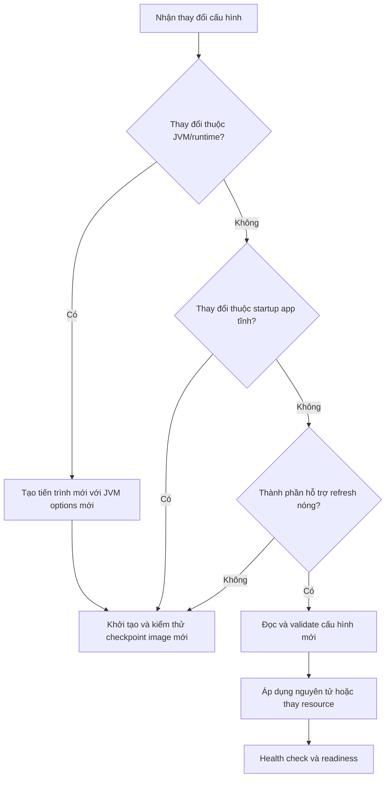

# Giới hạn thay đổi tham số JVM và cấu hình tại thời điểm restore

CRaC khôi phục một tiến trình Java đã được checkpoint. Vì vậy, restore tiếp tục sử dụng JVM đã được khởi tạo cùng trạng thái ứng dụng đã có trong ảnh. Nó không tạo một JVM mới rồi chạy lại toàn bộ quá trình đọc tham số dòng lệnh, biến môi trường và cấu hình khởi động như khi chạy lạnh.

Điểm này đặt ra một giới hạn quan trọng: **không thể coi thời điểm restore như một lần khởi động mới để thay tùy ý các tham số JVM hoặc cấu hình đã được nạp vào bộ nhớ**. Một số thiết lập của JVM gắn với cách runtime được tạo và không thể thay đổi sau khi tiến trình đã chạy. Một số cấu hình ứng dụng có thể được làm mới, nhưng chỉ khi ứng dụng chủ động đọc lại nguồn cấu hình, kiểm tra giá trị mới và cập nhật các thành phần đang sử dụng.

Khi thiết kế ứng dụng CRaC, cần phân biệt ba lớp: tham số khởi tạo JVM, cấu hình ứng dụng đã được materialize thành object trong heap và cấu hình động có thể tải lại từ hệ thống bên ngoài. Việc phân loại này quyết định khi nào phải tạo checkpoint image mới, khi nào cần callback `afterRestore()` và khi nào một lần khởi động lạnh là lựa chọn phù hợp.

## 1. Restore không chạy lại quy trình khởi động JVM

Trong một lần khởi động lạnh, launcher tạo JVM, áp dụng các tham số khởi động, thiết lập classpath/module path, nạp agent, khởi tạo runtime và gọi `main()`. Ứng dụng tiếp tục đọc cấu hình, tạo object, dựng dependency injection container và mở các tài nguyên cần thiết.

Với CRaC, tiến trình đã đi qua các bước đó trước khi tạo checkpoint. Khi restore, runtime phục hồi tiến trình và tiếp tục các thread từ trạng thái đã lưu. Các object cấu hình, system properties, class đã nạp, trạng thái JIT và những cấu trúc runtime được hỗ trợ đã tồn tại trong ảnh. Restore không tự gọi lại `main()`, không tự dựng lại Spring `ApplicationContext` và không tự đọc lại mọi file cấu hình.

```text
Khởi động lạnh
  Java launcher
      |
      v
  Tạo JVM và áp dụng JVM options
      |
      v
  Nạp class, agent, system properties
      |
      v
  main() và khởi tạo ứng dụng
      |
      v
  Warm-up
      |
      v
  Checkpoint image

Restore
  Chọn runtime tương thích và yêu cầu restore
      |
      v
  Khôi phục tiến trình đã lưu
      |
      v
  Phục hồi tài nguyên và cấu hình động theo thiết kế ứng dụng
      |
      v
  Readiness
```

Phần cấu hình được nạp trước checkpoint vẫn là trạng thái hiện có trong tiến trình. Nếu file cấu hình bên ngoài thay đổi sau checkpoint, thay đổi đó không tự cập nhật các object đã đọc file trước đó. Ứng dụng phải có cơ chế tải lại rõ ràng nếu muốn nhận giá trị mới.

## 2. Phân biệt tham số JVM và cấu hình ứng dụng

Hai loại giá trị này thường bị nhầm lẫn vì đều có thể được truyền qua command line hoặc file cấu hình.

| Loại | Ví dụ | Có tự thay đổi khi restore không? |
|---|---|---|
| Tham số khởi tạo JVM | `-Xms`, `-Xmx`, `-XX:+UseG1GC`, module options, native agent | Không; đây là thiết lập của JVM đã được khởi tạo |
| System property lúc khởi động | `-Duser.timezone=UTC`, `-Dapp.region=ap-southeast-1` | Giá trị đã nằm trong tiến trình được khôi phục; không tự đọc lại command line |
| Biến môi trường | `DB_HOST`, `APP_PROFILE`, `JAVA_TOOL_OPTIONS` | Tiến trình đã tồn tại với môi trường của nó; restore không tự nhận môi trường mới của một lần chạy khác |
| Tham số ứng dụng | `--server.port=8080`, feature flag, batch size | Giá trị đã được ứng dụng đọc và lưu; chỉ đổi nếu có cơ chế cập nhật |
| Cấu hình động | Feature flag từ config service, routing rule, giới hạn concurrency có thể refresh | Có thể tải lại nếu ứng dụng chủ động refresh và thành phần hỗ trợ |
| Bí mật và credential | Password, access token, certificate | Cần đánh giá hạn dùng; thường phải lấy mới hoặc xác thực lại sau restore |

Ví dụ, `-Xmx2g` là tham số điều khiển heap của JVM. Nó không tương đương với `app.worker-limit=32`, một giá trị mà ứng dụng có thể dùng để cấu hình executor. Thay đổi `System.setProperty("app.worker-limit", "64")` không làm heap tăng lên và cũng không tự cấu hình lại executor đã được tạo với 32 worker.

## 3. Những tham số JVM cần được quyết định trước khi tạo checkpoint

Nhiều tham số JVM ảnh hưởng đến cấu trúc hoặc hành vi của runtime ngay từ lúc khởi tạo. Các nhóm thường gặp gồm:

- **Bộ nhớ:** `-Xms`, `-Xmx`, kích thước stack thread và các giới hạn vùng nhớ liên quan.
- **Garbage collector:** lựa chọn GC và các tham số cấu hình collector.
- **Class loading và module:** classpath, module path, module exports/opens và các agent được nạp lúc khởi động.
- **Native runtime:** thư viện native, native agent, biến môi trường và tùy chọn ảnh hưởng đến native library loading.
- **JIT và compiler:** các tùy chọn biên dịch, profiling và tối ưu hóa được thiết lập cho runtime.
- **Runtime diagnostics:** một số tùy chọn logging, JFR hoặc diagnostic có thể thay đổi qua API được hỗ trợ, nhưng phạm vi thay đổi phụ thuộc JDK và từng option.

Ví dụ một lần chạy lạnh có thể được cấu hình như sau:

```bash
java \
  -Xms512m \
  -Xmx2g \
  -XX:+UseG1GC \
  -Duser.timezone=UTC \
  -jar application.jar
```

Các giá trị này thuộc cấu hình của tiến trình được tạo. Nếu cần một image dành cho heap tối đa 4 GB hoặc một lựa chọn GC khác, hãy tạo và kiểm thử image bằng cấu hình JVM tương ứng. Không nên kỳ vọng truyền `-Xmx4g` vào lệnh restore sẽ biến một tiến trình đã được checkpoint với cấu hình heap 2 GB thành JVM có heap 4 GB.

### Thay đổi JVM option khi runtime đang chạy

HotSpot có một số cơ chế quản trị hoặc diagnostic cho phép thay đổi một số VM option trong lúc chạy. Tuy nhiên, điều đó chỉ áp dụng cho các option được JVM đánh dấu có thể ghi và được API/JDK cụ thể hỗ trợ. Nó không biến toàn bộ tham số dòng lệnh thành cấu hình động.

`RuntimeMXBean.getInputArguments()` cho phép quan sát các đối số JVM đã dùng, không phải API để sửa chúng. `HotSpotDiagnosticMXBean` có thể cung cấp thông tin về một số VM option và hỗ trợ thay đổi một số option được phép; phải kiểm tra khả năng ghi của option và tài liệu đúng JDK. Không được suy ra rằng heap size, GC algorithm, module access hoặc mọi option `-XX` đều có thể đổi an toàn sau khi khởi tạo.

Ngay cả với option có thể thay đổi lúc chạy, cần xác minh việc thay đổi đó có phù hợp với checkpoint/restore và không tạo trạng thái khác biệt ngoài dự kiến. Nếu thay đổi tác động đến layout bộ nhớ, thread, class loading hoặc tài nguyên native, hãy dùng quy trình tạo image mới và kiểm thử riêng.

## 4. System properties và biến môi trường không tự được nạp lại

### System properties

Các system properties có thể được đặt bằng `-D` khi khởi chạy:

```bash
java -Dapp.region=ap-southeast-1 -jar application.jar
```

Ứng dụng có thể đọc chúng bằng:

```java
String region = System.getProperty("app.region");
```

Giá trị này nằm trong `System.getProperties()` của tiến trình. Sau restore, tiến trình tiếp tục với trạng thái properties đã được lưu. Nếu một file bên ngoài hoặc cấu hình của deployment thay đổi, Java không tự chạy lại launcher để nạp giá trị `-D` mới.

Java cho phép một số system properties được thay đổi bằng `System.setProperty()`:

```java
System.setProperty("app.region", "ap-southeast-1");
```

Nhưng thao tác này chỉ cập nhật property map trong JVM. Nó không tự thông báo cho mọi thư viện, bean hoặc object đã đọc giá trị cũ. Một thư viện có thể đọc property một lần trong static initializer, cache giá trị vào field hoặc dùng nó để tạo thread pool. Thay property sau đó không tự tái cấu hình những object đó.

Đặc biệt, không nên dùng `System.setProperty()` như cách thay đổi một tham số JVM nội tại. Ví dụ, đặt `System.setProperty("-Xmx", "4g")` không phải cách tăng heap. Các JVM option có cú pháp và thời điểm áp dụng riêng.

### Environment variables

`System.getenv()` đọc môi trường của tiến trình:

```java
String databaseHost = System.getenv("DB_HOST");
```

Restore khôi phục tiến trình đã tồn tại, không tạo một môi trường tiến trình mới từ cấu hình container hoặc shell tại thời điểm restore. Vì vậy, không nên mong `DB_HOST` được cập nhật chỉ vì deployment đã đổi biến môi trường cho một lần chạy mới. `System.getenv()` cũng không cung cấp API chuẩn để sửa môi trường tiến trình hiện tại.

Nếu cần thay endpoint hoặc credential động, hãy đọc chúng từ config service, secret manager hoặc file được quản lý có khả năng refresh. Không dùng biến môi trường như một kênh cập nhật nóng sau restore.

## 5. Cấu hình ứng dụng đã được nạp vào heap

Khi ứng dụng khởi tạo, nó thường chuyển dữ liệu từ file, environment, command line hoặc config server thành object Java. Sau checkpoint, các object đó được khôi phục cùng tiến trình.

Ví dụ:

```java
public final class DatabaseSettings {

    private final String jdbcUrl;
    private final int maximumPoolSize;

    public DatabaseSettings(String jdbcUrl, int maximumPoolSize) {
        this.jdbcUrl = jdbcUrl;
        this.maximumPoolSize = maximumPoolSize;
    }

    public String jdbcUrl() {
        return jdbcUrl;
    }

    public int maximumPoolSize() {
        return maximumPoolSize;
    }
}
```

Nếu `DatabaseSettings` được tạo trước checkpoint với pool size bằng 8, restore sẽ phục hồi object chứa giá trị 8. Thay file YAML bên ngoài thành 12 không tự thay đổi field `maximumPoolSize` trong object đã lưu. Hơn nữa, connection pool đã được tạo từ cấu hình cũ cũng không tự mở rộng chỉ vì file thay đổi.

Muốn refresh, ứng dụng phải có một luồng cập nhật có chủ đích:

1. Đọc cấu hình mới từ nguồn bên ngoài.
2. Parse và validate giá trị.
3. Kiểm tra thay đổi có thể áp dụng nóng hay yêu cầu tạo lại resource.
4. Tạo cấu hình immutable mới và công bố nó một cách thread-safe.
5. Cập nhật hoặc thay thế các thành phần phụ thuộc.
6. Chỉ đánh dấu cấu hình mới đã hoạt động khi bước áp dụng hoàn tất.

Không nên sửa trực tiếp từng field của nhiều bean mà không có cơ chế đồng bộ. Trong lúc refresh, request có thể nhìn thấy một phần cấu hình cũ và một phần cấu hình mới.

## 6. Phân loại cấu hình: tĩnh, có thể refresh và gắn với instance

Một bảng phân loại giúp quyết định cấu hình nào phải có trong checkpoint image và cấu hình nào cần lấy lại sau restore.

| Nhóm cấu hình | Ví dụ | Chiến lược |
|---|---|---|
| JVM/runtime tĩnh | Heap size, GC, module access, native agent | Chọn trước khi tạo image; thay đổi lớn cần image mới hoặc cold start |
| Startup app tĩnh | Classpath, profile, cấu hình bean, schema mapping | Được materialize trước checkpoint; thay đổi cần khởi tạo lại thành phần hoặc image mới |
| Runtime app có thể refresh | Feature flag, routing rule, log level, concurrency limit có hỗ trợ | Tải lại và áp dụng bằng cơ chế refresh rõ ràng |
| Theo môi trường hiện tại | Endpoint, DNS, region, service discovery | Đọc hoặc xác minh lại sau restore khi cần |
| Theo thời gian/phiên | Token, certificate ngắn hạn, lease, session | Refresh, xác thực lại hoặc đăng ký lại sau restore |
| Theo instance | Instance ID, leader state, shard assignment | Tạo mới hoặc acquire lại cho từng bản restore |

Không phải mọi thay đổi cấu hình đều cần tạo image mới. Feature flag có thể được tải lại từ dịch vụ cấu hình. Ngược lại, thay đổi heap size hoặc lựa chọn GC cần một tiến trình JVM được khởi tạo theo tham số mới. Một thay đổi `maximumPoolSize` có thể cần tạo pool mới hoặc dùng API cấu hình động được pool hỗ trợ; chỉ đổi property không đủ.

## 7. Thiết kế cấu hình động an toàn sau restore

Nếu ứng dụng cần nhận thay đổi cấu hình khi restore, nên có một `ConfigProvider` đọc nguồn bên ngoài và công bố một snapshot cấu hình immutable. Các thành phần đọc snapshot hiện hành thay vì tự đọc rải rác từ system properties hoặc file.

Ví dụ đơn giản:

```java
import java.util.concurrent.atomic.AtomicReference;

public final class ConfigProvider {

    private final AtomicReference<AppConfig> current =
            new AtomicReference<>();

    public AppConfig current() {
        return current.get();
    }

    public void refresh() throws Exception {
        AppConfig candidate = loadFromExternalSource();
        validate(candidate);
        current.set(candidate);
    }

    private AppConfig loadFromExternalSource() throws Exception {
        // Đọc file/config service/secret manager hiện hành.
        throw new UnsupportedOperationException("Provide a config source");
    }

    private void validate(AppConfig candidate) {
        if (candidate.workerLimit() < 1) {
            throw new IllegalArgumentException("workerLimit must be positive");
        }
    }
}
```

`AppConfig` nên là object immutable chứa một version hoặc revision. `AtomicReference` giúp công bố một snapshot hoàn chỉnh trong một thao tác, để các thread không nhìn thấy trạng thái cập nhật dở dang. Trong triển khai thực tế, `loadFromExternalSource()` cần timeout, xác thực và xử lý lỗi; không nên để callback restore chờ vô hạn khi config service không phản hồi.

Nếu cấu hình mới yêu cầu thay thế resource, cần có bước apply riêng. Ví dụ, đổi database URL không thể chỉ cập nhật một field nếu `DataSource` cũ vẫn đang mở kết nối đến endpoint cũ. Hãy tạo resource mới, kiểm tra hoạt động, chuyển traffic nội bộ sang resource mới rồi mới đóng resource cũ.

## 8. Tải lại cấu hình trong `afterRestore()`

CRaC cung cấp `Resource` callback để ứng dụng tham gia vào quá trình trước checkpoint và sau restore. Có thể dùng `afterRestore()` để đọc lại cấu hình động hoặc credential cần được làm mới.

Ví dụ:

```java
import org.crac.Context;
import org.crac.Core;
import org.crac.Resource;

public final class DynamicConfigResource implements Resource {

    private final ConfigProvider configProvider;
    private final RuntimeConfigApplier applier;

    public DynamicConfigResource(ConfigProvider configProvider,
                                 RuntimeConfigApplier applier) {
        this.configProvider = configProvider;
        this.applier = applier;
        Core.getGlobalContext().register(this);
    }

    @Override
    public void beforeCheckpoint(Context<? extends Resource> context) {
        applier.stopConfigDependentWork();
    }

    @Override
    public void afterRestore(Context<? extends Resource> context)
            throws Exception {
        configProvider.refresh();
        applier.apply(configProvider.current());
    }
}
```

Các kiểu `ConfigProvider` và `RuntimeConfigApplier` là abstraction do ứng dụng định nghĩa. `beforeCheckpoint()` có thể dừng watcher hoặc tác vụ đang dùng cấu hình để tránh checkpoint giữa lúc refresh. `afterRestore()` tải snapshot mới và áp dụng cấu hình trước khi readiness hoàn tất.

Trong ứng dụng thật, cần xử lý trường hợp refresh thất bại. Nếu cấu hình là bắt buộc để kết nối database hoặc xác thực, giữ readiness ở trạng thái chưa sẵn sàng và báo lỗi rõ ràng. Nếu cấu hình mới không hợp lệ, có thể giữ snapshot cũ chỉ khi snapshot đó vẫn an toàn và được chính sách cho phép; không nên âm thầm dùng credential đã hết hạn hoặc endpoint không còn hợp lệ.

Nếu một thư viện/framework đã có CRaC integration hoặc callback riêng để refresh resource, hãy phối hợp với integration đó và tránh đăng ký nhiều callback cạnh tranh.

## 9. Spring Boot: file cấu hình và bean không tự được tạo lại

Trong Spring Boot, `application.yml`, profile, environment variables và command-line properties thường được hợp nhất vào `Environment` trong quá trình khởi động. Bean được tạo từ các giá trị đó, ví dụ qua `@Value`, `@ConfigurationProperties` hoặc constructor binding.

Sau checkpoint/restore:

- `ApplicationContext` và các bean đã được tạo là trạng thái của tiến trình được khôi phục.
- `@PostConstruct`, `ApplicationRunner` và `CommandLineRunner` không tự chạy lại chỉ vì restore.
- File `application.yml` thay đổi trên filesystem không tự cập nhật các object configuration đã được bind.
- Biến môi trường của một container mới không tự thay đổi môi trường của tiến trình đã được checkpoint.
- Những bean giữ connection pool, HTTP client hoặc scheduler cần xử lý vòng đời tài nguyên theo integration phù hợp.

Nếu dùng Spring Cloud Config, Spring Cloud Context hoặc một cơ chế refresh tương tự, hãy xác minh phiên bản và cách tích hợp cụ thể. Các cơ chế refresh chỉ cập nhật những bean và property source mà framework hỗ trợ; chúng không biến mọi JVM option thành runtime option và không tự làm mới mọi tài nguyên bên ngoài.

Với bean có cấu hình bất biến, thường cần tạo lại context hoặc tạo checkpoint image mới khi thay đổi cấu hình khởi tạo quan trọng. Với feature flag hoặc routing rule, có thể dùng một service cấu hình động được thiết kế để refresh. Với datasource, cần thay pool theo lifecycle rõ ràng và đảm bảo các bean truy cập datasource nhìn thấy pool mới.

## 10. Cấu hình bí mật và thông tin xác thực

Checkpoint image có thể chứa dữ liệu heap, bao gồm password, token, private key hoặc credential mà ứng dụng đã nạp. Nếu các giá trị này được nhúng trong image, nhiều bản restore có thể bắt đầu với cùng một bản sao của secret.

Với secret có thời hạn hoặc được cấp theo instance:

- Không giả định token còn hạn chỉ vì object token được khôi phục.
- Lấy credential mới từ secret manager hoặc identity provider khi cần.
- Xác thực lại database, broker và dịch vụ bên ngoài sau restore.
- Không ghi secret vào log hoặc metric label.
- Bảo vệ checkpoint artifact và quyền truy cập vào nơi lưu image.
- Nếu nhiều bản restore cần danh tính riêng, cấp identity sau restore thay vì chia sẻ một credential phiên độc quyền.

Không phải mọi secret đều cần thay mới mỗi lần restore. Một certificate dài hạn hoặc key bất biến có thể được giữ nếu chính sách bảo mật cho phép và nó còn hợp lệ. Quyết định phải dựa vào expiry, rotation, scope và quyền sở hữu, không chỉ dựa vào việc giá trị có trong heap.

## 11. Tạo checkpoint image theo phiên bản cấu hình

Một checkpoint image được tạo với một phiên bản ứng dụng, JDK, JVM options và tập cấu hình khởi tạo cụ thể. Nên quản lý image cùng metadata để biết nó được tạo từ những đầu vào nào.

Metadata triển khai có thể ghi nhận:

| Metadata | Mục đích |
|---|---|
| Application build/version | Xác định mã nguồn và artifact đã tạo image |
| JDK/CRaC distribution version | Xác định runtime cần tương thích |
| JVM startup profile | Ghi nhận nhóm tham số JVM được dùng khi tạo image |
| Static configuration revision | Biết image được khởi tạo với revision cấu hình nào |
| Resource compatibility notes | Theo dõi các driver, client và integration CRaC liên quan |
| Checkpoint creation time | Phân biệt thời điểm tạo image với thời điểm restore |

Không nên ghi password, private key hoặc giá trị secret trực tiếp vào metadata. Có thể ghi version hoặc identifier của secret để sau restore lấy giá trị hiện hành.

Khi thay đổi tham số JVM quan trọng, JDK, native agent, classpath hoặc cấu hình startup ảnh hưởng đến cấu trúc bean, hãy tạo image mới và kiểm thử image đó. Khi chỉ thay đổi cấu hình động, có thể giữ image và refresh từ nguồn bên ngoài nếu ứng dụng đã hỗ trợ.

## 12. Những thay đổi nào cần image mới?

| Thay đổi | Hướng xử lý thường phù hợp |
|---|---|
| Tăng/giảm `-Xmx`, `-Xms` | Khởi tạo JVM mới với giá trị mới và tạo image mới |
| Thay đổi GC hoặc tham số runtime nền tảng | Tạo image mới bằng JDK và option tương ứng |
| Thay classpath, module path hoặc native agent | Đóng gói/khởi động lại ứng dụng và tạo image mới |
| Thay profile Spring làm thay đổi bean graph | Khởi tạo context theo profile mới; thường cần image mới |
| Đổi `DB_HOST` qua environment của deployment | Tiến trình restore không tự nhận env mới; cần đọc từ nguồn cấu hình động hoặc tạo tiến trình/image mới |
| Đổi feature flag từ config service | Refresh nếu ứng dụng có cơ chế hỗ trợ |
| Đổi giới hạn worker | Áp dụng qua executor có hỗ trợ resize hoặc thay executor có kiểm soát |
| Đổi database URL | Tạo và kiểm tra datasource mới, chuyển sử dụng rồi đóng datasource cũ |
| Token hết hạn | Refresh hoặc xác thực lại sau restore |
| Đổi log level | Có thể refresh nếu logging framework hỗ trợ thay đổi runtime |

Các mục trong bảng là hướng dẫn phân loại, không thay thế tài liệu của từng JDK, framework và thư viện. Một số thay đổi ứng dụng có thể được áp dụng nóng, nhưng cần xem resource hiện tại có hỗ trợ thay đổi hay phải được tạo lại.

## 13. Lệnh restore và giới hạn của JVM options

Một JDK CRaC thường có tùy chọn hoặc công cụ riêng để chỉ định checkpoint image và thực hiện restore. Cú pháp cụ thể phụ thuộc bản phân phối JDK/runtime. Ví dụ minh họa có thể có dạng:

```bash
java -XX:CRaCRestoreFrom=/checkpoints/my-app
```

Đây là chỉ dẫn chọn image để restore theo runtime hỗ trợ. Không nên hiểu mọi option khác được thêm vào lệnh đó sẽ ghi đè các tham số đã được sử dụng khi tạo tiến trình trong image. Restore cần runtime tương thích và các tùy chọn CRaC mà bản phân phối yêu cầu. Hãy kiểm tra tài liệu đúng phiên bản JDK về option được phép khi restore, điều kiện tương thích và giới hạn thay đổi.

Nếu cần một cấu hình JVM khác, hãy tạo một tiến trình mới với các tham số mong muốn rồi tạo checkpoint mới. Đừng dùng việc thêm `-D`, `-Xmx`, `-XX` hoặc thay environment ở lệnh restore như một cơ chế cấu hình nóng chung.

## 14. Quy trình quyết định khi có thay đổi cấu hình

Khi deployment thay đổi cấu hình, có thể dùng quy trình sau:



Trước khi áp dụng, hãy xác định phạm vi ảnh hưởng. Nếu thay đổi chỉ là feature flag, refresh có thể đủ. Nếu thay đổi ảnh hưởng tới heap, GC, module access hoặc native library, cần tiến trình mới. Nếu thay đổi database endpoint, có thể cần tạo pool mới và chuyển đổi có kiểm soát. Nếu thay đổi profile Spring làm thay đổi tập bean, hãy khởi tạo context mới hoặc tạo image mới.

## 15. Các lỗi thường gặp

### Nghĩ rằng restore đọc lại `-D` và command-line arguments

Restore phục hồi tiến trình đã được tạo, không gọi launcher để phân tích lại command line. Hãy tạo image mới nếu cần thay startup options hoặc đọc cấu hình mới từ nguồn động.

### Dùng `System.setProperty()` để đổi JVM option

System property là dữ liệu trong property map. Nó không thay thế tham số JVM như heap size, GC hoặc module access. Chỉ thay đổi VM option qua cơ chế được JDK hỗ trợ và chỉ khi option đó cho phép ghi.

### Thay file YAML nhưng tiếp tục dùng bean cũ

Bean đã bind cấu hình trước checkpoint vẫn giữ giá trị trong heap. File mới không tự cập nhật field của bean. Cần refresh framework được hỗ trợ hoặc tạo lại thành phần phụ thuộc.

### Mong biến môi trường của deployment mới xuất hiện trong tiến trình cũ

Environment thuộc tiến trình đã được tạo. Restore không tạo lại environment từ container spec mới. Dùng config service/secret manager có API refresh hoặc khởi chạy tiến trình mới.

### Refresh property nhưng không thay resource

Đổi `DB_HOST` hoặc pool size trong config object không tự thay connection pool đang mở. Cần tạo resource mới, xác minh rồi chuyển sử dụng.

### Bật readiness trước khi refresh hoàn tất

Ứng dụng có thể phục vụ bằng endpoint cũ hoặc credential đã hết hạn. Chỉ bật readiness sau khi cấu hình và resource bắt buộc đã được áp dụng và kiểm tra.

### Dùng chung secret hoặc identity độc quyền cho nhiều bản restore

Một image có thể nhân bản giá trị trong heap. Identity, lease và credential gắn với instance cần được cấp lại theo chính sách sau restore.

## 16. Kiểm thử và quan sát cấu hình sau restore

Hãy kiểm thử cả cấu hình không thay đổi và cấu hình thay đổi trong khoảng giữa checkpoint với restore.

Các tình huống nên bao gồm:

1. Restore với cùng JDK, JVM options và static configuration revision đã dùng khi tạo image.
2. Thay file cấu hình bên ngoài rồi restore để xác nhận bean cũ không tự đổi.
3. Thay feature flag trong config service và kiểm tra cơ chế refresh.
4. Đổi database endpoint và xác nhận datasource mới được tạo, kiểm tra và chuyển sử dụng đúng thứ tự.
5. Làm token hết hạn trước restore và xác nhận ứng dụng refresh hoặc xác thực lại.
6. Thay environment của deployment rồi xác nhận tiến trình restore không tự nhận giá trị mới.
7. Thử thay một VM option được phép ghi và xác minh giới hạn của đúng JDK; không dùng kết quả đó để suy rộng cho option khác.
8. Restore nhiều bản sao và kiểm tra instance identity, secret, lease và cấu hình theo từng instance.
9. Khi config service không khả dụng, xác nhận readiness và chính sách fallback hoạt động đúng.

Nên ghi nhận các mốc `afterRestore-start`, `config-source-read`, `config-validation-complete`, `resource-replaced`, `credential-refreshed` và `readiness-ready`. Gắn application version, image ID, config revision và instance ID vào log/metric. Không ghi secret hoặc giá trị cấu hình nhạy cảm.

Các chỉ số hữu ích gồm thời gian refresh cấu hình, số lần refresh thất bại, revision đang hoạt động, số resource được thay thế và thời gian từ restore đến readiness. Khi có sự cố, những thông tin này giúp phân biệt image được tạo từ cấu hình cũ với một lần refresh sau restore thất bại.

## 17. Kết luận

CRaC restore phục hồi JVM và ứng dụng đã được khởi tạo trước checkpoint. Tham số JVM như heap size, GC, module access, classpath và native agent thuộc cấu hình của runtime đã tạo image; không thể tùy ý thay chúng bằng cách truyền option mới vào restore. System properties, biến môi trường và bean cấu hình đã được nạp cũng giữ trạng thái của tiến trình; chúng không tự đọc lại nguồn mới.

Nếu cần thay đổi cấu hình ứng dụng, hãy phân loại nó là startup tĩnh, runtime có thể refresh, hay giá trị gắn với thời gian/instance. Cấu hình động cần được tải từ nguồn bên ngoài, validate và áp dụng bằng một cơ chế thread-safe. Tài nguyên như datasource, executor và client có thể phải được tạo lại thay vì chỉ đổi property. Khi thay đổi JVM hoặc startup configuration quan trọng, hãy tạo image mới bằng cấu hình mong muốn. Sau restore, chỉ bật readiness khi cấu hình hiện hành và mọi resource bắt buộc đã sẵn sàng.
