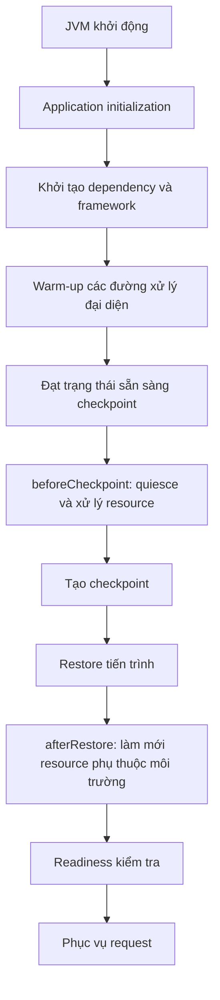

# Phân biệt khởi tạo ứng dụng với làm nóng các đường thực thi

Trong Java, khởi tạo ứng dụng và làm nóng các đường thực thi là hai công việc có liên quan nhưng giải quyết hai vấn đề khác nhau. Khởi tạo ứng dụng chuẩn bị cấu hình, dependency, object, route và tài nguyên để hệ thống có thể hoạt động. Làm nóng đường thực thi (warm-up) chủ động chạy những luồng xử lý quan trọng để JVM, framework và cache ứng dụng có cơ hội chuẩn bị trước khi nhận tải thật.

Với CRaC, sự phân biệt này đặc biệt quan trọng. Một ứng dụng có thể khởi tạo xong nhưng request đầu tiên sau restore vẫn chậm vì các nhánh xử lý chưa được chạy, lớp phụ trợ chưa được nạp, serializer chưa tạo metadata hoặc mã nóng chưa được JIT biên dịch ở mức tối ưu. Ngược lại, chạy warm-up khi dependency chưa sẵn sàng có thể tạo lỗi hoặc gây tác dụng phụ. Cần xác định rõ giai đoạn nào xây dựng trạng thái ứng dụng, giai đoạn nào thực thi workload đại diện, và trạng thái nào cần được làm mới sau restore.

## 1. Khởi tạo ứng dụng là gì?

Khởi tạo ứng dụng (application initialization) là quá trình đưa chương trình từ trạng thái JVM vừa khởi động tới trạng thái có thể thực hiện chức năng. Công việc thường bao gồm:

- Đọc và xác thực cấu hình, biến môi trường, secret và tham số triển khai.
- Tạo dependency injection container và các singleton cần thiết.
- Khởi tạo service, repository, controller, handler và route.
- Đăng ký listener, serializer, converter, validator và metadata của framework.
- Chuẩn bị cache ban đầu hoặc đọc dữ liệu cấu hình cần thiết.
- Tạo các executor, scheduler và thành phần quản lý vòng đời.
- Đăng ký các `Resource` cần xử lý trong `beforeCheckpoint` và `afterRestore`.

Mục tiêu của khởi tạo là tạo ra cấu trúc và trạng thái ban đầu hợp lệ. Khi khởi tạo hoàn tất, ứng dụng có thể đã có đủ object để xử lý request, nhưng điều đó không có nghĩa mọi phương thức quan trọng đã được thực thi hoặc đã được JVM tối ưu.

Ví dụ đơn giản:

```java
public final class ApplicationBootstrap {
    public ApplicationRuntime initialize(AppConfig config) {
        config.validate();

        DatabaseAccess database = createDatabaseAccess(config);
        PricingService pricing = new PricingService(config.pricingRules());
        OrderService orders = new OrderService(database, pricing);
        HttpHandlers handlers = new HttpHandlers(orders);

        Router router = new Router();
        router.register("POST", "/orders/preview", handlers::preview);

        return new ApplicationRuntime(database, orders, router);
    }

    private DatabaseAccess createDatabaseAccess(AppConfig config) {
        // Tạo abstraction truy cập dữ liệu theo cấu hình.
        return new DatabaseAccess(config.database());
    }
}
```

Ví dụ minh họa việc dựng object graph và route. Việc tạo `OrderService` hay đăng ký handler chưa tự động làm cho toàn bộ logic bên trong các phương thức `preview`, `validate` hoặc serialize response được thực thi.

## 2. Warm-up là gì?

Warm-up là việc chạy có chủ đích một tập hợp thao tác đại diện trước khi hệ thống nhận tải thật. Mục đích là kích hoạt những phần công việc mà khởi tạo object đơn thuần chưa chạm tới.

Warm-up có thể chuẩn bị nhiều lớp trạng thái:

| Loại warm-up | Công việc được kích hoạt | Lợi ích kỳ vọng |
|---|---|---|
| Class loading | Nạp các lớp được dùng ở đường xử lý | Giảm việc nạp lớp muộn ở request đầu tiên |
| Class initialization | Chạy static initializer và khởi tạo lớp khi cần | Phát hiện lỗi khởi tạo và chuẩn bị static state |
| Framework warm-up | Tạo proxy, metadata, route matcher, serializer hoặc converter | Giảm chi phí lazy initialization |
| Application cache warm-up | Nạp dữ liệu thường dùng vào cache | Tránh cache miss hoặc đọc nguồn dữ liệu trong request đầu |
| JIT warm-up | Thực thi phương thức nóng với dữ liệu đại diện | Thu thập profile và tạo cơ hội biên dịch mã tối ưu |
| Runtime/resource warm-up | Mở hoặc kiểm tra resource cần thiết | Phát hiện sớm lỗi kết nối hoặc cấu hình |

Các loại warm-up này không đồng nghĩa với nhau. Chẳng hạn, nạp một lớp không có nghĩa phương thức của lớp đã được JIT biên dịch. Đọc một mục vào cache ứng dụng không chứng minh đường xử lý dùng mục đó đã được thực thi. Gọi một endpoint một lần có thể kích hoạt lazy initialization nhưng chưa đủ để phương thức trở thành hot method.

## 3. Phân biệt application initialization, class loading và JIT compilation

Để lập kế hoạch đúng, cần tách ba tầng thường bị gọi chung là “khởi động JVM”.

### 3.1. Application initialization

Đây là logic do ứng dụng hoặc framework thực hiện: tạo object, đọc cấu hình, wiring dependency, đăng ký route và tạo resource. Công việc này chủ yếu quyết định cấu trúc ứng dụng đã sẵn sàng hay chưa.

### 3.2. Class loading và class initialization

JVM nạp định nghĩa lớp khi cần và có thể kiểm tra, liên kết lớp. Khởi tạo lớp là giai đoạn chạy các phép gán trường `static` và khối `static` theo quy tắc của JVM. Một lớp có thể đã được nạp nhưng chưa được khởi tạo.

Ví dụ, `Class.forName(name, false, loader)` yêu cầu nạp lớp nhưng không chủ động chạy static initializer; `Class.forName(name, true, loader)` yêu cầu khởi tạo lớp. Cả hai cách gọi đều không phải là phương pháp làm nóng JIT cho các phương thức của lớp.

### 3.3. JIT compilation và profile thực thi

HotSpot có thể thực thi bytecode bằng interpreter trước, thu thập thông tin về hành vi và biên dịch phương thức nóng qua các mức tối ưu hóa. Với tiered compilation, một phương thức có thể được biên dịch ở mức trung gian rồi được biên dịch tối ưu hơn khi đủ dữ liệu.

JIT dựa vào hành vi thực thi như số lần gọi, nhánh thường đi qua, kiểu đối tượng xuất hiện và các đặc điểm của call site. Do đó, chỉ tạo object hoặc nạp lớp không cung cấp đủ profile để tối ưu những phương thức chưa chạy.

| Thao tác | Có thể kích hoạt | Không bảo đảm |
|---|---|---|
| Tạo object service | Constructor và một số lớp liên quan | Mọi phương thức của service đã chạy |
| `Class.forName(..., true, loader)` | Nạp và khởi tạo lớp | Các phương thức instance đã được JIT biên dịch |
| Gọi endpoint một lần | Một phần handler, lazy init và lớp phụ trợ | Đã đạt ngưỡng hot hoặc profile đại diện |
| Chạy workload lặp lại | Profile thực thi và cơ hội JIT compile | Mọi phương thức đều được biên dịch tối ưu |
| Nạp cache | Dữ liệu cache được chuẩn bị | JIT hoặc framework metadata đã warm-up |

## 4. Vì sao ứng dụng khởi tạo xong vẫn có request đầu tiên chậm?

Một request có thể đi qua nhiều bước chỉ được kích hoạt khi có request thật:

1. Router lần đầu phân giải route hoặc tạo handler wrapper.
2. Framework lần đầu tạo proxy hoặc resolve generic type metadata.
3. Serializer lần đầu phân tích cấu trúc một DTO.
4. Validator lần đầu dựng metadata cho annotation.
5. Driver lần đầu tạo statement hoặc chuẩn bị protocol state.
6. Một nhánh nghiệp vụ hiếm mới nạp class phụ trợ.
7. JVM bắt đầu thu thập profile và biên dịch phương thức được gọi thường xuyên.

Nếu request đầu tiên đi qua tất cả các bước này, độ trễ có thể lớn hơn các request sau. Chỉ đánh dấu `ApplicationContext` đã start không chứng minh các đường xử lý đã warm-up.

Ví dụ, `OrderService` đã được tạo lúc startup, nhưng phương thức `preview()` có thể chưa từng chạy. Khi request đầu tiên gọi `preview()`, nó có thể lần đầu thực hiện validation, tra bảng giá, serialize kết quả và kích hoạt các lớp liên quan. Các request sau hưởng lợi từ metadata đã tạo, cache đã nạp và profile thực thi đã tích lũy.

## 5. Warm-up phù hợp với CRaC ở thời điểm nào?

Với CRaC, quy trình thường có các giai đoạn sau:



Application initialization cần hoàn tất trước warm-up vì workload phải dùng dependency đã được dựng. Warm-up nên diễn ra trước checkpoint nếu mục tiêu là chuẩn bị đường thực thi cho trạng thái được lưu. Trước khi checkpoint, các resource bên ngoài vẫn phải được đưa về trạng thái an toàn theo CRaC lifecycle.

Sau restore, `afterRestore` có thể cần mở lại database pool, socket, message consumer hoặc refresh dữ liệu phụ thuộc môi trường. Không nên mặc định mọi cache hay connection được chuẩn bị trước checkpoint vẫn hợp lệ. Cần phân loại trạng thái nào được giữ lại và trạng thái nào phải tạo lại.

JIT code, profile và các trạng thái runtime được phục hồi đến mức nào phụ thuộc JDK/runtime CRaC, nền tảng và cách triển khai. Không suy luận rằng một lớp đã nạp đồng nghĩa mã đã được tối ưu, hoặc rằng mọi lợi ích warm-up chắc chắn được giữ nguyên. Hãy đo trên đúng runtime và môi trường restore mục tiêu.

## 6. Chọn các đường thực thi cần warm-up

Không cần chạy mọi chức năng của ứng dụng trước checkpoint. Hãy chọn theo dữ liệu sử dụng và tác động đến độ trễ.

Một cách lựa chọn có hệ thống:

1. Xác định endpoint hoặc job có tỷ lệ sử dụng cao ngay sau khi instance sẵn sàng.
2. Xác định đường xử lý có độ trễ đầu tiên cao hoặc có nhiều lazy initialization.
3. Xác định nhánh nghiệp vụ quan trọng cần được kiểm tra trước khi nhận traffic.
4. Chọn tập input đại diện cho kiểu dữ liệu và nhánh điều kiện thường gặp.
5. Chạy warm-up trong giới hạn thời gian và concurrency.
6. Đo xem warm-up có giảm độ trễ request đầu tiên sau restore hay chỉ làm startup kéo dài hơn.

Ví dụ cho một dịch vụ xử lý đơn hàng:

| Đường thực thi | Nội dung warm-up |
|---|---|
| Preview order | Tính giá, áp dụng discount, tính thuế và serialize response |
| Validate order | Chạy các validator cho kiểu dữ liệu phổ biến |
| Search product | Chuẩn bị query builder và mapper |
| Authentication | Khởi tạo parser/token verifier bằng dữ liệu giả hợp lệ |
| Error response | Chuẩn bị serializer và handler cho một số lỗi phổ biến |

Nên có dữ liệu đại diện cho nhiều nhánh. Nếu warm-up chỉ dùng một loại request rất đơn giản, profile JIT có thể không phản ánh hành vi thật và các nhánh khác vẫn phải trả chi phí lần đầu.

## 7. Thực thi workload warm-up an toàn

Warm-up phải có khả năng lặp lại mà không tạo tác dụng phụ nghiệp vụ. Không dùng dữ liệu khách hàng thật hoặc gửi giao dịch thật chỉ để kích hoạt code path.

Các lựa chọn an toàn:

- Dùng fixture tổng hợp với giá trị cố định và có thể tái tạo.
- Dùng API preview/validation không ghi dữ liệu.
- Dùng transaction rollback nếu hệ thống bảo đảm mọi side effect đều nằm trong transaction đó.
- Dùng mock hoặc sandbox cho dịch vụ ngoài.
- Tách bước serialize/deserialize và mapping khỏi thao tác gửi dữ liệu thật.
- Dùng idempotency key riêng cho thao tác warm-up nếu phải gọi API hỗ trợ idempotency.

Một transaction rollback không hoàn tác email, message đã publish, file đã ghi hoặc HTTP request đã xử lý ở dịch vụ khác. Vì vậy, không giả định rollback database là đủ để xóa mọi side effect.

Warm-up cũng cần giới hạn tải. Chạy quá nhiều luồng cùng lúc có thể làm connection pool cạn, chiếm CPU, tạo áp lực GC hoặc làm dependency bị quá tải. Hãy đặt thời gian tối đa, số lần lặp và concurrency phù hợp.

## 8. Ví dụ: tách bootstrap khỏi warm-up

Có thể biểu diễn hai trách nhiệm bằng hai abstraction riêng:

```java
public final class ApplicationStartup {
    private final ApplicationBootstrap bootstrap;
    private final WarmupRunner warmupRunner;

    public ApplicationStartup(
            ApplicationBootstrap bootstrap,
            WarmupRunner warmupRunner) {
        this.bootstrap = bootstrap;
        this.warmupRunner = warmupRunner;
    }

    public ApplicationRuntime start(AppConfig config) throws Exception {
        // Giai đoạn 1: dựng cấu trúc ứng dụng.
        ApplicationRuntime runtime = bootstrap.initialize(config);

        // Giai đoạn 2: thực thi workload đại diện.
        warmupRunner.warm(runtime);

        return runtime;
    }
}
```

Warm-up runner có thể gọi các use case an toàn:

```java
public final class WarmupRunner {
    public void warm(ApplicationRuntime runtime) {
        OrderPreviewInput basic = WarmupFixtures.basicOrder();
        OrderPreviewInput discounted = WarmupFixtures.discountedOrder();

        for (int i = 0; i < 500; i++) {
            runtime.orders().preview(basic);
            runtime.orders().preview(discounted);
        }

        runtime.serializers().serialize(WarmupFixtures.sampleResponse());
        runtime.validators().validate(WarmupFixtures.sampleOrder());
    }
}
```

Đây là ví dụ về cách phân tách trách nhiệm. Con số 500 chỉ minh họa vòng lặp; không phải ngưỡng JIT cố định hoặc khuyến nghị áp dụng cho mọi ứng dụng. Trong thực tế, số lần lặp nên được quyết định bằng đo lường, có giới hạn thời gian và không tạo side effect. Nếu phương thức `preview()` dùng cache hoặc gọi dịch vụ bên ngoài, hãy dùng fixture và sandbox phù hợp.

Nếu warm-up cần thực hiện bất đồng bộ, startup phải chờ tín hiệu hoàn tất trước khi báo sẵn sàng tạo checkpoint. Không để warm-up thread tiếp tục thay đổi trạng thái trong lúc checkpoint đang diễn ra.

## 9. Làm nóng JIT khác với làm nóng cache ứng dụng

Hai việc này thường được gọi chung là warm-up nhưng có mục tiêu và cách xác nhận khác nhau.

### JIT warm-up

JIT warm-up chạy các phương thức quan trọng nhiều lần với input đại diện để JVM thu thập profile và có cơ hội biên dịch mã nóng. Kết quả phụ thuộc vào hành vi thực thi, tiered compilation, ngưỡng runtime và khả năng tối ưu của JIT.

### Application cache warm-up

Cache warm-up nạp dữ liệu vào cache ứng dụng như bảng giá, cấu hình, metadata, danh mục hoặc kết quả tra cứu. Nó giảm cache miss nhưng không tự làm phương thức xử lý được JIT compile.

### Framework metadata warm-up

Framework có thể tạo metadata cho serializer, validator, ORM mapping, route hoặc proxy khi lần đầu sử dụng. Warm-up đường xử lý có thể kích hoạt phần này. Một số framework có API precompute/preload riêng; ưu tiên dùng API đó khi có.

| Dấu hiệu | JIT warm-up | Cache warm-up | Framework metadata warm-up |
|---|---|---|---|
| Chạy phương thức lặp lại | Có | Có thể | Có thể |
| Nạp dữ liệu nghiệp vụ | Không nhất thiết | Có | Không nhất thiết |
| Có thể làm giảm cache miss | Không trực tiếp | Có | Có thể |
| Có thể kích hoạt JIT | Có | Nếu chạy code đủ nhiều | Nếu chạy code đủ nhiều |
| Cần đo bằng | Compilation/profile và latency | Hit ratio, miss và latency | Thời gian tạo metadata và latency |

Một request warm-up có thể đồng thời kích hoạt cả ba loại, nhưng khi phân tích hiệu quả cần đo riêng để biết lợi ích đến từ đâu.

## 10. JVM không bảo đảm mọi phương thức warm-up đều được tối ưu

HotSpot sử dụng profile và ngưỡng để quyết định biên dịch. Một số phương thức có thể không bao giờ đủ nóng để được biên dịch tối ưu. Các phương thức rất ngắn có thể được inline vào caller; một số code path chỉ chạy một lần sẽ không có lợi ích đáng kể từ JIT.

Những điểm cần nhớ:

- Gọi phương thức một lần thường chỉ chứng minh code path đã được thực thi.
- JIT compilation có thể diễn ra bất đồng bộ sau khi phương thức đạt ngưỡng.
- Profile phụ thuộc kiểu input và phân bố nhánh.
- Nếu warm-up dùng input quá đồng nhất, profile có thể khác workload thật.
- Khi giả định tối ưu bị vi phạm, JVM có thể deoptimize và tiếp tục thu thập profile.
- Không nên cố ép biên dịch mọi phương thức nếu chưa có dữ liệu cho thấy lợi ích.

Vì vậy, mục tiêu thực tế là warm-up các đường xử lý quan trọng với workload gần thực tế và đo kết quả, không phải tìm cách gọi mọi method một số lần tùy ý.

## 11. Quan sát class loading và JIT compilation

Có thể dùng logging của JVM để quan sát lớp được nạp và hoạt động biên dịch. Ví dụ:

```bash
java -Xlog:class+load=info,class+init=info -XX:+PrintCompilation -jar app.jar
```

`class+load` và `class+init` giúp quan sát loading/initialization. `PrintCompilation` hiển thị các sự kiện biên dịch của HotSpot. Cú pháp và mức logging có thể khác giữa các bản phân phối JDK; kiểm tra `java -Xlog:help` và tài liệu của runtime đang dùng.

JFR (Java Flight Recorder) có thể giúp quan sát compilation, execution sample, allocation, GC và độ trễ. Dùng profile trên workload đại diện để xác định phương thức nào thực sự nóng thay vì dựa vào suy đoán.

Không nên bật logging compilation quá chi tiết trong benchmark cuối cùng nếu logging làm thay đổi đáng kể timing. Có thể dùng một lần chạy chẩn đoán riêng để hiểu hành vi rồi chạy phép đo hiệu năng với cấu hình production gần nhất.

## 12. Warm-up trước checkpoint và sau restore

Không phải mọi warm-up đều nên chạy lại sau restore. Hãy chia thành ba nhóm:

| Nhóm | Thời điểm | Ví dụ |
|---|---|---|
| Chuẩn bị cấu trúc | Application initialization trước checkpoint | Tạo DI graph, đăng ký route, dựng serializer |
| Warm-up đường thực thi | Sau initialization, trước checkpoint | Chạy preview, validation, serialization với fixture |
| Refresh trạng thái phụ thuộc môi trường | `afterRestore` | Mở connection pool, refresh token, cập nhật endpoint và cache động |

Nếu warm-up trước checkpoint đã tạo cache hoặc metadata thuần Java, trạng thái đó có thể được giữ trong checkpoint. Nhưng dữ liệu phụ thuộc môi trường hoặc thời gian có thể cần refresh. Nếu runtime không giữ được một trạng thái JIT/profile cụ thể hoặc trạng thái đó bị vô hiệu hóa trong môi trường restore, phép đo trên runtime mục tiêu sẽ cho thấy request đầu tiên còn cần warm-up bổ sung.

Có thể thực hiện một bước post-restore validation ngắn để kiểm tra resource và đường xử lý an toàn. Không nên chạy lại toàn bộ workload nặng nếu mục tiêu là giữ thời gian restore ngắn, trừ khi đo lường cho thấy lợi ích rõ ràng.

## 13. Những lỗi thiết kế thường gặp

### Chỉ khởi tạo bean rồi gọi là warm-up xong

Tạo bean hoặc service chỉ dựng object graph. Những method quan trọng, serializer, validator và nhánh xử lý lazy vẫn có thể chưa được chạy. Hãy thực thi đường xử lý đại diện.

### Chỉ dùng `Class.forName()` để làm nóng JIT

`Class.forName()` có thể nạp và khởi tạo lớp, nhưng không tự chạy các method nghiệp vụ đủ nhiều để tạo profile JIT. Hãy gọi workload đại diện nếu mục tiêu là warm-up execution.

### Chỉ chạy một input

Input quá đơn giản có thể bỏ qua nhánh điều kiện, kiểu dữ liệu và serializer thực tế. Hãy chọn nhiều fixture đại diện cho phân bố input phổ biến.

### Warm-up tạo side effect thật

Gửi email, publish message, tạo đơn hàng hoặc ghi dữ liệu thật có thể khiến mỗi lần startup tạo kết quả ngoài ý muốn. Dùng fixture, sandbox, API preview hoặc cơ chế idempotent.

### Warm-up vô hạn hoặc chiếm toàn bộ CPU

Warm-up kéo dài làm tăng thời gian tới checkpoint và có thể gây GC pressure. Đặt time budget, iteration limit và concurrency.

### Đóng dependency trước khi warm-up hoàn tất

Warm-up có thể cần cache, database hoặc service nội bộ. Hãy hoàn tất workload trước `beforeCheckpoint`; callback này chỉ bắt đầu khi warm-up đã dừng và không còn task nền thay đổi trạng thái.

### Mở traffic ngay sau khi JVM restore

JVM có thể đã restore nhưng kết nối mạng hoặc tài nguyên động chưa sẵn sàng. Readiness phải chờ `afterRestore` và các bước refresh bắt buộc.

### Đánh giá warm-up chỉ bằng thời gian startup

Warm-up làm startup dài hơn có thể vẫn đáng giá nếu giảm latency request đầu tiên hoặc thời gian đạt SLO sau restore. Cần đo tổng thời gian tới checkpoint, restore-to-ready và request latency.

## 14. Đo lường hiệu quả warm-up

Nên đo ít nhất bốn giai đoạn:

1. **Initialization duration:** thời gian dựng cấu hình, dependency và framework.
2. **Warm-up duration:** thời gian chạy workload đại diện trước checkpoint.
3. **Restore-to-ready:** thời gian từ lúc bắt đầu restore tới khi resource và ứng dụng sẵn sàng nhận traffic.
4. **First-request và steady-state latency:** độ trễ request đầu tiên và các request tiếp theo sau restore.

So sánh ít nhất hai kịch bản:

| Kịch bản | Quy trình |
|---|---|
| Không warm-up | Initialization → checkpoint → restore → request đo |
| Có warm-up | Initialization → warm-up → checkpoint → restore → request đo |

Dùng cùng JDK/runtime, cấu hình, dữ liệu và workload. Chạy nhiều lần để giảm ảnh hưởng của nhiễu. So sánh median và percentile cao như p95/p99, không chỉ nhìn một lần chạy. Ghi nhận cả CPU, allocation, GC và kích thước trạng thái nếu warm-up làm tăng bộ nhớ.

Nếu thời gian warm-up tăng 5 giây nhưng request đầu tiên giảm 20 ms, cần xem số lượng request và mục tiêu latency để quyết định. Với workload serverless hoặc scale-out thường xuyên, giảm latency đầu tiên có thể có giá trị lớn; với ứng dụng chạy liên tục và ít khi restore, warm-up nặng có thể không đáng.

## 15. Quy trình triển khai đề xuất

Một quy trình có thể áp dụng cho ứng dụng Java sử dụng CRaC:

1. Hoàn tất application initialization: cấu hình hợp lệ, DI graph, route và service đã được dựng.
2. Xác định các đường thực thi quan trọng dựa trên trace, metrics hoặc workload thực tế.
3. Tạo fixture an toàn, xác định input và nhánh cần warm-up.
4. Chạy warm-up có giới hạn thời gian, số lần lặp và concurrency.
5. Xác nhận warm-up không còn task nền, side effect và thao tác ghi dang dở.
6. Chuyển ứng dụng sang trạng thái sẵn sàng checkpoint.
7. Trong `beforeCheckpoint`, quiesce producer và đóng/flush resource phụ thuộc hệ điều hành hoặc dịch vụ ngoài.
8. Tạo checkpoint.
9. Trong `afterRestore`, làm mới kết nối, token, endpoint và cache động cần thiết.
10. Kiểm tra readiness, sau đó mới nhận traffic.
11. Đo first-request latency và steady-state latency sau restore để quyết định có cần post-restore warm-up nhẹ hay không.

Nếu ứng dụng dùng framework có CRaC integration, hãy để framework quản lý các thành phần nội bộ như event loop, connection pool hoặc scheduler theo hướng dẫn của nó. Warm-up runner chỉ điều phối workload ứng dụng và không nên tự thao tác thread nội bộ của framework.

## 16. Checklist thiết kế

- [ ] Application initialization và execution warm-up được tách thành hai giai đoạn rõ ràng.
- [ ] Cấu hình, dependency graph, route và service đã sẵn sàng trước warm-up.
- [ ] Danh sách đường thực thi được chọn từ workload và độ trễ thực tế.
- [ ] Warm-up chạy input đại diện cho nhiều nhánh quan trọng.
- [ ] Đã phân biệt class loading, class initialization, framework metadata, cache warm-up và JIT warm-up.
- [ ] Warm-up không tạo side effect nghiệp vụ thật.
- [ ] Có giới hạn thời gian, số lần lặp và concurrency.
- [ ] Warm-up hoàn tất trước `beforeCheckpoint` và không còn task nền đang chạy.
- [ ] Resource bên ngoài được xử lý đúng trong CRaC callbacks.
- [ ] Sau restore, trạng thái phụ thuộc môi trường được refresh trước readiness.
- [ ] Không giả định class đã nạp đồng nghĩa method đã được JIT tối ưu.
- [ ] Đã đo initialization, warm-up, restore-to-ready, first-request và steady-state latency.
- [ ] Đã kiểm tra hành vi trên đúng JDK/runtime CRaC mục tiêu.

## 17. Tài liệu tham khảo

- [Java Virtual Machine Specification — Loading, Linking, and Initializing](https://docs.oracle.com/javase/specs/jvms/se21/html/jvms-5.html): phân biệt loading, linking và initialization của lớp.
- [Java `Class.forName`](https://docs.oracle.com/en/java/javase/21/docs/api/java.base/java/lang/Class.html#forName(java.lang.String,boolean,java.lang.ClassLoader)): nạp lớp và tùy chọn khởi tạo lớp.
- [Java Flight Recorder](https://docs.oracle.com/en/java/javase/21/jfapi/): quan sát hành vi thực thi, allocation, GC và runtime events.
- [CRaC API — `Resource`](https://javadoc.io/doc/org.crac/crac/latest/org/crac/Resource.html): callback quản lý resource trước checkpoint và sau restore.

Application initialization chuẩn bị cấu trúc và dependency để ứng dụng có thể hoạt động. Warm-up chủ động chạy các đường thực thi quan trọng để kích hoạt lazy initialization, metadata, cache và JIT profile. Với CRaC, hãy hoàn tất initialization và workload warm-up trước checkpoint, xử lý resource bên ngoài trong callback, rồi refresh trạng thái phụ thuộc môi trường sau restore. Đánh giá hiệu quả bằng first-request latency và steady-state latency trên đúng runtime mục tiêu, thay vì chỉ dựa vào việc object đã được tạo hoặc class đã được nạp.
