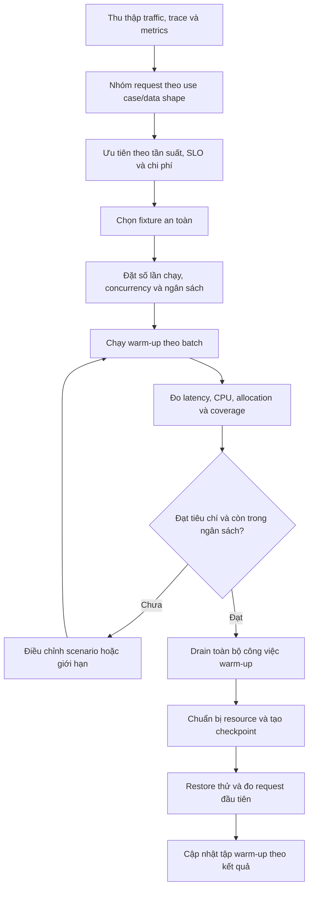

# Chọn tập yêu cầu làm nóng đại diện cho tải thực tế

Trong CRaC, ứng dụng thường được khởi chạy, khởi tạo và làm nóng trước khi tạo checkpoint. Trạng thái đã chuẩn bị có thể được khôi phục ở các lần chạy sau, giúp giảm thời gian khởi động và độ trễ của những request đầu tiên. Chất lượng của checkpoint phụ thuộc nhiều vào việc ứng dụng đã thực thi những đường chạy nào trước khi chụp ảnh.

Nếu chỉ gọi một endpoint đơn giản hoặc lặp lại một request có dữ liệu cố định, ứng dụng có thể đã làm nóng một phần nhỏ của hệ thống trong khi các luồng nghiệp vụ quan trọng vẫn lạnh. Ngược lại, gửi quá nhiều request hoặc chạy mọi endpoint một cách không kiểm soát có thể kéo dài thời gian tạo image, làm bẩn dữ liệu, gây tải lên dependency và tạo ra trạng thái cache không giống môi trường phục vụ thật.

Vì vậy, cần xây dựng một **tập yêu cầu làm nóng có đại diện** từ dữ liệu sử dụng thực tế, mục tiêu hiệu năng và ranh giới an toàn của ứng dụng. Tập này cần bao phủ các đường chạy quan trọng, kiểu dữ liệu đầu vào và những nhánh xử lý thường gặp, đồng thời có giới hạn về số lần gọi, concurrency, thời gian và side effect.

## 1. Warm-up nhằm chuẩn bị điều gì?

Một request đầu tiên có thể kích hoạt nhiều công việc cùng lúc:

- Nạp class và chạy static initializer.
- Tạo object nội bộ, serializer, mapper, validator và cấu trúc dữ liệu.
- Thực thi phương thức Java để JIT có cơ hội biên dịch các đoạn mã thường dùng.
- Khởi tạo framework, proxy, reflection metadata và các bộ chuyển đổi.
- Nạp dữ liệu vào cache trong bộ nhớ.
- Khởi tạo client, pool hoặc kết nối tới dependency.
- Đi qua các nhánh xử lý phụ thuộc vào loại payload, profile, quyền và feature flag.

Warm-up có thể chuẩn bị một số trạng thái trong JVM và heap để checkpoint giữ lại. Tuy nhiên, không phải mọi trạng thái đều nên được giữ qua checkpoint. Kết nối mạng hoặc database có thể phải đóng trước checkpoint và tạo lại sau restore; dữ liệu cache có thể cần xác minh TTL; token hoặc lease có thể hết hạn. Do đó, cần tách mục tiêu warm-up thành hai nhóm:

1. **Trạng thái có thể tái sử dụng:** class đã nạp, mã đã được thực thi/biên dịch, cấu trúc ứng dụng, serializer, metadata và cache nội bộ còn hợp lệ.
2. **Trạng thái cần phục hồi riêng:** connection, session, credential, lease, subscription và dữ liệu động phụ thuộc môi trường.

Warm-up không phải mục tiêu làm cho mọi request đều có độ trễ bằng không. Mục tiêu là giảm phần chi phí khởi tạo của các đường chạy quan trọng trong phạm vi ngân sách chuẩn bị checkpoint.

## 2. Bắt đầu từ tải thực tế thay vì đoán endpoint

Một tập warm-up tốt bắt đầu từ cách ứng dụng thực sự được sử dụng. Hãy thu thập dữ liệu ở tầng route, operation hoặc use case, tùy kiến trúc ứng dụng. Nguồn dữ liệu có thể gồm:

- Access log hoặc API gateway log đã loại bỏ thông tin nhận dạng nhạy cảm.
- Metrics về request count, latency, error rate và kích thước payload.
- Distributed trace để biết request đi qua những service và nhánh nghiệp vụ nào.
- Báo cáo truy vấn hoặc thống kê thao tác database.
- Event/consumer metrics nếu ứng dụng xử lý message thay vì chỉ HTTP request.
- Phân tích theo tenant, loại tài khoản, feature flag hoặc phiên bản API nếu các yếu tố này làm thay đổi đường chạy.

Không cần lưu payload thật của người dùng để làm warm-up. Thông thường chỉ cần thống kê loại request, phân bố kích thước và đặc điểm dữ liệu, sau đó tạo fixture tổng hợp đã được làm sạch để đại diện cho các nhóm đó.

### Những thông tin nên thu thập

| Thuộc tính | Vì sao hữu ích khi chọn warm-up |
|---|---|
| Tần suất request | Cho biết đường chạy nào xuất hiện thường xuyên |
| Latency p50/p95/p99 | Xác định đường chạy có chi phí đáng kể hoặc ảnh hưởng SLO |
| CPU time hoặc allocation | Tìm đoạn mã có thể hưởng lợi từ JIT và chuẩn bị cấu trúc |
| Payload size và data shape | Bao phủ các nhánh phụ thuộc kích thước, số phần tử và kiểu dữ liệu |
| Status/error class | Xác định luồng lỗi thường gặp và xử lý retry/validation |
| Dependency calls | Biết request nào kích hoạt database, cache, HTTP client hoặc broker |
| Tenant/feature profile | Phát hiện cấu hình hoặc feature khác nhau làm đổi đường chạy |
| Concurrency và burst | Hiểu cách hệ thống hoạt động khi nhiều request cùng đến |

Hãy dùng một khoảng thời gian quan sát đủ đại diện cho chu kỳ nghiệp vụ. Nếu ứng dụng có tải theo giờ, ngày, cuối tuần hoặc mùa vụ, dữ liệu của một khoảng ngắn có thể làm lệch tập warm-up. Với hệ thống mới chưa có traffic, dùng mô hình tải dự kiến, yêu cầu sản phẩm và các kịch bản nghiệp vụ đã được xác nhận; sau khi có production metrics, cập nhật lại tập warm-up.

## 3. Chọn đường chạy theo mức độ quan trọng

Không nên chọn request chỉ vì nó có tần suất cao. Một endpoint ít được gọi nhưng nằm trên luồng thanh toán, đăng nhập hoặc xử lý đơn hàng có thể có yêu cầu độ trễ rất nghiêm ngặt. Ngược lại, một endpoint thống kê có tần suất cao nhưng chạy nền hoặc không nằm trên critical path có thể không cần ưu tiên warm-up sâu.

Một cách xếp hạng là kết hợp bốn yếu tố:

1. **Tần suất:** request xuất hiện nhiều đến mức nào.
2. **Tác động hiệu năng:** request có chi phí CPU, allocation hoặc latency đáng kể không.
3. **Mức độ quan trọng:** request có nằm trên luồng nghiệp vụ trọng yếu hoặc SLO quan trọng không.
4. **Độ khác biệt đường chạy:** request có đại diện cho một nhóm code path chưa được các request khác thực thi không.

Có thể dùng ma trận định tính:

| Nhóm | Đặc điểm | Mức ưu tiên warm-up |
|---|---|---|
| Critical và phổ biến | Đường chạy chính, tần suất cao, ảnh hưởng trực tiếp SLO | Cao nhất; cần fixture và nhiều lần thực thi có kiểm soát |
| Critical nhưng ít gặp | Đường chạy ít xảy ra nhưng hậu quả lớn nếu chậm/lỗi | Chọn kịch bản đại diện và xác minh riêng |
| Phổ biến nhưng không critical | Request thường xuyên, chi phí thấp hoặc ít ảnh hưởng SLO | Warm-up vừa đủ theo tỷ trọng |
| Hiếm và không critical | Đường chạy phụ, ít ảnh hưởng người dùng | Thường không cần ưu tiên |

Một tập warm-up hiệu quả thường bao phủ phần lớn lưu lượng quan trọng bằng một số kịch bản có chủ đích, thay vì gọi mọi URL một lần. Việc bao phủ nên được tính theo use case và nhánh xử lý, không chỉ theo số lượng endpoint.

### Ví dụ phân bổ ngân sách

Giả sử một dịch vụ thương mại điện tử có các luồng chính sau:

| Use case | Tỷ trọng request quan sát | Đặc điểm | Quyết định |
|---|---:|---|---|
| Đọc chi tiết sản phẩm | 40% | Đọc cache và database, serialize response | Warm-up nhiều biến thể sản phẩm |
| Tìm kiếm | 25% | Query, filter, sort và phân trang | Warm-up vài tổ hợp filter phổ biến |
| Xem giỏ hàng | 15% | Phụ thuộc session và dữ liệu người dùng | Dùng fixture riêng, không dùng session thật |
| Đăng nhập/refresh session | 10% | Hash, token và kiểm tra quyền | Dùng account thử nghiệm, không phát hành credential production |
| Tạo đơn hàng | 8% | Có side effect và transaction | Chỉ chạy trong môi trường cô lập hoặc dùng đường warm-up không commit |
| Báo cáo hiếm | 2% | Truy vấn nặng, không nằm trên critical path | Không ưu tiên trừ khi có SLO riêng |

Tỷ trọng chỉ là một đầu vào. Nếu tạo đơn hàng có độ trễ quan trọng, nó vẫn cần được đại diện trong warm-up dù chỉ chiếm 8%. Nhưng không được gửi đơn hàng thật chỉ để làm nóng. Hãy tạo fixture, transaction có thể rollback và cô lập side effect bên ngoài.

## 4. Bao phủ nhiều dạng dữ liệu, không chỉ nhiều URL

Một endpoint có thể thực thi nhiều đường chạy tùy payload. Ví dụ, `GET /products/{id}` có thể trả về sản phẩm có ảnh, sản phẩm không có ảnh, sản phẩm đang giảm giá hoặc sản phẩm có nhiều biến thể. Một request chỉ dùng một sản phẩm đơn giản có thể không kích hoạt mapper, serializer hoặc nhánh tính giá của các trường hợp còn lại.

Hãy phân nhóm dữ liệu theo những thuộc tính làm thay đổi xử lý:

- Payload nhỏ, trung bình và lớn.
- Danh sách rỗng, danh sách một phần tử và danh sách nhiều phần tử.
- Trường tùy chọn có/không có, null hoặc giá trị biên.
- Kiểu dữ liệu hoặc subtype khác nhau.
- Quyền người dùng, tenant hoặc feature flag khác nhau.
- Cache hit và cache miss.
- Dữ liệu hợp lệ, dữ liệu biên và lỗi có thể xảy ra trong thực tế.

Không cần tổ hợp mọi thuộc tính theo tích Descartes vì số kịch bản có thể tăng rất nhanh. Hãy chọn đại diện theo mức ảnh hưởng đến code path, tần suất và rủi ro. Một tập nhỏ nhưng có phân tầng dữ liệu thường hữu ích hơn một tập lớn chứa nhiều request gần như giống nhau.

### Ví dụ tập biến thể cho một API tìm kiếm

```text
GET /search?q=phone&page=0&size=20
  - từ khóa phổ biến, trang đầu, kích thước mặc định

GET /search?q=phone&brand=acme&sort=price&page=1&size=20
  - có filter, sort và phân trang

GET /search?q=wireless-headphones&category=audio&size=100
  - kết quả nhiều phần tử và payload response lớn hơn

GET /search?q=rare-item&brand=unknown
  - trường hợp ít kết quả hoặc không có kết quả
```

Các giá trị cần được chọn từ thống kê đã ẩn danh hoặc dữ liệu tổng hợp. Tránh đưa email, số điện thoại, địa chỉ, access token hoặc dữ liệu cá nhân vào fixture warm-up.

## 5. Bao phủ code path và chi phí khởi tạo

Warm-up cần thực thi code path mà ứng dụng sẽ dùng sau restore. Chỉ tạo object hoặc xây dựng request chưa chắc đã làm nóng phần xử lý thực tế. Với reactive API, cần subscribe và chờ pipeline thực thi. Với asynchronous method, cần chờ future hoàn tất. Với message consumer, cần xử lý một message fixture đến điểm commit an toàn.

Một request đại diện nên đi qua các lớp quan trọng:

```text
HTTP / RPC entry point
        |
        v
Authentication / authorization
        |
        v
Validation and mapping
        |
        v
Business service
        |
        +------> Cache lookup
        |
        +------> Repository / database access
        |
        +------> External client (nếu cần)
        |
        v
Response mapping and serialization
```

Nếu một request warm-up chỉ gọi trực tiếp method ở service layer, nó có thể bỏ qua filter, interceptor, validation, serialization hoặc framework proxy mà request thật phải đi qua. Ngược lại, gọi toàn bộ HTTP stack có thể kích hoạt authentication, audit và side effect không mong muốn. Hãy quyết định mức entry point dựa trên mục tiêu: nếu cần làm nóng toàn bộ đường request, dùng entry point thật với fixture an toàn; nếu cần cô lập một thuật toán, gọi trực tiếp service/benchmark riêng.

### Warm-up code JIT và warm-up cache là hai mục tiêu khác nhau

JIT warm-up cần thực thi phương thức đủ lần và với dữ liệu có tính đại diện để runtime có cơ hội tối ưu hóa các đường chạy phổ biến. Cache warm-up cần nạp các key hoặc dữ liệu có xác suất được dùng sau restore. Một request có thể đóng góp cho cả hai, nhưng không nên nhầm rằng cache đã đầy nghĩa là JIT đã nóng hoặc ngược lại.

Ngoài ra, cache của database, filesystem, DNS, TLS session hoặc proxy có thể nằm ngoài tiến trình và có vòng đời riêng. Nếu tài nguyên đó bị đóng trước checkpoint hoặc dịch vụ ngoài thay đổi, không thể mặc định trạng thái đó được giữ lại cùng heap.

## 6. Chọn số lần gọi và mức concurrency

Một request duy nhất thường chỉ đủ để kích hoạt một số class loading và đường chạy ban đầu. JIT compilation và một số tối ưu hóa cần quan sát phương thức được thực thi nhiều lần. Tuy nhiên, không có một con số lặp cố định phù hợp cho mọi ứng dụng.

Hãy chọn số lần thực thi dựa trên:

- Tần suất dự kiến của đường chạy trong production.
- Mức độ ổn định của latency qua các vòng lặp.
- Tín hiệu compilation, class loading và allocation nếu có thể quan sát.
- Thời gian warm-up và ngân sách tạo checkpoint.
- Tác động đến CPU, heap, database và các dependency.

Concurrency cũng cần được lựa chọn cẩn thận. Nếu production có request đồng thời, chỉ chạy tuần tự có thể bỏ qua contention, thread pool và các đường code phụ thuộc concurrency. Nhưng warm-up với tải cực đại có thể làm cạn connection pool, tạo queue lớn hoặc checkpoint trong lúc còn request đang chạy.

Một chiến lược thường dùng:

1. Chạy một số vòng tuần tự để kích hoạt class loading và các nhánh cơ bản.
2. Tăng concurrency từ từ đến mức đại diện cho tải khởi đầu hoặc tải bình thường.
3. Quan sát latency, CPU, allocation, queue và dependency.
4. Dừng tăng tải khi đạt tiêu chí warm-up hoặc chạm giới hạn tài nguyên.
5. Drain toàn bộ request, future, message và tác vụ bất đồng bộ trước khi chuẩn bị checkpoint.

Không nên warm-up ở mức concurrency tối đa chỉ vì production có thể đạt mức đó. Hãy xem checkpoint được dùng để tạo bao nhiêu replica và tổng tải warm-up của các tiến trình chuẩn bị có thể ảnh hưởng tới dependency chung ra sao.

## 7. Tránh side effect khi chạy request làm nóng

Warm-up thường chạy trong giai đoạn chuẩn bị image, có thể được lặp lại khi tạo image mới hoặc khi pipeline triển khai chạy lại. Vì vậy, mọi request warm-up cần được xem như một lần thực thi thật về mặt side effect.

Các tác động cần kiểm soát gồm:

- Ghi hoặc cập nhật dữ liệu nghiệp vụ.
- Gửi email, SMS, webhook hoặc push notification.
- Trừ tiền, tạo đơn hàng, đặt chỗ hoặc gọi dịch vụ thanh toán.
- Phát message vào broker hoặc kích hoạt consumer khác.
- Tạo audit event hoặc log chứa dữ liệu nhạy cảm.
- Thay đổi quota, rate limit, counter hoặc trạng thái người dùng.

Các cách cô lập:

- Dùng database/schema riêng cho warm-up.
- Dùng fixture có ID dành riêng và có thể xóa an toàn.
- Dùng stub/mock cho dịch vụ có side effect.
- Tắt publisher hoặc chuyển sang sink giả lập trong môi trường tạo checkpoint.
- Dùng transaction rollback cho thao tác database khi phù hợp, nhưng không coi rollback là cách hoàn tác side effect đã gửi tới hệ thống ngoài.
- Cung cấp chế độ warm-up chỉ thực hiện các bước đọc và xử lý nội bộ.

Không nên chỉ dựa vào header `X-Warmup: true` để bỏ qua side effect nếu mọi tầng dịch vụ không thực sự kiểm tra và thực thi chính sách đó. Một đường warm-up an toàn cần được thiết kế ở cấp use case, không chỉ gắn nhãn request.

## 8. Xây dựng manifest cho tập warm-up

Một manifest giúp tập warm-up có thể review, version control và lặp lại giữa các lần tạo checkpoint. Mỗi kịch bản nên mô tả mục đích, dữ liệu fixture, số lần chạy, concurrency, giới hạn thời gian và side effect được phép.

Ví dụ YAML minh họa:

```yaml
version: 1
budget:
  maxDuration: 180s
  maxConcurrency: 4
  maxRequests: 500
  drainTimeout: 20s

scenarios:
  - name: product-detail-default
    route: GET /products/{id}
    fixture: product-standard
    iterations: 80
    concurrency: 2
    priority: critical
    expectedEffects: read-only

  - name: product-detail-with-variants
    route: GET /products/{id}
    fixture: product-with-many-variants
    iterations: 30
    concurrency: 2
    priority: high
    expectedEffects: read-only

  - name: search-filtered
    route: GET /search
    fixture: search-filter-brand-and-sort
    iterations: 50
    concurrency: 3
    priority: high
    expectedEffects: read-only

  - name: order-validation
    route: internal-warmup:validate-order
    fixture: order-valid-test-data
    iterations: 10
    concurrency: 1
    priority: critical
    expectedEffects: isolated
```

Các con số chỉ minh họa định dạng. Tần suất, số lần lặp và concurrency phải được quyết định từ số liệu ứng dụng và ngân sách chuẩn bị. Manifest cũng nên chỉ ra phiên bản fixture và phiên bản schema để tránh dữ liệu warm-up bị thay đổi âm thầm.

Một kịch bản nên thất bại rõ ràng nếu fixture thiếu, route không tồn tại hoặc dependency bắt buộc không sẵn sàng. Không nên âm thầm bỏ qua các scenario quan trọng vì checkpoint có thể được tạo trong trạng thái chưa thực sự được chuẩn bị.

## 9. Ví dụ bộ chạy warm-up trong Java

Có thể mô hình hóa từng kịch bản bằng một interface và một runner chịu trách nhiệm giới hạn số lần gọi, thời gian và concurrency. Ví dụ dưới đây minh họa cấu trúc, không phải framework warm-up hoàn chỉnh:

```java
import java.time.Duration;
import java.util.List;
import java.util.concurrent.ExecutorService;
import java.util.concurrent.Executors;
import java.util.concurrent.Future;

public interface WarmupScenario {
    String name();
    void execute() throws Exception;
}

public final class WarmupRunner {

    public void runSequentially(List<WarmupScenario> scenarios,
                                int iterationsPerScenario)
            throws Exception {
        for (WarmupScenario scenario : scenarios) {
            for (int i = 0; i < iterationsPerScenario; i++) {
                scenario.execute();
            }
        }
    }

    public void runConcurrent(WarmupScenario scenario,
                              int workers,
                              int iterationsPerWorker)
            throws Exception {
        ExecutorService executor = Executors.newFixedThreadPool(workers);
        try {
            List<Future<?>> tasks = new java.util.ArrayList<>();
            for (int worker = 0; worker < workers; worker++) {
                tasks.add(executor.submit(() -> {
                    for (int i = 0; i < iterationsPerWorker; i++) {
                        scenario.execute();
                    }
                }));
            }

            for (Future<?> task : tasks) {
                task.get();
            }
        } finally {
            executor.shutdown();
            if (!executor.awaitTermination(20,
                    java.util.concurrent.TimeUnit.SECONDS)) {
                executor.shutdownNow();
            }
        }
    }
}
```

Trong triển khai thật, cần bổ sung deadline tổng, giới hạn request, xử lý exception theo scenario, metrics và cancellation. `WarmupScenario.execute()` phải chờ công việc bất đồng bộ hoàn tất; nếu nó chỉ tạo `CompletableFuture` rồi trả về, runner có thể kết thúc trước khi code path thực sự được thực thi. Với reactive stream, phải subscribe và chờ terminal signal.

Runner cũng không nên tự tạo executor mới mà không kiểm soát vòng đời. Nếu executor cần được giữ lại qua checkpoint, hãy quyết định rõ; nếu không, shutdown và drain nó trước checkpoint rồi tạo lại sau restore.

## 10. Tiêu chí kết thúc warm-up

Không nên chỉ kết thúc warm-up sau khi chạy đủ một số request cứng nhắc. Số lượng request là một giới hạn, còn tiêu chí kết thúc nên dựa trên cả mức bao phủ và trạng thái hệ thống.

Một tập tiêu chí có thể gồm:

- Các scenario bắt buộc đã thực thi thành công.
- Những nhóm payload và nhánh nghiệp vụ ưu tiên đã được bao phủ.
- Latency của các vòng lặp cuối không còn giảm đáng kể so với các vòng trước, trong giới hạn đo đã định.
- Class loading/JIT hoặc allocation metrics không còn thay đổi lớn đối với các đường chạy mục tiêu, nếu có tín hiệu quan sát phù hợp.
- Cache nội bộ quan trọng đã được nạp hoặc có chính sách lazy load rõ ràng.
- CPU và heap nằm trong ngân sách dự kiến.
- Không còn request, future, message hoặc background task warm-up đang chạy.
- Không phát sinh side effect ngoài phạm vi cho phép.

JIT không nhất thiết đạt trạng thái tối ưu hoàn toàn sau một khoảng thời gian cố định. Một phương thức có thể được biên dịch lại hoặc deoptimize khi profile thay đổi. Vì vậy, đừng dùng một log “warm-up complete” hoặc một bộ đếm compilation đơn lẻ làm bằng chứng tuyệt đối. Hãy kết hợp độ bao phủ scenario, latency, CPU và các tín hiệu runtime.

### So sánh latency theo vòng lặp

Ví dụ, đo latency của cùng một scenario theo từng batch:

| Batch | p50 minh họa | p95 minh họa | Diễn giải |
|---|---:|---:|---|
| 1 | 80 ms | 150 ms | Còn nhiều chi phí khởi tạo |
| 2 | 42 ms | 70 ms | Đường chạy đã ổn định hơn |
| 3 | 28 ms | 45 ms | Tiếp tục cải thiện |
| 4 | 27 ms | 43 ms | Mức cải thiện nhỏ |
| 5 | 27 ms | 42 ms | Gần trạng thái ổn định trong điều kiện đo |

Đây chỉ là ví dụ minh họa. Cần đo trên cùng loại máy, cùng fixture, cùng concurrency và cùng trạng thái dependency. Không nên so sánh p95 của các batch có payload hoặc tải khác nhau rồi kết luận warm-up đã hoàn tất.

## 11. Warm-up với cache và dependency bên ngoài

Một request đại diện có thể nạp cache nội bộ, nhưng cache ngoài tiến trình có vòng đời riêng. Hãy phân biệt:

- Cache trong heap: có thể được giữ trong checkpoint, nhưng cần kiểm tra TTL và độ mới.
- Distributed cache: tồn tại ngoài tiến trình; request warm-up có thể làm nóng cache chung nhưng cũng có thể tạo tải hoặc thay đổi dữ liệu dùng chung.
- Database buffer/query cache: do database quản lý; không được bảo đảm giữ nguyên chỉ vì JVM được restore.
- DNS/TLS/session cache: phụ thuộc resolver, client và hệ thống bên ngoài; cần kiểm tra sau restore.
- HTTP client connection pool: thường cần xử lý theo CRaC integration và vòng đời kết nối.

Nếu warm-up đọc một triệu bản ghi để lấp cache, có thể làm database quá tải trong lúc tạo image. Hãy chọn key phổ biến, giới hạn số lượng và dùng lazy loading cho dữ liệu ít truy cập. Với nhiều checkpoint được tạo đồng thời, cân nhắc tải warm-up theo batch để tránh nhiều tiến trình chuẩn bị cùng đọc một tập dữ liệu lớn.

Đặc biệt, nếu `beforeCheckpoint()` đóng connection pool, request warm-up có thể vẫn hữu ích cho JIT, mapper và cache nội bộ nhưng không giữ lại connection vật lý. Sau restore, pool cần được tạo lại theo ngân sách kết nối và readiness chỉ bật khi kết nối mới hợp lệ.

## 12. Cập nhật tập warm-up theo sự thay đổi của production

Traffic thay đổi theo phiên bản sản phẩm, mùa vụ, tenant mới và feature flag. Một tập warm-up được tạo từ traffic sáu tháng trước có thể không còn đại diện.

Nên quản lý tập warm-up như một artifact có version:

- Ghi rõ ngày/khoảng thời gian dữ liệu dùng để xây dựng tập scenario.
- Ghi phiên bản ứng dụng, API schema và fixture.
- Lưu lý do chọn từng scenario và mục tiêu bao phủ.
- Theo dõi scenario nào không còn xuất hiện hoặc không còn quan trọng.
- Bổ sung scenario mới khi production xuất hiện đường chạy hoặc payload mới.
- Giữ lại các luồng ít gặp nhưng có yêu cầu SLO hoặc rủi ro cao.

Không nên thay tập warm-up theo từng ngày chỉ vì traffic dao động nhỏ. Dùng chu kỳ cập nhật phù hợp và so sánh thay đổi đủ lớn để tránh image build không ổn định giữa các lần chạy.

## 13. Các lỗi thường gặp

### Chỉ làm nóng health endpoint

Health endpoint thường chỉ kiểm tra một phần nhỏ ứng dụng. Nó không thực thi các mapper, query, serializer hoặc logic nghiệp vụ của request chính. Hãy chọn scenario theo use case thực tế.

### Chỉ lặp một payload cố định

Payload đơn giản có thể bỏ qua nhánh xử lý cho danh sách lớn, field tùy chọn, filter hoặc loại dữ liệu khác. Chọn một số fixture đại diện cho data shape.

### Chạy mọi endpoint một lần rồi coi là đã warm-up

Một lần gọi có thể kích hoạt class loading nhưng chưa đủ cho các đường chạy thường xuyên được JIT tối ưu. Dùng số lần thực thi và tiêu chí quan sát phù hợp.

### Warm-up bằng dữ liệu production thật

Payload thật có thể chứa PII, secret hoặc gây side effect. Dùng fixture tổng hợp/ẩn danh và kiểm soát lưu trữ.

### Tạo side effect nghiệp vụ

Request tạo đơn hàng hoặc phát message có thể gây tác động thật. Dùng môi trường cô lập, stub hoặc use case warm-up an toàn.

### Chạy concurrency quá cao

Warm-up có thể làm cạn pool, tăng queue hoặc gây tải lên dependency dùng chung. Tăng concurrency dần và đặt giới hạn.

### Không chờ asynchronous work hoàn tất

Runner kết thúc khi future chưa hoàn thành, khiến code path chưa thực sự chạy hoặc còn công việc tiếp tục trong lúc checkpoint. Hãy await/subscribe và drain.

### Dùng cache ngoài làm tiêu chí duy nhất

Cache bên ngoài có thể bị xóa hoặc thay đổi sau checkpoint. Hãy tập trung vào trạng thái có thể tái sử dụng và có chính sách refresh cho dữ liệu động.

### Không cập nhật tập scenario khi sản phẩm thay đổi

Image có thể làm nóng các luồng cũ trong khi traffic mới đi vào đường code lạnh. Theo dõi traffic và version tập warm-up.

## 14. Quy trình xây dựng tập yêu cầu làm nóng



Quy trình này tạo vòng phản hồi: traffic thực tế quyết định scenario, kết quả restore cho biết scenario có giúp giảm chi phí ở request đầu tiên hay không, rồi tập warm-up được cập nhật theo phiên bản ứng dụng.

## 15. Đo hiệu quả sau khi restore

Warm-up chỉ có giá trị nếu cải thiện hành vi sau restore. Hãy đo ít nhất:

- Thời gian từ restore đến readiness.
- Latency của request đầu tiên và các request đầu trong từng scenario.
- p50/p95/p99 sau khi traffic bắt đầu.
- CPU, allocation và GC trong những request đầu.
- Cache hit/miss và số lần nạp dữ liệu lại.
- Số lần kết nối lại tới dependency và thời gian phục hồi.
- Tỷ lệ lỗi hoặc timeout ở các request đầu tiên.

So sánh checkpoint được warm-up với một lần chạy cold-start hoặc một checkpoint có tập warm-up khác trong điều kiện máy và tải tương đương. Nếu chỉ đo tổng thời gian startup, có thể bỏ sót trường hợp readiness nhanh nhưng request đầu tiên vẫn chậm do một nhánh chưa được làm nóng.

Không nên tối ưu chỉ một request mẫu. Nếu một scenario được lặp quá nhiều, nó có thể chiếm profile và cache, làm các đường chạy khác kém đại diện. Đánh giá theo nhóm use case và phân bố tải dự kiến.

## 16. Kết luận

Tập yêu cầu làm nóng cần phản ánh những đường chạy ứng dụng thực sự sẽ phục vụ sau restore. Hãy xây dựng nó từ traffic, trace, latency, CPU, payload shape và mức độ quan trọng của use case. Ưu tiên đường chạy phổ biến hoặc ảnh hưởng SLO, nhưng vẫn đại diện các luồng ít gặp có rủi ro cao. Chọn fixture tổng hợp an toàn, kiểm soát side effect, số lần gọi, concurrency và thời gian chuẩn bị.

Một tập warm-up tốt thực thi đủ code path để chuẩn bị JVM và trạng thái nội bộ có thể tái sử dụng, đồng thời để tài nguyên phụ thuộc môi trường được phục hồi theo vòng đời riêng. Hãy chờ mọi công việc bất đồng bộ hoàn tất, drain request trước checkpoint và đo request đầu tiên sau restore. Cập nhật tập scenario theo traffic và phiên bản ứng dụng để checkpoint tiếp tục đại diện cho tải thực tế thay vì chỉ phản ánh một bộ request cũ.
