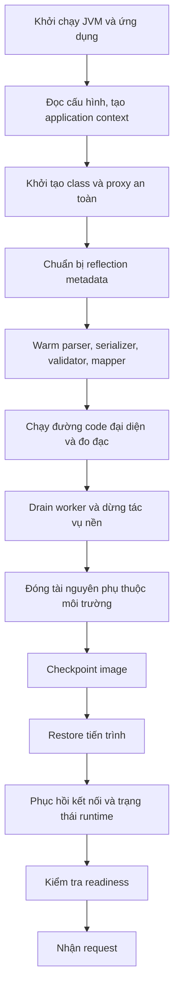

# Chuẩn bị lớp, bộ phân tích dữ liệu và các thành phần khởi tạo lười

Một ứng dụng Java có thể mất nhiều thời gian ở lần xử lý đầu tiên dù tiến trình đã khởi động xong. Nguyên nhân thường nằm ở những công việc chỉ được thực hiện khi một chức năng được gọi lần đầu: JVM tải và khởi tạo class, framework tạo proxy, thư viện đọc metadata bằng reflection, bộ phân tích xây dựng schema, serializer tạo cache, regex được biên dịch hoặc một bean `@Lazy` mới được khởi tạo.

CRaC cho phép chuẩn bị trước những phần công việc an toàn và có thể tái sử dụng, sau đó tạo checkpoint image từ trạng thái tiến trình đã được làm nóng. Khi restore, ứng dụng có thể tiếp tục từ trạng thái đó thay vì lặp lại mọi bước khởi tạo. Để đạt được lợi ích này, cần chọn đúng thành phần nên chuẩn bị trước checkpoint, kích hoạt chúng theo cách có kiểm soát và tách biệt trạng thái dùng chung với tài nguyên phụ thuộc môi trường.

## 1. Vì sao phải chuẩn bị lớp và thành phần khởi tạo lười?

Trong Java, khởi động JVM không đồng nghĩa mọi class của ứng dụng đã được tải, mọi static initializer đã chạy hoặc mọi thư viện đã chuẩn bị xong metadata. Nhiều framework và thư viện chủ động trì hoãn công việc để giảm thời gian startup ban đầu và tránh tạo những thành phần không được sử dụng.

Ví dụ, request đầu tiên có thể phải thực hiện đồng thời nhiều công việc:

- Nạp class controller, service, DTO và các class phụ thuộc.
- Khởi tạo class có static field hoặc static initializer.
- Tạo proxy cho transaction, security, AOP hoặc lazy dependency.
- Phân tích annotation và generic type bằng reflection.
- Tạo serializer/deserializer cho kiểu dữ liệu JSON.
- Biên dịch regex, expression hoặc template.
- Khởi tạo validator, converter, mapper hoặc metadata cache.
- Làm nóng một đường xử lý đủ thường xuyên để JIT compiler tối ưu.

Nếu các công việc này chỉ xảy ra khi request thật đầu tiên đến, độ trễ của request đó sẽ cao hơn các request tiếp theo. Với dịch vụ cần sẵn sàng nhanh, việc đưa những công việc khởi tạo an toàn vào giai đoạn chuẩn bị trước checkpoint có thể giảm đáng kể thời gian từ restore đến readiness và giảm độ trễ ban đầu.

Không nên cố khởi tạo mọi thứ một cách máy móc. Một bean lazy có thể mở database connection, tạo thread nền hoặc đọc secret ngắn hạn. Nếu những tài nguyên đó được đưa vào image rồi trở nên cũ trong thời gian image được lưu, restore có thể thất bại. Cần phân loại trước khi warm-up.

## 2. Các giai đoạn xử lý class của JVM

Quá trình xử lý class thường được mô tả qua các giai đoạn loading, linking và initialization.

| Giai đoạn | Công việc chính | Ví dụ |
|---|---|---|
| Loading | Tìm bytecode và tạo biểu diễn class trong JVM | Nạp `OrderService` từ classpath hoặc module |
| Verification | Kiểm tra bytecode tuân thủ các ràng buộc của JVM | Kiểm tra kiểu, stack map và tính hợp lệ của bytecode |
| Preparation | Cấp phát bộ nhớ cho static field và gán giá trị mặc định | `int count` ban đầu là `0` |
| Resolution | Chuyển symbolic reference thành tham chiếu runtime phù hợp | Resolve tham chiếu đến class hoặc method được gọi |
| Initialization | Chạy static initializer và gán giá trị static theo mã nguồn | Thực thi `static { ... }` hoặc `static final` không phải constant variable |

Verification, preparation và resolution thuộc linking. JVM có thể trì hoãn một số bước resolution cho đến khi tham chiếu thực sự cần được sử dụng. Vì vậy, nạp một class không nhất thiết có nghĩa mọi class phụ thuộc và mọi symbolic reference đã được resolve.

### 2.1. Nạp class mà chưa khởi tạo

`ClassLoader.loadClass()` và `Class.forName(name, false, loader)` có thể dùng để yêu cầu JVM nạp class mà chưa chạy static initialization.

```java
ClassLoader loader = Thread.currentThread().getContextClassLoader();
Class<?> type = Class.forName(
        "com.example.orders.OrderService",
        false,
        loader);

System.out.println(type.getName());
```

Tham số `false` yêu cầu không khởi tạo class. Cách này hữu ích khi muốn phát hiện class có mặt trong runtime hoặc chuẩn bị một số metadata mà chưa muốn chạy static initializer.

Tuy nhiên, nạp class không bảo đảm mọi dependency đã được nạp, mọi method đã được JIT compile hoặc mọi lỗi khởi tạo đã được phát hiện. Những class phụ thuộc có thể chỉ được tải khi code truy cập đến chúng.

### 2.2. Khởi tạo class một cách tường minh

`Class.forName(name, true, loader)` yêu cầu khởi tạo class nếu class chưa được khởi tạo bởi class loader đó:

```java
Class<?> type = Class.forName(
        "com.example.orders.OrderService",
        true,
        Thread.currentThread().getContextClassLoader());
```

Initialization chạy static initializer của class và các bước khởi tạo superclass theo quy tắc của Java. Một class được khởi tạo một lần cho mỗi class loader. Nếu static initializer thất bại, JVM có thể đánh dấu class ở trạng thái lỗi đối với class loader đó; lần sử dụng sau có thể nhận `NoClassDefFoundError` thay vì chạy initializer lại.

Do đó, chỉ nên chủ động initialize class khi đã hiểu side effect của static initializer. Một static block có thể đọc file cấu hình, khởi tạo native library, mở socket, tạo executor hoặc gọi dịch vụ bên ngoài. Những hành động đó có thể không phù hợp để đưa vào checkpoint image.

### 2.3. Active use có thể kích hoạt initialization

Không nhất thiết phải gọi `Class.forName(..., true, ...)` mới khởi tạo class. Một số hành động như tạo instance, gọi static method hoặc đọc/ghi static field không phải constant variable có thể kích hoạt initialization theo JLS.

Ví dụ:

```java
OrderService service = new OrderService(); // Có thể kích hoạt initialization
OrderService.prepareDefaults();             // Static method
int limit = OrderService.DEFAULT_LIMIT;     // Tùy field có phải constant variable hay không
```

Khi warm-up, cần hiểu đường thực thi nào sẽ kích hoạt class initialization. Một phép đọc `static final` primitive/String là compile-time constant có thể được nhúng vào bytecode và không buộc class phải initialize theo cách mà người đọc mã nguồn tưởng tượng.

## 3. Phân loại thành phần trước khi warm-up

Một thành phần nên được đánh giá theo thời điểm khởi tạo, trạng thái nó giữ và khả năng sử dụng sau restore.

| Nhóm | Ví dụ | Cách xử lý thường phù hợp |
|---|---|---|
| Metadata thuần trong bộ nhớ | Reflection metadata, annotation index, schema, serializer cache | Có thể chuẩn bị trước checkpoint bằng input đại diện |
| Class và static initialization an toàn | Class DTO, enum, utility không có side effect | Có thể load/initialize có chọn lọc |
| Bộ phân tích và converter | JSON parser, XML schema, regex, date formatter | Tạo và dùng thử trước checkpoint nếu không giữ tài nguyên ngoài tiến trình |
| Lazy bean không có kết nối ngoài | Mapper, validator, calculator, template engine | Có thể chủ động khởi tạo và warm-up |
| Tài nguyên gắn với môi trường | JDBC pool, HTTP connection pool, socket, file handle | Đóng trước checkpoint và tạo lại sau restore theo lifecycle |
| Thông tin có thời hạn | Token, lease, DNS result, credential ngắn hạn | Lấy mới hoặc xác thực lại sau restore |
| Tác vụ nền | Scheduler, consumer, polling thread, executor | Tạm dừng/drain trước checkpoint; tạo hoặc resume theo chính sách sau restore |

Một bean có thể thuộc nhiều nhóm. Ví dụ, một `ObjectMapper` giữ serializer cache trong heap nhưng cũng có thể được cấu hình với custom serializer tham chiếu đến service bên ngoài. Hãy xem xét toàn bộ object graph và dependency thay vì chỉ nhìn tên class.

## 4. Chuẩn bị metadata reflection và annotation

Reflection thường xuất hiện trong dependency injection, serialization, validation, ORM, mapping và framework proxy. Lần đầu thư viện phân tích class có thể phải duyệt field, method, constructor, annotation, generic type và hierarchy rồi lưu kết quả vào cache.

Ví dụ đơn giản:

```java
import java.lang.reflect.Constructor;
import java.lang.reflect.Field;
import java.lang.reflect.Method;

public final class ReflectionWarmup {

    public void inspect(Class<?> type) {
        type.getDeclaredFields();
        type.getDeclaredMethods();
        type.getDeclaredConstructors();

        for (Field field : type.getDeclaredFields()) {
            field.getAnnotations();
            field.getGenericType();
        }

        for (Method method : type.getDeclaredMethods()) {
            method.getAnnotations();
            method.getGenericReturnType();
            method.getGenericParameterTypes();
        }

        for (Constructor<?> constructor : type.getDeclaredConstructors()) {
            constructor.getAnnotations();
            constructor.getParameterTypes();
        }
    }
}
```

Đoạn mã trên yêu cầu một số metadata từ Reflection API. Nó không đảm bảo mọi framework cache đã được tạo, vì framework có thể có bộ phân tích và cache riêng. Để warm-up thực sự có giá trị, nên gọi API công khai của thư viện hoặc thực thi một đường xử lý đại diện khiến cache đó được xây dựng.

### 4.1. Tránh mở quyền truy cập reflection không cần thiết

Không gọi `setAccessible(true)` cho mọi field hoặc method chỉ nhằm warm-up. Truy cập sâu có thể bị giới hạn bởi module system, tạo lỗi `InaccessibleObjectException` hoặc yêu cầu `--add-opens` không cần thiết. Hãy dùng public API của framework và chỉ mở quyền khi ứng dụng có yêu cầu rõ ràng.

### 4.2. Chuẩn bị proxy và method metadata

Framework có thể tạo proxy lần đầu bean được truy cập. Ví dụ, Spring AOP hoặc transaction proxy có thể trì hoãn một số hoạt động đến khi bean được gọi. Nếu đường xử lý đầu tiên sau restore đi qua proxy, hãy thực hiện một lời gọi warm-up an toàn để kích hoạt đường đi đó.

Không gọi method nghiệp vụ có side effect chỉ để tạo proxy. Có thể dùng một method đọc dữ liệu kiểm thử hoặc một thao tác nội bộ không ghi database, không gửi message và không gọi dịch vụ bên ngoài.

## 5. Chuẩn bị parser và serializer

Bộ phân tích dữ liệu thường có chi phí khởi tạo đáng kể. Một JSON mapper có thể cần phân tích annotation, generic type, naming strategy và tạo serializer/deserializer. XML parser có thể cần tải schema, tạo factory hoặc biên dịch schema. Bộ expression engine có thể parse expression và xây dựng cây cú pháp.

### 5.1. Jackson `ObjectMapper`

Với Jackson, việc tạo `ObjectMapper` chưa chắc đã tạo serializer và deserializer cho mọi DTO. Nhiều phần chỉ được xây dựng khi mapper xử lý kiểu dữ liệu cụ thể lần đầu.

Ví dụ warm-up bằng dữ liệu tổng hợp:

```java
import com.fasterxml.jackson.databind.ObjectMapper;
import java.util.List;

public final class JsonWarmup {

    public void warm(ObjectMapper mapper) throws Exception {
        OrderRequest sample = new OrderRequest(
                "warmup-order",
                List.of(new OrderLine("SKU-DEMO", 2)));

        byte[] json = mapper.writeValueAsBytes(sample);
        mapper.readValue(json, OrderRequest.class);
    }
}
```

Thao tác ghi và đọc mẫu giúp kích hoạt serializer/deserializer cho kiểu được dùng. Hãy chọn DTO đại diện cho các request/response phổ biến, bao gồm những kiểu lồng nhau, enum, date/time và custom serializer nếu ứng dụng sử dụng chúng.

Không dùng dữ liệu khách hàng hoặc dữ liệu production để warm-up. Input mẫu cần hợp lệ nhưng không chứa thông tin nhạy cảm. Nếu custom serializer gọi database hoặc service bên ngoài, hãy xử lý dependency đó riêng và tránh thực thi side effect trong warm-up.

### 5.2. Tạo `ObjectReader` và `ObjectWriter`

Có thể tạo reader/writer chuyên biệt cho một kiểu:

```java
ObjectReader orderReader = mapper.readerFor(OrderRequest.class);
ObjectWriter orderWriter = mapper.writerFor(OrderRequest.class);

byte[] bytes = orderWriter.writeValueAsBytes(sample);
OrderRequest restored = orderReader.readValue(bytes);
```

Reader/writer giúp tái sử dụng cấu hình theo kiểu dữ liệu. Tuy nhiên, chỉ tạo object reader/writer có thể chưa buộc mọi serializer được khởi tạo trên mọi phiên bản/cấu hình Jackson. Thực thi serialize và deserialize mẫu là cách thực tế hơn để đi qua các đường code cần dùng.

Sau khi đã cấu hình xong, tránh thay đổi `ObjectMapper` dùng chung một cách tùy tiện. Thay đổi module, feature hoặc mix-in sau khi cache đã được sử dụng có thể tạo hành vi khó dự đoán. Hãy hoàn tất cấu hình trước warm-up.

### 5.3. XML schema và parser

Với XML, phần tốn thời gian có thể là tải XSD, biên dịch schema hoặc tạo parser factory. Có thể chuẩn bị `Schema` trước checkpoint:

```java
SchemaFactory factory = SchemaFactory.newInstance(
        XMLConstants.W3C_XML_SCHEMA_NS_URI);

Schema schema = factory.newSchema(
        new StreamSource(new File("schemas/order.xsd")));

Validator validator = schema.newValidator();
validator.validate(new StreamSource(new StringReader(sampleXml)));
```

Nếu schema được đóng gói trong classpath, ưu tiên đọc từ resource bất biến của ứng dụng. Nếu schema nằm trên volume có thể thay đổi hoặc chỉ có ở môi trường build, cần xác định đường dẫn có tồn tại và cùng nội dung khi restore hay không. Không giữ một stream hoặc file descriptor mở trong image nếu không cần thiết.

### 5.4. Regex và expression parser

`Pattern.compile()` tạo regex đã biên dịch để tái sử dụng:

```java
private static final Pattern ORDER_CODE =
        Pattern.compile("ORD-[A-Z0-9]{8}");

boolean valid = ORDER_CODE.matcher("ORD-AB12CD34").matches();
```

Nếu ứng dụng dùng nhiều regex, hãy biên dịch những pattern cố định khi khởi động hoặc trong warm-up. Không biên dịch lại cùng pattern ở mỗi request.

Với expression language như Spring Expression Language, hãy parse expression phổ biến trước checkpoint và đánh giá bằng context mẫu an toàn. Tránh expression warm-up gọi method có side effect hoặc truy cập dữ liệu thật.

## 6. Chuẩn bị validator, converter và mapper

Các thư viện validation và mapping thường tạo metadata theo class ở lần sử dụng đầu tiên.

Ví dụ với Jakarta Bean Validation:

```java
ValidatorFactory factory = Validation.buildDefaultValidatorFactory();
Validator validator = factory.getValidator();

OrderRequest sample = new OrderRequest("warmup-order", List.of());
Set<ConstraintViolation<OrderRequest>> violations =
        validator.validate(sample);
```

Thao tác `validate()` khiến provider phân tích constraint của kiểu được kiểm tra. Chọn mẫu dữ liệu để kích hoạt những nhánh validation cần warm-up; không cần tạo một bộ dữ liệu khổng lồ hoặc gọi mọi validator một cách mù quáng.

Với MapStruct, mapper được sinh mã lúc compile nên không cần runtime reflection như một số mapper động. Tuy nhiên, class mapper, dependency và đường xử lý có thể vẫn được khởi tạo lần đầu. Gọi mapper với DTO mẫu sẽ giúp nạp class và đi qua code path đại diện.

Với ModelMapper hoặc framework mapping dựa nhiều vào reflection, warm-up có thể cần gọi map cho từng cặp source/target phổ biến để cache type metadata và converter. Hãy kiểm tra API và cấu hình cụ thể của thư viện.

## 7. Kích hoạt các thành phần khởi tạo lười trong framework

Lazy initialization giúp giảm công việc startup bằng cách chỉ tạo bean hoặc metadata khi có nhu cầu. Với CRaC, một số lazy component quan trọng nên được kích hoạt trước checkpoint để request đầu tiên sau restore không phải trả chi phí khởi tạo.

Trong Spring, bean có thể được đánh dấu `@Lazy`, được truy cập qua `ObjectProvider`, hoặc chỉ được tạo khi một proxy được gọi. Có thể chủ động lấy bean cần warm-up từ `ApplicationContext`:

```java
@Component
public final class ApplicationWarmup implements ApplicationRunner {

    private final ApplicationContext context;

    public ApplicationWarmup(ApplicationContext context) {
        this.context = context;
    }

    @Override
    public void run(ApplicationArguments args) {
        context.getBean(OrderJsonCodec.class);
        context.getBean(OrderValidator.class);
        context.getBean(OrderMapper.class);
    }
}
```

Ví dụ chỉ lấy bean để kích hoạt khởi tạo. Nếu cần tạo serializer cache, proxy metadata hoặc parser cache, hãy gọi method warm-up riêng của từng component thay vì dừng ở `getBean()`.

### 7.1. Dùng `ObjectProvider` cho lazy bean

`ObjectProvider` cho phép yêu cầu bean khi cần:

```java
@Component
public final class WarmupCoordinator {
    private final ObjectProvider<OrderJsonCodec> codecProvider;

    public WarmupCoordinator(
            ObjectProvider<OrderJsonCodec> codecProvider) {
        this.codecProvider = codecProvider;
    }

    public void warm() {
        codecProvider.getObject().warm();
    }
}
```

Cách này giữ dependency lazy trong cấu trúc ứng dụng nhưng cho phép coordinator kích hoạt nó vào thời điểm đã chọn. Đảm bảo `warm()` không gửi dữ liệu thật, không tạo transaction không cần thiết và không mở tài nguyên mà callback checkpoint không quản lý.

### 7.2. Chọn bean cần warm-up

Không nên gọi `getBeansOfType(Object.class)` hoặc khởi tạo tất cả bean chỉ để loại bỏ lazy initialization. Một ứng dụng lớn có thể có nhiều bean ít dùng, bean phụ thuộc môi trường hoặc bean có side effect. Warm-up quá rộng làm tăng thời gian tạo image và có thể khiến checkpoint mang theo nhiều tài nguyên không cần thiết.

Hãy chọn bean theo dữ liệu quan sát được:

- Endpoint hoặc job có tần suất cao.
- Đường xử lý có độ trễ first-use lớn.
- Bean tạo parser, serializer, validator hoặc metadata cache.
- Component cần thiết để readiness sau restore.
- Thành phần có thể khởi tạo an toàn bằng dữ liệu mẫu.

## 8. Phân biệt warm-up class với warm-up JIT

Class loading/initialization và JIT compilation là hai công việc khác nhau.

- **Class warm-up:** nạp class, chạy initialization, tạo proxy và metadata.
- **Library warm-up:** tạo cache của serializer, parser, validator hoặc framework.
- **JIT warm-up:** thực thi đường code đủ số lần và đủ điều kiện để JVM cân nhắc biên dịch/tối ưu.

Chỉ nạp class không làm method tự động được JIT compile. Ngược lại, gọi method nhiều lần có thể vừa kích hoạt class initialization, vừa tạo metadata cache, vừa cung cấp dữ liệu profile cho JIT.

Ví dụ một đường xử lý có thể được gọi với dữ liệu tổng hợp:

```java
for (int i = 0; i < warmupIterations; i++) {
    orderService.calculateQuote(sampleOrder);
}
```

Số lần gọi cần được quyết định bằng đo đạc. Warm-up quá ít có thể chưa kích hoạt tối ưu; warm-up quá nhiều làm tăng thời gian tạo image và có thể gây tải không cần thiết. Dữ liệu mẫu nên đại diện cho kiểu dữ liệu và nhánh code thường dùng, nhưng không tạo side effect.

Không nên dùng vòng lặp nhân tạo để ép mọi method compile bằng mọi giá. JIT có thể thay đổi quyết định tối ưu dựa trên profile, deoptimization hoặc dữ liệu thực tế sau restore. Việc code cache và trạng thái biên dịch được duy trì ra sao cũng phụ thuộc JDK CRaC và runtime cụ thể. Hãy đo thời gian first request sau restore thay vì giả định warm-up loop luôn mang lại lợi ích.

## 9. Thiết kế warm-up không tạo side effect

Warm-up nên đi qua code path cần thiết nhưng không làm thay đổi dữ liệu nghiệp vụ thật. Có thể dùng một profile warm-up hoặc các object mẫu được tạo riêng.

Nên làm:

- Dùng DTO giả và giá trị đánh dấu rõ ràng như `warmup-order`.
- Parse/serialize trong bộ nhớ.
- Validate object mẫu.
- Biên dịch regex hoặc expression cố định.
- Tạo metadata và proxy cần thiết.
- Gọi các hàm thuần (pure functions) hoặc phép tính không có side effect.
- Đo thời gian từng bước và ghi nhận số lượng component đã warm.

Tránh:

- Tạo đơn hàng hoặc thanh toán thật.
- Gửi message đến topic/queue production.
- Ghi dữ liệu mẫu vào database thật.
- Gửi email, webhook hoặc request có tác dụng phụ.
- Mở kết nối mạng rồi giữ nguyên qua checkpoint nếu không có lifecycle rõ ràng.
- Lưu token, secret hoặc dữ liệu cá nhân vào object dùng chung trong image.
- Chạy scheduler hoặc polling loop trong lúc đang chuẩn bị checkpoint.

Nếu cần warm-up một đường code phải gọi database, hãy dùng database kiểm thử hoặc một thao tác read-only được kiểm soát. Đóng transaction và connection trước checkpoint. Nếu chỉ cần tạo repository proxy hoặc ORM metadata, có thể tách phần khởi tạo metadata khỏi việc thực hiện truy vấn thật.

## 10. Quản lý class loader và plugin

Ứng dụng dùng plugin, module hoặc class loader riêng có thể không nạp toàn bộ class qua system class loader. Warm-up phải dùng đúng class loader mà ứng dụng sẽ dùng khi chạy.

Ví dụ:

```java
ClassLoader applicationLoader =
        Thread.currentThread().getContextClassLoader();

Class<?> pluginType = Class.forName(
        "com.example.plugins.CsvPlugin",
        false,
        applicationLoader);
```

Với `ServiceLoader`, việc duyệt provider có thể kích hoạt tải và khởi tạo provider tùy API được gọi. Nếu ứng dụng cần warm-up plugin, hãy gọi đúng lifecycle của plugin và xác định resource mà plugin sở hữu.

Không nên nạp mọi class từ mọi JAR bằng cách quét classpath không giới hạn. Điều đó có thể làm tăng memory footprint, tạo lỗi do class optional không có mặt, kích hoạt static initializer ngoài ý muốn hoặc làm thay đổi thứ tự khởi tạo. Hãy dùng danh sách class/component đã xác định từ cấu hình ứng dụng.

## 11. Thứ tự warm-up và checkpoint

Một quy trình warm-up thường diễn ra sau khi application context đã khởi tạo nhưng trước khi tiến trình được checkpoint.



Thứ tự cụ thể phải tuân theo dependency của ứng dụng. Ví dụ, nếu warm-up serializer không cần database, nên làm trước khi đóng pool. Nếu warm-up repository cần database, thực hiện bằng môi trường được kiểm soát, hoàn tất transaction và đóng pool sau đó.

Không checkpoint khi warm-up còn chạy. Một thread có thể đang ghi cache, tạo class hoặc cập nhật singleton. Hãy đợi tất cả warm-up task kết thúc và công bố kết quả bằng cơ chế đồng bộ phù hợp trước khi yêu cầu checkpoint.

## 12. Ví dụ coordinator warm-up

Có thể gom các bước warm-up vào một coordinator có danh sách công việc tường minh:

```java
import java.util.List;

public final class WarmupCoordinator {
    private final List<WarmupTask> tasks;

    public WarmupCoordinator(List<WarmupTask> tasks) {
        this.tasks = List.copyOf(tasks);
    }

    public WarmupReport run() {
        long started = System.nanoTime();
        int completed = 0;

        for (WarmupTask task : tasks) {
            long taskStarted = System.nanoTime();
            task.warm();
            long elapsed = System.nanoTime() - taskStarted;

            System.out.printf(
                    "Warm-up %s completed in %d ms%n",
                    task.name(),
                    elapsed / 1_000_000);
            completed++;
        }

        return new WarmupReport(
                completed,
                System.nanoTime() - started);
    }
}

public interface WarmupTask {
    String name();
    void warm();
}

public record WarmupReport(int completedTasks, long elapsedNanos) { }
```

Coordinator này chạy tuần tự để dễ kiểm soát thứ tự và log. Nếu các warm-up task độc lập, có thể chạy song song, nhưng cần đảm bảo thư viện và cache được dùng thread-safe, giới hạn concurrency và chờ tất cả task hoàn tất trước checkpoint. Không chạy warm-up bất đồng bộ rồi tạo checkpoint ngay khi method `run()` trả về.

Một task cho parser có thể như sau:

```java
public final class OrderJsonWarmup implements WarmupTask {
    private final ObjectMapper mapper;
    private final OrderRequest sample;

    public OrderJsonWarmup(ObjectMapper mapper, OrderRequest sample) {
        this.mapper = mapper;
        this.sample = sample;
    }

    @Override
    public String name() {
        return "order-json";
    }

    @Override
    public void warm() {
        try {
            byte[] encoded = mapper.writeValueAsBytes(sample);
            mapper.readValue(encoded, OrderRequest.class);
        } catch (Exception failure) {
            throw new IllegalStateException(
                    "Could not warm order JSON codec", failure);
        }
    }
}
```

Nếu một warm-up task thất bại, coordinator nên báo startup/checkpoint chưa đủ điều kiện. Không ghi nhận warm-up thành công khi chỉ một phần task đã chạy. Có thể cho phép task optional thất bại nếu ứng dụng có chính sách rõ ràng và endpoint tương ứng không bắt buộc cho readiness.

## 13. Đo hiệu quả warm-up

Warm-up có chi phí: thời gian khởi tạo dài hơn, heap lớn hơn, image có thể lớn hơn và nhiều class/cache được giữ lại dù một số chức năng ít khi sử dụng. Vì vậy, cần đo trước và sau khi áp dụng.

Các chỉ số hữu ích:

| Chỉ số | Cách diễn giải |
|---|---|
| Startup đến warm-up complete | Chi phí chuẩn bị trước checkpoint |
| Warm-up time theo component | Xác định parser/bean/class nào tốn thời gian |
| Heap sau warm-up | Đánh giá object/cache được giữ lại trong image |
| Số class được load | Quan sát phạm vi class warm-up |
| Kích thước checkpoint image | Đo chi phí lưu trữ và truyền image |
| Restore đến readiness | Thời gian thực tế trước khi nhận traffic |
| Latency request đầu tiên | Xác định first-use work còn sót lại |
| Latency các request tiếp theo | Làm mốc so sánh sau warm-up |

Đo theo nhiều lần chạy và dùng cùng môi trường. Không kết luận chỉ từ một lần benchmark vì JIT, GC, filesystem cache, CPU contention và network có thể làm kết quả dao động.

### 13.1. Warm-up quá nhiều cũng có hại

Nếu khởi tạo mọi bean, mọi serializer và mọi class có thể tìm thấy, image có thể tăng đáng kể. Những cache ít dùng chiếm heap và có thể làm tăng thời gian checkpoint/restore. Một số initializer còn tạo thread hoặc giữ resource mà ứng dụng không cần sau restore.

Hãy ưu tiên đường xử lý có tần suất cao, độ trễ first-use lớn và khả năng warm-up an toàn. Với chức năng ít dùng, lazy initialization sau restore có thể là lựa chọn hợp lý.

## 14. Những thành phần nên trì hoãn đến sau restore

Một số thành phần cần thông tin hoặc tài nguyên gắn với instance đang chạy. Không nên đưa chúng vào image dùng chung nếu trạng thái có thể thay đổi trong thời gian image được lưu.

| Thành phần | Lý do nên tạo hoặc làm mới sau restore |
|---|---|
| JDBC connection pool | Connection/session có thể hết hạn hoặc bị đóng |
| HTTP connection pool và socket client | Mạng, DNS và peer có thể thay đổi |
| Message consumer | Subscription, lease và trạng thái broker cần đăng ký lại |
| Token hoặc credential ngắn hạn | Có thể hết hạn hoặc được xoay vòng |
| Instance ID và worker ID | Mỗi bản restore cần danh tính riêng |
| Scheduler phụ thuộc thời gian | Lịch có thể đã trễ hoặc cần tính lại theo thời điểm hiện tại |
| File handle trên volume thay đổi | Mount, path hoặc quyền có thể khác |
| Cache chứa dữ liệu bên ngoài | Dữ liệu có thể cũ trong lúc image được lưu |

Warm-up class hoặc parser không có nghĩa phải giữ mọi tài nguyên mà component sử dụng. Có thể tách metadata thuần trong bộ nhớ khỏi client kết nối ngoài. Ví dụ, chuẩn bị schema và serializer của DTO trước checkpoint, nhưng tạo lại HTTP client sau restore.

## 15. Các lỗi thường gặp

**Chỉ khởi động JVM mà không gọi đường xử lý thật.** Nhiều class, serializer và bean lazy chỉ được tạo ở lần sử dụng đầu tiên. Hãy gọi các API warm-up đại diện.

**Nghĩ rằng load class đồng nghĩa initialize class.** `Class.forName(..., false, loader)` không chạy static initializer; nếu cần initialization, phải kích hoạt có chủ đích và hiểu side effect.

**Initialize mọi class bằng reflection.** Static initializer có thể mở file, socket, thread hoặc gọi dịch vụ ngoài. Hãy chọn class an toàn và cần thiết.

**Chỉ tạo `ObjectMapper` rồi coi serializer đã warm.** Serializer/deserializer theo kiểu có thể chỉ được tạo khi xử lý dữ liệu. Hãy serialize và deserialize mẫu cho DTO quan trọng.

**Warm-up bằng dữ liệu production.** Dữ liệu thật có thể nằm trong heap và checkpoint image. Dùng dữ liệu tổng hợp không nhạy cảm.

**Gọi method warm-up có side effect.** Có thể tạo đơn hàng, gửi message hoặc thanh toán thật. Tách đường chuẩn bị metadata khỏi nghiệp vụ có tác dụng phụ.

**Khởi tạo lazy bean giữ kết nối ngoài.** Bean có thể giữ socket, credential hoặc thread cũ. Phân loại dependency và đóng/tạo lại theo callback.

**Chạy warm-up bất đồng bộ nhưng không chờ hoàn tất.** Checkpoint có thể chụp trạng thái cache đang được cập nhật. Hãy join hoặc chờ future/latch hoàn thành.

**Warm-up JIT quá mức.** Vòng lặp lớn có thể kéo dài startup, tăng CPU và làm image lớn. Đo hiệu quả theo request latency và restore-to-ready.

**Cho rằng JIT code luôn được bảo toàn giống nhau ở mọi JDK.** Cơ chế lưu và phục hồi trạng thái compiler phụ thuộc triển khai. Kiểm tra đúng bản JDK CRaC và đo sau restore.

**Giữ executor hoặc scheduler đã dừng trong image rồi dùng lại.** Nhiều executor không thể restart sau `shutdown()`. Tạo executor mới sau restore nếu lifecycle yêu cầu.

## 16. Tự kiểm tra mức độ hiểu

1. **Vì sao request đầu tiên có thể chậm dù JVM đã khởi động?** Vì class, proxy, reflection metadata, parser, serializer hoặc lazy bean có thể chỉ được khởi tạo khi chức năng được gọi lần đầu.
2. **`Class.forName(name, false, loader)` có chạy static initializer không?** Không. Tham số `false` yêu cầu nạp class mà chưa initialize.
3. **Tạo `ObjectMapper` có bảo đảm mọi serializer đã sẵn sàng không?** Không. Nhiều serializer/deserializer được tạo theo kiểu khi mapper xử lý dữ liệu; cần chạy serialize/deserialize mẫu cho các kiểu quan trọng.
4. **Vì sao không nên warm-up mọi lazy bean?** Một số bean mở tài nguyên ngoài, giữ secret hoặc tạo thread; warm-up quá rộng cũng làm image lớn và kéo dài startup.
5. **Warm-up parser nên dùng dữ liệu nào?** Dữ liệu tổng hợp, hợp lệ, đại diện cho các kiểu và nhánh xử lý cần dùng, không chứa thông tin production nhạy cảm.
6. **Class warm-up có giống JIT warm-up không?** Không. Class warm-up nạp/initialize class và metadata; JIT warm-up cần thực thi code đủ điều kiện để JVM tối ưu.
7. **Vì sao phải chờ warm-up task hoàn tất trước checkpoint?** Để tránh chụp trạng thái cache hoặc object graph đang được cập nhật dở dang.
8. **Thành phần nào thường nên tạo lại sau restore?** Connection pool, socket client, message consumer, token ngắn hạn, instance ID và scheduler phụ thuộc thời gian.

## Kết luận

Chuẩn bị class, parser và các thành phần khởi tạo lười giúp chuyển chi phí first-use vào giai đoạn trước checkpoint. Có thể chủ động nạp/initialize class an toàn, tạo reflection metadata, warm serializer/deserializer, schema, validator, mapper, regex, expression và những lazy bean phục vụ đường xử lý quan trọng.

Hãy warm-up có chọn lọc bằng dữ liệu tổng hợp, tránh side effect và chờ mọi công việc hoàn tất trước khi checkpoint. Tách metadata có thể tái sử dụng khỏi connection, token, scheduler và định danh phụ thuộc môi trường; những thành phần này cần được tạo mới hoặc xác thực sau restore. Cuối cùng, đo restore-to-readiness và latency request đầu tiên trên đúng JDK CRaC để xác nhận warm-up thực sự cải thiện trải nghiệm khởi động.
