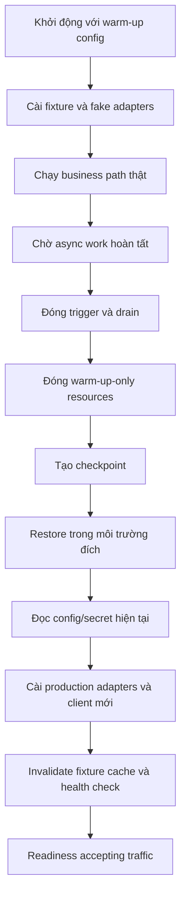

# Dùng dữ liệu giả lập và dịch vụ phụ thuộc kiểm soát được

Làm nóng JVM trước khi tạo checkpoint CRaC giúp ứng dụng bước vào trạng thái đã nạp các lớp quan trọng, đã thực thi những đường code thường dùng và đã chuẩn bị một phần cache cần thiết. Để quá trình này có thể lặp lại và an toàn, ứng dụng nên dùng **dữ liệu giả lập có chủ đích** cùng **các dịch vụ phụ thuộc được kiểm soát**.

Một lần warm-up có thể gọi qua nhiều tầng: controller, validation, service, mapper, serializer, repository, HTTP client và các thư viện xử lý dữ liệu. Nếu warm-up kết nối thẳng tới hệ thống production, nó có thể tạo đơn hàng giả, gửi thông báo, tiêu thụ message thật, làm thay đổi cache dùng chung hoặc ghi dữ liệu không mong muốn. Ngược lại, nếu thay toàn bộ business code bằng mock thì JVM chỉ làm nóng mock, không làm nóng những đường code mà request thật sẽ sử dụng.

Mục tiêu là chạy **mã ứng dụng thật với dữ liệu tổng hợp và dependency an toàn**, sau đó thay các adapter warm-up bằng dependency production phù hợp khi restore. Checkpoint cần được tạo sau khi warm-up đã hoàn tất, các công việc bất đồng bộ đã drain và trạng thái giả lập không thể bị hiểu nhầm là dữ liệu production.

## 1. Warm-up cần chuẩn bị những gì?

Warm-up không chỉ là gửi một request bất kỳ tới ứng dụng. Tùy ứng dụng, nó có thể giúp chuẩn bị nhiều loại trạng thái:

- **Class loading và linking:** nạp các lớp, resolve method, annotation, reflection metadata và proxy mà đường xử lý thường dùng cần tới.
- **JIT compilation:** thực thi đủ những đường code quan trọng để JVM thu thập profile và có cơ hội biên dịch các method nóng.
- **Framework initialization:** khởi tạo serializer, validator, mapper, expression, dependency injection và metadata của framework.
- **Application cache:** tạo những cấu trúc tra cứu hoặc dữ liệu tham chiếu có thể tái sử dụng nếu dữ liệu đó vẫn hợp lệ sau restore.
- **Client preparation:** khởi tạo thư viện client, cấu hình TLS, connection pool hoặc prepared statement nếu lifecycle của chúng tương thích với checkpoint/restore.
- **Data path execution:** chạy các nhánh xử lý có cấu trúc dữ liệu, kiểu request và độ phức tạp gần với traffic thực tế.

CRaC giữ trạng thái tiến trình tại thời điểm checkpoint. Vì vậy, những gì warm-up đã tạo trong heap có thể xuất hiện sau restore. Tuy nhiên, một socket, token, lease hoặc cache phụ thuộc môi trường có thể đã cũ. Cần phân biệt trạng thái giúp tiết kiệm thời gian khởi tạo với trạng thái phải tạo lại hoặc xác minh sau restore.

## 2. Vì sao nên dùng dữ liệu giả lập?

Dữ liệu warm-up nên đủ giống dữ liệu thật để kích hoạt các nhánh code quan trọng, nhưng không mang theo thông tin cá nhân hoặc gây side effect trong hệ thống nghiệp vụ.

Ví dụ, với một dịch vụ đặt hàng, dữ liệu warm-up có thể gồm:

- Một khách hàng tổng hợp với ID dành riêng cho warm-up.
- Một giỏ hàng có nhiều mặt hàng, biến thể và số lượng khác nhau.
- Các mức giá, chiết khấu, thuế và phí vận chuyển đại diện.
- Địa chỉ giả lập theo những định dạng hợp lệ mà validator cần xử lý.
- Các trạng thái đơn hàng dùng để chạy qua những nhánh xử lý khác nhau.
- Một số trường hợp biên như giỏ hàng rỗng, mã giảm giá hết hạn hoặc sản phẩm không còn hàng.

Dữ liệu này giúp JVM thực thi code kiểm tra đầu vào, tính giá, ánh xạ object, serialize response và xử lý lỗi. Vì ID và nội dung là tổng hợp, warm-up không cần đọc thông tin của khách hàng thật hoặc tạo đơn hàng có thể đi vào quy trình giao nhận.

### Dữ liệu phải đại diện cho hình dạng thực tế

Một fixture chỉ có một record đơn giản có thể không kích hoạt những nhánh mà production thường dùng. Hãy lựa chọn dữ liệu dựa trên cấu trúc và phân bố của workload:

| Đặc điểm dữ liệu | Ví dụ cần chuẩn bị | Đường xử lý có thể được kích hoạt |
|---|---|---|
| Kích thước nhỏ và lớn | Một item, nhiều item, payload lớn trong giới hạn | Vòng lặp, allocation, serializer và giới hạn request |
| Trường tùy chọn | Có/không có địa chỉ phụ, ghi chú, metadata | Nhánh null/optional và validation |
| Giá trị khác nhau | Giá dương, chiết khấu, thuế, số lượng | Tính toán và quy tắc nghiệp vụ |
| Trạng thái khác nhau | Mới tạo, đã xác nhận, bị hủy | State transition và nhánh xử lý |
| Ký tự và định dạng | Unicode, ngày giờ, timezone, mã định danh | Parsing, normalization và serialization |
| Trường hợp lỗi | ID không tồn tại, dữ liệu sai định dạng | Exception mapping và error response |

Không cần đưa mọi tổ hợp vào warm-up. Chọn các đường quan trọng dựa trên tần suất và chi phí khởi tạo. Một workload quá lớn có thể làm tăng thời gian tạo checkpoint, kích thước heap và thời gian restore mà không mang lại lợi ích tương xứng.

### Dữ liệu tổng hợp phải có thể tái tạo

Fixture nên có quy tắc tạo ổn định:

- Dùng namespace ID riêng, ví dụ `warmup-customer-001` hoặc tenant dành riêng.
- Dùng seed xác định nếu cần tạo dữ liệu giả ngẫu nhiên có thể tái lập.
- Dùng clock giả lập hoặc timestamp cố định cho các phép tính phụ thuộc thời gian.
- Đặt version cho bộ fixture để biết cache hoặc snapshot được tạo từ bộ dữ liệu nào.
- Không lấy dữ liệu production rồi chỉ đổi tên trường; dữ liệu đã ẩn danh vẫn có thể chứa thông tin nhạy cảm hoặc dấu vết có thể nhận diện.

Ví dụ một factory tạo dữ liệu tổng hợp:

```java
import java.math.BigDecimal;
import java.util.List;

record WarmupLine(String sku, int quantity, BigDecimal unitPrice) {}

record WarmupOrder(
        String orderId,
        String customerId,
        List<WarmupLine> lines) {}

final class WarmupFixtures {
    private WarmupFixtures() {
    }

    static WarmupOrder representativeOrder() {
        return new WarmupOrder(
                "warmup-order-001",
                "warmup-customer-001",
                List.of(
                        new WarmupLine("SKU-A", 2, new BigDecimal("19.90")),
                        new WarmupLine("SKU-B", 1, new BigDecimal("42.50")),
                        new WarmupLine("SKU-C", 4, new BigDecimal("3.25"))
                )
        );
    }
}
```

Fixture này cố ý dùng ID có tiền tố `warmup-` để dễ nhận biết trong log và metric. Nếu ứng dụng lưu fixture vào database warm-up, hãy dùng schema hoặc database riêng và xóa dữ liệu đó theo lifecycle của môi trường warm-up.

## 3. Dùng dependency được kiểm soát thay vì gọi dịch vụ production

Warm-up thường đi qua nhiều dependency. Mỗi dependency cần một chiến lược rõ ràng để bảo đảm lời gọi có kết quả ổn định và không gây tác động ngoài ý muốn.

| Dependency | Cách kiểm soát khi warm-up | Điều cần giữ giống production |
|---|---|---|
| Database | Database/schema tách biệt với dữ liệu tổng hợp; hoặc adapter in-memory khi chỉ cần làm nóng logic | Driver, dialect, kiểu dữ liệu, mapping và câu SQL nếu mục tiêu là warm-up đường truy cập DB |
| HTTP service | Stub server hoặc fake adapter trả response xác định | HTTP client, serializer, TLS/configuration path và kiểu response |
| Message broker | Broker riêng, topic/queue warm-up hoặc producer/consumer giả lập | Serialization, partition/key logic và handler thật |
| Payment/email/SMS | Fake gateway ghi nhận request vào bộ nhớ hoặc sink thử nghiệm | Business validation, request mapping và error handling |
| Object storage | Bucket riêng hoặc fake store | SDK client, metadata và cách ứng dụng xử lý object |
| Identity provider | Token giả có cấu trúc phù hợp hoặc identity test provider | Luồng parse claim, authorization mapping và refresh logic |
| Clock | `Clock.fixed(...)` hoặc clock có thể điều khiển | Cách tính deadline, timezone và lịch nghiệp vụ |

Điều cần kiểm soát là side effect và nguồn dữ liệu. Hãy giữ các lớp ứng dụng, validation, mapping, serialization và logic nghiệp vụ thật trong đường warm-up. Thay adapter ở ranh giới tích hợp để request không chạm tới hệ thống production.

### Không mock chính đoạn code cần làm nóng

Giả sử service xử lý đơn hàng có logic:

```java
OrderResult result = orderService.createOrder(request);
```

Warm-up nên gọi `orderService.createOrder(...)` thật. Có thể thay `PaymentGateway`, `InventoryPort` và `OrderRepository` bằng adapter an toàn. Nếu mock toàn bộ `OrderService` rồi chỉ gọi mock, JVM không thực thi code tính giá, kiểm tra tồn kho, tạo entity hoặc serialize kết quả.

Mức độ thay thế dependency phụ thuộc mục tiêu. Nếu muốn làm nóng Hibernate mapping hoặc JDBC driver, in-memory repository có thể không đủ; cần database riêng có schema và phiên bản tương thích. Nếu chỉ muốn làm nóng business logic, adapter in-memory có thể phù hợp.

## 4. Thiết kế ranh giới dependency để chuyển từ warm-up sang production

Một thiết kế hữu ích là để service phụ thuộc vào interface/port, còn adapter được lắp qua một registry hoặc factory. Trong giai đoạn warm-up, registry giữ adapter giả lập. Sau restore, lifecycle manager lắp adapter production.

```java
interface CatalogPort {
    CatalogItem findBySku(String sku);
}

interface PaymentPort {
    PaymentResult authorize(PaymentRequest request);
}

interface EventPort {
    void publish(OrderCreated event);
}

record ApplicationDependencies(
        CatalogPort catalog,
        PaymentPort payment,
        EventPort events) {}

final class DependencyRegistry {
    private volatile ApplicationDependencies current;

    ApplicationDependencies current() {
        ApplicationDependencies dependencies = current;
        if (dependencies == null) {
            throw new IllegalStateException("Dependencies are not installed");
        }
        return dependencies;
    }

    void install(ApplicationDependencies dependencies) {
        current = dependencies;
    }
}
```

Service lấy dependency từ registry tại thời điểm xử lý:

```java
final class OrderService {
    private final DependencyRegistry dependencies;

    OrderService(DependencyRegistry dependencies) {
        this.dependencies = dependencies;
    }

    OrderResult createOrder(OrderRequest request) {
        ApplicationDependencies ports = dependencies.current();
        CatalogItem item = ports.catalog().findBySku(request.sku());
        PaymentResult payment = ports.payment().authorize(
                new PaymentRequest(request.customerId(), item.price())
        );

        OrderCreated event = new OrderCreated(
                request.orderId(), request.customerId(), payment.reference()
        );
        ports.events().publish(event);

        return new OrderResult(request.orderId(), payment.status());
    }
}
```

`OrderService` vẫn chạy code thật trong warm-up. Adapter giả lập chỉ thay các cổng tích hợp. Sau restore, có thể thay toàn bộ `ApplicationDependencies` bằng một object mới thông qua một lần gán volatile, để request mới nhìn thấy cùng một bộ dependency nhất quán.

Thiết kế này yêu cầu service tra dependency qua registry khi xử lý. Nếu service lưu trực tiếp một adapter fake vào field từ constructor, việc thay registry sẽ không thay adapter mà service đang dùng. Trong trường hợp đó, cần tạo lại service/client holder hoặc thiết kế provider/proxy để chuyển adapter an toàn.

## 5. Ví dụ adapter giả lập có side effect an toàn

Adapter warm-up cần trả kết quả đủ thực tế để business code chạy qua các nhánh cần thiết. Với payment, adapter có thể ghi nhận yêu cầu nhưng không gọi cổng thanh toán:

```java
import java.util.ArrayList;
import java.util.List;

final class FakePaymentPort implements PaymentPort {
    private final List<PaymentRequest> received = new ArrayList<>();

    @Override
    public PaymentResult authorize(PaymentRequest request) {
        received.add(request);
        return new PaymentResult("warmup-payment-ref", "AUTHORIZED");
    }

    List<PaymentRequest> receivedRequests() {
        return List.copyOf(received);
    }
}
```

Với event publisher, có thể dùng sink chỉ lưu event trong bộ nhớ:

```java
final class RecordingEventPort implements EventPort {
    private final List<OrderCreated> events = new ArrayList<>();

    @Override
    public void publish(OrderCreated event) {
        events.add(event);
    }

    List<OrderCreated> events() {
        return List.copyOf(events);
    }
}
```

Trong production, `PaymentPort` có thể gọi payment provider và `EventPort` có thể publish lên broker thật. Khi warm-up, những side effect đó được thay bằng adapter kiểm soát. Không dùng fake adapter để xử lý traffic production sau restore.

Nếu warm-up chạy nhiều thread, adapter ghi nhận dữ liệu phải thread-safe. Nếu kết quả chỉ dùng để khởi tạo đường code và không cần lưu, có thể dùng sink loại bỏ event thay vì giữ một danh sách ngày càng lớn trong heap checkpoint.

## 6. Dùng database warm-up phù hợp với mục tiêu

Không phải lúc nào database giả lập cũng đủ. Có hai mục tiêu thường khác nhau:

**Làm nóng business logic:** adapter in-memory có thể trả về entity tổng hợp để service thực hiện validation, tính toán, mapping và serialization. Cách này nhanh, dễ tái lập và không cần khởi động database.

**Làm nóng đường truy cập dữ liệu:** nếu mục tiêu là làm nóng JDBC driver, ORM metadata, SQL parsing, prepared statement hoặc query path, cần database riêng có schema tương thích. Dùng dữ liệu tổng hợp và tài khoản riêng, không dùng database production.

Một database warm-up nên có:

- Phiên bản engine và schema gần với môi trường đích.
- Bảng và index cần thiết cho các query quan trọng.
- Dữ liệu tổng hợp đủ để kích hoạt các kiểu query đại diện.
- Giới hạn quyền ghi và dữ liệu tách biệt.
- Quy trình cleanup hoặc reset sau warm-up.

Connection pool được tạo trước checkpoint có thể chứa socket và session không còn hợp lệ sau restore. Hãy dùng lifecycle API của pool để đóng hoặc chuẩn bị trước checkpoint và tạo pool mới sau restore. Không giả định connection tới database warm-up sẽ trở thành connection production chỉ vì tiến trình được restore.

## 7. Stub HTTP và dịch vụ ngoài có thể kiểm soát

Đối với HTTP dependency, có thể chạy một stub server cục bộ hoặc trong mạng warm-up riêng. Stub cần trả response có cấu trúc và status code đại diện:

- Thành công với payload phổ biến.
- Thành công nhưng có trường tùy chọn hoặc danh sách rỗng.
- Lỗi 4xx để làm nóng mapping lỗi nghiệp vụ.
- Lỗi 5xx hoặc timeout để làm nóng retry/error path nếu đó là đường quan trọng.
- Response lớn hoặc có phân trang khi client xử lý những trường hợp đó.

Hãy dùng cùng HTTP client, codec và mapping code với production. Stub server chỉ thay endpoint và phản hồi. Nếu mục tiêu là làm nóng TLS handshake hoặc xác thực thật, dùng một dịch vụ thử nghiệm được kiểm soát với certificate và identity test; response giả không làm nóng đầy đủ mọi chi phí của TLS hoặc auth provider.

Không để URL stub, token test hoặc DNS nội bộ warm-up được lưu thành cấu hình production trong checkpoint. Sau restore, đọc endpoint và credential từ cấu hình/secret provider của môi trường hiện tại.

## 8. Warm-up qua đường xử lý ứng dụng thật

Một warm-up runner nên gọi các use case quan trọng bằng fixture đã chuẩn bị. Ví dụ:

```java
final class ApplicationWarmup {
    private final OrderService orderService;
    private final SearchService searchService;
    private final ResponseEncoder responseEncoder;

    ApplicationWarmup(
            OrderService orderService,
            SearchService searchService,
            ResponseEncoder responseEncoder) {
        this.orderService = orderService;
        this.searchService = searchService;
        this.responseEncoder = responseEncoder;
    }

    void run() {
        OrderRequest order = WarmupFixtures.representativeOrderRequest();
        OrderResult result = orderService.createOrder(order);
        responseEncoder.encode(result);

        searchService.search(WarmupFixtures.representativeSearchQuery());
        searchService.search(WarmupFixtures.emptySearchQuery());
    }
}
```

Các phương thức `representativeOrderRequest`, `representativeSearchQuery` và `emptySearchQuery` là factory fixture do ứng dụng định nghĩa. Runner nên gọi trực tiếp service hoặc đi qua một internal entry point có cùng pipeline với request thật. Nếu muốn làm nóng controller, filter, validation hoặc serialization ở tầng web, hãy dùng internal HTTP request tới server warm-up hoặc test harness có cùng web stack.

Không nhất thiết phải chạy mọi API. Ưu tiên những đường code có chi phí khởi tạo cao, tần suất sử dụng lớn hoặc ảnh hưởng mạnh tới latency của request đầu tiên. Ghi lại phạm vi warm-up để biết đường nào đã được thực thi.

### Warm-up phải hoàn tất trước checkpoint

Nếu runner tạo tác vụ bất đồng bộ, phải chờ chúng hoàn tất. Không checkpoint trong khi fixture đang được ghi, một future còn pending hoặc event vẫn nằm trong queue nội bộ.

```java
CompletableFuture<Void> warmup = warmupRunner.runAsync();
warmup.get(60, TimeUnit.SECONDS);

warmupCoordinator.awaitBackgroundWorkDrained();
```

Ví dụ dùng `get` có timeout để chờ runner. `awaitBackgroundWorkDrained()` là phần điều phối riêng của ứng dụng nhằm đợi các tác vụ con mà runner đã phát sinh. Chỉ đợi future gốc là chưa đủ nếu nó submit việc sang executor khác rồi hoàn tất sớm.

## 9. Phân biệt warm-up dữ liệu với warm-up JIT

Warm-up dữ liệu và warm-up JIT có liên quan nhưng không phải một việc:

- Nạp fixture vào cache có thể làm nóng cấu trúc dữ liệu và giảm truy cập nguồn trong request đầu tiên.
- Gọi method với dữ liệu đại diện giúp JVM thu thập profile thực thi và có thể JIT compile code nóng.
- Khởi tạo framework giúp nạp class, tạo proxy, validator và serializer.
- Mở connection giúp khởi tạo client, nhưng socket/session có thể phải tạo lại sau restore.

Chỉ nạp object vào cache mà không thực thi method sẽ không làm nóng JIT cho những method chưa chạy. Ngược lại, gọi cùng một method với dữ liệu quá đơn giản có thể không đại diện cho các nhánh production. Hãy chọn workload có kích thước, kiểu dữ liệu và nhánh logic phù hợp.

JIT compilation là quyết định động của JVM. Không có số lần gọi cố định bảo đảm mọi method sẽ được compile tối ưu. Theo dõi thời gian warm-up, compilation log/JFR hoặc công cụ quan sát phù hợp với runtime để hiểu phần nào thực sự được làm nóng. Đừng kéo dài warm-up chỉ để ép mọi method hiếm gặp trở thành hot.

## 10. Không để dữ liệu giả lập trở thành dữ liệu production

Checkpoint giữ trạng thái heap, do đó cache và singleton được warm-up có thể tiếp tục chứa fixture sau restore. Điều này nguy hiểm nếu code coi mọi entry trong cache là dữ liệu thật.

Một số biện pháp:

- Dùng namespace/key riêng cho warm-up và không dùng chung namespace với cache production.
- Đánh dấu fixture bằng nguồn dữ liệu hoặc version riêng.
- Xóa cache chứa kết quả giả lập trong `afterRestore` trước khi mở readiness.
- Nạp lại reference data từ nguồn production nếu cần cache nóng.
- Không đưa warm-up customer, order hoặc token vào database/cache dùng chung.
- Dùng sink giả cho email, SMS, payment, event và các side effect khác.
- Kiểm tra log, metric và trace để không gửi dữ liệu warm-up tới hệ thống phân tích production như traffic thật.

Nếu muốn giữ một số cache đã warm-up, chỉ giữ dữ liệu có thể tái sử dụng an toàn, ví dụ bảng mã hoặc metadata bất biến theo phiên bản artifact. Cache phụ thuộc tenant, quyền truy cập, giá, tồn kho hoặc cấu hình runtime phải được xác minh hoặc nạp lại.

## 11. Điều phối dependency khi checkpoint và restore

Một quy trình tổng quát có thể gồm ba giai đoạn:

### Giai đoạn chuẩn bị warm-up

1. Khởi động ứng dụng với cấu hình warm-up riêng.
2. Tạo fixture tổng hợp và cài các adapter giả lập.
3. Khởi tạo các dependency thử nghiệm cần thiết.
4. Chạy warm-up runner qua các use case thật.
5. Chờ task bất đồng bộ hoàn tất và ghi nhận các đường code đã chạy.

### Trước checkpoint

1. Ngừng nhận warm-up request và trigger mới.
2. Drain request, task, consumer và event nội bộ.
3. Đóng stub server, connection pool và tài nguyên chỉ tồn tại trong môi trường warm-up nếu chúng không thể được giữ an toàn.
4. Xóa hoặc đánh dấu stale các cache chỉ chứa fixture.
5. Xác nhận ứng dụng đang ở trạng thái nhất quán rồi tạo checkpoint.

### Sau restore

1. Đọc cấu hình và secret của môi trường đích.
2. Tạo lại client, connection pool, listener và dependency production.
3. Thay adapter warm-up trong dependency registry bằng adapter production.
4. Invalidate cache chứa fixture và refresh dữ liệu cần thiết.
5. Kiểm tra health của dependency bắt buộc.
6. Chuyển readiness sang accepting traffic sau khi mọi bước phục hồi thành công.



Nếu warm-up và production dùng cùng một database/service nhưng khác namespace, hãy bảo đảm namespace được cấu hình lại sau restore và quyền của credential test không thể ghi vào dữ liệu production. Một cấu hình `warmup=true` bị lưu trong heap không nên là cơ chế duy nhất quyết định endpoint production; hãy xác định môi trường đích từ nguồn cấu hình đáng tin cậy.

## 12. Ví dụ resource điều phối warm-up và dependency swap

Ví dụ sau cho thấy nơi đặt logic lifecycle. Các interface là abstraction của ứng dụng:

```java
import java.time.Duration;

import org.crac.Context;
import org.crac.Resource;

final class WarmupResource implements Resource {
    private final WarmupRunner runner;
    private final WarmupCoordinator coordinator;
    private final DependencyRegistry dependencies;
    private final ProductionDependencyFactory productionFactory;
    private final RuntimeConfigurationProvider configurationProvider;
    private final Duration drainTimeout;

    WarmupResource(
            WarmupRunner runner,
            WarmupCoordinator coordinator,
            DependencyRegistry dependencies,
            ProductionDependencyFactory productionFactory,
            RuntimeConfigurationProvider configurationProvider,
            Duration drainTimeout) {
        this.runner = runner;
        this.coordinator = coordinator;
        this.dependencies = dependencies;
        this.productionFactory = productionFactory;
        this.configurationProvider = configurationProvider;
        this.drainTimeout = drainTimeout;
    }

    void runWarmup() throws Exception {
        runner.run();
        coordinator.awaitWarmupWorkDrained(drainTimeout);
        coordinator.markWarmupComplete();
    }

    @Override
    public void beforeCheckpoint(Context<? extends Resource> context)
            throws Exception {
        coordinator.stopWarmupTriggers();
        coordinator.awaitWarmupWorkDrained(drainTimeout);
        coordinator.closeWarmupOnlyResources();
    }

    @Override
    public void afterRestore(Context<? extends Resource> context)
            throws Exception {
        RuntimeConfiguration configuration = configurationProvider.loadCurrent();
        ApplicationDependencies production =
                productionFactory.create(configuration);

        dependencies.install(production);
        coordinator.invalidateFixtureCaches();
        coordinator.verifyProductionDependencies();
    }
}
```

Đoạn code là khung minh họa; `runWarmup()` cần được gọi trong giai đoạn chuẩn bị checkpoint, trước khi yêu cầu tạo checkpoint. `beforeCheckpoint` xác nhận warm-up work đã drain và đóng các tài nguyên chỉ dành cho warm-up. `afterRestore` lắp dependency production, xóa fixture cache và kiểm tra health. Trong ứng dụng thật, cần bảo đảm `productionFactory` không phụ thuộc vào adapter warm-up đã đóng và readiness chỉ mở sau khi coordinator hoàn tất.

Nếu một bước trong `beforeCheckpoint` thất bại, callback phải báo lỗi để checkpoint không tiếp tục với trạng thái dở dang. Nếu checkpoint attempt bị hủy sau khi callback đã đóng stub hoặc pool warm-up, controller của ứng dụng cần có cách phục hồi hoặc khởi tạo lại các dependency đó trước khi tiếp tục chạy. Không giả định `afterRestore` sẽ được gọi trên tiến trình cũ để undo một checkpoint thất bại.

## 13. Chọn giữa fake adapter, stub server và dependency thử nghiệm thật

Không có một kiểu giả lập phù hợp cho mọi mục tiêu. Hãy chọn theo tầng muốn làm nóng:

| Mục tiêu | Lựa chọn phù hợp | Giới hạn |
|---|---|---|
| Làm nóng business logic | Fake/in-memory adapter | Không làm nóng driver hoặc protocol thật |
| Làm nóng HTTP client và codec | Stub HTTP server | Không đại diện đầy đủ latency, TLS hoặc hành vi production |
| Làm nóng JDBC/ORM/SQL | Database thử nghiệm có schema tương thích | Cần quản lý dữ liệu, phiên bản và connection lifecycle |
| Làm nóng message serialization/handler | Broker riêng hoặc adapter test có cùng codec | Không được tiêu thụ message production |
| Làm nóng SDK/driver bên ngoài | Sandbox/test service của vendor | Cần xác minh sandbox có cùng tính năng và cấu hình quan trọng |
| Làm nóng cache thuần | Fixture/cache builder | Cache phải được phân loại và refresh đúng sau restore |

Có thể kết hợp nhiều cách. Ví dụ, warm-up business logic bằng fake adapter nhanh, sau đó chạy một số đường đại diện qua database thử nghiệm để làm nóng ORM. Hãy giữ phạm vi vừa đủ để checkpoint không phình to và thời gian chuẩn bị không vượt quá lợi ích giảm cold start.

## 14. Những lỗi thường gặp

### Dùng dữ liệu production để warm-up

Điều này có thể làm lộ thông tin, tạo side effect hoặc đưa dữ liệu riêng của một tenant vào checkpoint dùng chung cho nhiều replica. Dùng fixture tổng hợp và môi trường tách biệt.

### Mock toàn bộ service cần làm nóng

Nếu mock business service, JVM không thực thi logic thực tế. Chỉ thay dependency ở ranh giới I/O và gọi use case thật.

### Dùng stub nhưng không refresh endpoint sau restore

Nếu URL stub nằm trong singleton hoặc configuration snapshot, ứng dụng có thể tiếp tục gọi stub trong production. Hãy nạp endpoint production từ cấu hình hiện tại và thay dependency registry.

### Giữ cache fixture như cache production

Cache có thể chứa giá, tồn kho, quyền hoặc dữ liệu tenant giả. Gắn version/namespace và invalidate trước readiness.

### Để task warm-up chạy dở khi checkpoint

Task bất đồng bộ có thể tiếp tục ghi fixture hoặc phát event sau restore. Dừng trigger, drain toàn bộ công việc con và chỉ checkpoint khi đã đạt trạng thái ổn định.

### Warm-up quá ít hoặc quá nhiều

Một request đơn giản không kích hoạt đủ code path; một workload quá lớn lại kéo dài thời gian và tăng heap. Chọn dữ liệu và số lần gọi dựa trên profile workload và mục tiêu warm-up.

### Không phân biệt trạng thái warm-up với trạng thái sẵn sàng phục vụ

Ứng dụng có thể đã chạy warm-up thành công nhưng chưa kết nối production dependency. Readiness chỉ được mở sau khi dependency đích đã được cài và xác minh.

## 15. Quan sát và đo hiệu quả

Để biết warm-up có giúp ích, nên ghi lại các chỉ số trước và sau khi áp dụng:

| Chỉ số | Điều cần quan sát |
|---|---|
| Thời gian khởi tạo framework | Có giảm phần việc phải lặp lại sau restore không |
| Thời gian warm-up | Chi phí chuẩn bị checkpoint có hợp lý không |
| Số code path được chạy | Những use case nào đã được warm-up |
| JIT compilation/profile | Các method quan trọng có được thực thi đủ để JVM tối ưu không |
| Kích thước heap/checkpoint | Fixture hoặc cache có làm ảnh tiến trình quá lớn không |
| Thời gian restore và readiness | Dependency swap có trở thành nút thắt mới không |
| Latency request đầu tiên | Request đầu tiên sau restore có cải thiện không |
| Lỗi dependency sau restore | Có còn URL, credential hoặc connection của môi trường warm-up không |

So sánh với cold start trên cùng phần cứng, JDK, cấu hình và workload. Dùng phân vị latency như p50/p95/p99 thay vì chỉ nhìn trung bình. Cũng cần quan sát sau một khoảng traffic thực tế để phân biệt lợi ích của warm-up với chi phí tạo checkpoint và restore.

## 16. Checklist chuẩn bị dữ liệu và dependency

- [ ] Đã xác định các use case và code path cần warm-up.
- [ ] Fixture là dữ liệu tổng hợp, tái tạo được và không chứa dữ liệu production.
- [ ] Fixture đại diện cho kích thước, kiểu dữ liệu và nhánh nghiệp vụ quan trọng.
- [ ] Dữ liệu có namespace/version riêng để nhận biết là warm-up.
- [ ] Business logic, validation, mapping và serialization thật được thực thi.
- [ ] Dependency có side effect được thay bằng fake adapter, stub hoặc sandbox kiểm soát được.
- [ ] Database warm-up dùng schema/dữ liệu tách biệt nếu cần làm nóng JDBC/ORM.
- [ ] Không có payment, email, SMS, message hoặc event production bị phát ra trong warm-up.
- [ ] Warm-up task và mọi tác vụ bất đồng bộ đã hoàn tất trước checkpoint.
- [ ] Fixture cache được xóa hoặc xác minh trước khi phục vụ traffic production.
- [ ] Endpoint, credential và client được tạo lại theo cấu hình môi trường đích sau restore.
- [ ] Readiness chỉ mở sau khi dependency production được cài và kiểm tra.
- [ ] Có phương án phục hồi nếu checkpoint attempt thất bại sau khi warm-up resource đã đóng.
- [ ] Đã đo thời gian warm-up, kích thước checkpoint, restore time và latency request đầu tiên.

## 17. Kết luận

Dùng dữ liệu giả lập và dependency kiểm soát được giúp warm-up thực thi những đường code quan trọng mà không làm thay đổi hệ thống production hoặc đưa dữ liệu nhạy cảm vào checkpoint. Fixture cần tái tạo được và đại diện cho hình dạng dữ liệu thực tế; fake adapter nên thay thế ranh giới I/O trong khi business logic thật vẫn được gọi.

Trước checkpoint, hãy dừng warm-up trigger, drain task và đóng tài nguyên chỉ dùng cho môi trường chuẩn bị. Sau restore, nạp cấu hình và credential của môi trường đích, thay adapter giả lập bằng dependency production, invalidate fixture cache và kiểm tra health trước khi mở readiness. Như vậy, trạng thái đã warm-up có thể giúp giảm cold start mà không khiến ứng dụng tiếp tục dùng dữ liệu hoặc dịch vụ giả lập khi nhận traffic thật.
