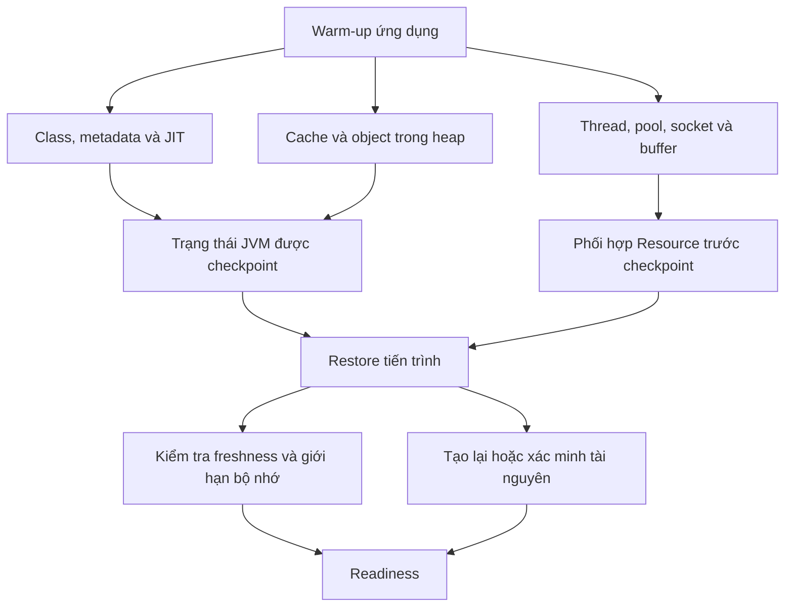

# Kiểm soát cache, phân bổ bộ nhớ và tài nguyên sinh ra khi làm nóng

Làm nóng JVM trước khi tạo checkpoint giúp ứng dụng hoàn thành những công việc thường làm chậm quá trình khởi động: nạp class, tạo metadata của framework, thực thi các đường code quan trọng, biên dịch JIT và nạp dữ liệu thường xuyên dùng vào cache. Khi tiến trình được restore, một phần trạng thái đã chuẩn bị có thể tiếp tục được sử dụng, nhờ đó giảm lượng công việc phải lặp lại.

Tuy nhiên, warm-up cũng tạo ra trạng thái mới: cache tăng kích thước, heap có thêm object, JIT sử dụng code cache, framework có thể tạo proxy và metadata, còn ứng dụng có thể mở connection pool, thread, file, socket hoặc buffer native. Nếu làm nóng không kiểm soát, checkpoint có thể lớn, restore tốn bộ nhớ, cache chứa dữ liệu lỗi thời hoặc tiến trình tiếp tục với những tài nguyên bên ngoài không còn hợp lệ.

Vì vậy, mục tiêu không phải làm nóng càng nhiều càng tốt. Mục tiêu là tạo đúng trạng thái có ích, giữ mức sử dụng bộ nhớ trong giới hạn, quản lý vòng đời tài nguyên và xác minh lại những gì có thể thay đổi trong thời gian tiến trình ngừng chạy.

## 1. Warm-up tạo ra những loại trạng thái nào?

Một ứng dụng Java có nhiều lớp trạng thái khác nhau. Chúng không có cùng vòng đời và không phải loại nào cũng được xử lý giống nhau khi checkpoint/restore.

| Loại trạng thái | Ví dụ | Cách suy nghĩ khi warm-up |
|---|---|---|
| Trạng thái trong heap | Object cấu hình, metadata, cache nghiệp vụ, dữ liệu tra cứu. | Chỉ nạp dữ liệu cần thiết; đặt giới hạn kích thước và chính sách hết hạn. |
| Trạng thái của JVM | Class đã nạp, cấu trúc runtime, profiling và mã đã biên dịch JIT. | Thực thi đường code đại diện; hiệu quả giữ lại phụ thuộc JDK CRaC và runtime. |
| Bộ nhớ ngoài heap | Direct buffer, native allocation, memory mapping. | Theo dõi ownership, giới hạn và khả năng khôi phục của thư viện sử dụng. |
| Tài nguyên hệ điều hành | File descriptor, socket, thread, timer, process state. | Xác định cần giữ, tạm dừng, đóng hoặc tạo lại qua Resource callback. |
| Tài nguyên bên ngoài | Database, broker, HTTP service, secret provider. | Không giả định trạng thái từ xa được checkpoint cùng JVM; kiểm tra và kết nối lại sau restore. |

Có thể phân biệt ba nhóm lớn:

1. **Trạng thái có ích để giữ:** class đã nạp, object khởi tạo ổn định, cache dữ liệu ít thay đổi và một phần trạng thái runtime đã được làm nóng.
2. **Trạng thái cần kiểm tra hoặc làm mới:** cache phụ thuộc dữ liệu bên ngoài, token, DNS, cấu hình có thể đổi, dữ liệu theo thời gian và trạng thái phiên.
3. **Tài nguyên cần quản lý vòng đời:** socket, connection pool, executor, file, thread, buffer native và tài nguyên do thư viện quản lý.



Sơ đồ mô tả cách phân loại khi thiết kế. Trạng thái cụ thể được lưu, tái tạo hoặc cần xử lý phụ thuộc JDK CRaC, hệ điều hành và thư viện của ứng dụng.

## 2. Chọn workload warm-up có mục tiêu

Warm-up nên dựa trên đường xử lý thực tế mà ứng dụng cần tối ưu. Chạy một lượng lớn request ngẫu nhiên có thể làm tăng heap và cache nhưng không cải thiện đáng kể thời gian sẵn sàng.

### 2.1. Xác định đường code quan trọng

Trước khi warm-up, xác định các thao tác đại diện:

- Các endpoint hoặc use case thường xuyên được gọi.
- Các serializer, validator, mapper và bộ chuyển đổi dữ liệu quan trọng.
- Những truy vấn hoặc phép tính có chi phí khởi tạo cao.
- Những class hoặc module chỉ được nạp khi đi vào một chức năng nhất định.
- Các thành phần framework cần tạo metadata hoặc proxy trước khi phục vụ.

Ưu tiên các đường xử lý ảnh hưởng trực tiếp tới thời gian sẵn sàng và latency ban đầu. Không cần gọi mọi endpoint hoặc mọi nhánh code nếu chúng hiếm khi được dùng.

### 2.2. Dùng dữ liệu warm-up an toàn

Warm-up có thể gọi code nghiệp vụ thật, vì vậy phải kiểm soát side effect. Không dùng dữ liệu production theo cách có thể tạo đơn hàng, gửi email, trừ tiền, tiêu thụ message, ghi audit không mong muốn hoặc thay đổi trạng thái hệ thống.

Các cách an toàn hơn:

- Dùng fixture hoặc dữ liệu thử nghiệm có định danh riêng.
- Gọi các hàm khởi tạo/biến đổi thuần khi có thể, thay vì kích hoạt toàn bộ luồng nghiệp vụ.
- Dùng mock hoặc sandbox cho dependency có side effect.
- Tách bước nạp cache khỏi bước thực hiện lệnh ghi.
- Nếu cần gọi dịch vụ thật, dùng endpoint kiểm tra hoặc thao tác đọc có kiểm soát.

Warm-up cần có thể lặp lại. Nếu checkpoint thất bại và ứng dụng khởi động lại từ đầu, việc chạy lại warm-up không được tạo ra dữ liệu trùng hoặc tác động nghiệp vụ ngoài dự kiến.

### 2.3. Warm-up theo giai đoạn

Không nên khởi chạy tất cả tác vụ warm-up đồng thời nếu chúng tranh chấp CPU, heap, database connection hoặc thread pool. Có thể chia thành các giai đoạn:

1. Đọc cấu hình, tạo component và khởi tạo framework.
2. Nạp class và metadata quan trọng.
3. Thực thi các đường code đại diện để JVM có cơ hội tối ưu hóa.
4. Nạp cache có giới hạn và dữ liệu nền cần thiết.
5. Kiểm tra resource, dừng hoặc điều phối các tác vụ nền.
6. Đưa ứng dụng tới trạng thái an toàn để checkpoint.

Thứ tự cụ thể phụ thuộc dependency. Ví dụ, cache cần database thì database phải sẵn sàng trước khi nạp cache; worker sử dụng cache cần được giữ ở trạng thái chờ cho tới khi cache hoàn tất.

## 3. Kiểm soát cache được tạo trong warm-up

Cache là một trong những nguồn tăng heap rõ rệt nhất khi làm nóng. Một cache hữu ích có thể giúp giảm truy vấn hoặc tính toán sau restore, nhưng cache không giới hạn có thể chiếm phần lớn heap và giữ dữ liệu không còn cần thiết.

### 3.1. Phân loại cache trước khi nạp

| Loại cache | Ví dụ | Chính sách gợi ý |
|---|---|---|
| Cache metadata | Metadata entity, schema, serializer, reflection hoặc cấu hình đã parse. | Có thể giữ nếu tương thích với phiên bản ứng dụng và cấu hình sau restore. |
| Cache dữ liệu ít thay đổi | Danh mục, mã quốc gia, bảng tham chiếu. | Nạp phần cần thiết; dùng version hoặc thời hạn làm mới. |
| Cache dữ liệu thay đổi thường xuyên | Giá, tồn kho, trạng thái tài khoản. | Nạp có chọn lọc và xác minh freshness trước khi dùng. |
| Cache theo người dùng/phiên | Profile, quyền, token hoặc session. | Cẩn thận với quyền riêng tư, hết hạn và dữ liệu nhạy cảm; thường không nên nạp đại trà. |
| Cache kết quả tính toán | Kết quả tổng hợp hoặc cấu trúc đã chuẩn hóa. | Đặt giới hạn, cân nhắc chi phí tính lại và khả năng lỗi thời. |

Không phải cache nào cũng nên được làm nóng. Hãy so sánh chi phí khởi tạo lại với bộ nhớ và thời gian cần để nạp cache. Một cache lớn nhưng chỉ được dùng ở vài request có thể làm tăng chi phí checkpoint nhiều hơn lợi ích mà nó đem lại.

### 3.2. Đặt giới hạn kích thước

Mỗi cache nên có giới hạn rõ ràng, chẳng hạn:

- Giới hạn số entry.
- Giới hạn trọng số hoặc dung lượng ước tính.
- TTL (time-to-live) cho dữ liệu có thời hạn.
- Chính sách eviction khi vượt ngưỡng.
- Giới hạn riêng cho từng tenant hoặc nhóm dữ liệu.

Ví dụ với cache bounded trong Caffeine:

```java
Cache<String, ProductSummary> productCache = Caffeine.newBuilder()
        .maximumSize(20_000)
        .expireAfterWrite(Duration.ofMinutes(15))
        .recordStats()
        .build();
```

Đây là ví dụ minh họa, cần có dependency Caffeine và import tương ứng. `maximumSize` giới hạn số entry, không phải giới hạn byte chính xác. Nếu kích thước mỗi value khác nhau đáng kể, có thể cân nhắc `maximumWeight(...)` cùng `weigher(...)` để ước lượng trọng số phù hợp.

Không nên đặt giới hạn chỉ dựa trên dung lượng heap tối đa. Cần để lại headroom cho request đồng thời, object tạm, GC, thread stack, direct buffer và các thư viện khác.

### 3.3. Chọn dữ liệu nào cần warm

Một cách làm thực tế là xếp hạng dữ liệu theo tần suất truy cập, chi phí nạp và mức độ thay đổi:

| Nhóm | Ví dụ | Quyết định |
|---|---|---|
| Thường dùng, chi phí nạp cao, ít thay đổi | Metadata dùng trong hầu hết request. | Ưu tiên warm-up. |
| Thường dùng nhưng thay đổi nhanh | Giá hoặc tồn kho. | Chỉ nạp khi có thể xác minh freshness; có thể refresh sau restore. |
| Ít dùng, chi phí nạp thấp | Một bảng tra cứu hiếm gặp. | Để lazy-load khi có request. |
| Ít dùng, chi phí nạp cao | Báo cáo hoặc phân tích chuyên biệt. | Chỉ warm nếu SLA thực sự yêu cầu. |
| Theo người dùng hoặc chứa bí mật | Token, session, thông tin xác thực. | Tránh warm đại trà; quản lý bằng provider và chính sách bảo mật. |

Cache warm-up nên dựa trên dữ liệu tổng hợp hoặc workload đại diện, tránh phụ thuộc vào một tập dữ liệu quá hẹp khiến cache có tỷ lệ hit cao trong bài thử nhưng thấp trong production.

### 3.4. Freshness sau restore

Cache được giữ trong heap có thể tiếp tục tồn tại sau restore, nhưng dữ liệu nguồn đã thay đổi trong thời gian ứng dụng ngừng chạy. Cần xác định:

- Cache nào có thể sử dụng ngay vì dữ liệu ít thay đổi?
- Cache nào cần kiểm tra version, timestamp hoặc generation?
- Cache nào phải xóa và nạp lại trước khi chức năng được mở?
- Cache nào có thể refresh bất đồng bộ sau khi ứng dụng phục vụ ở chế độ giới hạn?

TTL là một phần của chính sách, không phải bảo đảm freshness tuyệt đối. Cần kiểm tra cách thư viện cache đo thời gian và xử lý expiration khi tiến trình được checkpoint trong thời gian dài. Với dữ liệu quan trọng, nên xác minh version hoặc timestamp từ nguồn dữ liệu thay vì chỉ dựa vào cache cũ.

### 3.5. Tránh cache stampede sau restore

Nếu nhiều instance được restore cùng lúc và cùng thấy cache hết hạn, chúng có thể đồng loạt gọi database hoặc dịch vụ ngoài để nạp lại. Hiện tượng này tạo tải đột biến đúng lúc hệ thống đang khởi động.

Các cách giảm tải:

- Dùng single-flight hoặc cơ chế coalesce để nhiều request cùng chờ một lần nạp.
- Refresh theo nhóm nhỏ thay vì nạp toàn bộ cache cùng lúc.
- Dùng jitter cho thời điểm refresh/expiration.
- Giới hạn concurrency của tác vụ warm-up và refresh.
- Giữ fallback an toàn cho dữ liệu có thể tính lại.
- Chỉ mở capability phụ sau khi cache liên quan đã sẵn sàng.

## 4. Quản lý phân bổ bộ nhớ trong warm-up

Warm-up có thể làm tăng cả lượng object đang sống lẫn lượng cấp phát tạm. Hai con số này có ý nghĩa khác nhau:

- **Live set:** object còn được tham chiếu và cần giữ lại.
- **Allocation rate:** tốc độ tạo object mới trong một khoảng thời gian.
- **Committed heap:** vùng heap JVM đã cam kết sử dụng từ hệ điều hành.
- **Maximum heap:** giới hạn heap tối đa theo cấu hình JVM.
- **RSS:** lượng bộ nhớ vật lý đang resident của tiến trình, bao gồm nhiều thành phần ngoài heap.
- **Native/direct memory:** bộ nhớ được cấp phát ngoài heap bởi JVM hoặc thư viện.

Một warm-up tạo nhiều object tạm có thể làm tăng allocation rate và kích hoạt GC nhưng không làm live set tăng tương ứng. Ngược lại, nạp một cache lớn có thể làm live set tăng lâu dài dù allocation rate sau đó thấp.

### 4.1. Đặt ngân sách bộ nhớ cho checkpoint

Hãy lập ngân sách theo toàn bộ tiến trình, không chỉ heap:

| Thành phần | Cần theo dõi |
|---|---|
| Heap live set | Object còn sống sau warm-up và sau một chu kỳ GC phù hợp. |
| Heap committed/max | Mức heap JVM sử dụng và giới hạn được cấu hình. |
| Metaspace | Class và metadata được nạp trong warm-up. |
| Code cache | Mã JIT đã biên dịch và dữ liệu runtime liên quan. |
| Direct/native memory | Buffer, native library, allocator và thư viện mạng. |
| Thread stack | Số lượng thread và kích thước stack. |
| File mapping và native mapping | Vùng nhớ được map từ file hoặc native component. |
| Bộ nhớ hệ điều hành | RSS và headroom trong giới hạn container/cgroup. |

Checkpoint image và chi phí restore phụ thuộc cách JVM, công cụ checkpoint và hệ điều hành xử lý memory mapping/page. Không thể suy ra chính xác kích thước image chỉ từ `-Xmx`. Tuy vậy, giữ một live set lớn hoặc nhiều vùng nhớ resident thường làm tăng footprint và có thể tăng chi phí lưu/khôi phục. Cần đo trên đúng JDK, kernel và cấu hình triển khai.

### 4.2. Tránh cấp phát giả chỉ để làm nóng heap

Không nên tạo một mảng lớn hoặc hàng triệu object vô nghĩa chỉ để “đụng” vào heap trước checkpoint. Cách này có thể:

- Làm tăng live set nếu object còn được giữ tham chiếu.
- Tạo nhiều GC và kéo dài warm-up.
- Tăng footprint hoặc checkpoint image.
- Làm giảm headroom cho request thực tế sau restore.
- Che khuất vấn đề cấp phát của workload thật.

Nếu mục tiêu là làm nóng một đường xử lý, hãy thực thi chính đường code đó với dữ liệu đại diện. Nếu mục tiêu là kiểm tra memory behavior, hãy đo allocation rate, live set và GC thay vì cố tình lấp đầy heap.

### 4.3. Đừng ép GC một cách máy móc

Gọi `System.gc()` không bảo đảm thu hồi mọi object hoặc làm heap ở trạng thái tối ưu. Nó chỉ là yêu cầu JVM cân nhắc GC; hành vi còn phụ thuộc collector, cờ JVM và trạng thái runtime.

Có thể thực hiện phép đo sau warm-up để hiểu live set và GC, nhưng không nên coi một lệnh GC là điều kiện bắt buộc để checkpoint. Nếu ứng dụng cần giải phóng object, hãy sửa reference/lifecycle để object không còn reachable; để GC xử lý theo chính sách runtime.

### 4.4. Theo dõi GC và allocation

Nên thu thập dữ liệu trước và sau warm-up:

- Heap used/committed/max.
- Live set sau GC trong điều kiện đo đã xác định.
- Số lần GC, thời gian pause và loại collector.
- Allocation rate và các điểm cấp phát nóng.
- Metaspace và code cache.
- Direct buffer/native memory.
- RSS và giới hạn bộ nhớ container.

Có thể dùng Java Flight Recorder, GC log, `jcmd` và metric của JVM để quan sát. Cần đo bằng cùng một cấu hình JDK và workload khi so sánh cold start với warm-up/restore.

## 5. Kiểm soát tài nguyên được tạo trong warm-up

Warm-up không chỉ tạo object. Nó có thể tạo những tài nguyên có vòng đời bên ngoài heap. Đây là nhóm cần đặc biệt chú ý khi tích hợp CRaC.

### 5.1. Thread và executor

Warm-up có thể khởi động scheduler, worker pool, HTTP client executor hoặc thread của thư viện. Trước checkpoint, cần xác định thread nào:

- Có thể tiếp tục an toàn qua checkpoint.
- Phải dừng ở safe point và chờ.
- Phải shutdown trước checkpoint rồi tạo lại sau restore.
- Không được phép chạy tác vụ mới trong giai đoạn chuẩn bị.

Đừng tạo thread pool quá lớn chỉ để warm-up. Số thread tăng làm tăng thread stack, scheduler overhead và số tác vụ có thể chạy đồng thời. Tác vụ warm-up nên có giới hạn concurrency riêng, tránh chiếm hết executor phục vụ request.

### 5.2. Database và HTTP connection pool

Nạp cache có thể mở nhiều database connection hoặc HTTP connection. Các kết nối này có thể bị server đóng trong thời gian checkpoint. Hãy:

1. Dừng cấp connection mới.
2. Drain các request hoặc transaction đang chạy.
3. Đóng hoặc chuẩn bị pool theo API của thư viện.
4. Tạo pool/client mới sau restore.
5. Kiểm tra kết nối và chỉ mở lại chức năng sau khi dependency sẵn sàng.

Không nên dùng warm-up để mở số lượng connection lớn hơn nhu cầu thực tế. Connection pool cần có giới hạn phù hợp với tổng connection budget của database, số instance và các client khác.

### 5.3. File, socket và temporary file

Warm-up có thể tạo file tạm, mở file mapping, tạo socket hoặc bind cổng. Cần phân biệt file dữ liệu bền vững với file tạm có vòng đời theo tiến trình.

- Flush dữ liệu cần thiết trước checkpoint.
- Đóng handle không cần giữ qua restore.
- Không giả định socket tới dịch vụ ngoài còn hoạt động.
- Ghi lại đường dẫn và quy tắc tái tạo file tạm nếu cần.
- Dọn file tạm không còn sử dụng để tránh tích lũy qua nhiều lần khởi động.

### 5.4. Direct buffer và native resource

Một số thư viện mạng, codec hoặc native library dùng direct buffer và native allocation. Chúng không được quản lý như object heap thông thường. Cần xác định:

- Ai sở hữu buffer và ai giải phóng?
- Có native handle hoặc thread native nào không?
- Thư viện có hướng dẫn CRaC hoặc callback lifecycle riêng không?
- Có cần đóng và tạo lại component sau restore không?
- Có giới hạn direct memory/native memory phù hợp không?

Không dùng `Unsafe`, reflection vào internals hoặc API không được hỗ trợ để tự ý sửa trạng thái native của thư viện. Hãy dùng lifecycle API công khai và hướng dẫn tương thích CRaC của thư viện.

## 6. Phân biệt cache ứng dụng, JIT code cache và OS page cache

Từ “cache” có thể chỉ nhiều thứ khác nhau. Khi tối ưu CRaC, cần gọi đúng tên để không nhầm trạng thái được giữ với trạng thái phải tạo lại.

| Cache | Nơi lưu | Liên quan tới checkpoint |
|---|---|---|
| Application cache | Thường nằm trong heap hoặc off-heap của ứng dụng. | Có thể là một phần trạng thái tiến trình; cần kiểm soát dung lượng và freshness. |
| Framework metadata cache | Heap/metaspace hoặc cấu trúc runtime. | Có thể giảm công việc khởi tạo sau restore nếu runtime giữ trạng thái tương ứng. |
| JIT code cache | Bộ nhớ runtime của JVM. | Warm-up có thể giúp biên dịch đường code nóng; việc giữ và sử dụng lại phụ thuộc JDK/CRaC implementation. |
| CPU cache | Cache phần cứng của CPU. | Không phải trạng thái ứng dụng được checkpoint như heap; không kỳ vọng giữ nguyên qua restore. |
| OS page cache | Cache trang file do hệ điều hành quản lý. | Là trạng thái hệ điều hành, không nên coi là dữ liệu ứng dụng được đóng gói trong checkpoint image. |
| DNS cache | Có thể ở JVM, thư viện hoặc hệ điều hành. | TTL và thay đổi địa chỉ cần được xem xét; kết nối mới có thể cần phân giải lại. |

Warm-up JIT cần chạy đường code đại diện đủ nhiều để JVM có cơ hội tối ưu hóa. Không có một số vòng lặp cố định phù hợp mọi ứng dụng; ngưỡng biên dịch, tiered compilation và cách lưu trạng thái runtime phụ thuộc JVM. Đo latency và trạng thái compilation thay vì chọn số vòng lặp theo cảm tính.

## 7. Thiết kế warm-up có thể lặp lại và có thể dừng

Warm-up nên có trạng thái và ngân sách riêng. Một component điều phối có thể theo dõi các giai đoạn như `NOT_STARTED`, `RUNNING`, `COMPLETED`, `FAILED` và `CANCELLED`.

Ví dụ minh họa:

```java
public final class WarmupCoordinator {

    private final AtomicReference<WarmupState> state =
            new AtomicReference<>(WarmupState.NOT_STARTED);

    public void runWarmup() {
        if (!state.compareAndSet(
                WarmupState.NOT_STARTED, WarmupState.RUNNING)) {
            return;
        }

        try {
            warmFrameworkMetadata();
            executeRepresentativeCodePaths();
            populateBoundedCaches();
            state.set(WarmupState.COMPLETED);
        } catch (RuntimeException e) {
            state.set(WarmupState.FAILED);
            throw e;
        }
    }

    public WarmupState state() {
        return state.get();
    }

    private void warmFrameworkMetadata() { /* ... */ }
    private void executeRepresentativeCodePaths() { /* ... */ }
    private void populateBoundedCaches() { /* ... */ }
}
```

Ví dụ là skeleton để thể hiện tính idempotent ở mức coordinator; các hàm warm-up phải có giới hạn thời gian, concurrency và side effect rõ ràng. Nếu cần chạy lại sau lỗi, hãy định nghĩa trạng thái retry và cách dọn các tài nguyên được tạo một phần.

Không nên để warm-up chạy nền vô hạn trong lúc checkpoint bắt đầu. Trước khi checkpoint, coordinator cần biết warm-up đã hoàn tất hay đã được dừng tại safe point. Nếu warm-up còn dang dở, hãy quyết định rõ: đợi hoàn tất trong deadline, hủy an toàn hoặc từ chối checkpoint.

## 8. Phối hợp warm-up với `Resource` callback

`Resource` giúp ứng dụng chuẩn bị và khôi phục tài nguyên quanh checkpoint. Nó không thay thế cơ chế quản lý cache hoặc ngân sách bộ nhớ.

### 8.1. Trước checkpoint

Một callback `beforeCheckpoint(...)` có thể thực hiện:

- Ngăn warm-up task hoặc background refresh bắt đầu công việc mới.
- Chờ tác vụ đang nạp cache kết thúc hoặc hủy theo chính sách.
- Đảm bảo cache không bị ghi đồng thời trong khi snapshot trạng thái tiến trình.
- Flush/đóng file hoặc giải phóng resource cần đóng.
- Dừng connection pool, scheduler hoặc executor cần tạo lại sau restore.
- Ghi lại trạng thái cache/version cần kiểm tra sau restore.

Không xóa toàn bộ cache một cách mặc định. Nếu cache có ích, ổn định và có thể dùng lại, giữ nó có thể giảm thời gian khởi động. Chỉ loại bỏ cache không còn hợp lệ hoặc có chi phí lưu giữ lớn hơn lợi ích.

### 8.2. Sau restore

Trong `afterRestore(...)`, ứng dụng có thể:

- Tạo lại pool, client, executor hoặc tài nguyên đã đóng.
- Xác minh generation/version của cache.
- Xóa entry hết hạn hoặc không còn phù hợp.
- Nạp lại dữ liệu bắt buộc trước khi bật capability.
- Khởi động background refresh có giới hạn.
- Giữ readiness false cho tới khi resource thiết yếu hoạt động.

Không nên thực hiện một tác vụ nạp cache rất lớn đồng bộ trong callback nếu nó có thể kéo dài restore quá mức. Có thể khôi phục tối thiểu để ứng dụng an toàn, sau đó refresh bất đồng bộ, nhưng chỉ khi các chức năng chưa có dữ liệu được chặn hoặc có fallback đúng đắn.

### 8.3. Ví dụ Resource quản lý trạng thái warm-up

```java
import org.crac.Context;
import org.crac.Core;
import org.crac.Resource;

public final class WarmupResource implements Resource {

    private final WarmupCoordinator warmup;
    private final CacheManager caches;
    private final ExternalClients clients;

    public WarmupResource(
            WarmupCoordinator warmup,
            CacheManager caches,
            ExternalClients clients) {
        this.warmup = warmup;
        this.caches = caches;
        this.clients = clients;
        Core.getGlobalContext().register(this);
    }

    @Override
    public void beforeCheckpoint(Context<? extends Resource> context)
            throws Exception {
        warmup.stopNewTasksAndAwaitCompletion();
        caches.freezeWrites();
        clients.closeConnectionsForCheckpoint();
    }

    @Override
    public void afterRestore(Context<? extends Resource> context)
            throws Exception {
        clients.recreateClients();
        caches.removeExpiredAndIncompatibleEntries();
        caches.verifyRequiredData();
        warmup.resumeBackgroundRefresh();
    }
}
```

`WarmupCoordinator`, `CacheManager` và `ExternalClients` là các abstraction minh họa, không phải class có sẵn trong CRaC. Trong ứng dụng thật, chỉ gọi `freezeWrites()` nếu cache có cơ chế đồng bộ tương ứng; chỉ đóng các client do resource này sở hữu; và không đánh dấu ứng dụng sẵn sàng trước khi các dependency bắt buộc được kiểm tra.

## 9. Kiểm soát dữ liệu cache nhạy cảm và khác môi trường

Checkpoint có thể chứa heap, trong đó có cache và object chứa dữ liệu nhạy cảm. Vì vậy, dữ liệu warm-up cần tuân theo nguyên tắc tối thiểu hóa dữ liệu.

- Không nạp password, private key hoặc access token chỉ để giảm một bước khởi tạo nhỏ.
- Hạn chế cache dữ liệu cá nhân hoặc session của nhiều người dùng trong cùng checkpoint.
- Không dùng checkpoint được tạo ở môi trường staging với credential hoặc endpoint production.
- Bảo vệ checkpoint image bằng quyền truy cập, nơi lưu và thời hạn lưu phù hợp.
- Khi cấu hình hoặc secret có thể đổi, đọc lại từ provider sau restore thay vì tin rằng object cũ vẫn hợp lệ.
- Không ghi nội dung cache nhạy cảm vào log khi đo warm-up hoặc debug.

Cache có thể chứa dữ liệu theo tenant. Nếu checkpoint image được tái sử dụng giữa các instance, cần bảo đảm dữ liệu cache không làm lẫn tenant, vùng triển khai hoặc danh tính dịch vụ.

## 10. Đo hiệu quả warm-up và chi phí checkpoint

Không nên đánh giá warm-up chỉ bằng việc thời gian tạo checkpoint hoặc restore có nhanh hay không. Cần so sánh toàn bộ chi phí và hành vi sau restore.

Các chỉ số nên ghi nhận:

| Chỉ số | Điều cần trả lời |
|---|---|
| Cold start tới readiness | Ứng dụng cần bao lâu khi khởi động từ đầu? |
| Warm-up duration | Tạo trạng thái có ích trước checkpoint tốn bao lâu? |
| Checkpoint duration | Lưu trạng thái tiến trình tốn bao lâu? |
| Checkpoint image size | Artifact checkpoint lớn đến mức nào? |
| Restore duration | Từ lúc khởi chạy restore đến khi callback hoàn tất mất bao lâu? |
| Time to readiness | Sau restore bao lâu ứng dụng có thể nhận traffic? |
| Heap live set | Cache và object giữ lại làm live set tăng bao nhiêu? |
| GC pause/allocation | Warm-up gây thêm GC hoặc allocation pressure thế nào? |
| RSS/native memory | Tổng footprint của tiến trình có nằm trong giới hạn không? |
| Cache hit/miss và refresh | Cache thực sự giảm công việc sau restore hay cần nạp lại quá nhiều? |
| First-request latency | Request đầu tiên sau restore có nhanh hơn không? |

Hãy đo trong điều kiện tương đương: cùng JDK, giới hạn CPU/memory, workload, dependency và môi trường triển khai. Một checkpoint restore nhanh nhưng cache stale hoặc first request phải nạp lại toàn bộ dữ liệu có thể không đem lại lợi ích mong muốn.

### 10.1. So sánh các kịch bản

Có thể thử ít nhất ba cấu hình:

1. Không warm-up, khởi động lạnh.
2. Warm-up class/JIT nhưng không nạp cache dữ liệu lớn.
3. Warm-up class/JIT và nạp cache được chọn lọc, có giới hạn.

So sánh thời gian tới readiness, latency của request đầu, live set, checkpoint image size và thời gian checkpoint/restore. Cấu hình tốt nhất là cấu hình đáp ứng mục tiêu latency với chi phí bộ nhớ và vận hành chấp nhận được.

## 11. Những lỗi thường gặp

**Warm-up càng nhiều càng tốt.** Nạp quá nhiều dữ liệu làm tăng live set, checkpoint image và áp lực GC. Chỉ warm những đường code và dữ liệu có lợi ích đo được.

**Cache còn trong heap thì dữ liệu vẫn mới.** Cache có thể đã lỗi thời trong thời gian checkpoint. Cần TTL, version hoặc xác minh từ nguồn dữ liệu.

**Tăng `-Xmx` giải quyết được mọi vấn đề memory.** Heap lớn hơn có thể giảm áp lực cấp phát trong một số trường hợp nhưng cũng làm tăng giới hạn footprint và không giải quyết direct/native memory, thread stack hoặc container limit.

**Tạo object giả để ép JVM cấp phát trước.** Việc này có thể làm tăng live set hoặc GC mà không cải thiện đường code thật. Hãy thực thi workload đại diện.

**Gọi `System.gc()` trước checkpoint là bắt buộc.** Lệnh này không bảo đảm heap ở trạng thái tối ưu. Quản lý reference và đo live set có ý nghĩa hơn.

**Mọi tài nguyên tạo trong warm-up đều được giữ an toàn qua restore.** Socket, pool, thread và native resource có thể cần đóng hoặc tạo lại. Phải xác định ownership và lifecycle.

**Nạp cache đồng bộ trong callback mà không có giới hạn.** Điều này có thể kéo dài restore hoặc làm callback chờ dịch vụ ngoài quá lâu. Hãy phân loại dữ liệu bắt buộc và tùy chọn, đặt deadline và dùng refresh bất đồng bộ khi an toàn.

**Dùng cùng checkpoint cho nhiều môi trường.** Cache, endpoint, credential và cấu hình có thể khác nhau giữa môi trường. Chỉ tái sử dụng checkpoint khi runtime và toàn bộ điều kiện tương thích được bảo đảm.

## 12. Quy trình thực hành đề xuất

Một quy trình thực hành có thể triển khai theo các bước sau:

1. Đo cold start, first-request latency, heap, GC và RSS làm baseline.
2. Liệt kê đường code, class, metadata và cache muốn làm nóng.
3. Phân loại dữ liệu cache theo tần suất, chi phí nạp, freshness và độ nhạy cảm.
4. Đặt giới hạn cache, TTL, eviction và concurrency cho warm-up.
5. Chạy workload đại diện, không tạo side effect nghiệp vụ.
6. Đo live set, allocation, GC, metaspace, code cache, direct memory và RSS.
7. Xác định thread, pool, file, socket và native resource được tạo trong warm-up.
8. Đăng ký Resource để dừng, drain, đóng hoặc chuẩn bị tài nguyên trước checkpoint.
9. Sau restore, tạo lại resource cần thiết và xác minh cache freshness/version.
10. Chỉ mở readiness khi dữ liệu và dependency bắt buộc sẵn sàng.
11. So sánh cold start với warm-up/restore bằng cùng workload và cấu hình.
12. Kiểm tra checkpoint image size, thời gian checkpoint/restore và hành vi khi dependency không sẵn sàng.

## 13. Checklist kiểm soát warm-up

- [ ] Xác định mục tiêu warm-up và các đường code đại diện.
- [ ] Dùng dữ liệu warm-up không tạo side effect nghiệp vụ.
- [ ] Chia warm-up thành giai đoạn và giới hạn concurrency.
- [ ] Phân loại cache theo độ quan trọng, tần suất và freshness.
- [ ] Đặt giới hạn size/weight, TTL và eviction cho cache.
- [ ] Không nạp đại trà dữ liệu cá nhân, token hoặc secret.
- [ ] Đo heap live set, allocation rate, GC, metaspace và code cache.
- [ ] Đo direct/native memory, thread count và RSS.
- [ ] Không tạo object giả hoặc ép GC theo thói quen.
- [ ] Xác định resource nào cần đóng, giữ, tạo lại hoặc kiểm tra sau restore.
- [ ] Dừng warm-up/background refresh ở safe point trước checkpoint.
- [ ] Kiểm tra version/freshness của cache sau restore.
- [ ] Tránh cache stampede và retry không giới hạn.
- [ ] Chỉ báo readiness sau khi cache và resource bắt buộc sẵn sàng.
- [ ] Đo checkpoint image size, checkpoint/restore duration và first-request latency.

## 14. Thuật ngữ cần nhớ

- **Warm-up:** thực thi có chủ đích trước checkpoint để chuẩn bị class, code path, metadata và cache.
- **Application cache:** dữ liệu hoặc kết quả được giữ lại để giảm truy vấn và tính toán.
- **TTL:** thời gian một entry được coi là còn hiệu lực theo chính sách cache.
- **Eviction:** loại bỏ entry khỏi cache khi vượt giới hạn hoặc không còn phù hợp.
- **Live set:** tập object còn được tham chiếu và cần giữ trong bộ nhớ.
- **Allocation rate:** tốc độ cấp phát object trong một khoảng thời gian.
- **Code cache:** vùng bộ nhớ JVM dùng cho mã đã biên dịch, bao gồm mã JIT.
- **Direct/native memory:** bộ nhớ ngoài heap được cấp phát bởi JVM hoặc thư viện.
- **RSS:** lượng bộ nhớ của tiến trình hiện đang resident trong RAM.
- **Cache stampede:** nhiều luồng hoặc instance đồng loạt nạp lại cùng dữ liệu khi cache hết hạn.
- **Safe point:** thời điểm worker có thể tạm dừng mà không làm hỏng thao tác đang chạy.
- **Readiness:** trạng thái xác nhận ứng dụng đã sẵn sàng phục vụ các chức năng bắt buộc.

Kiểm soát warm-up cho CRaC là cân bằng giữa trạng thái có ích cần giữ và chi phí phải trả để tạo, lưu và khôi phục trạng thái đó. Hãy warm-up workload đại diện, giữ cache có giới hạn và có chính sách freshness, theo dõi toàn bộ footprint bộ nhớ, đồng thời quản lý thread, pool, socket và native resource bằng lifecycle rõ ràng. Sau restore, xác minh những gì có thể đã thay đổi rồi mới cho ứng dụng nhận traffic.
