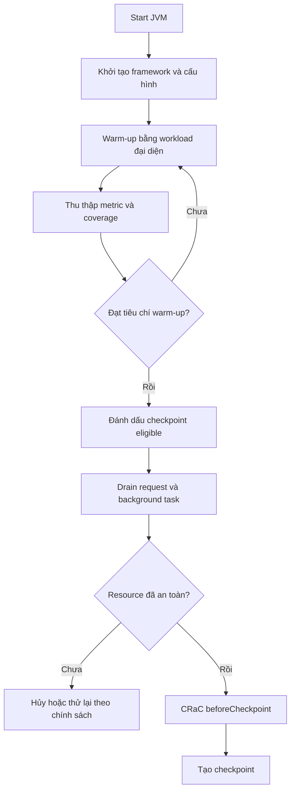
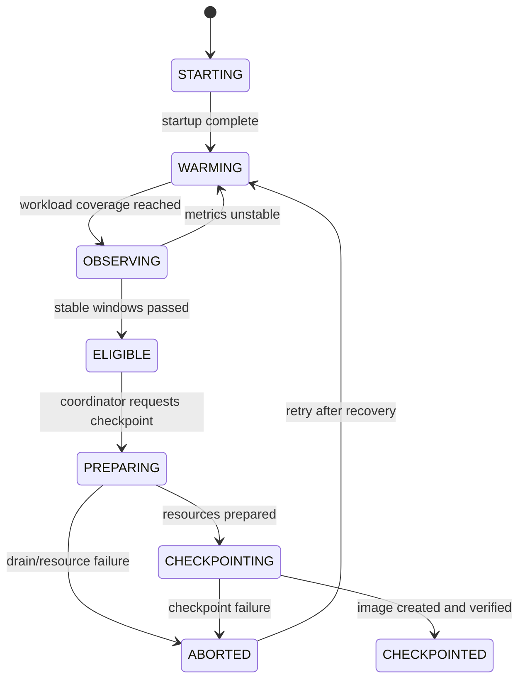

# Chọn thời điểm checkpoint dựa trên tiêu chí có thể quan sát

Trong CRaC (Coordinated Restore at Checkpoint), ứng dụng thường được khởi chạy trước, thực hiện các bước khởi tạo và làm nóng JVM, sau đó mới tạo checkpoint. Ảnh checkpoint có thể giữ lại nhiều trạng thái đã chuẩn bị như class đã nạp, framework context, cấu trúc dữ liệu và một phần mã đã được JIT biên dịch. Khi restore, ứng dụng có thể tiếp tục từ trạng thái đã chuẩn bị đó và giảm đáng kể công việc khởi động.

Thời điểm tạo checkpoint ảnh hưởng trực tiếp đến lợi ích đạt được. Nếu checkpoint quá sớm, các đường xử lý quan trọng chưa được làm nóng, cache chưa sẵn sàng hoặc framework còn đang khởi tạo. Nếu checkpoint quá muộn, ứng dụng có thể đã tiêu tốn thêm CPU và bộ nhớ mà lợi ích tăng thêm rất nhỏ; cache hoặc credential cũng có thể trở nên cũ trong thời gian ảnh được lưu.

Vì vậy, nên quyết định thời điểm checkpoint bằng **các tiêu chí quan sát được**, chẳng hạn mức độ bao phủ đường xử lý, số lần thực thi đại diện, xu hướng biên dịch JIT, độ ổn định latency và throughput, hoạt động GC, trạng thái cache và khả năng chuẩn bị resource. Một khoảng thời gian cố định có thể dùng làm giới hạn hoặc fallback, nhưng không nên là bằng chứng duy nhất cho thấy JVM đã được làm nóng.

## 1. Warm-up và checkpoint eligibility là hai giai đoạn liên tiếp

Warm-up là quá trình chạy ứng dụng để chuẩn bị trạng thái runtime. Checkpoint eligibility là điều kiện cho biết ứng dụng đã đạt mức chuẩn bị mong muốn và có thể bắt đầu quy trình tạo ảnh.

Hai khái niệm này có liên quan nhưng khác nhau:

| Giai đoạn | Mục tiêu | Bằng chứng cần quan sát |
| --- | --- | --- |
| Khởi tạo | Nạp class, tạo framework context, đọc cấu hình và dựng cấu trúc dữ liệu | Các thành phần bắt buộc đã khởi tạo; không còn lỗi startup |
| Warm-up | Chạy các đường xử lý đại diện để JVM và cache tích lũy trạng thái hữu ích | Route/operation coverage, số lần gọi, compilation activity, latency và throughput |
| Ổn định | Xác nhận các chỉ số đã đạt mục tiêu và không còn biến động lớn | Nhiều cửa sổ đo liên tiếp đạt ngưỡng; lỗi và GC nằm trong giới hạn |
| Chuẩn bị checkpoint | Đưa ứng dụng về trạng thái an toàn để ghi ảnh | Không còn request/task cần drain; resource callback chuẩn bị thành công |
| Tạo checkpoint | JVM phối hợp với cơ chế checkpoint của hệ điều hành để ghi trạng thái tiến trình | Lệnh checkpoint hoàn tất và artifact được tạo thành công |

Ứng dụng có thể đã warm-up tốt nhưng chưa đủ điều kiện checkpoint vì vẫn còn request đang chạy hoặc resource không thể đóng. Ngược lại, một tiến trình có thể không còn request nào nhưng chưa được warm-up đủ. Cần thỏa mãn cả hai nhóm điều kiện trước khi xem checkpoint là thành công.



## 2. Xác định mục tiêu warm-up trước khi đo

Không có một ngưỡng warm-up đúng cho mọi ứng dụng. Trước khi chọn thời điểm checkpoint, cần xác định trạng thái nào thực sự giúp giảm thời gian đưa instance vào phục vụ.

### 2.1. Xác định các đường xử lý quan trọng

Lập danh sách các operation hoặc route quan trọng, ví dụ:

- API đọc dữ liệu phổ biến nhất.
- API ghi hoặc xử lý transaction thường gặp.
- Luồng xác thực và phân quyền.
- Luồng serialize/deserialize payload.
- Truy vấn database hoặc thao tác cache thường xuyên.
- Các nhánh nghiệp vụ có logic phức tạp hoặc được gọi nhiều.
- Các tác vụ nền cần sẵn sàng ngay sau khi restore.

Không cần làm nóng mọi method trong ứng dụng. Mục tiêu là bao phủ những đường chạy có ảnh hưởng đáng kể đến thời gian khởi động và hiệu năng ban đầu. Một endpoint ít dùng nhưng rất quan trọng về nghiệp vụ có thể cần được đưa vào workload warm-up dù tỷ lệ request thực tế thấp.

Nên mô tả mỗi operation bằng tên ổn định, trọng số và mức gọi mục tiêu. Ví dụ:

| Operation | Trọng số | Warm-up cần xác nhận |
| --- | ---: | --- |
| `GET /catalog` | Cao | Nạp mapping, serializer và cache danh mục |
| `GET /account/{id}` | Cao | Nạp repository, query path và authorization logic |
| `POST /orders` | Cao | Chuẩn bị validation và đường xử lý nghiệp vụ; chỉ dùng dữ liệu thử an toàn |
| `GET /reports/{id}` | Trung bình | Nạp parser và template báo cáo |
| Job tổng hợp nền | Theo yêu cầu | Chuẩn bị code path, không tạo side effect nghiệp vụ thật |

Các tên route chỉ là ví dụ. Với ứng dụng không phải HTTP server, có thể dùng tên message handler, service operation hoặc loại job.

### 2.2. Dùng workload đại diện

Warm-up cần chạy qua đường xử lý thật ở mức đủ đại diện. Chỉ gọi một health endpoint thường không làm nóng các controller, serializer, repository, query hoặc nhánh nghiệp vụ khác.

Workload nên phản ánh:

- Phân bố kích thước payload.
- Các nhánh điều kiện thường gặp.
- Loại dữ liệu và kiểu object thực tế.
- Cấu trúc truy vấn và mapping.
- Tỷ lệ đọc/ghi gần với hoạt động dự kiến.
- Các đường xử lý đồng bộ và bất đồng bộ cần thiết.

Nếu workload chỉ gọi một method với một loại dữ liệu, JIT có thể tối ưu cho trường hợp đó nhưng chưa chắc phản ánh các kiểu dữ liệu hoặc nhánh chạy khác. Cần chọn dữ liệu đại diện đủ rộng mà vẫn kiểm soát được chi phí.

### 2.3. Tránh tạo side effect nghiệp vụ thật

Warm-up không nên tạo đơn hàng thật, gửi email, trừ tiền, publish message thật hoặc cập nhật dữ liệu dùng chung chỉ để làm nóng code path. Có thể dùng:

- Dataset thử nghiệm được cô lập.
- Request chỉ đọc.
- Stub hoặc sandbox cho dịch vụ ngoài.
- Transaction được rollback có kiểm soát nếu phù hợp với hệ thống.
- Chế độ dry-run được thiết kế riêng cho warm-up.

Không nên giả định rằng gọi một API rồi rollback database sẽ hoàn tác mọi side effect. Một request có thể đã gửi message, gọi dịch vụ ngoài hoặc kích hoạt workflow trước khi transaction rollback. Warm-up cần có hợp đồng dữ liệu và side effect rõ ràng.

## 3. Các tín hiệu quan sát được để quyết định thời điểm

Không nên dùng một metric đơn lẻ. Hãy kết hợp các tín hiệu phản ánh mức độ khởi tạo, JIT, hiệu năng và trạng thái tài nguyên.

### 3.1. Mức độ hoàn thành khởi tạo

Các tín hiệu cơ bản:

- Startup lifecycle của framework đã hoàn tất.
- Các bean/service bắt buộc đã được tạo.
- Class cần thiết đã được nạp.
- Cấu hình và schema đã được phân tích.
- Cache khởi tạo quan trọng đã được nạp.
- Các dependency cần thiết cho warm-up đã kết nối hoặc có mock/sandbox phù hợp.

Có thể theo dõi số class đang loaded và xu hướng class loading. Java cung cấp `ClassLoadingMXBean` qua `ManagementFactory`:

```java
import java.lang.management.ClassLoadingMXBean;
import java.lang.management.ManagementFactory;

ClassLoadingMXBean classLoading =
        ManagementFactory.getClassLoadingMXBean();

int currentlyLoaded = classLoading.getLoadedClassCount();
long totalLoaded = classLoading.getTotalLoadedClassCount();
long unloaded = classLoading.getUnloadedClassCount();
```

`getLoadedClassCount()` là số class hiện đang được nạp; `getTotalLoadedClassCount()` và `getUnloadedClassCount()` là các bộ đếm tích lũy. Khi các giá trị này thay đổi chậm lại, đó có thể là tín hiệu ứng dụng đã đi qua phần lớn đường khởi tạo dự kiến. Tuy nhiên, class loading ổn định không chứng minh JIT đã tối ưu các method quan trọng hoặc cache đã đầy đủ.

### 3.2. Hoạt động biên dịch JIT

JIT compiler biên dịch các method được thực thi đủ thường xuyên hoặc có đặc điểm phù hợp với chính sách tối ưu của JVM. Vì vậy, warm-up nên gọi các đường xử lý quan trọng nhiều lần với dữ liệu đại diện.

Có thể quan sát một số tín hiệu:

- Tổng thời gian biên dịch của JVM.
- Sự kiện compilation trong Java Flight Recorder (JFR), nếu được bật.
- Hàng đợi biên dịch hoặc code cache qua công cụ chẩn đoán của bản JDK đang dùng.
- CPU tiêu thụ bởi compiler thread trong giai đoạn warm-up.
- Sự thay đổi latency của cùng một workload qua các cửa sổ đo.

Java cung cấp `CompilationMXBean`:

```java
import java.lang.management.CompilationMXBean;
import java.lang.management.ManagementFactory;

CompilationMXBean compilation =
        ManagementFactory.getCompilationMXBean();

if (compilation != null && compilation.isCompilationTimeMonitoringSupported()) {
    long totalCompilationMillis = compilation.getTotalCompilationTime();
    System.out.println("JIT compilation time: "
            + totalCompilationMillis + " ms");
}
```

`getTotalCompilationTime()` là tổng thời gian biên dịch tích lũy mà JVM báo cáo, không phải số method đã được tối ưu và cũng không phải chỉ báo trực tiếp rằng JIT đã hoàn tất. Có thể lấy hai snapshot cách nhau một khoảng thời gian để quan sát delta. Nếu delta giảm trong khi workload vẫn được thực thi, đó có thể là dấu hiệu hoạt động biên dịch đang ổn định.

Không nên yêu cầu delta compilation bằng 0 trong mọi cửa sổ. Khi workload tiếp tục gọi code path mới, JVM vẫn có thể biên dịch thêm. Ngược lại, delta bằng 0 vì workload không chạy cũng không chứng minh warm-up đã đạt mục tiêu.

Với HotSpot, một số bản JDK cung cấp lệnh chẩn đoán qua `jcmd`, chẳng hạn lệnh liên quan tới compiler queue hoặc code cache. Tên và khả năng hỗ trợ phụ thuộc bản JDK, nên cần xem `jcmd <pid> help` và tài liệu của runtime cụ thể. JFR có thể giúp xác định method nào được biên dịch và thời điểm compilation xảy ra, nhưng việc bật ghi sự kiện cũng có chi phí quan sát cần được tính đến.

### 3.3. Latency và throughput

Đây là nhóm tín hiệu gần với trải nghiệm phục vụ thực tế.

Theo dõi:

- Throughput: số request hoặc operation hoàn tất mỗi giây.
- p50, p95 và p99 latency.
- Error rate và timeout rate.
- Queue time nếu request phải chờ executor hoặc connection pool.
- Thời gian xử lý theo route hoặc operation.

Warm-up có thể được xem là ổn định khi cùng một workload đạt latency và throughput mục tiêu qua nhiều cửa sổ liên tiếp. Một mẫu đo ngắn có thể bị nhiễu do GC, CPU scheduling hoặc network jitter; vì vậy không nên tạo checkpoint ngay khi một cửa sổ duy nhất đạt ngưỡng.

Ví dụ tiêu chí minh họa:

| Chỉ số | Điều kiện ví dụ |
| --- | --- |
| p95 latency | Nằm trong ngân sách latency đã định cho workload warm-up |
| Throughput | Đạt tỷ lệ mục tiêu so với baseline trên cùng loại máy |
| Error rate | Không vượt ngưỡng lỗi cho phép |
| Độ ổn định | Các cửa sổ liên tiếp không có xu hướng xấu đi đáng kể |

Không sao chép một ngưỡng latency hoặc throughput cố định từ ứng dụng khác. Baseline phải được đo trên cấu hình CPU, memory, JDK, container limit và workload tương ứng với môi trường tạo checkpoint.

### 3.4. CPU và tải của compiler

Warm-up thường tiêu thụ CPU do class loading, JIT compilation, tạo cache và chạy workload. Nếu CPU vẫn cao vì compiler hoặc startup task, checkpoint ngay có thể lưu một tiến trình chưa ổn định và làm tăng thời gian cạnh tranh tài nguyên.

Theo dõi CPU process và CPU hệ thống trong cùng cửa sổ với latency. Khi workload đại diện vẫn chạy mà CPU và compilation activity đã ổn định, có thể xem đó là một tín hiệu tốt. Tuy nhiên, CPU thấp cũng có thể do workload không đủ tải hoặc thread đang bị block chờ dependency.

Nên kết hợp CPU với throughput, latency và số operation đã chạy. Nếu CPU cao nhưng throughput không tăng, hãy xác định đó là compilation, GC, contention hay một vòng lặp bất thường trước khi quyết định tiếp tục warm-up.

### 3.5. GC, heap và code cache

Theo dõi:

- Heap used và heap committed.
- Tần suất và thời gian GC.
- Allocation rate.
- Số lần GC và thời gian GC tích lũy.
- Mức sử dụng code cache nếu JVM cung cấp metric phù hợp.

Có thể lấy thông tin tổng quát về GC qua `GarbageCollectorMXBean`:

```java
import java.lang.management.GarbageCollectorMXBean;
import java.lang.management.ManagementFactory;

for (GarbageCollectorMXBean gc :
        ManagementFactory.getGarbageCollectorMXBeans()) {
    System.out.printf("%s: collections=%d, time=%d ms%n",
            gc.getName(),
            gc.getCollectionCount(),
            gc.getCollectionTime());
}
```

Các bộ đếm GC là tích lũy. Hãy so sánh delta giữa các cửa sổ thay vì chỉ nhìn tổng từ lúc JVM khởi động. Một lần GC bình thường không phải lý do để trì hoãn checkpoint; điều cần quan sát là xu hướng GC bất thường, pause vượt ngân sách hoặc heap tiếp tục tăng mà không ổn định.

Không nên cố ép full GC chỉ để làm heap nhỏ trước checkpoint. Việc gọi `System.gc()` có thể gây pause, không bảo đảm giải phóng mọi object và không phải tiêu chí chứng minh warm-up hoàn tất.

### 3.6. Cache và dependency readiness

Cache hit ratio, số entry đã nạp, thời gian truy vấn nguồn và trạng thái kết nối cũng là tín hiệu quan trọng. Một ứng dụng có latency thấp trong warm-up nhưng cache chính vẫn trống có thể chậm khi nhận request thật.

Theo dõi:

- Cache hit/miss ratio theo loại cache.
- Số entry hoặc partition đã nạp.
- Thời gian nạp cache và số lỗi refresh.
- Version hoặc timestamp của snapshot cache.
- Connection pool có đủ khả năng phục vụ warm-up không.
- Các dịch vụ bên ngoài có ổn định không.

Không phải cache nào cũng nên giữ qua checkpoint. Cache có TTL, credential hoặc dữ liệu cần freshness cao phải được kiểm tra hoặc refresh sau restore. Warm-up nên phân biệt cache có thể tái sử dụng với cache phải tạo lại theo instance.

## 4. Thiết kế bộ tiêu chí checkpoint

Một chính sách tốt nên có nhiều nhóm điều kiện. Có thể chia thành điều kiện bắt buộc và điều kiện chất lượng.

### 4.1. Điều kiện bắt buộc

Những điều kiện này phải đạt trước khi tạo checkpoint:

- Startup lifecycle hoàn tất.
- Các operation bắt buộc đã được warm-up đủ số lần hoặc đủ coverage.
- Không có lỗi khởi tạo hoặc lỗi warm-up chưa được xử lý.
- Workload warm-up đã kết thúc hoặc được dừng tại ranh giới an toàn.
- Không còn task/request cần drain khi bắt đầu checkpoint.
- Các resource đã đăng ký có thể hoàn tất callback `beforeCheckpoint`.
- Môi trường và thư mục checkpoint sẵn sàng.

Nếu một điều kiện bắt buộc không đạt, không nên đánh dấu checkpoint eligible chỉ vì thời gian warm-up đã đủ.

### 4.2. Điều kiện chất lượng

Các điều kiện này đánh giá mức độ warm-up:

- Coverage của route/operation đạt mục tiêu.
- Số lần gọi các method quan trọng đạt mức đại diện.
- Latency và throughput ổn định qua nhiều cửa sổ đo.
- Compilation activity có xu hướng giảm hoặc đạt trạng thái dự kiến.
- Class loading và cache initialization đã ổn định.
- CPU, allocation và GC không có xu hướng bất thường.
- Không có error rate hoặc timeout vượt ngưỡng.

Điều kiện chất lượng có thể được đánh trọng số theo mục tiêu của ứng dụng. Ví dụ, một dịch vụ thiên về CPU có thể chú trọng JIT và throughput; một dịch vụ thiên về truy vấn dữ liệu có thể chú trọng cache, connection setup và latency.

### 4.3. Dùng cửa sổ quan sát liên tiếp

Không nên kích hoạt checkpoint dựa trên một snapshot. Hãy chia thời gian warm-up thành các cửa sổ, chẳng hạn mỗi cửa sổ 30 giây hoặc 1 phút tùy tốc độ và đặc điểm ứng dụng. Trong mỗi cửa sổ, tính:

- số operation hoàn tất;
- coverage tích lũy;
- p95 latency;
- throughput;
- error rate;
- delta compilation time;
- delta class loading;
- delta GC count/time;
- heap và code cache usage nếu có.

Chỉ đánh dấu ổn định khi nhiều cửa sổ liên tiếp đạt tiêu chí. Điều này giúp tránh việc một đợt tải ngắn hoặc một khoảng không có traffic tạo ra kết luận sai.

Ví dụ, có thể yêu cầu 5 cửa sổ liên tiếp đạt mục tiêu latency, throughput và error rate, đồng thời coverage bắt buộc đã đủ. Con số 5 chỉ là ví dụ; số cửa sổ và độ dài cửa sổ cần được hiệu chỉnh bằng dữ liệu của ứng dụng.

## 5. Xây dựng warm-up workload có thể quan sát

Warm-up workload cần có danh sách operation và cách ghi nhận kết quả. Có thể dùng một runner nội bộ hoặc công cụ bên ngoài để gửi request tới instance chưa nhận traffic người dùng.

Một workload tốt cần:

1. Gọi các operation quan trọng theo phân bố đã định.
2. Dùng payload đại diện về kích thước và cấu trúc.
3. Có đủ số lần lặp để kích hoạt các đường code cần làm nóng.
4. Đo thời gian xử lý và tỷ lệ lỗi.
5. Ghi lại operation nào đã được chạy và số lần hoàn tất.
6. Có thể dừng tại ranh giới an toàn khi đã đạt tiêu chí hoặc hết deadline.

Ví dụ cấu hình workload:

```yaml
warmup:
  deadline: 8m
  observationWindow: 30s
  stableWindowsRequired: 5
  operations:
    - name: catalog-read
      weight: 40
      minimumExecutions: 500
    - name: account-read
      weight: 30
      minimumExecutions: 300
    - name: order-validation
      weight: 20
      minimumExecutions: 200
    - name: report-render
      weight: 10
      minimumExecutions: 100
  thresholds:
    maxErrorRate: 0.001
    maxP95LatencyMillis: 150
    minimumThroughputPerSecond: 100
```

Các con số trong ví dụ chỉ để minh họa cấu trúc cấu hình. Mỗi hệ thống phải xác định ngưỡng từ SLA, baseline, phần cứng và workload thực tế. Đừng dùng các giá trị này như mặc định cho mọi ứng dụng.

### 5.1. Coverage phải có ý nghĩa

Coverage không chỉ là tổng số request. Nếu một endpoint được gọi 10.000 lần nhưng các endpoint khác chưa từng chạy, tổng số request lớn vẫn không thể hiện warm-up toàn ứng dụng.

Có thể tính coverage theo operation:

\[
\text{Coverage} =
\frac{\text{Số operation bắt buộc đạt mức gọi tối thiểu}}
{\text{Tổng số operation bắt buộc}} \times 100\%
\]

Nếu operation có trọng số khác nhau, có thể tính weighted coverage:

\[
\text{Weighted Coverage} =
\frac{\sum_{i \in \text{đạt}} w_i}
{\sum_{i \in \text{bắt buộc}} w_i} \times 100\%
\]

Weighted coverage giúp phản ánh mức độ quan trọng của operation, nhưng không nên cho phép một operation trọng số cao che lấp một operation bắt buộc chưa chạy. Những operation critical vẫn cần điều kiện riêng.

### 5.2. Workload warm-up và workload đo hiệu năng

Hai workload này có mục đích khác nhau:

- Warm-up workload nhằm đưa JVM và ứng dụng qua các đường khởi tạo, JIT và cache cần thiết.
- Performance workload nhằm đo hiệu năng dưới tải xác định và so sánh với baseline.

Có thể dùng cùng một bộ operation nhưng cần tách giai đoạn. Khi đo performance, cần kiểm soát concurrency, dữ liệu, thời gian đo và môi trường. Nếu vừa warm-up vừa lấy kết quả benchmark, số đo có thể bị ảnh hưởng bởi compilation và cache chưa ổn định.

JMH phù hợp để benchmark method hoặc component trong môi trường benchmark riêng, nhưng kết quả JMH không tự chứng minh toàn bộ ứng dụng đã warm-up. Cần quan sát đường chạy của ứng dụng thực tế, framework, serialization, dependency và network stack.

## 6. Xây dựng WarmupDecision bằng Java

Có thể đóng gói các số đo của mỗi cửa sổ thành một object và dùng policy để quyết định đã đủ điều kiện hay chưa. Ví dụ dưới đây tập trung vào logic quyết định; cách thu thập metric và lưu cửa sổ phụ thuộc hệ thống telemetry của ứng dụng.

```java
import java.util.Map;

public record WarmupWindow(
        Map<String, Long> operationCounts,
        double p95LatencyMillis,
        double throughputPerSecond,
        double errorRate,
        double compilationTimeDeltaMillis,
        long loadedClassDelta,
        long gcCountDelta,
        double heapUsedRatio) {
}
```

Policy:

```java
import java.util.List;
import java.util.Map;

public final class WarmupPolicy {

    private final Map<String, Long> minimumExecutions;
    private final double maxP95Millis;
    private final double minThroughput;
    private final double maxErrorRate;
    private final int stableWindowsRequired;

    public WarmupPolicy(
            Map<String, Long> minimumExecutions,
            double maxP95Millis,
            double minThroughput,
            double maxErrorRate,
            int stableWindowsRequired) {
        this.minimumExecutions = Map.copyOf(minimumExecutions);
        this.maxP95Millis = maxP95Millis;
        this.minThroughput = minThroughput;
        this.maxErrorRate = maxErrorRate;
        this.stableWindowsRequired = stableWindowsRequired;
    }

    public boolean coverageComplete(Map<String, Long> totals) {
        return minimumExecutions.entrySet().stream().allMatch(entry ->
                totals.getOrDefault(entry.getKey(), 0L) >= entry.getValue());
    }

    public boolean windowIsStable(WarmupWindow window) {
        return window.p95LatencyMillis() <= maxP95Millis
                && window.throughputPerSecond() >= minThroughput
                && window.errorRate() <= maxErrorRate;
    }

    public boolean ready(
            Map<String, Long> totals,
            List<WarmupWindow> recentWindows) {
        if (!coverageComplete(totals)
                || recentWindows.size() < stableWindowsRequired) {
            return false;
        }

        return recentWindows.stream().allMatch(this::windowIsStable);
    }
}
```

Đoạn code minh họa một policy cơ bản. Trong hệ thống thật, nên bổ sung:

- Kiểm tra các operation critical riêng biệt.
- Kiểm tra dữ liệu metric không bị thiếu hoặc stale.
- Giới hạn heap, GC pause, CPU và code cache theo baseline.
- Kiểm tra compilation trend thay vì chỉ lưu delta.
- Kiểm tra startup error, dependency error và cache freshness.
- Yêu cầu cửa sổ đo có đủ số request để percentile có ý nghĩa.
- Ghi lại lý do policy chưa đạt để vận hành biết cần warm-up thêm phần nào.

Không nên dùng `heapUsedRatio` hoặc `compilationTimeDeltaMillis` như một ngưỡng độc lập. Chúng cần được diễn giải cùng workload và các chỉ số khác. Ví dụ, compilation delta cao trong lúc latency đang giảm có thể là dấu hiệu JVM vẫn đang tối ưu; compilation delta bằng 0 trong lúc throughput cũng bằng 0 thì không có ý nghĩa.

## 7. Theo dõi các metric bằng JMX và JFR

Java Management Extensions (JMX) cung cấp một số MXBean có sẵn để lấy trạng thái JVM. Chúng hữu ích cho việc quan sát xu hướng, nhưng không cung cấp mọi metric cần thiết cho warm-up policy.

| MXBean | Thông tin có thể quan sát |
| --- | --- |
| `ClassLoadingMXBean` | Số class đang loaded, tổng class đã loaded và class đã unloaded |
| `CompilationMXBean` | Tổng thời gian compilation nếu JVM hỗ trợ theo dõi |
| `MemoryMXBean` | Heap và non-heap memory usage |
| `GarbageCollectorMXBean` | Số lần GC và thời gian GC tích lũy |
| `ThreadMXBean` | Số thread, peak thread và thông tin thread contention nếu được hỗ trợ |
| `OperatingSystemMXBean` | Thông tin CPU và hệ điều hành; một số metric process-specific phụ thuộc implementation |

JFR bổ sung góc nhìn theo sự kiện như compilation, GC, allocation, thread scheduling và các điểm nóng runtime. Có thể dùng JFR trong giai đoạn thử nghiệm để xác định phần nào còn đang hoạt động mạnh. Khi triển khai, cần chọn cấu hình event và thời gian ghi phù hợp vì việc thu thập telemetry cũng tiêu thụ tài nguyên.

### 7.1. So sánh snapshot thay vì nhìn số tích lũy

Nhiều MXBean trả về bộ đếm tích lũy từ lúc JVM khởi động. Ví dụ, tổng compilation time và GC time tăng theo thời gian. Hãy lấy hai snapshot:

\[
\Delta M = M(t_2) - M(t_1)
\]

với cùng một khoảng thời gian quan sát. Delta giúp biết hoạt động đang diễn ra trong cửa sổ hiện tại. Cần xử lý trường hợp counter reset, JVM restart hoặc metric không được hỗ trợ.

### 7.2. Metric ứng dụng thường quan trọng hơn metric JVM đơn lẻ

JVM có thể ổn định nhưng ứng dụng vẫn chưa warm-up nếu cache nghiệp vụ chưa được nạp hoặc một route quan trọng chưa chạy. Ngược lại, compilation vẫn có thể diễn ra ở mức nhỏ trong khi latency và throughput đã đạt mục tiêu.

Vì vậy, cần kết hợp metric JVM với metric ứng dụng: route coverage, operation count, cache hit ratio, connection pool state, error rate và latency.

## 8. Chọn thời điểm: quá sớm, phù hợp và quá muộn

### 8.1. Checkpoint quá sớm

Dấu hiệu thường gặp:

- Framework startup vừa hoàn tất nhưng workload đại diện chưa chạy.
- Nhiều class quan trọng vẫn được nạp trong các request đầu tiên.
- Compilation activity còn cao và latency giảm rõ qua từng cửa sổ.
- Cache quan trọng chưa được nạp.
- Các route hoặc job quan trọng chưa đạt số lần thực thi tối thiểu.
- Request đầu tiên sau restore vẫn phải thực hiện nhiều công việc khởi tạo.

Ảnh tạo quá sớm có thể vẫn restore thành công về mặt kỹ thuật nhưng lợi ích warm-up không đạt như mong muốn.

### 8.2. Checkpoint ở thời điểm phù hợp

Dấu hiệu:

- Các operation quan trọng đã được chạy bằng workload đại diện.
- Class loading và các bước startup chính đã ổn định.
- Latency và throughput đạt mục tiêu qua nhiều cửa sổ liên tiếp.
- Compilation activity có xu hướng ổn định phù hợp với workload.
- Cache cần tái sử dụng đã được chuẩn bị và có version/freshness rõ ràng.
- CPU, heap và GC nằm trong giới hạn dự kiến.
- Không còn lỗi hoặc task warm-up chưa được xử lý.
- Quy trình resource có thể drain và đóng tài nguyên an toàn.

Đây là thời điểm hợp lý để chuyển từ warm-up sang checkpoint preparation.

### 8.3. Checkpoint quá muộn

Dấu hiệu:

- Thêm workload không còn cải thiện đáng kể latency hoặc throughput.
- CPU và thời gian warm-up tiếp tục tiêu tốn nhưng metric đã đi ngang.
- Heap tăng do cache hoặc dữ liệu tạm không cần thiết.
- Cache có nguy cơ stale hoặc credential sắp hết hạn.
- Background task và timer đã chạy lâu, làm tăng trạng thái phải drain.
- Thời gian tạo checkpoint và kích thước ảnh tăng mà lợi ích restore không tương xứng.

Checkpoint muộn không nhất thiết sai. Nếu warm-up thêm vẫn cải thiện các đường quan trọng, tiếp tục có thể có lợi. Nhưng cần đo marginal benefit: phần lợi ích tăng thêm sau mỗi cửa sổ so với chi phí CPU, memory, thời gian và độ mới của dữ liệu.

## 9. Cân bằng lợi ích warm-up và chi phí checkpoint

Chọn thời điểm không chỉ dựa trên việc JVM đã warm-up bao nhiêu, mà còn dựa trên hiệu quả vận hành tổng thể.

Một số đại lượng nên đo:

- `T_startup`: thời gian khởi chạy và khởi tạo bình thường.
- `T_warmup`: thời gian chuẩn bị workload trước checkpoint.
- `T_checkpoint`: thời gian tạo ảnh.
- `T_restore`: thời gian restore tiến trình.
- `T_afterRestore`: thời gian callback và kết nối lại resource.
- `T_readiness`: thời gian từ restore đến khi instance có thể nhận traffic.
- `S_checkpoint`: kích thước artifact checkpoint.

Thời gian đưa instance vào phục vụ sau restore nên được đo từ lúc bắt đầu restore tới readiness, không chỉ đo thời gian JVM dựng lại process.

Ví dụ bảng so sánh các thời điểm checkpoint:

| Thời điểm | Warm-up coverage | p95 sau restore | Restore-to-ready | Kích thước ảnh |
| --- | ---: | ---: | ---: | ---: |
| A – sớm | 55% | 240 ms | 0,8 s | 420 MB |
| B – vừa | 92% | 125 ms | 1,0 s | 470 MB |
| C – muộn | 96% | 120 ms | 1,4 s | 610 MB |

Các số liệu trên hoàn toàn giả định để minh họa cách so sánh. Điểm B có thể là lựa chọn tốt hơn C nếu mức cải thiện p95 rất nhỏ nhưng chi phí checkpoint, kích thước ảnh và thời gian chuẩn bị tăng đáng kể. Nếu SLA đòi hỏi p95 thấp hơn 120 ms, kết quả có thể dẫn tới lựa chọn khác.

Nên so sánh nhiều lần trên cùng cấu hình phần cứng và cùng workload. Một lần chạy đơn lẻ có thể bị ảnh hưởng bởi CPU contention, GC hoặc biến động dịch vụ ngoài.

## 10. State machine cho quyết định checkpoint

Một coordinator có thể dùng các trạng thái:

| Trạng thái | Mô tả |
| --- | --- |
| `STARTING` | JVM và framework đang khởi tạo |
| `WARMING` | Đang chạy workload warm-up |
| `OBSERVING` | Đang thu thập cửa sổ metric để xác nhận ổn định |
| `ELIGIBLE` | Đạt các tiêu chí warm-up và được phép yêu cầu checkpoint |
| `PREPARING` | Drain request/task và gọi resource callback |
| `CHECKPOINTING` | JVM và cơ chế hệ điều hành đang tạo ảnh |
| `CHECKPOINTED` | Ảnh đã được tạo thành công và xác nhận |
| `ABORTED` | Không đạt tiêu chí hoặc chuẩn bị thất bại; cần xử lý/retry |



`ELIGIBLE` chỉ là quyết định từ warm-up policy. Nó chưa có nghĩa checkpoint đã thành công. Chỉ khi resource preparation và thao tác tạo ảnh hoàn tất mới chuyển sang `CHECKPOINTED`.

## 11. Ví dụ coordinator theo dõi tiêu chí warm-up

Ví dụ sau minh họa cách một coordinator kiểm tra coverage và các cửa sổ ổn định trước khi cho phép checkpoint. Các interface `WarmupMetrics` và `CheckpointRequester` là API nội bộ của ứng dụng.

```java
import java.time.Duration;
import java.util.List;
import java.util.Map;

public final class CheckpointEligibility {

    public interface WarmupMetrics {
        Map<String, Long> operationTotals();
        List<WarmupWindow> recentWindows();
        boolean startupComplete();
        boolean requiredCachesReady();
        boolean noWarmupErrors();
    }

    public interface CheckpointRequester {
        void requestCheckpoint() throws Exception;
    }

    private final WarmupPolicy policy;
    private final WarmupMetrics metrics;
    private final CheckpointRequester requester;

    public CheckpointEligibility(
            WarmupPolicy policy,
            WarmupMetrics metrics,
            CheckpointRequester requester) {
        this.policy = policy;
        this.metrics = metrics;
        this.requester = requester;
    }

    public boolean isEligible() {
        return metrics.startupComplete()
                && metrics.requiredCachesReady()
                && metrics.noWarmupErrors()
                && policy.ready(
                        metrics.operationTotals(),
                        metrics.recentWindows());
    }

    public void checkpointIfEligible() throws Exception {
        if (!isEligible()) {
            throw new IllegalStateException(
                    "Warm-up criteria have not been met");
        }

        requester.requestCheckpoint();
    }
}
```

Coordinator không tự thực hiện `beforeCheckpoint` hoặc gọi `Core.checkpointRestore()` trong ví dụ. Nó chỉ quyết định khi nào được phép yêu cầu checkpoint. Cách gửi yêu cầu phụ thuộc JDK CRaC và nền tảng triển khai. Khi yêu cầu được gửi, JVM sẽ điều phối resource theo API CRaC.

Trong production, cần bảo đảm `checkpointIfEligible()` chỉ được gọi một lần cho mỗi chu kỳ, tránh nhiều thread cùng gửi yêu cầu checkpoint. Có thể dùng state machine hoặc atomic transition từ `ELIGIBLE` sang `PREPARING` để bảo vệ thao tác này.

## 12. Warm-up và resource callback cần phối hợp thế nào?

Warm-up thường cần truy cập database, cache, broker hoặc service bên ngoài. Nhưng các kết nối này có thể không nên được giữ trong checkpoint. Vì vậy, cần tách giai đoạn warm-up khỏi giai đoạn resource preparation.

Trình tự thường dùng:

1. Khởi tạo ứng dụng và các resource cần thiết.
2. Chạy workload warm-up qua các resource đó.
3. Đo metric và xác nhận các tiêu chí ổn định.
4. Ngừng workload warm-up và drain các task/request còn lại.
5. Gọi `beforeCheckpoint` để đóng connection pool, socket hoặc resource phụ thuộc môi trường.
6. Tạo checkpoint.
7. Sau restore, gọi `afterRestore` để tạo lại resource và xác minh kết nối.
8. Chỉ mở readiness khi ứng dụng sẵn sàng phục vụ.

Không nên đóng connection pool trước warm-up nếu workload cần truy vấn database. Cũng không nên tạo checkpoint trong lúc warm-up request vẫn còn chạy và sử dụng pool.

### 12.1. Cache có thể tái sử dụng và cache cần refresh

Nếu warm-up tạo cache bất biến hoặc có version, cache có thể được giữ trong ảnh để giảm chi phí khởi tạo. Nếu cache chứa dữ liệu có TTL ngắn hoặc phụ thuộc môi trường, cần kiểm tra freshness sau restore.

Một cache có thể có trạng thái:

- `WARMED`: đã nạp và đủ dữ liệu trước checkpoint.
- `VALID`: version/TTL vẫn hợp lệ sau restore.
- `STALE`: cần refresh trước khi phục vụ.
- `REFRESHING`: đang nạp lại.
- `READY`: đã xác minh và có thể sử dụng.

Warm-up policy không nên chỉ kiểm tra cache đã có entry. Nó cần kiểm tra cache đạt mức cần thiết và có thể được tái sử dụng theo thời gian ảnh sẽ được lưu.

### 12.2. Resource callback không thay thế warm-up policy

`beforeCheckpoint` được dùng để đưa resource về trạng thái an toàn. Nó không biết workload đã đủ đại diện hay JIT đã đạt mục tiêu. `afterRestore` dùng để phục hồi resource. Nó không chứng minh ứng dụng đã được warm-up đúng.

Do đó, hãy giữ warm-up policy ở một thành phần riêng và dùng CRaC resource để quản lý vòng đời các tài nguyên.

## 13. Giới hạn thời gian và điều kiện fallback

Warm-up không nên chạy vô thời hạn. Cần có deadline tối đa và hành vi khi không đạt tiêu chí.

| Tình huống | Hành động |
| --- | --- |
| Đạt tiêu chí trước deadline | Chuyển sang `ELIGIBLE` và bắt đầu chuẩn bị checkpoint |
| Coverage thiếu nhưng deadline còn | Tiếp tục workload cho operation còn thiếu |
| Latency chưa ổn định | Tiếp tục quan sát hoặc tìm nguyên nhân CPU/GC/dependency |
| Compilation vẫn cao và latency còn cải thiện | Có thể tiếp tục warm-up trong giới hạn ngân sách |
| Error rate vượt ngưỡng | Dừng warm-up, điều tra lỗi; không tạo checkpoint từ trạng thái lỗi |
| Cache hoặc dependency không sẵn sàng | Retry theo chính sách hoặc hủy lần chuẩn bị |
| Hết deadline mà chưa đạt | Báo không đủ điều kiện; không tự đánh dấu eligible |
| Resource callback thất bại | Hủy checkpoint và phục hồi trạng thái hiện tại theo lifecycle manager |

Có thể có một chính sách fallback tạo checkpoint ở mức warm-up tối thiểu nếu mục tiêu vận hành cho phép, nhưng phải ghi rõ mức coverage và rủi ro hiệu năng sau restore. Không nên đánh dấu fallback là tương đương với checkpoint đã đạt đầy đủ tiêu chí.

## 14. Các lỗi thường gặp khi chọn thời điểm checkpoint

| Lỗi | Hệ quả | Cách xử lý |
| --- | --- | --- |
| Chỉ đợi một số phút cố định | JVM có thể chưa chạy đủ code path hoặc đã warm-up dư thừa | Dùng metric và coverage kết hợp deadline |
| Chỉ kiểm tra startup complete | Framework sẵn sàng nhưng JIT/cache chưa đủ | Chạy workload đại diện và đo ổn định |
| Chỉ nhìn tổng request | Một route có thể chiếm gần toàn bộ workload | Theo dõi coverage theo operation |
| Coi compilation time bằng 0 là hoàn tất | Có thể workload không chạy hoặc metric không hỗ trợ | Kết hợp JIT, throughput, latency và workload count |
| Chỉ nhìn p50 latency | Tail latency có thể vẫn cao | Theo dõi p95/p99 và error rate |
| Không đo GC/heap | Ảnh có thể chứa heap tăng bất thường hoặc trạng thái GC không ổn định | Theo dõi delta GC và heap trend |
| Warm-up bằng dữ liệu thật | Có thể tạo side effect ngoài ý muốn | Dùng dữ liệu thử và sandbox |
| Checkpoint khi warm-up task còn chạy | Resource bị truy cập trong lúc đóng | Drain workload trước callback |
| Cố ép full GC trước checkpoint | Pause lớn mà không bảo đảm lợi ích | Đo GC tự nhiên và tối ưu nguyên nhân giữ object |
| Không kiểm tra cache freshness | Restore instance có thể dùng dữ liệu stale | Version/TTL check sau restore |
| Chỉ đo thời gian JVM restore | Bỏ qua callback, kết nối và readiness | Đo restore-to-ready end-to-end |
| Dùng cùng ngưỡng cho mọi máy | Kết quả sai lệch theo CPU, memory và JDK | Hiệu chỉnh theo môi trường triển khai |

## 15. Biên bản đo và so sánh các lần checkpoint

Để lựa chọn ngưỡng có cơ sở, hãy lưu biên bản cho mỗi lần thử:

| Nhóm | Thông tin cần ghi |
| --- | --- |
| Runtime | JDK vendor/version, JVM flags, CRaC support, OS/kernel, kiến trúc CPU |
| Hạ tầng | CPU/memory limit, container image, storage và cấu hình mạng |
| Workload | Phiên bản workload, operation coverage, số lần gọi, concurrency và dataset |
| JIT | Compilation time delta, event JFR liên quan, code cache nếu có |
| Class loading | Loaded class, total loaded, unloaded và delta theo cửa sổ |
| Hiệu năng | Throughput, p50/p95/p99, error rate và timeout |
| Bộ nhớ | Heap used, allocation rate, GC count/time, code cache |
| Cache | Hit ratio, số entry, version và thời điểm refresh |
| Checkpoint | Thời điểm bắt đầu, thời gian tạo, kích thước artifact và kết quả |
| Restore | Thời gian restore, callback duration, dependency reconnect và readiness |

Khi so sánh hai chính sách warm-up, hãy giữ cùng workload và môi trường. Nếu thay JDK, CPU limit, framework hoặc cấu hình GC, cần đo lại vì hành vi JIT và thời gian khởi tạo có thể thay đổi.

## 16. Quy trình áp dụng trong môi trường thật

Một quy trình triển khai có thể được tổ chức như sau:

### Bước 1: Xác định workload và mục tiêu

Chọn các operation quan trọng, xác định số lần chạy tối thiểu, latency/throughput mục tiêu, error budget và dữ liệu thử an toàn.

### Bước 2: Instrument ứng dụng

Ghi nhận operation count, route coverage, latency, throughput, error rate, cache status và số task đang hoạt động. Bật JMX/JFR ở mức phù hợp để quan sát JVM.

### Bước 3: Đo baseline

Chạy ứng dụng bình thường trên cấu hình dự kiến. Đo startup, warm-up, performance và restore-to-ready để có baseline thực tế.

### Bước 4: Chạy warm-up workload

Chỉ chạy khi startup hoàn tất. Dùng payload đại diện và không tạo side effect nghiệp vụ thật. Thu thập metric theo cửa sổ.

### Bước 5: Đánh giá ổn định

Kiểm tra coverage, latency, throughput, error rate, JIT trend, class loading, GC và cache. Yêu cầu nhiều cửa sổ liên tiếp đạt ngưỡng.

### Bước 6: Đánh dấu checkpoint eligible

Chỉ chuyển trạng thái khi tất cả điều kiện bắt buộc đạt và policy không còn lý do từ chối. Ghi lại metric snapshot và thời điểm quyết định.

### Bước 7: Drain và tạo checkpoint

Dừng workload, ngừng nhận request/job mới, chờ task hiện tại hoàn tất và để resource callback đóng tài nguyên. Sau đó yêu cầu JVM tạo checkpoint.

### Bước 8: Xác nhận artifact và restore thử

Kiểm tra checkpoint được tạo thành công, restore trên môi trường tương thích, xác minh callback và đo thời gian tới readiness. Nếu hiệu năng sau restore chưa đạt, điều chỉnh workload hoặc policy.

## 17. Kết luận

Chọn thời điểm checkpoint dựa trên tiêu chí có thể quan sát giúp tạo ảnh từ một JVM đã được chuẩn bị đủ tốt. Hãy xác định các operation quan trọng, chạy workload đại diện, đo coverage, JIT, class loading, latency, throughput, CPU, GC, heap và cache. Dùng nhiều cửa sổ liên tiếp để xác nhận ổn định, thay vì dựa vào một khoảng thời gian cố định hoặc một metric đơn lẻ.

Warm-up eligibility chỉ cho biết ứng dụng đã sẵn sàng bước vào quy trình checkpoint. Ứng dụng vẫn phải drain request và tác vụ nền, đóng resource theo callback CRaC, tạo ảnh thành công và kiểm tra restore-to-ready. Việc đo cả lợi ích hiệu năng lẫn chi phí warm-up, kích thước ảnh và thời gian phục hồi giúp chọn được thời điểm checkpoint phù hợp với workload và mục tiêu vận hành thực tế.
