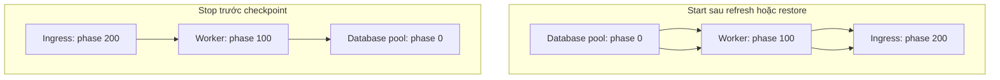
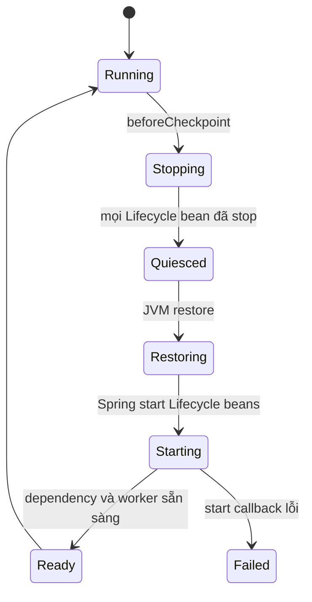

# Dừng và khởi động lại bean khi checkpoint theo yêu cầu

Trong ứng dụng Spring Boot sử dụng CRaC, một checkpoint có thể được yêu cầu khi ứng dụng đã chạy và đang phục vụ công việc. Trước khi JVM chụp trạng thái, các thành phần đang chạy cần dừng nhận công việc mới, hoàn tất hoặc lưu công việc đang xử lý và giải phóng những tài nguyên không thể giữ nguyên qua checkpoint. Sau khi restore, các thành phần đó cần được khởi động lại theo đúng thứ tự phụ thuộc.

Spring Framework cung cấp hợp đồng `Lifecycle` và `SmartLifecycle` để quản lý vòng đời này ở cấp bean. Từ Spring Framework 6.1, `DefaultLifecycleProcessor` tích hợp với CRaC khi thư viện `org.crac:crac` có trên classpath: trong quy trình checkpoint theo yêu cầu, Spring dừng các bean `Lifecycle` đang chạy; sau restore, Spring khởi động lại chúng. Bean vẫn thuộc `ApplicationContext`; thao tác stop/start không đồng nghĩa với đóng context, hủy singleton rồi tạo bean mới.

Điều này giúp ứng dụng gắn hành vi tạm dừng và tiếp tục vào đúng thành phần. Một background worker có thể dừng thread và đóng socket trong `stop()`, sau đó tạo lại worker và kết nối trong `start()`. Một message consumer có thể ngừng poll, hoàn tất hoặc lưu trạng thái message đang xử lý, rồi subscribe lại sau restore. Những thành phần không phải bean Spring hoặc cần callback riêng vẫn có thể dùng `org.crac.Resource`.

## 1. Stop/start khác với destroy/recreate

Một Spring bean có thể tham gia nhiều phần khác nhau của lifecycle:

| Cơ chế | Thời điểm | Mục đích |
|---|---|---|
| `@PostConstruct`, `InitializingBean`, init method | Sau khi bean được tạo và dependency được inject | Hoàn tất khởi tạo object |
| `Lifecycle.start()` | Khi lifecycle processor yêu cầu bắt đầu | Bắt đầu hoạt động, thread hoặc nhận công việc |
| `Lifecycle.stop()` | Khi lifecycle processor yêu cầu tạm dừng | Dừng hoạt động và đưa resource về trạng thái an toàn |
| `@PreDestroy`, `DisposableBean`, destroy method | Khi bean bị hủy hoặc context đóng | Giải phóng tài nguyên trong quá trình destruction |

Checkpoint theo yêu cầu sử dụng stop/start để tạm dừng rồi tiếp tục cùng các bean đang tồn tại. `@PreDestroy` không phải callback thay thế cho `stop()`: nó thuộc giai đoạn destruction khi bean hoặc context bị hủy. Tương tự, restore không tạo lại `ApplicationContext` và không chạy lại constructor hay `@PostConstruct` chỉ vì JVM vừa được khôi phục.

Ví dụ, một bean giữ `ExecutorService`:

- `start()` tạo executor mới và bắt đầu worker.
- `stop()` ngừng nhận task, chờ task đang chạy hoàn tất và đóng executor.
- Sau restore, `start()` tạo executor mới vì executor đã shutdown không thể tái sử dụng.

Nếu chỉ đóng executor trong `@PreDestroy`, thao tác đó có thể không được gọi khi checkpoint diễn ra. Nếu đóng executor trong `stop()` nhưng không tạo lại trong `start()`, bean sẽ tồn tại sau restore nhưng không còn worker hoạt động.

## 2. Điều kiện để Spring quản lý checkpoint/restore

Để Spring lifecycle tham gia CRaC, cần các thành phần chính sau:

1. Dùng JDK/runtime có hỗ trợ CRaC và môi trường triển khai tương thích.
2. Có dependency `org.crac:crac` trên classpath theo phiên bản được Spring Framework hỗ trợ.
3. Dùng Spring Framework 6.1 trở lên để có tích hợp checkpoint/restore trong `DefaultLifecycleProcessor`.
4. Đảm bảo bean cần tạm dừng triển khai `Lifecycle` hoặc `SmartLifecycle` và đang ở trạng thái running.
5. Viết `stop()` và `start()` để xử lý tài nguyên của chính bean đó một cách an toàn, có thể gọi lặp lại.

Ví dụ khai báo dependency trong Maven:

```xml
<dependency>
    <groupId>org.crac</groupId>
    <artifactId>crac</artifactId>
    <version>1.5.0</version>
</dependency>
```

Hoặc trong Gradle:

```kotlin
dependencies {
    implementation("org.crac:crac:1.5.0")
}
```

`1.5.0` là phiên bản minh họa; chọn phiên bản phù hợp với Spring Framework và CRaC-enabled JDK mà dự án sử dụng. Tài liệu Spring Framework hiện hành yêu cầu `org.crac:crac` từ 1.4.0 trở lên.

Spring Boot dựa trên tích hợp của Spring Framework. Các phiên bản Spring Boot sử dụng Spring Framework 6.1 trở lên có thể sử dụng cơ chế lifecycle này khi dependency CRaC phù hợp có mặt. Hãy kiểm tra phiên bản Spring Boot, Spring Framework và JDK thực tế của dự án; chỉ thêm dependency không biến một JDK thông thường thành CRaC-enabled runtime.

Khi checkpoint được yêu cầu, Spring sử dụng `DefaultLifecycleProcessor` để dừng các bean đang chạy. Sau restore, processor khởi động lại chúng. Những bean không triển khai lifecycle hoặc không được Spring quản lý sẽ không tự động nhận hành vi stop/start chỉ vì chúng nằm trong heap.

Tài liệu Spring phân biệt hai chế độ: checkpoint theo yêu cầu của ứng dụng đang chạy và checkpoint tự động trong giai đoạn refresh lúc startup. Bài này tập trung vào chế độ thứ nhất. Cấu hình `spring.context.checkpoint=onRefresh` phục vụ checkpoint ở giai đoạn refresh, trước khi lifecycle beans được start và trước `ContextRefreshedEvent`; nó không thay thế thiết kế stop/start của bean trong checkpoint theo yêu cầu.

## 3. Hợp đồng `Lifecycle`

`org.springframework.context.Lifecycle` là hợp đồng cơ bản cho object có hoạt động cần bắt đầu và dừng:

```java
package org.springframework.context;

public interface Lifecycle {
    void start();

    void stop();

    boolean isRunning();
}
```

Một bean triển khai interface này cần tuân thủ ba quy tắc:

- `start()` bắt đầu hoạt động nếu bean chưa chạy.
- `stop()` dừng hoạt động nếu bean đang chạy.
- `isRunning()` phản ánh trạng thái thực tế, không chỉ một cờ được đặt tùy tiện.

Các phương thức nên idempotent: gọi `start()` hai lần không tạo hai worker hoặc hai listener; gọi `stop()` hai lần không ném lỗi chỉ vì resource đã được đóng. Trạng thái `isRunning()` cần được cập nhật sau khi thao tác thực sự thành công hoặc hoàn tất.

Ví dụ một bean đồng bộ dữ liệu chạy nền:

```java
import org.springframework.context.Lifecycle;
import org.springframework.stereotype.Component;

@Component
public final class CatalogSyncLifecycle implements Lifecycle {
    private final CatalogSyncWorker worker;
    private volatile boolean running;

    public CatalogSyncLifecycle(CatalogSyncWorker worker) {
        this.worker = worker;
    }

    @Override
    public synchronized void start() {
        if (running) {
            return;
        }

        worker.start();
        running = true;
    }

    @Override
    public synchronized void stop() {
        if (!running) {
            return;
        }

        worker.stopAndAwait();
        running = false;
    }

    @Override
    public boolean isRunning() {
        return running;
    }
}
```

`CatalogSyncWorker` là thành phần ứng dụng tự định nghĩa. `stopAndAwait()` cần có timeout và bảo đảm worker không còn truy cập database hoặc shared resource sau khi trả về. Nếu dừng worker thất bại, bean không nên báo `running = false` trong khi worker vẫn chạy.

Lưu ý: `Lifecycle` thuần không có thuộc tính auto-start. Việc triển khai interface này không tự động bảo đảm bean được start khi `ApplicationContext` refresh. Nếu bean cần tự khởi động và cần điều khiển phase, hãy cân nhắc `SmartLifecycle`.

## 4. Dùng `SmartLifecycle` cho bean cần điều phối

`SmartLifecycle` mở rộng `Lifecycle` và `Phased`, cung cấp thêm:

- `isAutoStartup()`: quyết định bean có tự start trong giai đoạn refresh hay không.
- `getPhase()`: xác định thứ tự start/stop giữa các nhóm bean.
- `stop(Runnable callback)`: cho phép dừng bất đồng bộ và báo khi đã dừng xong.

Một implementation thường dùng `SmartLifecycle` cho listener, consumer, scheduler và worker pool vì các thành phần này cần thứ tự khởi động và dừng rõ ràng.

```java
import org.springframework.context.SmartLifecycle;
import org.springframework.stereotype.Component;

@Component
public final class MessageConsumerLifecycle implements SmartLifecycle {
    private final MessageConsumer consumer;
    private volatile boolean running;

    public MessageConsumerLifecycle(MessageConsumer consumer) {
        this.consumer = consumer;
    }

    @Override
    public synchronized void start() {
        if (running) {
            return;
        }

        consumer.subscribeAndStart();
        running = true;
    }

    @Override
    public void stop() {
        stop(() -> { });
    }

    @Override
    public void stop(Runnable callback) {
        consumer.stopPollingAndDrain();
        running = false;
        callback.run();
    }

    @Override
    public boolean isRunning() {
        return running;
    }

    @Override
    public boolean isAutoStartup() {
        return true;
    }

    @Override
    public int getPhase() {
        return 200;
    }
}
```

Ví dụ minh họa cấu trúc. Nếu `stopPollingAndDrain()` ném lỗi, bean chưa được đánh dấu stopped và callback chưa được gọi; cần ghi nhận lỗi và để lifecycle processor áp dụng timeout/chính sách lỗi của nó. Với `SmartLifecycle`, callback phải được gọi đúng một lần sau khi việc dừng thực sự hoàn tất. Nếu shutdown bất đồng bộ, chỉ gọi callback từ completion handler khi worker đã dừng; không gọi ngay khi vừa bắt đầu shutdown.

Trong ví dụ trên, `stop()` chuyển tiếp sang overload có callback để các đường gọi lifecycle đồng bộ vẫn có hành vi dừng. `MessageConsumer` phải hỗ trợ tạo subscription mới trong `start()` sau restore; không giữ một handle đã bị đóng rồi giả định nó còn hợp lệ.

## 5. Thứ tự start và stop bằng phase

Spring dùng phase để điều phối `SmartLifecycle`:

- Khi start, phase thấp được khởi động trước, phase cao được khởi động sau.
- Khi stop, thứ tự đảo ngược: phase cao dừng trước, phase thấp dừng sau.

Điều này phù hợp với quan hệ provider–consumer. Database pool là provider; worker sử dụng database là consumer; listener nhận request là producer đưa công việc vào worker. Có thể đặt phase như sau:

| Bean | Phase minh họa | Start | Stop |
|---|---:|---|---|
| Database pool lifecycle | 0 | Đầu tiên | Cuối cùng |
| Background worker | 100 | Sau database | Trước database |
| HTTP ingress/message listener | 200 | Sau worker | Đầu tiên |

Kết quả khi checkpoint:

1. Ingress dừng nhận công việc mới.
2. Worker dừng poll và drain task đang chạy.
3. Database pool đóng kết nối sau khi consumer đã dừng.

Sau restore, thứ tự đảo lại:

1. Database pool mở lại.
2. Worker khởi động và xác nhận sẵn sàng.
3. Ingress bắt đầu nhận request hoặc message.

Sơ đồ:



Phase là một phần của hợp đồng lifecycle, không phải thứ tự tạo bean. Nếu có quan hệ dependency tường minh qua `depends-on`, Spring cũng tính đến quan hệ đó: dependency được start trước dependent và được stop sau dependent. Hãy tránh dùng phase tùy tiện khi chưa xác định dependency thực tế.

## 6. Tạm dừng một bean an toàn

Một bean chạy nền không nên chỉ đặt cờ `running = false` rồi coi như đã dừng. `stop()` cần đưa thành phần về trạng thái không còn thao tác sử dụng tài nguyên sắp bị đóng.

Một trình tự dừng điển hình:

1. Đóng admission để không nhận task mới.
2. Dừng poll, listener hoặc timer tạo công việc mới.
3. Chờ các task đang chạy hoàn tất trong một deadline hữu hạn.
4. Commit/rollback transaction hoặc lưu cursor/offset cần thiết.
5. Đóng socket, file handle, connection hoặc executor do bean sở hữu.
6. Cập nhật trạng thái stopped sau khi các bước cần thiết hoàn tất.

Nếu task đang chạy không thể hoàn tất trước deadline, bean cần có chính sách rõ ràng: hủy an toàn, lưu trạng thái để tiếp tục, hoặc báo lỗi khiến checkpoint không được coi là đã chuẩn bị thành công. Không đóng dependency khi worker vẫn có thể truy cập dependency đó.

Ví dụ adapter cho worker:

```java
public interface WorkerController {
    void start() throws Exception;

    void stopAcceptingTasks();

    boolean awaitIdle(Duration timeout) throws InterruptedException;

    void closeResources() throws Exception;
}
```

Trong `stop()`, gọi `stopAcceptingTasks()`, đợi `awaitIdle(timeout)` và chỉ sau đó mới gọi `closeResources()`. Nếu `awaitIdle()` trả về `false`, không nên tiếp tục đóng resource mà worker vẫn cần; hãy báo lỗi và để hệ thống xử lý checkpoint thất bại hoặc thực hiện rollback.

## 7. Khởi động lại bean sau restore

`start()` sau restore không nên giả định các resource bên ngoài còn hợp lệ. Cần tạo lại hoặc xác thực chúng:

- Mở connection pool hoặc client mới theo cấu hình hiện tại.
- Tạo lại thread/executor đã shutdown.
- Đăng ký lại listener, subscription hoặc file watcher.
- Refresh credential, token, DNS hoặc endpoint nếu phụ thuộc thời gian/môi trường.
- Khôi phục consumer offset hoặc cursor trước khi poll message mới.
- Chỉ bật readiness sau khi dependency bắt buộc đã sẵn sàng.

`start()` cần có thể gọi nhiều lần mà không tạo worker hoặc subscription trùng. Nếu quá trình start thất bại giữa chừng, hãy đóng những resource đã mở một phần và giữ bean ở trạng thái chưa running. Đừng đặt `running = true` trước khi worker thực sự bắt đầu.

Một ví dụ quản lý executor có thể tạo mới sau mỗi lần start:

```java
import java.util.concurrent.ExecutorService;
import java.util.concurrent.Executors;
import java.util.concurrent.TimeUnit;

public final class RestartableWorker {
    private ExecutorService executor;
    private volatile boolean running;

    public synchronized void start() {
        if (running) {
            return;
        }

        ExecutorService candidate = Executors.newSingleThreadExecutor();
        try {
            candidate.submit(this::runLoop);
            executor = candidate;
            running = true;
        } catch (RuntimeException e) {
            candidate.shutdownNow();
            throw e;
        }
    }

    public void stopAndAwait() {
        ExecutorService current;
        synchronized (this) {
            if (!running) {
                return;
            }
            current = executor;
        }

        current.shutdown();
        try {
            if (!current.awaitTermination(20, TimeUnit.SECONDS)) {
                current.shutdownNow();
                if (!current.awaitTermination(5, TimeUnit.SECONDS)) {
                    throw new IllegalStateException("Worker did not stop");
                }
            }
        } catch (InterruptedException e) {
            current.shutdownNow();
            Thread.currentThread().interrupt();
            throw new IllegalStateException("Interrupted while stopping worker", e);
        }

        synchronized (this) {
            if (executor == current) {
                executor = null;
                running = false;
            }
        }
    }

    private void runLoop() {
        // Vòng lặp xử lý công việc; cần hỗ trợ dừng và interrupt an toàn.
    }
}
```

Đây là skeleton để minh họa việc tạo executor mới. Ứng dụng thật cần có cơ chế đánh thức `runLoop`, dừng vòng lặp khi executor shutdown và xử lý exception trong worker. Không nên chỉ dựa vào interrupt nếu code bên trong không phản hồi interrupt.

## 8. Tích hợp bean lifecycle với CRaC

Khi `org.crac:crac` có trên classpath và dùng `DefaultLifecycleProcessor` của Spring Framework 6.1 trở lên, Spring tích hợp callback CRaC để điều phối bean lifecycle đang chạy. Vì vậy, bean chỉ cần triển khai đúng hợp đồng `Lifecycle` hoặc `SmartLifecycle` và quản lý resource của mình.

Một cách tiếp cận tổng quát:

```java
@Configuration
public class WorkerConfiguration {

    @Bean
    SmartLifecycle reportWorker(ReportWorker worker) {
        return new ReportWorkerLifecycle(worker);
    }
}
```

Spring quản lý bean `ReportWorkerLifecycle`; lifecycle processor gọi start/stop theo refresh, stop/start theo checkpoint/restore và close khi context đóng. Nếu bean là `SmartLifecycle` và `isAutoStartup()` trả về `true`, nó được tự động start trong giai đoạn lifecycle refresh. Nếu không, ứng dụng cần một đường khởi động tường minh phù hợp.

Trong ứng dụng Spring Boot, cần kiểm tra những bean hạ tầng nào đã được Spring Boot hoặc thư viện tự quản lý. Spring Boot cung cấp quản lý lifecycle cho một số tài nguyên như socket, file và thread pool trong phạm vi nhất định; những dependency khác và code nghiệp vụ có thể cần lifecycle riêng. Tránh đóng cùng một connection pool ở cả integration của thư viện và một bean tự viết, vì có thể tạo callback trùng hoặc đóng tài nguyên quá sớm.

## 9. Khi nào cần `org.crac.Resource` riêng?

Không phải mọi resource đều là Spring bean. Một thư viện native, client tự tạo ngoài Spring container hoặc thành phần dùng chung ở cấp tiến trình có thể cần tích hợp CRaC trực tiếp bằng `org.crac.Resource`.

```java
import org.crac.Context;
import org.crac.Core;
import org.crac.Resource;

public final class NativeClientResource implements Resource {
    private final NativeClient client;

    public NativeClientResource(NativeClient client) {
        this.client = client;
        Core.getGlobalContext().register(this);
    }

    @Override
    public void beforeCheckpoint(Context<? extends Resource> context)
            throws Exception {
        client.closeHandles();
    }

    @Override
    public void afterRestore(Context<? extends Resource> context)
            throws Exception {
        client.reopenHandles();
    }
}
```

Ví dụ chỉ dành cho thư viện không được lifecycle processor quản lý. Nếu cùng một object vừa triển khai `Lifecycle` để Spring stop/start, vừa đăng ký chính nó vào global CRaC context, nó có thể bị xử lý hai lần. Hãy chọn một chủ sở hữu lifecycle rõ ràng hoặc tách adapter để mỗi thao tác chỉ được thực hiện một lần.

Nếu `Resource` được đăng ký bằng `Core.getGlobalContext()`, cần giữ tham chiếu mạnh tới instance trong suốt vòng đời ứng dụng. Không tạo resource trong biến cục bộ rồi để nó có thể bị garbage collector thu hồi.

## 10. Kiểm thử stop/start mà không cần tạo checkpoint

Có thể kiểm tra lifecycle bean ở cấp Spring trước khi thử checkpoint thật. `ConfigurableApplicationContext` cung cấp `stop()` và `start()` để điều khiển lifecycle processor:

```java
try (ConfigurableApplicationContext context =
        SpringApplication.run(Application.class, args)) {

    // Ứng dụng đang chạy.
    context.stop();

    // Kiểm tra listener, worker và consumer đã dừng.
    assertApplicationQuiesced(context);

    context.start();

    // Kiểm tra resource đã mở lại và bean hoạt động.
    assertApplicationRunning(context);
}
```

Đây là kiểm thử Spring lifecycle, không thay thế integration test CRaC. Nó giúp phát hiện lỗi trong `start()`, `stop()`, phase và trạng thái bean mà không cần tạo snapshot. Sau đó vẫn cần chạy checkpoint/restore thực tế trên CRaC-enabled runtime để kiểm tra resource native, socket, thread và hành vi của tiến trình sau restore.

Nên ghi log tên bean và thời điểm callback để xác nhận thứ tự. Với `SmartLifecycle.stop(Runnable)`, chỉ ghi nhận bean đã dừng sau khi callback được gọi và công việc bất đồng bộ thực sự hoàn tất.

## 11. Những lỗi thường gặp

| Triệu chứng | Nguyên nhân có thể | Cách xử lý |
|---|---|---|
| Bean không được stop khi checkpoint | Bean không triển khai `Lifecycle` hoặc không ở trạng thái running | Triển khai lifecycle và xác nhận bean đã được start |
| Bean không tự start sau context refresh | Chỉ triển khai `Lifecycle` thuần hoặc `SmartLifecycle.isAutoStartup()` trả về `false` | Dùng `SmartLifecycle` hoặc gọi start theo lifecycle tường minh |
| Bean được start nhưng worker không chạy | Executor đã shutdown trước checkpoint và được tái sử dụng | Tạo executor/thread/client mới trong `start()` |
| Worker bị nhân đôi sau restore | `start()` không idempotent hoặc không kiểm tra trạng thái | Bảo đảm start chỉ tạo một worker/subscription |
| Checkpoint bị chậm hoặc timeout | `stop()` chờ vô hạn hoặc `SmartLifecycle` không gọi callback | Dùng deadline và gọi callback sau khi dừng xong |
| Database pool đóng khi handler vẫn chạy | Phase hoặc dependency order sai | Dừng ingress và consumer trước pool |
| `@PreDestroy` không chạy lúc checkpoint | Checkpoint dùng stop/start, không destroy bean | Đưa logic tạm dừng vào `stop()` và phục hồi vào `start()` |
| Resource được đóng hai lần | Cùng tài nguyên được quản lý bởi Spring lifecycle và CRaC Resource | Chọn một lifecycle owner duy nhất |
| Ứng dụng báo ready quá sớm | Readiness không chờ resource và worker phục hồi | Chỉ mở traffic sau khi start hoàn tất |
| Restore gặp lỗi kết nối | Bean giữ socket hoặc credential cũ | Tạo lại hoặc refresh kết nối trong start/afterRestore |

Một lỗi khác là override bean `lifecycleProcessor` bằng implementation tùy chỉnh nhưng không giữ lại hành vi checkpoint/restore của `DefaultLifecycleProcessor`. Nếu cần tùy biến lifecycle processor, hãy kiểm tra rõ tích hợp CRaC vẫn được kích hoạt trong phiên bản Spring Framework đang dùng.

## 12. Thời gian chờ khi stop và start

Stop cần có deadline để checkpoint không bị giữ vô hạn. `SmartLifecycle.stop(Runnable)` cho phép processor đợi callback từ các bean dừng bất đồng bộ. `DefaultLifecycleProcessor` áp dụng timeout theo phase; giá trị mặc định và API cấu hình chi tiết phụ thuộc phiên bản Spring Framework.

Các nguyên tắc thực tế:

- Mỗi worker cần deadline cho drain hoặc shutdown.
- Không giữ monitor hoặc lock dùng chung trong lúc chờ I/O hay worker.
- Không gọi callback trước khi resource thực sự dừng.
- Nếu không dừng được trong deadline, ghi log và báo trạng thái lỗi rõ ràng.
- Sau restore, start cũng cần xác nhận resource đã sẵn sàng trước khi mở traffic.
- Tổng ngân sách stop của các phase cần phù hợp với thời gian checkpoint mà nền tảng cho phép.

Với Spring Framework 6.2 trở lên, `DefaultLifecycleProcessor` có API cấu hình timeout shutdown theo phase. Các phiên bản trước có API timeout khác; hãy tham khảo Javadoc đúng phiên bản thay vì sao chép cấu hình từ phiên bản mới hơn.

## 13. Readiness và trạng thái ứng dụng

Sau restore, việc JVM đã tiếp tục chạy không có nghĩa mọi bean đã sẵn sàng nhận công việc. Có thể database pool đã mở nhưng consumer chưa subscribe; worker đã start nhưng cache chưa refresh; listener đã mở nhưng một dependency bắt buộc chưa xác thực.

Hãy tách các trạng thái:



Chỉ chuyển readiness sang ready khi các thành phần bắt buộc đã start và health check đạt yêu cầu. Với dependency tùy chọn, có thể cho phép chế độ suy giảm nếu nghiệp vụ hỗ trợ. Không để listener nhận traffic trước khi consumer hoặc worker mà nó phụ thuộc đã hoạt động.

## 14. Quy trình triển khai đề xuất

Đối với ứng dụng Spring Boot có database pool, background worker và HTTP ingress, có thể tổ chức như sau:

1. Xác nhận phiên bản Spring Framework hỗ trợ CRaC và `org.crac:crac` có trên classpath.
2. Xác định các bean cần stop/start: worker, consumer, scheduler, listener và adapter quản lý resource riêng.
3. Dùng `SmartLifecycle` cho bean cần auto-start, phase và asynchronous stop; dùng `Lifecycle` đơn giản khi cần hợp đồng start/stop cơ bản.
4. Đặt phase theo dependency: database pool trước worker, worker trước ingress khi start.
5. Trong stop, ngừng ingress, đóng admission, drain task, dừng worker/consumer rồi mới đóng dependency.
6. Trong start sau restore, tạo lại dependency, khởi động worker và cuối cùng mở ingress.
7. Đảm bảo `start()` và `stop()` idempotent, có timeout và cập nhật `isRunning()` chính xác.
8. Dùng `org.crac.Resource` riêng cho thư viện hoặc resource không thuộc Spring lifecycle; tránh đăng ký trùng.
9. Kiểm thử `ApplicationContext.stop()`/`start()` và xác nhận thứ tự callback.
10. Thực hiện checkpoint/restore thật, kiểm tra kết nối, thread, readiness và nhiều chu kỳ restore.

## 15. Checklist thiết kế bean lifecycle

- [ ] Bean cần tạm dừng triển khai `Lifecycle` hoặc `SmartLifecycle`.
- [ ] Bean được start trước checkpoint và `isRunning()` phản ánh trạng thái thật.
- [ ] `start()` có thể tạo lại thread, executor, socket hoặc subscription sau khi đã stop.
- [ ] `stop()` ngừng nhận việc mới và drain công việc đang chạy trước khi đóng dependency.
- [ ] `start()` và `stop()` idempotent, không tạo worker hoặc listener trùng.
- [ ] `SmartLifecycle.stop(Runnable)` gọi callback sau khi dừng hoàn tất.
- [ ] Phase và `depends-on` phản ánh đúng thứ tự provider–consumer.
- [ ] Bean không dùng `@PreDestroy` làm logic duy nhất để dừng trước checkpoint.
- [ ] Không quản lý cùng một resource hai lần qua Spring lifecycle và `org.crac.Resource`.
- [ ] Resource không thuộc Spring được tích hợp CRaC riêng và giữ tham chiếu sống.
- [ ] Timeout stop/start phù hợp với deadline checkpoint và restore.
- [ ] Readiness chỉ bật sau khi dependency bắt buộc đã phục hồi.
- [ ] Đã thử `ApplicationContext.stop()`/`start()` và checkpoint/restore thật.

## 16. Tài liệu tham khảo

- [Spring Framework — JVM Checkpoint Restore](https://docs.spring.io/spring-framework/reference/integration/checkpoint-restore.html): tích hợp CRaC, checkpoint theo yêu cầu và tự động tại refresh.
- [Spring Framework — Lifecycle and SmartLifecycle](https://docs.spring.io/spring-framework/reference/core/beans/factory-nature.html): hợp đồng start/stop, auto-start và thứ tự phase.
- [Spring `DefaultLifecycleProcessor` Javadoc](https://docs.spring.io/spring-framework/docs/6.1.21/javadoc-api/org/springframework/context/support/DefaultLifecycleProcessor.html): hỗ trợ checkpoint/restore từ Spring Framework 6.1 khi `org.crac:crac` có trên classpath.
- [Spring Boot — Checkpoint and Restore With the JVM](https://docs.spring.io/spring-boot/reference/packaging/checkpoint-restore.html): hỗ trợ CRaC của Spring Boot và phạm vi lifecycle resource được quản lý.
- [CRaC API — `Resource`](https://javadoc.io/doc/org.crac/crac/latest/org/crac/Resource.html): callback dành cho resource cần tích hợp trực tiếp với CRaC.

Spring bean cần tạm dừng khi checkpoint nên quản lý hoạt động qua `Lifecycle` hoặc `SmartLifecycle`. `stop()` dừng công việc và giải phóng resource trước checkpoint; `start()` tạo lại hoặc phục hồi resource sau restore. Dùng phase và quan hệ dependency để dừng consumer trước provider, rồi khởi động provider trước consumer. Giữ rõ ranh giới giữa stop/start và destroy/recreate, tránh đăng ký cùng resource ở nhiều lifecycle owner, và chỉ mở traffic khi toàn bộ thành phần bắt buộc đã sẵn sàng.
