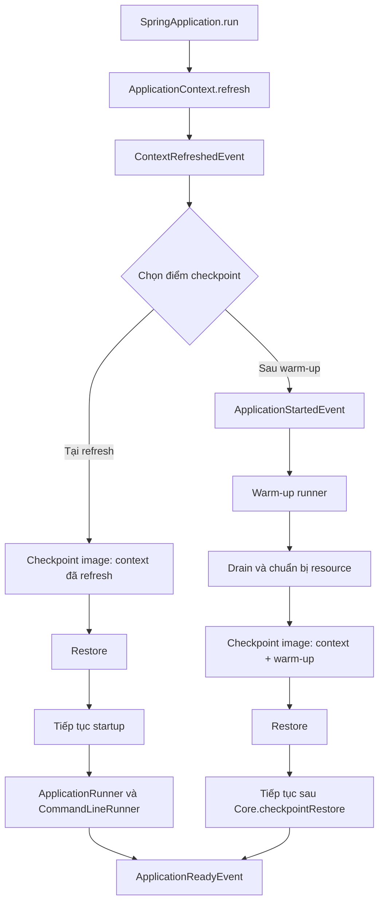
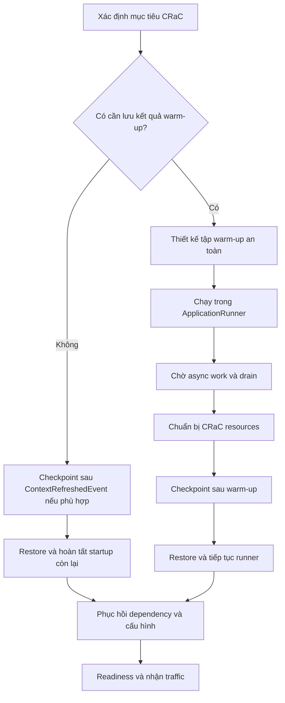

# Phân biệt checkpoint lúc refresh với checkpoint sau khi làm nóng

Trong ứng dụng Spring Boot dùng CRaC, thời điểm tạo checkpoint quyết định phần nào của quá trình khởi động được lưu lại và phần nào vẫn phải chạy khi restore. Hai mốc thường được cân nhắc là checkpoint tại sự kiện Spring `ContextRefreshedEvent` và checkpoint sau khi ứng dụng đã chạy xong tập warm-up đại diện.

Hai mốc này không tương đương. `ContextRefreshedEvent` cho biết Spring `ApplicationContext` đã hoàn thành giai đoạn refresh, nhưng Spring Boot vẫn còn các bước startup tiếp theo như phát `ApplicationStartedEvent`, chạy `ApplicationRunner`/`CommandLineRunner` và phát `ApplicationReadyEvent`. Nếu checkpoint tại mốc refresh, những bước warm-up đặt trong runner chưa được thực hiện và sẽ tiếp tục chạy sau mỗi lần restore. Nếu checkpoint sau warm-up, trạng thái đã được chuẩn bị bởi các request warm-up có thể được lưu trong image và tái sử dụng.

Lựa chọn phụ thuộc mục tiêu. Checkpoint tại refresh có thể rút ngắn phần khởi tạo Spring context. Checkpoint sau warm-up thường phù hợp hơn khi mục tiêu là giảm cả chi phí khởi tạo lẫn độ trễ của các request đầu tiên. Dù chọn mốc nào, tài nguyên bên ngoài như database connection, socket, token và lease vẫn cần được xử lý theo vòng đời riêng.

## 1. Nhìn lại thứ tự khởi động của Spring Boot

Để hiểu hai mốc, trước tiên cần phân biệt vòng đời của `ApplicationContext` với vòng đời startup tổng thể của Spring Boot.

Một luồng khởi động Spring Boot điển hình có thể mô tả như sau:

```text
Java launcher
    |
    v
SpringApplication.run(...)
    |
    v
Chuẩn bị Environment và ApplicationContext
    |
    v
ApplicationContext.refresh()
    |  - tạo bean cần khởi tạo sớm
    |  - khởi tạo các singleton không lazy
    |  - khởi động các lifecycle component
    |  - phát ContextRefreshedEvent
    |
    v
ApplicationStartedEvent
    |
    v
ApplicationRunner / CommandLineRunner
    |
    v
ApplicationReadyEvent
    |
    v
Readiness chuyển sang ACCEPTING_TRAFFIC
```

Đây là thứ tự khái niệm của một lần chạy Spring Boot thông thường; chi tiết event và availability có thể khác theo phiên bản hoặc cách ứng dụng tùy biến startup. Hãy kiểm tra đúng phiên bản Spring Boot đang dùng khi tích hợp với CRaC.

### `ContextRefreshedEvent` có ý nghĩa gì?

`ContextRefreshedEvent` được phát khi Spring `ApplicationContext` hoàn tất giai đoạn refresh. Đến thời điểm này, các singleton không lazy đã được khởi tạo và các thành phần lifecycle của context đã được xử lý theo cơ chế Spring. Đây là mốc hữu ích để biết context đã được dựng.

Tuy nhiên, event này không có nghĩa toàn bộ ứng dụng Spring Boot đã hoàn tất mọi bước startup. `SpringApplication.run()` còn tiếp tục sau khi `refresh()` trả về. Các runner như `ApplicationRunner` và `CommandLineRunner` chạy sau giai đoạn refresh, vì vậy logic được đặt trong chúng chưa chạy khi `ContextRefreshedEvent` được phát.

Một số thành phần có thể khởi tạo lười (lazy), chỉ được tạo khi lần đầu được sử dụng. Việc context đã refresh không có nghĩa tất cả bean hoặc mọi đường code của ứng dụng đã được thực thi.

### `ApplicationRunner` và `ApplicationReadyEvent` có ý nghĩa gì?

`ApplicationRunner` và `CommandLineRunner` chạy sau khi context đã refresh và Spring Boot đã phát sự kiện started. Chúng thường được dùng để thực hiện công việc khởi động bổ sung như nạp dữ liệu, kiểm tra tích hợp hoặc chuẩn bị ứng dụng.

Sau khi các runner hoàn tất, Spring Boot phát `ApplicationReadyEvent`. Đây là mốc báo startup đã đi đến giai đoạn sẵn sàng. Trong ứng dụng web, cần xem thêm readiness/availability và cấu hình load balancer để xác định chính xác thời điểm traffic được gửi đến.

Nếu muốn checkpoint chứa kết quả warm-up chạy trong runner, có thể gọi checkpoint ở cuối runner sau khi warm-up đã hoàn tất và trước khi runner trả về. Khi restore, lời gọi checkpoint tiếp tục và runner hoàn tất; Spring Boot tiếp tục các bước startup còn lại.

## 2. Checkpoint tại `ContextRefreshedEvent`

Ở cách này, ứng dụng yêu cầu checkpoint khi Spring context vừa phát `ContextRefreshedEvent`. Image sẽ chứa trạng thái tiến trình sau giai đoạn refresh, nhưng trước khi Spring Boot thực hiện các bước startup tiếp theo.

Các trạng thái thường đã có tại mốc này:

- `ApplicationContext` đã được refresh.
- Các singleton không lazy đã được khởi tạo.
- Các bean đã thực hiện phần lớn callback khởi tạo trong quá trình tạo bean.
- Các lifecycle component được Spring quản lý đã đi qua bước refresh/start tương ứng.
- Cấu hình đã được nạp vào các object đã tạo.

Những việc có thể chưa hoàn tất:

- `ApplicationRunner` và `CommandLineRunner` chưa chạy.
- Các tác vụ warm-up đặt trong runner chưa được thực hiện.
- Các bean lazy có thể chưa được tạo.
- Các đường code JIT quan trọng có thể vẫn lạnh.
- Cache chỉ được nạp trong request thật hoặc trong runner có thể chưa sẵn sàng.
- Các bước khởi động bổ sung do ứng dụng thực hiện sau `refresh()` chưa hoàn tất.

### Ví dụ trigger tại refresh

```java
import org.crac.Core;
import org.springframework.context.ApplicationListener;
import org.springframework.context.event.ContextRefreshedEvent;

import java.util.concurrent.atomic.AtomicBoolean;

public final class RefreshCheckpointListener
        implements ApplicationListener<ContextRefreshedEvent> {

    private final AtomicBoolean requested = new AtomicBoolean();

    @Override
    public void onApplicationEvent(ContextRefreshedEvent event) {
        // Trong ứng dụng có parent/child context, cần giới hạn đúng context.
        if (!isTargetApplicationContext(event)) {
            return;
        }

        if (requested.compareAndSet(false, true)) {
            try {
                Core.checkpointRestore();
            } catch (Exception exception) {
                throw new IllegalStateException(
                        "Could not checkpoint after context refresh", exception);
            }
        }
    }

    private boolean isTargetApplicationContext(ContextRefreshedEvent event) {
        // Thay bằng điều kiện xác định context chính của ứng dụng.
        return true;
    }
}
```

Ví dụ minh họa vị trí gọi API, không phải cấu hình hoàn chỉnh cho mọi ứng dụng. Cần xác định đúng context trong hệ thống có parent/child context, tránh gọi checkpoint nhiều lần nếu context được refresh lại, và đăng ký các CRaC resource cần thiết. Cách tích hợp cụ thể phụ thuộc phiên bản Spring Boot, Spring Framework và JDK CRaC.

Khi checkpoint được gọi trong listener, luồng thực thi tạm dừng tại lời gọi `Core.checkpointRestore()`. Sau restore, lời gọi tiếp tục và listener trả về. Spring hoàn tất phần còn lại của `refresh()`, rồi Spring Boot tiếp tục các bước startup phía sau, bao gồm runner và sự kiện ready.

### Điều gì xảy ra với warm-up đặt trong runner?

Giả sử ứng dụng có một `ApplicationRunner` gọi 100 request warm-up. Nếu checkpoint được tạo tại `ContextRefreshedEvent`, các request này chưa chạy khi image được tạo. Mỗi lần restore, Spring tiếp tục startup sau refresh và runner được thực thi. Như vậy, warm-up vẫn xảy ra trong mỗi lần restore và không được tái sử dụng từ checkpoint image.

Điều này có thể là lựa chọn hợp lý nếu muốn image chứa context đã dựng nhưng muốn chạy warm-up theo môi trường của từng instance sau restore. Tuy nhiên, cần tính chi phí startup và tải lên dependency trong mỗi lần restore.

## 3. Checkpoint sau khi làm nóng

Ở cách này, ứng dụng hoàn thành context refresh, chạy các bước chuẩn bị và thực thi tập warm-up đại diện trước khi yêu cầu checkpoint. Image chứa cả trạng thái khởi tạo Spring lẫn những trạng thái nội bộ đã được làm nóng.

Các kết quả có thể được giữ lại nếu phù hợp:

- Các bean và cấu trúc ứng dụng đã khởi tạo.
- Class đã nạp và các đường code đã được thực thi để JVM có cơ hội JIT compile.
- Serializer, mapper, validator và metadata đã được sử dụng.
- Cache trong heap đã được nạp, nếu dữ liệu vẫn hợp lệ sau restore.
- Những cấu trúc dữ liệu nội bộ được tạo trong quá trình xử lý request warm-up.

Các tài nguyên không nên mặc định giữ lại:

- Database connection và connection pool vật lý.
- HTTP/WebSocket/gRPC session và socket.
- Token, session hoặc credential có hạn dùng.
- Lease, leader state và quyền sở hữu theo instance.
- Timer, scheduler hoặc dữ liệu cache có TTL cần tính lại.

Các tài nguyên này cần CRaC integration hoặc callback đóng/tạm dừng trước checkpoint và tạo mới/làm mới sau restore.

### Đặt warm-up trong `ApplicationRunner`

`ApplicationRunner` chạy sau context refresh và trước `ApplicationReadyEvent`. Đây là vị trí phù hợp để thực thi các scenario warm-up và yêu cầu checkpoint sau khi chúng hoàn tất.

```java
import org.crac.Core;
import org.springframework.boot.ApplicationArguments;
import org.springframework.boot.ApplicationRunner;
import org.springframework.core.Ordered;
import org.springframework.core.annotation.Order;
import org.springframework.stereotype.Component;

@Component
@Order(Ordered.LOWEST_PRECEDENCE)
public final class WarmupAndCheckpointRunner implements ApplicationRunner {

    private final WarmupService warmupService;

    public WarmupAndCheckpointRunner(WarmupService warmupService) {
        this.warmupService = warmupService;
    }

    @Override
    public void run(ApplicationArguments args) throws Exception {
        warmupService.runRepresentativeScenarios();
        warmupService.awaitAllWorkToComplete();
        warmupService.verifyWarmupState();

        Core.checkpointRestore();

        // Sau restore, luồng tiếp tục tại đây rồi runner hoàn tất.
    }
}
```

`WarmupService` là abstraction của ứng dụng. Các phương thức cần bảo đảm request bất đồng bộ đã hoàn tất, fixture an toàn, không còn tác vụ warm-up chạy nền và trạng thái nội bộ đạt điều kiện mong muốn. `@Order` chỉ điều khiển thứ tự tương đối giữa các runner được Spring sắp xếp; không nên dựa vào nó để kiểm soát mọi thành phần startup ngoài cơ chế runner.

Nếu có nhiều runner, cần xác định rõ runner nào phải chạy trước checkpoint và runner nào không được chạy trước khi traffic được chấp nhận. Có thể gom warm-up vào một runner điều phối duy nhất để dễ quản lý thứ tự và lỗi.

### Sau restore runner có chạy lại từ đầu không?

Không. Nếu checkpoint được yêu cầu bên trong `run()`, khi tiến trình được restore, luồng tiếp tục sau lời gọi `Core.checkpointRestore()`. Các dòng warm-up phía trước lời gọi không tự chạy lại chỉ vì restore. Runner tiếp tục phần còn lại, trả về và Spring Boot đi đến các bước startup tiếp theo.

Điều này khác với checkpoint tại `ContextRefreshedEvent`: ở trường hợp đó, Spring chưa bắt đầu chạy runner tại thời điểm checkpoint. Sau restore, startup tiếp tục từ sau refresh và runner bắt đầu thực thi lần đầu trong luồng startup đã được khôi phục.

## 4. So sánh trực tiếp hai thời điểm

| Khía cạnh | Checkpoint tại `ContextRefreshedEvent` | Checkpoint sau warm-up trong runner |
|---|---|---|
| Context đã refresh | Có | Có |
| Singleton không lazy đã khởi tạo | Có | Có |
| Runner đã chạy | Chưa | Runner warm-up đã chạy đến điểm checkpoint |
| Warm-up code path | Chưa có, trừ phần đã được gọi trong quá trình bean init | Đã thực thi theo tập scenario |
| JIT profile từ request warm-up | Chưa được chuẩn bị bởi runner | Có thể đã được chuẩn bị |
| Cache nội bộ do warm-up nạp | Chưa có | Có thể được giữ nếu còn hợp lệ |
| Lazy bean chỉ được warm-up tạo ra | Chưa được tạo | Có thể đã được tạo |
| Công việc còn lại sau restore | Hoàn tất refresh/startup, chạy runner, ready | Tiếp tục sau checkpoint trong runner, hoàn tất startup, ready |
| Chi phí mỗi lần restore | Còn phải chạy warm-up nếu đặt sau refresh | Thường thấp hơn vì warm-up đã nằm trong image |
| Thời gian chuẩn bị image | Thường ngắn hơn | Dài hơn do chạy warm-up |
| Tải dependency trong giai đoạn restore | Warm-up có thể tạo tải trên mỗi replica | Chủ yếu là tài nguyên phải kết nối lại và công việc sau restore |

### Sơ đồ luồng thực thi



Sơ đồ thể hiện vị trí tương đối. Nếu ứng dụng dùng nhiều runner, event listener hoặc custom startup lifecycle, cần kiểm tra thứ tự thực tế trong phiên bản Spring Boot và cấu hình của ứng dụng.

## 5. Chọn thời điểm theo mục tiêu ứng dụng

Checkpoint tại refresh phù hợp khi:

- Muốn lưu context và các bean đã khởi tạo nhưng cần chạy một phần startup theo từng môi trường restore.
- Warm-up phụ thuộc endpoint, tenant, credential hoặc dữ liệu chỉ có thể xác định sau restore.
- Warm-up tạo side effect hoặc phụ thuộc trạng thái bên ngoài không nên đóng gói trong image.
- Muốn giảm thời gian tạo image và chấp nhận chi phí warm-up trong mỗi lần restore.
- Cần giữ một phần công việc khởi động ở giai đoạn sau restore để kiểm tra cấu hình mới.

Checkpoint sau warm-up phù hợp khi:

- Muốn giảm độ trễ request đầu tiên sau restore.
- Các đường chạy warm-up có thể thực hiện an toàn trước checkpoint.
- Dữ liệu warm-up có thể tái sử dụng hoặc có chính sách kiểm tra độ mới.
- Chi phí warm-up đáng kể và không muốn trả lại ở mỗi lần restore.
- Ứng dụng có thể phân tách trạng thái nội bộ có thể giữ với tài nguyên bên ngoài phải phục hồi.

Không có một thời điểm duy nhất đúng cho mọi ứng dụng. Một dịch vụ xử lý request đọc nhiều có thể hưởng lợi rõ rệt từ checkpoint sau warm-up. Một dịch vụ cần lấy credential hoặc cấu hình theo từng instance có thể giữ checkpoint ở mốc sớm hơn rồi hoàn tất một số bước sau restore.

## 6. Cẩn thận với lazy initialization

`ContextRefreshedEvent` không có nghĩa mọi bean đã được khởi tạo. Bean được đánh dấu `@Lazy`, bean theo scope request/session hoặc object được tạo bằng factory khi có nhu cầu có thể chưa tồn tại.

Nếu checkpoint tại refresh, những bean này có thể được tạo lần đầu sau restore khi request thật đến. Điều đó làm một phần chi phí khởi tạo xuất hiện lại ở request đầu tiên.

Checkpoint sau warm-up có thể tạo các bean lazy nếu scenario thực sự đi qua chúng. Tuy nhiên, không nên ép khởi tạo tất cả bean một cách máy móc. Một số bean chỉ dùng trong luồng hiếm, giữ native resource hoặc phụ thuộc môi trường riêng. Chỉ warm-up những thành phần có giá trị và có thể được chuẩn bị an toàn.

Hãy kiểm tra các cơ chế tạo bean gián tiếp như:

- `ObjectProvider<T>` hoặc `Provider<T>` chỉ lấy bean khi cần.
- Factory tạo client hoặc serializer theo tenant.
- Proxy lazy khởi tạo target khi method được gọi.
- Request/session scoped bean.
- Reflection hoặc service loader chỉ được dùng trong một nhánh nghiệp vụ.

Nếu muốn một đường chạy được làm nóng, phải thực thi đường chạy đó đủ sâu. Chỉ lấy reference đến proxy chưa chắc đã khởi tạo target hoặc kích hoạt code cần thiết.

## 7. Phân biệt warm-up JVM, Spring và dependency

Một request warm-up có thể làm nóng nhiều lớp, nhưng kết quả không có cùng vòng đời:

| Lớp | Ví dụ | Khả năng giữ qua checkpoint |
|---|---|---|
| JVM | Class loading, JIT compilation, runtime profile | Có thể được giữ trong trạng thái runtime được hỗ trợ |
| Spring | Bean, proxy, metadata, serializer, validator | Thường là trạng thái trong heap được phục hồi |
| Ứng dụng | Cache nội bộ, cấu trúc lookup, template đã parse | Có thể giữ nếu dữ liệu còn hợp lệ |
| Database | Connection, transaction, server-side session, query cache | Phải theo lifecycle và khả năng hỗ trợ của driver/database |
| Network client | Socket, TLS session, WebSocket, gRPC channel | Không mặc định còn hợp lệ; có thể phải tạo lại |
| Hệ thống phân tán | Lease, lock, subscription, consumer assignment | Xác minh hoặc đăng ký lại sau restore |

Ví dụ, warm-up một truy vấn repository có thể giúp JIT tối ưu code của repository và mapper. Nhưng nếu `beforeCheckpoint()` đóng connection pool, connection vật lý không được giữ lại chỉ vì request đã chạy. Sau restore, pool phải được phục hồi theo integration tương ứng.

## 8. Chuẩn bị tài nguyên trước checkpoint ở cả hai cách

Dù checkpoint tại refresh hay sau warm-up, trước khi snapshot cần đưa resource về trạng thái an toàn. Các thành phần nên đăng ký CRaC callback hoặc dùng integration được thư viện hỗ trợ.

Một resource có thể xử lý như sau:

```java
import org.crac.Context;
import org.crac.Core;
import org.crac.Resource;

public final class ExternalClientResource implements Resource {

    private final ClientFactory factory;
    private ExternalClient client;

    public ExternalClientResource(ClientFactory factory) {
        this.factory = factory;
        this.client = factory.connect();
        Core.getGlobalContext().register(this);
    }

    @Override
    public void beforeCheckpoint(Context<? extends Resource> context)
            throws Exception {
        stopNewCallsAndDrain();
        if (client != null) {
            client.close();
            client = null;
        }
    }

    @Override
    public void afterRestore(Context<? extends Resource> context)
            throws Exception {
        client = factory.connect();
        verifyClient(client);
        resumeCalls();
    }

    private void stopNewCallsAndDrain() throws Exception { /* ... */ }
    private void verifyClient(ExternalClient value) throws Exception { /* ... */ }
    private void resumeCalls() { /* ... */ }
}
```

`ClientFactory` và `ExternalClient` là kiểu minh họa. Trong ứng dụng thật, cần dùng đúng API của client và tránh đăng ký callback trùng nếu thư viện đã có CRaC integration. Cần drain request đang sử dụng client trước khi đóng và chỉ resume sau khi kết nối mới được xác minh.

Ở checkpoint sau warm-up, callback `beforeCheckpoint()` thường chạy sau khi các scenario đã hoàn tất. Vì vậy, warm-up phải kết thúc và giải phóng công việc đang chạy trước khi yêu cầu checkpoint. Ở checkpoint tại refresh, callback chạy khi Spring còn đang trong quá trình startup; các resource cần được tạo/đăng ký đúng thời điểm và callback không được giả định runner đã chạy.

## 9. Kiểm soát readiness và traffic

Một server có thể đã mở socket trong quá trình Spring context refresh, dù ứng dụng chưa hoàn tất warm-up hoặc chưa phục hồi dependency sau restore. Vì vậy, việc port đã listen không đồng nghĩa replica nên nhận traffic.

Với checkpoint sau warm-up, nên giữ ứng dụng ở trạng thái chưa sẵn sàng cho đến khi:

1. Warm-up hoàn tất và mọi future/stream/request liên quan đã kết thúc.
2. Các resource đã xử lý `beforeCheckpoint()` thành công.
3. Sau restore, các callback `afterRestore()` đã hoàn tất.
4. Kết nối database, client và dependency bắt buộc đã được kiểm tra.
5. Cấu hình động, token và lease đã được làm mới nếu cần.
6. Ứng dụng mới chuyển readiness sang trạng thái chấp nhận traffic.

Nếu checkpoint tại refresh, runner và các bước startup còn lại sẽ chạy sau restore. Readiness cần tiếp tục false trong suốt khoảng này, nếu không request có thể đến trước khi warm-up và cấu hình theo môi trường hoàn tất.

Với Spring Boot, hãy dùng cơ chế availability/readiness phù hợp phiên bản và nền tảng triển khai. Đồng thời cấu hình load balancer hoặc orchestrator để chỉ gửi traffic tới instance đã báo ready. Không dùng liveness probe để biểu diễn dependency tạm thời chưa sẵn sàng; restart liên tục có thể tạo vòng lặp checkpoint/restore và tăng tải lên hệ thống bên ngoài.

## 10. Warm-up phải an toàn và đại diện

Nếu chọn checkpoint sau warm-up, chất lượng tập warm-up quyết định chất lượng image. Tập request nên được xây dựng từ traffic, trace, SLO và các nhóm payload thực tế. Cần ưu tiên:

- Đường chạy phổ biến và critical.
- Các kiểu payload làm thay đổi nhánh xử lý.
- Serializer, mapper, validator và repository quan trọng.
- Cache nội bộ có thể giữ lại và có chính sách độ mới rõ ràng.
- Một số đường lỗi thường gặp nếu chúng ảnh hưởng đến code path quan trọng.

Warm-up cần dùng fixture an toàn. Tránh tạo đơn hàng thật, gửi email, trừ tiền, phát message hoặc cập nhật dữ liệu nghiệp vụ ngoài ý muốn. Nếu cần đi qua một đường ghi, dùng database/schema cô lập, stub hoặc use case có chế độ warm-up riêng. Transaction rollback không thể hoàn tác email hay message đã gửi ra hệ thống khác.

Đặt giới hạn cho số request, concurrency, thời gian chạy và drain. Đừng checkpoint khi runner còn future, reactive subscription hoặc thread warm-up đang chạy. Nếu warm-up gọi dependency dùng chung, cần tránh nhiều pipeline tạo image cùng lúc làm quá tải database/cache.

## 11. Những trường hợp checkpoint sau warm-up không đem lại lợi ích như mong đợi

Checkpoint sau warm-up không tự đảm bảo mọi request sau restore đều nhanh. Một số nguyên nhân thường gặp:

- Scenario warm-up không đi qua đúng entry point hoặc code path của request thật.
- Payload warm-up quá đơn giản nên không khởi tạo nhánh quan trọng.
- Tác vụ bất đồng bộ chưa hoàn tất khi checkpoint được yêu cầu.
- Warm-up chỉ nạp distributed cache hoặc database cache, trong khi trạng thái đó không thuộc heap image.
- `beforeCheckpoint()` đóng một resource mà ứng dụng lại kỳ vọng đã được warm-up và giữ nguyên.
- Cache trong heap đã hết TTL hoặc dữ liệu đã thay đổi khi restore.
- JIT profile chỉ đại diện một loại dữ liệu, còn traffic sau restore có shape khác.
- Một số bean lazy hoặc proxy target chưa được khởi tạo.
- Warm-up đã làm nóng một replica nhưng image được restore trên môi trường có CPU, architecture hoặc cấu hình runtime không tương thích.

Vì vậy, phải đo request đầu tiên sau restore theo từng nhóm use case. Thời gian restore đến readiness và latency request đầu tiên là hai chỉ số khác nhau.

## 12. Kiểm thử hai chiến lược trong cùng điều kiện

Để quyết định mốc phù hợp, hãy tạo hai image thử nghiệm:

- **Image A:** checkpoint ngay tại `ContextRefreshedEvent`.
- **Image B:** checkpoint ở cuối warm-up runner sau khi mọi scenario đã hoàn tất.

Giữ cùng phiên bản ứng dụng, JDK CRaC, cấu hình JVM, tài nguyên máy, dependency và bộ dữ liệu thử nghiệm. So sánh các chỉ số sau:

| Chỉ số | Image A: tại refresh | Image B: sau warm-up |
|---|---|---|
| Thời gian tạo image | Thường ngắn hơn | Thường dài hơn do chạy scenario |
| Thời gian restore đến ready | Có thể còn chi phí runner/warm-up | Có thể ngắn hơn nếu resource phục hồi nhanh |
| Latency request đầu tiên | Có thể còn class/JIT/cache cold path | Có thể thấp hơn trên đường chạy đã warm-up |
| Tải dependency khi restore | Có thể cao nếu runner chạy trên mỗi replica | Có thể thấp hơn nếu chỉ cần reconnect resource |
| Mức độ phụ thuộc dữ liệu động | Warm-up có thể đọc dữ liệu hiện hành sau restore | Cache warm-up có thể cũ và cần validate |
| Độ phức tạp lifecycle | Startup còn tiếp tục sau restore | Cần phối hợp warm-up, drain và callback trước checkpoint |

Các phép đo nên bao gồm:

1. Thời gian từ restore đến `ApplicationReadyEvent`/readiness.
2. Latency p50, p95 và p99 của các request đầu tiên theo scenario.
3. CPU, allocation, GC và class loading trong giai đoạn đầu.
4. Cache hit/miss và thời gian nạp lại dữ liệu.
5. Thời gian reconnect database/client và số lần retry.
6. Số request lỗi hoặc timeout trước khi hệ thống ổn định.
7. Tác động khi nhiều replica restore cùng lúc.

Không so sánh hai image nếu một image dùng dữ liệu cache mới còn image kia dùng dữ liệu cũ, hoặc một image được restore trên máy khác cấu hình. Điều kiện thử nghiệm cần tương đương để kết luận có ý nghĩa.

## 13. Các lỗi thường gặp

### Coi `ContextRefreshedEvent` là `ApplicationReadyEvent`

Context đã refresh nhưng runner và một số bước startup vẫn chưa chạy. Nếu cần warm-up trong runner, checkpoint tại refresh sẽ xảy ra quá sớm để lưu kết quả warm-up.

### Gọi checkpoint trước khi warm-up hoàn tất

Tạo image khi future hoặc message còn đang xử lý có thể lưu trạng thái chưa ổn định. Hãy await mọi công việc và drain trước khi yêu cầu checkpoint.

### Đặt warm-up sau checkpoint nhưng kỳ vọng nó được lưu

Mã chạy sau điểm checkpoint không nằm trong trạng thái đã chụp. Nếu warm-up ở runner nhưng checkpoint tại refresh, runner sẽ chạy sau restore mỗi lần.

### Cho traffic vào trước khi restore hoàn tất

Port đã listen không đồng nghĩa dependency và warm-up đã sẵn sàng. Readiness cần phản ánh trạng thái thực tế.

### Giữ nguyên mọi connection vì đã được warm-up

Warm-up có thể giúp JIT và cache nội bộ, nhưng không làm cho socket hoặc database session còn hợp lệ. Xử lý chúng bằng CRaC integration hoặc callback.

### Dùng `ApplicationReadyEvent` mà không kiểm tra thứ tự readiness

Nếu warm-up hoặc checkpoint được gắn vào event này, hãy xác minh thứ tự phát event và availability của phiên bản Spring Boot đang dùng. Đặt warm-up trong runner thường làm ranh giới trước ready rõ ràng hơn.

### Trigger checkpoint nhiều lần

Ứng dụng có thể có parent/child context, refresh event lặp lại hoặc nhiều listener. Cần one-shot guard và xác định đúng context để tránh tạo checkpoint ngoài dự kiến.

## 14. Quy trình lựa chọn và triển khai



Trình tự triển khai nên gồm:

1. Chọn đúng event/lifecycle point theo mục tiêu.
2. Xác định runner, bean lazy và startup task nào đã chạy ở mốc đó.
3. Đăng ký CRaC resource cho client, pool, scheduler và tài nguyên cần xử lý.
4. Đảm bảo readiness chưa bật khi ứng dụng còn đang warm-up hoặc restore.
5. Tạo checkpoint image và restore trong môi trường tương thích.
6. Đo thời gian startup, readiness và request đầu tiên.
7. Thử restore nhiều replica và kiểm tra side effect, lease, connection, cache.

## 15. Kết luận

Checkpoint tại `ContextRefreshedEvent` lưu trạng thái sau khi Spring context đã refresh, nhưng trước khi Spring Boot chạy `ApplicationRunner`/`CommandLineRunner` và phát `ApplicationReadyEvent`. Vì vậy, warm-up được đặt trong runner chưa nằm trong image và sẽ chạy sau mỗi lần restore.

Checkpoint ở cuối warm-up runner lưu được trạng thái nội bộ đã chuẩn bị bởi các scenario warm-up. Khi restore, luồng tiếp tục sau lời gọi checkpoint, runner hoàn tất và Spring Boot đi đến các bước ready. Cách này thường phù hợp khi mục tiêu là giảm độ trễ của request đầu tiên, nhưng yêu cầu warm-up an toàn, đại diện, hoàn tất mọi công việc bất đồng bộ và xử lý tài nguyên bên ngoài đúng vòng đời.

Hãy chọn mốc dựa trên trạng thái mà ứng dụng cần tái sử dụng, dữ liệu nào có thể cũ, dependency nào cần kết nối lại và cách readiness được điều phối. Dù checkpoint tại refresh hay sau warm-up, chỉ đưa ứng dụng vào phục vụ khi startup/restore, callback resource, cấu hình hiện hành và các dependency bắt buộc đều đã sẵn sàng.
