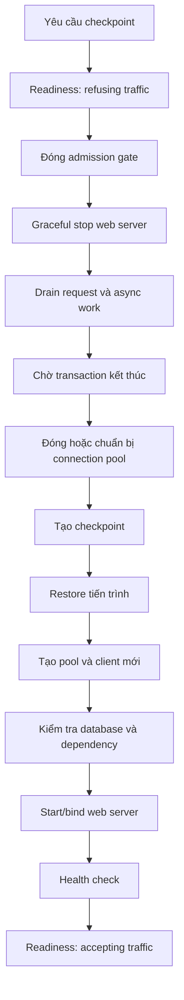

# Quản lý máy chủ web nhúng và nhóm kết nối dữ liệu

Ứng dụng Spring Boot thường chạy máy chủ web nhúng như Tomcat, Jetty hoặc Undertow, đồng thời dùng connection pool để quản lý kết nối tới database. Các thành phần này được khởi tạo trong ApplicationContext và thường giữ socket, thread, timer, connection hoặc trạng thái phụ thuộc vào hệ điều hành và dịch vụ bên ngoài.

Khi tạo checkpoint CRaC, việc lưu được trạng thái JVM không bảo đảm mọi listener và database connection vẫn hợp lệ khi tiến trình được restore. Cổng lắng nghe có thể cần bind lại; connection tới database có thể đã bị server đóng, hết timeout hoặc không còn tương thích với môi trường mới. Nếu ứng dụng tiếp tục dùng object cũ mà không phục hồi, request đầu tiên sau restore có thể thất bại dù Spring bean vẫn tồn tại.

Vì vậy, cần phối hợp vòng đời của máy chủ web và connection pool với CRaC: **ngừng nhận request mới, drain request và transaction đang chạy, chuẩn bị hoặc đóng tài nguyên mạng trước checkpoint, sau đó khôi phục pool và listener trước khi chuyển readiness sang accepting traffic**. Spring Boot và từng embedded server có cơ chế lifecycle riêng; hãy dùng integration phù hợp với phiên bản đang triển khai thay vì tự đóng socket bên dưới framework.

## 1. Những thành phần mạng Spring Boot đang quản lý

Trong một ứng dụng Spring Boot web, nhiều lớp cùng tham gia xử lý request:

1. Embedded server mở socket và chấp nhận kết nối từ client hoặc reverse proxy.
2. Server quản lý connection, request parsing, thread hoặc event loop.
3. Spring MVC/WebFlux đưa request qua filter, interceptor, controller và handler.
4. Service thực thi nghiệp vụ và có thể gọi database, cache, message broker hoặc HTTP service.
5. Data access layer lấy connection từ pool, chạy câu lệnh và commit/rollback transaction.

Các thành phần có trạng thái riêng:

| Thành phần | Tài nguyên hoặc trạng thái thường giữ | Việc cần xem xét khi CRaC restore |
|---|---|---|
| Tomcat/Jetty/Undertow | Listening socket, worker thread, executor, connection state | Ngừng nhận request, drain, bind/start lại theo lifecycle được hỗ trợ |
| Netty/WebFlux server | Event loop, channel, selector và socket | Dừng nhận channel mới, hoàn tất hoặc đóng channel cũ, khôi phục event loop/server đúng cách |
| Servlet filter/interceptor | Bộ đếm request, cache, context | Bảo đảm không còn request đang sử dụng state bị thay thế |
| JDBC connection pool | Physical connection, pool thread, validation state | Drain borrower, đóng hoặc làm mới connection, tạo pool mới nếu pool đã đóng |
| JPA/Hibernate | EntityManagerFactory, transaction context, JDBC connection | Không checkpoint transaction dở dang; xác minh pool và provider sau restore |
| R2DBC connection pool | Reactive connection, channel và pool lifecycle | Dừng subscription mới, drain publisher đang chạy, tạo hoặc xác minh connection mới |
| Health/readiness | Trạng thái nhận traffic | Giữ refusing traffic cho tới khi server và dependency bắt buộc sẵn sàng |

ApplicationContext có thể vẫn tồn tại sau restore. Điều đó không có nghĩa mọi tài nguyên mà các bean đang tham chiếu đều còn dùng được. Một `HikariDataSource` hoặc server wrapper có thể vẫn là cùng một Java object trong heap, nhưng các connection/socket bên dưới cần được kiểm tra hoặc tạo lại.

## 2. Vòng đời cần đạt trước và sau checkpoint

Một trình tự tổng quát cho ứng dụng Spring Boot:

### Trước checkpoint

1. Chuyển readiness sang trạng thái từ chối traffic mới.
2. Đóng admission gate ở ứng dụng để request lọt qua load balancer vẫn không được nhận xử lý mới.
3. Dừng nhận kết nối hoặc request mới ở embedded server theo lifecycle API.
4. Chờ request đang xử lý hoàn tất; drain async request và streaming response theo chính sách của ứng dụng.
5. Ngừng scheduler, consumer và background task có thể mở transaction mới.
6. Chờ transaction hiện tại commit/rollback và trả connection về pool.
7. Đóng hoặc chuẩn bị pool và client mạng theo hướng dẫn của driver/runtime.
8. Chỉ cho phép checkpoint khi các thành phần đã tới trạng thái an toàn.

### Sau restore

1. Đọc lại cấu hình và credential của môi trường hiện tại.
2. Tạo hoặc khôi phục connection pool và kiểm tra kết nối database.
3. Phục hồi các client phụ thuộc và kiểm tra health của dependency bắt buộc.
4. Bind/start embedded server bằng lifecycle API được hỗ trợ.
5. Xác nhận listener thực sự hoạt động và port đúng.
6. Chạy health check cần thiết, sau đó mở admission gate và readiness.



Thứ tự cụ thể phụ thuộc embedded server và cách tích hợp CRaC của phiên bản Spring Boot. Nếu framework đã cung cấp CRaC integration tự quản lý web server hoặc pool, hãy dùng đúng integration đó và tránh đăng ký thêm resource đóng cùng một thành phần lần thứ hai.

## 3. Quản lý embedded web server

### Vì sao không nên bỏ qua listener?

Embedded server thường mở một hoặc nhiều socket để nhận kết nối. Sau khi checkpoint, socket có thể bị peer đóng, network namespace thay đổi hoặc checkpoint engine không thể phục hồi trạng thái socket trong môi trường đích. Nếu ứng dụng báo ready trong khi listener không còn nhận kết nối, traffic sẽ gặp lỗi timeout hoặc connection refused.

Một số nền tảng có thể khôi phục một số loại socket trong điều kiện cụ thể. Khả năng đó phụ thuộc loại socket, kernel, checkpoint engine, cấu hình mạng và embedded server. Không suy ra rằng socket chắc chắn dùng được chỉ vì server object vẫn còn trong heap.

### Graceful shutdown và drain request

Graceful shutdown có hai mục tiêu:

- Ngừng nhận request mới hoặc ngừng tạo thêm công việc từ request mới.
- Cho request đã được chấp nhận đủ thời gian hoàn tất trước khi đóng tài nguyên.

Spring Boot hỗ trợ graceful shutdown cho embedded web server ở các phiên bản phù hợp. Cấu hình `server.shutdown=graceful` và timeout cho lifecycle phase có thể giúp khi ApplicationContext được đóng. Tuy nhiên, một CRaC checkpoint callback không tự động đồng nghĩa với việc ApplicationContext bị đóng. Cần nối quy trình checkpoint với lifecycle API mà phiên bản Spring Boot và server đang dùng cung cấp.

Ví dụ cấu hình trong `application.yml`:

```yaml
server:
  shutdown: graceful

spring:
  lifecycle:
    timeout-per-shutdown-phase: 30s
```

Các giá trị trên chỉ là ví dụ. Timeout phải phù hợp với thời gian xử lý request, transaction, giới hạn checkpoint và thời hạn dừng của nền tảng. Nếu checkpoint integration không đóng ApplicationContext, cần điều phối việc refuse traffic và graceful stop qua CRaC resource hoặc integration tương ứng.

### Dùng lifecycle của Spring Boot và embedded server

Spring Boot quản lý embedded server thông qua các abstraction như `WebServer` và lifecycle bean. Tomcat, Jetty và Undertow có cách triển khai graceful shutdown, worker thread và socket riêng. Hãy dùng API do Spring Boot/server cung cấp để start, stop hoặc shutdown gracefully.

Không nên tự lấy file descriptor của server rồi gọi `close()` bằng JNI, reflection hoặc thao tác hệ điều hành. Làm vậy có thể khiến server nghĩ listener vẫn mở, trong khi kernel đã đóng descriptor; lúc start lại server có thể gặp lỗi hoặc trạng thái nội bộ không nhất quán.

Một số nguyên tắc:

- Đặt readiness về refusing traffic trước khi dừng listener.
- Dùng graceful shutdown để chờ request đang chạy, không chỉ đóng listening socket.
- Bao gồm async servlet request, `DeferredResult`, `Callable`, WebFlux publisher và streaming response trong chính sách drain.
- Xác định cách xử lý WebSocket hoặc kết nối dài hạn; chúng có thể không kết thúc trong thời gian drain thông thường.
- Không mở lại traffic cho tới khi listener bind thành công và dependency đã sẵn sàng.
- Đo port thực tế sau khi server start nếu dùng cổng động.

### Servlet và reactive server

Với Spring MVC/Servlet, request thường chạy qua servlet container và có thể có async processing. Bộ đếm request cần giảm khi response thực sự hoàn tất, không chỉ khi controller method trả về.

Với Spring WebFlux trên Reactor Netty, event loop và channel lifecycle khác servlet container. Một request có thể là publisher bất đồng bộ; việc đóng server phải phối hợp với subscription đang hoạt động và các task được schedule trên event loop. Không dùng bộ đếm đồng bộ quanh lúc tạo `Mono`/`Flux` rồi coi đó là lúc request đã kết thúc. Hãy theo dõi signal kết thúc/cancel phù hợp và dùng API lifecycle của Reactor Netty/Spring Boot.

## 4. Quản lý connection pool JDBC

### Vì sao pool cần được phục hồi?

Connection pool như HikariCP giữ các physical connection tới database để tái sử dụng. Một connection có thể bị database đóng do idle timeout, failover, restart hoặc network interruption trong lúc ứng dụng ở trạng thái checkpoint. Các giá trị Java như `Connection` proxy và pool entry vẫn có thể nằm trong heap, nhưng socket phía dưới không nhất thiết còn hợp lệ.

Những rủi ro thường gặp sau restore:

- Connection cũ trả lỗi khi gọi `prepareStatement`, `execute` hoặc `commit`.
- Pool vẫn đánh dấu connection là idle/available dù database đã đóng nó.
- Housekeeping/validation thread của pool có trạng thái không phù hợp với tiến trình đã restore.
- Credential hoặc DNS của database đã thay đổi.
- Database đã failover sang node khác.
- Transaction dở dang bị bỏ lại hoặc trạng thái ứng dụng không biết transaction đã commit hay chưa.

Với pool hỗ trợ CRaC, hãy theo đúng hướng dẫn của phiên bản thư viện. Nếu không có integration đã được kiểm chứng, một cách an toàn thường dùng là drain borrower, đóng pool trước checkpoint rồi tạo pool mới sau restore. Không giả định mọi pool có thể được restart sau khi gọi `close()`.

### Không checkpoint transaction đang mở

Trước checkpoint, không để transaction JDBC/JPA đang ở trạng thái dở dang. Hãy dừng request mới, chờ transaction hiện tại commit hoặc rollback, sau đó mới đóng pool.

Một transaction có thể đã thực hiện một số câu lệnh nhưng chưa commit. Nếu tiến trình được restore từ trạng thái giữa transaction, trạng thái kết nối ở database có thể đã timeout hoặc rollback trong lúc ứng dụng không chạy. Không thể giải quyết vấn đề này chỉ bằng cách giữ object `EntityManager` hoặc `Connection` trong heap.

Đối với message consumer, chỉ ack/commit offset sau khi transaction nghiệp vụ đã hoàn tất theo đúng semantics. Nếu checkpoint không thể chờ consumer xử lý xong, hãy để message được redeliver theo cơ chế broker và bảo đảm handler idempotent.

### HikariCP: đóng pool cũ, tạo pool mới

Với HikariCP, `HikariDataSource.close()` đóng pool. Không nên dựa vào cùng instance đã close để tiếp tục hoạt động sau restore. Tạo `HikariDataSource` mới từ cấu hình hiện tại:

```java
import com.zaxxer.hikari.HikariConfig;
import com.zaxxer.hikari.HikariDataSource;

final class DataSourceFactory {
    HikariDataSource create(DatabaseSettings settings) {
        HikariConfig config = new HikariConfig();
        config.setJdbcUrl(settings.jdbcUrl());
        config.setUsername(settings.username());
        config.setPassword(settings.password());
        config.setMaximumPoolSize(settings.maximumPoolSize());
        config.setConnectionTimeout(settings.connectionTimeoutMillis());
        config.setPoolName("application-db-pool");
        return new HikariDataSource(config);
    }
}
```

`DatabaseSettings` là cấu hình do ứng dụng định nghĩa. Trong thực tế, password nên được lấy từ secret provider, không ghi vào log hoặc đóng gói trong checkpoint nếu có thể cấp lại sau restore.

Việc tạo pool mới cần được phối hợp với các bean đang giữ tham chiếu tới `DataSource`. Nếu `JdbcTemplate`, `DataSourceTransactionManager`, Hibernate hoặc repository giữ trực tiếp instance pool cũ, chỉ tạo một pool mới ở một field khác sẽ không khiến các bean đó tự chuyển sang pool mới.

Có hai hướng triển khai:

1. Dùng CRaC integration được thư viện/framework hỗ trợ, nếu nó đã xử lý pool và các bean liên quan.
2. Dùng một `DataSource` proxy ổn định được inject vào Spring, proxy này chuyển `getConnection()` tới pool hiện tại. Lifecycle manager thay pool đích sau restore trong khi `JdbcTemplate` và transaction manager vẫn giữ proxy ổn định.

Không thay `DataSource` đang được dùng giữa lúc transaction còn hoạt động. Chỉ swap sau khi toàn bộ borrower đã drain và pool cũ đã được đóng an toàn.

### Mô hình switchable DataSource

Ví dụ sau minh họa phần cốt lõi của một proxy. Trong ứng dụng thật, cần triển khai/delegate đầy đủ các phương thức còn lại của `DataSource`, xử lý quyền sở hữu pool và bảo đảm không có transaction nào đang dùng pool khi thay target.

```java
import java.sql.Connection;
import java.sql.SQLException;
import java.util.concurrent.atomic.AtomicReference;

import javax.sql.DataSource;

final class SwitchableDataSource {
    private final AtomicReference<DataSource> target = new AtomicReference<>();

    Connection getConnection() throws SQLException {
        DataSource current = target.get();
        if (current == null) {
            throw new SQLException("Database pool is not ready");
        }
        return current.getConnection();
    }

    void install(DataSource next) {
        target.set(next);
    }

    DataSource currentTarget() {
        return target.get();
    }
}
```

Đây là đoạn minh họa ý tưởng delegate, chưa phải implementation trực tiếp thay thế `DataSource` trong Spring vì nó chưa triển khai toàn bộ interface. Khi dùng thật, có thể tạo class triển khai `DataSource` đầy đủ hoặc dùng abstraction proxy của Spring. Hãy giữ một điểm truy cập ổn định cho transaction manager và repository, đồng thời bảo đảm pool cũ chỉ được đóng sau khi không còn connection đang được mượn.

## 5. Tích hợp DataSource và transaction với Spring

Trong Spring Boot, `DataSource` thường được tạo bởi auto-configuration và được inject vào `JdbcTemplate`, JPA `EntityManagerFactory`, transaction manager và repository. Nếu tự quản lý việc thay pool sau restore, cần tính đến toàn bộ dependency graph.

Một cách triển khai đơn giản hơn là sử dụng CRaC support được Spring Boot hoặc thư viện pool cung cấp khi phiên bản đó hỗ trợ. Hãy xác định rõ integration nào chịu trách nhiệm:

- Dừng nhận request và chờ transaction hoàn tất.
- Đóng hoặc suspend pool trước checkpoint.
- Tạo lại pool sau restore.
- Cập nhật health/readiness của database.
- Giữ nguyên tham chiếu mà các bean Spring đang sử dụng hoặc thay thế bean theo cơ chế được hỗ trợ.

Tránh đăng ký hai resource cùng đóng một `DataSource`. Nếu Spring Boot đã quản lý pool, một resource tự viết khác có thể gọi `close()` lần nữa hoặc đóng pool sai thứ tự.

### JPA và Hibernate

`EntityManagerFactory` là thành phần dài hạn, còn `EntityManager` thường gắn với một unit of work/transaction. Trước checkpoint:

- Dừng request và job có thể mở transaction mới.
- Chờ transaction hiện tại kết thúc.
- Không giữ `EntityManager` đang hoạt động qua checkpoint.
- Để pool đóng hoặc refresh theo integration được hỗ trợ.

Sau restore, xác nhận `DataSource` mà Hibernate sử dụng đang trỏ tới pool hợp lệ. Nếu chỉ thay pool ở một object mà `EntityManagerFactory` vẫn giữ DataSource cũ, các query tiếp theo vẫn có thể thất bại.

Không nên tạo lại `EntityManagerFactory` tùy tiện trong `afterRestore` nếu framework không thiết kế cho việc đó; đây là object nặng và có nhiều metadata/lifecycle liên quan. Hãy ưu tiên integration CRaC chính thức hoặc một DataSource proxy ổn định đã được cấu hình từ đầu.

### R2DBC

Ứng dụng WebFlux có thể dùng R2DBC connection pool thay vì JDBC. Dù API khác nhau, nguyên tắc tương tự:

- Ngừng tạo subscription/công việc mới.
- Chờ publisher đang sử dụng connection kết thúc hoặc cancel an toàn.
- Đóng/refresh pool theo lifecycle của implementation.
- Tạo connection mới sau restore và xác nhận database sẵn sàng.
- Không mở readiness khi pool chưa có khả năng phục vụ request.

Vì reactive pipeline có thể tiếp tục bất đồng bộ sau khi method trả về, drain phải theo dõi completion của publisher, không chỉ số lượng thread đang chạy.

## 6. Một CRaC resource điều phối web server và database pool

Ví dụ dưới đây minh họa cách tổ chức một resource ở tầng ứng dụng. Các interface như `WebServerLifecycle`, `RequestTracker`, `DatabasePoolLifecycle` và `ReadinessController` là abstraction do ứng dụng định nghĩa; chúng không phải API CRaC hay Spring Boot có sẵn.

```java
import java.time.Duration;
import java.util.concurrent.TimeoutException;

import org.crac.Context;
import org.crac.Resource;

final class SpringInfrastructureResource implements Resource {
    private final ReadinessController readiness;
    private final RequestTracker requests;
    private final WebServerLifecycle webServer;
    private final BackgroundWorkLifecycle backgroundWork;
    private final DatabasePoolLifecycle databasePool;
    private final Duration drainTimeout;

    SpringInfrastructureResource(
            ReadinessController readiness,
            RequestTracker requests,
            WebServerLifecycle webServer,
            BackgroundWorkLifecycle backgroundWork,
            DatabasePoolLifecycle databasePool,
            Duration drainTimeout) {
        this.readiness = readiness;
        this.requests = requests;
        this.webServer = webServer;
        this.backgroundWork = backgroundWork;
        this.databasePool = databasePool;
        this.drainTimeout = drainTimeout;
    }

    @Override
    public void beforeCheckpoint(Context<? extends Resource> context)
            throws Exception {
        readiness.refuseTraffic();
        requests.stopAccepting();
        backgroundWork.stopCreatingWork();

        webServer.stopAcceptingAndDrain(drainTimeout);
        backgroundWork.awaitInFlight(drainTimeout);
        requests.awaitDrained(drainTimeout);

        if (!databasePool.awaitNoBorrowers(drainTimeout)) {
            throw new TimeoutException("Database connections are still in use");
        }

        databasePool.closeCurrentPool();
    }

    @Override
    public void afterRestore(Context<? extends Resource> context)
            throws Exception {
        databasePool.createPoolFromCurrentConfiguration();
        databasePool.verifyConnection();

        backgroundWork.recreateDependencies();
        webServer.bindAndStart();
        webServer.verifyListening();

        requests.resumeAccepting();
        backgroundWork.resume();
        readiness.acceptTraffic();
    }
}
```

Đây là cấu trúc điều phối khái niệm. Một implementation production cần xử lý timeout riêng cho từng giai đoạn, cleanup nếu pool mới tạo được nhưng server không bind được, và bảo đảm readiness chỉ bật khi server thực sự nhận request. Thứ tự resume background work cần dựa trên nghiệp vụ; ví dụ consumer có thể chỉ được resume sau khi database và listener đã sẵn sàng.

Nếu `beforeCheckpoint` thất bại sau khi server đã dừng hoặc pool đã đóng, cần có đường phục hồi cho checkpoint attempt bị hủy. Không giả định CRaC sẽ gọi `afterRestore` trên tiến trình cũ để đảo ngược những thao tác đã thực hiện. Resource/coordinator phải biết cách khởi tạo lại pool và server hoặc để bộ điều phối thay instance.

## 7. Thứ tự phục hồi và readiness

Readiness cần phản ánh khả năng phục vụ request thật. Có thể phân biệt các trạng thái:

| Trạng thái | Ý nghĩa | Có nhận traffic không? |
|---|---|---|
| Starting | JVM đã restore nhưng dependency chưa sẵn sàng | Không |
| Restoring database | Pool đang được tạo và kiểm tra | Không |
| Restoring server | Listener đang bind/start | Không |
| Verifying | Database, server và dependency bắt buộc đã được kiểm tra | Chưa |
| Accepting | Các thành phần bắt buộc đã sẵn sàng | Có |
| Failed | Một bước phục hồi không thể hoàn tất | Không |

Không đánh dấu readiness thành công chỉ vì process còn sống hoặc HTTP health endpoint trả được một response tĩnh. Một health check hữu ích nên xác nhận listener đang hoạt động và các dependency tối thiểu cần cho request đã sẵn sàng.

Nếu readiness endpoint cũng được phục vụ qua embedded server, cần bảo đảm server đã start trước khi nền tảng gọi endpoint. Một số ứng dụng có thể dùng startup/liveness probe riêng với readiness; hãy giữ liveness phản ánh process sống và readiness phản ánh khả năng nhận traffic.

## 8. Cấu hình timeout và graceful shutdown

Thời hạn drain phải đủ dài cho request hợp lệ nhưng nhỏ hơn ngân sách tổng thể dành cho checkpoint. Có thể chia ngân sách như sau:

| Giai đoạn | Ngân sách minh họa |
|---|---:|
| Readiness propagation và đóng admission gate | 3 giây |
| Web server ngừng nhận request mới | 5 giây |
| Drain request, async response và background task | 20 giây |
| Hoàn tất transaction và trả connection | 5 giây |
| Đóng pool và chuẩn bị resource khác | 5 giây |
| Dự phòng cho checkpoint engine | 10 giây |
| Tổng | 48 giây |

Đây chỉ là ví dụ lập ngân sách. Hãy đo p95/p99 request duration, transaction duration và thời gian shutdown thực tế. Timeout của server, Spring lifecycle, pool drain và CRaC controller phải nhất quán để giai đoạn bên trong không chờ lâu hơn thời hạn bên ngoài.

Khi timeout:

1. Không tiếp tục checkpoint trong khi request hoặc transaction vẫn đang sử dụng tài nguyên.
2. Ghi nhận số request, task và connection borrower còn lại.
3. Báo lỗi từ callback để checkpoint attempt thất bại rõ ràng.
4. Nếu process vẫn tiếp tục chạy, khôi phục server/pool hoặc giữ instance unhealthy theo một quy trình có kiểm soát.
5. Không cưỡng bức đóng connection đang được transaction sử dụng chỉ để đạt bộ đếm bằng 0.

## 9. Các lỗi thường gặp

### Server object còn nhưng listening socket không còn hợp lệ

Ứng dụng thấy bean server vẫn tồn tại và chuyển readiness sang accepting. Traffic tới nhưng socket không nhận kết nối. Dùng lifecycle API của embedded server, kiểm tra bind/listening sau restore và chỉ mở readiness sau xác nhận.

### Chỉ đóng listening socket mà không drain request

Request đã được chấp nhận có thể vẫn chạy và đang giữ transaction. Đóng pool ngay sau khi ngừng accept có thể làm request hiện tại thất bại. Hãy drain request và background work trước khi đóng pool.

### Đóng HikariDataSource rồi dùng lại cùng object

`close()` đóng pool. Hãy tạo pool mới và bảo đảm DataSource mà Spring transaction manager/JPA sử dụng được trỏ tới target mới qua cơ chế đã thiết kế.

### Chỉ tạo pool mới nhưng repository vẫn giữ pool cũ

Các bean có thể đã giữ tham chiếu tới DataSource cũ. Dùng integration framework hỗ trợ hoặc một DataSource proxy ổn định; không thay field ở một service riêng rồi giả định toàn bộ ApplicationContext tự cập nhật.

### Có transaction hoặc async request chưa kết thúc

Một controller method đã trả về không có nghĩa async response đã hoàn tất. Theo dõi lifecycle thực tế của request, reactive publisher, transaction và công việc con.

### Đăng ký hai resource cùng quản lý server hoặc pool

Hai callback cùng close/start một thành phần có thể tạo double-close, start sai thứ tự hoặc race. Chọn một chủ sở hữu lifecycle rõ ràng và phối hợp các thành phần phụ thuộc qua coordinator.

### Chuyển readiness trước khi database kiểm tra xong

Request đầu tiên sau restore có thể gặp pool rỗng, credential cũ hoặc database failover chưa hoàn tất. Chỉ mở readiness sau khi connection test và health check bắt buộc thành công.

### Không xử lý checkpoint attempt thất bại

Callback có thể đã dừng server và đóng pool trước khi checkpoint engine gặp lỗi. Cần đường phục hồi rõ ràng cho tiến trình đang chạy tiếp hoặc thay instance; không trông chờ callback restore tự đảo ngược.

## 10. Quan sát và đo lường

Nên theo dõi các tín hiệu riêng cho web server và pool:

| Metric/log | Mục đích |
|---|---|
| Số request đang xử lý | Xác nhận drain và phát hiện request bị treo |
| Thời gian graceful shutdown | Đo thời gian server ngừng nhận và hoàn tất request |
| Số async request/stream còn hoạt động | Phát hiện drain chưa bao gồm async lifecycle |
| Port và listener state sau restore | Xác nhận server bind/start thành công |
| Pool active/idle/pending connections | Xác nhận borrower đã drain và pool mới sẵn sàng |
| Connection validation failures | Phát hiện stale connection hoặc database chưa sẵn sàng |
| Database connection creation time | Đo chi phí tạo pool sau restore |
| Transaction duration và rollback count | Phát hiện transaction kéo dài hoặc lỗi phục hồi |
| Readiness transition time | Đo thời gian từ restore đến lúc nhận traffic |

Không ghi password, JDBC URL chứa secret, token hoặc dữ liệu query nhạy cảm vào log. Có thể ghi tên pool, database alias, error category và correlation ID để điều tra.

## 11. Kịch bản kiểm thử

Hãy thử trên đúng Spring Boot version, embedded server, JDK/CRaC runtime, JDBC driver, pool implementation, database và container environment sẽ triển khai:

1. Khởi động ứng dụng, xác nhận web server đang listen và pool có connection hợp lệ.
2. Gửi request đọc/ghi đại diện, xác nhận transaction hoàn tất.
3. Bắt đầu request dài và yêu cầu checkpoint; xác nhận readiness đóng trước, request được drain hoặc checkpoint timeout an toàn.
4. Tạo checkpoint khi không còn request, transaction hoặc borrower.
5. Restore và xác nhận pool được tạo lại, connection validation thành công.
6. Xác nhận embedded server bind/listen lại trên endpoint dự kiến.
7. Gửi request đầu tiên sau restore, kiểm tra query, commit/rollback và response.
8. Restart hoặc failover database trong thời gian checkpoint để kiểm tra pool không giữ connection cũ.
9. Làm database không sẵn sàng sau restore, xác nhận readiness vẫn refusing traffic.
10. Làm bind port thất bại, xác nhận instance không được quảng bá là healthy.
11. Thử checkpoint attempt thất bại sau khi callback đã dừng server hoặc đóng pool, xác nhận đường phục hồi hoạt động.

## 12. Checklist triển khai

- [ ] Đã xác định embedded server và API lifecycle phù hợp với Spring Boot version.
- [ ] Readiness và admission gate đóng trước khi server ngừng nhận request.
- [ ] Graceful shutdown bao gồm request đồng bộ, async, reactive và kết nối dài hạn theo chính sách.
- [ ] Background task và consumer không tạo transaction mới trong lúc drain.
- [ ] Transaction hoàn tất trước khi pool đóng.
- [ ] Connection pool được phục hồi theo integration được hỗ trợ; không tái sử dụng pool đã close nếu implementation không cho phép.
- [ ] `DataSource` mà JdbcTemplate, transaction manager và JPA sử dụng trỏ tới pool hiện hành.
- [ ] Pool mới được kiểm tra kết nối trước khi mở readiness.
- [ ] Listener được bind/start và xác nhận port trước khi nhận traffic.
- [ ] Chỉ có một chủ sở hữu lifecycle cho mỗi server/pool.
- [ ] Callback có timeout và báo lỗi khi request hoặc connection không drain.
- [ ] Có đường phục hồi nếu checkpoint attempt thất bại sau khi resource đã dừng.
- [ ] Đã kiểm thử restore, database failover, stale connection và server bind failure trên môi trường gần production.

## 13. Kết luận

Máy chủ web nhúng và connection pool là hai nhóm tài nguyên quan trọng trong ứng dụng Spring Boot. Embedded server phải ngừng nhận request mới và drain request đang chạy; connection pool chỉ nên đóng sau khi transaction và borrower đã hoàn tất. Sau restore, pool cần được tạo lại hoặc xác minh theo integration của thư viện, server phải bind/start thành công và readiness chỉ được mở khi các dependency bắt buộc đã khỏe.

Hãy để Spring Boot, embedded server và pool quản lý tài nguyên của chính chúng thông qua lifecycle API được hỗ trợ. Phối hợp các bước đó bằng CRaC resource hoặc integration chính thức, giữ tham chiếu DataSource nhất quán trong ApplicationContext và kiểm thử trên đúng runtime triển khai. Như vậy, ứng dụng có thể tận dụng trạng thái đã warm-up mà không nhận traffic bằng listener hoặc database connection đã stale.
