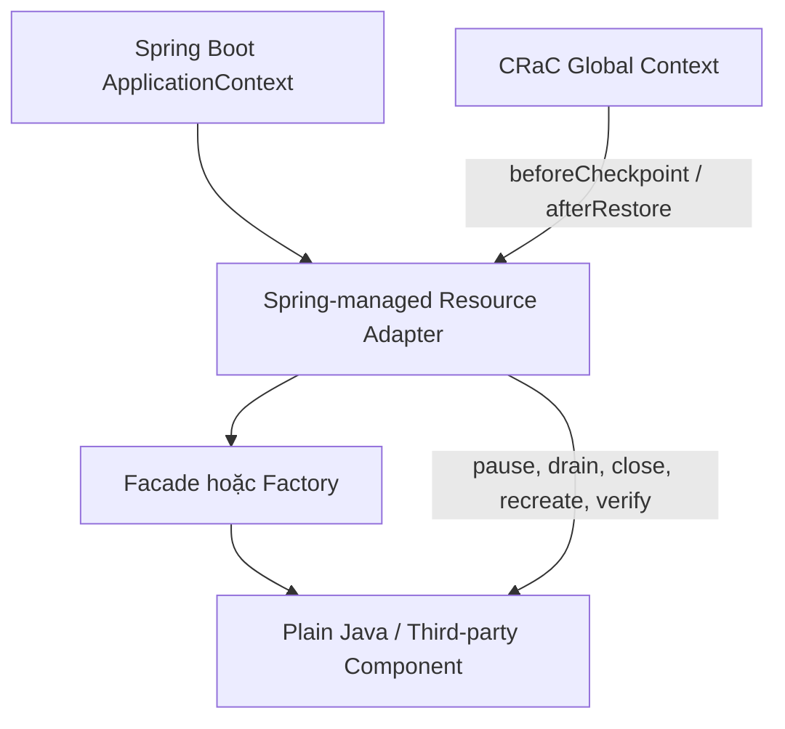

# Tích hợp Resource tùy chỉnh cho thành phần không thuộc Spring

Trong ứng dụng Spring Boot, không phải mọi thành phần đều do Spring tạo và quản lý vòng đời. Một thư viện bên thứ ba có thể tự tạo client, engine hoặc worker; một thành phần native có thể được khởi tạo qua factory riêng; hoặc ứng dụng có thể dùng một object Java thuần được tạo thủ công. Spring không tự biết khi nào phải tạm dừng, đóng hay khởi tạo lại những tài nguyên này khi tiến trình thực hiện CRaC checkpoint và restore.

CRaC cung cấp `org.crac.Resource` để ứng dụng mô tả hai thời điểm trong vòng đời checkpoint:

- `beforeCheckpoint(...)`: chuẩn bị tài nguyên trước khi trạng thái tiến trình được chụp.
- `afterRestore(...)`: phục hồi tài nguyên sau khi tiến trình được khôi phục.

Với thành phần không thuộc Spring, cách tích hợp thường dùng là tạo một **adapter Resource**. Adapter giữ tham chiếu đến component hoặc một facade quản lý component, rồi chuyển callback CRaC thành các thao tác lifecycle mà thư viện cung cấp. Spring quản lý adapter và các dependency cần thiết; CRaC gọi adapter qua global context.

Điểm cần phân biệt là một object triển khai `Resource` chưa tự động được CRaC gọi chỉ vì nó là Spring bean. Ứng dụng phải đăng ký object đó với CRaC context đúng một lần. Đồng thời, callback cần tuân thủ ownership và thứ tự phụ thuộc của tài nguyên mà adapter quản lý.

## 1. Khi nào cần Resource tùy chỉnh?

Một số thành phần thường không trực tiếp thuộc lifecycle của Spring:

| Thành phần | Vấn đề khi checkpoint | Công việc adapter có thể điều phối |
|---|---|---|
| Client của thư viện bên thứ ba | Giữ socket, connection pool hoặc thread nội bộ | Dừng request mới, drain thao tác, đóng client và tạo client mới sau restore |
| Engine xử lý dữ liệu | Giữ buffer, native memory hoặc worker thread | Flush buffer, dừng worker, giải phóng engine và khởi tạo lại |
| SDK cloud tự tạo | Giữ credential, HTTP connection hoặc token | Đóng client cũ, đọc cấu hình/credential hiện hành và tạo SDK client mới |
| Bộ xử lý native/JNI | Giữ handle hoặc context do native code cấp phát | Gọi API native để giải phóng và tạo lại context sau restore |
| Thư viện có scheduler riêng | Có thread nền hoặc lịch chạy gắn với thời gian cũ | Tạm dừng, chờ tác vụ kết thúc và khởi động lại theo thời điểm hiện tại |
| Object Java thuần do ứng dụng tạo thủ công | Không có Spring bean lifecycle để tích hợp | Bọc object bằng adapter và đăng ký callback CRaC rõ ràng |

Không cần tạo Resource riêng cho mọi object. Chỉ những tài nguyên cần hành động trước checkpoint hoặc sau restore mới cần được quản lý. Một object chỉ chứa dữ liệu bất biến trong heap và không phụ thuộc môi trường có thể không cần callback.

## 2. Phân biệt ba lớp lifecycle

Trong ứng dụng Spring Boot dùng CRaC, có thể tồn tại ba lớp lifecycle khác nhau:

1. **Lifecycle của Spring bean:** Spring tạo bean, inject dependency và thực hiện callback như `@PostConstruct`, `InitializingBean`, `SmartLifecycle` hoặc `@PreDestroy`.
2. **Lifecycle của component bên ngoài:** thư viện có thể cung cấp `start()`, `stop()`, `close()`, `shutdown()`, `pause()` hoặc factory riêng. Nếu component không phải bean, Spring không tự gọi các method này.
3. **Lifecycle của CRaC Resource:** CRaC gọi `beforeCheckpoint` và `afterRestore` trên Resource đã đăng ký với context.

Adapter là cầu nối giữa lớp thứ hai và lớp thứ ba. Spring có thể tạo adapter như một bean để inject factory, cấu hình và facade. Nhưng callback CRaC chỉ chạy khi adapter được đăng ký với CRaC context.



Không nên gộp lifecycle Spring shutdown với lifecycle checkpoint một cách tùy tiện. `@PreDestroy` thường được gọi khi ApplicationContext đóng; checkpoint không nhất thiết đóng ApplicationContext. `beforeCheckpoint` và `afterRestore` phải xử lý trạng thái tiến trình đang được checkpoint/restore, còn shutdown thông thường vẫn cần một đường đóng tài nguyên phù hợp.

## 3. API `org.crac.Resource`

Một Resource triển khai hai callback:

```java
import org.crac.Context;
import org.crac.Resource;

public final class ExampleResource implements Resource {

    @Override
    public void beforeCheckpoint(Context<? extends Resource> context)
            throws Exception {
        // Dừng hoặc đóng tài nguyên trước checkpoint.
    }

    @Override
    public void afterRestore(Context<? extends Resource> context)
            throws Exception {
        // Tạo lại hoặc xác thực tài nguyên sau restore.
    }
}
```

`beforeCheckpoint` được gọi trong giai đoạn chuẩn bị checkpoint. Resource nên dừng việc nhận công việc mới, chờ công việc đang chạy kết thúc và đưa tài nguyên về trạng thái có thể lưu. Nếu callback không thể chuẩn bị an toàn, nó nên báo lỗi để quy trình checkpoint bị từ chối thay vì âm thầm tiếp tục với trạng thái không rõ ràng.

`afterRestore` được gọi khi tiến trình đã được khôi phục. Resource nên tạo lại hoặc làm mới những thứ phụ thuộc môi trường như kết nối, native context, token hoặc thread nền. Chỉ hoàn tất callback sau khi tài nguyên mà nó sở hữu đã đạt trạng thái sẵn sàng theo yêu cầu.

Không đưa logic nghiệp vụ tùy ý vào callback. Hãy tập trung vào lifecycle của tài nguyên: pause, drain, flush, close, create, initialize và verify.

## 4. Thiết kế adapter cho một component Java thuần

Giả sử ứng dụng sử dụng một thư viện xử lý tài liệu tên `LegacyEngine`. Thư viện không biết Spring và không triển khai `org.crac.Resource`, nhưng cung cấp các thao tác:

- Tạo instance qua factory.
- `start()` để khởi động engine.
- `stopAccepting()` để ngừng nhận công việc mới.
- `awaitDrained(...)` để chờ tác vụ đang chạy kết thúc.
- `close()` để giải phóng thread, buffer và native handle.
- `verifyReady()` để xác nhận engine hoạt động.

Ứng dụng có thể định nghĩa một interface nhỏ đại diện cho hợp đồng mà adapter cần:

```java
import java.time.Duration;

public interface LegacyEngine extends AutoCloseable {
    void start() throws Exception;
    void stopAccepting() throws Exception;
    boolean awaitDrained(Duration timeout) throws Exception;
    void resumeAccepting() throws Exception;
    void verifyReady() throws Exception;
    void process(Document document) throws Exception;

    @Override
    void close() throws Exception;
}
```

Interface này là lớp adapter của ứng dụng; implementation thực tế có thể gọi API của thư viện bên thứ ba. Nếu thư viện dùng tên method khác, hãy ánh xạ các method tương ứng thay vì yêu cầu sửa thư viện.

Factory chịu trách nhiệm tạo instance mới:

```java
public interface LegacyEngineFactory {
    LegacyEngine create() throws Exception;
}
```

Factory nên lấy cấu hình, đường dẫn, credential và endpoint hiện hành khi tạo component. Không giữ sẵn các giá trị có thời hạn trong factory nếu chúng có thể hết hạn trong lúc checkpoint image được lưu.

## 5. Dùng facade để thay component sau restore

Một khó khăn phổ biến là các Spring bean khác có thể đang giữ reference đến component cũ. Nếu adapter đóng component đó rồi tạo object mới, các bean đang giữ reference trực tiếp vẫn gọi object cũ đã đóng.

Giải pháp là inject một facade ổn định vào các bean Spring. Facade giữ reference có thể thay thế đến component thực tế. Các consumer gọi qua facade, còn Resource adapter chịu trách nhiệm thay instance sau restore.

```java
import java.time.Duration;

public final class LegacyEngineHandle {
    private final LegacyEngineFactory factory;
    private volatile LegacyEngine current;

    public LegacyEngineHandle(LegacyEngineFactory factory)
            throws Exception {
        this.factory = factory;
        this.current = createStartedEngine();
    }

    public void process(Document document) throws Exception {
        LegacyEngine engine = current;
        if (engine == null) {
            throw new IllegalStateException("Legacy engine is not ready");
        }
        engine.process(document);
    }

    public synchronized void closeForCheckpoint(Duration timeout)
            throws Exception {
        LegacyEngine engine = current;
        if (engine == null) {
            return;
        }

        engine.stopAccepting();
        if (!engine.awaitDrained(timeout)) {
            IllegalStateException failure = new IllegalStateException(
                    "Legacy engine did not drain before checkpoint");
            try {
                engine.resumeAccepting();
            } catch (Exception resumeFailure) {
                failure.addSuppressed(resumeFailure);
            }
            throw failure;
        }

        try {
            engine.close();
            current = null;
        } catch (Exception failure) {
            try {
                engine.resumeAccepting();
            } catch (Exception resumeFailure) {
                failure.addSuppressed(resumeFailure);
            }
            throw failure;
        }
    }

    public synchronized void recreateAfterRestore() throws Exception {
        if (current != null) {
            throw new IllegalStateException(
                    "Legacy engine is already installed");
        }

        LegacyEngine replacement = createStartedEngine();
        current = replacement;
    }

    private LegacyEngine createStartedEngine() throws Exception {
        LegacyEngine engine = factory.create();
        try {
            engine.start();
            engine.verifyReady();
            return engine;
        } catch (Exception failure) {
            try {
                engine.close();
            } catch (Exception cleanupFailure) {
                failure.addSuppressed(cleanupFailure);
            }
            throw failure;
        }
    }
}
```

Trong ví dụ, `current` là `volatile` để thread gọi facade nhìn thấy instance mới được công bố. Việc thay reference không tự bảo vệ các thao tác đang chạy trên instance cũ; đó là lý do `stopAccepting()` và `awaitDrained()` phải đảm bảo mọi thao tác đã bắt đầu đều kết thúc trước khi `close()` được gọi.

Hợp đồng của `LegacyEngine` cần bảo đảm `stopAccepting()` ngăn tác vụ mới, kể cả khi một consumer đã lấy reference đến engine ngay trước thời điểm dừng. Nếu không, cần thêm admission gate hoặc lock ở facade để loại bỏ race giữa `process()` và `closeForCheckpoint()`.

`createStartedEngine()` đóng instance nếu khởi tạo thất bại. Trong code production, cần xử lý cả lỗi khi `close()` trong khối cleanup và gắn exception cleanup vào exception ban đầu bằng `addSuppressed()` để không mất nguyên nhân gốc.

## 6. Viết Resource adapter

Adapter không cần biết component là thư viện nào. Nó chỉ gọi lifecycle qua facade:

```java
import org.crac.Context;
import org.crac.Resource;

import java.time.Duration;

public final class LegacyEngineCracResource implements Resource {
    private final LegacyEngineHandle handle;
    private final Duration drainTimeout;

    public LegacyEngineCracResource(
            LegacyEngineHandle handle,
            Duration drainTimeout) {
        this.handle = handle;
        this.drainTimeout = drainTimeout;
    }

    @Override
    public void beforeCheckpoint(Context<? extends Resource> context)
            throws Exception {
        handle.closeForCheckpoint(drainTimeout);
    }

    @Override
    public void afterRestore(Context<? extends Resource> context)
            throws Exception {
        handle.recreateAfterRestore();
    }
}
```

Resource adapter giữ một tham chiếu ổn định đến facade. Khi checkpoint, nó đóng component hiện tại. Khi restore, nó yêu cầu factory tạo component mới rồi mới công bố qua facade.

Nếu component có thể được mở lại an toàn trên cùng instance, adapter có thể gọi `pause/close` trước checkpoint và `reopen/start` sau restore. Nhưng với thư viện không có cam kết restartable, tạo instance mới từ factory thường dễ kiểm soát hơn. Hãy tuân thủ tài liệu lifecycle của chính thư viện.

## 7. Đăng ký adapter trong Spring Boot

Có thể để Spring tạo adapter và đăng ký nó với CRaC global context sau khi các singleton cần thiết đã được tạo. Ví dụ dưới đây dùng `SmartInitializingSingleton` làm điểm đăng ký:

```java
import org.crac.Core;
import org.springframework.beans.factory.SmartInitializingSingleton;
import org.springframework.context.annotation.Bean;
import org.springframework.context.annotation.Configuration;

import java.time.Duration;

@Configuration
public class LegacyEngineCracConfiguration {

    @Bean
    LegacyEngineHandle legacyEngineHandle(LegacyEngineFactory factory)
            throws Exception {
        return new LegacyEngineHandle(factory);
    }

    @Bean
    LegacyEngineCracResource legacyEngineCracResource(
            LegacyEngineHandle handle) {
        return new LegacyEngineCracResource(
                handle,
                Duration.ofSeconds(30));
    }

    @Bean
    SmartInitializingSingleton registerLegacyEngineCracResource(
            LegacyEngineCracResource resource) {
        return () -> Core.getGlobalContext().register(resource);
    }
}
```

`SmartInitializingSingleton.afterSingletonsInstantiated()` được gọi sau khi các singleton thông thường đã được tạo. Bean đăng ký lấy Resource qua dependency injection nên adapter và facade đã tồn tại khi đăng ký. `Core.getGlobalContext().register(resource)` đưa Resource vào global context để CRaC gọi callback.

Trong ứng dụng thật, cần cung cấp `LegacyEngineFactory` dưới dạng bean hoặc adapter tới factory của thư viện. Nếu thư viện tự tạo component, factory có thể là lớp bao quanh API đó. Không đăng ký cùng một Resource nhiều lần khi có nhiều configuration class hoặc nhiều ApplicationContext.

### 7.1. Vì sao đăng ký một lần?

Nếu cùng Resource được đăng ký nhiều lần, callback có thể bị gọi nhiều lần cho cùng một object. Điều đó dễ dẫn đến đóng component hai lần, tạo nhiều instance sau restore hoặc thực hiện cleanup lặp lại.

Hãy bảo đảm:

- Chỉ có một bean registrar chịu trách nhiệm đăng ký Resource.
- Không đăng ký trong mỗi request hoặc mỗi lần tạo component.
- Không đăng ký lại từ `afterRestore()`.
- Nếu ứng dụng có parent/child ApplicationContext hoặc nhiều context, xác định rõ context nào sở hữu Resource.
- Giữ Resource và facade sống trong suốt vòng đời tiến trình.

Không tự ý tạo một global context riêng nếu API CRaC yêu cầu dùng `Core.getGlobalContext()` cho callback của tiến trình. Đọc tài liệu của đúng bản `org.crac` và JDK đang triển khai.

## 8. Thứ tự đăng ký khi có nhiều Resource

Một ứng dụng có thể có nhiều Resource tùy chỉnh: database client, engine xử lý, message consumer và scheduler. Chúng có thể phụ thuộc nhau.

Ví dụ:

```text
CredentialProvider
       ↓
DatabaseClient
       ↓
OrderProcessor
       ↓
BackgroundWorker
```

Khi phục hồi, dependency phải sẵn sàng trước thành phần sử dụng nó. Khi chuẩn bị checkpoint, thành phần phụ thuộc phải dừng trước dependency.

Với các Resource đăng ký trong cùng context, thứ tự callback được thiết kế để hỗ trợ quan hệ phụ thuộc: `beforeCheckpoint` chạy theo thứ tự ngược với đăng ký; `afterRestore` chạy theo thứ tự đăng ký. Vì vậy, hãy đăng ký dependency trước rồi mới đăng ký dependent.

```java
Core.getGlobalContext().register(credentialResource);
Core.getGlobalContext().register(databaseResource);
Core.getGlobalContext().register(processorResource);
Core.getGlobalContext().register(workerResource);
```

Với thứ tự trên:

- Trước checkpoint: worker → processor → database → credential.
- Sau restore: credential → database → processor → worker.

Đối với resource phức tạp hoặc có nhiều dependency nội bộ, có thể dùng một coordinator duy nhất để quản lý thứ tự tường minh. Không đăng ký cả coordinator lẫn từng resource con nếu điều đó khiến cùng một tài nguyên bị đóng/mở hai lần.

## 9. Tích hợp component có lifecycle riêng

Không phải thư viện nào cũng có cùng API. Adapter cần ánh xạ callback CRaC sang lifecycle thực tế.

| API thư viện | Có thể ánh xạ trong `beforeCheckpoint` | Có thể ánh xạ trong `afterRestore` |
|---|---|---|
| `start()` / `close()` | Ngừng nhận việc và gọi `close()` | Tạo instance mới và gọi `start()` |
| `pause()` / `resume()` | Pause, drain và giải phóng tài nguyên không thể giữ | Tạo lại kết nối rồi resume |
| `shutdown()` / factory | Shutdown instance hiện tại | Gọi factory tạo instance mới |
| `flush()` / `dispose()` | Flush buffer rồi dispose | Tạo context mới, nạp cấu hình và dữ liệu cần thiết |
| Native `destroy()` / `create()` | Giải phóng native handle/context | Cấp phát context mới và xác thực |

Nếu thư viện đã có tích hợp CRaC chính thức, ưu tiên dùng tích hợp đó thay vì tạo adapter thứ hai làm trùng lifecycle. Nếu thư viện cung cấp callback riêng, adapter có thể gọi callback đó hoặc bridge giữa hai API.

Không gọi `close()` nếu tài liệu thư viện chỉ cho phép `shutdown()` một lần và không có cách tạo instance mới. Ngược lại, không giả định `stop()` là đủ để giải phóng socket hoặc native memory. Cần xác định chính xác ý nghĩa từng method.

## 10. Xử lý lỗi trong callback

Callback CRaC là một phần của ranh giới checkpoint/restore. Bỏ qua lỗi ở đây có thể khiến image được tạo từ trạng thái chưa an toàn hoặc instance sau restore nhận công việc khi dependency chưa sẵn sàng.

### 10.1. `beforeCheckpoint` thất bại

Ví dụ engine không thể drain trong thời hạn:

- Không tiếp tục đóng những dependency mà engine còn cần.
- Báo lỗi từ callback để checkpoint bị từ chối.
- Nếu đã tạm dừng nhận việc, thử resume theo trạng thái thực tế.
- Nếu cleanup chỉ hoàn tất một phần, đánh dấu instance chưa sẵn sàng và thực hiện quy trình phục hồi có kiểm soát.

Không bắt exception rồi chỉ ghi log. Điều đó khiến CRaC có thể tiếp tục trong khi tài nguyên vẫn hoạt động hoặc đang ở trạng thái không xác định.

### 10.2. `afterRestore` thất bại

Nếu factory không tạo được component hoặc `verifyReady()` thất bại:

- Không công bố component là sẵn sàng.
- Không mở traffic hoặc khởi động dependent worker.
- Đóng instance tạo dở nếu có thể.
- Trả lỗi từ callback để quá trình phục hồi được nhận biết là thất bại.
- Dùng retry có giới hạn hoặc để bộ điều phối khởi động instance mới theo chính sách triển khai.

Không retry vô hạn trong callback. Hãy đặt timeout và phân loại lỗi tạm thời với lỗi cấu hình.

### 10.3. Idempotency và trạng thái lifecycle

Callback và các method lifecycle nên có trạng thái rõ ràng, chẳng hạn `RUNNING`, `PAUSED`, `CLOSED`, `RESTORING` và `FAILED`. Đừng chỉ dùng một boolean `started` cho mọi trạng thái.

Nếu callback có thể được gọi trong nhiều chu kỳ checkpoint–restore, logic phải xử lý đúng trạng thái hiện tại. Ví dụ, `closeForCheckpoint()` có thể trả về ngay khi component đã đóng; `recreateAfterRestore()` phải từ chối tạo trùng nếu instance hiện tại vẫn đang hoạt động.

Idempotent không có nghĩa có thể gọi method đồng thời tùy ý. Các thao tác lifecycle vẫn cần được tuần tự hóa và phối hợp với thread nghiệp vụ.

## 11. Component cần đóng hay chỉ cần pause?

Không phải tài nguyên nào cũng cần hủy hoàn toàn trước checkpoint. Quyết định phụ thuộc vào khả năng restore của tài nguyên và thư viện:

- **Pause:** dùng khi component có thể tiếp tục an toàn sau restore và tài liệu runtime cho phép giữ trạng thái của nó.
- **Drain:** dùng để chờ công việc hiện tại hoàn tất trước khi snapshot.
- **Flush:** ghi dữ liệu buffer cần lưu ra đích bền vững trước checkpoint.
- **Close:** dùng khi FD/socket/session không thể giữ qua restore hoặc thư viện yêu cầu đóng.
- **Recreate:** dùng khi instance cũ không thể mở lại hoặc phụ thuộc môi trường có thể thay đổi.
- **Verify:** dùng sau restore để xác nhận component mới thật sự hoạt động.

Ví dụ, một parser chỉ giữ metadata trong heap có thể không cần đóng. Một HTTP client giữ connection pool thường cần đóng và tạo lại. Một engine native có thể cần gọi `destroy()` để giải phóng handle rồi gọi `create()` sau restore.

## 12. Spring bean nào nên sở hữu adapter?

Đặt adapter ở lớp cấu hình hoặc integration module phù hợp với component. Tránh đăng ký Resource từ controller hoặc service nghiệp vụ vì lifecycle checkpoint là mối quan tâm cấp ứng dụng.

Một cấu trúc package có thể là:

```text
com.example.application
├── config
│   └── CracConfiguration.java
├── integration
│   └── legacy
│       ├── LegacyEngineFactory.java
│       ├── LegacyEngineHandle.java
│       └── LegacyEngineCracResource.java
└── order
    └── OrderService.java
```

`OrderService` chỉ phụ thuộc facade `LegacyEngineHandle` hoặc một interface nghiệp vụ ổn định. Nó không cần biết CRaC callback được đăng ký ở đâu. `CracConfiguration` chịu trách nhiệm nối Spring bean, factory và Resource adapter.

Nếu component không nên được truy cập trực tiếp từ các bean khác, giữ class triển khai ở package integration và chỉ expose facade. Điều này giúp tránh bean giữ reference đến instance cũ sau restore.

## 13. Phân biệt CRaC callback với Spring shutdown/startup callback

Spring có các cơ chế như `@PostConstruct`, `InitializingBean`, `SmartInitializingSingleton`, `SmartLifecycle`, `ContextRefreshedEvent` và `@PreDestroy`. Chúng phục vụ lifecycle của ApplicationContext.

| Cơ chế | Khi nào được gọi | Vai trò |
|---|---|---|
| `@PostConstruct` | Sau khi bean được inject và khởi tạo | Chuẩn bị bean trong startup Spring |
| `SmartInitializingSingleton` | Sau khi các singleton thông thường đã tạo | Có thể dùng làm điểm đăng ký Resource một lần |
| `SmartLifecycle.start()` | Khi lifecycle processor khởi động component | Khởi động component theo pha của Spring |
| `SmartLifecycle.stop()` | Khi Spring dừng lifecycle | Dừng component khi context shutdown |
| `@PreDestroy` | Khi bean bị hủy | Cleanup trong shutdown thông thường |
| CRaC `beforeCheckpoint()` | Khi CRaC chuẩn bị checkpoint | Chuẩn bị trạng thái tiến trình cho snapshot |
| CRaC `afterRestore()` | Sau khi CRaC khôi phục tiến trình | Phục hồi tài nguyên sau snapshot |

Có thể dùng `SmartLifecycle` để quản lý start/stop của một component do Spring quản lý, nhưng không nên mặc định nó thay thế `Resource`. Checkpoint không nhất thiết là một lần đóng ApplicationContext rồi tạo context mới. Adapter CRaC phải được thiết kế riêng cho hai callback của CRaC.

Nếu đã dùng một thư viện Spring/Boot có tích hợp CRaC chính thức, hãy kiểm tra thứ tự và cách tích hợp của phiên bản đó. Tránh vừa để auto-configuration quản lý một tài nguyên, vừa đăng ký adapter tùy chỉnh đóng cùng tài nguyên lần nữa.

## 14. Kiểm thử adapter

Kiểm thử cần xác nhận cả callback lẫn trạng thái thật của component. Có thể dùng một fake component ghi lại thứ tự method để kiểm tra logic adapter mà không cần khởi chạy CRaC ở mỗi unit test.

### 14.1. Unit test cho adapter

Một fake engine có thể ghi nhận các thao tác:

```java
public final class FakeLegacyEngine implements LegacyEngine {
    private final List<String> events;
    private boolean accepting;

    public FakeLegacyEngine(List<String> events) {
        this.events = events;
    }

    @Override
    public void start() {
        accepting = true;
        events.add("start");
    }

    @Override
    public void stopAccepting() {
        accepting = false;
        events.add("stopAccepting");
    }

    @Override
    public boolean awaitDrained(Duration timeout) {
        events.add("awaitDrained");
        return true;
    }

    @Override
    public void resumeAccepting() {
        accepting = true;
        events.add("resumeAccepting");
    }

    @Override
    public void verifyReady() {
        events.add("verifyReady");
    }

    @Override
    public void process(Document document) {
        if (!accepting) {
            throw new IllegalStateException("Engine is paused");
        }
        events.add("process");
    }

    @Override
    public void close() {
        accepting = false;
        events.add("close");
    }
}
```

Unit test có thể xác nhận:

- `beforeCheckpoint` gọi stop, drain rồi close đúng thứ tự.
- Timeout khi drain khiến callback báo lỗi và không đóng component đang được sử dụng.
- `afterRestore` gọi factory, start, verify rồi mới công bố instance.
- Factory thất bại không để facade trỏ đến instance dở dang.
- Gọi callback lặp không tạo nhiều instance hoặc đóng tài nguyên nhiều lần ngoài dự kiến.
- Consumer dùng facade nhìn thấy instance mới sau restore.

### 14.2. Integration test trên JDK CRaC

Unit test không chứng minh JDK thực sự gọi callback khi checkpoint/restore. Cần chạy integration test trên JDK CRaC và môi trường hệ điều hành được hỗ trợ:

1. Khởi động Spring Boot và xác nhận Resource đã được đăng ký.
2. Xác nhận component bên ngoài ở trạng thái sẵn sàng.
3. Tạo checkpoint và kiểm tra log `beforeCheckpoint`.
4. Xác nhận component cũ đã dừng và tài nguyên được giải phóng.
5. Restore image và kiểm tra `afterRestore`.
6. Xác nhận factory tạo instance mới, instance mới được verify và facade trỏ đến instance đó.
7. Gọi chức năng nghiệp vụ qua Spring service để chứng minh consumer sử dụng component mới.
8. Thử factory hoặc dependency thất bại và xác nhận readiness không thành công.

Nếu triển khai nhiều instance từ cùng image, kiểm tra mỗi instance có tài nguyên, ID và connection riêng. Không để trạng thái riêng của một instance được giữ nguyên trong image dùng chung.

## 15. Những lỗi thường gặp

**Nghĩ rằng Spring bean tự động là CRaC Resource.** Spring quản lý bean lifecycle; CRaC chỉ gọi resource đã đăng ký với context. Hãy đăng ký rõ ràng.

**Đăng ký Resource từ nhiều nơi.** Cùng một object có thể nhận callback lặp. Dùng một registrar duy nhất và đăng ký một lần.

**Đóng object mà các bean khác đang giữ reference trực tiếp.** Sau restore, các bean đó vẫn gọi instance cũ. Inject facade ổn định hoặc dùng cơ chế thay thế dependency có kiểm soát.

**Tạo component mới nhưng không công bố an toàn.** Consumer có thể thấy instance chưa khởi tạo. Chỉ cập nhật reference sau khi start và verify thành công.

**Không drain công việc trước khi close.** Thread đang chạy có thể truy cập object sau khi bị đóng. Dừng nhận việc mới và chờ tác vụ hoàn tất.

**Dùng `@PreDestroy` thay cho `beforeCheckpoint`.** Checkpoint không nhất thiết hủy ApplicationContext. Tích hợp riêng Resource callback.

**Giữ credential hoặc endpoint cũ trong factory.** Sau restore, thông tin có thể hết hạn hoặc thay đổi. Đọc cấu hình hiện hành khi tạo component mới.

**Nuốt exception trong callback.** Checkpoint hoặc restore có thể tiếp tục trong trạng thái không an toàn. Báo lỗi và giữ readiness thất bại khi cần.

**Đăng ký cả adapter và component con.** Cùng tài nguyên có thể bị close/recreate hai lần. Xác định một chủ sở hữu lifecycle duy nhất.

**Không kiểm thử trên JDK CRaC thật.** Unit test chỉ kiểm tra logic adapter. Cần integration test checkpoint/restore trên runtime và hệ điều hành đích.

## 16. Tự kiểm tra mức độ hiểu

1. **Vì sao cần Resource adapter cho thư viện không thuộc Spring?** Vì Spring không tự quản lý lifecycle checkpoint/restore của object mà thư viện tạo hoặc quản lý riêng; adapter chuyển callback CRaC thành các thao tác lifecycle của thư viện.
2. **Một Spring bean triển khai `Resource` có tự động được CRaC gọi không?** Không. Nó phải được đăng ký với CRaC context, thường qua `Core.getGlobalContext().register(resource)`.
3. **Vì sao nên dùng facade khi tạo lại component sau restore?** Các bean khác có thể giữ reference đến object cũ; facade ổn định cho phép chuyển sang instance mới sau khi khởi tạo thành công.
4. **`beforeCheckpoint` nên làm gì trước khi gọi close?** Ngừng nhận việc mới, drain các thao tác đang chạy và đưa component về trạng thái an toàn.
5. **Khi nào nên tạo instance mới thay vì mở lại instance cũ?** Khi thư viện không cam kết component có thể restart sau close hoặc tài nguyên phụ thuộc môi trường cần được tạo mới.
6. **Vì sao không nên dùng `@PreDestroy` thay cho CRaC callback?** `@PreDestroy` thuộc lifecycle hủy bean/ApplicationContext; checkpoint không nhất thiết hủy context.
7. **Resource phụ thuộc cần được đăng ký theo thứ tự nào?** Đăng ký dependency trước rồi dependent sau để callback restore phục hồi dependency trước và checkpoint đóng dependent trước.
8. **Điều gì chứng minh adapter hoạt động trong CRaC?** Integration test tạo checkpoint, restore, xác nhận callback, component mới và chức năng nghiệp vụ qua facade hoạt động trên runtime đích.

## Kết luận

Để tích hợp một thành phần không thuộc Spring với CRaC trong Spring Boot, hãy tạo một adapter triển khai `org.crac.Resource`, để Spring quản lý adapter và các dependency, rồi đăng ký adapter một lần với `Core.getGlobalContext()`. Adapter chuyển `beforeCheckpoint` thành các thao tác dừng, drain và đóng; `afterRestore` thành tạo mới, khởi động và xác thực component.

Với thành phần có thể được thay thế sau restore, hãy để các bean nghiệp vụ truy cập qua facade ổn định thay vì giữ reference trực tiếp đến instance cũ. Tôn trọng thứ tự phụ thuộc, xử lý lỗi callback rõ ràng và giữ readiness thất bại cho đến khi component mới hoạt động. Cuối cùng, kết hợp unit test cho adapter với integration test checkpoint/restore trên đúng JDK CRaC và môi trường triển khai.
