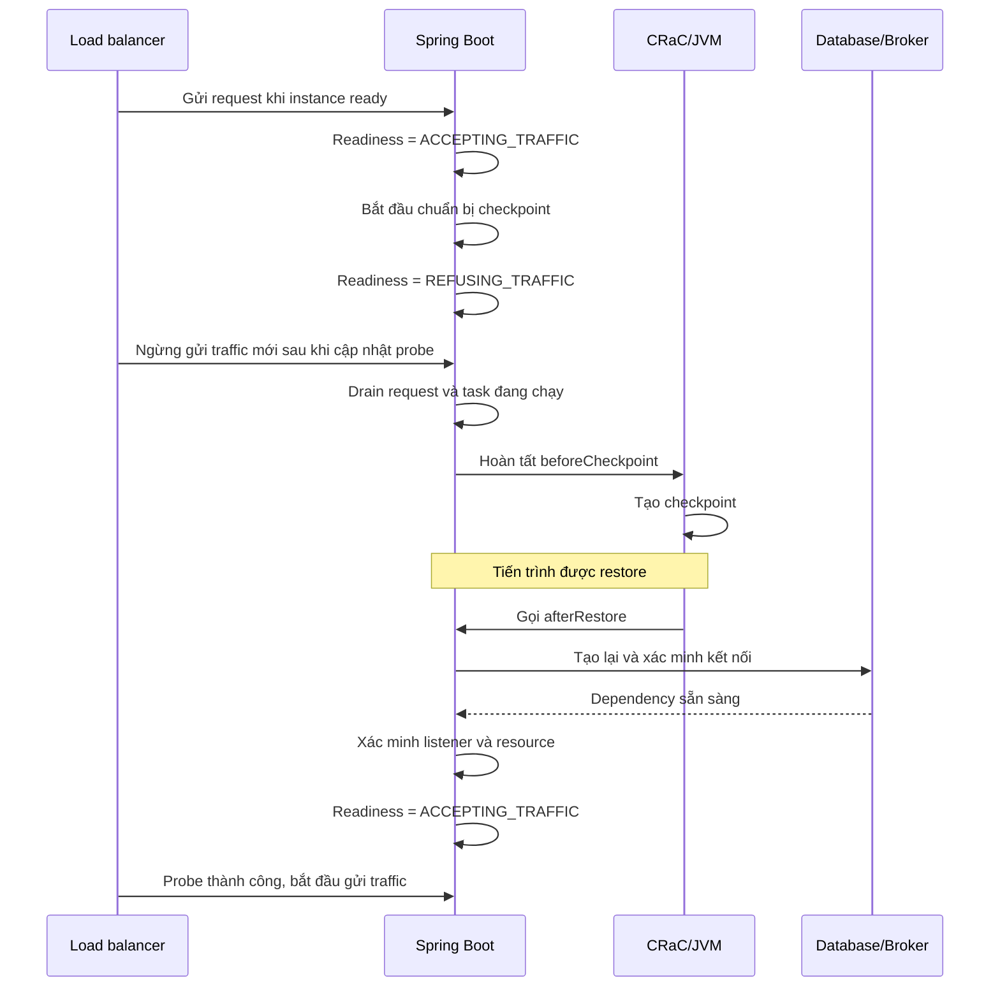

# Readiness, liveness và thời điểm cho phép nhận lưu lượng sau restore

Khi một ứng dụng Spring Boot được khôi phục từ checkpoint CRaC, tiến trình có thể trở lại rất nhanh nhưng điều đó chưa có nghĩa ứng dụng đã sẵn sàng nhận request. Database pool có thể chưa kết nối lại, broker consumer chưa được khởi động, cache cần kiểm tra freshness hoặc HTTP listener chưa hoàn tất vòng đời phục hồi. Nếu load balancer gửi traffic ngay khi process xuất hiện, request có thể đi vào một instance chưa đủ điều kiện phục vụ.

Spring Boot cung cấp mô hình **liveness** và **readiness** để biểu diễn hai trạng thái khác nhau. Liveness cho biết tiến trình còn hoạt động và có thể tiếp tục chạy hay không. Readiness cho biết ứng dụng có nên nhận lưu lượng mới hay không. Trong quá trình restore, readiness cần tiếp tục ở trạng thái từ chối traffic cho tới khi các resource bắt buộc được phục hồi, xác minh và listener có thể phục vụ.

Điểm quan trọng là **process restored không đồng nghĩa application ready**. Cần đặt đúng thời điểm chuyển `ReadinessState` sang `ACCEPTING_TRAFFIC`, đồng thời giữ liveness độc lập với các dependency tạm thời chưa sẵn sàng.

## 1. Phân biệt liveness và readiness

Hai trạng thái trả lời hai câu hỏi vận hành khác nhau:

| Trạng thái | Câu hỏi | Ý nghĩa khi kiểm tra |
| --- | --- | --- |
| Liveness | Ứng dụng có còn sống và có khả năng tiếp tục hoạt động không? | Nếu thất bại kéo dài, nền tảng có thể cần khởi động lại instance |
| Readiness | Instance có thể nhận request mới ngay bây giờ không? | Nếu thất bại, load balancer hoặc service không gửi traffic nghiệp vụ tới instance |

Một ứng dụng có thể còn sống nhưng chưa sẵn sàng. Ví dụ, JVM đã restore thành công nhưng database chưa chấp nhận kết nối. Trong trường hợp này, liveness vẫn có thể là healthy trong khi readiness là not ready.

Ngược lại, nếu ứng dụng rơi vào trạng thái nội bộ không thể phục hồi, chẳng hạn một lỗi runtime nghiêm trọng khiến tiến trình không thể tiếp tục xử lý, liveness có thể chuyển sang trạng thái lỗi để nền tảng thực hiện restart theo chính sách.

Không nên gộp hai trạng thái thành một health check chung. Nếu liveness phụ thuộc trực tiếp vào database, một sự cố database có thể khiến mọi instance đồng loạt bị restart. Điều này không khắc phục được database và còn có thể tạo restart loop hoặc làm tăng tải khi hệ thống đang phục hồi.

## 2. Các trạng thái availability trong Spring Boot

Spring Boot biểu diễn trạng thái availability bằng các kiểu trong package `org.springframework.boot.availability`.

### 2.1. LivenessState

`LivenessState` có hai giá trị chính:

- `CORRECT`: ứng dụng còn có khả năng hoạt động.
- `BROKEN`: ứng dụng ở trạng thái không thể tiếp tục phục vụ theo cách an toàn và cần được xử lý như một lỗi liveness.

Liveness nên phản ánh khả năng sống của tiến trình và trạng thái nội bộ quan trọng. Không đưa các dependency bên ngoài như database, broker hoặc dịch vụ HTTP vào liveness chỉ vì chúng tạm thời không phản hồi.

### 2.2. ReadinessState

`ReadinessState` có hai giá trị:

- `ACCEPTING_TRAFFIC`: ứng dụng sẵn sàng nhận traffic.
- `REFUSING_TRAFFIC`: ứng dụng chưa sẵn sàng hoặc đang chủ động ngừng nhận traffic.

Trước checkpoint, ứng dụng nên chuyển readiness sang `REFUSING_TRAFFIC` trước khi bắt đầu drain request và resource. Sau restore, readiness tiếp tục ở trạng thái từ chối cho đến khi tất cả điều kiện phục vụ đã đạt.

### 2.3. ApplicationAvailability

`ApplicationAvailability` cho phép đọc trạng thái availability hiện tại:

```java
import org.springframework.boot.availability.ApplicationAvailability;
import org.springframework.boot.availability.LivenessState;
import org.springframework.boot.availability.ReadinessState;

public final class AvailabilityReporter {

    private final ApplicationAvailability availability;

    public AvailabilityReporter(ApplicationAvailability availability) {
        this.availability = availability;
    }

    public LivenessState liveness() {
        return availability.getLivenessState();
    }

    public ReadinessState readiness() {
        return availability.getReadinessState();
    }
}
```

`ApplicationAvailability` phản ánh các trạng thái availability mà Spring Boot đang quản lý. Nó không tự kiểm tra mọi kết nối bên ngoài và không tự chứng minh HTTP listener đã sẵn sàng. Những điều kiện đó cần được ứng dụng kiểm tra và biểu diễn qua readiness health indicators hoặc lifecycle coordinator.

## 3. Health probes của Spring Boot Actuator

Khi dùng Spring Boot Actuator, ứng dụng có thể cung cấp các endpoint health dành riêng cho liveness và readiness:

- `/actuator/health/liveness`
- `/actuator/health/readiness`

Trong môi trường Kubernetes, Spring Boot có thể tự cấu hình các health group này khi nhận diện môi trường phù hợp. Nếu cần bật rõ ràng, có thể cấu hình:

```yaml
management:
  endpoint:
    health:
      probes:
        enabled: true
```

Khi probe được bật, health group liveness thường phản ánh `livenessState`, còn readiness phản ánh `readinessState`. Ứng dụng có thể bổ sung các health indicator cần thiết vào group readiness theo yêu cầu vận hành.

Ví dụ cấu hình readiness kiểm tra thêm database và một health indicator broker do ứng dụng cung cấp:

```yaml
management:
  endpoint:
    health:
      probes:
        enabled: true
        add-additional-paths: true
      group:
        readiness:
          include: readinessState,db,broker
```

Trong ví dụ, `db` là health indicator database được Spring Boot cung cấp khi có cấu hình phù hợp; `broker` cần là một health contributor do ứng dụng hoặc thư viện tích hợp đăng ký. Chỉ đưa dependency vào readiness nếu ứng dụng thực sự không thể phục vụ khi dependency đó chưa sẵn sàng. Một dịch vụ tùy chọn hoặc chỉ dùng cho tác vụ nền có thể không cần chặn toàn bộ traffic HTTP.

Thuộc tính `add-additional-paths` cho phép cung cấp các đường dẫn probe bổ sung trên cổng server chính, thường là `/livez` và `/readyz`. Điều này hữu ích khi management endpoint chạy trên một port riêng: probe trên management port có thể healthy trong khi cổng phục vụ request nghiệp vụ chưa mở hoặc chưa hoạt động đúng. Cần kiểm tra cấu hình endpoint thực tế của ứng dụng.

### 3.1. HTTP status của health group

Thông thường, health group có trạng thái `UP` trả HTTP 200; trạng thái không healthy như `DOWN` trả mã lỗi tương ứng, thường là HTTP 503. Kubernetes và load balancer dựa vào kết quả probe để quyết định có gửi traffic hay restart container.

Health endpoint cần được bảo vệ theo chính sách bảo mật. Không trả thông tin chi tiết về credential, hostname nội bộ, URL có token hoặc exception nhạy cảm cho client không được phép.

## 4. Thời điểm thay đổi readiness trong vòng đời CRaC

Một vòng đời thường có ba thời điểm quan trọng:

1. **Trước checkpoint:** chủ động từ chối traffic mới, drain request và background task, sau đó đóng hoặc chuẩn bị các resource.
2. **Trong checkpoint và restore:** instance không nhận traffic nghiệp vụ. Trạng thái readiness phải được xem là chưa sẵn sàng.
3. **Sau restore:** khôi phục dependency và listener, kiểm tra các điều kiện phục vụ, rồi mới cho phép traffic.



Thời điểm chính xác của readiness transition phải gắn với lifecycle thực tế. Đặt readiness thành `ACCEPTING_TRAFFIC` ngay khi `afterRestore` bắt đầu là quá sớm. Đặt nó sau khi mọi resource bắt buộc và listener đã sẵn sàng mới tạo ra tín hiệu đáng tin cậy cho load balancer.

## 5. Đặt readiness về REFUSING_TRAFFIC trước checkpoint

Spring Boot phát các sự kiện availability để thay đổi trạng thái. Có thể sử dụng `AvailabilityChangeEvent.publish(...)` với `ReadinessState`.

```java
import org.springframework.context.ConfigurableApplicationContext;
import org.springframework.boot.availability.AvailabilityChangeEvent;
import org.springframework.boot.availability.ReadinessState;

public final class ReadinessController {

    private final ConfigurableApplicationContext applicationContext;

    public ReadinessController(
            ConfigurableApplicationContext applicationContext) {
        this.applicationContext = applicationContext;
    }

    public void refuseTraffic() {
        AvailabilityChangeEvent.publish(
                applicationContext,
                ReadinessState.REFUSING_TRAFFIC);
    }

    public void acceptTraffic() {
        AvailabilityChangeEvent.publish(
                applicationContext,
                ReadinessState.ACCEPTING_TRAFFIC);
    }
}
```

Trước khi yêu cầu JVM checkpoint, lifecycle coordinator có thể gọi `refuseTraffic()`, sau đó chờ ingress cập nhật và drain request. Callback `beforeCheckpoint` có thể phát lại trạng thái từ chối như một lớp bảo vệ cuối, nhưng không nên dựa vào callback đó để thay thế toàn bộ quá trình điều phối load balancer.

Nếu drain thất bại trước khi tài nguyên bị đóng, coordinator có thể khôi phục trạng thái phục vụ bằng cách xác minh resource còn hoạt động rồi mới publish `ACCEPTING_TRAFFIC`. Nếu một phần tài nguyên đã đóng hoặc không còn đáng tin cậy, giữ readiness ở `REFUSING_TRAFFIC` và phục hồi có kiểm soát.

## 6. Giữ liveness độc lập với readiness

Trong quá trình chuẩn bị checkpoint, ứng dụng chủ động ngừng nhận traffic nhưng vẫn là một tiến trình hợp lệ. Vì vậy, thông thường chỉ cần chuyển readiness sang `REFUSING_TRAFFIC`; không chuyển liveness sang `BROKEN` chỉ vì đang drain.

Ví dụ:

```java
AvailabilityChangeEvent.publish(
        applicationContext,
        ReadinessState.REFUSING_TRAFFIC);

// Liveness vẫn CORRECT trong khi ứng dụng drain có kiểm soát.
```

Liveness nên chuyển sang `BROKEN` khi có lỗi nội bộ khiến tiến trình không thể tiếp tục hoạt động an toàn và restart là cách phục hồi được thiết kế. Không dùng `BROKEN` để biểu diễn các tình huống sau:

- Database đang tạm thời không kết nối được.
- Broker chưa sẵn sàng sau restore.
- Cache đang refresh.
- Instance đang drain để chuẩn bị checkpoint.
- Ứng dụng chưa mở listener hoặc chưa nhận traffic.

Những tình huống trên thường được biểu diễn bằng readiness. Nếu dependency tạm thời lỗi, ứng dụng có thể giữ readiness ở `REFUSING_TRAFFIC`, retry kết nối theo deadline và chỉ báo liveness `BROKEN` khi tiến trình thực sự không thể tự phục hồi theo chính sách đã định.

### 6.1. Tránh restart cascade

Giả sử database bị gián đoạn trong vài phút. Nếu mọi ứng dụng đưa database health vào liveness, Kubernetes có thể restart tất cả pod cùng lúc. Những pod mới lại kết nối database, làm tăng tải vào hệ thống vốn đang lỗi. Readiness giúp ngừng gửi request tới pod chưa thể phục vụ trong khi liveness vẫn cho phép tiến trình tiếp tục retry và phục hồi.

Liveness probe nên tập trung vào trạng thái nội bộ của ứng dụng. Readiness có thể bao gồm dependency bắt buộc để phục vụ traffic. Sự phân tách này đặc biệt hữu ích trong giai đoạn restore, khi dependency được tạo lại theo thứ tự và có thể cần thêm thời gian để sẵn sàng.

## 7. Kiểm tra dependency trước khi cho phép traffic

Sau restore, không nên chỉ kiểm tra một object reference khác `null`. Cần xác minh dependency thực sự có thể thực hiện công việc.

Ví dụ các điều kiện:

- Database pool đã tạo và có thể lấy connection.
- Broker client kết nối được và có quyền cần thiết.
- Cache đã được refresh hoặc xác nhận version còn hợp lệ.
- Secret và token đã được nạp lại, còn thời hạn và đúng identity.
- Service discovery trả endpoint hợp lệ.
- Scheduler hoặc consumer chỉ được resume sau khi dependency của chúng sẵn sàng.
- HTTP listener đã bind và có thể nhận request.
- Các background worker bắt buộc đã sẵn sàng hoặc được cố ý giữ pause.

Không phải dependency nào cũng phải healthy trước khi nhận traffic. Hãy phân loại theo khả năng phục vụ: nếu database là bắt buộc cho mọi request, readiness cần phản ánh nó; nếu một broker chỉ phục vụ tác vụ nền tùy chọn, có thể giữ consumer pause mà vẫn cho API đọc hoạt động.

### 7.1. Custom HealthIndicator cho dependency

Spring Boot Actuator cho phép thêm health indicator. Ví dụ:

```java
import org.springframework.boot.actuate.health.Health;
import org.springframework.boot.actuate.health.HealthIndicator;
import org.springframework.stereotype.Component;

@Component("broker")
public final class BrokerHealthIndicator implements HealthIndicator {

    private final BrokerClient brokerClient;

    public BrokerHealthIndicator(BrokerClient brokerClient) {
        this.brokerClient = brokerClient;
    }

    @Override
    public Health health() {
        if (brokerClient.isConnectedAndAuthorized()) {
            return Health.up().build();
        }

        return Health.down()
                .withDetail("reason", "Broker is not ready")
                .build();
    }
}
```

`BrokerClient` là abstraction của ứng dụng. Phương thức kiểm tra nên có timeout ngắn và không tạo một kết nối mới quá tốn kém mỗi lần probe. Nếu health check gọi dịch vụ bên ngoài, cần tránh để probe tự tạo tải lớn hoặc treo thread của HTTP server.

Health indicator mô tả tình trạng dependency; nó không tự tạo lại kết nối. Việc restore client thuộc resource lifecycle. Khi client đã được tạo và xác minh, readiness health group mới có thể chuyển sang `UP`.

### 7.2. Readiness theo khả năng phục vụ thực tế

Không nhất thiết phải chờ mọi thành phần phụ trợ. Ví dụ một ứng dụng có API đọc catalog và consumer xử lý email. Nếu broker email chưa sẵn sàng, API đọc catalog vẫn có thể hoạt động. Có thể:

- giữ toàn ứng dụng not ready nếu broker là dependency bắt buộc của mọi request;
- tách readiness group hoặc route theo năng lực nếu kiến trúc hỗ trợ;
- cho API hoạt động nhưng giữ consumer pause nếu broker chỉ phục vụ tác vụ nền;
- biểu diễn trạng thái degraded riêng để monitoring quan sát.

Một readiness probe ở cấp instance thường quyết định traffic cho toàn pod. Vì vậy, nếu các route có yêu cầu dependency khác nhau, cần thiết kế policy sao cho probe không chặn nhiều traffic hơn mức cần thiết nhưng vẫn không gửi request tới một route không thể phục vụ.

## 8. Tích hợp readiness với CRaC Resource

Có thể đăng ký một resource điều phối trạng thái readiness. Resource này đặt readiness thành từ chối traffic trước checkpoint và chỉ chuyển sang accepting sau khi phục hồi các điều kiện cần thiết.

```java
import org.crac.Context;
import org.crac.Core;
import org.crac.Resource;
import org.springframework.boot.availability.AvailabilityChangeEvent;
import org.springframework.boot.availability.ReadinessState;
import org.springframework.context.ConfigurableApplicationContext;
import org.springframework.stereotype.Component;

@Component
public final class ReadinessCracResource implements Resource {

    private final ConfigurableApplicationContext applicationContext;
    private final RestoreCoordinator restoreCoordinator;

    public ReadinessCracResource(
            ConfigurableApplicationContext applicationContext,
            RestoreCoordinator restoreCoordinator) {
        this.applicationContext = applicationContext;
        this.restoreCoordinator = restoreCoordinator;
        Core.getGlobalContext().register(this);
    }

    @Override
    public void beforeCheckpoint(Context<? extends Resource> context)
            throws Exception {
        AvailabilityChangeEvent.publish(
                applicationContext,
                ReadinessState.REFUSING_TRAFFIC);

        restoreCoordinator.stopAcceptingNewWorkAndDrain();
    }

    @Override
    public void afterRestore(Context<? extends Resource> context)
            throws Exception {
        try {
            restoreCoordinator.restoreAndVerifyRequiredResources();
            restoreCoordinator.verifyServerCanServe();

            AvailabilityChangeEvent.publish(
                    applicationContext,
                    ReadinessState.ACCEPTING_TRAFFIC);
        } catch (Exception ex) {
            AvailabilityChangeEvent.publish(
                    applicationContext,
                    ReadinessState.REFUSING_TRAFFIC);
            throw ex;
        }
    }
}
```

`RestoreCoordinator` là interface/bean nội bộ do ứng dụng định nghĩa. Nó chịu trách nhiệm chờ các resource cần thiết được khôi phục, xác minh server và bảo đảm không còn bước bắt buộc nào đang chạy. Ví dụ này thể hiện nguyên tắc điều phối; trong một ứng dụng Spring Boot thực tế, cần kiểm tra phiên bản Spring Boot và cơ chế CRaC integration đang sử dụng để tránh đăng ký trùng resource hoặc lặp lại việc quản lý listener mà framework đã xử lý.

### 8.1. Vì sao readiness được publish cuối cùng?

Giả sử callback sau restore thực hiện các bước:

1. Tạo database pool.
2. Xác minh truy vấn đơn giản.
3. Tạo broker client và xác thực.
4. Refresh cache bắt buộc.
5. Khởi động listener hoặc xác nhận listener đã bind.
6. Xác nhận các background component cần thiết đã sẵn sàng.
7. Publish `ACCEPTING_TRAFFIC`.

Nếu readiness được publish ở bước 1, load balancer có thể gửi request trong lúc broker hoặc cache vẫn chưa sẵn sàng. Publish sau cùng giúp health probe phản ánh trạng thái phục vụ tổng thể.

Nếu một bước thất bại, giữ readiness ở `REFUSING_TRAFFIC`. Có thể retry theo chính sách có giới hạn; nếu không thể phục hồi, để lifecycle manager báo lỗi và nền tảng xử lý restart hoặc tạo instance mới.

### 8.2. Tránh callback quản lý trùng tài nguyên

Một số framework hoặc thư viện có thể tự đăng ký CRaC resource để đóng và khôi phục connection pool, HTTP client hoặc server. Nếu resource readiness tự đóng/mở cùng đối tượng, thao tác có thể bị thực hiện hai lần hoặc sai thứ tự.

Nên có một chủ sở hữu rõ ràng cho từng tài nguyên. Readiness coordinator chủ yếu điều phối và xác minh; resource chuyên biệt quản lý vòng đời của tài nguyên mà nó sở hữu. Nếu cần đồng bộ nhiều callback, dùng một coordinator có hợp đồng thứ tự rõ ràng và tuân thủ thứ tự callback của runtime đang triển khai.

## 9. Kubernetes probes và cấu hình triển khai

Kubernetes dùng ba loại probe thường gặp:

- `startupProbe`: cho ứng dụng thời gian khởi động; khi startup probe chưa thành công, liveness và readiness probe chưa được thực hiện.
- `livenessProbe`: phát hiện container cần được khởi động lại.
- `readinessProbe`: quyết định pod có được đưa vào endpoint/service để nhận traffic hay không.

Ví dụ cấu hình:

```yaml
containers:
  - name: app
    image: example/my-service:latest
    ports:
      - name: http
        containerPort: 8080
    startupProbe:
      httpGet:
        path: /actuator/health/liveness
        port: http
      periodSeconds: 5
      failureThreshold: 30
    livenessProbe:
      httpGet:
        path: /actuator/health/liveness
        port: http
      periodSeconds: 10
      failureThreshold: 3
    readinessProbe:
      httpGet:
        path: /actuator/health/readiness
        port: http
      periodSeconds: 5
      failureThreshold: 2
```

Các giá trị thời gian và ngưỡng trên chỉ là ví dụ. Cần hiệu chỉnh theo thời gian restore, thời gian kết nối lại dependency, thời gian drain và hành vi của nền tảng. Nếu restore rất nhanh, không cần đặt startup allowance quá lớn; nếu callback restore có thể kéo dài, phải bảo đảm probe không tạo restart ngoài ý muốn.

### 9.1. Vai trò của startupProbe

`startupProbe` bảo vệ ứng dụng khỏi liveness restart quá sớm trong giai đoạn startup. Với workload CRaC, cần thử nghiệm cách container runtime và orchestrator nhìn nhận tiến trình sau restore. Không nên giả định mọi môi trường sẽ xử lý freeze/restore giống nhau; thời gian probe, timeout và failure threshold cần phù hợp với quy trình triển khai.

Startup probe thường kiểm tra endpoint liveness vì nó trả lời liệu ứng dụng đã khởi tạo đủ để tiếp tục chạy hay chưa. Readiness vẫn có thể ở trạng thái từ chối traffic lâu hơn trong khi ứng dụng kết nối lại dependency.

### 9.2. Readiness probe không thay thế admission gate

Kubernetes cần thời gian cập nhật EndpointSlice và load balancer. Trong khoảng propagation, request vẫn có thể tới pod. Vì vậy, ứng dụng nên có admission gate nội bộ để từ chối request nghiệp vụ mới khi đã bắt đầu drain.

Health endpoint phải được cấu hình để probe vẫn đọc được trạng thái. Có thể tách endpoint quản trị khỏi filter admission, hoặc sử dụng đường dẫn probe bổ sung trên cổng chính. Không để readiness endpoint tự bị chặn bởi chính gate đang báo not ready.

### 9.3. Management port và application port

Nếu Actuator chạy trên management port riêng, readiness probe có thể thành công dù application port chưa mở hoặc listener nghiệp vụ chưa phục hồi. Điều này tạo tín hiệu sai cho load balancer.

Có thể dùng `management.endpoint.health.probes.add-additional-paths=true` để expose `/livez` và `/readyz` trên cổng server chính. Hãy kiểm tra endpoint đó thực sự đi qua listener mà client sẽ sử dụng và không chỉ kiểm tra một management server độc lập.

## 10. Xử lý lỗi sau restore

Không phải mọi lỗi sau restore đều có cùng cách xử lý.

| Tình huống | Readiness | Liveness | Hành động |
| --- | --- | --- | --- |
| Database đang khởi động lại | `REFUSING_TRAFFIC` nếu database bắt buộc | Thường vẫn `CORRECT` | Retry kết nối trong deadline, tiếp tục not ready |
| Broker chưa kết nối nhưng API vẫn phục vụ độc lập | Có thể accepting cho API; giữ consumer pause | `CORRECT` | Khôi phục broker riêng và theo dõi trạng thái degraded |
| Cache bắt buộc chưa refresh | `REFUSING_TRAFFIC` | `CORRECT` | Refresh và xác minh trước khi nhận request phụ thuộc cache |
| HTTP listener chưa bind | `REFUSING_TRAFFIC` | Tùy trạng thái tiến trình | Khôi phục listener, kiểm tra port và server lifecycle |
| Lỗi cấu hình không thể phục hồi | `REFUSING_TRAFFIC` | Có thể `BROKEN` nếu process không thể tiếp tục | Báo lỗi để nền tảng thay instance hoặc restart |
| Một resource tùy chọn thất bại | Theo khả năng phục vụ thực tế | Thường `CORRECT` | Degrade tính năng liên quan, không nhất thiết chặn toàn bộ app |

Nếu `afterRestore` ném exception, không publish readiness thành accepting trước đó. Việc exception có dẫn tới process exit, retry hay restart phụ thuộc runtime và lifecycle manager; ứng dụng cần có chính sách rõ ràng. Không nên bắt exception rồi bỏ qua để tiến trình tiếp tục báo ready.

## 11. Thứ tự readiness, listener và background component

Readiness là tín hiệu tổng hợp. Cần quyết định những thành phần nào phải sẵn sàng trước khi mở traffic.

Một thứ tự thường dùng:

| Giai đoạn | Thành phần | Trạng thái mong muốn |
| --- | --- | --- |
| Restore bắt đầu | Readiness | `REFUSING_TRAFFIC` |
| Dependency phục hồi | Database, broker, cache bắt buộc | Đang reconnect/verify |
| Runtime phục hồi | Executor và scheduler | Tạo mới nhưng chưa nhận job |
| Server phục hồi | HTTP listener | Đã bind và có thể nhận kết nối |
| Kiểm tra cuối | Health indicators | Tất cả điều kiện bắt buộc `UP` |
| Mở phục vụ | Admission gate | Cho phép request mới |
| Hoàn tất | Readiness | `ACCEPTING_TRAFFIC` |

Không nhất thiết phải resume mọi background component trước khi nhận traffic. Ví dụ scheduler chạy báo cáo hàng đêm có thể được khởi động sau khi API đã sẵn sàng. Ngược lại, nếu request cần broker client đồng bộ, broker phải sẵn sàng trước khi readiness accepting.

Nếu readiness và admission gate được mở ở hai thành phần khác nhau, hãy đảm bảo thứ tự không tạo khoảng thời gian load balancer gửi request trong khi gate còn đóng. Một trình tự an toàn thường là khôi phục tài nguyên, xác minh listener, mở gate nội bộ, rồi publish readiness accepting. Nếu framework tự động thay đổi readiness khi startup, cần phối hợp hoặc ghi đè trạng thái ở lifecycle phù hợp để không có sự kiện accepting sớm.

## 12. Nhiều bản restore từ cùng checkpoint

Một checkpoint có thể được dùng để tạo nhiều instance. Mỗi instance cần thực hiện quy trình readiness độc lập:

- Tạo instance identity riêng.
- Kết nối lại dependency bằng cấu hình hiện hành.
- Lấy lease hoặc quyền leader nếu cần.
- Khôi phục consumer group hoặc partition assignment.
- Xác minh cache và credential.
- Chỉ publish accepting khi chính instance đó sẵn sàng.

Không nên lưu một flag `ready=true` trước checkpoint rồi giữ nguyên sau restore. Flag đó chỉ phản ánh trạng thái của tiến trình tại thời điểm tạo ảnh, không phản ánh dependency và quyền sở hữu ở thời điểm hiện tại.

Nếu nhiều instance restore đồng thời, database và broker có thể nhận một đợt kết nối lớn. Cân nhắc retry có exponential backoff và jitter, giới hạn connection pool, stagger thời điểm mở readiness và dùng cơ chế leader/lease nếu chỉ một instance được chạy một số background task.

## 13. Quan sát readiness và thời gian restore-to-ready

Để đánh giá quy trình, không chỉ đo thời gian JVM restore. Cần đo toàn bộ khoảng từ khi restore bắt đầu tới lúc instance thực sự nhận traffic.

Các metric hữu ích:

- Thời điểm restore bắt đầu và callback `afterRestore` bắt đầu/kết thúc.
- Thời điểm database, broker và cache bắt đầu/hoàn tất phục hồi.
- Thời gian bind listener và xác minh server.
- Trạng thái liveness và readiness theo thời gian.
- Số request bị từ chối trong giai đoạn admission đóng.
- Số lần readiness chuyển giữa refusing và accepting.
- Số lần restore retry hoặc thất bại.
- Thời gian từ restore tới readiness accepting.
- Thời gian từ readiness accepting tới request đầu tiên thành công.

Không log credential, connection string có secret hoặc payload nghiệp vụ. Có thể dùng instance ID, resource name và correlation ID để nối các sự kiện lifecycle.

### 13.1. Các tình huống cần kiểm thử

| Kịch bản | Kết quả mong đợi |
| --- | --- |
| Bắt đầu drain trước checkpoint | Readiness chuyển sang refusing trước khi ngừng nhận traffic |
| Request đến trong thời gian propagation | Admission gate từ chối request mới |
| Restore hoàn tất nhưng database chưa sẵn sàng | Readiness vẫn refusing; liveness vẫn correct nếu process khỏe |
| Broker tùy chọn chưa sẵn sàng | Chỉ tính năng phụ thuộc broker bị giữ lại nếu kiến trúc cho phép |
| Listener chưa bind | Readiness không accepting |
| Tất cả resource bắt buộc đã phục hồi | Readiness chuyển accepting sau cùng |
| `afterRestore` thất bại | Không publish accepting; lỗi được truyền lên lifecycle manager |
| Management port healthy nhưng app port lỗi | Probe phải phát hiện trạng thái listener phục vụ thực tế |
| Nhiều instance restore cùng ảnh | Mỗi instance có readiness và identity riêng |
| Liveness probe chạy khi readiness refusing | Không restart instance chỉ vì đang drain có chủ ý |

Một bài thử end-to-end nên tạo checkpoint, restore instance trong môi trường tương thích, trì hoãn database hoặc broker có kiểm soát, rồi quan sát readiness. Xác nhận load balancer không gửi traffic nghiệp vụ cho tới khi các dependency bắt buộc và listener đã sẵn sàng.

## 14. Những lỗi thường gặp

| Lỗi | Hậu quả | Cách xử lý |
| --- | --- | --- |
| Publish `ACCEPTING_TRAFFIC` ngay đầu `afterRestore` | Request tới khi resource chưa sẵn sàng | Chỉ publish sau khi restore và verify hoàn tất |
| Dùng database làm liveness indicator | Restart cascade khi database lỗi | Đưa dependency bắt buộc vào readiness |
| Chỉ đổi readiness, không drain request | Request đang chạy có thể bị ngắt khi đóng resource | Drain in-flight trước khi đóng tài nguyên |
| Không có admission gate | Request vẫn có thể tới trong thời gian propagation | Chặn request mới ở ứng dụng |
| Readiness endpoint bị chặn bởi admission | Orchestrator không đọc được trạng thái | Tách health endpoint khỏi filter nghiệp vụ |
| Probe trên management port riêng | Probe healthy dù listener nghiệp vụ chưa sẵn sàng | Probe trên cổng chính hoặc xác minh cả hai listener |
| Giữ `ready=true` trong checkpoint | Instance mới kế thừa trạng thái cũ | Khởi tạo readiness ở trạng thái refusing trong restore lifecycle |
| Resume consumer trước khi dependency sẵn sàng | Message xử lý lỗi hoặc retry dồn dập | Khởi động consumer sau khi broker và dependency sẵn sàng |
| Nuốt exception trong callback | Ứng dụng có thể báo ready giả | Giữ refusing và truyền lỗi lên |
| Liveness timeout quá ngắn | Process bị restart khi restore đang diễn ra | Hiệu chỉnh startup/liveness probe theo thời gian thực tế |
| Đăng ký trùng resource | Listener hoặc client bị mở/đóng nhiều lần | Một owner cho mỗi lifecycle resource |

## 15. Quy trình triển khai tham khảo

Một quy trình có thể áp dụng cho Spring Boot chạy CRaC:

### Trước checkpoint

1. Lifecycle manager yêu cầu instance ngừng nhận traffic mới.
2. Publish `ReadinessState.REFUSING_TRAFFIC`.
3. Chờ load balancer/ingress cập nhật trạng thái.
4. Đóng admission gate nội bộ.
5. Drain HTTP request và background task.
6. Đóng hoặc tạm dừng các resource cần làm mới qua callback `beforeCheckpoint`.
7. Xác nhận không còn thao tác nghiệp vụ đang dùng resource.
8. Cho JVM tạo checkpoint.

### Sau restore

1. Giữ readiness ở `REFUSING_TRAFFIC`.
2. Phục hồi database, broker, cache, credential và client mạng.
3. Tạo lại executor, scheduler và các resource riêng của instance.
4. Xác minh listener trên cổng phục vụ thực tế.
5. Khởi động các component cần thiết cho traffic.
6. Mở admission gate.
7. Publish `ReadinessState.ACCEPTING_TRAFFIC`.
8. Xác nhận health probe thành công và request đầu tiên được xử lý bình thường.

Liveness vẫn phản ánh sức khỏe của process trong toàn bộ quy trình. Chỉ chuyển sang `BROKEN` khi có lỗi nội bộ không thể phục hồi theo chính sách, không phải chỉ vì instance đang từ chối traffic.

## 16. Kết luận

Trong Spring Boot, liveness và readiness là hai tín hiệu khác nhau. Liveness phản ánh khả năng tiếp tục hoạt động của tiến trình; readiness phản ánh khả năng nhận traffic tại thời điểm hiện tại. Khi chuẩn bị checkpoint, ứng dụng chủ động chuyển readiness sang `REFUSING_TRAFFIC`, drain request và task đang chạy, rồi mới đóng resource. Sau restore, readiness tiếp tục từ chối traffic cho tới khi dependency, listener và các thành phần bắt buộc đã được phục hồi và xác minh.

Chỉ publish `ReadinessState.ACCEPTING_TRAFFIC` ở bước cuối của lifecycle restore. Giữ liveness độc lập với dependency tạm thời, cấu hình health probes đúng với cổng phục vụ thật, và kiểm thử restore-to-ready end-to-end. Nhờ đó, load balancer chỉ gửi request khi instance thực sự có thể phục vụ, kể cả khi một checkpoint được dùng để tạo nhiều bản sao.
