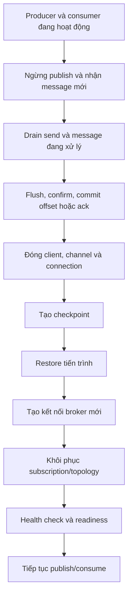

# Kafka, RabbitMQ và vòng đời producer hoặc consumer

Kafka và RabbitMQ là hai hệ thống messaging phổ biến, nhưng producer, consumer và kết nối của chúng có vòng đời khác nhau. Khi ứng dụng Java dùng CRaC, checkpoint lưu trạng thái tiến trình; nó không bảo đảm broker vẫn giữ socket, session, channel, assignment hoặc trạng thái xác nhận message trong thời gian tiến trình tạm dừng.

Một object `KafkaProducer`, `KafkaConsumer`, RabbitMQ `Connection` hoặc `Channel` có thể vẫn còn được tham chiếu trong heap sau restore, nhưng điều đó không chứng minh kết nối tới broker còn hợp lệ. Broker, load balancer hoặc mạng có thể đã đóng phiên. Consumer group có thể đã rebalance, lease có thể hết hạn và message chưa được acknowledge có thể được giao lại.

Vì vậy, ứng dụng cần quản lý rõ ràng vòng đời messaging qua ranh giới checkpoint: ngừng nhận công việc mới, hoàn tất hoặc lưu tiến độ của công việc đang chạy, xác nhận những message đã xử lý đúng thời điểm, flush dữ liệu producer, đóng client và tạo lại kết nối sau restore. Thiết kế này phải giữ đúng semantics giao nhận của broker, tránh mất message và xử lý được trường hợp message được giao lại.

## 1. Phân biệt trạng thái trong tiến trình và trạng thái do broker quản lý

Một messaging client có nhiều lớp trạng thái:

- **Object Java:** producer, consumer, connection factory, channel, listener, callback và cấu hình.
- **Transport:** TCP socket, TLS session, heartbeat và buffer mạng.
- **Protocol:** Kafka request/response, consumer group membership, partition assignment, RabbitMQ channel và consumer tag.
- **Delivery state:** record đã gửi, publisher confirm, offset đã commit, delivery tag, acknowledgement và message đang xử lý.
- **Application state:** subscription, routing, retry, outbox, idempotency key và tiến độ nghiệp vụ.

Checkpoint có thể lưu trạng thái bộ nhớ của tiến trình, nhưng trạng thái broker được quản lý độc lập. Trong thời gian checkpoint, broker vẫn tiếp tục xử lý timeout, rebalance, redelivery và retention. Không nên suy ra trạng thái broker từ một field trong heap.

| Thành phần | Ví dụ | Việc cần xác minh sau restore |
|---|---|---|
| Producer object | `KafkaProducer`, RabbitMQ publisher wrapper | Client còn mở hay đã đóng? Có cần tạo instance mới không? |
| Consumer object | `KafkaConsumer`, RabbitMQ consumer | Membership, channel và consumer registration còn hiệu lực không? |
| Transport | Socket, TLS connection | Peer có còn giữ kết nối không? |
| Producer delivery | Send future, confirm, transaction | Broker đã nhận/commit message chưa? |
| Consumer progress | Kafka offset, RabbitMQ delivery tag | Tiến độ nào đã được commit/ack bền vững? |
| Topology | Kafka topic, Rabbit exchange/queue/binding | Có cần subscribe hoặc khai báo lại sau restore không? |

## 2. Vòng đời chung qua checkpoint/restore

Một quy trình messaging thường có các giai đoạn sau:

1. **Quiesce:** ngừng nhận yêu cầu publish mới và ngừng lấy message mới.
2. **Drain producer:** chờ các send đang được chấp nhận hoàn tất theo chính sách; flush và xử lý kết quả xác nhận.
3. **Drain consumer:** hoàn tất message đang xử lý, commit offset hoặc acknowledge chỉ sau khi nghiệp vụ đã commit.
4. **Close:** đóng producer, consumer, channel và connection theo API của client.
5. **Checkpoint:** tạo image khi không còn công việc messaging dở dang trong các thành phần cần được đóng.
6. **Restore:** khôi phục tiến trình và cấu trúc ứng dụng.
7. **Reconnect:** tạo client/connection mới, xác thực lại và khôi phục cấu hình hiện hành.
8. **Resume:** Kafka consumer tham gia group và nhận assignment mới; RabbitMQ consumer đăng ký lại queue và consumer.
9. **Readiness:** chỉ nhận traffic hoặc công việc mới khi kết nối và trạng thái messaging đã sẵn sàng.



Đây là trình tự khái niệm. Thứ tự chi tiết phụ thuộc phiên bản Kafka client, RabbitMQ Java client, framework và CRaC integration. Nếu thư viện đã có integration CRaC hoặc tự quản lý recovery, cần chọn một chủ sở hữu vòng đời để tránh đóng/mở tài nguyên hai lần.

## 3. Kafka producer: flush và đóng trước checkpoint

`KafkaProducer` là client thread-safe và thường có background sender thread cùng buffer để gửi record tới broker. Lời gọi `send()` thường trả về ngay một `Future` trong khi việc gửi mạng diễn ra bất đồng bộ. Vì vậy, chỉ ngừng gọi `send()` chưa có nghĩa mọi record đã được broker xác nhận.

Trước checkpoint, producer cần:

- Ngừng nhận lệnh publish mới từ request, scheduler hoặc consumer khác.
- Chờ các luồng đang tạo record và gọi `send()` kết thúc.
- Theo dõi callback hoặc future để phát hiện send thất bại.
- Gọi `flush()` để chờ các record đã gửi được hoàn tất theo semantics của client.
- Với producer transactional, hoàn tất hoặc abort transaction theo quyết định nghiệp vụ trước checkpoint.
- Đóng producer bằng timeout phù hợp để giải phóng thread và socket.

`flush()` giúp đợi các request gửi đang chờ hoàn tất, nhưng không tự biến một giao dịch Kafka đang mở thành giao dịch đã commit. Nếu dùng transaction, ứng dụng phải gọi `commitTransaction()` hoặc `abortTransaction()` theo đúng trạng thái nghiệp vụ. Không commit transaction chỉ để checkpoint nếu dữ liệu nghiệp vụ chưa sẵn sàng.

### Ví dụ quản lý producer

```java
import org.apache.kafka.clients.producer.KafkaProducer;
import org.apache.kafka.clients.producer.ProducerRecord;
import org.crac.Context;
import org.crac.Core;
import org.crac.Resource;

import java.time.Duration;
import java.util.concurrent.atomic.AtomicReference;

public final class KafkaProducerResource implements Resource {

    private final ProducerFactory factory;
    private final AtomicReference<KafkaProducer<String, String>> current =
            new AtomicReference<>();
    private volatile boolean accepting = true;

    public KafkaProducerResource(ProducerFactory factory) {
        this.factory = factory;
        current.set(factory.create());
        Core.getGlobalContext().register(this);
    }

    public void send(ProducerRecord<String, String> record) {
        if (!accepting) {
            throw new IllegalStateException("Producer is quiescing");
        }
        KafkaProducer<String, String> producer = current.get();
        if (producer == null) {
            throw new IllegalStateException("Producer is not available");
        }
        producer.send(record, (metadata, exception) -> {
            if (exception != null) {
                recordPublishFailure(record, exception);
            }
        });
    }

    @Override
    public void beforeCheckpoint(Context<? extends Resource> context) {
        accepting = false;
        awaitPublishersToDrain();

        KafkaProducer<String, String> producer = current.getAndSet(null);
        if (producer != null) {
            producer.flush();
            producer.close(Duration.ofSeconds(10));
        }
    }

    @Override
    public void afterRestore(Context<? extends Resource> context) {
        current.set(factory.create());
        accepting = true;
    }

    private void awaitPublishersToDrain() { /* ứng dụng điều phối và chờ producer caller */ }
    private void recordPublishFailure(ProducerRecord<String, String> record,
                                      Exception exception) { /* ghi nhận lỗi */ }
}
```

`ProducerFactory`, `awaitPublishersToDrain()` và `recordPublishFailure()` là thành phần minh họa do ứng dụng định nghĩa. Code thật cần đồng bộ việc kiểm tra `accepting` với thao tác lấy producer để tránh race condition: một thread có thể vượt qua kiểm tra rồi gọi `send()` đúng lúc callback đang đóng producer. Có thể dùng một gate/read-write lock hoặc cơ chế admission control để ngừng caller mới và đợi caller hiện tại kết thúc trước khi flush.

`KafkaProducer.close(Duration)` có trong các phiên bản Kafka client hiện đại; hãy kiểm tra API của phiên bản đang dùng. Không giữ lại producer đã đóng để sử dụng sau restore. Tạo instance mới từ factory và nạp endpoint, credential cùng cấu hình hiện hành.

### Idempotence và transaction

Kafka producer có thể được cấu hình idempotence để giảm duplicate do retry trong phạm vi semantics mà Kafka hỗ trợ. Tuy nhiên, idempotence không thay thế idempotency nghiệp vụ khi ứng dụng gửi lại một event sau restore hoặc khi một message được tạo hai lần ở hai tiến trình khác nhau.

Với transactional producer:

- Không checkpoint giữa một transaction đang mở mà chưa quyết định commit/abort.
- Xác định rõ record nào đã được commit và record nào phải phát lại.
- Không sao chép một `transactional.id` độc quyền sang nhiều tiến trình restore cùng lúc. Producer khác dùng cùng transactional ID có thể fence producer trước đó; cần thiết kế identity và quyền sở hữu theo mô hình triển khai.
- Dùng outbox hoặc nguồn bền vững nếu cần đảm bảo event được phát sau khi transaction nghiệp vụ commit.

## 4. Kafka consumer: xử lý offset và message đang chạy

`KafkaConsumer` không thread-safe. Một thread nên sở hữu các thao tác `poll`, `pause`, `resume`, `commit` và `close`. Ngoại lệ quan trọng là `wakeup()`, được thiết kế để một thread khác đánh thức thread đang poll.

Trước checkpoint, consumer cần ngừng nhận record mới, hoàn tất hoặc dừng an toàn việc xử lý record đang có và commit offset đúng thời điểm. Với xử lý at-least-once, nguyên tắc phổ biến là chỉ commit offset sau khi nghiệp vụ đã được xử lý thành công. Nếu commit trước khi xử lý xong, restore có thể khiến message bị bỏ qua. Nếu xử lý xong nhưng chưa commit, message có thể được giao lại; handler cần idempotent.

Nếu ứng dụng tự quản lý offset, nên tắt auto commit để tránh client commit tiến độ trong khi handler vẫn đang xử lý:

```java
Properties properties = new Properties();
properties.put(ConsumerConfig.ENABLE_AUTO_COMMIT_CONFIG, "false");
properties.put(ConsumerConfig.GROUP_ID_CONFIG, "orders-worker");
```

Đây là phần cấu hình bổ sung cho `KafkaConsumer`; các thuộc tính bootstrap server, deserializer và bảo mật được lược bỏ. Nếu dùng auto commit, phải hiểu rõ thời điểm commit theo cấu hình client và chấp nhận semantics tương ứng. Với xử lý cần kiểm soát tiến độ chính xác qua checkpoint, manual commit thường dễ phối hợp hơn.

### Trình tự dừng consumer

1. Đặt trạng thái quiescing để không nhận thêm công việc mới từ ứng dụng.
2. Gửi `wakeup()` để thoát khỏi `poll()` nếu thread consumer đang chờ.
3. Trên thread sở hữu consumer, dừng poll mới và hoàn tất batch hiện tại theo chính sách.
4. Chờ các handler bất đồng bộ đã được submit hoàn tất.
5. Commit offset cao nhất liên tục đã xử lý thành công cho từng partition.
6. Đóng consumer bằng timeout.
7. Sau restore, tạo consumer mới, subscribe lại và chờ rebalance/assignment.

Không commit offset chỉ vì record đã được poll hoặc đưa vào executor. Offset commit cần phản ánh điểm tiến độ xử lý đã hoàn tất. Nếu các record trong cùng partition được xử lý song song, cần theo dõi thứ tự hoàn thành để không commit vượt qua record còn chưa xử lý.

### Ví dụ vòng lặp consumer có thể dừng

```java
import org.apache.kafka.clients.consumer.ConsumerRecord;
import org.apache.kafka.clients.consumer.ConsumerRecords;
import org.apache.kafka.clients.consumer.KafkaConsumer;
import org.apache.kafka.common.errors.WakeupException;

import java.time.Duration;
import java.util.concurrent.atomic.AtomicBoolean;

public final class KafkaConsumerLoop implements Runnable {

    private final KafkaConsumer<String, String> consumer;
    private final AtomicBoolean running = new AtomicBoolean(true);

    public KafkaConsumerLoop(KafkaConsumer<String, String> consumer) {
        this.consumer = consumer;
    }

    public void requestStop() {
        running.set(false);
        consumer.wakeup();
    }

    @Override
    public void run() {
        try {
            while (running.get()) {
                ConsumerRecords<String, String> records =
                        consumer.poll(Duration.ofMillis(500));

                for (ConsumerRecord<String, String> record : records) {
                    processAndCommitProgress(record);
                }
            }

            consumer.commitSync();
        } catch (WakeupException exception) {
            if (running.get()) {
                throw exception;
            }
            // Dừng có chủ đích: hoàn tất công việc đã nhận rồi commit tiến độ.
            consumer.commitSync();
        } finally {
            consumer.close(Duration.ofSeconds(10));
        }
    }

    private void processAndCommitProgress(ConsumerRecord<String, String> record) {
        // Chỉ đánh dấu tiến độ sau khi xử lý nghiệp vụ thành công.
    }
}
```

Đây là ví dụ đơn giản để minh họa việc `wakeup()` đánh thức vòng `poll`. `requestStop()` phải được gọi từ thread điều phối; các thao tác commit và close vẫn do thread consumer sở hữu thực hiện. Trong code thật, cần phối hợp việc xử lý song song, commit offset theo partition và đảm bảo `processAndCommitProgress()` không commit từng record theo cách làm vượt qua record trước đó chưa hoàn tất.

Một resource CRaC có thể gọi `requestStop()` rồi chờ thread consumer kết thúc bằng latch hoặc future trước khi checkpoint tiếp tục. Nếu thread không dừng trong timeout, callback cần báo lỗi thay vì checkpoint khi consumer vẫn đang thao tác với broker.

### Rebalance sau restore

Consumer mới phải tham gia consumer group lại. Kafka coordinator có thể phân phối partition khác với lần chạy trước. Không nên giả định partition assignment trong bộ nhớ là assignment hiện hành. Hãy dùng callback rebalance để xử lý partition được cấp/thu hồi, commit tiến độ phù hợp và chỉ bắt đầu xử lý khi assignment mới đã sẵn sàng.

`group.id` thường giữ ổn định để các replica cùng tham gia một consumer group. Nhưng cấu hình static membership như `group.instance.id` phải duy nhất cho mỗi member đang hoạt động. Nếu nhiều bản restore mang cùng một static member ID, chúng có thể xung đột hoặc fencing nhau. Hãy cấp identity phù hợp cho từng instance hoặc dùng dynamic membership theo thiết kế.

## 5. RabbitMQ producer: publisher confirm trước khi đóng channel

RabbitMQ Java client thường dùng `Connection` để kết nối tới broker và `Channel` để thực hiện publish/consume. Một connection có thể có nhiều channel. Các channel không nên được chia sẻ tùy tiện giữa nhiều thread; hãy tuân thủ concurrency contract của phiên bản client và mô hình ứng dụng.

Publisher cần phân biệt ba trạng thái:

- Message đã được ứng dụng đưa vào lời gọi `basicPublish()`.
- Broker đã nhận message và có thể xác nhận bằng publisher confirm.
- Message đã được định tuyến tới queue mong muốn; với `mandatory`, ứng dụng còn phải xử lý returned message nếu không route được.

`basicPublish()` trả về không có nghĩa broker đã lưu message. Nếu cần xác nhận broker đã nhận, bật publisher confirms bằng `confirmSelect()` và đợi confirm trước khi đóng channel.

### Ví dụ publisher confirms

```java
import com.rabbitmq.client.Channel;
import java.io.IOException;
import java.util.concurrent.TimeoutException;

public final class RabbitPublisher {

    private final Channel channel;

    public RabbitPublisher(Channel channel) throws IOException {
        this.channel = channel;
        this.channel.confirmSelect();
    }

    public void publish(String exchange,
                        String routingKey,
                        byte[] body)
            throws IOException {
        channel.basicPublish(exchange, routingKey, body);
    }

    public void flushAndConfirm()
            throws IOException, TimeoutException, InterruptedException {
        channel.waitForConfirmsOrDie(10_000);
    }
}
```

Ví dụ dùng API publisher confirm đồng bộ để dễ thấy ranh giới xác nhận. Với throughput cao, có thể dùng confirm listener bất đồng bộ và theo dõi sequence number của từng publish. Trước checkpoint, ngừng publish mới, đợi mọi confirm đang chờ và xử lý nack/return. Nếu confirm không đến trong timeout, phải giữ message chưa xác nhận trong outbox hoặc hàng đợi bền vững để có thể gửi lại.

Publisher confirm xác nhận broker đã nhận publish theo giao thức, nhưng không tự chứng minh consumer đã xử lý message. Nếu cần đảm bảo message không mất khi broker restart, cần cấu hình exchange/queue phù hợp, message persistent và chính sách durability tương ứng. Cũng cần hiểu publisher confirm và routing return là hai tín hiệu khác nhau.

## 6. RabbitMQ consumer: cancel, drain và acknowledge

RabbitMQ consumer thường đăng ký với `basicConsume()` và nhận delivery qua callback. Khi dùng manual acknowledgement, ứng dụng gọi `basicAck()` sau khi xử lý thành công. Nếu connection/channel đóng khi delivery chưa được ack, broker thường có thể đưa message trở lại trạng thái sẵn sàng để giao lại; hành vi chính xác còn phụ thuộc trạng thái ack đã tới broker hay chưa.

Trước checkpoint:

1. Ngừng nhận công việc mới từ ứng dụng.
2. Gọi `basicCancel(consumerTag)` để hủy đăng ký consumer và ngừng nhận delivery mới qua consumer đó.
3. Chờ callback/handler đang chạy hoàn tất.
4. Ack các message đã xử lý thành công; nack/requeue hoặc lưu tiến độ cho message chưa hoàn tất theo chính sách.
5. Đóng channel và connection.

Không ack message trước khi side effect nghiệp vụ đã commit. Nếu ack trước rồi checkpoint khi cập nhật database chưa hoàn tất, message có thể mất khỏi queue trong khi nghiệp vụ chưa được ghi nhận. Nếu database commit xong nhưng ack chưa tới broker, message có thể được giao lại; consumer cần idempotency để xử lý bản giao lại.

### Delivery tag không phải định danh bền vững

RabbitMQ delivery tag có phạm vi theo channel. Sau khi channel đóng và tạo channel mới, không được dùng delivery tag cũ để ack trên channel mới. Hãy xử lý/ack delivery trước khi đóng channel hoặc để broker giao lại message và xử lý nó như delivery mới.

Nếu dùng `multiple=true` trong `basicAck`, cần chắc chắn mọi delivery có tag nhỏ hơn hoặc bằng tag được ack đã hoàn tất. Với handler song song, ack theo batch có thể xác nhận nhầm message chưa xử lý xong. Cần quản lý thứ tự và trạng thái hoàn tất rõ ràng.

### Ví dụ hủy consumer

```java
import com.rabbitmq.client.Channel;
import java.io.IOException;
import java.util.concurrent.TimeoutException;

public final class RabbitConsumerLifecycle {

    private final Channel channel;
    private final String consumerTag;

    public RabbitConsumerLifecycle(Channel channel, String consumerTag) {
        this.channel = channel;
        this.consumerTag = consumerTag;
    }

    public void stopBeforeCheckpoint() throws IOException, TimeoutException {
        channel.basicCancel(consumerTag);
        awaitInFlightHandlers();
        // Handler đã ack/nack các delivery theo kết quả nghiệp vụ.
        channel.close();
    }

    private void awaitInFlightHandlers() {
        // Ứng dụng chờ callback và executor hoàn tất trong timeout có giới hạn.
    }
}
```

`awaitInFlightHandlers()` là phần điều phối của ứng dụng. `basicCancel()` không tự đợi tất cả handler bất đồng bộ do ứng dụng submit vào executor hoàn tất. Phải theo dõi công việc đã nhận và chờ chúng trước khi đóng channel. Nếu timeout, không checkpoint khi vẫn còn callback có thể sử dụng channel hoặc thay đổi trạng thái nghiệp vụ.

## 7. Tạo lại RabbitMQ connection, channel và consumer sau restore

Sau restore, tạo connection mới bằng `ConnectionFactory`, sau đó tạo channel mới. Khôi phục các thiết lập và đăng ký cần thiết:

- Xác thực và TLS configuration hiện hành.
- Exchange, queue và binding nếu ứng dụng sở hữu topology và cần khai báo lại.
- QoS/prefetch bằng `basicQos()`.
- Publisher confirm bằng `confirmSelect()` nếu producer cần xác nhận.
- Consumer callback bằng `basicConsume()`.
- Các listener xử lý shutdown, recovery và lỗi kết nối.

Ví dụ cấu trúc:

```java
import com.rabbitmq.client.Channel;
import com.rabbitmq.client.Connection;
import com.rabbitmq.client.ConnectionFactory;

public final class RabbitClientFactory {

    private final ConnectionFactory connectionFactory;

    public RabbitClientFactory(ConnectionFactory connectionFactory) {
        this.connectionFactory = connectionFactory;
    }

    public RabbitResources open() throws Exception {
        Connection connection = connectionFactory.newConnection();
        try {
            Channel channel = connection.createChannel();
            channel.exchangeDeclare("orders", "topic", true);
            channel.queueDeclare("orders.worker", true, false, false, null);
            channel.queueBind("orders.worker", "orders", "order.*");
            channel.basicQos(20);
            return new RabbitResources(connection, channel);
        } catch (Exception failure) {
            connection.close();
            throw failure;
        }
    }
}

record RabbitResources(Connection connection, Channel channel) { }
```

Tên exchange, queue, routing key và QoS trong ví dụ chỉ mang tính minh họa. Khai báo topology phải tương thích với cấu hình hiện có trên broker; khai báo lại với thuộc tính khác có thể gây lỗi `PRECONDITION_FAILED`. Nếu topology được quản lý bởi deployment hoặc infrastructure-as-code, ứng dụng cần tuân theo ownership đó.

Queue exclusive hoặc auto-delete có vòng đời gắn với connection/consumer có thể biến mất khi connection đóng. Sau restore, ứng dụng cần tạo queue mới và binding mới nếu thiết kế yêu cầu. Không nên mặc định mọi queue đều tồn tại sau khi connection cũ bị đóng.

## 8. Automatic recovery không thay thế quản lý CRaC

RabbitMQ Java client có thể được cấu hình automatic connection recovery và topology recovery để kết nối lại sau một lỗi mạng. Kafka client cũng có cơ chế reconnect, retry và consumer group rejoin. Những cơ chế này hữu ích khi mạng gián đoạn trong một tiến trình đang chạy.

Tuy nhiên, checkpoint/restore có một ranh giới vòng đời rõ ràng: tiến trình có thể ngừng hoạt động lâu hơn heartbeat/connection timeout; object client được khôi phục từ heap; thread recovery, timer và socket có thể có trạng thái không phù hợp với môi trường mới. Automatic recovery không đảm bảo mọi trạng thái ứng dụng, transaction, offset hoặc callback đang chạy được khôi phục đúng.

Hãy xác định một chiến lược:

- Dùng CRaC integration được thư viện cung cấp nếu phiên bản hỗ trợ và tài liệu xác nhận cách sử dụng.
- Hoặc chủ động quiesce/close trong `beforeCheckpoint()` và tạo client mới trong `afterRestore()`.
- Nếu vẫn bật automatic recovery, phối hợp nó với lifecycle callback để tránh hai cơ chế cùng mở connection hoặc đăng ký consumer trùng.

Không nên vừa để recovery thread tự reconnect vừa tạo connection mới trong callback mà không có đồng bộ. Điều đó có thể tạo nhiều connection, consumer hoặc channel cho cùng một thành phần.

## 9. Semantics giao nhận: at-most-once, at-least-once và xử lý trùng

Checkpoint không tự cung cấp exactly-once processing. Kết quả phụ thuộc thời điểm message được gửi, broker xác nhận, nghiệp vụ commit và consumer ack/offset được ghi nhận.

| Mô hình | Rủi ro qua checkpoint | Cách giảm rủi ro |
|---|---|---|
| At-most-once | Commit/ack trước khi xử lý có thể làm mất message nếu tiến trình dừng giữa chừng | Chỉ dùng khi chấp nhận mất message hoặc nghiệp vụ có thể tái tạo |
| At-least-once | Xử lý xong nhưng chưa commit/ack có thể khiến message được giao lại | Consumer idempotent, deduplication key và commit đúng thời điểm |
| Exactly-once ở phạm vi broker | Có thể có transaction hoặc cơ chế broker-specific, nhưng không tự bao phủ mọi side effect ngoài broker | Dùng transaction/offset integration đúng semantics và hiểu giới hạn |
| Exactly-once nghiệp vụ | Cần đồng bộ trạng thái database, message và side effect | Outbox/inbox, transaction, idempotency và thiết kế workflow |

### Ví dụ tình huống Kafka

Một consumer nhận record offset 42, cập nhật database thành công rồi checkpoint trước khi commit offset. Sau restore, Kafka có thể giao lại record 42. Nếu handler không idempotent, database có thể bị cập nhật lần thứ hai.

Nếu consumer commit offset 43 trước khi cập nhật database, rồi checkpoint xảy ra trước khi transaction database commit, Kafka có thể không giao lại record 42 dù nghiệp vụ chưa được lưu. Đây là nguy cơ mất xử lý.

Với xử lý quan trọng, hãy commit offset sau khi side effect đã commit và dùng khóa idempotency hoặc transaction phù hợp. Nếu cần phối hợp database với Kafka, xem xét transactional outbox/inbox hoặc mô hình xử lý có thể retry.

### Ví dụ tình huống RabbitMQ

Consumer nhận delivery tag 7, ghi database thành công nhưng chưa gửi `basicAck(7, false)` trước checkpoint. Khi channel đóng, broker có thể giao message lại. Consumer cần nhận diện message ID đã xử lý hoặc dùng transaction/inbox để tránh lặp side effect.

Nếu gửi ack trước khi database commit, broker có thể loại message khỏi queue rồi tiến trình bị checkpoint trước khi database ghi xong. Message không còn được giao lại dù nghiệp vụ chưa hoàn tất.

## 10. Tích hợp lifecycle bằng CRaC Resource

Một thành phần quản lý messaging có thể đăng ký `org.crac.Resource`. Callback trước checkpoint quiesce producer/consumer, drain công việc và đóng client. Callback sau restore tạo client mới và khôi phục subscription.

```java
import org.crac.Context;
import org.crac.Core;
import org.crac.Resource;

public final class MessagingResource implements Resource {

    private final MessagingClientFactory factory;
    private MessagingClients clients;

    public MessagingResource(MessagingClientFactory factory) throws Exception {
        this.factory = factory;
        this.clients = factory.openInitialClients();
        Core.getGlobalContext().register(this);
    }

    @Override
    public void beforeCheckpoint(Context<? extends Resource> context)
            throws Exception {
        clients.stopAcceptingNewWork();
        clients.drainPublishersAndConsumers();
        clients.flushAndCommitAcknowledgedProgress();
        clients.close();
        clients = null;
    }

    @Override
    public void afterRestore(Context<? extends Resource> context)
            throws Exception {
        MessagingClients restored = factory.openNewClients();
        try {
            restored.verifyConnections();
            restored.restoreSubscriptionsAndTopology();
            clients = restored;
            clients.resumeWork();
        } catch (Exception failure) {
            restored.close();
            throw failure;
        }
    }
}
```

`MessagingClientFactory` và `MessagingClients` là abstraction của ứng dụng, không phải API chuẩn Kafka/RabbitMQ. Các bước `drainPublishersAndConsumers()` và `flushAndCommitAcknowledgedProgress()` cần triển khai theo từng broker vì Kafka offset và RabbitMQ acknowledgement có semantics khác nhau. Không dùng một thao tác chung để commit/ack mà không biết message nào đã hoàn tất.

Nếu `afterRestore()` không thể kết nối broker, callback cần báo lỗi và giữ ứng dụng chưa sẵn sàng. Có thể dùng retry có backoff ở một lifecycle coordinator, nhưng không để readiness true khi consumer/publisher bắt buộc chưa hoạt động. Đặt timeout cho kết nối, drain và close để callback không treo vô hạn.

## 11. Nhiều bản restore từ cùng checkpoint

Một checkpoint có thể tạo nhiều replica. Các bản sao có thể bắt đầu với cùng cấu hình consumer, producer, transaction ID, subscription và trạng thái trong heap. Không nên nhân bản danh tính hoặc quyền sở hữu độc quyền.

Với Kafka:

- Các consumer có cùng `group.id` có thể tham gia cùng group; coordinator phân phối partition theo membership hiện hành.
- Static member ID phải duy nhất cho từng member đang hoạt động.
- `transactional.id` cần được thiết kế để không vô tình fence một producer khác đang hoạt động.
- Mỗi replica phải tạo client mới và tham gia group/rebalance sau restore.

Với RabbitMQ:

- Mỗi connection/channel mới là một phiên riêng.
- Nhiều consumer trên cùng queue thường cạnh tranh nhận message; prefetch và số consumer quyết định lượng message đang được phân phối.
- Queue exclusive gắn với connection cũ có thể không tồn tại sau khi đóng.
- Consumer tag, delivery tag và trạng thái channel cũ không phải định danh có thể tái sử dụng trên channel mới.
- Nếu cần một consumer độc quyền, dùng cơ chế lock/lease bên ngoài hoặc cấu hình queue phù hợp.

Các replica cần có instance identity mới nếu client hoặc topology yêu cầu định danh riêng. Dùng cùng checkpoint không có nghĩa các bản sao nên dùng chung một transaction ID, static member ID, connection hoặc channel.

## 12. Backpressure, prefetch và giới hạn tải khi reconnect

Sau restore, nhiều consumer có thể cùng kết nối và bắt đầu nhận message. Nếu tất cả lập tức dùng prefetch lớn hoặc tạo nhiều worker, database và downstream service có thể bị quá tải.

Hãy xem xét:

- Giữ prefetch phù hợp với số worker và khả năng xử lý thực tế.
- Khởi động consumer theo batch hoặc delay có jitter nếu nhiều replica restore đồng thời.
- Không nhận message mới trước khi database và downstream dependency sẵn sàng.
- Giới hạn hàng đợi nội bộ để không tích lũy message không giới hạn trong heap.
- Dùng backpressure và retry có giới hạn.
- Tránh nhiều replica cùng chạy một tác vụ khởi tạo hoặc replay lớn.

Kafka consumer có thể dùng `pause()` trên partition trong khi vẫn tiếp tục `poll()` để duy trì membership, nhưng khi chuẩn bị checkpoint thì cần dừng vòng poll và đóng consumer theo lifecycle. RabbitMQ có `basicQos()` để giới hạn số delivery chưa ack. Hai cơ chế này không giống nhau; hãy cấu hình theo mô hình xử lý của từng broker.

## 13. Readiness và health check

Một ứng dụng có thể đã restore JVM nhưng chưa kết nối được Kafka hoặc RabbitMQ. Readiness cần phản ánh khả năng xử lý công việc thật.

Các điều kiện thường cần xác nhận:

- Producer đã được tạo và có thể publish/confirm theo chính sách.
- Consumer đã subscribe hoặc tham gia group và có assignment/consumer registration phù hợp.
- Topology RabbitMQ cần thiết đã tồn tại hoặc được khai báo thành công.
- Credential và TLS configuration hiện hành hợp lệ.
- Các message đang xử lý trước checkpoint đã được drain hoặc có thể được giao lại an toàn.
- Database/downstream dependency cần thiết đã sẵn sàng.

Liveness và readiness nên được tách biệt. Broker tạm thời chưa sẵn sàng có thể làm readiness false trong khi tiến trình vẫn sống và đang retry. Nếu liveness probe restart liên tục một tiến trình chưa kết nối được broker, hệ thống có thể tạo reconnect storm.

## 14. Quan sát vòng đời messaging

Nên ghi log các mốc lifecycle rõ ràng:

- `messaging-quiesce-start`
- `producer-drain-start` và `producer-flush-complete`
- `consumer-stop-start` và `consumer-drain-complete`
- `offset-commit` hoặc `message-ack`
- `channel-close` / `connection-close`
- `afterRestore-start`
- `broker-reconnect-complete`
- `consumer-assignment-ready` hoặc `rabbit-consumer-registered`
- `messaging-readiness-ready`

Các metric hữu ích:

| Metric | Ý nghĩa |
|---|---|
| Producer pending sends | Số send chưa hoàn tất trước khi flush |
| Publish failures/nacks/returns | Message gửi thất bại hoặc không được route |
| Consumer lag | Khoảng cách giữa offset mới nhất và offset đã commit |
| Records/messages in flight | Công việc đã nhận nhưng chưa xử lý/ack xong |
| Rebalance count/duration | Mức độ thay đổi membership Kafka group |
| Rabbit unacked messages | Số delivery chưa được acknowledge |
| Connection/channel count | Số phiên broker đang mở theo instance |
| Reconnect attempts and latency | Thời gian và số lần phục hồi client |
| Restore-to-messaging-ready | Thời gian từ restore đến khi messaging hoạt động |

Gắn instance ID, client role và group/queue đã được làm sạch thông tin nhạy cảm. Không ghi payload riêng tư, token hoặc credential vào log. Khi nhiều replica restore cùng lúc, metrics theo instance giúp xác định burst kết nối, rebalance hoặc redelivery.

## 15. Kiểm thử các tình huống checkpoint/restore

Không chỉ kiểm thử khi producer/consumer đang idle. Cần kiểm tra ranh giới giữa publish, confirm, xử lý và acknowledgement.

Các tình huống nên bao gồm:

1. Checkpoint khi Kafka producer không có record đang chờ.
2. Checkpoint khi Kafka producer có send đang chờ confirm.
3. Checkpoint khi Kafka consumer đang xử lý một batch.
4. Checkpoint sau khi nghiệp vụ commit nhưng trước khi Kafka offset commit.
5. Checkpoint khi RabbitMQ publisher có confirm đang chờ.
6. Checkpoint khi RabbitMQ consumer có delivery chưa ack.
7. Restore sau khi broker đã đóng connection do heartbeat/idle timeout.
8. Restore khi Kafka consumer group đã rebalance.
9. Restore khi RabbitMQ queue/channel/connection cũ không còn.
10. Restore nhiều replica từ cùng image và kiểm tra duplicate consumer/transaction identity.
11. Broker unavailable trong lúc `afterRestore()` và phục hồi sau retry.
12. Handler nhận lại message đã xử lý trước checkpoint và chứng minh idempotency.

Kiểm tra rằng producer không bỏ sót record đã xác nhận, consumer không commit vượt qua message chưa xử lý, message chưa ack có thể được giao lại an toàn và readiness chỉ bật sau khi client mới sẵn sàng. Cũng cần thử trường hợp drain vượt timeout để callback báo lỗi rõ ràng.

## 16. Các lỗi thường gặp

### Giữ nguyên producer/consumer object vì chúng còn trong heap

Object còn tồn tại không chứng minh socket, channel hoặc membership còn hợp lệ. Đóng và tạo client mới theo integration CRaC hoặc lifecycle callback được hỗ trợ.

### Đóng Kafka producer mà không chờ send hoàn tất

Record đang nằm trong buffer có thể chưa được xác nhận. Ngừng publish mới, chờ caller, flush và kiểm tra lỗi trước khi đóng.

### Commit Kafka offset trước khi xử lý nghiệp vụ

Nếu tiến trình checkpoint trước khi nghiệp vụ commit, record có thể bị bỏ qua. Commit sau khi xử lý thành công và dùng idempotency cho trường hợp giao lại.

### Dùng KafkaConsumer từ nhiều thread

Consumer không thread-safe. Dùng một thread sở hữu thao tác poll/commit/close; thread khác chỉ yêu cầu dừng qua `wakeup()` hoặc cơ chế điều phối.

### Đóng RabbitMQ channel khi delivery còn đang xử lý

Message chưa ack có thể được giao lại. Drain handler, commit nghiệp vụ và ack theo đúng thứ tự; xử lý duplicate an toàn.

### Tái sử dụng RabbitMQ delivery tag sau reconnect

Delivery tag thuộc channel cũ. Tạo channel mới và xử lý delivery mới; không ack tag cũ trên channel mới.

### Nghĩ publisher confirm đồng nghĩa consumer đã xử lý

Publisher confirm chỉ xác nhận broker đã nhận publish theo giao thức. Consumer acknowledgement là một bước riêng.

### Bật automatic recovery đồng thời tự tạo client mới

Hai cơ chế có thể tạo connection hoặc consumer trùng. Chọn một chủ sở hữu lifecycle và đồng bộ các callback.

### Bật readiness trước khi consumer group/topology sẵn sàng

Ứng dụng có thể nhận traffic trong khi chưa xử lý được message hoặc publish. Chỉ bật readiness sau khi kết nối và đăng ký cần thiết hoàn tất.

## 17. Quy trình triển khai tham khảo

```text
Trước checkpoint
  1. Đưa ứng dụng ra khỏi traffic nếu cần.
  2. Ngừng nhận lệnh publish mới và dừng consumer nhận message mới.
  3. Drain các send, record và delivery đang xử lý.
  4. Kafka: flush producer; commit offset đã xử lý; xử lý transaction.
  5. RabbitMQ: chờ publisher confirm; ack/nack delivery theo kết quả.
  6. Đóng producer, consumer, channel và connection.
  7. Xác nhận không còn worker messaging sử dụng tài nguyên cũ.

Sau restore
  1. Nạp endpoint, credential và identity hiện hành.
  2. Tạo Kafka producer/consumer và RabbitMQ connection/channel mới.
  3. Kafka: subscribe, join group và chờ partition assignment.
  4. RabbitMQ: khai báo topology cần thiết, đặt QoS và đăng ký consumer.
  5. Kiểm tra publish/consume health và dependency.
  6. Bật readiness rồi mới nhận traffic/công việc mới.
```

Các bước cần được điều phối theo phiên bản client và framework. Nếu dùng Spring Kafka hoặc Spring AMQP, hãy xem lifecycle container và CRaC support của phiên bản tương ứng; không nên đóng client bên dưới trong khi framework container vẫn nghĩ nó đang chạy. Có thể cần dừng container listener, drain listener thread và khởi động lại container sau restore bằng một coordinator thống nhất.

## 18. Kết luận

Kafka và RabbitMQ giữ trạng thái ở cả client, transport, broker và tầng nghiệp vụ. CRaC có thể phục hồi object Java nhưng không bảo đảm kết nối, channel, consumer group membership, delivery tag hoặc trạng thái xác nhận message còn hợp lệ. Producer cần ngừng nhận publish mới, drain và flush/confirm trước khi đóng. Consumer cần ngừng nhận message, hoàn tất công việc, commit offset hoặc ack đúng sau khi nghiệp vụ đã commit.

Sau restore, hãy tạo client và connection mới, khôi phục subscription hoặc topology, tham gia lại consumer group và chỉ tiếp tục xử lý khi readiness đạt yêu cầu. Thiết kế idempotency, outbox/inbox và retry để xử lý message được giao lại hoặc publish chưa rõ kết quả. Khi nhiều bản restore cùng chạy, cấp identity phù hợp và kiểm soát số consumer/kết nối. Như vậy, vòng đời producer/consumer sẽ đi qua checkpoint một cách có kiểm soát mà không dựa vào giả định rằng phiên broker cũ vẫn tồn tại.
