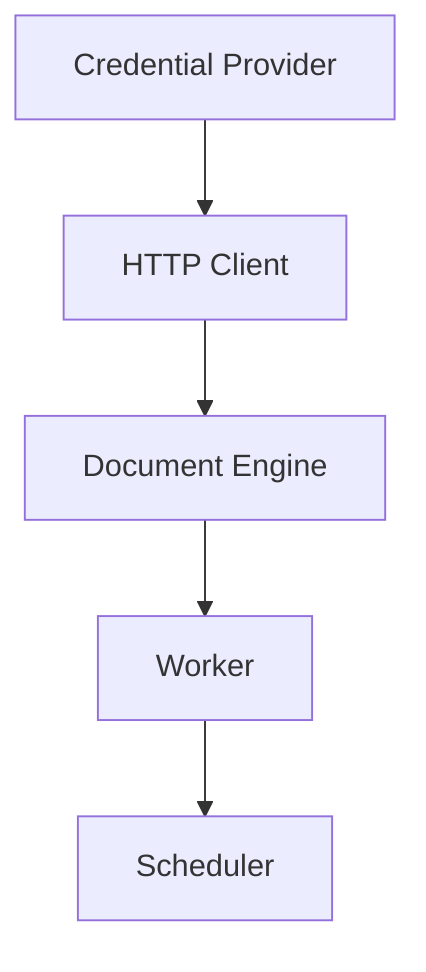
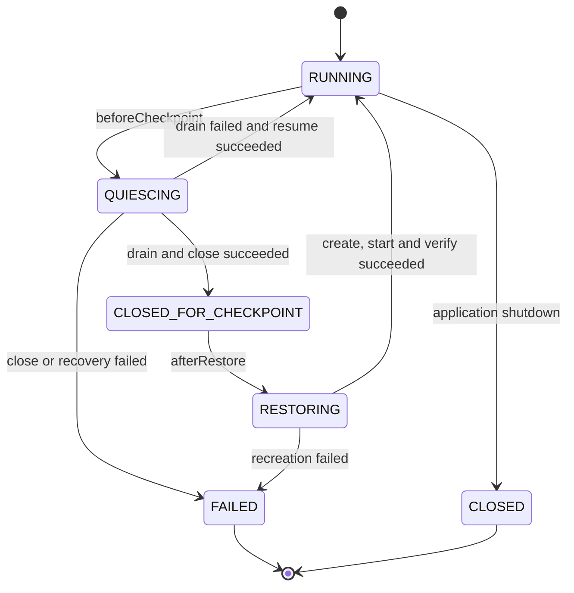

# Thiết kế lớp bọc Resource cho thư viện chưa có tích hợp

Nhiều thư viện Java được thiết kế để chạy liên tục trong một JVM và không biết đến CRaC. Chúng có thể giữ connection pool, socket, thread nền, native handle, cache hoặc một engine xử lý riêng. Khi tiến trình được checkpoint, những tài nguyên đó có thể không còn hợp lệ sau restore. Nếu thư viện chưa triển khai `org.crac.Resource`, ứng dụng vẫn có thể tích hợp nó bằng một lớp bọc (wrapper) chịu trách nhiệm điều phối vòng đời.

Lớp bọc không cần sửa mã nguồn thư viện. Nó cung cấp một hợp đồng lifecycle ở phía ứng dụng, chuyển các callback `beforeCheckpoint` và `afterRestore` thành thao tác mà thư viện hỗ trợ, chẳng hạn ngừng nhận việc, chờ tác vụ hoàn tất, đóng instance và tạo instance mới. Nếu các service khác đang sử dụng thư viện, wrapper còn cần cung cấp một facade ổn định để chúng tiếp tục gọi được instance mới sau restore.

Thiết kế tốt bắt đầu từ việc xác định ai sở hữu tài nguyên, thư viện có thể dừng và khởi động lại theo cách nào, và ứng dụng cần bảo đảm điều gì trước khi checkpoint. Một adapter chỉ gọi `close()` rồi tạo object mới chưa đủ nếu vẫn còn thread đang sử dụng object cũ hoặc các bean khác giữ reference trực tiếp đến nó.

## 1. Vì sao cần lớp bọc Resource?

Giả sử ứng dụng sử dụng một thư viện xử lý tài liệu. Thư viện tự quản lý worker thread và bộ nhớ native, nhưng không có tích hợp CRaC:

```text
Spring Service
      |
      v
Third-party Document Engine
      |
      +-- worker threads
      +-- native memory / handles
      +-- internal buffers
```

Nếu ứng dụng checkpoint khi engine đang xử lý một tài liệu, snapshot có thể chứa trạng thái công việc dở dang hoặc tài nguyên không thể tiếp tục sử dụng ở môi trường restore. Nếu đóng engine mà service vẫn giữ reference đến object cũ, request sau restore có thể gọi vào một instance đã đóng.

Wrapper giải quyết vấn đề bằng cách đặt một lớp quản lý giữa ứng dụng và thư viện:

```text
Spring Service
      |
      v
Stable Library Facade
      |
      v
Library Lifecycle Wrapper  <---- CRaC Resource callbacks
      |
      v
Third-party Library Instance
```

Wrapper có thể đảm nhiệm bốn việc:

1. Kiểm soát việc nhận lời gọi mới vào thư viện.
2. Chờ các lời gọi đang chạy và tác vụ nội bộ đạt trạng thái an toàn.
3. Đóng hoặc giải phóng instance trước checkpoint.
4. Tạo, khởi động, xác thực và công bố instance mới sau restore.

Spring quản lý wrapper như một bean nếu ứng dụng dùng Spring Boot. CRaC gọi wrapper thông qua một object triển khai `org.crac.Resource` đã được đăng ký với CRaC context.

## 2. Xác định hợp đồng lifecycle mà thư viện hỗ trợ

Trước khi viết wrapper, cần đọc API và tài liệu của thư viện để xác định chính xác cách nó dừng và khởi động. Không nên suy đoán rằng mọi method `close()`, `stop()` hoặc `shutdown()` có cùng ý nghĩa.

Hãy tìm câu trả lời cho các câu hỏi:

- Có thể ngừng nhận công việc mới mà không hủy công việc đang chạy không?
- Có API để chờ worker, request hoặc job đang chạy kết thúc không?
- `close()` giải phóng những tài nguyên nào: socket, thread, buffer, native handle hay tất cả?
- Sau `close()`, object có thể `start()` lại hay phải tạo object mới?
- Factory tạo instance mới có thể nhận cấu hình, credential và endpoint hiện hành không?
- Có API kiểm tra trạng thái sẵn sàng sau khi khởi động không?
- Thư viện có tự tạo thread hoặc tác vụ nền mà ứng dụng không nhìn thấy không?
- Thư viện có tích hợp CRaC chính thức ở phiên bản mới hơn không?

Từ đó, lập một lifecycle contract rõ ràng:

| Pha | Hành động cần có | Điều kiện hoàn tất |
|---|---|---|
| Running | Nhận và xử lý lời gọi | Instance hoạt động bình thường |
| Quiescing | Từ chối công việc mới, dừng producer nội bộ | Không phát sinh thêm công việc mới |
| Draining | Chờ lời gọi và job đang chạy hoàn tất | Không còn thao tác sử dụng instance |
| Closed for checkpoint | Đóng instance và giải phóng tài nguyên | Instance cũ không còn được truy cập |
| Restoring | Tạo instance mới, khởi động và kiểm tra | Instance mới đạt điều kiện sẵn sàng |
| Running after restore | Công bố instance mới và nhận công việc | Consumer sử dụng instance mới |

Nếu thư viện không có cách ngừng nhận việc hoặc chờ tác vụ hoàn tất, wrapper không thể tự suy ra trạng thái an toàn. Khi đó cần bổ sung admission gate ở phía ứng dụng, dùng API quản lý task của thư viện, hoặc chọn cách tích hợp khác. Không nên checkpoint khi không thể chứng minh tài nguyên đã ngừng được sử dụng.

## 3. Chọn kiểu wrapper phù hợp

Có một số cách tổ chức wrapper tùy mức độ kiểm soát được thư viện.

| Kiểu thiết kế | Khi phù hợp | Đặc điểm |
|---|---|---|
| Adapter trực tiếp | Thư viện có `pause`, `drain`, `close`, `start` rõ ràng | Một class triển khai `Resource` và gọi trực tiếp API thư viện |
| Decorator | Muốn bổ sung lifecycle quanh một interface mà service đang dùng | Bọc object thật, giữ nguyên interface nghiệp vụ |
| Stable facade + replaceable delegate | Phải tạo instance mới sau restore | Consumer giữ facade ổn định, delegate bên trong được thay thế |
| Factory-managed wrapper | Instance không thể restart sau `close()` | Factory tạo instance mới mỗi lần restore |
| Coordinator | Nhiều thành phần có dependency và thứ tự lifecycle | Một Resource điều phối nhiều wrapper theo thứ tự rõ ràng |

Trong nhiều ứng dụng, stable facade kết hợp factory-managed wrapper là lựa chọn dễ kiểm soát. Service chỉ biết interface nghiệp vụ; wrapper giữ instance thư viện và Resource adapter quản lý checkpoint/restore.

## 4. Định nghĩa interface cho thư viện và factory

Ví dụ dưới đây giả lập một thư viện chưa có CRaC integration. Interface `DocumentEngine` thể hiện các thao tác mà wrapper cần. Implementation thực tế sẽ gọi API tương ứng của thư viện bên thứ ba.

```java
import java.time.Duration;

public interface DocumentEngine extends AutoCloseable {
    void start() throws Exception;
    void stopAccepting() throws Exception;
    boolean awaitDrained(Duration timeout) throws Exception;
    void resumeAccepting() throws Exception;
    void verifyReady() throws Exception;
    DocumentResult process(Document document) throws Exception;

    @Override
    void close() throws Exception;
}
```

Ý nghĩa của từng method phải được xác định trong adapter:

- `start()`: khởi tạo hoặc bắt đầu worker của instance mới.
- `stopAccepting()`: ngăn công việc mới đi vào instance.
- `awaitDrained(timeout)`: chờ các công việc đã nhận hoàn tất trong giới hạn thời gian.
- `resumeAccepting()`: đưa instance đang còn hợp lệ trở lại trạng thái nhận việc nếu checkpoint bị hủy trước khi đóng.
- `verifyReady()`: kiểm tra các chức năng cần thiết đã hoạt động.
- `close()`: giải phóng tài nguyên và kết thúc instance.

Factory tạo instance mới từ cấu hình hiện hành:

```java
public interface DocumentEngineFactory {
    DocumentEngine create() throws Exception;
}
```

Factory không nên trả về một singleton đã bị đóng. Nếu thư viện có builder, factory có thể tạo builder mới, nạp cấu hình, khởi tạo engine và trả về instance chưa chạy để wrapper gọi `start()`.

## 5. Dùng stable facade để tránh reference cũ

Giả sử `DocumentService` inject trực tiếp `DocumentEngine`. Khi checkpoint, wrapper đóng engine cũ rồi tạo engine mới sau restore. Reference trong `DocumentService` vẫn trỏ đến object cũ. Việc thay một field trong Resource adapter không tự cập nhật những reference mà các bean khác đã giữ.

Thay vào đó, service chỉ phụ thuộc một facade ổn định:

```java
public interface DocumentProcessor {
    DocumentResult process(Document document) throws Exception;
}
```

Facade giữ delegate hiện tại và chuyển lời gọi đến delegate đó. Adapter có thể thay delegate sau restore mà không cần thay đổi các bean consumer.

```java
public final class DocumentProcessorFacade implements DocumentProcessor {
    private volatile DocumentEngine delegate;

    public DocumentProcessorFacade(DocumentEngine initial) {
        this.delegate = initial;
    }

    @Override
    public DocumentResult process(Document document) throws Exception {
        DocumentEngine current = delegate;
        if (current == null) {
            throw new IllegalStateException("Document engine is unavailable");
        }
        return current.process(document);
    }

    void install(DocumentEngine replacement) {
        this.delegate = replacement;
    }

    DocumentEngine current() {
        return delegate;
    }

    void clear() {
        this.delegate = null;
    }
}
```

`volatile` bảo đảm các thread đọc facade nhìn thấy reference delegate mới sau khi được công bố. Nó không chờ những lời gọi đang chạy trên delegate cũ hoàn tất. Wrapper vẫn cần một cơ chế admission/drain để không đóng instance khi có thread đang sử dụng nó.

Nếu chỉ dùng `AtomicReference` hoặc `volatile` mà không quản lý lời gọi đang chạy, có thể xảy ra race: thread A đọc delegate cũ; thread B thay delegate và đóng object cũ; thread A tiếp tục gọi object đã đóng. Phần tiếp theo giải quyết khoảng trống đó.

## 6. Bảo vệ lời gọi và drain trước checkpoint

Wrapper cần phân biệt hai nhóm hoạt động:

- Lời gọi mới từ service hoặc consumer.
- Lời gọi đã bắt đầu và đang sử dụng instance hiện tại.

Khi bắt đầu checkpoint, wrapper chuyển sang `QUIESCING`, từ chối lời gọi mới, yêu cầu thư viện ngừng nhận việc, rồi chờ các lời gọi đang chạy kết thúc. Chỉ sau đó mới đóng instance.

Có thể dùng `ReentrantLock` và `Condition` để quản lý trạng thái cùng số lượng lời gọi đang hoạt động. Ví dụ sau minh họa một handle có thể thay delegate:

```java
import java.time.Duration;
import java.util.concurrent.TimeUnit;
import java.util.concurrent.locks.Condition;
import java.util.concurrent.locks.ReentrantLock;

public final class ManagedDocumentProcessor implements DocumentProcessor {
    private enum State {
        RUNNING,
        QUIESCING,
        CLOSED_FOR_CHECKPOINT,
        FAILED
    }

    private final ReentrantLock gate = new ReentrantLock(true);
    private final Condition noActiveCalls = gate.newCondition();
    private final DocumentEngineFactory factory;
    private final Duration drainTimeout;

    private DocumentEngine current;
    private State state = State.RUNNING;
    private int activeCalls;

    public ManagedDocumentProcessor(
            DocumentEngineFactory factory,
            Duration drainTimeout) throws Exception {
        this.factory = factory;
        this.drainTimeout = drainTimeout;
        this.current = createStartedEngine();
    }

    @Override
    public DocumentResult process(Document document) throws Exception {
        DocumentEngine target;

        gate.lockInterruptibly();
        try {
            if (state != State.RUNNING || current == null) {
                throw new IllegalStateException(
                        "Document engine is not accepting work: " + state);
            }
            activeCalls++;
            target = current;
        } finally {
            gate.unlock();
        }

        try {
            return target.process(document);
        } finally {
            gate.lock();
            try {
                activeCalls--;
                if (activeCalls == 0) {
                    noActiveCalls.signalAll();
                }
            } finally {
                gate.unlock();
            }
        }
    }

    public void beforeCheckpoint() throws Exception {
        DocumentEngine target;
        long deadline = System.nanoTime() + drainTimeout.toNanos();

        gate.lockInterruptibly();
        try {
            if (state == State.CLOSED_FOR_CHECKPOINT) {
                return;
            }
            if (state != State.RUNNING || current == null) {
                throw new IllegalStateException(
                        "Cannot checkpoint engine in state: " + state);
            }
            state = State.QUIESCING;
            target = current;
        } finally {
            gate.unlock();
        }

        boolean closeAttempted = false;
        try {
            // Ngăn thư viện nhận thêm công việc nội bộ.
            target.stopAccepting();

            long remaining = deadline - System.nanoTime();
            if (remaining <= 0 ||
                    !target.awaitDrained(Duration.ofNanos(Math.max(0, remaining)))) {
                throw new IllegalStateException(
                        "Document engine did not drain before checkpoint");
            }

            gate.lockInterruptibly();
            try {
                while (activeCalls != 0) {
                    remaining = deadline - System.nanoTime();
                    if (remaining <= 0) {
                        throw new IllegalStateException(
                                "Facade calls did not finish before checkpoint");
                    }
                    noActiveCalls.awaitNanos(remaining);
                }
            } finally {
                gate.unlock();
            }

            closeAttempted = true;
            target.close();

            gate.lock();
            try {
                current = null;
                state = State.CLOSED_FOR_CHECKPOINT;
            } finally {
                gate.unlock();
            }
        } catch (Exception failure) {
            if (closeAttempted) {
                setFailed();
            } else {
                try {
                    target.resumeAccepting();
                    setRunning();
                } catch (Exception resumeFailure) {
                    failure.addSuppressed(resumeFailure);
                    setFailed();
                }
            }
            throw failure;
        }
    }

    public void afterRestore() throws Exception {
        gate.lockInterruptibly();
        try {
            if (state != State.CLOSED_FOR_CHECKPOINT || current != null) {
                throw new IllegalStateException(
                        "Engine is not in a restorable state: " + state);
            }
        } finally {
            gate.unlock();
        }

        DocumentEngine replacement = null;
        try {
            replacement = createStartedEngine();

            gate.lockInterruptibly();
            try {
                current = replacement;
                state = State.RUNNING;
                replacement = null;
            } finally {
                gate.unlock();
            }
        } catch (Exception failure) {
            if (replacement != null) {
                try {
                    replacement.close();
                } catch (Exception cleanupFailure) {
                    failure.addSuppressed(cleanupFailure);
                }
            }
            setFailed();
            throw failure;
        }
    }

    private DocumentEngine createStartedEngine() throws Exception {
        DocumentEngine engine = factory.create();
        try {
            engine.start();
            engine.verifyReady();
            return engine;
        } catch (Exception failure) {
            try {
                engine.close();
            } catch (Exception cleanupFailure) {
                failure.addSuppressed(cleanupFailure);
            }
            throw failure;
        }
    }

    private void setRunning() {
        gate.lock();
        try {
            state = State.RUNNING;
        } finally {
            gate.unlock();
        }
    }

    private void setFailed() {
        gate.lock();
        try {
            state = State.FAILED;
        } finally {
            gate.unlock();
        }
    }
}
```

Đây là ví dụ về cơ chế điều phối lời gọi của facade. Implementation thật cần điều chỉnh theo hợp đồng của thư viện và cách nó quản lý thread nội bộ. `awaitDrained()` phải bao phủ các công việc do thư viện tự nhận; `activeCalls` chỉ đếm những lời gọi đi qua facade.

Một số điểm cần chú ý trong thiết kế:

- Lock chỉ giữ trong lúc cập nhật trạng thái và bộ đếm; không giữ lock trong khi thực thi nghiệp vụ hoặc chờ I/O.
- `QUIESCING` khiến lời gọi mới bị từ chối ngay khi bắt đầu checkpoint.
- `stopAccepting()` dừng producer nội bộ của thư viện.
- `awaitDrained()` và `activeCalls` cùng xác nhận công việc đã kết thúc.
- Chỉ sau khi drain thành công mới gọi `close()`.
- Nếu `close()` đã bắt đầu nhưng thất bại, trạng thái được chuyển sang `FAILED` vì không thể giả định instance còn nguyên vẹn.
- Sau restore, factory tạo instance mới và wrapper chỉ công bố instance sau khi `start()` và `verifyReady()` thành công.

Nếu thư viện không cung cấp `stopAccepting()` hoặc `awaitDrained()`, cần thay chúng bằng cơ chế quản lý task thực tế. Không bỏ qua bước drain chỉ để làm ví dụ ngắn hơn.

## 7. Viết Resource adapter mỏng

Khi wrapper đã cung cấp hai thao tác lifecycle, Resource adapter chỉ cần chuyển callback CRaC đến wrapper:

```java
import org.crac.Context;
import org.crac.Resource;

public final class DocumentEngineResource implements Resource {
    private final ManagedDocumentProcessor processor;

    public DocumentEngineResource(ManagedDocumentProcessor processor) {
        this.processor = processor;
    }

    @Override
    public void beforeCheckpoint(Context<? extends Resource> context)
            throws Exception {
        processor.beforeCheckpoint();
    }

    @Override
    public void afterRestore(Context<? extends Resource> context)
            throws Exception {
        processor.afterRestore();
    }
}
```

Tách wrapper khỏi adapter giúp hai phần có trách nhiệm rõ ràng:

- `ManagedDocumentProcessor` bảo vệ lời gọi, state machine, factory và delegate.
- `DocumentEngineResource` kết nối state machine với lifecycle của CRaC.

Wrapper có thể được unit test mà không cần khởi chạy CRaC. Adapter có thể được kiểm tra riêng để xác nhận callback gọi đúng phương thức. Integration test vẫn cần chạy trên JDK CRaC để chứng minh runtime gọi callback ở đúng thời điểm.

## 8. Đăng ký wrapper trong Spring Boot

Spring có thể tạo factory, wrapper và Resource adapter thành bean. Một registrar đăng ký adapter với global context sau khi các singleton cần thiết đã được tạo:

```java
import org.crac.Core;
import org.springframework.beans.factory.SmartInitializingSingleton;
import org.springframework.context.annotation.Bean;
import org.springframework.context.annotation.Configuration;

import java.time.Duration;

@Configuration
public class DocumentEngineConfiguration {

    @Bean
    ManagedDocumentProcessor managedDocumentProcessor(
            DocumentEngineFactory factory) throws Exception {
        return new ManagedDocumentProcessor(
                factory,
                Duration.ofSeconds(30));
    }

    @Bean
    DocumentEngineResource documentEngineResource(
            ManagedDocumentProcessor processor) {
        return new DocumentEngineResource(processor);
    }

    @Bean
    SmartInitializingSingleton registerDocumentEngineResource(
            DocumentEngineResource resource) {
        return () -> Core.getGlobalContext().register(resource);
    }
}
```

Service chỉ inject `DocumentProcessor`, tức facade ổn định:

```java
@Service
public class DocumentService {
    private final DocumentProcessor processor;

    public DocumentService(DocumentProcessor processor) {
        this.processor = processor;
    }

    public DocumentResult process(Document document) throws Exception {
        return processor.process(document);
    }
}
```

Trong cấu hình thực tế, `ManagedDocumentProcessor` có thể implement trực tiếp `DocumentProcessor` như ví dụ. Nếu dùng một facade riêng, expose facade từ bean configuration và giữ delegate ở wrapper. Không inject instance thư viện thô vào các service khác, nếu không chúng có thể tiếp tục gọi object cũ sau restore.

Đăng ký Resource đúng một lần. Không đăng ký lại trong `afterRestore()`, không đăng ký trong mỗi request và không đồng thời đăng ký cùng một tài nguyên qua một integration khác. Nếu Spring Boot hoặc thư viện đã có CRaC auto-configuration, hãy xác định rõ component nào đang sở hữu lifecycle để tránh đóng/mở hai lần.

## 9. Thứ tự lifecycle khi thư viện có dependency

Thư viện bên thứ ba thường phụ thuộc vào tài nguyên khác. Ví dụ engine cần credential provider và HTTP client; worker dùng engine; scheduler tạo việc cho worker.



Thứ tự phục hồi phải mở dependency trước thành phần sử dụng nó: credential, HTTP client, engine, worker, scheduler. Trước checkpoint, đóng theo chiều ngược: scheduler, worker, engine, HTTP client, credential.

Với các Resource đăng ký trong cùng context, thứ tự callback được dùng để hỗ trợ dependency: `beforeCheckpoint` chạy theo thứ tự ngược đăng ký; `afterRestore` chạy theo thứ tự đăng ký. Vì vậy, đăng ký dependency trước, dependent sau.

Nếu wrapper quản lý nhiều tài nguyên nội bộ, hãy để nó điều phối thứ tự bên trong thay vì đăng ký một phần tài nguyên qua wrapper và một phần khác qua Resource độc lập mà không có quy ước ownership.

## 10. Khi thư viện chỉ có `close()` mà không có `pause()` hoặc `drain()`

Đây là trường hợp khó hơn. `close()` có thể đóng ngay tài nguyên trong khi thread nội bộ vẫn đang chạy. Trước khi dùng, cần kiểm tra tài liệu và source/API của thư viện để xác định:

- `close()` có chờ worker kết thúc hay không.
- `close()` có interrupt hoặc hủy task đang chạy không.
- Có callback shutdown hoặc hook riêng nào được cung cấp không.
- Có thể ngừng producer bên ngoài trước khi gọi `close()` không.
- Có thể quan sát số task đang hoạt động hoặc trạng thái termination không.

Nếu thư viện cung cấp `ExecutorService`, `awaitTermination()` hoặc một lifecycle manager, có thể dùng chúng để drain. Nếu không có cách xác định công việc đã kết thúc, không nên giả định `close()` là đủ. Có thể cần một lớp admission gate ở phía ứng dụng và một quy trình dừng tiến trình riêng.

Không dùng `Thread.sleep()` để đoán rằng worker đã dừng. Sleep không chứng minh không còn tác vụ và không tạo quan hệ đồng bộ. Dùng API chờ kết thúc có timeout hoặc một tín hiệu completion có hợp đồng rõ ràng.

## 11. Phân biệt đóng instance với giải phóng mọi tài nguyên

Một method `close()` có thể chỉ đóng tài nguyên mà object trực tiếp sở hữu. Nếu thư viện tạo singleton static, thread trong global executor hoặc native resource dùng chung, đóng instance chưa chắc giải phóng hết.

Hãy kiểm tra:

- Thread do thư viện tạo có kết thúc không?
- Executor có bị shutdown không và có chờ termination không?
- Native handle có được giải phóng không?
- Hook shutdown có chỉ chạy khi JVM exit hay có API gọi chủ động?
- Cache/static registry có giữ reference đến instance cũ không?
- Callback hoặc listener đã đăng ký với hệ thống bên ngoài có được hủy không?
- Các connection/socket đã được đóng chưa?

Nếu thư viện chỉ cung cấp một singleton process-wide và không hỗ trợ tạo lại, wrapper không thể tự tạo instance độc lập sau restore. Cần tìm cơ chế reinitialize chính thức, nâng cấp thư viện, thay đổi cách sử dụng hoặc loại component đó khỏi quy trình checkpoint.

## 12. Xử lý lỗi và phục hồi trạng thái

Callback phải có hành vi rõ ràng khi thao tác thất bại.

### 12.1. Drain thất bại trước khi close

Nếu hết timeout nhưng instance vẫn còn hoạt động, wrapper có thể thử resume nhận việc và trả lỗi để checkpoint bị hủy. Việc resume chỉ hợp lệ nếu instance chưa bị close và thư viện hỗ trợ quay lại trạng thái running.

Nếu resume thất bại, wrapper phải chuyển sang trạng thái lỗi và ngăn service tiếp tục sử dụng instance không xác định. Không âm thầm đặt state thành `RUNNING`.

### 12.2. Close thất bại

Khi `close()` đã bắt đầu và ném exception, không thể mặc định object vẫn hoạt động bình thường. Có thể một phần socket đã đóng nhưng thread khác chưa dừng. Hãy đánh dấu trạng thái lỗi và để quy trình vận hành xử lý. Không gọi `resumeAccepting()` như thể close chắc chắn chưa làm gì.

### 12.3. Factory hoặc start thất bại sau restore

Nếu factory tạo object nhưng `start()` hoặc `verifyReady()` thất bại, đóng object tạo dở và giữ facade ở trạng thái unavailable. Chỉ công bố delegate sau khi mọi bước bắt buộc thành công.

Không retry vô hạn trong `afterRestore`. Có thể retry có giới hạn với backoff cho lỗi tạm thời, nhưng lỗi cấu hình, credential hoặc binary không tương thích cần được báo rõ. Readiness không được chuyển sang thành công khi component chưa hoạt động.

### 12.4. State machine rõ ràng

Một state machine có thể dùng các trạng thái:



Không nhất thiết phải dùng đúng tên trạng thái trên. Điều quan trọng là mỗi method lifecycle xác định được trạng thái đầu vào hợp lệ, trạng thái đầu ra và cách xử lý lỗi. State transition phải được bảo vệ đồng bộ để nhiều thread không cùng tạo hoặc đóng instance.

## 13. Tích hợp với Spring shutdown lifecycle

CRaC checkpoint không nhất thiết làm Spring `ApplicationContext` đóng. Do đó, không dùng riêng `@PreDestroy` hoặc `DisposableBean.destroy()` để xử lý checkpoint.

Ứng dụng vẫn cần cleanup khi shutdown thông thường. Có thể để wrapper implement `AutoCloseable` hoặc `DisposableBean`, nhưng cần phân biệt:

- Shutdown thông thường: dừng component và giải phóng tài nguyên trước khi process kết thúc.
- `beforeCheckpoint`: dừng component để snapshot an toàn, nhưng tiến trình có thể tiếp tục sau khi checkpoint theo hành vi runtime.
- `afterRestore`: tạo lại component trong tiến trình được phục hồi.

Nếu dùng cùng một method đóng cho shutdown và checkpoint, method phải nhận biết state và có hành vi phù hợp. Không để Spring shutdown callback và CRaC callback cùng đóng tài nguyên đồng thời. Có thể dùng một lifecycle coordinator để tuần tự hóa hai đường đóng.

## 14. Kiểm thử wrapper và adapter

Nên tách kiểm thử thành hai tầng.

### 14.1. Unit test với fake library

Fake library ghi lại các sự kiện để xác nhận thứ tự:

```java
public final class FakeDocumentEngine implements DocumentEngine {
    private final List<String> events;

    public FakeDocumentEngine(List<String> events) {
        this.events = events;
    }

    @Override
    public void start() {
        events.add("start");
    }

    @Override
    public void stopAccepting() {
        events.add("stopAccepting");
    }

    @Override
    public boolean awaitDrained(Duration timeout) {
        events.add("awaitDrained");
        return true;
    }

    @Override
    public void resumeAccepting() {
        events.add("resumeAccepting");
    }

    @Override
    public void verifyReady() {
        events.add("verifyReady");
    }

    @Override
    public DocumentResult process(Document document) {
        events.add("process");
        return DocumentResult.success();
    }

    @Override
    public void close() {
        events.add("close");
    }
}
```

Các trường hợp cần kiểm tra:

- Lời gọi bình thường được chuyển đến delegate hiện tại.
- Khi bắt đầu quiesce, lời gọi mới bị từ chối.
- Lời gọi đang chạy được đợi hoàn tất trước `close()`.
- Thứ tự là stop accepting, drain, wait active calls, close.
- Drain timeout làm checkpoint callback thất bại và không đóng instance đang còn dùng.
- Close failure đưa wrapper vào trạng thái lỗi.
- Restore tạo instance mới, start và verify trước khi công bố.
- Factory/start failure đóng instance tạo dở và không để facade sử dụng object lỗi.
- Callback lặp hoặc chuyển trạng thái không hợp lệ được xử lý rõ ràng.

### 14.2. Integration test với JDK CRaC

Unit test không chứng minh runtime thực sự gọi callback. Cần chạy trên JDK CRaC và hệ điều hành được hỗ trợ:

1. Khởi chạy Spring Boot và xác nhận Resource được đăng ký.
2. Gọi service để xác nhận component ban đầu hoạt động.
3. Yêu cầu checkpoint và xác nhận wrapper ngừng nhận việc, drain rồi đóng instance.
4. Restore image.
5. Xác nhận factory tạo instance mới và `afterRestore` hoàn tất.
6. Gọi lại service qua cùng facade và xác nhận request được xử lý bởi instance mới.
7. Thử restore khi dependency bên ngoài chưa sẵn sàng.
8. Thử checkpoint khi một tác vụ kéo dài chưa drain xong.
9. Kiểm tra readiness và log khi callback thất bại.

Nếu cùng image được restore thành nhiều instance, xác nhận mỗi instance có tài nguyên và định danh riêng. Không dùng một static registry bên ngoài wrapper để vô tình chia sẻ hoặc giữ instance cũ giữa các tiến trình.

## 15. Các giới hạn không thể giải quyết chỉ bằng wrapper

Wrapper chỉ có thể điều khiển những gì thư viện hoặc ứng dụng expose. Một số giới hạn cần được nhận diện sớm:

- Nếu thư viện không thể dừng thread hoặc không cung cấp cách drain, không thể chứng minh trạng thái an toàn chỉ bằng cách gọi `close()`.
- Nếu thư viện giữ static singleton và không có API reset, factory có thể không tạo được instance mới trong cùng tiến trình sau restore.
- Nếu native code giữ FD mà không đi qua JDK API, policy FD của JDK có thể không xử lý được; cần API native hoặc thay đổi thư viện.
- Nếu thư viện lưu trạng thái nghiệp vụ bên ngoài, wrapper không thể tự đồng bộ trạng thái đó với checkpoint image.
- Nếu thư viện không hỗ trợ nhiều instance, restore cùng image thành nhiều replica có thể vi phạm giả định của nó.
- Nếu license hoặc client identity gắn với một process, phải xác minh cách cấp lại identity sau restore.

Khi gặp giới hạn như vậy, lựa chọn phù hợp có thể là nâng cấp thư viện, dùng extension chính thức, thay thư viện, chạy component ở process/service riêng hoặc không checkpoint phần workload đó. Không nên che giấu giới hạn bằng một wrapper giả định quá mức.

## 16. Quy trình thiết kế và triển khai

Có thể thực hiện theo trình tự sau:

1. **Khảo sát thư viện:** đọc tài liệu lifecycle, thread, connection, native handle và khả năng restart.
2. **Xác định ownership:** ghi rõ object nào sở hữu tài nguyên và component nào được phép đóng nó.
3. **Định nghĩa interface ứng dụng:** tách API nghiệp vụ khỏi API lifecycle của thư viện.
4. **Tạo factory:** bảo đảm tạo được instance mới bằng cấu hình hiện hành.
5. **Tạo facade:** để consumer giữ reference ổn định và không truy cập instance thô.
6. **Thêm admission/drain gate:** chặn lời gọi mới và chờ lời gọi đang chạy kết thúc.
7. **Triển khai Resource adapter:** chuyển callback CRaC thành các bước lifecycle của wrapper.
8. **Đăng ký một lần:** để Spring tạo adapter và đăng ký với `Core.getGlobalContext()`.
9. **Kiểm thử lỗi:** drain timeout, close failure, factory failure, dependency unavailable và callback lặp.
10. **Chạy integration test:** tạo checkpoint, restore và gọi nghiệp vụ qua facade trên đúng runtime.
11. **Đo đạc:** thời gian drain, close, recreate, verify và restore-to-readiness.
12. **Ghi nhận giới hạn:** lưu phiên bản thư viện, JDK, OS và cấu hình đã được kiểm chứng.

## 17. Những lỗi thường gặp

**Chỉ triển khai `Resource` rồi gọi `close()`.** Thread hoặc request có thể vẫn đang dùng object. Cần ngừng nhận việc mới và drain trước khi đóng.

**Để service giữ reference đến thư viện thô.** Sau restore, service tiếp tục gọi object cũ. Inject facade ổn định và thay delegate bên trong.

**Dùng `volatile` thay cho cơ chế drain.** `volatile` công bố reference mới nhưng không đợi các lời gọi trên reference cũ hoàn tất.

**Cho rằng mọi `close()` đều có thể `start()` lại.** Nhiều thư viện xem close là terminal. Hãy dùng factory tạo instance mới nếu tài liệu yêu cầu.

**Tạo instance mới trước khi dependency sẵn sàng.** Component có thể khởi động với credential hoặc endpoint cũ. Factory cần lấy cấu hình hiện hành và verify trước khi công bố.

**Bỏ qua task nội bộ của thư viện.** Bộ đếm lời gọi qua facade không bao phủ worker thread do thư viện tự tạo. Dùng API drain/termination của thư viện.

**Nuốt exception callback.** CRaC có thể tiếp tục với trạng thái không an toàn. Báo lỗi và giữ instance ở trạng thái không sẵn sàng.

**Đăng ký Resource nhiều lần.** Callback có thể đóng hoặc tạo lại component nhiều lần. Chỉ có một registrar sở hữu việc đăng ký.

**Dùng `@PreDestroy` thay cho CRaC Resource.** Checkpoint không nhất thiết đóng Spring context. Tích hợp callback CRaC riêng và giữ cleanup shutdown thông thường.

**Không kiểm thử restore nhiều instance.** Một số giả định singleton hoặc identity chỉ lộ ra khi cùng image được dùng cho nhiều tiến trình. Thử đúng mô hình triển khai.

## 18. Tự kiểm tra mức độ hiểu

1. **Vì sao cần wrapper cho thư viện chưa có CRaC integration?** Vì wrapper chuyển callback CRaC thành lifecycle API mà thư viện hiện có, đồng thời quản lý trạng thái và tài nguyên quanh checkpoint/restore.
2. **Vì sao service nên dùng facade thay vì giữ object thư viện trực tiếp?** Vì instance thư viện có thể bị đóng và thay bằng instance mới sau restore; facade giữ reference ổn định cho consumer.
3. **Vì sao cần admission gate và drain?** Để từ chối công việc mới và chờ các lời gọi đang chạy kết thúc trước khi đóng instance.
4. **`volatile` có đủ để thay delegate an toàn không?** Không. Nó công bố reference mới nhưng không chờ thread đang sử dụng delegate cũ hoàn tất.
5. **Khi nào cần factory thay vì gọi `start()` lại?** Khi `close()` là thao tác terminal hoặc thư viện không cam kết instance có thể restart.
6. **Nếu thư viện không có API drain thì sao?** Cần tìm cơ chế quản lý task khác hoặc không checkpoint khi chưa chứng minh được tài nguyên đã dừng an toàn.
7. **Vì sao callback `afterRestore` chỉ nên công bố instance sau `verifyReady()`?** Để consumer không nhìn thấy object đang khởi tạo hoặc chưa kết nối đầy đủ.
8. **Unit test có chứng minh CRaC gọi callback thật không?** Không. Cần integration test trên JDK CRaC và môi trường triển khai tương thích.

## Kết luận

Với thư viện chưa có tích hợp CRaC, hãy thiết kế một lớp bọc làm chủ vòng đời thay vì chỉ gọi `close()` trong callback. Wrapper cần xác định ownership, ngừng nhận lời gọi mới, drain công việc đang chạy, đóng instance cũ và tạo instance mới sau restore bằng factory. Stable facade giúp các Spring bean tiếp tục sử dụng cùng một interface trong khi delegate bên trong được thay thế.

Đặt state machine và cơ chế đồng bộ ở wrapper, giữ Resource adapter mỏng, đăng ký adapter một lần với CRaC context và tuân thủ thứ tự dependency. Nếu thư viện không expose cách dừng hoặc khởi tạo lại an toàn, hãy coi đó là giới hạn tích hợp cần giải quyết ở cấp thư viện hoặc kiến trúc. Cuối cùng, kiểm thử cả unit lifecycle lẫn checkpoint/restore thật trên JDK CRaC để xác nhận component mới hoạt động trước khi instance nhận traffic.
