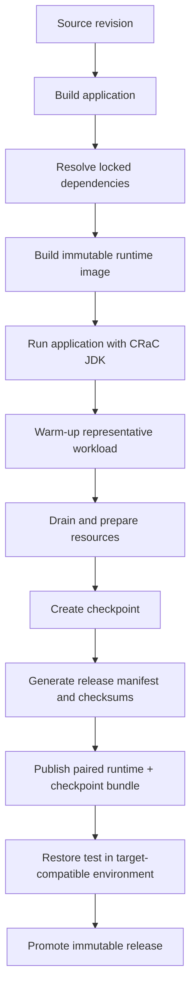

# Quan hệ giữa ảnh, JDK, mã ứng dụng và thư viện phụ thuộc

Checkpoint CRaC không phải một file độc lập có thể ghép tùy ý với bất kỳ JDK hoặc phiên bản ứng dụng nào. Nó lưu trạng thái của một tiến trình Java đã chạy, bao gồm trạng thái runtime, bộ nhớ, thread và những tài nguyên tiến trình được cơ chế checkpoint/restore hỗ trợ. Vì vậy, ảnh checkpoint có mối quan hệ chặt chẽ với JDK đã tạo ra nó, mã ứng dụng đã được nạp, thư viện phụ thuộc, cấu hình khởi chạy và môi trường hệ điều hành.

Khi đóng gói để triển khai, cần xem checkpoint và môi trường tạo ra checkpoint là một bộ artifact có phiên bản. Bộ này phải giữ được tính tương thích giữa ảnh, JDK, ứng dụng và dependencies. Nếu chỉ phát hành file checkpoint rồi ghép nó với một container image mới hoặc một bộ JAR khác, tiến trình có thể không restore được hoặc restore được nhưng chạy sai do trạng thái trong bộ nhớ không còn khớp với các file và dịch vụ bên ngoài.

Nguyên tắc quan trọng là **mỗi checkpoint phải được ghép với đúng bộ runtime và ứng dụng đã tạo ra nó, trong một môi trường tương thích đã được kiểm chứng**. Khi nâng cấp JDK, mã ứng dụng, thư viện native hoặc cấu hình nền tảng, cần tạo checkpoint mới hoặc chứng minh rõ ràng tổ hợp mới có thể restore an toàn.

## 1. Phân biệt các loại artifact

Trong quy trình CRaC, có nhiều loại artifact khác nhau. Chúng có thể được phân phối cùng nhau nhưng không có cùng vai trò.

| Artifact | Nội dung | Vai trò |
| --- | --- | --- |
| Application artifact | JAR, WAR hoặc các module ứng dụng | Chứa mã ứng dụng và tài nguyên đóng gói |
| Dependency set | Thư viện Java, native library và dependency runtime | Cung cấp các lớp và thành phần mà ứng dụng cần |
| JDK/runtime | Bản phân phối JDK có hỗ trợ CRaC và các thành phần runtime | Thực thi ứng dụng và diễn giải trạng thái JVM khi restore |
| Container image | Filesystem, JDK, ứng dụng, thư viện hệ thống và cấu hình nền | Cung cấp môi trường chạy có thể tái tạo |
| Checkpoint image | Các tệp trạng thái tiến trình được tạo bởi JVM và cơ chế checkpoint/restore | Dựng lại tiến trình Java từ trạng thái đã lưu |
| Release manifest | Metadata về phiên bản và checksum của các thành phần | Xác định chính xác tổ hợp artifact tương thích |

Checkpoint image không thay thế JAR, JDK hay container image. Một container image có thể chứa checkpoint hoặc tham chiếu tới checkpoint được lưu ở volume/artifact store. Dù chọn cách nào, runtime và các file cần thiết phải khớp với môi trường đã tạo ảnh.

### 1.1. Checkpoint không phải application JAR

JAR chứa bytecode, resource và metadata của ứng dụng. Checkpoint lưu trạng thái của một tiến trình đã nạp và thực thi chương trình. Một checkpoint có thể giữ class metadata, object graph, trạng thái JIT và trạng thái runtime mà JAR không chứa.

Do đó, không thể thay JAR bằng checkpoint hoặc xem checkpoint như một bản build mới của ứng dụng. JAR vẫn là một phần của bộ triển khai để cung cấp classpath và các file mà tiến trình cần trong môi trường restore.

### 1.2. Checkpoint không phải container image

Container image thường chứa filesystem và các thành phần để khởi chạy container. Checkpoint chứa trạng thái tiến trình tại một thời điểm. Trong triển khai CRaC, hai artifact này thường đi cùng nhau:

- Container image cung cấp JDK, ứng dụng, dependency và filesystem tương thích.
- Checkpoint cung cấp trạng thái tiến trình đã được khởi tạo.

Một checkpoint có thể được lưu ngoài container image để tránh làm image quá lớn, nhưng khi restore cần mount hoặc tải đúng checkpoint vào đúng vị trí mà runtime mong đợi. Không nên thay container image trong khi vẫn dùng checkpoint cũ nếu chưa xác minh tương thích.

## 2. Vì sao checkpoint phụ thuộc vào JDK?

JVM quản lý heap, stack, class metadata, JIT code, garbage collector, thread và nhiều cấu trúc runtime khác. Checkpoint ghi lại trạng thái tiến trình có chứa những cấu trúc này. Khi restore, một JVM có hỗ trợ CRaC cần tiếp tục diễn giải và sử dụng trạng thái runtime đã lưu.

JDK vì vậy là một phần của môi trường tạo checkpoint. Các thuộc tính cần nhận diện bao gồm:

- Nhà cung cấp JDK (vendor/distribution).
- Phiên bản Java và phiên bản build cụ thể.
- Bản cập nhật hoặc patch level của JDK.
- Bản build có tích hợp CRaC và cách tích hợp với CRIU.
- Kiến trúc CPU và ABI mà runtime được build cho.
- Các tùy chọn JVM liên quan tới heap, GC, module, native access và agent.
- Các thư viện native đi kèm JDK.

Hai JDK cùng báo `java.version` có thể khác nhau về vendor, build, patch hoặc cách đóng gói. Không nên chỉ ghi `Java 21` vào manifest rồi coi mọi JDK 21 là tương thích.

### 2.1. Ghi nhận danh tính runtime

Khi tạo checkpoint, cần lưu lại thông tin runtime thực tế:

```bash
java -version
java -XshowSettings:properties -version 2>&1
```

Các thuộc tính nên ghi gồm `java.vendor`, `java.runtime.version`, `java.vm.name`, `java.vm.version`, `java.home`, `os.name`, `os.arch` và phiên bản JDK build. Trên Linux, cũng cần ghi kernel và phiên bản CRIU:

```bash
uname -a
criu --version
criu check
```

Lệnh `criu check` kiểm tra một số điều kiện môi trường. Nó không thay thế một lần checkpoint/restore thử nghiệm với đúng ứng dụng.

### 2.2. Dùng đúng JDK khi restore

Mặc định an toàn là restore bằng đúng distribution và build JDK đã tạo checkpoint. Một bản cập nhật JDK mới có thể chứa thay đổi trong JVM, GC, native library hoặc CRaC integration. Ngay cả khi ứng dụng JAR không đổi, không nên mặc định checkpoint cũ tương thích với JDK mới.

Nếu cần chuyển checkpoint sang một bản JDK khác, phải có bằng chứng tương thích từ tài liệu của nhà cung cấp và kiểm thử restore trên đúng tổ hợp. Trong nhiều quy trình triển khai, cách đơn giản và có thể kiểm soát hơn là tạo checkpoint mới sau khi nâng cấp JDK.

### 2.3. JVM flags cũng là một phần của cấu hình runtime

Các tham số khởi chạy có thể ảnh hưởng tới bố cục bộ nhớ, GC, module access, native agent, encoding, timezone hoặc hành vi ứng dụng. Cần lưu các JVM flags đã dùng khi tạo checkpoint và dùng cấu hình restore theo hướng dẫn của JDK tương ứng.

Ví dụ các nhóm tham số cần quản lý:

- Heap sizing như `-Xms` và `-Xmx`.
- Garbage collector và các tùy chọn GC.
- Module options như `--add-opens` hoặc `--add-exports`.
- Java agent và native agent.
- System properties như timezone, locale và cấu hình ứng dụng.
- Các tùy chọn CRaC dùng để tạo hoặc restore checkpoint.

Không phải mọi tham số đều được truyền lại hoặc xử lý giống nhau ở mọi bản JDK. Hãy giữ cấu hình khởi chạy được version control và đối chiếu tài liệu runtime thay vì tự ý thay flags khi restore.

## 3. Quan hệ giữa checkpoint và mã ứng dụng

Khi checkpoint được tạo, JVM đã nạp các class và ứng dụng có thể đã tạo nhiều object từ những class đó. Trạng thái trong heap phản ánh cấu trúc và logic của đúng phiên bản mã đã chạy tại thời điểm tạo ảnh.

Nếu restore cùng checkpoint nhưng thay JAR hoặc classpath, có thể xuất hiện sự không nhất quán:

- Object trong heap được tạo từ phiên bản class cũ, trong khi file class trên filesystem là phiên bản mới.
- Class metadata và method đã nạp không khớp với bytecode mới.
- Resource hoặc serialization format đã thay đổi.
- Các class được nạp động sau restore có thể đến từ dependency mới.
- File resource hoặc template mà ứng dụng mở sau restore có nội dung khác với thời điểm checkpoint.

Checkpoint không phải cơ chế hot deployment. Thay file JAR bên dưới một tiến trình đã được checkpoint không làm object graph trong ảnh tự chuyển sang cấu trúc của phiên bản mới.

### 3.1. Ghép checkpoint với đúng application build

Mỗi checkpoint cần tham chiếu tới một application build cụ thể. Nên lưu:

- Version hoặc build ID của ứng dụng.
- Git commit hoặc source revision nếu quy trình phát hành sử dụng.
- Checksum của JAR/WAR hoặc từng module.
- Danh sách resource đóng gói cần thiết.
- Classpath theo thứ tự thực tế.
- Phiên bản framework và plugin runtime quan trọng.
- Build configuration liên quan tới code generation hoặc instrumentation.

Nếu ứng dụng được đóng gói thành một executable JAR, checksum của JAR là định danh hữu ích. Nếu ứng dụng dùng nhiều JAR ngoài, cần ghi checksum của cả dependency set hoặc dùng một container image digest bất biến bao trùm chúng.

### 3.2. Không ghép ảnh cũ với classpath mới

Ví dụ không an toàn:

```text
Checkpoint tạo từ:
  app-1.4.0.jar
  jackson-2.16.x.jar
  spring-boot-3.x.y.jar

Restore với:
  app-1.5.0.jar
  jackson-2.17.x.jar
  spring-boot-3.x.z.jar
```

Ngay cả khi các phiên bản mới tương thích ở mức source hoặc binary compatibility thông thường, điều đó không chứng minh object graph và trạng thái runtime đã lưu trong checkpoint tương thích với bộ class mới. Cần tạo checkpoint mới từ bộ ứng dụng mới.

Nếu cần triển khai phiên bản ứng dụng mới, hãy build application artifact mới, chạy warm-up bằng JDK/runtime tương ứng, tạo checkpoint mới và phát hành cả bộ như một release mới.

## 4. Thư viện Java và dependency runtime

Ứng dụng Java thường phụ thuộc vào framework, logging, database driver, serialization library, HTTP client, cache client và nhiều thư viện khác. Những dependency này có thể đã được nạp vào JVM hoặc được nạp lazy sau restore.

Một thay đổi dependency có thể tác động tới checkpoint theo nhiều cách:

- Thay đổi cấu trúc class hoặc method đã được nạp.
- Thay đổi static initializer hoặc cách tạo object.
- Thay đổi cấu hình mặc định hoặc resource trên classpath.
- Thay đổi connection lifecycle hoặc native integration.
- Thay đổi định dạng dữ liệu được serialize/deserialized.
- Thay đổi hành vi khi khởi tạo lazy sau restore.

Vì vậy, dependency lock và artifact checksum là một phần của định danh release. Không nên chỉ pin phiên bản JAR ở build file mà sau đó tải lại từ repository không kiểm soát tại thời điểm restore.

### 4.1. Dependency tree và lockfile

Với Gradle, có thể dùng dependency locking để giữ phiên bản dependency được resolve. Với Maven, có thể quản lý dependency version qua BOM và build reproducible. Dù dùng công cụ nào, checkpoint pipeline cần biết chính xác những artifact nào đã nằm trên classpath lúc tạo ảnh.

Ví dụ một phần manifest:

```yaml
application:
  version: 1.4.0
  buildId: service-1.4.0+build.281
  artifact: app.jar
  sha256: "<sha256-of-app-jar>"
dependencies:
  lockfile: gradle.lockfile
  classpathDigest: "<digest-of-resolved-runtime-classpath>"
```

Các chuỗi trong dấu ngoặc nhọn là placeholder. Pipeline thực tế phải ghi checksum đã tính được, không để placeholder trong manifest phát hành.

### 4.2. Thứ tự classpath và class loading

Thứ tự classpath có thể ảnh hưởng class nào được nạp khi có nhiều artifact chứa cùng tên class hoặc resource. Với classloader tùy chỉnh, plugin system hoặc module layer, thứ tự và cấu hình loader càng quan trọng.

Checkpoint giữ trạng thái classloader và các class đã được nạp. Vì vậy, nên giữ nguyên:

- Thứ tự classpath.
- Danh sách JAR và phiên bản.
- Cấu hình classloader/module layer.
- Cơ chế plugin hoặc extension đã được khởi tạo.
- Các resource được tìm qua classpath.

Không thay một JAR trong thư mục lib rồi dùng lại checkpoint cũ mà không tạo và kiểm tra một release mới.

## 5. Native library và thành phần phụ thuộc hệ điều hành

Một số thư viện Java sử dụng JNI, JNA hoặc native code được nạp qua `System.loadLibrary`. Các thành phần này gắn với kiến trúc CPU, ABI, libc, thư viện hệ thống và filesystem của môi trường.

Ví dụ:

- Native database driver hoặc compression library.
- TLS/crypto provider có native component.
- Image processing hoặc machine learning runtime.
- Thư viện JNI của ứng dụng.
- Agent hoặc profiler có native code.

Nếu native library thay đổi giữa lúc tạo checkpoint và restore, tiến trình có thể không tương thích với vùng nhớ hoặc handle mà ảnh đang tham chiếu. Ngay cả khi tên file giống nhau, nội dung binary khác vẫn có thể gây lỗi.

Nên giữ cùng phiên bản native library, ABI và đường dẫn filesystem. Nếu cần nâng cấp, hãy tạo checkpoint mới trong image mới. Cần kiểm tra cả thư viện được nạp lúc startup lẫn thư viện chỉ được nạp khi một code path hiếm chạy sau restore.

## 6. Hệ điều hành, kernel và CRIU trong bộ tương thích

CRIU và kernel tham gia ghi lại và phục hồi trạng thái tiến trình ở cấp hệ điều hành. Vì vậy, checkpoint còn phụ thuộc vào môi trường Linux, kiến trúc CPU, namespace, capability, cgroup, filesystem và các loại tài nguyên mà CRIU hỗ trợ.

Các yếu tố cần quản lý:

- Kiến trúc CPU, ví dụ x86_64 hoặc aarch64.
- Kernel version và các tính năng kernel cần thiết.
- CRIU version và kết quả kiểm tra môi trường.
- Cấu hình container runtime, namespace và capability.
- Cgroup và resource limit.
- Filesystem, mount point và đường dẫn mà tiến trình sử dụng.
- Thư viện hệ thống như libc và các native dependency.
- Loại file descriptor, socket hoặc tài nguyên kernel đang mở.

Không nên coi checkpoint là một định dạng portable có thể di chuyển tùy ý giữa Windows, macOS, Linux hoặc giữa hai kiến trúc CPU. Hãy tạo và restore trong môi trường tương thích được hỗ trợ và đã được thử nghiệm.

### 6.1. Đường dẫn filesystem cần giữ ổn định

Tiến trình có thể giữ tham chiếu tới file, thư mục làm việc, native library, log path, certificate hoặc temporary directory. Nếu restore trong filesystem khác, một số đường dẫn có thể không tồn tại hoặc trỏ tới nội dung khác.

Nên xác định:

- Working directory khi khởi chạy.
- Đường dẫn JDK và application artifact.
- Đường dẫn native library.
- Các mount point cần thiết.
- Thư mục cấu hình, certificate và trust store.
- Thư mục tạm và nơi lưu dữ liệu runtime.
- Quyền sở hữu và permission của các file cần truy cập.

Không nên để ứng dụng phụ thuộc vào một đường dẫn tạm trên máy build rồi giả định đường dẫn đó sẽ có trong container restore.

### 6.2. Container image digest

Tag như `my-service:latest` có thể trỏ tới nội dung khác ở lần deploy sau. Để ghép checkpoint với môi trường chính xác, nên sử dụng image digest bất biến, ví dụ:

```text
registry.example.com/my-service@sha256:<image-digest>
```

Digest phải được lấy từ image thực tế đã tạo checkpoint. Khi restore, deploy đúng digest đó hoặc một image đã được chứng minh tương thích với checkpoint. Nếu base image hoặc OS package thay đổi, cần tạo checkpoint mới hoặc chạy kiểm thử tương thích đầy đủ.

## 7. Cấu hình khởi chạy và biến môi trường

Không phải mọi cấu hình đều nằm trong checkpoint theo cùng một cách. Một số giá trị đã được đọc và lưu trong object graph; một số giá trị chỉ được đọc sau restore; một số giá trị đến từ môi trường bên ngoài.

Ví dụ:

- `SPRING_PROFILES_ACTIVE` có thể đã ảnh hưởng tới bean được tạo trước checkpoint.
- `JAVA_TOOL_OPTIONS` có thể ảnh hưởng tới JVM khi khởi chạy.
- System property có thể đã được đọc vào singleton hoặc static field.
- Environment variable có thể được thư viện đọc lazy sau restore.
- Endpoint hoặc credential có thể thay đổi khi instance được tạo trên node khác.

Nếu restore dùng cấu hình khác, ứng dụng có thể rơi vào trạng thái lai: một phần object được tạo theo cấu hình cũ, phần khác đọc cấu hình mới. Điều này gây lỗi khó tìm vì cùng một process có thể chứa hai thế hệ cấu hình.

### 7.1. Phân loại cấu hình

| Loại | Ví dụ | Cách xử lý |
| --- | --- | --- |
| Cấu hình bất biến theo release | Feature mapping, schema version, rule mặc định | Giữ nguyên và version cùng application artifact |
| Cấu hình môi trường | Profile, endpoint, region, port | Giữ đồng nhất với môi trường tạo ảnh hoặc nạp lại có kiểm soát |
| Secret động | Password, token, certificate, API key | Lấy từ secret manager/identity provider sau restore khi phù hợp |
| Cấu hình instance | Instance ID, hostname, pod metadata | Đọc hoặc tạo lại theo instance hiện tại |
| Cấu hình có thể thay đổi | Feature flag, routing rule, rate limit | Refresh hoặc xác minh version trước readiness |

Không đưa secret vào manifest. Manifest chỉ nên chứa tên tham chiếu, version hoặc identifier không nhạy cảm. Credential thực tế cần được cung cấp qua secret manager hoặc cơ chế bảo mật của nền tảng.

### 7.2. Không giả định thay environment variable sẽ cập nhật object đã tạo

Nếu một bean đã đọc `DATABASE_URL` trước checkpoint và lưu URL vào field, thay environment variable trong container restore không tự thay giá trị field đó. Nếu cần cấu hình mới, phải có lifecycle hook chủ động nạp lại và tái tạo resource.

Ngược lại, nếu một thư viện chỉ đọc biến môi trường khi lần đầu tạo client sau restore, nó có thể dùng giá trị mới. Vì vậy, cần biết thời điểm từng cấu hình được đọc và tránh thay đổi không kiểm soát giữa hai giai đoạn.

## 8. Đóng gói checkpoint thành một release bundle

Một cách triển khai có thể kiểm soát là phát hành một bundle bất biến gồm:

1. Container image hoặc runtime filesystem đã được cố định digest.
2. JDK đúng vendor, version và build.
3. Application artifact cùng checksum.
4. Dependency set và native library cùng checksum/version.
5. Checkpoint directory do runtime tạo.
6. Manifest mô tả môi trường, phiên bản và quan hệ giữa các artifact.
7. Chữ ký hoặc checksum để xác minh tính toàn vẹn.



Bundle không nhất thiết phải là một file nén duy nhất. Có thể lưu container image trong registry và checkpoint trong artifact/object store, miễn là manifest liên kết chính xác hai artifact và quá trình deploy luôn lấy đúng cặp.

### 8.1. Ví dụ manifest release

```yaml
release:
  name: orders-service-crac-1.4.0
  createdAt: "2026-11-13T06:00:00Z"
  application:
    version: 1.4.0
    buildId: "orders-service+build.281"
    sourceRevision: "<git-commit>"
    artifact: /opt/app/app.jar
    sha256: "<application-jar-sha256>"
  runtime:
    jdkVendor: "<jdk-vendor>"
    javaRuntimeVersion: "<runtime-version-and-build>"
    javaHome: /opt/java/openjdk
    imageDigest: "sha256:<container-image-digest>"
    architecture: amd64
    os: linux
    kernel: "<validated-kernel-version>"
    criuVersion: "<criu-version>"
  dependencies:
    lockfile: /opt/app/gradle.lockfile
    classpathDigest: "<runtime-classpath-digest>"
    nativeLibraryDigest: "<native-library-set-digest>"
  checkpoint:
    path: /var/lib/app/checkpoint
    format: "<provider-specific-checkpoint-format>"
    sha256Manifest: /var/lib/app/checkpoint.sha256
  launch:
    workingDirectory: /opt/app
    classpath: /opt/app/app.jar
    jvmOptionsFile: /opt/app/jvm-options.txt
```

Đây là cấu trúc minh họa, không phải schema chuẩn của CRaC. Pipeline cần điền giá trị thực tế. Trường `checkpoint.format` có thể được điều chỉnh theo công cụ và bản phân phối JDK; không tự giả định một định dạng portable.

### 8.2. Manifest phải mô tả đúng thứ đã chạy

Không lấy version từ build file rồi mặc định đó là runtime thực tế. Cần ghi nhận thông tin từ tiến trình đã tạo checkpoint và artifact đã được resolve. Ví dụ, `java -version` của shell có thể khác JDK của container hoặc Gradle daemon. Manifest nên được tạo từ chính môi trường checkpoint và gắn checksum với file được phát hành.

## 9. Hai chiến lược lưu trữ checkpoint

### 9.1. Đóng checkpoint vào container image

Checkpoint có thể được copy vào một layer của container image sau khi tạo. Ưu điểm là image và checkpoint đi cùng một digest, việc deploy dễ ghép đúng cặp.

Nhược điểm:

- Image có thể rất lớn.
- Mỗi checkpoint mới tạo ra một image mới.
- Registry phải lưu và phân phối các layer checkpoint.
- Cần kiểm soát việc copy checkpoint đúng đường dẫn và permission.

Chiến lược này phù hợp khi kích thước ảnh chấp nhận được và muốn có một artifact triển khai duy nhất.

### 9.2. Lưu checkpoint riêng và ghép bằng manifest

Container image và checkpoint được lưu ở hai nơi. Manifest ghi rõ image digest, checkpoint artifact ID, checksum và runtime compatibility tuple.

Ưu điểm:

- Có thể phân phối image và checkpoint độc lập.
- Dễ lưu trữ nhiều checkpoint theo release.
- Có thể dùng object storage hoặc artifact repository chuyên dụng.

Nhược điểm:

- Deployment phải tải đúng checkpoint cho đúng image.
- Cần xác minh checksum và version trước khi restore.
- Phải xử lý trường hợp một artifact được publish còn artifact kia chưa hoàn tất.

Với chiến lược này, chỉ đánh dấu release hoàn chỉnh sau khi cả image, checkpoint và manifest đã được upload, xác minh và liên kết đúng. Nên publish vào một version directory hoặc release ID bất biến, sau đó mới cập nhật pointer tới release mới.

## 10. Tính toàn vẹn và tính nguyên tử khi publish

Checkpoint thường gồm nhiều file. Không nên copy một phần thư mục trong khi CRIU còn đang ghi hoặc publish một bundle chưa hoàn tất. Một quy trình an toàn cần:

1. Chờ lệnh checkpoint hoàn tất thành công.
2. Xác nhận tiến trình và thư mục checkpoint ở trạng thái cuối theo công cụ đang dùng.
3. Tạo danh sách file và checksum.
4. Copy/upload vào một staging location riêng.
5. Xác minh kích thước và checksum sau khi truyền.
6. Publish manifest sau khi mọi thành phần đã hoàn tất.
7. Chuyển release từ staging sang immutable published location bằng thao tác nguyên tử nếu storage hỗ trợ.

Không chỉnh sửa nội dung bên trong checkpoint để giảm kích thước hoặc đổi tên tùy tiện. Nếu cần nén hoặc đóng gói, dùng cách được công cụ/runtime hỗ trợ và giữ nguyên cấu trúc khi restore.

### 10.1. Kiểm tra checksum

Trên Linux có thể dùng:

```bash
sha256sum /opt/app/app.jar
find /var/lib/app/checkpoint -type f -print0 \
  | sort -z \
  | xargs -0 sha256sum > checkpoint.sha256
```

Khi restore, xác minh checksum theo manifest trước khi gọi JVM. Với checkpoint nhiều file, checksum manifest cần bao phủ cả đường dẫn tương đối và nội dung từng file để phát hiện thiếu file hoặc thay đổi cấu trúc.

Checksum phát hiện hỏng hoặc thay đổi ngoài ý muốn. Nếu cần xác minh nguồn phát hành, dùng chữ ký số hoặc provenance được bảo vệ; một checksum được lưu cùng artifact ở nơi có thể bị sửa không chứng minh được ai đã phát hành artifact.

## 11. Quy trình restore từ bundle

Trước khi restore, deployment system nên kiểm tra:

- Release ID được chọn là một bộ hoàn chỉnh.
- Container image digest đúng với manifest.
- JDK vendor/version/build khớp với môi trường đã tạo ảnh.
- Application artifact và dependency checksum khớp.
- Native library set và kiến trúc CPU tương thích.
- Kernel, CRIU và cấu hình container nằm trong phạm vi đã kiểm thử.
- Checkpoint directory đầy đủ và checksum hợp lệ.
- Các đường dẫn, mount point và permission cần thiết tồn tại.
- Cấu hình động và secret được cung cấp qua cơ chế hiện hành.

Sau khi các điều kiện đạt, dùng đúng cách restore mà JDK CRaC đang hỗ trợ. Một số bản phân phối dùng tùy chọn dạng `-XX:CRaCRestoreFrom=<directory>`, nhưng cần kiểm tra tài liệu của đúng JDK và lệnh launch đã được xác nhận trong release.

Ví dụ dạng lệnh:

```bash
cd /opt/app
/opt/java/openjdk/bin/java \
  -XX:CRaCRestoreFrom=/var/lib/app/checkpoint
```

Đây là ví dụ khái niệm. Cú pháp, các JVM flags bổ sung, classpath và cách runtime tìm các file phụ thuộc có thể khác theo JDK. Nên dùng script/entrypoint được tạo cùng release manifest và kiểm thử trong chính container image đã phát hành.

Sau restore, ứng dụng cần:

1. Chạy callback `afterRestore`.
2. Tạo lại socket, connection pool, client và resource phụ thuộc môi trường.
3. Nạp lại secret hoặc cấu hình động nếu cần.
4. Xác minh cache version, instance identity, lease và scheduler.
5. Đạt readiness trước khi nhận traffic.

## 12. Nâng cấp JDK, ứng dụng hoặc dependency

Mỗi thay đổi trong bộ runtime có thể làm checkpoint cũ không còn phù hợp. Cần có chính sách rõ ràng cho từng loại nâng cấp.

| Thay đổi | Cách xử lý mặc định |
| --- | --- |
| JDK vendor hoặc build | Tạo checkpoint mới bằng JDK mới; chỉ tái sử dụng ảnh cũ nếu nhà cung cấp hỗ trợ và đã kiểm thử rõ ràng |
| JDK patch update | Coi là thay đổi runtime; kiểm tra compatibility và ưu tiên tạo checkpoint mới |
| Application JAR | Tạo checkpoint mới từ ứng dụng mới |
| Java dependency | Resolve lại dependency set, build và tạo checkpoint mới |
| Native library | Kiểm tra ABI và binary; ưu tiên tạo checkpoint mới |
| Base container image | Xác minh OS, libc, filesystem và kernel assumptions; tạo ảnh mới nếu môi trường thay đổi |
| JVM flags | So sánh cấu hình; không tự ý restore với bộ flags khác |
| Secret hoặc endpoint động | Refresh/verify sau restore theo lifecycle; không nhất thiết phải tạo checkpoint mới nếu code/runtime không đổi |
| Feature flag hoặc dữ liệu nghiệp vụ | Đọc theo policy freshness và consistency của ứng dụng |

### 12.1. Release mới nên có checkpoint mới

Một pipeline dễ kiểm soát là:

1. Build ứng dụng và resolve dependency.
2. Tạo container image bất biến chứa JDK và application artifact.
3. Chạy ứng dụng trong môi trường tương thích CRaC.
4. Warm-up workload đại diện.
5. Drain và tạo checkpoint.
6. Tạo manifest, checksum và chữ ký.
7. Restore thử bằng đúng image digest và checkpoint vừa tạo.
8. Đo restore-to-ready và xác minh chức năng.
9. Chỉ sau khi đạt mới promote release.

Không dùng lại checkpoint của release trước chỉ để tiết kiệm bước warm-up khi mã ứng dụng hoặc runtime đã thay đổi, trừ khi có cơ sở tương thích cụ thể và đã kiểm chứng.

## 13. Kiểm thử tính tương thích

Có thể xây dựng một ma trận kiểm thử để xác định tổ hợp nào được hỗ trợ. Không cần thử mọi kết hợp JDK, OS và dependency; hãy xác định compatibility tuple được phát hành.

| Thành phần | Thông tin cần cố định/ghi nhận | Kiểm tra |
| --- | --- | --- |
| JDK | Vendor, version, build, CRaC support | Launch, checkpoint và restore bằng cùng runtime |
| JVM flags | Heap, GC, module, agents, system properties | Khởi chạy và restore bằng cấu hình đã version |
| Application | Version, commit, JAR checksum | Checksum khớp artifact đã tạo checkpoint |
| Dependencies | Lockfile, classpath digest, framework versions | Runtime classpath giống release manifest |
| Native libraries | Version, checksum, ABI | Nạp được và hoạt động sau restore |
| OS/container | Image digest, architecture, filesystem | Restore trong môi trường tương thích |
| Kernel/CRIU | Version và capabilities | `criu check` và smoke test checkpoint/restore |
| Configuration | Profile, endpoint, schema version | Không có cấu hình lai giữa trước và sau restore |
| External resources | Database, broker, cache, secrets | Reconnect và verify trong `afterRestore` |

### 13.1. Smoke test tối thiểu

Một release bundle nên qua các bước:

1. Khởi chạy image từ digest đã ghi trong manifest.
2. Xác nhận JDK và application checksum.
3. Chạy workload warm-up.
4. Tạo checkpoint và xác nhận toàn bộ file ảnh đã hoàn tất.
5. Đóng tiến trình tạo ảnh theo quy trình công cụ.
6. Khởi chạy restore trong môi trường tương thích.
7. Xác nhận callback `afterRestore` và kết nối lại resource.
8. Kiểm tra health/readiness và gửi request đại diện.
9. So sánh latency và thời gian restore-to-ready với mục tiêu.

### 13.2. Kiểm tra âm tính

Ngoài đường chạy thành công, nên xác nhận deployment từ chối restore nếu manifest không khớp. Ví dụ:

- Application checksum sai.
- JDK build không đúng.
- Thiếu file checkpoint.
- Image digest không khớp.
- Kiến trúc CPU khác.
- Dependency lockfile hoặc native library digest thay đổi.

Từ chối sớm giúp tránh khởi chạy một tiến trình có trạng thái không tương thích. Không nên để hệ thống thử restore rồi mới phát hiện artifact bị ghép sai nếu có thể xác minh trước.

## 14. Quản lý version, rollback và retention

Mỗi release checkpoint nên bất biến và có ID riêng. Ví dụ:

```text
orders-service/
  releases/
    1.4.0-build.281/
      manifest.yml
      checkpoint/
      checksums/
    1.4.1-build.294/
      manifest.yml
      checkpoint/
      checksums/
  current-release.txt
```

Không ghi đè checkpoint của release cũ bằng checkpoint mới. Nếu release mới lỗi, deployment có thể quay lại cặp image + checkpoint trước đó. Rollback phải quay lại toàn bộ bundle, không chỉ đổi container image hoặc chỉ đổi checkpoint.

Retention policy cần cân bằng khả năng rollback với dung lượng lưu trữ. Xóa release cũ chỉ khi không còn deployment nào tham chiếu và đã hết thời hạn rollback. Với checkpoint chứa dữ liệu nhạy cảm, retention và xóa phải theo chính sách bảo mật của hệ thống.

## 15. Bảo mật của release bundle

Checkpoint có thể chứa heap, token, credential, dữ liệu người dùng và trạng thái nội bộ. Vì vậy, việc đóng gói và phân phối checkpoint cần được bảo vệ tương tự một bản sao bộ nhớ ứng dụng.

Các biện pháp nên có:

- Hạn chế quyền đọc/ghi checkpoint theo release và môi trường.
- Mã hóa khi truyền và lưu trữ theo chính sách hệ thống.
- Dùng registry/artifact store có xác thực và audit.
- Xác minh checksum và chữ ký trước restore.
- Không đưa secret vào manifest hoặc log build.
- Không publish checkpoint vào repository công khai.
- Giới hạn retention và xóa artifact hết hạn.
- Không dùng checkpoint production làm artifact thử nghiệm không kiểm soát.

Nếu cùng checkpoint được phân phối tới nhiều node, mỗi node cần được cấp quyền truy cập có kiểm soát. Không nên giả định checkpoint chỉ chứa mã nguồn vì nó có thể chứa dữ liệu runtime và thông tin xác thực.

## 16. Các lỗi đóng gói thường gặp

| Lỗi | Hậu quả | Cách xử lý |
| --- | --- | --- |
| Restore checkpoint bằng JDK khác build | JVM/CRaC state có thể không tương thích | Pin JDK vendor/version/build và test theo tuple |
| Dùng JAR mới với checkpoint cũ | Class trong heap không khớp file class | Tạo checkpoint mới cho application build mới |
| Chỉ ghi Java major version | Không phân biệt patch, vendor và build | Ghi runtime version đầy đủ và image digest |
| Dependency không được khóa | Restore có thể dùng thư viện khác với lúc checkpoint | Lock dependency và ghi classpath digest |
| Native library thay đổi | ABI hoặc trạng thái native không khớp | Pin binary và tạo checkpoint mới khi thay đổi |
| Container tag mutable | Tag có thể trỏ tới image khác | Dùng digest bất biến |
| Thiếu file checkpoint khi copy | Restore thất bại hoặc ảnh không đầy đủ | Publish nguyên thư mục sau khi checkpoint hoàn tất, xác minh checksum |
| Thay JVM flags không kiểm soát | Hành vi runtime có thể khác ảnh đã tạo | Version launch configuration cùng release |
| Environment thay đổi một phần | Object đã khởi tạo giữ cấu hình cũ, object lazy đọc cấu hình mới | Phân loại và refresh cấu hình có chủ đích |
| Dùng checkpoint như cơ chế upgrade code | Ứng dụng tiếp tục từ state của code cũ | Build, warm-up và checkpoint lại sau nâng cấp |
| Copy checkpoint khi tiến trình còn ghi | Artifact thiếu hoặc không nhất quán | Chỉ publish sau khi lệnh checkpoint hoàn tất |
| Không kiểm tra chữ ký/checksum | Artifact có thể hỏng hoặc bị thay thế | Verify trước restore |

## 17. Quy trình đóng gói tham khảo

Một pipeline có thể chia thành các giai đoạn sau:

### Giai đoạn A: Build runtime bundle

1. Chọn JDK có hỗ trợ CRaC và cố định vendor/build.
2. Build application artifact từ source revision xác định.
3. Resolve dependency và lưu lockfile.
4. Đóng gói native library và OS package cần thiết.
5. Build container image bất biến và lấy image digest.
6. Lưu JVM flags, classpath và working directory.

### Giai đoạn B: Tạo checkpoint

1. Khởi chạy ứng dụng từ đúng image.
2. Xác minh JDK và application checksum.
3. Chạy warm-up workload.
4. Drain request và background task.
5. Thực hiện callback resource và tạo checkpoint.
6. Chờ checkpoint hoàn tất.

### Giai đoạn C: Đóng gói và xác minh

1. Tạo manifest với thông tin thực tế của runtime.
2. Tính checksum cho application, dependencies và checkpoint files.
3. Ký manifest hoặc tạo provenance theo chính sách.
4. Publish bundle vào location bất biến.
5. Tải bundle như một deployment mới và xác minh checksum.
6. Restore thử bằng đúng image digest và checkpoint.
7. Kiểm tra resource, readiness và workload đại diện.

### Giai đoạn D: Phát hành

1. Promote release đã vượt qua smoke test.
2. Triển khai theo rollout strategy.
3. Theo dõi restore-to-ready, error rate và latency.
4. Giữ release trước để rollback.
5. Chỉ dọn artifact cũ theo retention policy.

## 18. Kết luận

Checkpoint CRaC gắn với trạng thái của một tiến trình đã chạy nên phụ thuộc vào JDK, mã ứng dụng, dependency Java, native library và môi trường hệ điều hành đã tạo ra nó. Application JAR, container image và checkpoint image là các artifact khác nhau; chúng phải được liên kết thành một release bundle có version và checksum rõ ràng.

Hãy pin JDK vendor/build, application artifact, dependency set, native library, container image digest và cấu hình khởi chạy. Tạo checkpoint từ đúng bundle đó, publish ảnh một cách toàn vẹn và restore thử trong môi trường tương thích. Khi thay đổi JDK, mã ứng dụng hoặc dependency, ưu tiên tạo checkpoint mới. Cách đóng gói theo cặp runtime–application–checkpoint giúp tránh ghép sai artifact, hỗ trợ rollback chính xác và làm cho quy trình triển khai CRaC có thể tái hiện.
