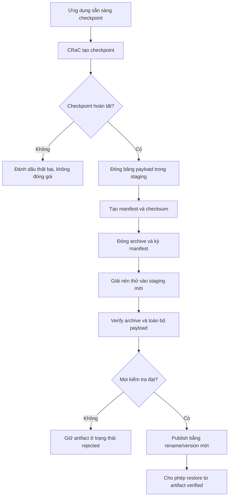

# Kiểm tra checksum và phát hiện ảnh thiếu hoặc hỏng

Checkpoint CRaC là một tập hợp dữ liệu mà JVM và runtime dùng để khôi phục tiến trình. Tùy bản phân phối và phiên bản runtime, thư mục checkpoint có thể chứa nhiều image, metadata và file phụ trợ. Chỉ cần thiếu một file bắt buộc hoặc một phần dữ liệu bị thay đổi trong quá trình sao chép, đóng gói hay lưu trữ, restore có thể thất bại hoặc không thể khôi phục đúng trạng thái.

Vì vậy, trước khi chuyển checkpoint sang máy khác, đưa vào artifact store hoặc dùng để restore, cần kiểm tra tính toàn vẹn của toàn bộ gói. Cách phổ biến là tạo manifest liệt kê từng file, kích thước và checksum SHA-256; sau đó xác minh manifest với thư mục đã đóng gói. Phép kiểm tra phải phát hiện ít nhất bốn trường hợp: file bị thiếu, file thừa ngoài danh sách, kích thước sai và nội dung không khớp checksum.

Checksum giúp phát hiện hỏng dữ liệu ngoài ý muốn. Nó không chứng minh checkpoint tương thích với JDK, hệ điều hành hoặc kiến trúc đích, cũng không chứng minh manifest đến từ nguồn đáng tin cậy. Để bảo vệ gói khỏi bị thay thế có chủ đích, cần ký manifest hoặc dùng cơ chế lưu trữ có xác thực.

## 1. Checkpoint là một gói gồm nhiều file

Không nên coi checkpoint là một file duy nhất. Runtime CRaC thường lưu trạng thái tiến trình dưới dạng một cấu trúc thư mục với nhiều thành phần. Tên file, cấu trúc thư mục và các metadata nội bộ có thể thay đổi theo runtime, phiên bản CRaC, hệ điều hành và cách checkpoint được tạo.

Một gói checkpoint có thể được tổ chức ở lớp đóng gói bên ngoài như sau:

```text
checkpoint-bundle/
├── checkpoint/                 # Nội dung do CRaC runtime tạo
│   ├── ...                     # Image và metadata phụ thuộc runtime
│   └── ...
├── checkpoint-manifest.json   # Danh sách file, size và SHA-256
├── checkpoint-manifest.sig    # Chữ ký detached của manifest (nếu dùng)
└── bundle-info.txt             # Thông tin đóng gói tùy chọn
```

Thư mục `checkpoint/` trong ví dụ chỉ là thư mục chứa checkpoint do runtime tạo. Không giả định các tên file bên trong là cố định, không tự đổi tên, xóa hoặc chỉnh sửa các image nội bộ để làm cho gói nhỏ hơn. Hãy coi cấu trúc đó là artifact do runtime sở hữu.

Manifest được đặt bên ngoài thư mục checkpoint để có thể liệt kê và kiểm tra toàn bộ file payload mà không phải tự loại trừ chính manifest khỏi danh sách checksum. Chữ ký cũng nên là file detached bên ngoài payload để quy trình xác minh rõ ràng.

## 2. Checksum là gì và phát hiện được điều gì?

Checksum là giá trị được tính từ nội dung file bằng một thuật toán băm. Với SHA-256, cùng một chuỗi byte đầu vào sẽ tạo ra cùng một digest 256 bit. Khi một bit trong file thay đổi, digest tính lại gần như chắc chắn sẽ khác.

Ví dụ một entry trong manifest:

```json
{
  "path": "image-a.img",
  "size": 1048576,
  "sha256": "9f86d081884c7d659a2feaa0c55ad015a3bf4f1b2b0b822cd15d6c15b0f00a08"
}
```

Giá trị hash ở đây chỉ minh họa định dạng; không phải checksum của một checkpoint thực tế.

Khi verify, công cụ đọc file, tính lại SHA-256 rồi so sánh với giá trị trong manifest. Kết hợp với danh sách file và kích thước, quy trình có thể phát hiện:

| Tình huống | Dấu hiệu phát hiện |
|---|---|
| File bắt buộc bị thiếu | Đường dẫn có trong manifest nhưng không tồn tại trong payload |
| File bị cắt ngắn hoặc thay đổi kích thước | Kích thước thực tế khác `size` trong manifest |
| Nội dung file bị sửa hoặc hỏng | SHA-256 thực tế khác `sha256` trong manifest |
| File lạ được thêm vào gói | Payload có file không xuất hiện trong manifest |
| Manifest bị lỗi định dạng hoặc thiếu trường | Không parse được hoặc không vượt qua kiểm tra schema |
| Đường dẫn manifest không an toàn | Đường dẫn tuyệt đối, chứa `..` hoặc thoát khỏi thư mục payload |
| Không đọc được file | Lỗi I/O hoặc lỗi quyền truy cập khi verify |

Kích thước và checksum bổ trợ cho nhau. Kích thước sai giúp phát hiện nhanh file bị cắt hoặc thay thế bằng file có độ dài khác; checksum phát hiện cả thay đổi nội dung mà kích thước không đổi.

## 3. Vì sao nên dùng SHA-256?

SHA-256 thuộc họ SHA-2 và được cung cấp trong Java qua `MessageDigest`. Đây là lựa chọn phù hợp để phát hiện lỗi truyền tải, lỗi lưu trữ và thay đổi nội dung trong gói checkpoint.

Không nên dùng MD5 hoặc SHA-1 cho thiết kế mới cần khả năng chống va chạm. CRC32 có ích để phát hiện một số lỗi truyền tải đơn giản nhưng không phải hàm băm mật mã và không phù hợp để xác thực tính toàn vẹn trước hành vi cố ý thay thế dữ liệu.

Một điểm quan trọng: checksum không phải chữ ký số. Nếu người nhận tải được cả payload và manifest từ cùng một nguồn không đáng tin cậy, kẻ tấn công có thể thay đổi file rồi tạo lại manifest với checksum mới. SHA-256 khi đó vẫn khớp. Để xác minh nguồn gốc, hãy ký manifest bằng private key được bảo vệ và kiểm tra chữ ký bằng public key tin cậy, hoặc dùng HMAC với secret được chia sẻ an toàn.

## 4. Tạo manifest sau khi checkpoint hoàn tất

Chỉ tạo manifest sau khi runtime báo checkpoint thành công và không còn tiến trình nào ghi vào thư mục checkpoint. Nếu tính hash trong khi file còn đang được tạo hoặc sao chép, manifest có thể mô tả một trạng thái dở dang.

Một manifest nên chứa:

| Trường | Ý nghĩa |
|---|---|
| `formatVersion` | Phiên bản schema manifest để công cụ verify biết cách đọc |
| `checkpointId` | Định danh duy nhất của checkpoint |
| `createdAt` | Thời điểm tạo checkpoint hoặc thời điểm hoàn tất đóng gói |
| `runtime` | Vendor, phiên bản JDK/CRaC, OS và kiến trúc nếu có |
| `files` | Danh sách file payload với đường dẫn tương đối, kích thước và SHA-256 |

Ví dụ manifest rút gọn:

```json
{
  "formatVersion": 1,
  "checkpointId": "orders-api-2026-11-13T064500Z",
  "createdAt": "2026-11-13T06:45:00Z",
  "runtime": {
    "jdk": "vendor-and-version-recorded-at-build-time",
    "crac": "runtime-version",
    "os": "linux",
    "architecture": "x86_64"
  },
  "files": [
    {
      "path": "metadata/file-a",
      "size": 4096,
      "sha256": "..."
    },
    {
      "path": "images/file-b",
      "size": 1048576,
      "sha256": "..."
    }
  ]
}
```

Các tên `metadata/file-a` và `images/file-b` chỉ là ví dụ về đường dẫn tương đối tính từ thư mục payload `checkpoint/`, không bao gồm tên thư mục gốc đó. Hãy ghi lại đúng mọi file thực tế do runtime tạo, không tự đặt tên hoặc đoán cấu trúc nội bộ.

Manifest cần được tạo từ payload cuối cùng sẽ được phân phối. Nếu sau khi tạo manifest có thao tác nén, mã hóa, chuyển đổi định dạng hoặc thay đổi file, cần xác minh lại payload sau giải nén hoặc tạo manifest mới cho payload cuối cùng.

## 5. Tính SHA-256 trong Java theo kiểu streaming

Không nên đọc toàn bộ image vào RAM chỉ để tính hash. Checkpoint có thể lớn hơn nhiều so với bộ nhớ dành cho công cụ đóng gói. Hãy đọc từng block bằng `InputStream` và cập nhật `MessageDigest`.

```java
import java.io.IOException;
import java.io.InputStream;
import java.nio.file.Files;
import java.nio.file.Path;
import java.security.MessageDigest;
import java.security.NoSuchAlgorithmException;
import java.util.HexFormat;

public final class CheckpointHashes {
    private CheckpointHashes() {
    }

    public static String sha256(Path file)
            throws IOException, NoSuchAlgorithmException {
        MessageDigest digest = MessageDigest.getInstance("SHA-256");
        byte[] buffer = new byte[1024 * 1024];

        try (InputStream input = Files.newInputStream(file)) {
            int read;
            while ((read = input.read(buffer)) != -1) {
                digest.update(buffer, 0, read);
            }
        }

        return HexFormat.of().formatHex(digest.digest());
    }
}
```

Buffer 1 MiB chỉ là lựa chọn minh họa. Có thể điều chỉnh theo kích thước file, tốc độ storage và bộ nhớ. Dùng `try-with-resources` để đóng stream kể cả khi quá trình đọc gặp lỗi.

`MessageDigest.getInstance("SHA-256")` có thể ném `NoSuchAlgorithmException` nếu provider JVM không cung cấp thuật toán. SHA-256 là thuật toán tiêu chuẩn của các JDK thông dụng, nhưng công cụ đóng gói vẫn nên xử lý lỗi thay vì giả định mọi thao tác đều thành công.

## 6. Tạo danh sách file trong manifest

Một bước tạo inventory cần duyệt toàn bộ cây thư mục, chỉ chấp nhận loại file được hỗ trợ và tính hash từng file. Ví dụ dưới đây dùng record để biểu diễn một entry:

```java
import java.io.IOException;
import java.nio.file.Files;
import java.nio.file.LinkOption;
import java.nio.file.Path;
import java.util.ArrayList;
import java.util.Comparator;
import java.util.List;
import java.util.stream.Stream;

public record CheckpointFile(
        String path,
        long size,
        String sha256) {
}

public final class CheckpointInventory {
    private CheckpointInventory() {
    }

    public static List<CheckpointFile> create(Path checkpointRoot)
            throws Exception {
        Path root = checkpointRoot.toRealPath();
        List<CheckpointFile> files = new ArrayList<>();

        try (Stream<Path> paths = Files.walk(root)) {
            for (Path path : paths
                    .filter(p -> !p.equals(root))
                    .sorted(Comparator.comparing(Path::toString))
                    .toList()) {

                if (Files.isSymbolicLink(path)) {
                    throw new IOException("Symlink is not allowed: " + path);
                }

                if (Files.isDirectory(path, LinkOption.NOFOLLOW_LINKS)) {
                    continue;
                }

                if (!Files.isRegularFile(path, LinkOption.NOFOLLOW_LINKS)) {
                    throw new IOException("Unsupported filesystem entry: " + path);
                }

                String relative = root.relativize(path).toString()
                        .replace(path.getFileSystem().getSeparator(), "/");

                files.add(new CheckpointFile(
                        relative,
                        Files.size(path),
                        CheckpointHashes.sha256(path)));
            }
        }

        return List.copyOf(files);
    }
}
```

Ví dụ yêu cầu Java 17 trở lên vì sử dụng record và `Stream.toList()`. Nếu dự án dùng Java thấp hơn, có thể thay record bằng class thông thường và thu thập kết quả bằng `Collectors.toList()`.

Đoạn code chọn chính sách nghiêm ngặt: từ chối symbolic link và filesystem entry không phải file thường hoặc thư mục. Đây là lựa chọn an toàn cho gói checkpoint có cấu trúc file thông thường. Nếu định dạng artifact của runtime có yêu cầu đặc biệt với symbolic link, cần biểu diễn và xác minh link target theo một schema riêng, không theo link để hash file bên ngoài cây payload.

## 7. Xác minh manifest và phát hiện file thiếu, thừa hoặc hỏng

Khi nhận một gói checkpoint, không nên chỉ kiểm tra một vài file mẫu. Cần so sánh toàn bộ inventory thực tế với manifest:

1. Parse manifest và xác nhận `formatVersion` được hỗ trợ.
2. Kiểm tra đường dẫn từng entry là đường dẫn tương đối hợp lệ.
3. Từ chối entry trùng đường dẫn.
4. Xác nhận từng file tồn tại và là regular file.
5. So sánh kích thước thực tế với kích thước khai báo.
6. Tính lại SHA-256 và so sánh digest.
7. Duyệt payload lần nữa để phát hiện file không có trong manifest.
8. Chỉ chấp nhận gói nếu tất cả kiểm tra đều thành công.

Manifest JSON có thể được đọc bằng Jackson. Ví dụ schema Java:

```java
import java.util.List;

public record RuntimeMetadata(
        String jdk,
        String crac,
        String os,
        String architecture) {
}

public record CheckpointManifest(
        int formatVersion,
        String checkpointId,
        String createdAt,
        RuntimeMetadata runtime,
        List<CheckpointFile> files) {
}
```

Verifier dưới đây minh họa các kiểm tra chính. Nó giả định `checkpoint-manifest.json` nằm cạnh thư mục payload và được đọc từ một vị trí tin cậy:

```java
import com.fasterxml.jackson.databind.ObjectMapper;

import java.io.IOException;
import java.nio.file.Files;
import java.nio.file.LinkOption;
import java.nio.file.Path;
import java.security.MessageDigest;
import java.util.HashMap;
import java.util.HashSet;
import java.util.Map;
import java.util.Set;
import java.util.stream.Stream;

public final class CheckpointVerifier {
    private static final int SUPPORTED_FORMAT = 1;

    private CheckpointVerifier() {
    }

    public static void verify(
            Path checkpointRoot,
            Path manifestPath) throws Exception {

        Path root = checkpointRoot.toRealPath();
        CheckpointManifest manifest = new ObjectMapper().readValue(
                manifestPath.toFile(), CheckpointManifest.class);

        if (manifest.formatVersion() != SUPPORTED_FORMAT) {
            throw new IOException("Unsupported manifest format: "
                    + manifest.formatVersion());
        }

        Map<String, CheckpointFile> expected = new HashMap<>();
        for (CheckpointFile entry : manifest.files()) {
            validateRelativePath(entry.path());
            if (entry.size() < 0 || entry.sha256() == null
                    || !entry.sha256().matches("[0-9a-fA-F]{64}")) {
                throw new IOException("Invalid manifest entry: " + entry.path());
            }
            if (expected.putIfAbsent(entry.path(), entry) != null) {
                throw new IOException("Duplicate manifest path: " + entry.path());
            }
        }

        // Kiểm kê và từ chối symlink trước khi mở bất kỳ file nào trong manifest.
        Set<String> actual = new HashSet<>();
        try (Stream<Path> paths = Files.walk(root)) {
            for (Path path : paths.filter(p -> !p.equals(root)).toList()) {
                if (Files.isSymbolicLink(path)) {
                    throw new IOException("Unexpected symbolic link: " + path);
                }
                if (Files.isDirectory(path, LinkOption.NOFOLLOW_LINKS)) {
                    continue;
                }
                if (!Files.isRegularFile(path, LinkOption.NOFOLLOW_LINKS)) {
                    throw new IOException("Unsupported filesystem entry: " + path);
                }

                String relative = root.relativize(path).toString()
                        .replace(path.getFileSystem().getSeparator(), "/");
                actual.add(relative);
            }
        }

        for (String expectedPath : expected.keySet()) {
            if (!actual.contains(expectedPath)) {
                throw new IOException("Missing file: " + expectedPath);
            }
        }
        for (String actualPath : actual) {
            if (!expected.containsKey(actualPath)) {
                throw new IOException("Unexpected file not in manifest: "
                        + actualPath);
            }
        }

        for (Map.Entry<String, CheckpointFile> item : expected.entrySet()) {
            Path file = root.resolve(item.getKey()).normalize();
            if (!file.startsWith(root)
                    || !Files.isRegularFile(file, LinkOption.NOFOLLOW_LINKS)) {
                throw new IOException("Missing or non-regular file: "
                        + item.getKey());
            }

            CheckpointFile entry = item.getValue();
            long actualSize = Files.size(file);
            if (actualSize != entry.size()) {
                throw new IOException("Size mismatch for " + entry.path()
                        + ": expected " + entry.size()
                        + ", got " + actualSize);
            }

            String actualHash = CheckpointHashes.sha256(file);
            if (!MessageDigest.isEqual(
                    actualHash.toLowerCase().getBytes(java.nio.charset.StandardCharsets.US_ASCII),
                    entry.sha256().toLowerCase().getBytes(java.nio.charset.StandardCharsets.US_ASCII))) {
                throw new IOException("SHA-256 mismatch for " + entry.path());
            }
        }
    }

    private static void validateRelativePath(String value)
            throws IOException {
        if (value == null || value.isBlank()
                || value.startsWith("/")
                || value.contains("\\")
                || value.contains(":")) {
            throw new IOException("Unsafe manifest path: " + value);
        }
        for (String segment : value.split("/", -1)) {
            if (segment.isBlank() || segment.equals(".")
                    || segment.equals("..")) {
                throw new IOException("Unsafe manifest path: " + value);
            }
        }
    }
}
```

Verifier trên ném exception ở lỗi đầu tiên để ngăn việc sử dụng gói chưa được xác minh. Công cụ đóng gói hoàn chỉnh có thể thay bằng một `VerificationReport` thu thập mọi lỗi để người vận hành thấy tất cả file thiếu/hỏng trong một lần chạy. Dù chọn cách nào, kết quả tổng thể chỉ được là `VERIFIED` khi mọi entry đều hợp lệ và không có file lạ.

Để dùng `ObjectMapper`, dự án cần Jackson Databind trên classpath; nếu dùng record như ví dụ, hãy dùng phiên bản Jackson hỗ trợ record (2.12 trở lên). `RuntimeMetadata` trong record tương ứng với object `runtime` ở manifest mẫu. Ví dụ này là mã minh họa cấu trúc verifier; hãy bổ sung logging, thông tin checkpoint ID và báo cáo lỗi theo quy ước công cụ của dự án.

## 8. Kiểm tra đường dẫn manifest an toàn

Manifest là dữ liệu đầu vào. Không được tin một đường dẫn chỉ vì nó nằm trong JSON. Nếu manifest chứa `../../some-file`, việc ghép trực tiếp với thư mục checkpoint có thể khiến công cụ đọc file bên ngoài payload. Đây là lỗi path traversal.

Một verifier cần:

- Chỉ chấp nhận đường dẫn tương đối.
- Từ chối `..`, `.`, segment rỗng, đường dẫn tuyệt đối và separator không chuẩn.
- Chuẩn hóa đường dẫn sau khi resolve rồi xác nhận nó vẫn nằm dưới root.
- Không đi theo symbolic link nếu schema không hỗ trợ link một cách tường minh.
- Từ chối entry trùng nhau và loại filesystem không được hỗ trợ.
- Không cho phép manifest quyết định ghi file ra vị trí tùy ý.

Khi chạy trên Windows và Unix-like, nên dùng đường dẫn tương đối chuẩn hóa bằng dấu `/` trong manifest để tránh cách diễn giải khác nhau. Không dùng path tuyệt đối vì vị trí mount của checkpoint thường khác giữa các môi trường.

Ngoài ra, cần bảo đảm payload không bị thay đổi trong lúc verify. Một quy trình an toàn thường giải nén vào thư mục staging riêng, không cho tiến trình khác ghi vào, verify xong mới publish hoặc restore từ chính thư mục đó. Nếu file có thể bị thay thế sau khi hash xong nhưng trước khi restore, kết quả verify không còn bảo đảm cho file được restore. Đây là race condition kiểu time-of-check/time-of-use.

## 9. Kiểm tra nhanh bằng công cụ hệ điều hành

Với gói nhỏ hoặc điều tra sự cố, có thể dùng công cụ checksum có sẵn. Đây là cách kiểm tra thủ công; pipeline tự động vẫn nên so sánh manifest đầy đủ và phát hiện file thừa.

### Linux

Tính checksum cho một file:

```bash
sha256sum checkpoint.tar.zst
```

Tạo danh sách checksum cho payload:

```bash
find checkpoint -type f -print0 \
  | sort -z \
  | xargs -0 sha256sum > checkpoint.SHA256SUMS
```

Xác minh các checksum đã lưu:

```bash
cd package-root
sha256sum -c checkpoint.SHA256SUMS
```

File trong danh sách bị thiếu hoặc nội dung khác sẽ khiến lệnh báo lỗi. Lệnh này không tự phát hiện mọi file thừa không có trong danh sách; cần so sánh inventory riêng nếu muốn xác minh payload chính xác.

### Windows PowerShell

Tính hash của archive:

```powershell
Get-FileHash -LiteralPath '.\checkpoint-bundle.zip' -Algorithm SHA256
```

Tính hash của một file checkpoint:

```powershell
Get-FileHash -LiteralPath '.\checkpoint\some-image-file' -Algorithm SHA256
```

So sánh kết quả `Hash` với giá trị SHA-256 được phân phối qua kênh tin cậy. `Get-FileHash` tính hash cho file được chỉ định; nó không tự đối chiếu danh sách file trong manifest.

## 10. Xác minh archive và payload sau giải nén

Đóng gói checkpoint thành ZIP, TAR hoặc archive khác tạo thêm một lớp có thể hỏng trong quá trình truyền tải. Nên kiểm tra cả archive và nội dung sau giải nén.

Quy trình đề xuất:

1. Tạo checkpoint hoàn tất trong thư mục staging.
2. Tạo manifest cho toàn bộ payload checkpoint.
3. Tạo archive chứa payload và manifest.
4. Tính SHA-256 của chính archive và lưu ở vị trí tin cậy hoặc ký metadata của gói.
5. Truyền archive tới nơi lưu trữ hoặc máy restore.
6. Xác minh checksum archive trước khi giải nén.
7. Giải nén vào thư mục staging mới, không ghi đè checkpoint đang dùng.
8. Xác minh manifest trên cây thư mục sau giải nén.
9. Chỉ publish hoặc restore khi cả hai lớp xác minh thành công.

Checksum archive phát hiện archive bị thay đổi khi truyền tải. Manifest bên trong archive xác minh từng file sau giải nén. Cả hai lớp đều hữu ích: archive có thể đọc được nhưng một file bên trong không đúng với manifest; hoặc payload từng file đúng nhưng archive truyền tới nơi nhận bị cắt hoặc hỏng cấu trúc.

ZIP thường lưu CRC32 cho entry để phát hiện lỗi dữ liệu phổ biến. CRC32 không thay thế SHA-256 khi cần kiểm tra mật mã. TAR bản thân nó không cung cấp checksum mật mã cho toàn bộ payload; hãy dùng manifest hoặc archive format có hỗ trợ integrity phù hợp.

## 11. Phân biệt checksum với chữ ký và tính tương thích

Ba kiểm tra này giải quyết ba câu hỏi khác nhau:

| Kiểm tra | Câu hỏi được trả lời | Ví dụ |
|---|---|---|
| Checksum | Nội dung có giống dữ liệu lúc tạo manifest không? | SHA-256 từng file |
| Chữ ký/xác thực manifest | Manifest có đến từ bên phát hành đáng tin cậy không? | Chữ ký số hoặc HMAC |
| Compatibility check | Runtime đích có thể restore checkpoint này không? | JDK, CRaC runtime, OS, kiến trúc, native libraries và cấu hình |

Một gói có checksum hoàn toàn đúng vẫn có thể không restore được nếu được tạo bởi phiên bản runtime khác hoặc trên môi trường không tương thích. Ngược lại, một checkpoint tương thích về runtime vẫn có thể bị hỏng do file bị thiếu. Vì vậy, verify checksum là điều kiện cần cho đóng gói tin cậy, không phải điều kiện đủ cho restore thành công.

Metadata tương thích nên được lưu trong manifest hoặc bundle metadata: vendor/version JDK, phiên bản CRaC runtime, hệ điều hành, kiến trúc, phiên bản ứng dụng, thư viện native quan trọng và các điều kiện triển khai cần thiết. Những trường này hỗ trợ quyết định có nên thử restore; runtime vẫn là nơi xác nhận cuối cùng.

## 12. Ký manifest để xác minh nguồn gốc

Nếu checkpoint được phân phối qua artifact repository, object storage hoặc pipeline giữa nhiều nhóm, cần bảo đảm manifest không bị thay thế cùng payload. Có thể ký file manifest bằng private key của hệ thống phát hành và xác minh chữ ký bằng public key đã được tin cậy tại nơi restore.

Một luồng xác minh:

1. Nhận `checkpoint-manifest.json` và chữ ký detached.
2. Xác minh chữ ký bằng public key được provision độc lập với gói.
3. Chỉ sau khi chữ ký hợp lệ mới tin các entry trong manifest.
4. Tính lại SHA-256 của từng file và so sánh.
5. Kiểm tra compatibility metadata.
6. Chuyển gói sang trạng thái verified.

Không lưu public key duy nhất bên trong chính archive rồi coi đó là nguồn tin cậy. Kẻ tấn công có thể thay cả public key và chữ ký. Public key hoặc HMAC secret phải được phân phối qua trust store, secret manager, KMS hoặc cơ chế quản trị khóa đáng tin cậy.

Nếu dùng HMAC, mọi bên có quyền xác minh cũng có thể tạo chữ ký hợp lệ vì họ nắm shared secret. Chữ ký số bất đối xứng phù hợp hơn khi bên phát hành cần giữ quyền ký còn nhiều bên chỉ cần quyền xác minh.

## 13. Đóng gói nguyên tử và tránh checkpoint dở dang

Không nên đóng gói thư mục checkpoint trong khi runtime vẫn đang ghi image. Việc copy sớm có thể tạo ra một cây file không nhất quán: manifest có thể thiếu file vừa được tạo, hoặc file được copy chỉ chứa một phần dữ liệu.

Hãy dùng staging và publish nguyên tử:



Một thư mục staging nên nằm trên cùng filesystem với thư mục đích nếu quy trình dựa vào atomic rename. Nếu atomic move không được hỗ trợ, không nên âm thầm coi một thao tác copy từng file là publish nguyên tử; hãy dùng versioned directory và một bước chuyển tham chiếu/metadata cuối cùng sau khi verify.

Không ghi đè checkpoint đã được publish. Tạo một version mới, xác minh xong rồi cập nhật con trỏ release hoặc metadata trỏ tới version mới. Cách này giúp rollback và tránh tiến trình restore đọc một cây file đang bị thay đổi.

## 14. Phân loại lỗi và phản ứng của pipeline

Khi kiểm tra thất bại, nên trả mã lỗi hoặc trạng thái cụ thể để biết cần tạo lại checkpoint, truyền lại archive hay sửa quyền truy cập.

| Trạng thái | Nguyên nhân | Hành động |
|---|---|---|
| `MISSING_FILE` | File trong manifest không tồn tại | Loại gói; tạo lại hoặc truyền lại từ nguồn tin cậy |
| `SIZE_MISMATCH` | Kích thước khác manifest | Kiểm tra copy bị cắt, storage hoặc archive extraction |
| `HASH_MISMATCH` | Nội dung khác SHA-256 | Loại gói; không tự sửa image |
| `UNEXPECTED_FILE` | Có file ngoài inventory | Kiểm tra thao tác đóng gói hoặc payload bị thêm dữ liệu |
| `INVALID_MANIFEST` | JSON/schema/format version không hợp lệ | Dừng verify và kiểm tra phiên bản công cụ |
| `UNSAFE_PATH` | Manifest chứa path traversal hoặc path tuyệt đối | Từ chối gói như dữ liệu không an toàn |
| `SIGNATURE_INVALID` | Chữ ký không hợp lệ hoặc key không tin cậy | Từ chối gói và kiểm tra nguồn phân phối |
| `READ_ERROR` | Không đủ quyền hoặc storage gặp lỗi I/O | Kiểm tra quyền, mount và tình trạng storage |
| `INCOMPATIBLE_RUNTIME` | Metadata không phù hợp runtime đích | Dùng runtime tương thích hoặc tạo checkpoint mới |

Không tự động bỏ qua một file hỏng chỉ vì tên file có vẻ không quan trọng. Nếu runtime tạo file đó trong checkpoint payload, chỉ runtime mới có thể xác định file có bắt buộc hay không. Một verifier tổng quát nên kiểm tra đúng inventory đã được tạo từ checkpoint thành công.

## 15. Quy trình kiểm tra trước khi restore

Trước khi chạy JVM với đường dẫn checkpoint, pipeline nên thực hiện đầy đủ các bước:

1. Xác nhận thao tác checkpoint ban đầu kết thúc thành công.
2. Kiểm tra bundle ID và manifest version.
3. Xác minh chữ ký manifest nếu quy trình có yêu cầu xác thực nguồn gốc.
4. Xác minh checksum archive trước khi giải nén.
5. Giải nén vào một thư mục staging riêng.
6. So sánh toàn bộ danh sách file thực tế với manifest.
7. Xác minh kích thước và SHA-256 của mọi file.
8. Kiểm tra compatibility metadata với runtime và môi trường restore.
9. Đánh dấu artifact là verified và không cho sửa payload sau bước này.
10. Chỉ restore từ đúng thư mục đã verify.

Nếu bất kỳ bước nào thất bại, không chạy restore từ gói đó. Tạo lại checkpoint từ nguồn gốc hoặc truyền lại artifact nguyên vẹn. Không cố khắc phục bằng cách tạo file rỗng, đổi tên image khác hoặc sửa manifest để ép checksum khớp.

## 16. Logging và audit

Mỗi lần tạo hoặc verify gói nên ghi nhận:

- `checkpointId` và phiên bản manifest.
- Thời điểm tạo checkpoint và thời điểm đóng gói hoàn tất.
- Runtime/JDK, CRaC version, OS và architecture.
- Số file và tổng dung lượng payload.
- Thuật toán checksum và kết quả xác minh.
- Hash của archive và định danh chữ ký nếu có.
- Số file thiếu, file thừa, file sai size và file sai hash.
- Công cụ và phiên bản verifier đã chạy.
- Kết quả cuối: verified, rejected hoặc lỗi I/O.

Không ghi nội dung image, token, secret hoặc dữ liệu bộ nhớ ra log. Checkpoint có thể chứa trạng thái ứng dụng nhạy cảm; quyền truy cập tới bundle, manifest và chữ ký cần được kiểm soát như quyền truy cập tới dữ liệu runtime.

## 17. Checklist đóng gói checkpoint

- [ ] Runtime xác nhận checkpoint hoàn tất trước khi bắt đầu đóng gói.
- [ ] Payload được giữ bất biến trong lúc tạo manifest và verify.
- [ ] Manifest liệt kê mọi file checkpoint bằng đường dẫn tương đối.
- [ ] Mỗi entry có kích thước và SHA-256.
- [ ] Verifier phát hiện file thiếu, file thừa, sai kích thước và sai hash.
- [ ] Verifier từ chối path traversal, đường dẫn tuyệt đối và file type không hỗ trợ.
- [ ] Archive được checksum trước khi giải nén.
- [ ] Payload sau giải nén được xác minh lại theo manifest.
- [ ] Manifest được ký hoặc xác thực qua nguồn tin cậy nếu cần chống giả mạo.
- [ ] Metadata runtime được lưu để kiểm tra tương thích.
- [ ] Gói chỉ được publish sau khi verify hoàn tất.
- [ ] Restore chỉ dùng đúng artifact đã verify và không bị sửa sau đó.
- [ ] Artifact lỗi bị loại bỏ hoặc giữ ở trạng thái rejected, không tự sửa image.

## 18. Tài liệu tham khảo

- [Java `MessageDigest`](https://docs.oracle.com/en/java/javase/21/docs/api/java.base/java/security/MessageDigest.html): API tính digest như SHA-256 theo kiểu streaming.
- [Java `Files`](https://docs.oracle.com/en/java/javase/21/docs/api/java.base/java/nio/file/Files.html): duyệt cây thư mục, kiểm tra file, đọc kích thước và xử lý symbolic link.
- [Java `Path`](https://docs.oracle.com/en/java/javase/21/docs/api/java.base/java/nio/file/Path.html): chuẩn hóa và kiểm tra đường dẫn tương đối.
- [CRaC Project](https://crac.org/): thông tin về checkpoint/restore và runtime CRaC.

Checksum và manifest giúp xác minh rằng gói checkpoint được đóng gói đầy đủ và nội dung từng file không thay đổi so với thời điểm tạo inventory. Hãy tạo manifest sau khi checkpoint hoàn tất, kiểm tra toàn bộ file và đường dẫn, xác minh archive trước và sau giải nén, đồng thời ký manifest nếu cần bảo vệ nguồn gốc. Chỉ chuyển checkpoint sang trạng thái có thể restore khi mọi kiểm tra tính toàn vẹn và tương thích đều đạt.
